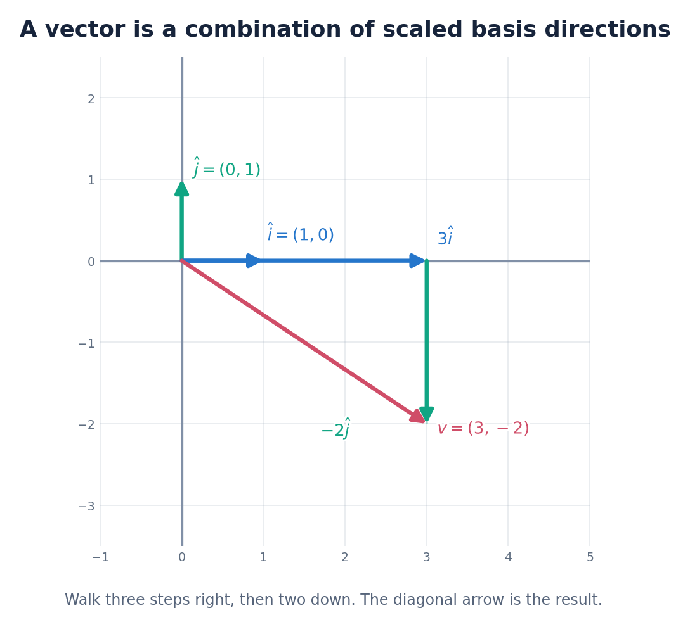
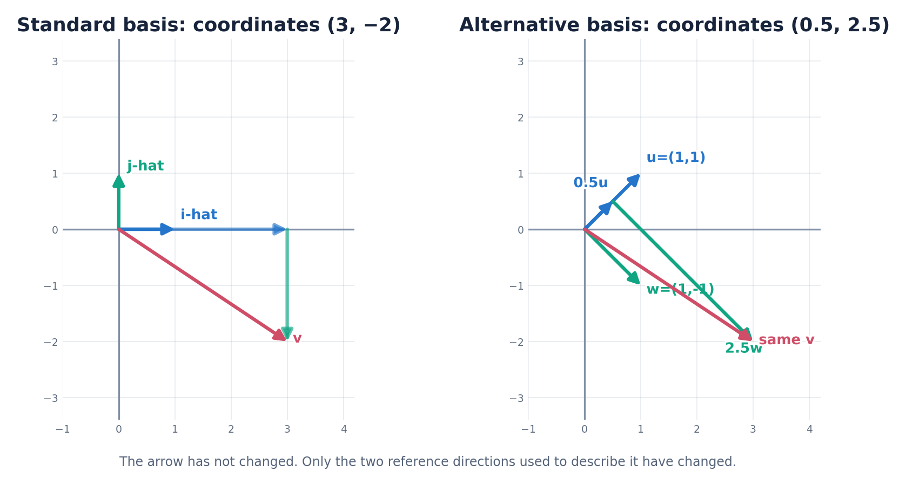
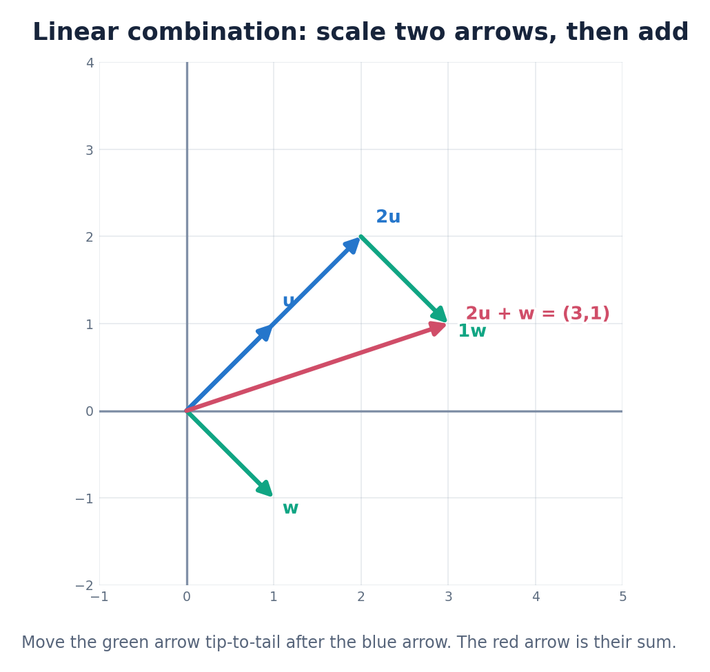
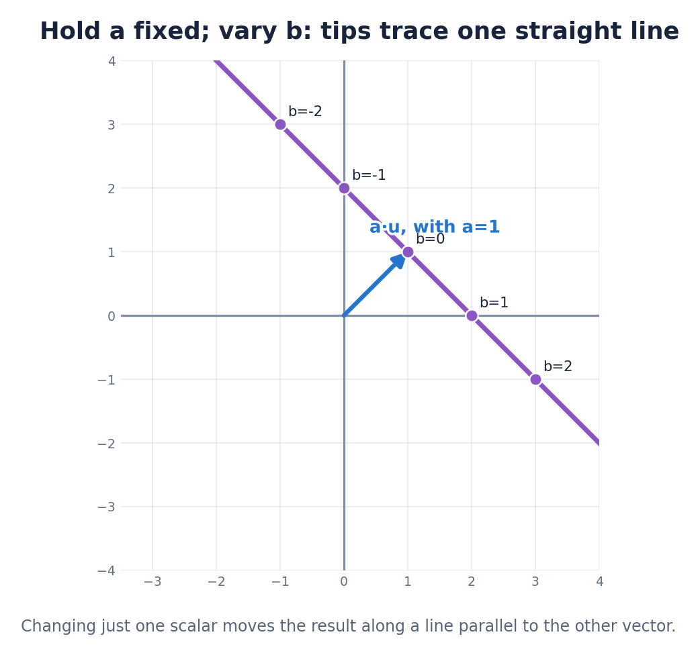
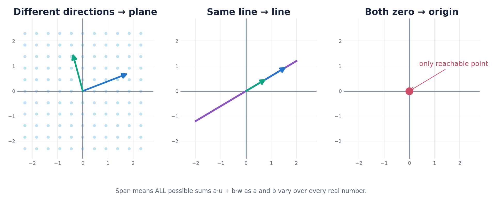
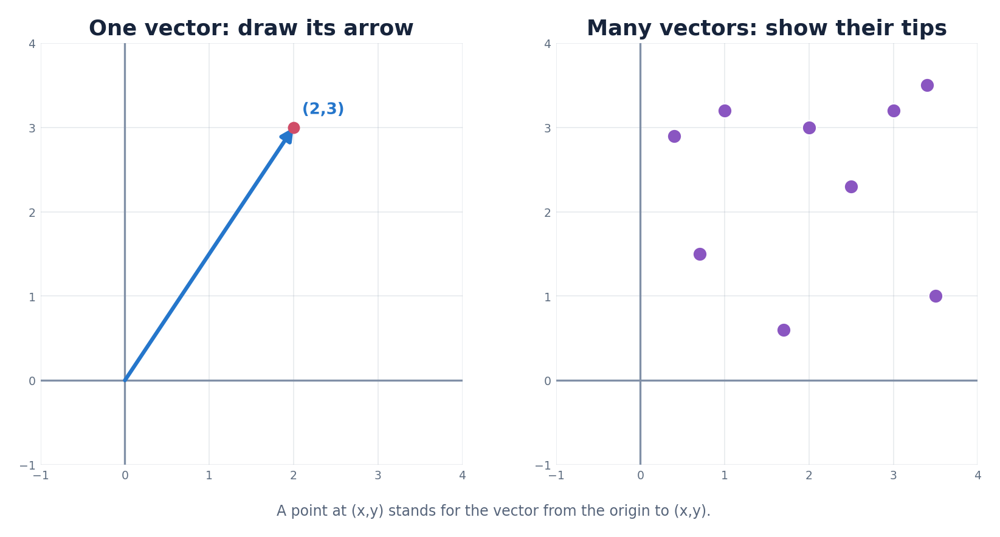
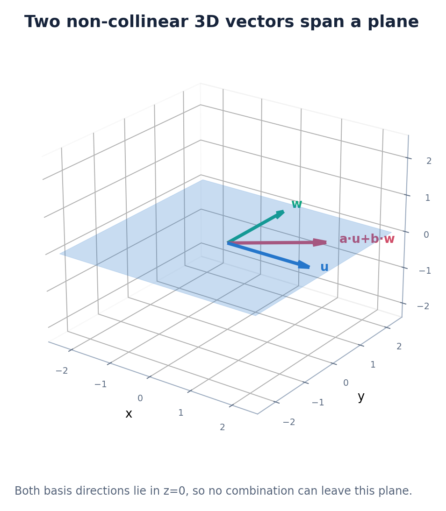
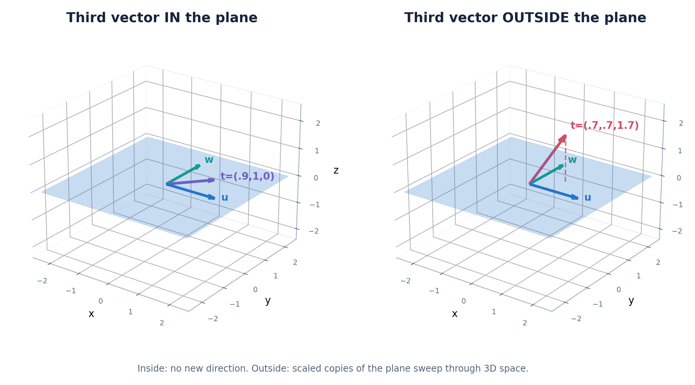
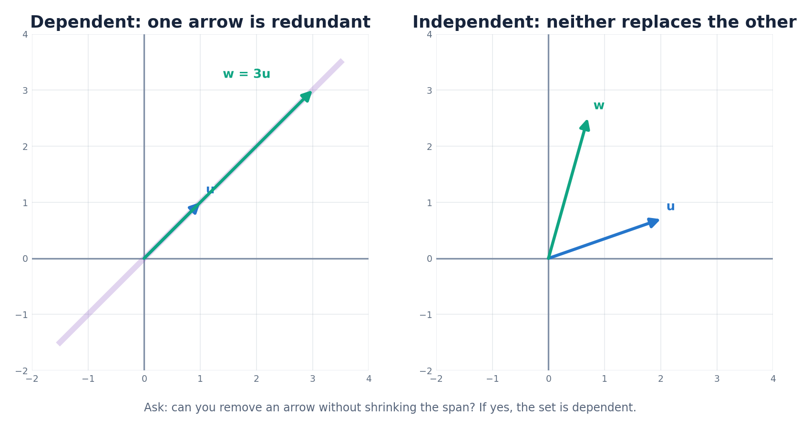
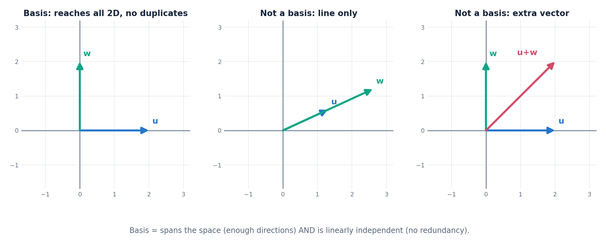

# 02 — Linear Combinations, Span, and Basis Vectors

**Essence of Linear Algebra · Chapter 2 · Detailed beginner-friendly lecture notes**

**Source:** Supplied transcript for *02 — Linear Combinations, Span, and Basis Vectors* (approximately 10 minutes) (approximately 10 minutes). The order of the sections follows the actual teaching progression. The diagrams, extra numerical examples, checks, and HTML demonstrations are original learning aids; they are clearly distinguished from the central examples in the source material.

> **How to learn from these notes:** Start with the story and the pictures. When an equation appears, read the words below it before doing the arithmetic. Then open the linked HTML animation and move the sliders yourself. You do **not** need to know matrices or calculus for this lesson.

---

## 1. Revisiting vector coordinates: a different way of reading numbers

### 1.1 What we already learned in the previous lecture

This section begins by recalling two operations introduced in Chapter 1:

- **Vector addition**: combining two arrows into one resulting movement.
- **Scalar multiplication**: stretching, shrinking, or reversing an arrow by multiplying it by a number.

We also learned how to describe an arrow with coordinates. For example,

$$
\mathbf v=\begin{bmatrix}3\cr -2\end{bmatrix}
$$

means an arrow starting at $(0,0)$ and ending at $(3,-2)$: move **three units right** and **two units down**.

Usually, we interpret the coordinates as travel instructions: “first go right, then go down.” This time the goal is to see something deeper.

### 1.2 Think of each coordinate as a scalar

Instead of treating **3** and **−2** as mere address numbers, imagine that they are **instructions for changing the lengths and directions of two special arrows**.

A **scalar** is simply a number used to multiply a vector. Examples: $3$, $-2$, $0$, and $1/2$.

Recall what scalar multiplication does:

- Multiply an arrow by $3$: make it three times as long, same direction.
- Multiply by $-2$: reverse its direction and make it twice as long.
- Multiply by $0$: turn it into the **zero vector** (an arrow of length zero).

**Why is this a useful interpretation?** Because we can build any ordinary two-dimensional vector by scaling just **two carefully chosen starting arrows** and adding the results.

---

## 2. Two special arrows: $\hat i$ and $\hat j$

The two special vectors in our usual $xy$-coordinate system:

$$
\hat i=\begin{bmatrix}1\cr 0\end{bmatrix},\qquad
\hat j=\begin{bmatrix}0\cr 1\end{bmatrix}.
$$

They are pronounced **“i-hat”** and **“j-hat.”**

- $\hat i$ points **one unit to the right**.
- $\hat j$ points **one unit upward**.

The word **unit** tells us that each arrow is one unit long. Their jobs are different: $\hat i$ supplies the horizontal direction, and $\hat j$ supplies the vertical direction.

### 2.1 Build the example vector $(3,-2)$ using these arrows

We want to construct:

$$
\mathbf v=\begin{bmatrix}3\cr -2\end{bmatrix}.
$$

**Step 1 — Scale $\hat i$ by 3.**

$$
3\hat i=3\begin{bmatrix}1\cr 0\end{bmatrix}
=\begin{bmatrix}3\cr 0\end{bmatrix}.
$$

This arrow points three units right and zero units up.

**Step 2 — Scale $\hat j$ by −2.**

$$
-2\hat j=-2\begin{bmatrix}0\cr 1\end{bmatrix}
=\begin{bmatrix}0\cr -2\end{bmatrix}.
$$

The minus sign reverses the upward arrow, so this new arrow points two units **down**.

**Step 3 — Add the two scaled arrows.**

$$
\begin{aligned}
3\hat i+(-2)\hat j
&=\begin{bmatrix}3\cr 0\end{bmatrix}+\begin{bmatrix}0\cr -2\end{bmatrix}\cr[4pt]
&=\begin{bmatrix}3+0\cr 0+(-2)\end{bmatrix}\cr[4pt]
&=\begin{bmatrix}3\cr -2\end{bmatrix}.
\end{aligned}
$$

So the example vector can be written as:

$$
\boxed{\mathbf v=3\hat i-2\hat j.}
$$

Read that equation in everyday language: **“Take three copies of the rightward unit arrow and add negative two copies of the upward unit arrow.”** The result is the arrow $(3,-2)$.

### 2.2 What we call a *basis*

The two reference arrows $\hat i$ and $\hat j$ are the **basis vectors** for our usual coordinate system. The pair is called the **standard basis** of the two-dimensional plane.

For now, think of a basis as **a set of reference directions that we use to build and describe other vectors**.

Deliberately, postpones the more precise mathematical definition until the end of the chapter. We will do the same.

**Remember this:** The numbers in a vector's coordinates tell us **how much to scale each basis vector**.

For an arbitrary vector $\begin{bmatrix}x\cr y\end{bmatrix}$, using this usual basis:

$$
\boxed{\begin{bmatrix}x\cr y\end{bmatrix}=x\hat i+y\hat j.}
$$

This means the coordinate pair $(x,y)$ is shorthand for “$x$ copies of $\hat i$, plus $y$ copies of $\hat j$.”

**Small check:** If the coordinates are $(0,4)$, what happens? We get $0\hat i+4\hat j$: there is **no horizontal movement**, only four units upward.

<strong>Interactive:</strong> Adjust both coordinates and watch the two scaled vectors form the resulting arrow.

<iframe
 src="../animations/animation-01.html"
 title="Try the interactive basis-and-coordinates animation"
 width="100%"
 height="820"
 style="max-width:980px;border:1px solid #dce4ef;border-radius:12px;background:#f3f6fb;"
 loading="lazy">
</iframe>

<a href="../animations/animation-01.html">Open Try the interactive basis-and-coordinates animation in full tab</a> if the embed does not load.

---

## 3. Could we choose a *different* basis?

Now asks an important question: **Who decided that our two reference arrows must point exactly right and exactly up?**

The answer is: **We made that choice.** It is convenient, but it is not the only possible choice.

### 3.1 Imagine choosing two slanted arrows

Instead of the horizontal arrow $\hat i$ and the vertical arrow $\hat j$, imagine choosing:

- One arrow pointing **up and to the right**.
- Another arrow pointing **down and to the right**.

Try to to imagine scaling each arrow by an arbitrary number and then adding them. Can you reach **every point on the plane**?

For two such arrows pointing in different, nonparallel directions, **yes**. You can make combinations that point left, right, up, down, or diagonally. You can also use negative scalars to reverse either arrow.

### 3.2 Extra beginner example: two diagonal basis vectors

To make the central idea concrete, choose the illustrative arrows

$$
\mathbf u=\begin{bmatrix}1\cr 1\end{bmatrix},\qquad
\mathbf w=\begin{bmatrix}1\cr -1\end{bmatrix}.
$$

These are **additional teaching values**, not numbers quoted in the source for the two slanted arrows.

We still want to describe the **same physical vector** $(3,-2)$. This time write:

$$
\mathbf v=a\mathbf u+b\mathbf w.
$$

The letters $a$ and $b$ are numbers we must find. Substituting the arrow coordinates gives:

$$
\begin{aligned}
\begin{bmatrix}3\cr -2\end{bmatrix}
&=a\begin{bmatrix}1\cr 1\end{bmatrix}+b\begin{bmatrix}1\cr -1\end{bmatrix}\cr
&=\begin{bmatrix}a+b\cr a-b\end{bmatrix}.
\end{aligned}
$$

To make the two vectors equal, their matching coordinates must agree:

$$
a+b=3,\qquad a-b=-2.
$$

Add the equations: $2a=1$, so $a=\tfrac12$. Then $b=3-\tfrac12=\tfrac52$.

Therefore:

$$
\boxed{\mathbf v=\tfrac12\mathbf u+\tfrac52\mathbf w.}
$$

**Verify it yourself:**

$$
\tfrac12\begin{bmatrix}1\cr 1\end{bmatrix}+
\tfrac52\begin{bmatrix}1\cr -1\end{bmatrix}
=\begin{bmatrix}0.5+2.5\cr 0.5-2.5\end{bmatrix}
=\begin{bmatrix}3\cr -2\end{bmatrix}.
$$

### 3.3 The subtle lesson: coordinates depend on the basis

The arrow has **not moved**. It still ends at $(3,-2)$ in the usual picture. What changed is the **reference directions** we used to describe it.

| Question | Standard basis | Illustrative diagonal basis |
|---|---|---|
| First basis arrow | $\hat i=(1,0)$ | $\mathbf u=(1,1)$ |
| Second basis arrow | $\hat j=(0,1)$ | $\mathbf w=(1,-1)$ |
| Coefficients describing the same arrow | $(3,-2)$ | $(0.5,2.5)$ |
| Physical arrow produced | $(3,-2)$ | $(3,-2)$ |

A useful analogy is giving directions using different streets. The destination stays the same, but the instructions change if your chosen roads point in different directions.

**Important distinction:** In a problem, when someone writes just $(3,-2)$, they normally mean the **standard basis** unless they tell you otherwise. But remember that this is an implicit choice, not a law of nature.

**A common misunderstanding:** It is **not** true that any two arrows give a useful 2D coordinate system. If they point along the same line, you cannot reach points off that line. We will discover why in the span section.

---

## 4. The name for “scale, then add”: a linear combination

Only after showing how standard and alternative bases work introduce the main term:

> A **linear combination** is a sum of vectors after each has been multiplied by a scalar.

For two starting vectors $\mathbf u$ and $\mathbf w$, the general expression is:

$$
\boxed{a\mathbf u+b\mathbf w.}
$$

- $\mathbf u,\mathbf w$: the arrows you start with.
- $a,b$: the scalars you choose.
- $a\mathbf u$: the first stretched, shrunk, or reversed arrow.
- $b\mathbf w$: the second stretched, shrunk, or reversed arrow.
- $+$: vector addition, combining the two scaled movements.

It is not a new third operation. A linear combination uses **only the two operations from Chapter 1**: scalar multiplication and vector addition.

### 4.1 Additional worked example

Using the diagonal vectors from Section 3,

$$
\mathbf u=\begin{bmatrix}1\cr 1\end{bmatrix},\quad
\mathbf w=\begin{bmatrix}1\cr -1\end{bmatrix},
$$

choose $a=2$ and $b=1$. Then

$$
\begin{aligned}
2\mathbf u+1\mathbf w
&=2\begin{bmatrix}1\cr 1\end{bmatrix}+\begin{bmatrix}1\cr -1\end{bmatrix}\cr
&=\begin{bmatrix}2\cr 2\end{bmatrix}+\begin{bmatrix}1\cr -1\end{bmatrix}\cr
&=\boxed{\begin{bmatrix}3\cr 1\end{bmatrix}}.
\end{aligned}
$$

**Movement interpretation:** Follow the doubled $\mathbf u$ arrow, then follow the $\mathbf w$ arrow. The single arrow that takes you from the starting point to the final point is the combination.

### 4.2 Why does the word “linear” have anything to do with lines?

Do **not** claim to give the historical origin of the word “linear.” Here is a helpful geometric way to remember the word.

Keep the first scalar $a$ **fixed**, but allow $b$ to change:

$$
\mathbf r= a\mathbf u+b\mathbf w.
$$

If $\mathbf w\ne\mathbf0$, increasing $b$ moves the tip of $\mathbf r$ along a **straight line** parallel to $\mathbf w$. The scalar $a$ decides where that line sits.

**Extra numerical demonstration:** Let $a=1$, $\mathbf u=(1,1)$, and $\mathbf w=(1,-1)$. Then

$$
\mathbf r=\begin{bmatrix}1+b\cr 1-b\end{bmatrix}.
$$

Try these values:

| $b$ | Result $\mathbf r$ | Tip position |
|---:|---|---|
| $-2$ | $(-1,3)$ | Upper left |
| $-1$ | $(0,2)$ | On the positive y-axis |
| $0$ | $(1,1)$ | At the tip of $\mathbf u$ |
| $1$ | $(2,0)$ | On the positive x-axis |
| $2$ | $(3,-1)$ | Lower right |

Those five points all lie on one straight line, because their coordinates satisfy $x+y=2$.

**Remember:** One changing scalar (with a nonzero direction vector) produces a **line**. What happens when **both** scalars can change? That is The next question.

---

## 5. Let both scalars vary: what can two vectors reach?

Take two arrows $\mathbf u$ and $\mathbf w$. Do not restrict $a$ or $b$: they can be **any real numbers**, positive, negative, zero, fractions, or large numbers.

Now think about **every possible** result:

$$
a\mathbf u+b\mathbf w.
$$

Instead of asking “Where will this one sum land?” we are asking “**Which destinations are possible if we are free to use any scalars?**”

### 5.1 Case 1: different directions → the whole 2D plane

For most pairs of 2D arrows, one cannot be made just by stretching, shrinking, or reversing the other. Their directions are not parallel. In that case, **their combinations can reach any point in the plane**.

Example: with $\hat i=(1,0)$ and $\hat j=(0,1)$, a desired point $(x,y)$ can always be made with $x\hat i+y\hat j$. The scalars are exactly the target coordinates.

The same statement holds for our two diagonal arrows $(1,1)$ and $(1,-1)$; the coefficients just look different.

### 5.2 Case 2: both arrows lie along the same line → only that line

Imagine $\mathbf u=(1,1)$ and $\mathbf w=(3,3)$. The second arrow is merely three times the first:

$$
\mathbf w=3\mathbf u.
$$

A general combination becomes

$$
\begin{aligned}
a\mathbf u+b\mathbf w
&=a\mathbf u+b(3\mathbf u)\cr
&=(a+3b)\mathbf u.
\end{aligned}
$$

However you choose $a$ and $b$, this expression is just a **multiple of $\mathbf u$**. You can travel forwards or backwards along the line through $(0,0)$ and $(1,1)$, but you cannot leave it.

For example, you **cannot** reach $(2,0)$ using only these two arrows, because every result has the form $(t,t)$: the two coordinates must be equal.

The line passes through the origin because $a=b=0$ produces the zero vector.

### 5.3 Case 3: both arrows are zero → only the origin

If $\mathbf u=\mathbf0$ and $\mathbf w=\mathbf0$, then

$$
a\mathbf0+b\mathbf0=\mathbf0
$$

no matter what scalars you choose. You cannot even move one tiny step from the origin.

### 5.4 Introducing the term *span*

the name **span** to the entire collection of vectors we can create.

$$
\boxed{\operatorname{span}\{\mathbf u,\mathbf w\}=
\{a\mathbf u+b\mathbf w\mid a,b\in\mathbb R\}.}
$$

This looks complicated, but every part has a simple meaning:

- $\operatorname{span}\{\mathbf u,\mathbf w\}$: the span of these two vectors.
- $\{\cdots\}$: the **collection** (or set) of all results.
- $a\mathbf u+b\mathbf w$: the result of scaling and adding.
- $\mid$: “such that.”
- $a,b\in\mathbb R$: $a$ and $b$ are **any real numbers**. The symbol $\mathbb R$ means all ordinary real-number values, including negative numbers, zero, and fractions.

In ordinary language: **The span of some vectors is every place you can reach by scaling and adding them.**

| Original two vectors | Their span in 2D |
|---|---|
| Point in different, nonparallel directions | All of the plane $\mathbb R^2$ |
| Along the same line, with at least one nonzero | That one line through the origin |
| Both zero | Only the origin $\{\mathbf0\}$ |

**Why is span important?** It tells us whether our chosen starting directions are **sufficient to describe the space**. The word will later appear in the definitions of both linear independence and a basis.

**Small check:** Is $\mathbf0$ in the span of every collection of vectors? **Yes**: choose every scalar to be zero. This observation helps explain why spans are lines or planes **through the origin**, not displaced away from it.

<strong>Interactive:</strong> Select “Different directions,” “Same line,” or “Both zero.” Change $a$ and $b$ and compare where the resulting arrow tip is allowed to go.

<iframe
 src="../animations/animation-02.html"
 title="Explore the three span cases interactively"
 width="100%"
 height="820"
 style="max-width:980px;border:1px solid #dce4ef;border-radius:12px;background:#f3f6fb;"
 loading="lazy">
</iframe>

<a href="../animations/animation-02.html">Open Explore the three span cases interactively in full tab</a> if the embed does not load.

---

## 6. Why mathematicians sometimes draw vectors as *points*

Now pauses the computation to teach a valuable visualization trick.

When studying **one vector**, an arrow is a perfect picture: it shows the direction and amount of movement.

But imagine drawing **a thousand arrows from the origin**—or even an infinite number of arrows. The drawing becomes so crowded that you cannot see the overall pattern.

### 6.1 Replace each arrow with its tip

For a vector $(2,3)$, instead of drawing an arrow from $(0,0)$ to $(2,3)$, simply place a point at $(2,3)$.

The point is a **visual shorthand** for the full arrow. We still mean the vector with its tail at the origin; we just choose not to draw the shaft.

### 6.2 Now the span pictures become much simpler

If the tips of all possible combinations lie on a straight line, **draw the line**.

If the tips can lie anywhere on the plane, **draw the whole plane**.

In each case we are seeing the span, even though the arrows have been omitted.

The guideline is:

> Think of an **individual vector as an arrow**. When thinking about a **collection of vectors**, it is often easier to think of their **tips as points**.

**Common misconception:** A vector is not suddenly changing from a vector into a different mathematical object. We are simply changing how we **draw** the same information.

---

## 7. Span becomes more interesting in three dimensions

So far, the drawings lived on a flat $xy$-plane. Now this lesson imagines ordinary three-dimensional space with **three coordinate directions**:

- $x$: side to side;
- $y$: another direction across the floor;
- $z$: up and down.

A 3D vector has three coordinates, for example $(2,1,3)$.

### 7.1 Choose two vectors in 3D space

Imagine that two arrows $\mathbf u$ and $\mathbf w$ do **not** lie on the same line. We can still form combinations

$$
a\mathbf u+b\mathbf w.
$$

We have **two adjustable numbers**—think of them as **two knobs**. As we turn the knobs, the endpoint of the resulting arrow moves.

What surface will all those possible endpoints trace?

**Answer: a flat plane passing through the origin** (provided the two arrows are not collinear).

### 7.2 Why a plane, rather than the full 3D world?

Think of two directions painted on a flat board. You can travel forwards or backwards along either direction and combine the movements, but there is no instruction to jump **off** the board.

That board is our plane.

**Extra beginner example:** Choose

$$
\mathbf u=\begin{bmatrix}1\cr 0\cr 0\end{bmatrix},\qquad
\mathbf w=\begin{bmatrix}0\cr 1\cr 0\end{bmatrix}.
$$

Then

$$
a\mathbf u+b\mathbf w
=\begin{bmatrix}a\cr 0\cr 0\end{bmatrix}+
 \begin{bmatrix}0\cr b\cr 0\end{bmatrix}
=\begin{bmatrix}a\cr b\cr 0\end{bmatrix}.
$$

See the third coordinate? It is **always zero**. Therefore every result lies in the flat $z=0$ plane. No combination of these two vectors can reach $(0,0,1)$, because that point sits **above the plane**.

Think of the plane as a **flat sheet through the origin**. That is a particularly useful image to remember.

**More precise technical note:** Two non-collinear vectors in 3D span a plane through the origin. If the two 3D vectors happen to lie along the same line, their span is instead a line (or only the origin when both are zero). This is the same special-case idea we saw in 2D.

---

## 8. What if we add a *third* vector in 3D?

We now ask: what happens if we allow one more vector, $\mathbf t$, to join the first two?

A linear combination of **three** vectors means

$$
\boxed{a\mathbf u+b\mathbf w+c\mathbf t.}
$$

There are three scalars, $a$, $b$, and $c$. Each scalar can be chosen freely.

### 8.1 Case A: the third vector lies **inside the existing plane**

Suppose $\mathbf t$ already points to somewhere on the plane generated by $\mathbf u$ and $\mathbf w$. This means we could already make $\mathbf t$ by combining the first two:

$$
\mathbf t=p\mathbf u+q\mathbf w
$$

for some numbers $p$ and $q$.

What happens if we try using all three?

$$
\begin{aligned}
a\mathbf u+b\mathbf w+c\mathbf t
&=a\mathbf u+b\mathbf w+c(p\mathbf u+q\mathbf w)\cr
&=(a+cp)\mathbf u+(b+cq)\mathbf w.
\end{aligned}
$$

Even though we added another adjustable number $c$, the whole expression is **still just a combination of the first two directions**. So it remains in the same plane.

**Everyday analogy:** If you can already move east and north, an additional instruction to move northeast is handy, but it does not let you leave the ground or fly upward. It adds **no new direction beyond those you already had**.

**Additional numerical example:** With $\mathbf u=(1,0,0)$ and $\mathbf w=(0,1,0)$, choose $\mathbf t=(1,1,0)=\mathbf u+\mathbf w$. Every sum $a\mathbf u+b\mathbf w+c\mathbf t$ still has $z=0$.

### 8.2 Case B: the third vector points **outside the existing plane**

Now imagine $\mathbf t$ has some movement **away from the plane**. No amount of combining just $\mathbf u$ and $\mathbf w$ could produce it.

As we adjust the third scalar $c$, the plane of combinations of the first two vectors is shifted in the direction of $\mathbf t$. Different values of $c$ give parallel translated copies of that plane, and together those copies **sweep across all 3D space**.

This is The central 3D mental image: **the third direction unlocks the volume of space**.

### 8.3 Extra numerical demonstration: unlocking the z direction

Keep the original two vectors:

$$
\mathbf u=(1,0,0),\qquad \mathbf w=(0,1,0).
$$

Now let the third be $\mathbf t=(0,0,1)$. Then

$$
a\mathbf u+b\mathbf w+c\mathbf t=(a,b,c).
$$

Given **any** target $(x,y,z)$, simply choose $a=x$, $b=y$, and $c=z$. The target is reached.

For example, to reach $(2,-1,3)$, choose

$$
2\mathbf u-\mathbf w+3\mathbf t
=\boxed{(2,-1,3)}.
$$

This is the difference between:

- Two adjustable directions: **a 2D plane inside 3D space**.
- Three genuinely different directions: **all of 3D space**.

**Careful wording:** Three *numbers* alone are not enough. The third vector must genuinely contribute a direction that cannot already be produced by the first two.

<strong>Interactive:</strong> Switch between a third vector <strong>inside</strong> the plane and one <strong>outside</strong> it, then change the coefficient $c$. Notice that only the outside case permits movement away from the plane.

<iframe
 src="../animations/animation-03.html"
 title="Explore the 3D span animation"
 width="100%"
 height="820"
 style="max-width:980px;border:1px solid #dce4ef;border-radius:12px;background:#f3f6fb;"
 loading="lazy">
</iframe>

<a href="../animations/animation-03.html">Open Explore the 3D span animation in full tab</a> if the embed does not load.

---

## 9. When is one vector unnecessary? Linear dependence

We now introduces a term for a situation we have already seen twice:

1. Two vectors in 2D lie on the same line; one is a scaled copy of the other.
2. A third vector in 3D already lies in the plane generated by the first two.

In either situation, **one of the chosen vectors does not let us reach anything new**.

### 9.1 Linear dependence = there is a redundant vector

A set of vectors is called **linearly dependent** if at least one vector can be expressed as a linear combination of the others.

Put more simply: **you can remove at least one vector without reducing what the whole group can reach**.

Example:

$$
\mathbf u=\begin{bmatrix}1\cr 1\end{bmatrix},\qquad
\mathbf w=\begin{bmatrix}3\cr 3\end{bmatrix}.
$$

Because $\mathbf w=3\mathbf u$, having $\mathbf w$ does not increase the span. The two together still cover only the same line that $\mathbf u$ already covered.

### 9.2 Linear independence = every vector contributes a new direction

A set is **linearly independent** if **none** of its vectors can be produced as a combination of the others.

In 2D, for a pair of nonzero vectors, it means they do not lie on the same line.

Example:

$$
\mathbf u=\begin{bmatrix}1\cr 0\end{bmatrix},\qquad
\mathbf w=\begin{bmatrix}0\cr 1\end{bmatrix}.
$$

- One arrow can move right or left.
- The other can move up or down.
- Neither alone can do what the other does.
- Removing either shrinks the span from a full plane to just a line.

### 9.3 A useful exact test (extra explanation)

For vectors $\mathbf v_1,\ldots,\mathbf v_n$, consider an equation that produces the zero vector:

$$
a_1\mathbf v_1+\cdots+a_n\mathbf v_n=\mathbf0.
$$

A set is **linearly independent** when the only way to make the zero vector is to choose **all scalars equal to zero**.

A set is **linearly dependent** when there is some combination giving zero where **at least one scalar is nonzero**.

Why does this match the “redundant arrow” picture? If, say, $a_1\ne0$, we could rearrange the equation and express $\mathbf v_1$ as a combination of the other vectors:

$$
\mathbf v_1=-\frac{a_2}{a_1}\mathbf v_2-\cdots-\frac{a_n}{a_1}\mathbf v_n.
$$

There is no need to memorize this derivation on your first reading. Its meaning is simply **one arrow can be reconstructed using the others**.

### 9.4 Common misunderstandings

- **Dependent does not mean “the arrows have equal lengths.”** Their lengths can be different; what matters is redundancy of direction.
- **Independent does not mean “the arrows must be perpendicular.”** Slanted arrows can be independent as long as neither is produced by the others.
- **More vectors does not necessarily mean a larger span.** A redundant vector adds nothing new.
- **The zero vector makes any nonempty set containing it dependent.** Its coefficient can be nonzero without changing a sum.

**Key takeaway:** Linear independence answers **“Is each arrow doing a genuinely necessary job?”** Span answers **“Can this group reach the entire space we care about?”**

---

## 10. Putting the two questions together: the technical definition of a basis

Near the end of this lesson, return to the term **basis**, which was introduced earlier using $\hat i$ and $\hat j$.

The formal definition is:

$$
\boxed{\text{A basis of a space is a set of linearly independent vectors that span that space.}}
$$

There are **two separate requirements**:

1. **Spanning:** The vectors must collectively be capable of producing **every vector in the target space**.
2. **Linear independence:** None of the chosen vectors can be reconstructed from the other chosen vectors. No arrow is wasted.

A basis is therefore a set of directions that is **sufficient but not redundant**.

### 10.1 Why $\hat i$ and $\hat j$ form a basis of the 2D plane

**Spanning test:** Can we build any vector $(x,y)$? Yes:

$$
(x,y)=x\hat i+y\hat j.
$$

**Independence test:** Can we produce the rightward unit vector $\hat i$ using only multiples of the upward vector $\hat j$? No. The same is true in reverse.

So both tests pass: $\{\hat i,\hat j\}$ is a basis for $\mathbb R^2$.

### 10.2 Why the alternative diagonal arrows also form a basis

Recall our extra example $\mathbf u=(1,1)$ and $\mathbf w=(1,-1)$.

They are not parallel, so neither one can be formed just by scaling the other. They are **linearly independent**.

They can produce every vector $(x,y)$, because

$$
(x,y)=\frac{x+y}{2}(1,1)+\frac{x-y}{2}(1,-1).
$$

Check each coordinate of the right side:

$$
\frac{x+y}{2}+\frac{x-y}{2}=x,
\qquad
\frac{x+y}{2}-\frac{x-y}{2}=y.
$$

So they also **span the entire plane**. Both requirements pass.

This is why we were able to say earlier that a different choice of basis can give us an equally valid coordinate system.

### 10.3 Why other groups fail to be a 2D basis

- **Two parallel nonzero vectors:** Not a basis of the plane, because they span only a line **and** are dependent.
- **Only one nonzero vector:** Not a basis of the plane, because it cannot reach every 2D direction.
- **Three vectors $\hat i,\hat j,\hat i+\hat j$:** They span the plane, but they are dependent; the third arrow is redundant.
- **Two nonparallel vectors:** A basis of the plane, because they span the whole plane with no redundancy.

A helpful way to remember the formal definition is:

| Question | Mathematical word | If answer is “no” |
|---|---|---|
| **Can we make every vector in the space?** | Spanning | We are missing a direction |
| **Is every chosen vector genuinely needed?** | Linear independence | We included a redundant vector |

### 10.4 Closing puzzle

Close with a thought exercise: **Why does it make sense to define a basis as a linearly independent spanning set?**

By now, we can answer intuitively:

- **Spanning** means the basis provides enough directions to reach everywhere.
- **Independence** means the directions do not duplicate one another.
- Therefore **coordinates are meaningful and nonredundant**: they tell us how much of each necessary basis direction to use.

**Extra insight:** When a set is a basis, every vector in the space has **one unique** way of being written as a linear combination of those basis vectors. Without independence, multiple coefficient choices could represent the same vector. That is why a basis is particularly good for coordinates.

The lecture ends by announcing the next topic: **matrices and transformations of space**.

---

## Review: the ideas in order

| Idea | Very simple meaning | Example |
|---|---|---|
| Coordinates as scalars | Numbers say how much to scale reference arrows | $(3,-2)=3\hat i-2\hat j$ |
| Basis vectors | Chosen reference directions | $\hat i,\hat j$ |
| Different basis | Same arrow can need different coefficients | $(3,-2)=0.5(1,1)+2.5(1,-1)$ |
| Linear combination | Scale starting vectors, then add | $a\mathbf u+b\mathbf w$ |
| One varying scalar | The arrow tip traces a line | $\mathbf u+b\mathbf w$ |
| Span | Every arrow the combinations can produce | Plane, line, or origin in 2D |
| Vectors as points | Represent arrows by their endpoints | Draw a line instead of infinitely many arrows |
| Two directions in 3D | Usually span a plane | $(a,b,0)$ |
| A new third direction | Can unlock all of 3D | $(a,b,c)$ |
| Linear dependence | Some starting vector is redundant | $(3,3)=3(1,1)$ |
| Linear independence | No starting vector is redundant | $(1,0),(0,1)$ |
| Basis | Spans the space **and** is independent | Standard basis of $\mathbb R^2$ |

## Check your understanding

Try answering these **without looking at the solutions below**.

1. In the standard basis, express $(4,-3)$ using $\hat i$ and $\hat j$.
2. What does a negative scalar do to a nonzero vector?
3. Why can the same arrow have different coordinate numbers in different bases?
4. Evaluate $2(1,1)+3(1,-1)$.
5. If one scalar in $a\mathbf u+b\mathbf w$ is fixed and the other varies, what geometric shape does the tip trace, assuming its direction vector is nonzero?
6. What is the span of $(1,2)$ and $(2,4)$ in 2D?
7. What is the span of $(0,0)$ and $(0,0)$?
8. Why do we use points instead of arrows when visualizing a whole span?
9. In 3D, what does $(1,0,0)$ together with $(0,1,0)$ span?
10. If you add $(1,1,0)$ to those two 3D vectors, does the span get larger? Why?
11. What happens if you add $(0,0,1)$ instead?
12. Can the three 2D vectors $(1,0),(0,1),(1,1)$ be a basis of the plane? Explain both conditions.

<strong>Answers — open after trying</strong>

1. $4\hat i-3\hat j$. The first term moves four units right, the second three units down.
2. It reverses the direction; the absolute value of the scalar controls the new length.
3. Coordinates tell us the coefficients of *chosen* basis directions; different directions require different coefficients.
4. $(2,2)+(3,-3)=(5,-1)$.
5. A straight line, parallel to the vector whose coefficient varies.
6. The line $y=2x$, because the second vector is twice the first.
7. Only the origin, $\{(0,0)\}$.
8. Many arrows overlap; plotting only tips reveals the shape of the whole collection.
9. The $xy$-plane, i.e. all $(a,b,0)$.
10. No. $(1,1,0)=(1,0,0)+(0,1,0)$ is already inside the plane.
11. The span becomes all of $\mathbb R^3$, because the third vector supplies a new perpendicular direction.
12. No. The three vectors **do span** the plane, but they are **dependent** because $(1,1)=(1,0)+(0,1)$. A basis must pass both tests.

## Tiny glossary

| Term | Beginner-friendly meaning |
|---|---|
| Vector | An arrow representing a direction and size; numerically, coordinates |
| Scalar | A number that stretches, shrinks, or reverses a vector |
| Coordinate | How much of each selected basis direction is used |
| Unit vector | An arrow one unit long |
| Basis | A nonredundant collection of vectors that can produce the whole space |
| Linear combination | Sum of scaled vectors |
| Span | All vectors that can be produced by those linear combinations |
| Zero vector | A vector with every coordinate zero |
| Collinear vectors | Vectors lying along the same line through the origin |
| Linearly dependent | At least one vector is obtainable from the others |
| Linearly independent | No vector is obtainable from the others |
| $\mathbb R^2$ | The collection of all real-number pairs; ordinary 2D coordinate space |
| $\mathbb R^3$ | The collection of all real-number triples; ordinary 3D coordinate space |

---

**Next lecture:** Matrices and transformations of space. You are now ready to see why changing the basis vectors can describe a transformation of the whole grid.
