# Chapter 03 — Linear Transformations and Matrices

**Series:** Essence of Linear Algebra · **Chapter:** 03 — Linear Transformations and Matrices (transcript, ~11 minutes) 
**Level:** First-time learner · **Approach:** follow this lesson order, with clearly marked beginner explanations.

> **The central idea of this lecture:** A matrix is not merely a rectangular arrangement of numbers. It is a compact description of **how a linear transformation moves space**. Each column tells us where one standard basis vector ends up.

**How to use these notes:** Read in order. When you see an animation link, open it in a browser and use **Step**, **Play**, **Pause**, and **Reset**. The PNG diagrams make sense even when you are offline and not running animations. Extra examples are labeled **Beginner extension** so you can distinguish them from the lecture.

---

## 1. Why this particular topic matters

This section starts by making a strong claim: understanding **linear transformations and their relationship to matrices** can make many other linear algebra topics suddenly seem much more natural.

If you learned matrices before, you might remember a rule like “multiply a row by a column, then add.” That rule is useful, but by itself it can feel like a trick that somebody invented for no obvious reason. This lecture asks a different question:

**Can we understand what matrix–vector multiplication *does* geometrically, before memorizing how to calculate it?**

The lecture focuses on **two-dimensional space**. That means vectors have two coordinates, such as

$$
\mathbf v=\begin{bmatrix}2\\3\end{bmatrix}.
$$

The first number measures horizontal movement; the second measures vertical movement. As we learned in Chapters 01–02, we can also write the same vector as a combination of the two standard basis vectors:

$$
\hat{\mathbf i}=\begin{bmatrix}1\\0\end{bmatrix},\quad
\hat{\mathbf j}=\begin{bmatrix}0\\1\end{bmatrix},\quad
\mathbf v=2\hat{\mathbf i}+3\hat{\mathbf j}.
$$

We will see why knowing where **only these two basis vectors** move tells us where **every** vector moves under a linear transformation.

**Remember this:** Instead of reading a matrix as a collection of unrelated numbers, think of it as instructions for moving the coordinate grid.

---

## 2. What is a transformation? Start with a function

Explain the first part of the term **linear transformation** by using a familiar idea: a **function**. A function takes an input and produces an output according to some rule.

For example, the ordinary function $f(x)=2x$ sends an input number $3$ to the output number $6$. A transformation in this course instead takes a **vector** as input and returns a **vector** as output:

$$
T:\text{input vector}\longrightarrow\text{output vector}.
$$

The letter $T$ stands for “transformation.” For example, imagine a rule that keeps a vector's vertical coordinate unchanged but adds that coordinate to its horizontal coordinate:

$$
T\!\left(\begin{bmatrix}x\\y\end{bmatrix}\right)
=\begin{bmatrix}x+y\\y\end{bmatrix}.
$$

Put $x=1$ and $y=2$:

$$
T\!\left(\begin{bmatrix}1\\2\end{bmatrix}\right)
=\begin{bmatrix}1+2\\2\end{bmatrix}
=\begin{bmatrix}3\\2\end{bmatrix}.
$$

This particular numerical rule is a **beginner extension**; it is a preview of the lecture's later shear example.

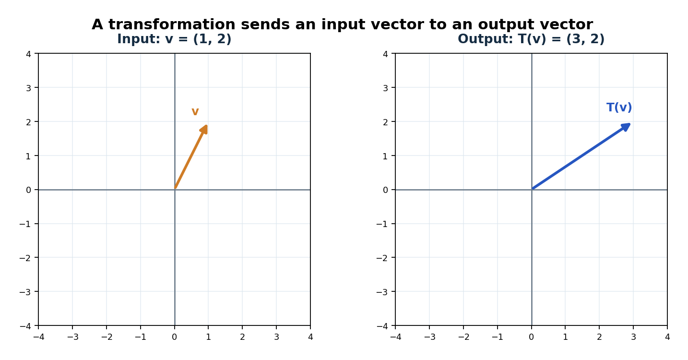

Why use the word **transformation**, then, instead of simply saying **function**? Because “transformation” encourages us to **picture movement**: the arrow starting at $(1,2)$ moves so its tip ends at $(3,2)$.

**Common misconception:** A transformation does not mean that a vector has physically traveled through a room. Moving the arrow is a visualization of the input–output relationship.

---

## 3. Instead of following one arrow, imagine moving every point in space

One vector is easy to draw. What if we wanted to see what $T$ does to **all possible vectors** at once? Drawing infinitely many arrows would make a hopelessly cluttered picture.

Reuses a trick from the previous lesson: whenever we want to think about many vectors together, replace each arrow by **a point at its tip**. This is valid because we are drawing all vectors with their tails at the origin $(0,0)$: the tip uniquely identifies the vector.

Now imagine **every point** moving to the output assigned by $T$. Rather than sketching random individual points, this lesson draws an entire **square grid** and watches it deform.

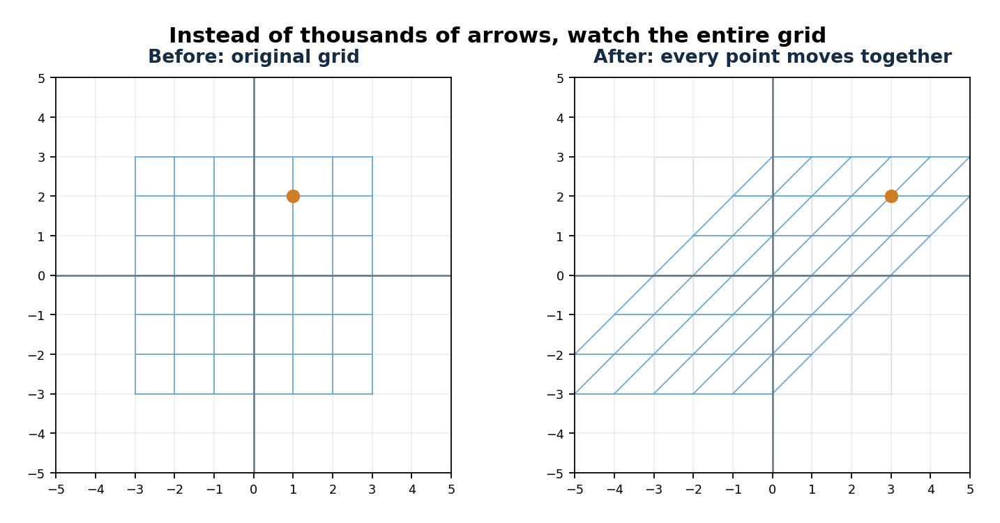

A grid makes the effect easy to see:

1. A point begins somewhere on the original grid.
2. We apply the same transformation rule to that point.
3. Every other point receives the same treatment.
4. The grid changes shape, as though we were stretching or shearing a flexible sheet.

Keeping a faint copy of the **original grid** behind the new grid makes it easier to compare the before-and-after positions.

<strong>Interactive:</strong> Start with the **Shear** option and watch the grid move; then compare with the non-linear examples later in this lesson.

<iframe
 src="../animations/animation-01.html"
 title="Animation 01 — What makes a transformation linear?"
 width="100%"
 height="820"
 style="max-width:980px;border:1px solid #dce4ef;border-radius:12px;background:#f3f6fb;"
 loading="lazy">
</iframe>

<a href="../animations/animation-01.html">Open Animation 01 — What makes a transformation linear? in full tab</a> if the embed does not load.

Why is this visualization useful? You can immediately notice whether straight lines have bent, whether the origin moved, and which directions became stretched or compressed—without calculating dozens of separate vectors.

---

## 4. What makes a transformation *linear*?

We now restricts attention to a particularly well-behaved kind of transformation. In the visual description for this chapter, a **linear transformation** has two crucial properties:

1. **Straight lines remain straight** (or, in a degenerate case, may be compressed to single points).
2. **The origin stays fixed**: the zero vector is sent to the zero vector.

For the non-collapsing examples in the lecture, the grid stays made of **parallel, evenly spaced straight lines**. The sheet may rotate, stretch, squash, flip, or shear, but its structure is preserved in a predictable way.

### 4.1 Non-linear example 1 — A straight line becomes curved

Imagine bending a rubber grid so that some straight lines become curves. No matter how attractive that deformation looks, it is **not** linear.

### 4.2 Non-linear example 2 — Translating (shifting) the entire grid

Suppose every point is moved one unit to the right:

$$
F(x,y)=(x+1,y).
$$

All straight lines stay straight, but look what happens to the origin:

$$
F(0,0)=(1,0)\ne(0,0).
$$

So this translation is **not a linear transformation** in the standard linear algebra sense. A straight-line grid, by itself, is not enough!

### 4.3 Non-linear example 3 — The horizontal/vertical lines fool you

Shows another subtle possibility: the visible **horizontal and vertical** grid lines can individually look straight, while a **diagonal line** bends.

A concrete **beginner extension** to demonstrate the issue is

$$
F(x,y)=(x,\ y+xy).
$$

- If $y=c$ is fixed, the output satisfies $y'=c+cx'$, a straight line.
- If $x=c$ is fixed, the output still lies on a vertical straight line $x'=c$.
- But for the diagonal $y=x$, the transformed points are $(x,x+x^2)$, which lie on a **curve**.

The origin is also fixed. This example therefore shows **why looking only at horizontal and vertical lines can be misleading**.

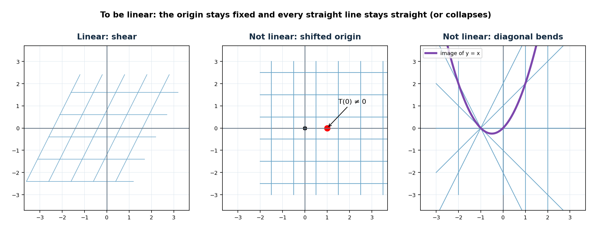

<em>Interactive:</em> Animation 01 — Compare shear, translation, curvature, and diagonal trick <a href="../animations/animation-01.html">Open in full tab</a> (embedded above).

### 4.4 Why these visual properties are important

A linear grid never changes in a random, point-by-point way. It keeps the addition and scaling patterns that already existed in space. That is the property the rest of this chapter depends on.

**Beginner extension — the exact algebraic test:** The most precise way to say “linear” is that for any vectors $\mathbf u,\mathbf v$ and numbers $a,b$,

$$
\boxed{T(a\mathbf u+b\mathbf v)=aT(\mathbf u)+bT(\mathbf v).}
$$

In plain English: **if you mix two vectors first and then transform them, you get the same result as transforming them separately and mixing their outputs in the same proportions**.

This is not an additional assumption for a linear transformation; it is the algebraic rule behind the geometry. We will use it in the very next section.

> **Important technical nuance:** The lecture speaks informally about straight lines “remaining lines.” A transformation may also **collapse** a whole line to one point, and still be linear. The later example of collapsing the plane onto a line is linear even though some lines collapse. The algebraic formula above handles both cases without ambiguity.

---

## 5. The surprising shortcut: Track only two basis vectors

Now asks: If we were writing a computer program, what information would let us compute where **any vector** ends up?

You might expect to need a separate instruction for every possible point—an impossible amount of data. But for a linear transformation in 2D, there is an astonishing shortcut:

**We only need the destinations of the two standard basis vectors** $\hat{\mathbf i}$ and $\hat{\mathbf j}$.

Recall their coordinates:

$$
\hat{\mathbf i}=\begin{bmatrix}1\\0\end{bmatrix}
\quad \text{and}\quad
\hat{\mathbf j}=\begin{bmatrix}0\\1\end{bmatrix}.
$$

Every input vector has the form

$$
\begin{bmatrix}x\\y\end{bmatrix}=x\hat{\mathbf i}+y\hat{\mathbf j}.
$$

The coordinates $x$ and $y$ are just the **scalars** that tell us how much of each basis vector to use. And because $T$ is linear,

$$
\boxed{T\left(x\hat{\mathbf i}+y\hat{\mathbf j}\right)
=xT(\hat{\mathbf i})+yT(\hat{\mathbf j}).}
$$

This is the most important equation in this lesson. It says:

- Start with $x$ copies of the right-pointing unit vector and $y$ copies of the upward-pointing unit vector.
- Transform both of those *basic directions*.
- Keep the original weights $x$ and $y$.
- Add the scaled transformed basis vectors.

No additional information about the rest of the grid is necessary.

### The example: The input vector $\mathbf v=(-1,2)$

We can decompose the input vector as

$$
\mathbf v=\begin{bmatrix}-1\\2\end{bmatrix}
=-1\hat{\mathbf i}+2\hat{\mathbf j}.
$$

Read this slowly:

1. Begin at the origin.
2. Multiply $\hat{\mathbf i}$ by $-1$: move one unit **left**.
3. Multiply $\hat{\mathbf j}$ by $2$: move two units **up**.
4. Combine those movements: the tip is at $(-1,2)$.

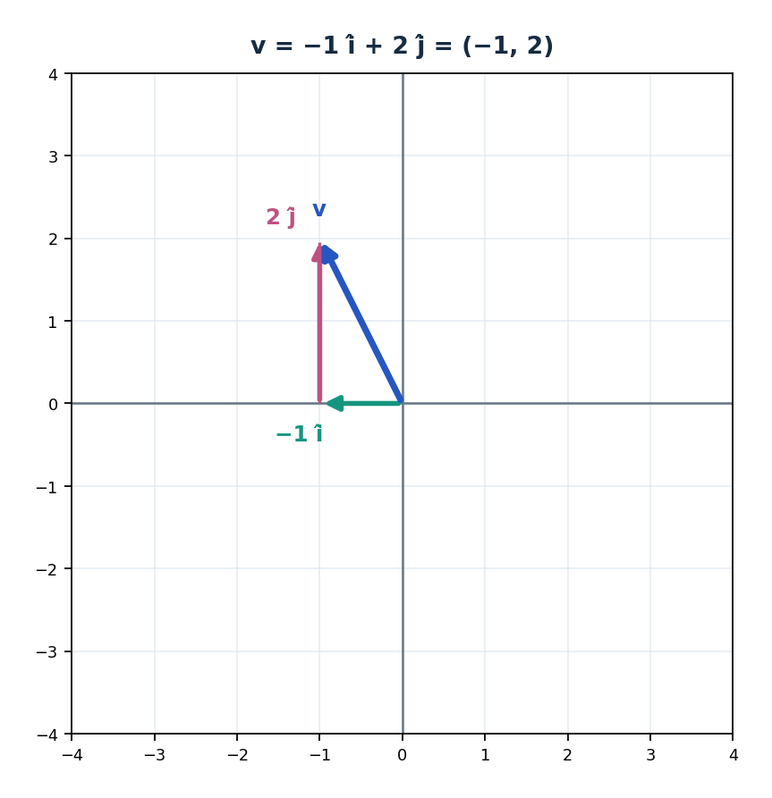

Because the transformation is linear, the output must have the form

$$
T(\mathbf v)=-T(\hat{\mathbf i})+2T(\hat{\mathbf j}).
$$

We have not yet said where the two basis vectors move; that comes next. The important fact is that the weights $-1$ and $2$ **will not change**.

**Check your understanding:** If a vector were $(4,-3)$, what expression would describe its output? Answer: $T(4,-3)=4T(\hat{\mathbf i})-3T(\hat{\mathbf j})$.

---

## 6. Calculate the transformed vector from the two destinations

The lecture now provides the actual basis-vector destinations:

$$
T(\hat{\mathbf i})=\begin{bmatrix}1\\-2\end{bmatrix}
\qquad
T(\hat{\mathbf j})=\begin{bmatrix}3\\0\end{bmatrix}.
$$

**Read the first result:** The vector that originally pointed one unit right now points **one right and two down**.

**Read the second result:** The vector that originally pointed one unit up now points **three right**.

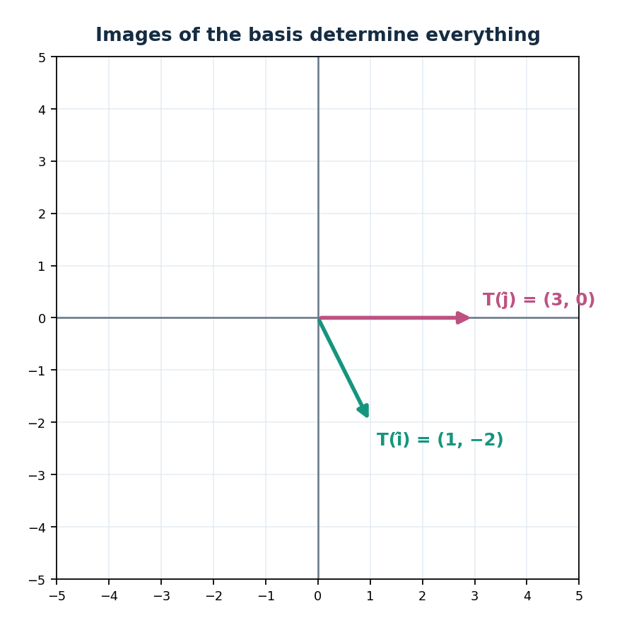

We want to calculate the output of

$$
\mathbf v=\begin{bmatrix}-1\\2\end{bmatrix}.
$$

**Step 1 — Preserve its original coefficients.**

$$
T(\mathbf v)=-1T(\hat{\mathbf i})+2T(\hat{\mathbf j}).
$$

**Step 2 — Insert the known destinations.**

$$
T(\mathbf v)
=-1\begin{bmatrix}1\\-2\end{bmatrix}
+2\begin{bmatrix}3\\0\end{bmatrix}.
$$

**Step 3 — Scale each vector separately.**

$$
-1\begin{bmatrix}1\\-2\end{bmatrix}=
\begin{bmatrix}-1\\2\end{bmatrix}
\quad\text{and}\quad
2\begin{bmatrix}3\\0\end{bmatrix}=
\begin{bmatrix}6\\0\end{bmatrix}.
$$

The first component of the first result is negative because $-1\times1=-1$; its second component is positive because $-1\times(-2)=+2$.

**Step 4 — Add corresponding components.**

$$
T(\mathbf v)=
\begin{bmatrix}-1\\2\end{bmatrix}+
\begin{bmatrix}6\\0\end{bmatrix}=
\begin{bmatrix}-1+6\\2+0\end{bmatrix}=
\boxed{\begin{bmatrix}5\\2\end{bmatrix}}.
$$

**Interpret the answer:** The original arrow ended at $(-1,2)$. After transforming the whole grid, that same input vector is sent to the point $(5,2)$, five to the right and two up.

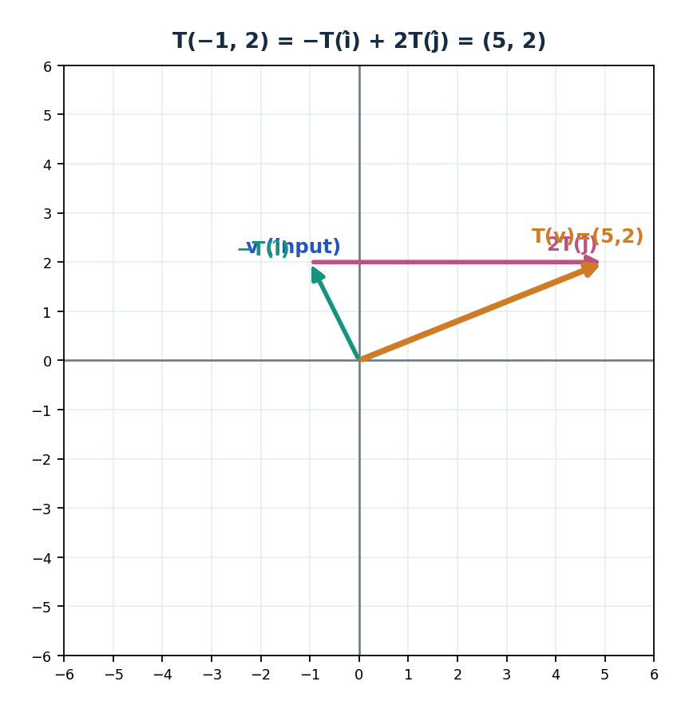

<strong>Interactive:</strong> Press **Step** several times: input $\to$ basis images $\to$ scaled columns $\to$ sum.

<iframe
 src="../animations/animation-02.html"
 title="Animation 02 — See how the two matrix columns build T(v)"
 width="100%"
 height="820"
 style="max-width:980px;border:1px solid #dce4ef;border-radius:12px;background:#f3f6fb;"
 loading="lazy">
</iframe>

<a href="../animations/animation-02.html">Open Animation 02 — See how the two matrix columns build T(v) in full tab</a> if the embed does not load.

This is the key insight. We did **not** need to watch the full animated explanation of the entire grid moving to find the answer. We only needed two vectors.

**Common mistakes:**

- Scaling the first image by $+1$ instead of $-1$.
- Using the coordinates of the **original** basis vectors instead of their **transformed** images.
- Adding the vector's two input coordinates together instead of adding the corresponding output-vector components.

---

## 7. Generalize: What happens to an arbitrary vector $(x,y)$?

We now replaces the particular numbers $-1$ and $2$ with variables $x$ and $y$. A **variable** just means a number whose value you are free to choose.

Every input vector can be written as

$$
\mathbf v=\begin{bmatrix}x\\y\end{bmatrix}
=x\hat{\mathbf i}+y\hat{\mathbf j}.
$$

Keep the same two basis-vector images from the previous example:

$$
T(\hat{\mathbf i})=\begin{bmatrix}1\\-2\end{bmatrix},\quad
T(\hat{\mathbf j})=\begin{bmatrix}3\\0\end{bmatrix}.
$$

The linearity rule gives

$$
T\!\left(\begin{bmatrix}x\\y\end{bmatrix}\right)
=x\begin{bmatrix}1\\-2\end{bmatrix}
+y\begin{bmatrix}3\\0\end{bmatrix}.
$$

Scale the two columns:

$$
=\begin{bmatrix}x\\-2x\end{bmatrix}
+\begin{bmatrix}3y\\0\end{bmatrix}.
$$

Add corresponding components:

$$
\boxed{T\!\left(\begin{bmatrix}x\\y\end{bmatrix}\right)
=\begin{bmatrix}x+3y\\-2x\end{bmatrix}.}
$$

Now we have a complete rule for **every possible input**.

**Beginner extension — check a second vector:** Choose $(2,1)$:

$$
T(2,1)=\begin{bmatrix}2+3(1)\\-2(2)\end{bmatrix}
=\begin{bmatrix}5\\-4\end{bmatrix}.
$$

Without any new grid drawing, we know exactly where the vector lands.

**Remember this:** A 2D linear transformation is completely determined by just **four numbers**: the two coordinates of $T(\hat{\mathbf i})$ and the two coordinates of $T(\hat{\mathbf j})$.

---

## 8. A matrix is a convenient package for those four numbers

The lecture now introduces the **matrix**. A 2-by-2 matrix is simply a rectangular arrangement with **two rows** and **two columns**.

For our running example, put the two basis-vector destinations next to each other:

$$
T(\hat{\mathbf i})=\begin{bmatrix}1\\-2\end{bmatrix},\quad
T(\hat{\mathbf j})=\begin{bmatrix}3\\0\end{bmatrix}
\quad\Rightarrow\quad
\boxed{A=\begin{bmatrix}1&3\\-2&0\end{bmatrix}.}
$$

Look at the **columns**, not the rows:

- **First column** = $(1,-2)$ = $T(\hat{\mathbf i})$.
- **Second column** = $(3,0)$ = $T(\hat{\mathbf j})$.

What is a column? The numbers placed vertically under one another. What is a row? The numbers placed horizontally alongside each other.

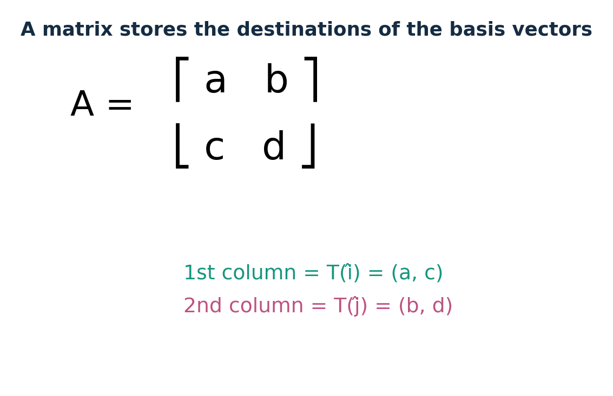

A matrix **does not merely represent four static numbers** in this interpretation. It represents how the whole plane is moved. The numbers tell us where the two basic directions end up, and linearity then fixes all other positions.

### 8.1 Matrix–vector multiplication is scaled-column addition

Write the transformation and its input together:

$$
\begin{bmatrix}1&3\\-2&0\end{bmatrix}
\begin{bmatrix}-1\\2\end{bmatrix}.
$$

Don't memorize a rule yet; interpret the vector as the coefficients $-1$ and $2$ that scale the **first** and **second** matrix columns:

$$
= -1\underbrace{\begin{bmatrix}1\\-2\end{bmatrix}}_{\text{first column}}
+2\underbrace{\begin{bmatrix}3\\0\end{bmatrix}}_{\text{second column}}
=\begin{bmatrix}5\\2\end{bmatrix}.
$$

This is exactly our previous calculation. Putting a matrix on the left of a vector is simply a compact way of applying the transformation to that vector.

### 8.2 The completely general 2-by-2 case

Replace the four specific entries with $a,b,c,d$:

$$
A=\begin{bmatrix}a&b\\c&d\end{bmatrix}.
$$

The first basis vector lands on the **first column**:

$$
T(\hat{\mathbf i})=\begin{bmatrix}a\\c\end{bmatrix}.
$$

The second basis vector lands on the **second column**:

$$
T(\hat{\mathbf j})=\begin{bmatrix}b\\d\end{bmatrix}.
$$

An arbitrary input is $\mathbf v=(x,y)$. Apply linearity:

$$
T(\mathbf v)=xT(\hat{\mathbf i})+yT(\hat{\mathbf j})
=x\begin{bmatrix}a\\c\end{bmatrix}
+y\begin{bmatrix}b\\d\end{bmatrix}.
$$

Multiply each component by its scalar:

$$
=\begin{bmatrix}ax\\cx\end{bmatrix}
+\begin{bmatrix}by\\dy\end{bmatrix}.
$$

Now add horizontal components to horizontal components and vertical to vertical:

$$
\boxed{\begin{bmatrix}a&b\\c&d\end{bmatrix}
\begin{bmatrix}x\\y\end{bmatrix}
=\begin{bmatrix}ax+by\\cx+dy\end{bmatrix}.}
$$

That is the familiar **matrix–vector multiplication formula**, now explained instead of memorized.

**Note on symbols:** $a,b,c,d$ are numbers describing the transformation; $x,y$ are the input vector's coordinates. The result is another 2D vector. Notice that the matrix has two columns, so it needs an input vector with two coordinates.

**Check your understanding:** Why is the first matrix column $(a,c)$, rather than $(a,b)$? Because columns are **vertical**, so the first column contains the top-left entry and the bottom-left entry.

---

## 9. Practice: A 90° counterclockwise rotation

The first full transformation example in the lecture rotates the entire plane by $90^\circ$ **counterclockwise** around the origin.

Before writing any matrix, picture what happens to the two basis vectors:

- $\hat{\mathbf i}$ originally points right. After a quarter-turn counterclockwise, it points **up**: $T(\hat{\mathbf i})=(0,1)$.
- $\hat{\mathbf j}$ originally points up. After the same rotation, it points **left**: $T(\hat{\mathbf j})=(-1,0)$.

Use those two vectors as the matrix columns, in that order:

$$
\boxed{R=\begin{bmatrix}0&-1\\1&0\end{bmatrix}.}
$$

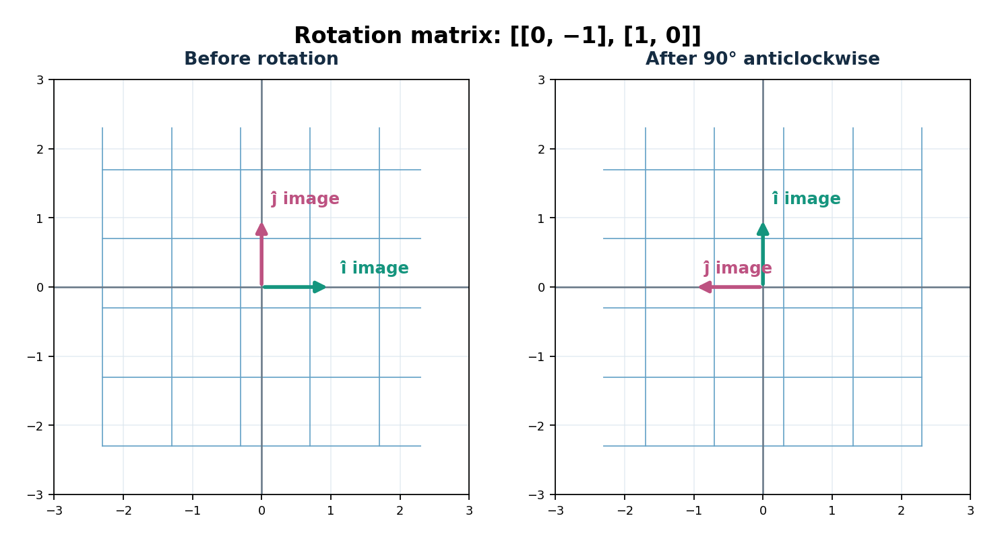

**Beginner extension — test a specific vector.** Apply $R$ to $(2,1)$:

$$
\begin{bmatrix}0&-1\\1&0\end{bmatrix}
\begin{bmatrix}2\\1\end{bmatrix}
=\begin{bmatrix}0(2)+(-1)(1)\\1(2)+0(1)\end{bmatrix}
=\begin{bmatrix}-1\\2\end{bmatrix}.
$$

The vector that pointed two right and one up now points one left and two up. Its length is unchanged because we merely rotated it.

**Common mistake:** The matrix for a **clockwise** quarter-turn would be different. Counterclockwise means right $\to$ up.

---

## 10. Practice: A shear transformation

Next, introduces a **shear**. Imagine a rectangular stack of cards: you keep the bottom card fixed, then slide the top sideways. The stack becomes slanted even though each card stays straight.

For the shear shown in the lecture:

- $\hat{\mathbf i}$ stays where it was, at $(1,0)$.
- $\hat{\mathbf j}$ moves to $(1,1)$: one right and one up.

The columns give

$$
\boxed{S=\begin{bmatrix}1&1\\0&1\end{bmatrix}.}
$$

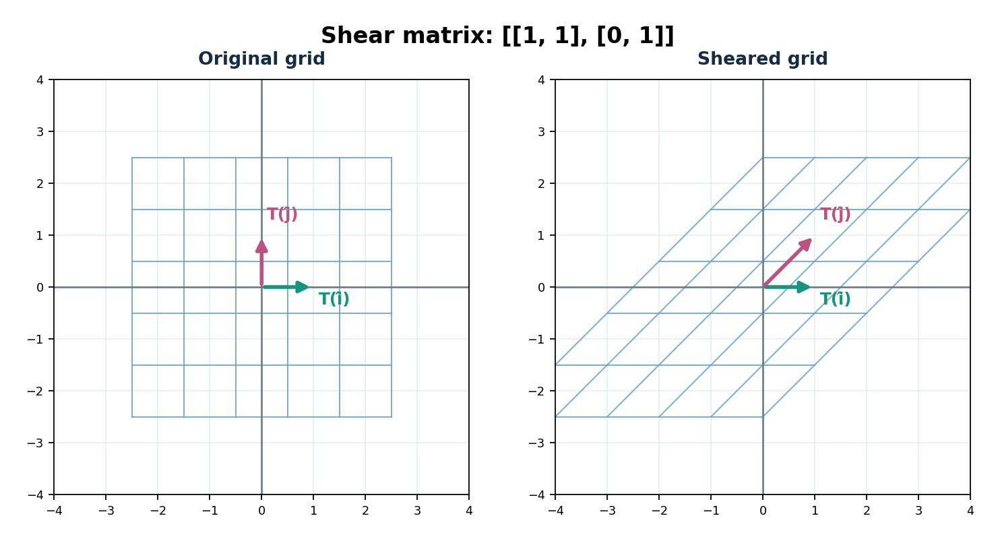

**Beginner extension — compute its action:**

$$
S\begin{bmatrix}x\\y\end{bmatrix}
=\begin{bmatrix}1x+1y\\0x+1y\end{bmatrix}
=\begin{bmatrix}x+y\\y\end{bmatrix}.
$$

So horizontal movement depends partly on how high up the original point was. A point with $y=0$ stays at the same height *and* horizontal coordinate. A point higher up shifts farther right.

This is why the horizontal lines remain horizontal while the vertical lines tilt. Despite the slant, the transformation is **linear**.

<strong>Interactive:</strong> Select **Rotation** and **Shear** to compare their grid motions.

<iframe
 src="../animations/animation-03.html"
 title="Animation 03 — Rotation, shear, and custom matrices"
 width="100%"
 height="820"
 style="max-width:980px;border:1px solid #dce4ef;border-radius:12px;background:#f3f6fb;"
 loading="lazy">
</iframe>

<a href="../animations/animation-03.html">Open Animation 03 — Rotation, shear, and custom matrices in full tab</a> if the embed does not load.

---

## 11. Go backwards: Given a matrix, imagine the transformed space

So far we began with a picture of what a transformation does to the two basis vectors, then wrote its matrix. Now this lesson reverses the question:

**If I hand you a matrix, can you picture the transformation?**

The example has columns $(1,2)$ and $(3,1)$:

$$
A=\begin{bmatrix}1&3\\2&1\end{bmatrix}.
$$

Read it aloud in terms of movement:

1. Move $\hat{\mathbf i}$, the one-unit right-pointing vector, to $(1,2)$.
2. Move $\hat{\mathbf j}$, the one-unit upward vector, to $(3,1)$.
3. Move the rest of the grid consistently, keeping the straight, parallel grid structure intact.

The original unit square has corners $(0,0),(1,0),(0,1),(1,1)$. Its transformed corners are

$$
T(0,0)=(0,0),\quad T(1,0)=(1,2),\quad T(0,1)=(3,1),
$$

and, because of linearity,

$$
T(1,1)=T(1,0)+T(0,1)=(1,2)+(3,1)=(4,3).
$$

The square becomes a **parallelogram**. The key point is not that you must draw every dot; once you place the two transformed basis vectors, the entire grid is forced to follow.

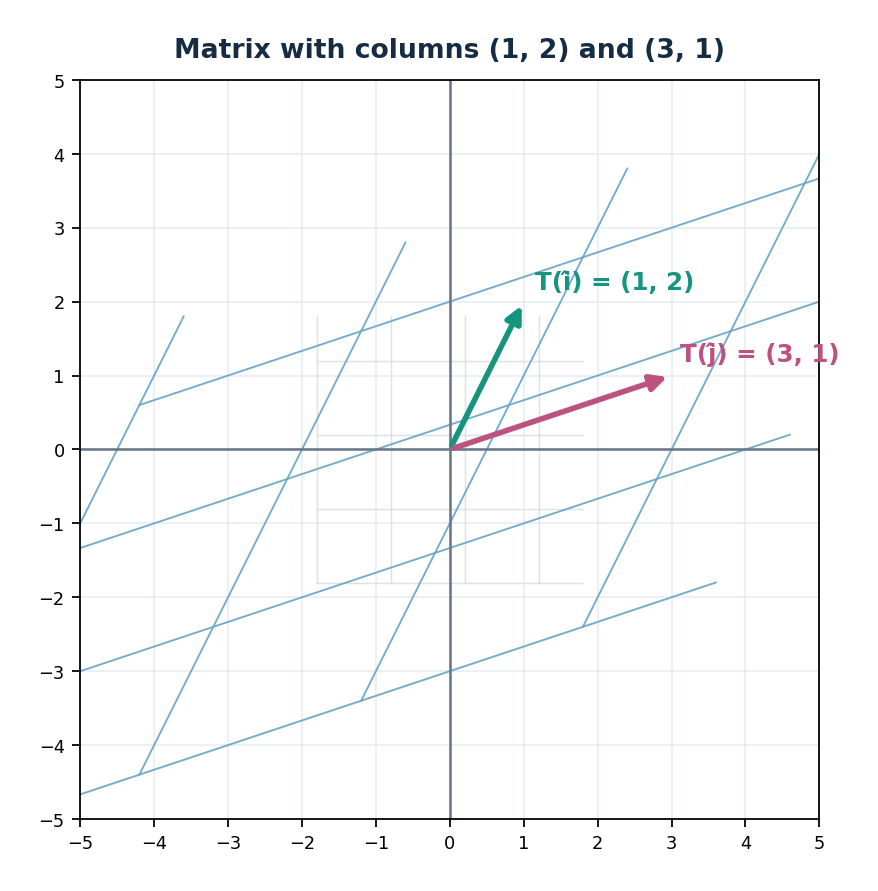

<em>Interactive:</em> Choose **Custom**, change the matrix entries, and watch how the grid follows the columns. <a href="../animations/animation-03.html">Open in full tab</a> (embedded above).

**Check your understanding:** For this matrix, where does $(2,1)$ go? Using the columns, $2(1,2)+(3,1)=(5,5)$.

---

## 12. What if the two transformed basis vectors point along the same line?

Ends with a striking case. Suppose the two columns of a matrix are **linearly dependent**. That means one is a multiple of the other, or one is zero—in either case, they do not provide two independent directions.

For example (**beginner extension**), take

$$
C=\begin{bmatrix}1&2\\1&2\end{bmatrix}.
$$

Its columns are

$$
C\hat{\mathbf i}=\begin{bmatrix}1\\1\end{bmatrix},\qquad
C\hat{\mathbf j}=\begin{bmatrix}2\\2\end{bmatrix}
=2\begin{bmatrix}1\\1\end{bmatrix}.
$$

Both column vectors point along the same diagonal line $y=x$. Therefore every output is a combination of vectors already on that line:

$$
C\begin{bmatrix}x\\y\end{bmatrix}
=x\begin{bmatrix}1\\1\end{bmatrix}
+y\begin{bmatrix}2\\2\end{bmatrix}
=\begin{bmatrix}x+2y\\x+2y\end{bmatrix}.
$$

Notice that the two output coordinates are always equal. So *regardless of the input*, the output lies on the line $y=x$.

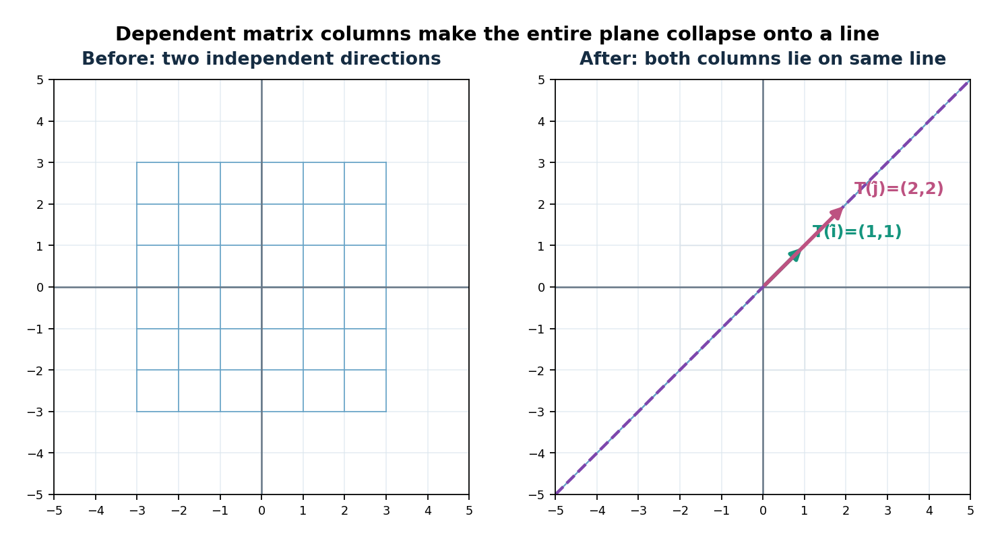

There were infinitely many possible points throughout the input plane, but after applying this transformation, all their output points fit on **one line**. The dimension of the span has gone from two to one.

This exactly connects back to Chapter 02:

- The **span** of two vectors is every possible linear combination of them.
- If the two transformed basis vectors are dependent, their span is only a line (or possibly just the origin).
- The transformation's output can never escape that span.

<strong>Interactive:</strong> Use **Step** to follow a grid collapsing into $y=x$. Compare it with the custom matrix from the previous section.

<iframe
 src="../animations/animation-04.html"
 title="Animation 04 — Collapse the plane onto a line"
 width="100%"
 height="820"
 style="max-width:980px;border:1px solid #dce4ef;border-radius:12px;background:#f3f6fb;"
 loading="lazy">
</iframe>

<a href="../animations/animation-04.html">Open Animation 04 — Collapse the plane onto a line in full tab</a> if the embed does not load.

**Important nuance:** Squashing an entire plane to a line is still a linear transformation. “Linear” does **not** mean it must preserve areas, lengths, angles, or distinct points. It preserves **addition and scalar multiplication**, including when many different input points end up at one output point.

---

## 13. final takeaway and what comes next

The lecture finishes by reconnecting everything:

1. A linear transformation moves vectors—or points representing vectors—around space in a structured way, keeping the origin fixed.
2. To describe its action in two dimensions, we only need to know where $\hat{\mathbf i}$ and $\hat{\mathbf j}$ go.
3. A **2-by-2 matrix** packages those two destination vectors as its columns.
4. Multiplying a matrix by an input vector means taking a **linear combination of its columns**, with the input coordinates used as coefficients.
5. This gives us a geometric interpretation of matrix arithmetic and prepares us for later topics: **matrix–matrix multiplication, determinants, change of basis, and eigenvalues**.

The very next chapter takes up **multiplying two matrices together**—which will be much easier to picture if we already know that each matrix represents a movement of the entire space.

### One equation to remember

$$
\boxed{\underbrace{\begin{bmatrix}a&b\\c&d\end{bmatrix}}_{\text{where the basis vectors go}}
\underbrace{\begin{bmatrix}x\\y\end{bmatrix}}_{\text{how much of each basis vector}}
=
\underbrace{x\begin{bmatrix}a\\c\end{bmatrix}
+y\begin{bmatrix}b\\d\end{bmatrix}}_{\text{sum of scaled transformed columns}}
=
\begin{bmatrix}ax+by\\cx+dy\end{bmatrix}.}
$$

If this picture makes sense, you understand *why* the rule for multiplying a 2-by-2 matrix by a 2D vector works.

---

## 14. Common misconceptions — quick reference

| Mistake | Better way to think about it |
|---|---|
| “Any function that moves vectors is linear.” | A linear transformation must preserve vector addition and scalar multiplication. |
| “Keeping grid lines straight is enough.” | You must also keep the origin fixed; examine diagonal lines too. |
| “A matrix is just a list of four numbers.” | Its columns show the final positions of the standard basis vectors. |
| “The first basis vector is the first matrix row.” | The first basis-vector image is the **first column**. |
| “For matrix multiplication, I should multiply the entries in matching places.” | Instead, scale the **columns** by the vector's input coordinates and **add**. |
| “Rotation changes a vector's magnitude.” | A pure rotation changes its direction but not its length. |
| “Shearing must be non-linear because it tilts squares.” | A shear is linear; lines remain straight and the origin stays fixed. |
| “A transformation that collapses the plane can't be linear.” | It can; dependent columns create exactly such a linear collapse. |

---

## 15. Check your understanding — 12 questions

Try the questions **before** opening the answers. The first eight directly practice the lecture's key ideas; the last four are small beginner extensions.

1. What does $T(\mathbf v)$ mean?
2. Why does this lesson visualize a large collection of vectors as points rather than arrows?
3. What happens to the origin under a linear transformation?
4. Is $F(x,y)=(x+4,y)$ linear? Why?
5. If $\mathbf v=(-1,2)$, write it using $\hat{\mathbf i}$ and $\hat{\mathbf j}$.
6. If $T(\hat{\mathbf i})=(1,-2)$ and $T(\hat{\mathbf j})=(3,0)$, find $T(-1,2)$.
7. Write the matrix whose first column is $(1,-2)$ and second column is $(3,0)$.
8. Why does knowing the two columns of a 2-by-2 transformation matrix determine the output for every input vector?
9. **Extension:** Compute $\begin{bmatrix}2&1\\0&3\end{bmatrix}\begin{bmatrix}4\\-2\end{bmatrix}$.
10. **Extension:** Write the matrix of a $90^\circ$ counterclockwise rotation and use it to rotate $(1,3)$.
11. **Extension:** For $S=\begin{bmatrix}1&1\\0&1\end{bmatrix}$, where does $(2,3)$ land?
12. **Extension:** Why does $C=\begin{bmatrix}1&2\\1&2\end{bmatrix}$ produce outputs on a line instead of throughout the plane?

<strong>Show worked answers</strong>

1. $T(\mathbf v)$ is the **output vector** obtained when the transformation $T$ acts on input $\mathbf v$.
2. An arrow for every vector would fill the picture; one point per vector makes it easier to see how the whole grid changes.
3. The origin remains fixed: $T(0,0)=(0,0)$.
4. No. It sends the origin to $(4,0)$, so it fails the origin requirement.
5. $\mathbf v=-\hat{\mathbf i}+2\hat{\mathbf j}$.
6. $-1(1,-2)+2(3,0)=(-1,2)+(6,0)=\boxed{(5,2)}$.
7. $\boxed{\begin{bmatrix}1&3\\-2&0\end{bmatrix}}$. The two output vectors go in the columns.
8. Every input $(x,y)$ is $x\hat{\mathbf i}+y\hat{\mathbf j}$, so its output is $xT(\hat{\mathbf i})+yT(\hat{\mathbf j})$.
9. $4(2,0)-2(1,3)=(8,0)+(-2,-6)=\boxed{(6,-6)}$.
10. $R=\begin{bmatrix}0&-1\\1&0\end{bmatrix}$, so $R(1,3)=(-3,1)$.
11. $S(2,3)=(2+3,3)=\boxed{(5,3)}$.
12. The second column is exactly two times the first, so $C(x,y)=(x+2y,x+2y)$; every result lies on $y=x$.

---

## 16. Beginner glossary

| Term | Meaning in simple words |
|---|---|
| **Vector** | A mathematical arrow with coordinates showing its direction and size. |
| **Origin** | The $(0,0)$ point where the axes cross. |
| **Function** | A rule that turns an input into an output. |
| **Transformation** | A vector-to-vector function, pictured as movement of space. |
| **Linear transformation** | A transformation that preserves vector addition and multiplication by numbers. |
| **Standard basis vectors** | $\hat{\mathbf i}=(1,0)$ and $\hat{\mathbf j}=(0,1)$. |
| **Scalar** | An ordinary number used to stretch, shrink, or reverse a vector. |
| **Linear combination** | A sum of scaled vectors, such as $3\mathbf u-2\mathbf v$. |
| **Matrix** | A rectangular arrangement of numbers; its columns describe where the basis vectors land. |
| **Matrix–vector multiplication** | Scale each matrix column by the corresponding input coordinate and add. |
| **Rotation** | Turning space around the origin through an angle. |
| **Shear** | Slanting a grid while keeping its lines straight. |
| **Span** | All vectors reachable by scaling and adding specified vectors. |
| **Linearly dependent** | At least one vector can be built from the others; it adds no new direction. |

**Final mental picture:** The matrix columns are **two arrows**; the input vector coordinates are **two sliders** controlling how much of each arrow to add; the output vector is **their sum**. The rest of the grid follows that same rule.
