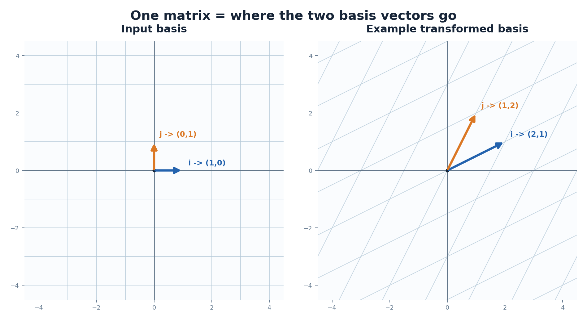
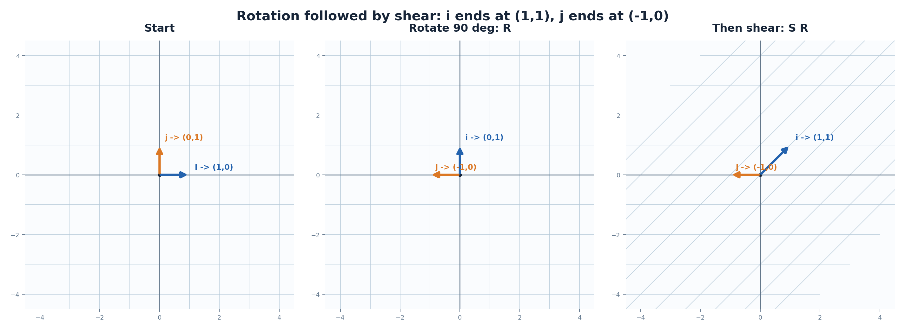
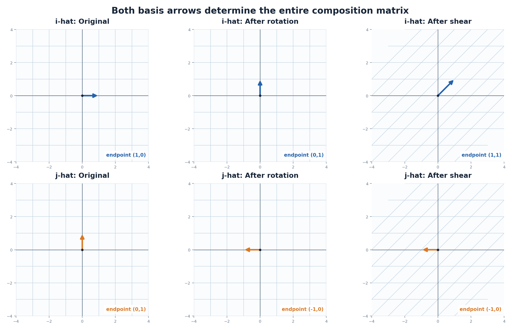
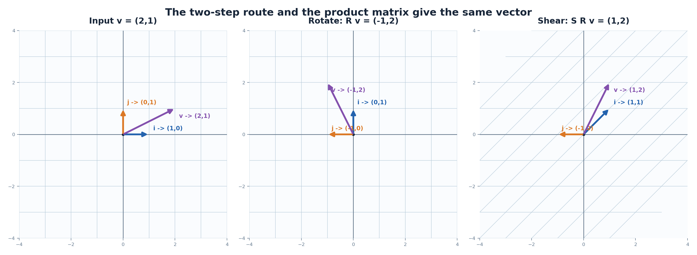
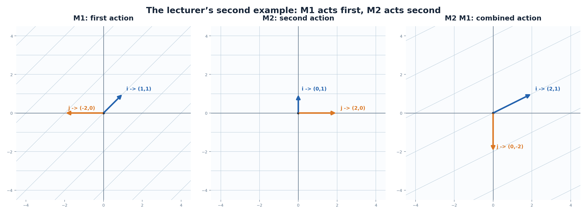
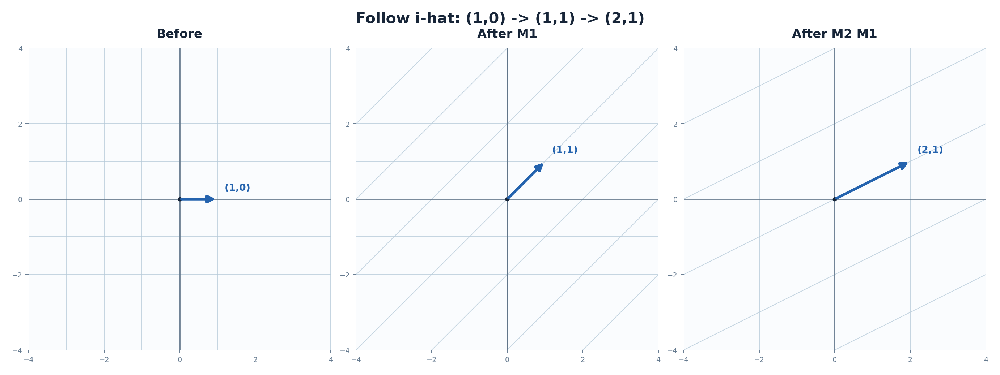
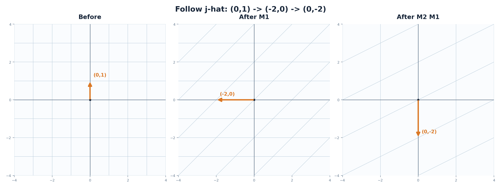
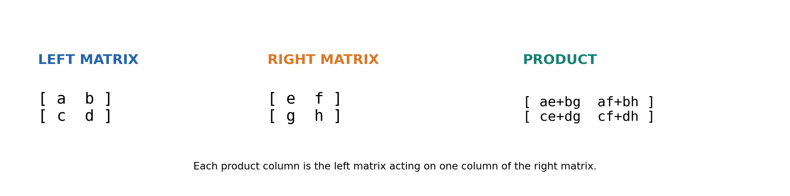
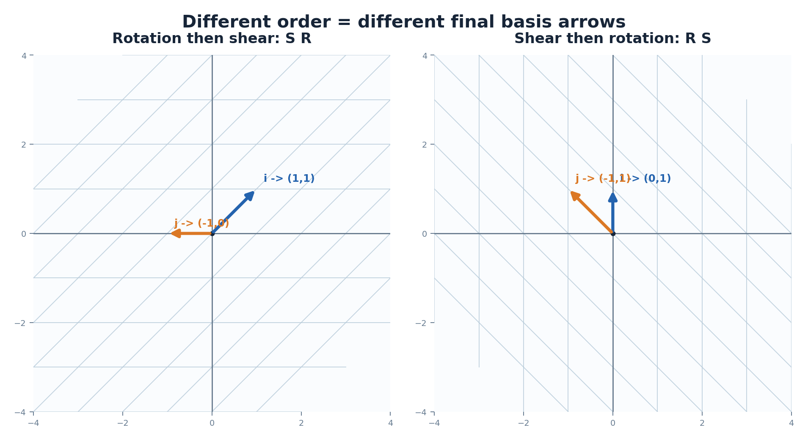
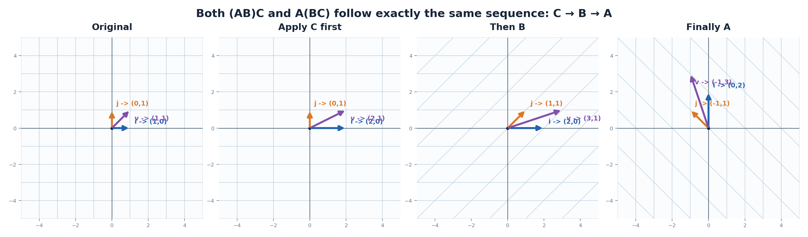

# 04 — Matrix Multiplication as Composition

**Essence of Linear Algebra · Chapter 4 · Beginner-friendly lecture notes** 
**Based on:** the supplied Chapter 04 lecture and transcript (approximately 10 minutes). 
**Study approach:** Follow the lecture in order, stopping at the diagrams and animations. Mathematical extensions and extra examples are explicitly labelled **Beginner's extra explanation**.

> **The central question:** What does multiplying *two matrices* actually *mean*? The answer is not “multiply rows by columns.” It is **perform one linear transformation, then another**.

---

## 1. First, a recap: what does one matrix mean?

This section begins by revisiting the previous lecture, because everything in this chapter rests on a simple idea: a matrix is not merely a rectangular box of numbers. It records how a **linear transformation** moves space.

### 1.1 A transformation is a function that moves vectors

A *function* takes an input and returns an output. Think of a machine: you put something in, something else comes out. In linear algebra, our inputs and outputs are often **vectors**, which you can picture as arrows anchored at the origin.

For example, a transformation called `T` might take the vector

$$
\mathbf v=\begin{bmatrix}2\\1\end{bmatrix}
$$

and send it to a new vector `T(v)`. The output is another arrow. Now picture doing that to *every* vector in the plane simultaneously. Instead of drawing millions of arrows, draw a square grid and watch its lines move. This makes the overall effect visible.

### 1.2 What does *linear* mean here?

A linear transformation preserves vector addition and scalar multiplication:

$$
T(\mathbf u+\mathbf v)=T(\mathbf u)+T(\mathbf v),\qquad
T(c\mathbf v)=c\,T(\mathbf v).
$$

In the geometric picture, the origin stays fixed and the straight, regularly spaced grid is carried to another straight, evenly spaced grid (possibly flattened onto a line). No bending of the grid into curves is allowed.

**Beginner's extra explanation.** A 90° rotation around the origin is linear. A translation that slides every point one unit to the right is **not** linear, because it moves the origin from `(0,0)` to `(1,0)`.

### 1.3 Why do only two basis vectors matter?

In 2D, the **standard basis vectors** are

$$
\hat{\mathbf i}=\begin{bmatrix}1\\0\end{bmatrix},\qquad
\hat{\mathbf j}=\begin{bmatrix}0\\1\end{bmatrix}.
$$

Every vector with coordinates `(x,y)` can be reconstructed by scaling and adding them:

$$
\begin{bmatrix}x\\y\end{bmatrix}=
 x\hat{\mathbf i}+y\hat{\mathbf j}.
$$

This says: travel `x` units in the horizontal basis direction, then `y` units in the vertical basis direction. For example,

$$
\begin{bmatrix}2\\3\end{bmatrix}=
2\begin{bmatrix}1\\0\end{bmatrix}+
3\begin{bmatrix}0\\1\end{bmatrix}.
$$

A linear transformation keeps the *same coefficients* when it moves these basis arrows:

$$
T\left(\begin{bmatrix}x\\y\end{bmatrix}\right)
=x\,T(\hat{\mathbf i})+y\,T(\hat{\mathbf j}).
$$

So, once you know where **i-hat** and **j-hat** land, you can calculate the landing place of *every* other vector. This is why the two columns of a 2×2 matrix are special.

### 1.4 The columns of a matrix record those landing places

Suppose

$$
T(\hat{\mathbf i})=\begin{bmatrix}a\\c\end{bmatrix},\qquad
T(\hat{\mathbf j})=\begin{bmatrix}b\\d\end{bmatrix}.
$$

We package those two *column vectors* side by side:

$$
A=\begin{bmatrix}a&b\\c&d\end{bmatrix}.
$$

The first column `(a,c)` is where i-hat goes. The second column `(b,d)` is where j-hat goes. Therefore,

$$
A\begin{bmatrix}x\\y\end{bmatrix}
=x\begin{bmatrix}a\\c\end{bmatrix}
+y\begin{bmatrix}b\\d\end{bmatrix}
=\begin{bmatrix}ax+by\\cx+dy\end{bmatrix}.
$$

The multiplication here is simply **scaling the transformed basis vectors and adding them**. That completes this recap.

**Remember this:** matrix × vector = “apply the transformation represented by the matrix to that vector.”

**Quick check:** In `[[2, 4], [1, -1]]`, where does j-hat land? Answer: `(4,-1)`, because j-hat corresponds to the **second column**, not the second row.

---

## 2. New idea: apply one transformation, then another

The next question is natural: *What if we do two movements of the whole plane, one after the other?*

Think of a photo editor: first rotate a picture, then distort it sideways. Both operations change the picture. The final appearance depends on **both**, but it is still just one final picture. In math, a single transformation capturing the total effect is called a **composition**.

### 2.1 The lecture's example: 90° rotation, then shear

Start with a 90-degree counterclockwise rotation:

$$
R=\begin{bmatrix}0&-1\\1&0\end{bmatrix}.
$$

It maps the basis arrows like this:

- `R(i-hat) = (0,1)`: rightward becomes upward.
- `R(j-hat) = (-1,0)`: upward becomes leftward.

Next, do a **shear**, which slants vertical grid lines to the right without moving the horizontal basis arrow:

$$
S=\begin{bmatrix}1&1\\0&1\end{bmatrix}.
$$

For this shear,

- `S(i-hat) = (1,0)`: i-hat stays put.
- `S(j-hat) = (1,1)`: j-hat is tilted right.

These matrices and arrow movements are the ones shown in the supplied lecture.

<strong>Interactive:</strong> Open interactive animation 01 — Rotation followed by shear

<iframe
 src="../animations/animation-01.html"
 title="Open interactive animation 01 — Rotation followed by shear"
 width="100%"
 height="820"
 style="max-width:980px;border:1px solid #dce4ef;border-radius:12px;background:#f3f6fb;"
 loading="lazy">
</iframe>

<a href="../animations/animation-01.html">Open interactive animation 01 — Rotation followed by shear** in full tab</a> if the embed does not load.

### 2.2 Follow i-hat through both operations

First rotate i-hat:

$$
\begin{bmatrix}1\\0\end{bmatrix}
\xrightarrow{R}
\begin{bmatrix}0\\1\end{bmatrix}.
$$

Then shear the *result*:

$$
S\begin{bmatrix}0\\1\end{bmatrix}
=0\begin{bmatrix}1\\0\end{bmatrix}
+1\begin{bmatrix}1\\1\end{bmatrix}
=\begin{bmatrix}1\\1\end{bmatrix}.
$$

The complete rotation-then-shear action sends i-hat to `(1,1)`. This will be **column 1** of the combined matrix.

### 2.3 Follow j-hat through both operations

Start with j-hat and rotate:

$$
\begin{bmatrix}0\\1\end{bmatrix}
\xrightarrow{R}
\begin{bmatrix}-1\\0\end{bmatrix}.
$$

Then apply the shear:

$$
S\begin{bmatrix}-1\\0\end{bmatrix}
=-1\begin{bmatrix}1\\0\end{bmatrix}
+0\begin{bmatrix}1\\1\end{bmatrix}
=\begin{bmatrix}-1\\0\end{bmatrix}.
$$

So j-hat finally lands at `(-1,0)`. This becomes **column 2** of the combined matrix.

### 2.4 Put the two final columns together

The complete transformation has matrix

$$
\boxed{
SR=\begin{bmatrix}1&-1\\1&0\end{bmatrix}
}.
$$

**Why this matrix?** Its first column says i-hat ends at `(1,1)`. Its second says j-hat ends at `(-1,0)`. That is enough to reconstruct every moved vector.

> An important point: the combined transformation is another linear transformation in its own right. You do not need to re-enact both steps every time; you can use its single matrix.

---

## 3. Why this combined matrix is a *product*

Next, connects the geometric idea to a numerical expression.

Suppose you start with any vector `v`. The “long way” is to rotate it first and then shear the rotated result:

$$
\mathbf v \xrightarrow{R} R\mathbf v
\xrightarrow{S} S(R\mathbf v).
$$

Because the composition matrix `SR` captures the entire action, the short way must produce the same vector:

$$
\boxed{S(R\mathbf v)=(SR)\mathbf v.}
$$

This is the motivation for **matrix multiplication**: find one matrix whose action equals the effect of both transformations in sequence.

### 3.1 Numerical check using an extra example

**Beginner's extra example** (this demo illustrates the idea for arbitrary vectors without choosing this particular one). Let

$$
\mathbf v=\begin{bmatrix}2\\1\end{bmatrix}.
$$

**Long route:** Rotate it:

$$
R\mathbf v=
\begin{bmatrix}0&-1\\1&0\end{bmatrix}
\begin{bmatrix}2\\1\end{bmatrix}
=\begin{bmatrix}-1\\2\end{bmatrix}.
$$

Now shear that result:

$$
S(R\mathbf v)=
\begin{bmatrix}1&1\\0&1\end{bmatrix}
\begin{bmatrix}-1\\2\end{bmatrix}
=\begin{bmatrix}1\\2\end{bmatrix}.
$$

**Short route:** Use the combined matrix:

$$
(SR)\mathbf v=
\begin{bmatrix}1&-1\\1&0\end{bmatrix}
\begin{bmatrix}2\\1\end{bmatrix}
=\begin{bmatrix}2-1\\2+0\end{bmatrix}
=\begin{bmatrix}1\\2\end{bmatrix}.
$$

Both routes agree. Geometrically, it is the same final arrow and the same final location in space.

### 3.2 Read matrix compositions **right to left**

This is one of the strongest warnings:

$$
\boxed{SR\mathbf v=S(R\mathbf v)}
$$

- The matrix **on the right**, `R`, acts **first**.
- The matrix **on the left**, `S`, acts **second**.
- `SR` therefore means **rotation first, shear second**.

Why? Ordinary function notation works the same way. If `f` means “add three” and `g` means “double,” then `g(f(2))` means calculate `f(2)=5` and then `g(5)=10`. The inner function happens first. Matrix notation inherits that habit.

**Common misconception:** “`SR` means do `S` first because `S` is the first letter I read.” No: acting on a vector on the right, the sequence starts with `R`.

---

## 4. A second example: multiply matrices by following the basis vectors

Now chooses **two new matrices**. Instead of watching the grid animate, the challenge is to calculate the final matrix using only their entries.

The first transformation is called `M₁`:

$$
M_1=\begin{bmatrix}1&-2\\1&0\end{bmatrix}.
$$

Notice its two columns:

$$
M_1\hat{\mathbf i}=\begin{bmatrix}1\\1\end{bmatrix},\quad
M_1\hat{\mathbf j}=\begin{bmatrix}-2\\0\end{bmatrix}.
$$

The second transformation is called `M₂`:

$$
M_2=\begin{bmatrix}0&2\\1&0\end{bmatrix}.
$$

Its columns tell us

$$
M_2\hat{\mathbf i}=\begin{bmatrix}0\\1\end{bmatrix},\quad
M_2\hat{\mathbf j}=\begin{bmatrix}2\\0\end{bmatrix}.
$$

**We apply M₁ first, then M₂.** So our desired combined matrix is

$$
M_2M_1.
$$

<strong>Interactive:</strong> Open interactive animation 02 — Follow both basis arrows through M₁ and M₂

<iframe
 src="../animations/animation-02.html"
 title="Open interactive animation 02 — Follow both basis arrows through M₁ and M₂"
 width="100%"
 height="820"
 style="max-width:980px;border:1px solid #dce4ef;border-radius:12px;background:#f3f6fb;"
 loading="lazy">
</iframe>

<a href="../animations/animation-02.html">Open interactive animation 02 — Follow both basis arrows through M₁ and M₂ in full tab</a> if the embed does not load.

### 4.1 First column: where does i-hat finally land?

Step 1: Begin at the horizontal unit arrow:

$$
\hat{\mathbf i}=\begin{bmatrix}1\\0\end{bmatrix}.
$$

Step 2: Apply `M₁`. The first column of `M₁` gives the answer immediately:

$$
M_1\hat{\mathbf i}=\begin{bmatrix}1\\1\end{bmatrix}.
$$

Step 3: Apply `M₂` to that intermediate arrow. Remember: a matrix times a vector means *scale the matrix columns by the vector's coordinates, and add*:

$$
\begin{aligned}
M_2\begin{bmatrix}1\\1\end{bmatrix}
&=1\begin{bmatrix}0\\1\end{bmatrix}
+1\begin{bmatrix}2\\0\end{bmatrix}\\
&=\begin{bmatrix}0+2\\1+0\end{bmatrix}\\
&=\boxed{\begin{bmatrix}2\\1\end{bmatrix}}.
\end{aligned}
$$

That final `(2,1)` arrow is the **first column of M₂M₁**.

### 4.2 Second column: where does j-hat finally land?

Step 1: Start with the vertical unit arrow:

$$
\hat{\mathbf j}=\begin{bmatrix}0\\1\end{bmatrix}.
$$

Step 2: Apply `M₁`. Its second column is where j-hat lands:

$$
M_1\hat{\mathbf j}=\begin{bmatrix}-2\\0\end{bmatrix}.
$$

Step 3: Apply `M₂`:

$$
\begin{aligned}
M_2\begin{bmatrix}-2\\0\end{bmatrix}
&=-2\begin{bmatrix}0\\1\end{bmatrix}
+0\begin{bmatrix}2\\0\end{bmatrix}\\
&=\begin{bmatrix}0\\-2\end{bmatrix}.
\end{aligned}
$$

So `(0,-2)` is the **second column** of the composition matrix.

### 4.3 Combine the two columns

$$
\boxed{
\underbrace{\begin{bmatrix}0&2\\1&0\end{bmatrix}}_{M_2}
\underbrace{\begin{bmatrix}1&-2\\1&0\end{bmatrix}}_{M_1}
=
\underbrace{\begin{bmatrix}2&0\\1&-2\end{bmatrix}}_{\text{M₁ first, M₂ second}}
}.
$$

Check that you can point at each number and explain its origin:

- `(2,1)` in column 1 is the **final location of i-hat**.
- `(0,-2)` in column 2 is the **final location of j-hat**.

**Remember this:** To find a product of two 2×2 matrices, transform **each column of the right matrix** using the matrix on the left.

---

## 5. The general rule with letters, not specific numbers

We now replaces the example's numbers with variables. The algebra looks more complicated, but the logic does **not** change.

Call the left matrix `L` and the right matrix `B`:

$$
L=\begin{bmatrix}a&b\\c&d\end{bmatrix},\qquad
B=\begin{bmatrix}e&f\\g&h\end{bmatrix}.
$$

(These letter names simply make it easier to see which matrix acts when: **B first, L second**.)

### 5.1 Transform the right matrix's first column

The first column of `B` is `(e,g)`. This is the place i-hat reaches **after the first transformation**. Apply `L` to that arrow:

$$
\begin{aligned}
L\begin{bmatrix}e\\g\end{bmatrix}
&=e\begin{bmatrix}a\\c\end{bmatrix}
+g\begin{bmatrix}b\\d\end{bmatrix}\\
&=\begin{bmatrix}ae+bg\\ce+dg\end{bmatrix}.
\end{aligned}
$$

This gives the first column of the product.

### 5.2 Transform the right matrix's second column

The second column of `B` is `(f,h)`. Apply `L` to it:

$$
\begin{aligned}
L\begin{bmatrix}f\\h\end{bmatrix}
&=f\begin{bmatrix}a\\c\end{bmatrix}
+h\begin{bmatrix}b\\d\end{bmatrix}\\
&=\begin{bmatrix}af+bh\\cf+dh\end{bmatrix}.
\end{aligned}
$$

This gives the second column of the product.

### 5.3 Put the columns side by side

$$
\boxed{
\begin{bmatrix}a&b\\c&d\end{bmatrix}
\begin{bmatrix}e&f\\g&h\end{bmatrix}
=
\begin{bmatrix}
ae+bg&af+bh\\
ce+dg&cf+dh
\end{bmatrix}
}.
$$

**Beginner's extra explanation: where does “row times column” come from?** Look at the top-left answer `ae+bg`. We can describe this as

$$
\underbrace{\begin{bmatrix}a&b\end{bmatrix}}_{\text{top row of left matrix}}
\underbrace{\begin{bmatrix}e\\g\end{bmatrix}}_{\text{first column of right matrix}}
=ae+bg.
$$

The standard row-by-column calculation is therefore a **shortcut for finding where the basis vectors land**, not an unrelated rule to memorize.

**Common mistakes to avoid:**

1. Multiplying corresponding entries (`a·e, b·f,...`) is **not** ordinary matrix multiplication.
2. Mixing up rows and columns loses the meaning of the transformed basis arrows.
3. Reversing the matrices reverses the order of the transformations.

---

## 6. Does the order matter? Shear then rotate versus rotate then shear

Next, uses the earlier shear and 90° rotation to make a surprising point: **yes, order usually matters**.

We already found

$$
SR=\begin{bmatrix}1&-1\\1&0\end{bmatrix}
\quad\text{(rotate first, shear second).}
$$

Now do the **reverse**: shear first, then rotate. The combined matrix is `RS`:

$$
RS=
\begin{bmatrix}0&-1\\1&0\end{bmatrix}
\begin{bmatrix}1&1\\0&1\end{bmatrix}
=
\begin{bmatrix}0&-1\\1&1\end{bmatrix}.
$$

### 6.1 Compare where i-hat and j-hat end up

| Order of operations | Combined matrix | Final i-hat | Final j-hat |
|---|---|---|---|
| Rotate, then shear | `SR` | `(1,1)` | `(-1,0)` |
| Shear, then rotate | `RS` | `(0,1)` | `(-1,1)` |

Because the final basis arrows are different, the overall transformations are different.

<strong>Interactive:</strong> Open interactive animation 03 — Swap the order and compare the results

<iframe
 src="../animations/animation-03.html"
 title="Open interactive animation 03 — Swap the order and compare the results"
 width="100%"
 height="820"
 style="max-width:980px;border:1px solid #dce4ef;border-radius:12px;background:#f3f6fb;"
 loading="lazy">
</iframe>

<a href="../animations/animation-03.html">Open interactive animation 03 — Swap the order and compare the results in full tab</a> if the embed does not load.

### 6.2 See the difference with an ordinary vector

**Beginner's extra example.** Take `v = (2,1)`.

Rotation then shear gives

$$
SR\begin{bmatrix}2\\1\end{bmatrix}
=\begin{bmatrix}1\\2\end{bmatrix}.
$$

Shear then rotation gives

$$
RS\begin{bmatrix}2\\1\end{bmatrix}
=\begin{bmatrix}-1\\3\end{bmatrix}.
$$

Those outputs differ, so `SR` and `RS` are not the same matrix.

### 6.3 Formal name: matrix multiplication is not generally commutative

“Commutative” means *switching order does not change the answer*. Ordinary number multiplication has this property: `3×5 = 5×3`. Matrix multiplication **usually does not**:

$$
\boxed{AB\neq BA\quad\text{in general}.}
$$

Be careful with the word “usually”: **some** matrix pairs do commute, for example the identity matrix with any compatible matrix. The point is that we cannot **assume** they commute.

A simple physical analogy is “put on your shoes, then put on your socks” versus “put on socks, then shoes.” The two instructions contain the same actions, but the results are not interchangeable. That captures the *order-dependence* idea, although the mathematical objects here are transformations of space.

---

## 7. A different property: matrix multiplication *is* associative

After showing that order matters, this lesson recalls a homework question from a first linear algebra class: **Why is matrix multiplication associative?**

The statement is

$$
\boxed{(AB)C=A(BC).}
$$

It says we can change the *grouping* of the multiplications. It does **not** say that we can change the order of `A`, `B`, `C`.

### 7.1 Think of three instructions acting on one vector

Start with an input vector `v`. The sequence is:

$$
\mathbf v \xrightarrow{C} C\mathbf v
\xrightarrow{B} B(C\mathbf v)
\xrightarrow{A} A(B(C\mathbf v)).
$$

Read from right to left: `C` first, then `B`, then `A`.

Now compare the two ways to group the matrices.

**Way 1: `(AB)C`**. Combine `A` and `B` into one action, but **apply C first**:

$$
((AB)C)\mathbf v=(AB)(C\mathbf v)
=A(B(C\mathbf v)).
$$

**Way 2: `A(BC)`**. Combine `B` and `C` into one action, then apply `A`:

$$
(A(BC))\mathbf v=A((BC)\mathbf v)
=A(B(C\mathbf v)).
$$

Both expressions say exactly the same thing: **C → B → A**. Nothing moved or swapped; only our decision about which two transformations to combine first changed.

<strong>Interactive:</strong> Open interactive animation 04 — Three transformations and associativity

<iframe
 src="../animations/animation-04.html"
 title="Open interactive animation 04 — Three transformations and associativity"
 width="100%"
 height="820"
 style="max-width:980px;border:1px solid #dce4ef;border-radius:12px;background:#f3f6fb;"
 loading="lazy">
</iframe>

<a href="../animations/animation-04.html">Open interactive animation 04 — Three transformations and associativity in full tab</a> if the embed does not load.

### 7.2 Why is this a genuine geometric explanation?

Every matrix stands for a function on vectors. The groupings `(AB)C` and `A(BC)` produce the same output for **every** input vector, because each carries out the same three transformations in the same order. Two matrices that transform every vector identically are the same matrix: in particular, they must send i-hat and j-hat to the same endpoints, so their columns are equal.

Thus the matrices must be equal:

$$
(AB)C=A(BC).
$$

This is The main insight: a seemingly complicated algebra fact becomes natural when we remember the geometry.

### 7.3 An extra numerical check (not from the lecture)

Choose three simple transformations:

$$
A=\begin{bmatrix}0&-1\\1&0\end{bmatrix}
\text{ (rotation)},\quad
B=\begin{bmatrix}1&1\\0&1\end{bmatrix}
\text{ (shear)},\quad
C=\begin{bmatrix}2&0\\0&1\end{bmatrix}
\text{ (horizontal stretch)}.
$$

First group `A` and `B`:

$$
AB=\begin{bmatrix}0&-1\\1&1\end{bmatrix},\qquad
(AB)C=\begin{bmatrix}0&-1\\2&1\end{bmatrix}.
$$

Or group `B` and `C`:

$$
BC=\begin{bmatrix}2&1\\0&1\end{bmatrix},\qquad
A(BC)=\begin{bmatrix}0&-1\\2&1\end{bmatrix}.
$$

The matrices are identical. Notice that the order of the transformations remains **stretch → shear → rotate** on both sides.

### 7.4 Associative does **not** mean commutative

These are different properties:

| Property | Question | For matrices? |
|---|---|---|
| **Associative** | Can parentheses move? `(AB)C = A(BC)` | **Yes**, for compatible products |
| **Commutative** | Can the order swap? `AB = BA` | **Not in general** |

**Check your understanding:** If an expression is `ABCv`, which transformation acts first on `v`? **C**. Can you rewrite `(AB)C` as `A(BC)`? **Yes**. Can you rewrite `ABC` as `BAC`? **Not generally**.

---

## 8. Closing advice: experiment, do not just memorize

The lecture ends with an invitation to *play with transformations*: imagine two geometric movements, predict the result of performing one after the other, and then calculate the corresponding matrix product. Repeat in the reverse order. That makes the ideas more intuitive than memorizing a formula in isolation.

The next chapter will extend the same principles beyond the two-dimensional plane.

### Final mental picture

1. **One matrix** = one transformation of the space.
2. **Matrix × vector** = where that transformation sends one vector.
3. **Two matrices multiplied** = applying two transformations successively.
4. **Right matrix acts first**, left matrix acts second.
5. The **columns of the product** show where the original basis arrows finish.
6. **Order generally matters**: `AB ≠ BA` in general.
7. **Grouping does not**: `(AB)C = A(BC)`.

---

## 9. Practice questions — use the animations, then try without looking

The problems below are **additional practice**, not a claim that the source lecture assigned them. Try to explain *why* each answer makes sense geometrically.

1. A matrix has columns `(3,0)` and `(1,2)`. Write it as a 2×2 matrix. Where does it take i-hat? Where does it take j-hat?
2. For `A = [[2,1],[0,1]]`, compute `A(1,3)` as a linear combination of its columns.
3. In `BA v`, which transformation acts first?
4. Write the 90° counterclockwise rotation matrix `R` and the shear matrix `S` used in the lecture.
5. Compute `S(R(1,0))` and say what it represents in the product matrix `SR`.
6. Compute `S(R(0,1))` and explain its role in `SR`.
7. Why do we find the product `M₂M₁`, not `M₁M₂`, if `M₁` acts first?
8. In the numerical example, what are the columns of `M₂M₁`?
9. Compute `[[1,1],[0,1]] [[0,-1],[1,0]]` and give the transformation order.
10. Which property is generally **false**: `(AB)C=A(BC)` or `AB=BA`?
11. If three matrices act as `A(B(Cv))`, list the transformations in the order they occur.
12. Challenge: let `P=[[1,0],[0,2]]` and `Q=[[0,-1],[1,0]]`. Find `PQ` and `QP`. Are they equal?

### Answers and explanations

1. `[[3,1],[0,2]]`; i-hat goes to `(3,0)` and j-hat to `(1,2)` because those are the columns.
2. `1(2,0)+3(1,1)=(5,3)`.
3. `A` acts first; it is closest to the vector on the right.
4. `R=[[0,-1],[1,0]]`; `S=[[1,1],[0,1]]`.
5. `R(1,0)=(0,1)` and `S(0,1)=(1,1)`; this is column **1** of `SR`.
6. `R(0,1)=(-1,0)` and `S(-1,0)=(-1,0)`; this is column **2** of `SR`.
7. The **rightmost matrix operates first**. In `M₂M₁ v`, we compute `M₁v` first and then apply `M₂`.
8. `(2,1)` and `(0,-2)`; the product is `[[2,0],[1,-2]]`.
9. `[[1,-1],[1,0]]` = `SR`; rotation first, shear second.
10. `AB=BA` is generally false. Grouping is associative when dimensions are compatible.
11. `C`, then `B`, then `A`.
12. `PQ=[[0,-1],[2,0]]`, while `QP=[[0,-2],[1,0]]`; they differ.

---

## 10. Short glossary

| Term | Plain-language meaning |
|---|---|
| Vector | An arrow, represented by coordinates |
| Linear transformation | A vector-to-vector function preserving addition and scaling |
| Basis vectors | The reference arrows used to describe all other arrows |
| Matrix column | The location a basis vector reaches after the transformation |
| Matrix–vector multiplication | Apply one matrix transformation to one input vector |
| Composition | Carrying out one transformation after another |
| Matrix–matrix multiplication | The matrix representing the combined transformation |
| Shear | A linear slanting deformation |
| Rotation | Turning the plane about the origin |
| Commutativity | Swapping the order leaves the result unchanged (not generally true) |
| Associativity | Changing parentheses leaves the result unchanged (true for compatible matrix products) |

**Study suggestion:** Re-read the lecture notes after using animation 01 and animation 02; you will be able to predict where the basis arrows finish before the animation shows you the answer.
