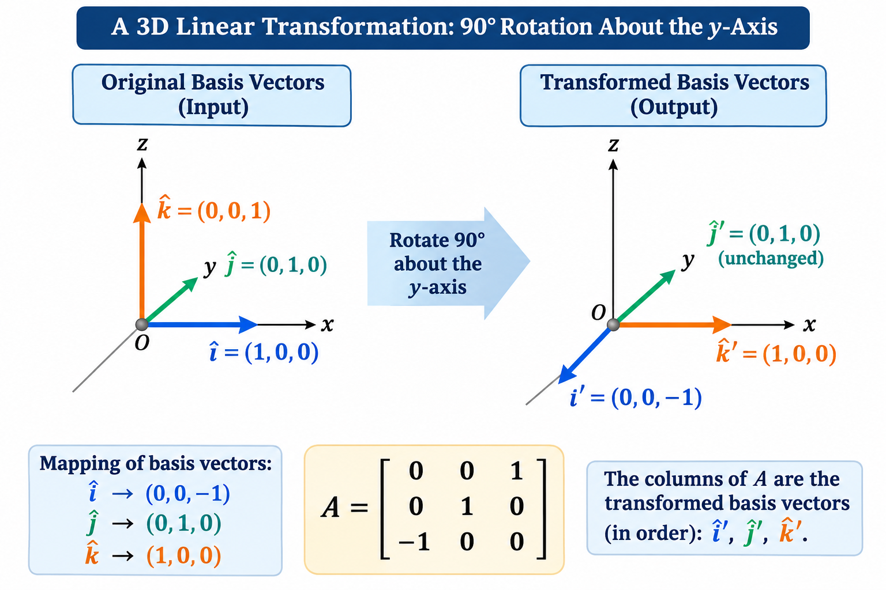

# Lecture 05 — Three-Dimensional Linear Transformations

> **Learning goal:** Understand how the ideas of linear transformations and matrices extend from a flat 2D plane into 3D space, and how a 3 × 3 matrix describes a transformation completely.

These notes follow the lecture in its original teaching order. The explanations and small numerical examples are expanded for a first-time learner.

## 1. From two dimensions to three dimensions

In the previous lectures, a vector had two coordinates, such as

$$
\begin{bmatrix}x\\y\end{bmatrix}.
$$

You can picture it as an arrow on a flat sheet of paper. A 2D linear transformation moves, rotates, stretches, or otherwise changes those arrows while preserving the defining properties of a linear transformation.

This lecture asks: **What changes if vectors have three coordinates instead?**

A 3D vector has an additional coordinate:

$$
\mathbf v=\begin{bmatrix}x\\y\\z\end{bmatrix}.
$$

- $x$ tells us how far the vector goes in the x direction.
- $y$ tells us how far it goes in the y direction.
- $z$ tells us how far it goes in the z direction (depth or height, depending on the chosen coordinate system).

Think of moving from a flat drawing to a room. On a sheet of paper you can move left/right and forward/backward on the page. In a room, you can also move up/down. That extra independent direction is the third dimension.

### What does a 3D transformation do?

Imagine every point in a 3D space being moved according to the same transformation rule. A grid is a useful way to visualize this: it gives us many points and lines to watch.

a transformed grid whose:

- grid lines remain straight and parallel to one another;
- spacing along a line remains even;
- origin stays fixed.

The grid is a visual aid. Each point can be treated as the tip of a vector starting at the origin. So, when a point moves, we can think of its corresponding vector moving.

**Why keep the origin fixed?** A linear transformation maps the zero vector to the zero vector. In the grid picture, that means the origin does not move.

A useful mental image is a transparent 3D lattice made of evenly spaced lines. A transformation may rotate, stretch, compress, or shear the lattice, but it does so consistently.

## 2. The three standard basis vectors

The key idea from the 2D lectures still works: **a linear transformation is completely determined by where it sends the standard basis vectors.**

In 2D, there are two standard basis vectors:

$$
\hat{\mathbf i}=\begin{bmatrix}1\\0\end{bmatrix},
\qquad
\hat{\mathbf j}=\begin{bmatrix}0\\1\end{bmatrix}.
$$

In 3D, we need a third one:

$$
\hat{\mathbf i}=\begin{bmatrix}1\\0\\0\end{bmatrix},\quad
\hat{\mathbf j}=\begin{bmatrix}0\\1\\0\end{bmatrix},\quad
\hat{\mathbf k}=\begin{bmatrix}0\\0\\1\end{bmatrix}.
$$

They are called **standard basis vectors** or, informally, the three unit-direction arrows.

- $\hat{\mathbf i}$ points one unit along the x-axis.
- $\hat{\mathbf j}$ points one unit along the y-axis.
- $\hat{\mathbf k}$ points one unit along the z-axis.

Each has length 1 and points along exactly one coordinate direction.

### Why are these three arrows enough?

Any 3D vector can be assembled by scaling and adding these basis vectors:

$$
\mathbf v=
\begin{bmatrix}x\\y\\z\end{bmatrix}
=x\hat{\mathbf i}+y\hat{\mathbf j}+z\hat{\mathbf k}.
$$

For example,

$$
\begin{bmatrix}2\\3\\1\end{bmatrix}
=2\begin{bmatrix}1\\0\\0\end{bmatrix}
+3\begin{bmatrix}0\\1\\0\end{bmatrix}
+\begin{bmatrix}0\\0\\1\end{bmatrix}.
$$

Read this as instructions:

1. Take two copies' worth of the x-direction arrow.
2. Take three copies' worth of the y-direction arrow.
3. Take one copy of the z-direction arrow.
4. Add those three contributions.

The result is the vector that ends at $(2,3,1)$.

A linear transformation preserves this scaling-and-adding structure. Therefore, if we know where the three basis vectors go, we can work out where every other vector goes. We do not need to track every point in the entire 3D grid individually.

### A small abstract example

Suppose a transformation $T$ sends the basis vectors to:

$$
T(\hat{\mathbf i})=\begin{bmatrix}2\\0\\0\end{bmatrix},\quad
T(\hat{\mathbf j})=\begin{bmatrix}0\\1\\1\end{bmatrix},\quad
T(\hat{\mathbf k})=\begin{bmatrix}1\\0\\1\end{bmatrix}.
$$

Then, by linearity,

$$
T\left(\begin{bmatrix}x\\y\\z\end{bmatrix}\right)
=xT(\hat{\mathbf i})+yT(\hat{\mathbf j})+zT(\hat{\mathbf k}).
$$

The three transformed basis vectors contain all the information needed to calculate the output.

## 3. Writing the transformation as a 3 × 3 matrix

In 2D, the two transformed basis vectors are placed as the two columns of a 2 × 2 matrix. In 3D, do exactly the same thing, but use three columns.

If

$$
T(\hat{\mathbf i})=\begin{bmatrix}a\\d\\g\end{bmatrix},\quad
T(\hat{\mathbf j})=\begin{bmatrix}b\\e\\h\end{bmatrix},\quad
T(\hat{\mathbf k})=\begin{bmatrix}c\\f\\i\end{bmatrix},
$$

then the transformation matrix is

$$
A=
\begin{bmatrix}
a&b&c\\
d&e&f\\
g&h&i
\end{bmatrix}.
$$

**Column rule:** the first column is where $\hat{\mathbf i}$ lands, the second column is where $\hat{\mathbf j}$ lands, and the third column is where $\hat{\mathbf k}$ lands.

A 3 × 3 matrix has nine entries. Those nine numbers describe the transformation completely. This is why we can focus on the three basis vectors instead of trying to follow the full 3D grid.

### Visual reference: the y-axis rotation

## 4. Worked example: rotate 3D space 90° around the y-axis

The lecture now gives a concrete example: rotate the entire 3D space by 90 degrees around the y-axis.

Imagine a vertical or central axis running in the y direction. The rotation happens around that axis. The y-axis itself does not change direction; the x and z directions rotate around it.

Tracks the three basis vectors one at a time.

### 4.1 Where does $\hat{\mathbf i}$ go?

Initially,

$$
\hat{\mathbf i}=\begin{bmatrix}1\\0\\0\end{bmatrix}.
$$

After the 90° rotation specified in the lecture, it points in the negative z direction:

$$
T(\hat{\mathbf i})=\begin{bmatrix}0\\0\\-1\end{bmatrix}.
$$

The negative sign matters: it means the arrow points opposite to the positive z direction.

### 4.2 Where does $\hat{\mathbf j}$ go?

Initially,

$$
\hat{\mathbf j}=\begin{bmatrix}0\\1\\0\end{bmatrix}.
$$

This vector lies along the rotation axis. Rotating space around the y-axis leaves that axis unchanged:

$$
T(\hat{\mathbf j})=\begin{bmatrix}0\\1\\0\end{bmatrix}.
$$

### 4.3 Where does $\hat{\mathbf k}$ go?

Initially,

$$
\hat{\mathbf k}=\begin{bmatrix}0\\0\\1\end{bmatrix}.
$$

It moves to the positive x direction:

$$
T(\hat{\mathbf k})=\begin{bmatrix}1\\0\\0\end{bmatrix}.
$$

### 4.4 Build the matrix from the three results

Put the three output vectors into the columns, in the same order as the original basis vectors:

$$
A=
\begin{bmatrix}
\vert&\vert&\vert\\
T(\hat{\mathbf i})&T(\hat{\mathbf j})&T(\hat{\mathbf k})\\
\vert&\vert&\vert
\end{bmatrix}
=
\begin{bmatrix}
0&0&1\\
0&1&0\\
-1&0&0
\end{bmatrix}.
$$

Read the columns carefully:

| Column | Values | Meaning |
|---|---|---|
| 1 | $(0,0,-1)$ | Where $\hat{\mathbf i}$ goes |
| 2 | $(0,1,0)$ | Where $\hat{\mathbf j}$ goes |
| 3 | $(1,0,0)$ | Where $\hat{\mathbf k}$ goes |

**Remember:** columns are transformed basis vectors. Do not accidentally put them in rows.

> The matrix is not a list of the original basis vectors. It is a record of where those basis vectors end up after the transformation.

## 5. Transforming any vector with the matrix

The next question is: if we know the matrix, how do we find the destination of an arbitrary vector?

The same scaling-and-adding idea used to build a vector from basis vectors also works after transformation.

Start with

$$
\mathbf v=
\begin{bmatrix}x\\y\\z\end{bmatrix}
=x\hat{\mathbf i}+y\hat{\mathbf j}+z\hat{\mathbf k}.
$$

Apply $T$ to both sides. Because $T$ is linear, it distributes over addition and allows scalar multiples to remain outside:

$$
T(\mathbf v)=xT(\hat{\mathbf i})+yT(\hat{\mathbf j})+zT(\hat{\mathbf k}).
$$

In words:

1. Scale the transformed $\hat{\mathbf i}$ by $x$.
2. Scale the transformed $\hat{\mathbf j}$ by $y$.
3. Scale the transformed $\hat{\mathbf k}$ by $z$.
4. Add the three resulting vectors.

Those transformed basis vectors are exactly the columns of $A$. This is what matrix-vector multiplication does:

$$
A\mathbf v=
\begin{bmatrix}
0&0&1\\
0&1&0\\
-1&0&0
\end{bmatrix}
\begin{bmatrix}x\\y\\z\end{bmatrix}
=
\begin{bmatrix}
0x+0y+1z\\
0x+1y+0z\\
-1x+0y+0z
\end{bmatrix}
=
\begin{bmatrix}z\\y\\-x\end{bmatrix}.
$$

So this rotation maps

$$
\boxed{(x,y,z)\longmapsto(z,y,-x)}.
$$

### Worked numerical example

Take the vector

$$
\mathbf v=\begin{bmatrix}2\\3\\4\end{bmatrix}.
$$

Multiply the matrix by the vector, row by row:

$$
A\mathbf v=
\begin{bmatrix}
0(2)+0(3)+1(4)\\
0(2)+1(3)+0(4)\\
-1(2)+0(3)+0(4)
\end{bmatrix}
=
\begin{bmatrix}4\\3\\-2\end{bmatrix}.
$$

The output is $(4,3,-2)$.

Notice what happened:

- the old z-coordinate, 4, becomes the new x-coordinate;
- the y-coordinate, 3, stays unchanged;
- the old x-coordinate, 2, becomes the negative new z-coordinate.

This is a useful way to check the answer against the three basis-vector movements.

## 6. Multiplying two 3 × 3 matrices: doing transformations in sequence

The lecture now returns to matrix multiplication.

A matrix represents a transformation. What should it mean to multiply two transformation matrices?

Suppose $A$ and $B$ are two 3 × 3 matrices. The product $AB$ represents two transformations applied one after another:

1. Apply the transformation represented by the **right-hand matrix** $B$ first.
2. Apply the transformation represented by the **left-hand matrix** $A$ second.

For a vector $\mathbf v$,

$$
(AB)\mathbf v=A(B\mathbf v).
$$

The parentheses show the order clearly: $B$ acts on the vector first; then $A$ acts on the result.

### Why is the right-hand matrix applied first?

Imagine a point going through two machines:

- Machine $B$ receives the original vector and produces an intermediate vector.
- Machine $A$ receives that intermediate vector and produces the final vector.

The combined machine is represented by $AB$. This is called composing transformations.

A common beginner mistake is to read $AB$ from left to right as “do A, then B.” For column vectors, that is backwards: **the rightmost matrix acts first.**

### How is the product calculated?

The numerical rule is the same as in 2D. Each entry in the product comes from taking a row of the left matrix and a column of the right matrix, multiplying corresponding entries, and adding the results.

For example, if

$$
A=\begin{bmatrix}a_{11}&a_{12}&a_{13}\\a_{21}&a_{22}&a_{23}\\a_{31}&a_{32}&a_{33}\end{bmatrix},
\quad
B=\begin{bmatrix}b_{11}&b_{12}&b_{13}\\b_{21}&b_{22}&b_{23}\\b_{31}&b_{32}&b_{33}\end{bmatrix},
$$

then the top-left entry of $AB$ is

$$
(AB)_{11}=a_{11}b_{11}+a_{12}b_{21}+a_{13}b_{31}.
$$

The same row-by-column process fills all nine entries.

The important conceptual point is not just the arithmetic: the product matrix must behave exactly like applying the two transformations successively. That is why the row-by-column multiplication rule is useful.

## 7. Why 3D matrix multiplication matters: graphics and robotics

Two practical fields where 3D matrix multiplication is especially important:

- **Computer graphics:** objects in a 3D scene need to be rotated and transformed to create different views and animations.
- **Robotics:** robot parts and tools need their positions and orientations described relative to one another.

A complicated movement can be easier to understand as a sequence of simpler movements. Instead of reasoning about one complicated transformation all at once, we can break it into smaller transformations and combine their matrices.

For example, a graphics system may rotate an object, then apply another rotation to orient it for a camera. A robot may express one movement relative to a joint and then combine it with the position of the rest of the arm. Matrix multiplication provides a compact way to combine these steps.

The lecture does not derive a specific graphics or robotics calculation; these are applications illustrating why 3D matrix multiplication is useful.

## 8. The suggested understanding check

Suggests using the previous lesson's matrix multiplication rule as a test: reason out what multiplying two 3 × 3 matrices should look like by thinking about two successive transformations in space.

Try to answer these questions before looking at the answers below:

1. Why are three basis vectors needed in 3D, rather than two?
2. In a transformation matrix, what does the second column represent?
3. For the lecture's y-axis rotation, where does $\hat{\mathbf i}$ go?
4. What does the matrix do to a general vector $(x,y,z)$?
5. In $AB\mathbf v$, which matrix acts on $\mathbf v$ first?
6. Why might a graphics programmer combine several simple transformations?

### Answers

1. 3D vectors have three independent coordinate directions, x, y and z.
2. The second column is the transformed vector $T(\hat{\mathbf j})$.
3. It goes to $(0,0,-1)$, the negative z direction.
4. It maps $(x,y,z)$ to $(z,y,-x)$.
5. $B$, the right-hand matrix, acts first.
6. A complex movement can be built from simpler transformations, which are easier to reason about and combine.

## 9. Key takeaways

- A 3D vector has three coordinates: $(x,y,z)$.
- The three standard basis vectors are $\hat{\mathbf i}=(1,0,0)$, $\hat{\mathbf j}=(0,1,0)$, and $\hat{\mathbf k}=(0,0,1)$.
- A 3D linear transformation is completely determined by where those three basis vectors go.
- Put the transformed basis vectors into the **columns** of a 3 × 3 matrix.
- For the lecture's 90° y-axis rotation:

 $$
 A=\begin{bmatrix}0&0&1\\0&1&0\\-1&0&0\end{bmatrix},
 \qquad
 A\begin{bmatrix}x\\y\\z\end{bmatrix}
 =\begin{bmatrix}z\\y\\-x\end{bmatrix}.
 $$

- Matrix multiplication combines transformations. With column vectors, the right-hand matrix acts first.
- 3D matrix multiplication is useful in computer graphics and robotics.

## 10. Common misconceptions to avoid

| Misconception | Correct understanding |
|---|---|
| A 3D transformation needs a completely new idea. | The same basis-vector idea from 2D extends to 3D; we simply add a third basis vector. |
| The columns contain the original basis vectors. | The columns contain the **transformed** basis vectors. |
| The y basis vector must move because the space is rotating. | A rotation around the y-axis leaves vectors along that axis unchanged. |
| Matrix multiplication $AB$ applies $A$ first. | For column vectors, $B$ acts first, then $A$. |
| We must track every point in the 3D grid. | Tracking the three basis vectors is enough to determine a linear transformation. |

## 11. What comes next?

In closing, saying that the next chapter will begin the topic of the **determinant**. This lecture itself does not explain the determinant, so these notes do not attempt to introduce its rules or properties.
