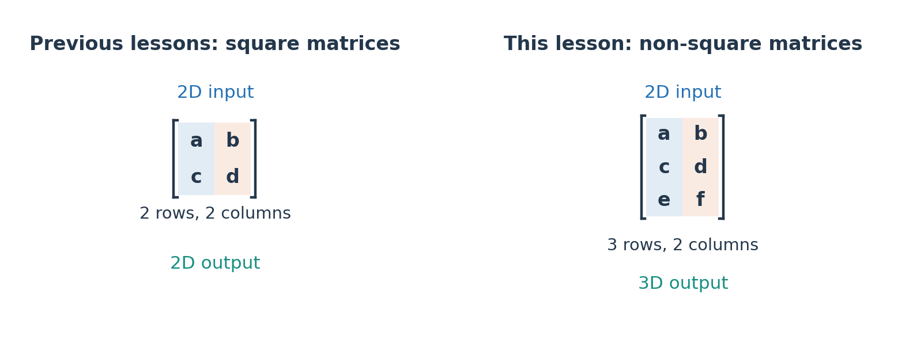
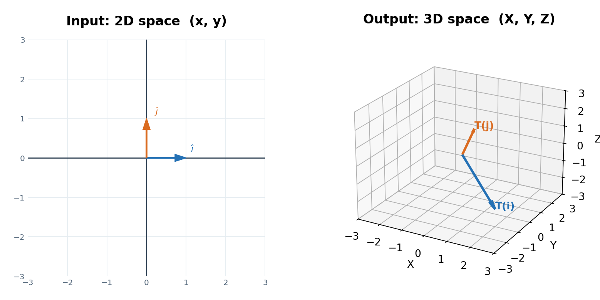
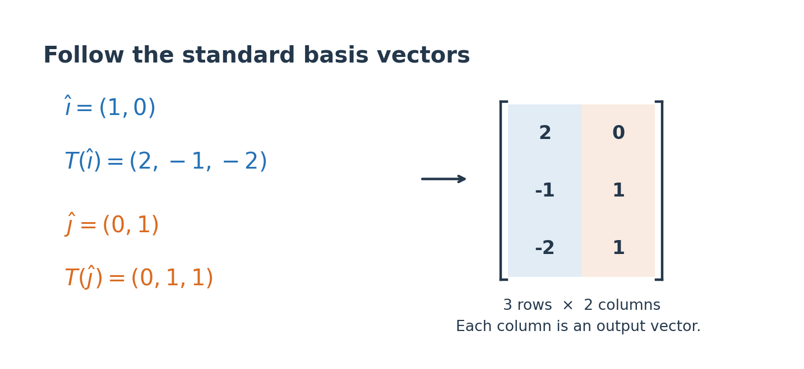
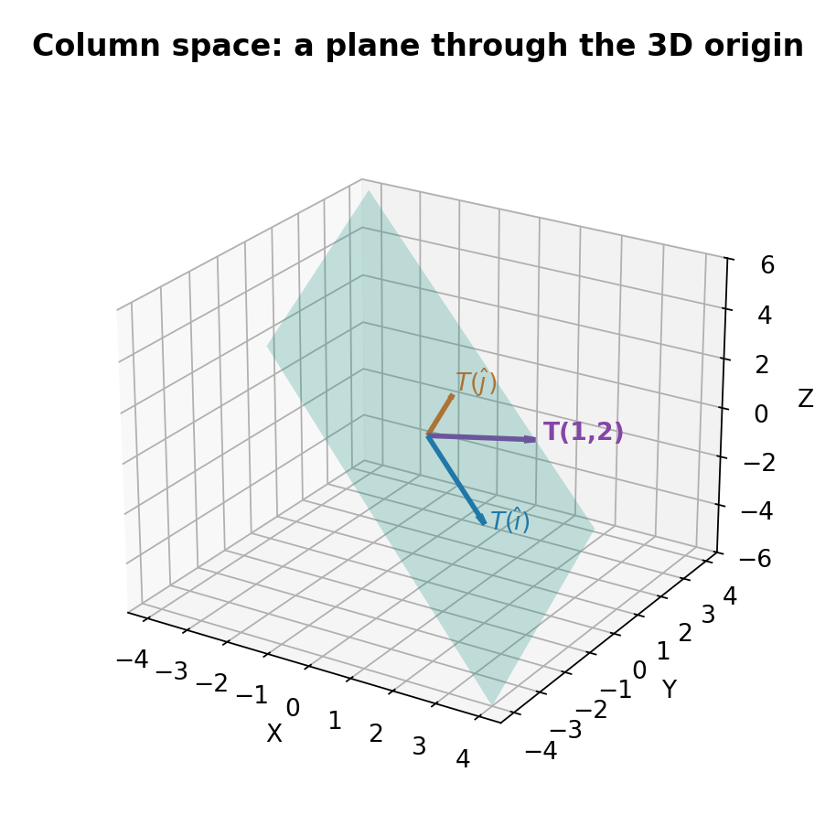
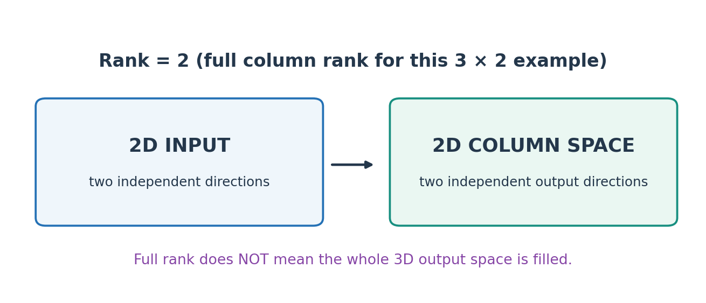
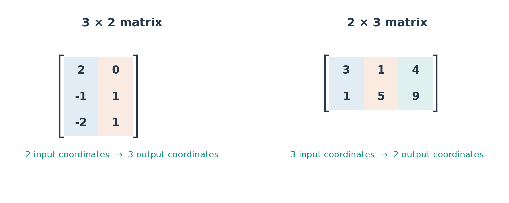
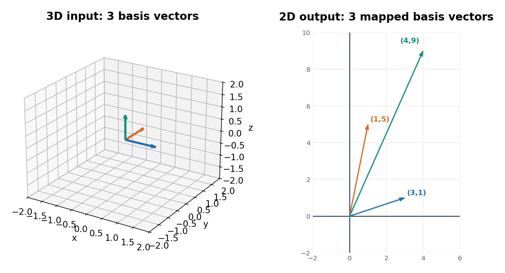
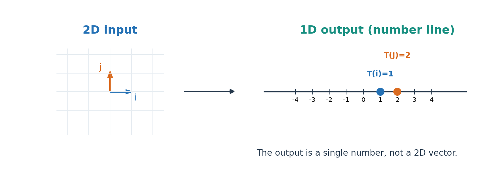
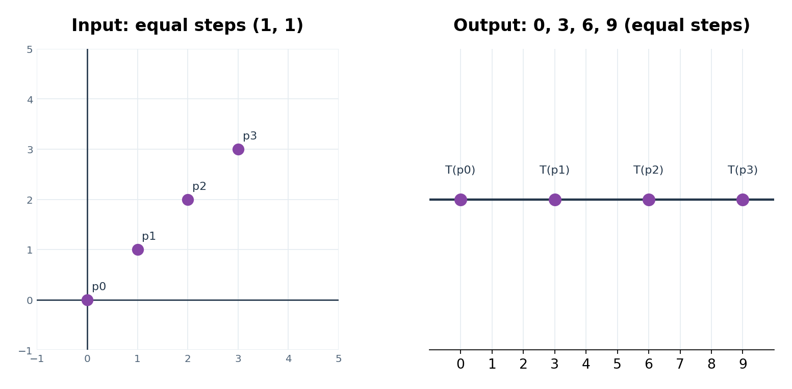
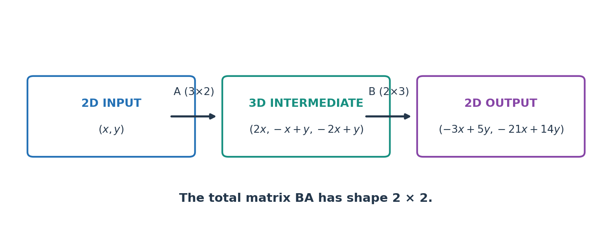

# 08 — Nonsquare Matrices as Transformations Between Dimensions

**Series:** Essence of Linear Algebra
**Learning level:** Complete beginner
**Sources:** The attached Chapter 08 lecture and its transcript. The lecture also shows the concrete $2\times3$ and $1\times2$ matrices used below, even though their numerical entries are not stated in the transcript.
**Aim:** Understand *what a rectangular matrix does to space*, instead of just memorizing how to multiply its numbers.

> **Big idea:** A matrix with **$m$ rows and $n$ columns** represents a linear transformation from **$n$-dimensional input** to **$m$-dimensional output**:
>
> $$A:\mathbb R^n\longrightarrow\mathbb R^m.$$
>
> The **columns** tell you where the input basis vectors land. The **number of entries in each column** tells you how many coordinates each output has.

Read the sections in order: they intentionally follow the progression. Whenever an explanation or example goes beyond the lecture, it is labelled **Extra beginner explanation**.

---

## 1. What we already know: square matrices and transformations

Opens with a short reminder of the earlier chapters.

Previously, we used matrices to describe *linear transformations*: rules that accept a vector and return another vector. You can imagine a transformation as a machine:

1. Put an arrow into the machine.
2. The machine moves or changes that arrow.
3. Read off the new arrow as the output.

A **2D vector** has two coordinates, such as $(3,2)$. A **3D vector** has three, such as $(3,2,1)$.

In earlier examples, the input and output had the **same number of coordinates**:

- A **$2\times2$ matrix** took 2D vectors to 2D vectors.
- A **$3\times3$ matrix** took 3D vectors to 3D vectors.

These are *square matrices*: they have equal numbers of rows and columns.

The important point is not that a matrix has to be square. It does **not**. We now ask: **what if the input and output do not have the same number of coordinates?**

### Remember this — vectors versus dimensions

A vector is not automatically a 2D arrow. A vector can have two, three, or many coordinates. Here, **dimension** simply tells you how many coordinates are needed to describe a vector in the chosen space. We will work with ordinary real-number coordinates throughout.

---

## 2. A linear transformation can go from 2D to 3D

The first new idea is surprisingly simple:

**A perfectly valid transformation can take a vector from one dimension-count to another.**

For example:

$$T:\mathbb R^2\rightarrow\mathbb R^3.$$

Read this slowly:

- $T$ means the transformation (the rule or machine).
- $\mathbb R^2$ means **all pairs of real numbers**, such as $(1,2)$.
- $\mathbb R^3$ means **all triples of real numbers**, such as $(2,1,0)$.
- The arrow $\rightarrow$ means *maps to* or *turns into*.

So the machine might accept $(1,2)$ and return $(2,1,0)$. That example is just one input and one output; to specify the whole transformation we need a rule that works for **every** 2D input.

### What does it mean for such a transformation to be *linear*?

Recall the visual intuition from earlier chapters: a linear transformation keeps the origin fixed, and the transformed grid behaves in a straight, evenly spaced way rather than bending arbitrarily.

The more precise, generally useful test is:

$$\boxed{T(\mathbf u+\mathbf v)=T(\mathbf u)+T(\mathbf v)}$$

and

$$\boxed{T(c\mathbf v)=c\,T(\mathbf v)}.$$

**Extra beginner explanation:** The first rule says that adding two vectors *before* transforming must give the same result as transforming each and then adding. The second says that doubling an input doubles its output. These properties imply that the zero vector maps to the zero vector, even when the input and output dimensions differ.

### The input and output spaces are separate

This part of the explanation is easy to overlook but important.

In an ordinary 2D-to-2D animation, it looks as though all the input arrows are moving around within one plane. For a 2D-to-3D transformation, the input is a **flat 2D coordinate space** and the output belongs to a **different 3D coordinate space**.

The lecture therefore shows the two spaces **side by side** rather than pretending every point is physically traveling from one to the other. The transformation defines a relationship between vectors; it does not require a literal journey through physical space.

**Think of an everyday analogy:** a machine can accept a pair, such as `(hours studied, practice problems solved)`, and produce three numbers, such as `(score A, score B, score C)`. The input has two features; the output has three. This analogy is only about the *shape* of the input and output; a real-world machine is linear only if it obeys the two mathematical rules above.

---

## 3. How do we record a 2D-to-3D transformation?

Now connects today's topic with the most important idea from the previous chapter:

> To determine a linear transformation, you only need to know **where the input basis vectors land**.

### 3.1 What are the basis vectors again?

In ordinary 2D coordinates, we use two standard basis vectors:

$$\hat{\imath}=\begin{bmatrix}1\\0\end{bmatrix},\qquad
\hat{\jmath}=\begin{bmatrix}0\\1\end{bmatrix}.$$

- $\hat{\imath}$ means *one step to the right*.
- $\hat{\jmath}$ means *one step upward*.

Any 2D vector can be made by scaling these two arrows and adding them. For example:

$$\begin{bmatrix}3\\-2\end{bmatrix}
=3\begin{bmatrix}1\\0\end{bmatrix}
-2\begin{bmatrix}0\\1\end{bmatrix}
=3\hat{\imath}-2\hat{\jmath}.$$

The first coordinate tells us how much of $\hat{\imath}$ to use; the second tells us how much of $\hat{\jmath}$ to use.

### 3.2 Follow each basis vector in the lecture's example

In the lecture, Note:

$$T(\hat{\imath})=\begin{bmatrix}2\\-1\\-2\end{bmatrix}$$

and

$$T(\hat{\jmath})=\begin{bmatrix}0\\1\\1\end{bmatrix}.$$

Read the first result as: the input arrow $(1,0)$ becomes the **3D output arrow $(2,-1,-2)$**.

Read the second as: the input arrow $(0,1)$ becomes the **3D output arrow $(0,1,1)$**.

Notice what changed: each input basis vector had **two coordinates**, but its landing point has **three coordinates**.

### 3.3 Put those landing spots into the columns

Write the output of $\hat{\imath}$ as **column 1**, then the output of $\hat{\jmath}$ as **column 2**:

$$\boxed{A=\begin{bmatrix}
2&0\\
-1&1\\
-2&1
\end{bmatrix}}$$

Let's count carefully:

| What we count | What we see | What it means |
|---|---|---|
| Columns | 2 | Two input basis vectors; inputs have **2 coordinates** |
| Rows | 3 | Three numbers per output; outputs have **3 coordinates** |

This is called a **$3\times2$ matrix**, pronounced *three by two*. Matrices are named **rows first, columns second**.

The important insight: **nothing new is required to construct a non-square matrix.** We use exactly the same basis-vector idea as for square matrices.

### 3.4 How to transform an arbitrary input

**Extra beginner example (using the matrix):** Suppose we put the input vector $(1,2)$ into the machine.

First express it using the basis:

$$\begin{bmatrix}1\\2\end{bmatrix}=1\hat{\imath}+2\hat{\jmath}.$$

Linearity tells us to apply those **same scalars** to the new basis-vector landing spots:

$$T(1,2)=1T(\hat{\imath})+2T(\hat{\jmath}).$$

Substitute the two columns:

$$\begin{aligned}
T(1,2)&=1\begin{bmatrix}2\\-1\\-2\end{bmatrix}
+2\begin{bmatrix}0\\1\\1\end{bmatrix}\\[4pt]
&=\begin{bmatrix}2\\-1\\-2\end{bmatrix}
+\begin{bmatrix}0\\2\\2\end{bmatrix}\\[4pt]
&=\boxed{\begin{bmatrix}2\\1\\0\end{bmatrix}}.
\end{aligned}$$

Why is the result 3D? Because the **output columns are 3D vectors**. Adding and scaling them cannot magically turn them back into 2D vectors.

For a general input $(x,y)$, the same reasoning gives:

$$\boxed{T(x,y)=
\begin{bmatrix}
2x\\-x+y\\-2x+y
\end{bmatrix}.}$$

You can test this by replacing $x$ with $1$ and $y$ with $2$.

### Try the first animation

<strong>Interactive:</strong> Interactive animation 01 — 2D input to 3D output

<iframe
 src="../animations/animation-01-2d-to-3d.html"
 title="Interactive animation 01 — 2D input to 3D output"
 width="100%"
 height="820"
 style="max-width:980px;border:1px solid #dce4ef;border-radius:12px;background:#f3f6fb;"
 loading="lazy">
</iframe>

<a href="../animations/animation-01-2d-to-3d.html">Open Interactive animation 01 — 2D input to 3D output in full tab</a> if the embed does not load.

Use **Play**, **Step**, and the $x$ and $y$ sliders to see the input vector, its two transformed basis vectors, the resulting plane, and its final output.

---

## 4. Column space: why the output occupies a plane in 3D

Then asks us to imagine every possible input pair $(x,y)$, not just one selected example.

All outputs have this form:

$$T(x,y)=x\begin{bmatrix}2\\-1\\-2\end{bmatrix}
+y\begin{bmatrix}0\\1\\1\end{bmatrix}.$$

Remember **linear combination** from Chapter 02? It means multiplying vectors by numbers and then adding them. Here we can freely choose $x$ and $y$, so we can reach every linear combination of the **two matrix columns**.

The collection of all those outputs is the **column space** of $A$. Another name is the *image of the transformation*.

### Why does the column space form a plane?

The two output arrows do not point along the same line. One is $(2,-1,-2)$; the other is $(0,1,1)$. Since they point in genuinely different directions, we can scale each independently to cover a **flat 2D plane passing through the origin**, even though that plane sits inside **3D space**.

An analogy: imagine a large **flat sheet of paper floating through a room**. The room is 3D, but the sheet itself has only two independent directions. You can choose two coordinates to specify a point on the sheet.

This is why the **column space of this matrix has dimension 2**.

### 4.1 Why does this lesson call this matrix *full rank*?

**Rank** counts the number of linearly independent directions represented by the columns. Here the two columns are independent:

- The first column has first coordinate $2$.
- The second has first coordinate $0$.
- The second is not a multiple of the first, and neither is the zero vector.

Therefore:

$$\operatorname{rank}(A)=2.$$

Because the input has two dimensions and the rank is also two, **no input direction has been lost**. For this rectangular $3\times2$ matrix, we say it has **full column rank**.

**Important distinction:** Full column rank does **not** mean the outputs fill all of 3D space. They still lie on a plane. It means the transformation has preserved both independent directions of the 2D input.

**Extra beginner clarification:** Not **every** $3\times2$ matrix has rank 2. For example, if its two columns are multiples of each other, the image is only a **line** (or even the origin if both are zero). The particular matrix has rank 2.

### Check your understanding

If an input has two coordinates, can a matrix give it an output with three coordinates? **Yes.** Does it follow that the outputs must fill *all* of 3D space? **No.** Here they fill just a plane.

---

## 5. The general rule: columns tell the input; rows tell the output

Steps back from the example to give a reusable rule:

$$\boxed{\underbrace{m\times n}_{\text{matrix shape}}
\quad\Longrightarrow\quad
\underbrace{\mathbb R^n}_{\text{input}}
\longrightarrow
\underbrace{\mathbb R^m}_{\text{output}}.}$$

In words: for a matrix with **$m$ rows** and **$n$ columns**, the input vector has **$n$ entries** and the output vector has **$m$ entries**.

Why does this work?

1. Each **input basis vector** needs its own column. There are $n$ such vectors, so there are $n$ columns.
2. Each **transformed basis vector** must give coordinates in the output space. There are $m$ coordinates in each output, so every column has $m$ entries (rows).

If you like to think of the matrix as a machine:

$$\underbrace{\begin{bmatrix}
\cdots&\cdots\\
\cdots&\cdots\\
\cdots&\cdots
\end{bmatrix}}_{3\times2}
\underbrace{\begin{bmatrix}x\\y\end{bmatrix}}_{2\text{ numbers}}
=
\underbrace{\begin{bmatrix}X\\Y\\Z\end{bmatrix}}_{3\text{ numbers}}.$$

The two inner dimensions (**2** and **2**) match: this matrix is allowed to multiply this input vector.

---

## 6. Now reverse the situation: a 2 × 3 matrix takes 3D to 2D

Next this lesson reverses the direction:

> What would a matrix with **two rows and three columns** mean?

Use the same rule:

- **Three columns** $\Rightarrow$ three input basis vectors $\Rightarrow$ **3D input**.
- **Two rows** $\Rightarrow$ two output coordinates $\Rightarrow$ **2D output**.

So:

$$\boxed{B:\mathbb R^3\longrightarrow\mathbb R^2.}$$

### 6.1 The matrix shown in the lecture

The lecture illustrates this idea with the following matrix (its entries are visible on screen):

$$\boxed{B=\begin{bmatrix}3&1&4\\1&5&9\end{bmatrix}.}$$

Its three columns describe where the three **3D input basis vectors** land:

$$B\begin{bmatrix}1\\0\\0\end{bmatrix}
=\begin{bmatrix}3\\1\end{bmatrix},\quad
B\begin{bmatrix}0\\1\\0\end{bmatrix}
=\begin{bmatrix}1\\5\end{bmatrix},\quad
B\begin{bmatrix}0\\0\\1\end{bmatrix}
=\begin{bmatrix}4\\9\end{bmatrix}.$$

Here we have **three different input directions**, and each one lands somewhere in a **2D output plane**.

### 6.2 Extra beginner calculation: use all three input coordinates

Take the input:

$$\mathbf v=\begin{bmatrix}1\\1\\0\end{bmatrix}.$$

The result must be **one copy of column 1**, plus **one copy of column 2**, plus **zero copies of column 3**:

$$\begin{aligned}
B\mathbf v&=1\begin{bmatrix}3\\1\end{bmatrix}
+1\begin{bmatrix}1\\5\end{bmatrix}
+0\begin{bmatrix}4\\9\end{bmatrix}\\[4pt]
&=\begin{bmatrix}3+1+0\\1+5+0\end{bmatrix}
=\boxed{\begin{bmatrix}4\\6\end{bmatrix}}.
\end{aligned}$$

Notice that we started with three coordinates $(1,1,0)$ but got only two $(4,6)$. That's exactly what a $2\times3$ matrix does.

For an arbitrary input $(x,y,z)$, this matrix gives:

$$\boxed{B(x,y,z)=\begin{bmatrix}
3x+y+4z\\x+5y+9z
\end{bmatrix}.}$$

### 6.3 Why does reducing dimensions feel strange?

Jokes that such a transformation should feel uncomfortable to imagine. We are taking information described using **three coordinates** and reducing it to **two**.

**Extra beginner explanation:** Imagine a 3D object and its 2D shadow. Different 3D points can have the same shadow position; the shadow cannot always tell you which 3D point you started with.

For a very simple example (not the matrix displayed in the lecture), consider:

$$P=\begin{bmatrix}1&0&0\\0&1&0\end{bmatrix},\qquad P(x,y,z)=(x,y).$$

Then $P(2,3,4)=(2,3)$ and $P(2,3,9)=(2,3)$. Both produce **exactly the same output**, even though the inputs are different.

**Precision note:** A $2\times3$ matrix always outputs 2D vectors, but whether its outputs fill the entire output plane or only a line depends on its rank. The lecture’s displayed matrix has rank 2, so its outputs do fill the 2D plane.

### Try the second animation

<strong>Interactive:</strong> Interactive animation 02 — 3D input to 2D output

<iframe
 src="../animations/animation-02-3d-to-2d.html"
 title="Interactive animation 02 — 3D input to 2D output"
 width="100%"
 height="820"
 style="max-width:980px;border:1px solid #dce4ef;border-radius:12px;background:#f3f6fb;"
 loading="lazy">
</iframe>

<a href="../animations/animation-02-3d-to-2d.html">Open Interactive animation 02 — 3D input to 2D output in full tab</a> if the embed does not load.

Move $x$, $y$, and $z$. Observe that the machine always produces just **two output coordinates**.

---

## 7. Going further: a 2D vector can turn into one number

The final main example is a transformation from two dimensions to **one dimension**:

$$T:\mathbb R^2\longrightarrow\mathbb R.$$

The symbol $\mathbb R$ without an exponent means just the real-number line. In this lesson, **1D space is a number line**.

This transformation accepts an arrow in the plane and returns a **single number**. The result is often written as a number rather than a column with one entry.

A matrix for this machine has:

- **Two columns**, because the input has two coordinates.
- **One row**, because each output needs only one number.

Its shape is therefore **$1\times2$**.

### 7.1 The example shown in the lecture notes

The visual shows the matrix:

$$\boxed{C=\begin{bmatrix}1&2\end{bmatrix}.}$$

The first input basis vector lands on **1** on the number line, and the second basis vector lands on **2**:

$$C\hat{\imath}=1,\qquad C\hat{\jmath}=2.$$

A general input vector can be written as $x\hat{\imath}+y\hat{\jmath}$. Therefore:

$$\begin{aligned}
C\begin{bmatrix}x\\y\end{bmatrix}
&=x\cdot C\hat{\imath}+y\cdot C\hat{\jmath}\\
&=x\cdot1+y\cdot2\\
&=\boxed{x+2y}.
\end{aligned}$$

The machine is simply **$C(x,y)=x+2y$**.

### 7.2 Extra beginner example: calculate one output

Suppose the input is $(3,-1)$:

$$C\begin{bmatrix}3\\-1\end{bmatrix}
=3+2(-1)=3-2=\boxed{1}.$$

We started with an arrow requiring two numbers and got **the single number 1**.

### 7.3 Why are equal-spaced dots a useful picture?

Note that a 2D grid being compressed onto a number line becomes awkward to visualize. Instead, imagine several dots on a straight line that are evenly spaced in the input plane.

For example, consider:

$$\mathbf p_0=(0,0),\quad\mathbf p_1=(1,1),\quad
\mathbf p_2=(2,2),\quad\mathbf p_3=(3,3).$$

Each dot is reached by taking the same step, $(1,1)$, from the previous one. Using the lecture’s matrix $C=[\,1\ \ 2\,]$:

$$\begin{array}{c|c}
\text{Input point}&\text{Number-line output }C(x,y)=x+2y\\\hline
(0,0)&0\\
(1,1)&3\\
(2,2)&6\\
(3,3)&9
\end{array}$$

So the output dots land at $0,3,6,9$: **still equally spaced**.

Why does this happen? Because the same input step always changes the output by the same amount. Here, each step $(1,1)$ changes the output by $C(1,1)=3$.

**Extra precision:** A nonzero input direction can sometimes map to zero. For example, $C(2,-1)=2-2=0$. In that case, equally spaced dots along that direction **collapse to one output point** rather than appearing as separated dots. This is consistent with linearity and with the description of *squishing*.

### Try the third animation

<strong>Interactive:</strong> Interactive animation 03 — 2D input to a number line

<iframe
 src="../animations/animation-03-2d-to-number-line.html"
 title="Interactive animation 03 — 2D input to a number line"
 width="100%"
 height="820"
 style="max-width:980px;border:1px solid #dce4ef;border-radius:12px;background:#f3f6fb;"
 loading="lazy">
</iframe>

<a href="../animations/animation-03-2d-to-number-line.html">Open Interactive animation 03 — 2D input to a number line in full tab</a> if the embed does not load.

Advance through the basis-vector locations, the calculated output, equally spaced dots, and two different inputs that collapse onto the same number.

---

## 8. Connection to the dot product — a preview, not the full next lesson

Closes the main teaching portion by hinting that $1\times2$ transformations have a **surprisingly important relationship** to the *dot product*, which will be explained in the next chapter.

**Extra beginner preview:** If you already know that a dot product multiplies corresponding coordinates and adds the results, then

$$\begin{bmatrix}1&2\end{bmatrix}
\begin{bmatrix}x\\y\end{bmatrix}=1x+2y$$

looks exactly like the dot product of $(1,2)$ and $(x,y)$:

$$\boxed{(1,2)\cdot(x,y)=x+2y.}$$

This is why a row matrix that maps a vector to a scalar is so useful. We will leave the deeper geometric explanation for the lecture that follows, just as in the lecture series.

---

## 9. The closing challenge: imagine matrix multiplication between dimensions

At the end of the chapter, Try to us to explore what matrix multiplication and linear systems of equations mean when the transformations change dimensions.

What happens if you first apply a $3\times2$ matrix and then a $2\times3$ matrix?

Think of the flow:

$$\underbrace{\mathbb R^2}_{\text{start}}
\xrightarrow{\ A\ }\underbrace{\mathbb R^3}_{\text{middle}}
\xrightarrow{\ B\ }\underbrace{\mathbb R^2}_{\text{finish}}.$$

The first step requires a **$3\times2$** matrix $A$; the second requires a **$2\times3$** matrix $B$. The total transformation $BA$ maps 2D inputs to 2D outputs, so $BA$ is a **$2\times2$** matrix. This is also a good reminder that matrix multiplication is read **right to left**: $BA\mathbf v$ means apply $A$ first and $B$ second.

### Extra beginner worked example (not calculated in the lecture)

Use the same $A$ and $B$ that appeared earlier:

$$A=\begin{bmatrix}2&0\\-1&1\\-2&1\end{bmatrix},\qquad
B=\begin{bmatrix}3&1&4\\1&5&9\end{bmatrix}.$$

Compute their product column by column:

- The **first column of $A$** is $(2,-1,-2)$. Applying $B$ gives $(-3,-21)$.
- The **second column of $A$** is $(0,1,1)$. Applying $B$ gives $(5,14)$.

Therefore:

$$\boxed{BA=\begin{bmatrix}-3&5\\-21&14\end{bmatrix}.}$$

Let's test the input $(1,1)$ two ways.

**Two-step method:**

$$A\begin{bmatrix}1\\1\end{bmatrix}
=\begin{bmatrix}2\\0\\-1\end{bmatrix},\qquad
B\begin{bmatrix}2\\0\\-1\end{bmatrix}
=\begin{bmatrix}6-4\\2-9\end{bmatrix}
=\begin{bmatrix}2\\-7\end{bmatrix}.$$

**Combined-matrix method:**

$$BA\begin{bmatrix}1\\1\end{bmatrix}
=\begin{bmatrix}-3+5\\-21+14\end{bmatrix}
=\boxed{\begin{bmatrix}2\\-7\end{bmatrix}}.$$

Both methods agree. This is composition from Chapter 04, now using non-square matrices!

<strong>Interactive:</strong> Interactive animation 04 — composing 2D → 3D → 2D

<iframe
 src="../animations/animation-04-composing-different-dimensions.html"
 title="Interactive animation 04 — composing 2D → 3D → 2D"
 width="100%"
 height="820"
 style="max-width:980px;border:1px solid #dce4ef;border-radius:12px;background:#f3f6fb;"
 loading="lazy">
</iframe>

<a href="../animations/animation-04-composing-different-dimensions.html">Open Interactive animation 04 — composing 2D → 3D → 2D in full tab</a> if the embed does not load.

---

## 10. Key takeaways

| Matrix shape | Input space | Output space | The basic picture |
|---|---|---|---|
| $2\times2$ | $\mathbb R^2$ | $\mathbb R^2$ | A plane transforms within a plane |
| $3\times3$ | $\mathbb R^3$ | $\mathbb R^3$ | 3D space transforms within 3D space |
| **$3\times2$** | **$\mathbb R^2$** | **$\mathbb R^3$** | A 2D input maps into a subset of 3D space |
| **$2\times3$** | **$\mathbb R^3$** | **$\mathbb R^2$** | A 3D input becomes a 2D output |
| **$1\times2$** | **$\mathbb R^2$** | **$\mathbb R$** | A 2D vector produces a number |

**Remember this shortcut:** **`ROWS = output coordinates`**, **`COLUMNS = input coordinates`**.

**More importantly:** A rectangular matrix is not an incomplete square matrix. It is a full description of a real linear transformation, potentially between spaces with different dimensions.

---

## 11. Common mistakes and how to avoid them

1. **Mistake: “A $3\times2$ matrix takes 3D inputs.”** Not so. The last number, 2, is the number of columns, hence the number of input coordinates. It takes **2D inputs** and produces **3D outputs**.
2. **Mistake: “A rectangular matrix cannot transform vectors.”** It can. Many useful transformations change the number of coordinates.
3. **Mistake: “If the output is 3D, the entire 3D room must be filled.”** The $3\times2$ example reaches only a plane within that room.
4. **Mistake: “Full rank means filling the whole output space.”** Here full **column** rank means that both input directions survive. The output can still be a 2D plane inside 3D.
5. **Mistake: “A $2\times3$ matrix always reaches every point of its output plane.”** The output *lives* in 2D. Filling that plane requires rank 2.
6. **Mistake: “A $1\times2$ output is still a 2D arrow.”** No. It is just one number (a point on the number line).
7. **Mistake: “The columns represent input basis vectors themselves.”** The columns record **where the input basis vectors land after transformation**.
8. **Mistake: “Any function changing dimensions is linear.”** No. It must also preserve vector addition and scalar multiplication.

---

## 12. Check your understanding — 12 practice questions

Try answering before opening the answer key.

1. What does the shape $3\times2$ tell you about an input and an output?
2. How many columns are needed to describe a transformation of 4D inputs?
3. If $T:\mathbb R^2\rightarrow\mathbb R^3$, how many numbers are in $T(\hat\imath)$?
4. For the lecture's $3\times2$ matrix $A$, what is $A(1,0)$?
5. For the same matrix, calculate $A(0,1)$.
6. Calculate $A(1,2)$.
7. Why does the column space of the lecture's $A$ form a plane, not the whole 3D space?
8. What does the rank 2 of $A$ mean?
9. A $2\times3$ matrix takes vectors from which space to which space?
10. Using $B=\begin{bmatrix}3&1&4\\1&5&9\end{bmatrix}$, calculate $B(1,1,0)$.
11. Using $C=\begin{bmatrix}1&2\end{bmatrix}$, calculate $C(3,-1)$.
12. What shape is $BA$ if $A$ has shape $3\times2$ and $B$ has shape $2\times3$? Which transformation happens first?

<strong>Show answer key and reasoning</strong>

1. **2D input → 3D output**. The 2 columns correspond to input coordinates; the 3 rows correspond to output coordinates.
2. **4 columns**. You need one column for the landing point of each input basis vector.
3. **3 numbers**. The output belongs to $\mathbb R^3$.
4. **$(2,-1,-2)$**. That is the first column of $A$.
5. **$(0,1,1)$**. That is the second column of $A$.
6. **$(2,1,0)$**. Compute $1(2,-1,-2)+2(0,1,1)$.
7. There are only **two independent output columns**, so their possible combinations lie in a 2D plane.
8. The two columns are **independent**: neither input direction is discarded.
9. **$\mathbb R^3\rightarrow\mathbb R^2$**. Three columns, two rows.
10. **$(4,6)$**. Add columns 1 and 2: $(3,1)+(1,5)$.
11. **$1$**. Compute $3+2(-1)$.
12. **$2\times2$**. First apply $A$, then apply $B$, so the combined matrix is $BA$.

---

## 13. Mini-glossary

| Term | Beginner-friendly meaning |
|---|---|
| Vector | An ordered list of coordinates, often pictured as an arrow |
| Dimension | Number of coordinates needed to describe a vector |
| Transformation | A rule that maps input vectors to output vectors |
| Linear | Preserves vector addition and multiplication by numbers |
| Basis vector | A reference direction used to describe other vectors |
| Matrix column | The destination of one input basis vector |
| Non-square matrix | A matrix with different numbers of rows and columns |
| Column space | All output vectors obtainable from the matrix |
| Span | Everything reachable by scaling and adding selected vectors |
| Rank | Number of independent directions available in the column space |
| Full column rank | The matrix's columns are all independent |
| Scalar | A number used to stretch or reverse a vector |
| Dot product | An operation that multiplies corresponding coordinates and adds the results; explored in the next lecture |
| Composition | Applying one transformation and then another |

---

## Suggested study path

First, reread Sections **2–3** and run <a href="../animations/animation-01-2d-to-3d.html">Animation 01</a> until you can explain why the $3\times2$ matrix has **two columns but three rows**. Then study Sections **4–6** and <a href="../animations/animation-02-3d-to-2d.html">Animation 02</a>. Finally, use <a href="../animations/animation-03-2d-to-number-line.html">Animation 03</a> to see how two coordinates can collapse into one number. The fourth animation and the composition example are optional further practice.

**One-sentence memory aid:** A matrix records where the input basis vectors land; **columns count input directions, rows count output coordinates**.
