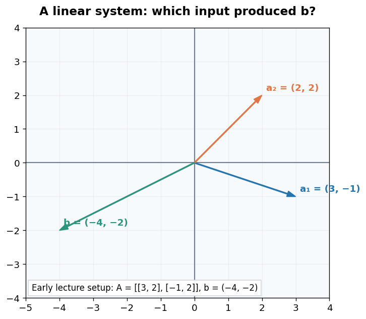
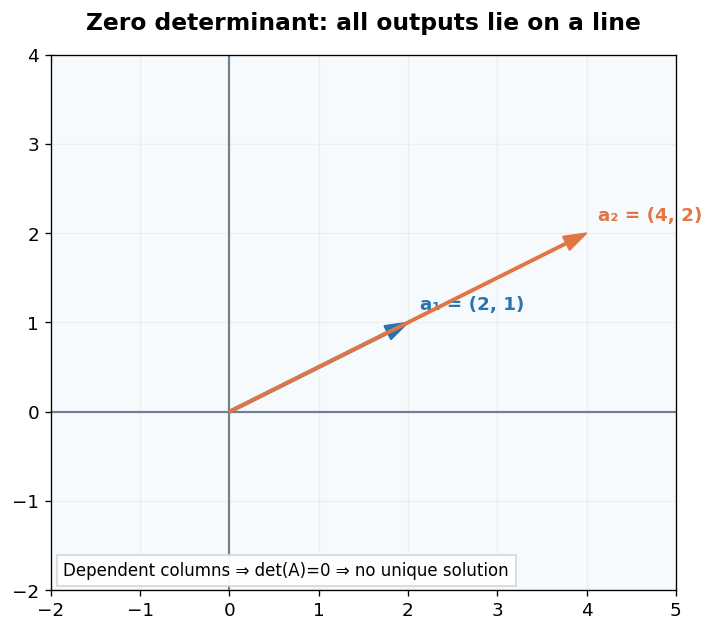
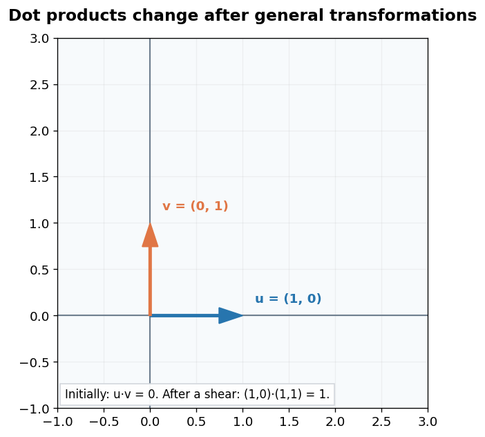
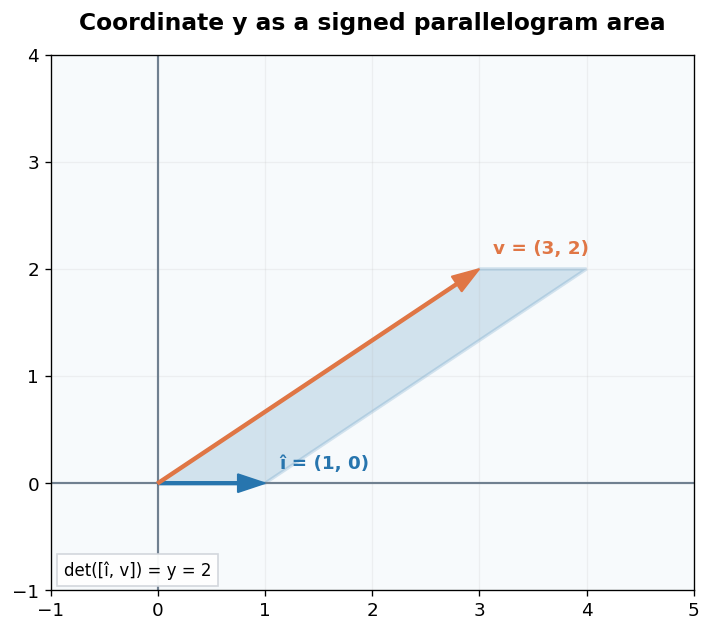
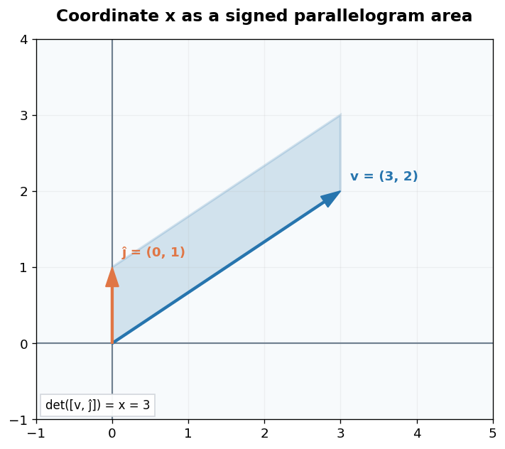
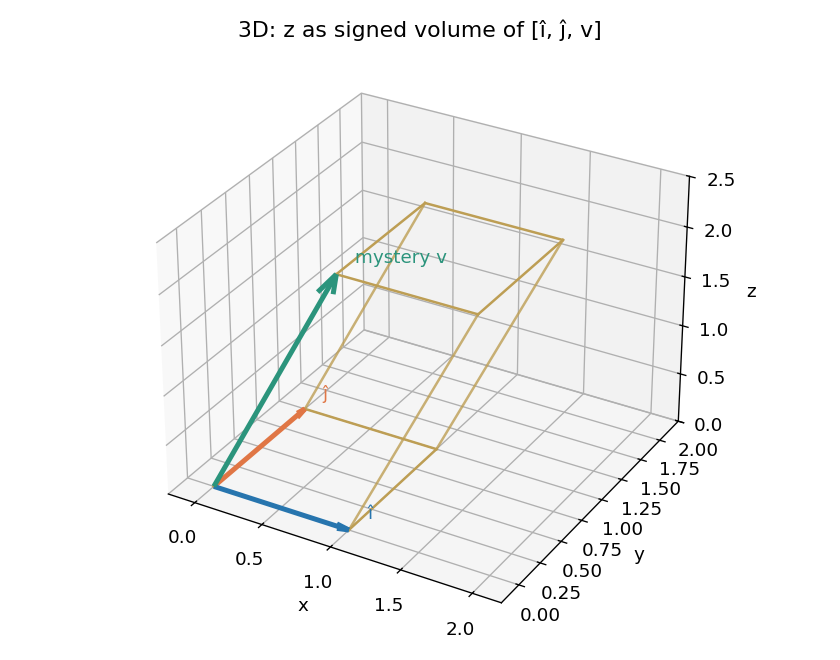
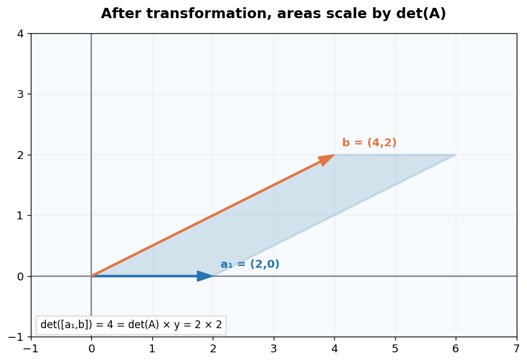
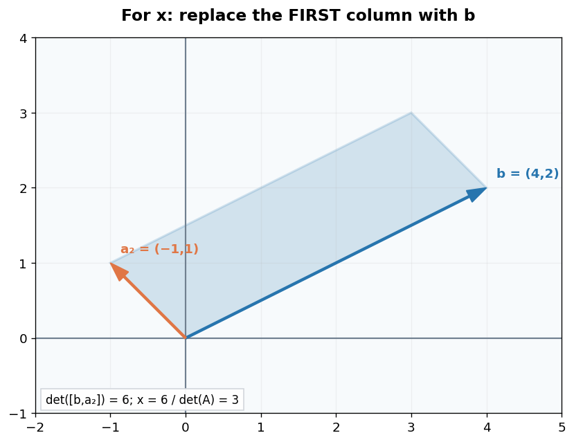
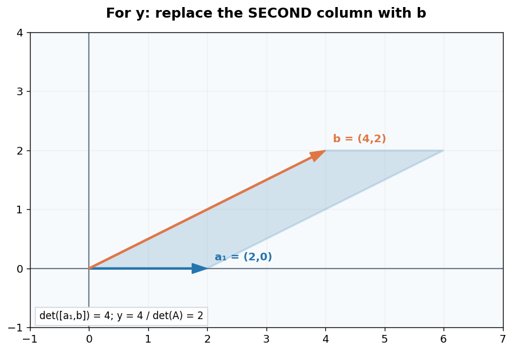

# Chapter 12 — Cramer's Rule, Explained Geometrically

**Series:** Essence of Linear Algebra 
**Source:** Provided video (approximately 12 minutes 12 seconds) and accompanying transcript. 
**Study goal:** Understand *why* the determinant ratios in Cramer's rule recover the unknown coordinates, rather than memorizing a formula.

> **How to read:** Work through the sections in order; they follow the teaching sequence. `Lecture example` means the example appears in the source. `Extra beginner explanation` or `Extra practice` identifies added teaching support. Original diagrams appear immediately after relevant discussions. Open the linked HTML files in any browser to interact with the geometry.

## 1. Why look at a way to compute a solution?

Earlier chapters explained how a **linear system of equations** can be represented by a matrix. We now ask a new question: rather than just knowing that a solution exists, **how do you calculate it?**

Suppose someone says: “I have two unknown numbers. I have two equations connecting them. What are the numbers?” This is a system of equations. Computers are commonly asked to solve such problems. Yet exploring exploring a method is valuable for understanding what is happening geometrically.

Today's method is **Cramer's rule** (named after Gabriel Cramer). You will need to remember three earlier ideas:

- **A linear system**: equations sharing unknowns, such as `2x − y = 4` and `y = 2`.
- **A determinant**: a signed number telling you how a square matrix scales area (in 2D) or volume (in 3D).
- **A dot product**: a way of combining two vectors that measures their geometric alignment and, for standard unit axes, reads off coordinates.

Important warning: that Cramer's rule is **not the preferred general computational method**. Gaussian elimination is typically more practical. We study Cramer's rule to connect *linear systems*, *transformations*, *coordinates*, and *determinants*.

**Remember this:** A method can be worth learning because it explains the mathematics, even when software uses a different algorithm.

## 2. Convert a two-equation puzzle into a matrix transformation

Consider a system with two unknowns, `x` and `y`, and two equations. Write it in the compact form

$$
A\begin{bmatrix}x\\y\end{bmatrix}=\mathbf b.
$$

Read this aloud: “Matrix `A` acts on an unknown input vector `(x,y)` and produces the known output vector `b`.” The challenge is to **find the input**.

The video initially shows the output

$$\mathbf b=\begin{bmatrix}-4\\-2\end{bmatrix}.$$

The video image for this early setup shows the two matrix columns `a₁ = (3,−1)` and `a₂ = (2,2)`, so the example can be written as

$$
\underbrace{\begin{bmatrix}3&2\\-1&2\end{bmatrix}}_{A}
\underbrace{\begin{bmatrix}x\\y\end{bmatrix}}_{\text{unknown input}}
=
\underbrace{\begin{bmatrix}-4\\-2\end{bmatrix}}_{\text{known output}}.
$$

The equations are `3x + 2y = −4` and `−x + 2y = −2`.

### Why the matrix columns matter

From earlier lectures, the first column `a₁` tells where the horizontal standard basis vector $\hat i=(1,0)$ lands, and the second column `a₂` tells where the vertical standard basis vector $\hat j=(0,1)$ lands. Therefore

$$
A\begin{bmatrix}x\\y\end{bmatrix}=x\mathbf a_1+y\mathbf a_2=\mathbf b.
$$

We know **the two directions** `a₁` and `a₂`, and we know **the destination** `b`. We need the coefficients `x` and `y` that produce it.

**Extra beginner calculation:** For this particular early system, subtracting the second equation from the first gives `4x = −2`, so `x = −1/2`; then `−(−1/2) + 2y = −2`, so `y = −5/4`. The video does *not* use this early setup for the later numerical Cramer's-rule check; those are **two separate examples**.

## 3. Why a zero determinant changes the answer

Before finding `x,y`, note points out that the transformation might **squash the entire plane onto a line**. If the two columns of `A` point along the same line, they cannot reach all of 2D space. In that case, `det(A)=0`.

For example, take

$$
A=\begin{bmatrix}2&4\\1&2\end{bmatrix}.
$$

Its columns are `(2,1)` and `(4,2)`, so the second is exactly twice the first. Its determinant is `(2×2)−(4×1)=0`.

There are then two possibilities for a given output `b`:

- **No solution** if `b` is outside the line these columns span.
- **Infinitely many solutions** if `b` is on that line, because many input combinations land at the same output.

**Important:** Cramer's rule in its usual division form applies when `det(A) ≠ 0`. This means the transformation is invertible, giving each possible output exactly one input.

## 4. A tempting idea: recover coordinates using dot products

Consider: an idea that sounds reasonable, but generally fails. Before any transformation, take the unknown input

$$\mathbf v=\begin{bmatrix}x\\y\end{bmatrix}.$$

The standard basis vectors are

$$\hat i=\begin{bmatrix}1\\0\end{bmatrix},\qquad
\hat j=\begin{bmatrix}0\\1\end{bmatrix}.$$

A **dot product** multiplies corresponding coordinates and adds: for `(a,b)` and `(c,d)`, it equals `ac+bd`. Thus

$$\mathbf v\cdot\hat i=x(1)+y(0)=x,$$
$$\mathbf v\cdot\hat j=x(0)+y(1)=y.$$

Wonderful: dotting with the coordinate-axis unit vectors reads off the coordinates. Could we simply dot the *transformed* output `b=A v` with the *transformed* basis vectors `A î` and `A ĵ` to recover `x,y`?

**No.** Most linear transformations distort lengths and angles, so dot products **do not stay the same**. A pair of perpendicular vectors can stop being perpendicular.

**Extra beginner example:** Initially `(1,0)·(0,1)=0`, so the axes are perpendicular. Under a shear, `(1,0)` might stay `(1,0)` while `(0,1)` becomes `(1,1)`. Their new dot product is `1`, not zero. The attempted shortcut fails.

### The special case: orthogonal transformations

The lecture refers to transformations preserving dot products as **orthonormal transformations**; the standard precise name for the matrix is an **orthogonal matrix** (`QᵀQ=I`) in real coordinates. Its columns form an orthonormal basis. Examples include rotations (and reflections). Such transformations preserve lengths, angles, and dot products.

Then `b = Qv` implies

$$x=(Q\hat i)\cdot\mathbf b,\qquad y=(Q\hat j)\cdot\mathbf b.$$

In ordinary language, for a pure rotation you can read coordinates by dotting the output with the rotated axes. This special case is introduced **as motivation** to search for a geometric quantity that will work even for stretching and shearing.

## 5. The better idea: encode a coordinate using signed area

The clever move is to represent a coordinate not by a dot product, but by a **parallelogram**. A parallelogram is a slanted four-sided shape with opposite sides parallel.

The area of a parallelogram is **base × perpendicular height**. When vectors form its two sides, its *signed area* is a determinant: a negative sign records reversed orientation.

### 5.1 Read the y-coordinate from area

Take the first standard basis vector $\hat i=(1,0)$ and your mystery vector $\mathbf v=(x,y)$. Together they form a parallelogram. Since $\hat i$ has length 1 along the horizontal axis, the perpendicular height is `|y|`. The **signed** area equals `y`:

$$
\det\begin{bmatrix}1&x\\0&y\end{bmatrix}=1\cdot y-x\cdot0=y.
$$

For `(x,y)=(3,2)`, this is `2` square units. The sign changes if the vector is below the x-axis.

### 5.2 Read the x-coordinate from area

Reverse the roles carefully: take your mystery vector **first** and the second basis vector $\hat j=(0,1)$ **second**. Their signed area is

$$
\det\begin{bmatrix}x&0\\y&1\end{bmatrix}=x\cdot1-0\cdot y=x.
$$

**Why order matters:** In general, `det([u,v]) = −det([v,u])`. If you swap the two columns, the signed area reverses sign. This is why the lecture chooses `[î,v]` for `y` but `[v,ĵ]` for `x`.

<strong>Interactive:</strong> Change `x` and `y` yourself and watch the signed areas update.

<iframe
 src="../animations/animation-01-coordinates-as-area.html"
 title="Animation 1 — Coordinates as signed areas"
 width="100%"
 height="820"
 style="max-width:980px;border:1px solid #dce4ef;border-radius:12px;background:#f3f6fb;"
 loading="lazy">
</iframe>

<a href="../animations/animation-01-coordinates-as-area.html">Open Animation 1 — Coordinates as signed areas in full tab</a> if the embed does not load.

## 6. Extend the area idea to a volume in 3D

We now ask what happens with three coordinates `(x,y,z)`. A 3D shape formed by three vectors is a **parallelepiped**—imagine a slanted shoebox.

If the base is the unit square formed by `î=(1,0,0)` and `ĵ=(0,1,0)`, and the third edge is `v=(x,y,z)`, the signed volume is exactly `z`:

$$
\det\begin{bmatrix}
1&0&x\\0&1&y\\0&0&z
\end{bmatrix}=z.
$$

Why? The unit square has area 1; its perpendicular height is `|z|`; the sign is fixed by orientation. The other coordinates also come from suitable ordered triples:

$$x=\det([\mathbf v,\hat j,\hat k]),\quad
 y=\det([\hat i,\mathbf v,\hat k]),\quad
 z=\det([\hat i,\hat j,\mathbf v]).$$

Here `[u,v,w]` means the matrix with **three columns** `u`, `v`, `w`, in that exact order. Signed volumes are emphasized and the right-hand rule: swapping two columns reverses orientation.

**Key takeaway:** In 2D a coordinate can be a signed area; in 3D it can be a signed volume.

## 7. Why areas are more helpful than dot products after transforming

Here is the connection to determinants. General matrices usually **do not preserve** area, but they **multiply every signed area by the same fixed number**:

$$
\operatorname{signedArea}(A\mathbf u,A\mathbf v)
=\det(A)\,\operatorname{signedArea}(\mathbf u,\mathbf v).
$$

Equivalently,

$$\det([A\mathbf u,A\mathbf v])=\det(A)\det([\mathbf u,\mathbf v]).$$

This is the essential property missing from dot products. The area changes, but in a predictable, uniform way. For example, if `det(A)=2`, every signed area doubles. If `det(A)=−2`, its magnitude doubles and its orientation reverses. If `det(A)=1`, signed area is preserved even if angles change.

## 8. Solve for y by tracking the transformed parallelogram

Remember the parallelogram `[î,v]`: its signed area was `y`. Apply matrix `A` to **both** edge vectors.

- `Aî = a₁`: the first column of `A`.
- `Av = b`: the known output of our original system.

So the **new** parallelogram has edges `[a₁,b]` and signed area

$$
\det([\mathbf a_1,\mathbf b])=\det(A)\,y.
$$

Since `det(A) ≠ 0`, divide by it:

$$
\boxed{y=\frac{\det([\mathbf a_1,\mathbf b])}{\det(A)}}.
$$

You have recovered a hidden input coordinate using only the **known output** `b` and the **known columns** of `A`!

**Important practical memory:** To compute `y`, replace the **second column** of `A` with `b`. The first column stays unchanged.

## 9. Solve for x with the same geometric reasoning

Now return to `[v,ĵ]`, the parallelogram whose signed area was `x`. Under the transformation it becomes `[Av,Aĵ]=[b,a₂]`. Therefore

$$
\det([\mathbf b,\mathbf a_2])=\det(A)\,x.
$$

Divide to solve:

$$
\boxed{x=\frac{\det([\mathbf b,\mathbf a_2])}{\det(A)}}.
$$

To find `x`, replace the **first** column with `b`; to find `y`, replace the **second** column. This leads directly to the formula known as **Cramer's rule**:

$$
\boxed{x=\frac{\det(A_x)}{\det(A)},\qquad
 y=\frac{\det(A_y)}{\det(A)}}
$$

where `Aₓ` means “replace column 1 by `b`,” and `Aᵧ` means “replace column 2 by `b`.” This is not a coincidence or a memorization trick: it follows from how a linear transformation scales signed areas.

## 10. Numerical sanity check: x = 3 and y = 2

**Important distinction from §2:** The *later numerical example* uses a **different** matrix and output from the earlier `(−4,−2)` setup. The on-screen worked calculation shows

$$
A=\begin{bmatrix}2&-1\\0&1\end{bmatrix},\qquad
\mathbf b=\begin{bmatrix}4\\2\end{bmatrix}.
$$

This represents the equations

$$2x-y=4,\qquad y=2.$$

### Step 1 — Find the denominator `det(A)`

For a 2×2 matrix $\begin{bmatrix}a&b\\c&d\end{bmatrix}$, the determinant is `ad−bc`. Hence

$$
\det(A)=(2)(1)-(-1)(0)=2.
$$

### Step 2 — Find x by replacing column 1

$$
A_x=\begin{bmatrix}4&-1\\2&1\end{bmatrix}.
$$

$$
\det(A_x)=(4)(1)-(-1)(2)=4+2=6.
$$

Therefore

$$\boxed{x=\frac{6}{2}=3}.$$

In the geometric picture, the output-space signed area for `x` is `6`, and every area has been scaled by `2`, so the input's coordinate must have been `3`.

### Step 3 — Find y by replacing column 2

$$
A_y=\begin{bmatrix}2&4\\0&2\end{bmatrix}.
$$

$$
\det(A_y)=(2)(2)-(4)(0)=4.
$$

Hence

$$\boxed{y=\frac{4}{2}=2}.$$

### Step 4 — Substitute to check

$$2(3)-2=6-2=4,\qquad y=2.$$

Both equations work, so the unknown input is

$$\boxed{\mathbf v=\begin{bmatrix}3\\2\end{bmatrix}}.$$

<strong>Interactive:</strong> Step through `A`, `Aₓ`, and `Aᵧ` and watch the parallelograms change.

<iframe
 src="../animations/animation-02-cramers-rule.html"
 title="Animation 2 — Cramer's rule, with the lecture matrix"
 width="100%"
 height="820"
 style="max-width:980px;border:1px solid #dce4ef;border-radius:12px;background:#f3f6fb;"
 loading="lazy">
</iframe>

<a href="../animations/animation-02-cramers-rule.html">Open Animation 2 — Cramer's rule, with the lecture matrix in full tab</a> if the embed does not load.

## 11. Generalize the reasoning to three or more dimensions

Near the end, challenges you to extend the geometry rather than simply giving you another finished derivation. A system with three unknowns looks like

$$
A\begin{bmatrix}x\\y\\z\end{bmatrix}=\mathbf b,\quad
A\text{ is }3\times3.
$$

We saw in §6 that `z` is the signed volume of `[î,ĵ,v]`. After a transformation `A`, these edges become the first matrix column `a₁`, the second matrix column `a₂`, and the output `b`:

$$\det([\mathbf a_1,\mathbf a_2,\mathbf b])=\det(A)z.$$

So, provided `det(A) ≠ 0`,

$$\boxed{z=\frac{\det([\mathbf a_1,\mathbf a_2,\mathbf b])}{\det(A)}}.$$

**Extra beginner explanation (general rule):** The same reasoning gives

$$\boxed{x_i=\frac{\det(A_i)}{\det(A)}}$$

for an `n×n` square system, where `Aᵢ` is formed by replacing its `i`-th column with `b`. The determinant now describes signed `n`-dimensional volume scaling.

<strong>Interactive:</strong> Try another matrix and see what happens as the determinant approaches zero.

<iframe
 src="../animations/animation-03-explore-systems.html"
 title="Animation 3 — Explore the input, output, and determinant ratio"
 width="100%"
 height="820"
 style="max-width:980px;border:1px solid #dce4ef;border-radius:12px;background:#f3f6fb;"
 loading="lazy">
</iframe>

<a href="../animations/animation-03-explore-systems.html">Open Animation 3 — Explore the input, output, and determinant ratio in full tab</a> if the embed does not load.

## 12. Final reflection: what to take away

Close by asking yourself to **pause and reason through the generalization yourself**. The most important point is the connection, not the formula:

1. A matrix transforms an unknown input into a known output.
2. An input coordinate is a special signed area/volume.
3. A matrix scales **all** those signed areas/volumes by `det(A)`.
4. The output-side area/volume can be calculated by replacing **one column** with `b`.
5. The ratio tells you the unknown input coordinate.

### Common misconceptions

- **“Cramer's rule works whenever there are equations.”** No: the usual formula requires a square system with `det(A) ≠ 0`.
- **“The area is always positive.”** Actual geometric area is nonnegative; determinants use **signed** area and orientation.
- **“Swap columns freely.”** Swapping two columns reverses determinant sign.
- **“Use the same b for every example.”** The lecture has an early output `(-4,-2)` and a later worked check with `(4,2)`. Keep their matrices paired with the correct outputs.
- **“Orthonormal means only rotation.”** Reflections also preserve dot products.
- **“If a determinant is tiny but not zero, there's no solution.”** There is a unique exact solution, but numerical calculations can be sensitive to errors when a matrix is close to singular.
- **“Cramer's rule should replace elimination in programs.”** Not usually. Its great strength here is conceptual insight.

### Check your understanding

**1.** Why does `det(A)=0` prevent division in Cramer's rule? 
**2.** Which matrix column is replaced to calculate `y` in a 2×2 system? 
**3.** For `A=[[2,-1],[0,1]]`, what is the determinant? 
**4.** What signed area equals the input coordinate `x`? 
**5.** Does an arbitrary shear preserve dot products? 
**6.** Why does Cramer's rule involve a ratio of determinants? 
**7.** What happens to oriented area if `det(A)=-3`? 
**8.** What does a determinant represent in 3D?

Answers

1. The denominator is zero, and the transformation is noninvertible. 
2. The second. 
3. `2`. 
4. `det([v,ĵ])`. 
5. No. 
6. One determinant measures the transformed coordinate area, and the other measures the common scale factor. 
7. Its magnitude triples and its sign reverses. 
8. Signed volume scaling.

### Extra practice problems (with answers)

**A.** Solve `3x + y = 7`, `x + y = 3` using Cramer's rule. `A=[[3,1],[1,1]]`, `b=(7,3)`.

- `det(A) = 3·1−1·1 = 2`.
- `det(Aₓ) = 7·1−1·3 = 4`, hence `x=4/2=2`.
- `det(Aᵧ) = 3·3−7·1 = 2`, hence `y=2/2=1`.

**B.** Find `det([[1,2],[2,4]])` and explain why Cramer's rule cannot give a unique solution. The determinant is `4−4=0`; the columns lie on one line.

**C.** Using the *early* lecture system `A=[[3,2],[-1,2]]` and `b=(-4,-2)`, verify the additional calculation in §2 by Cramer's rule: `det(A)=8`, `det(Aₓ)=-4`, `det(Aᵧ)=-10`, giving `x=-1/2`, `y=-5/4`.

---

**One-sentence memory aid:** *To solve for a particular coordinate, replace its matrix column with the known output; divide the new signed area (determinant) by the original area's scale factor.*
