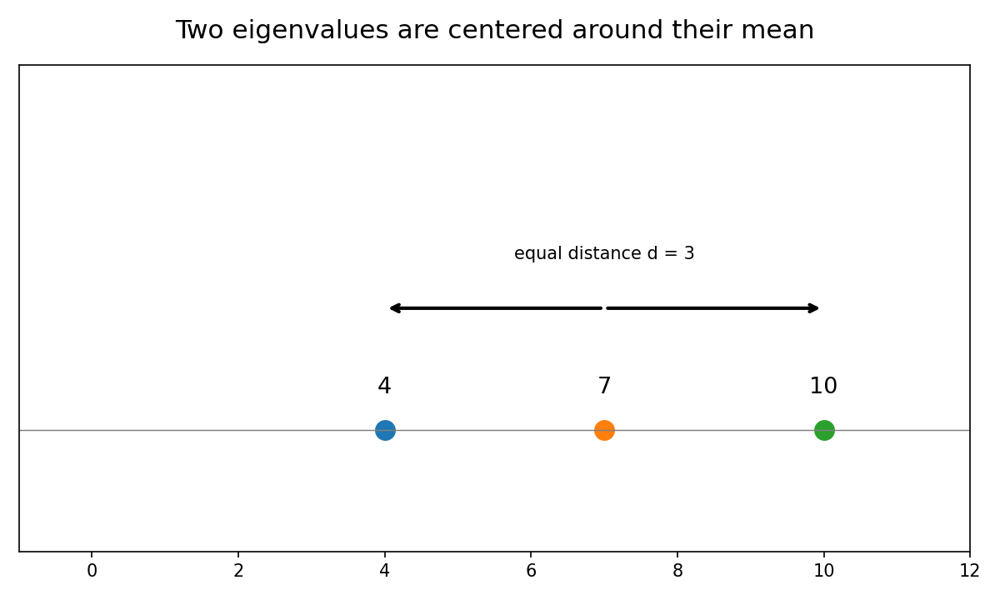
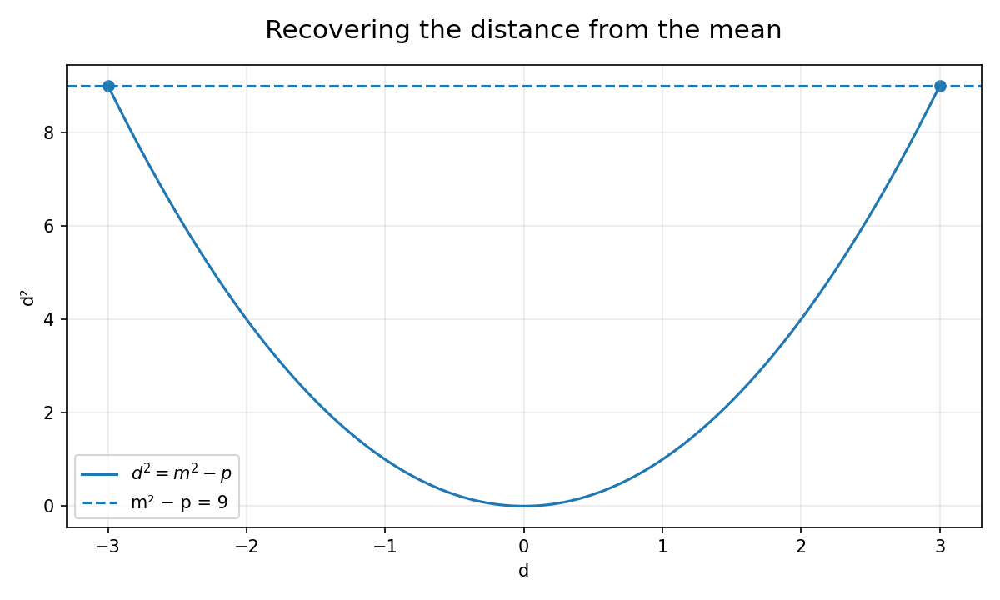
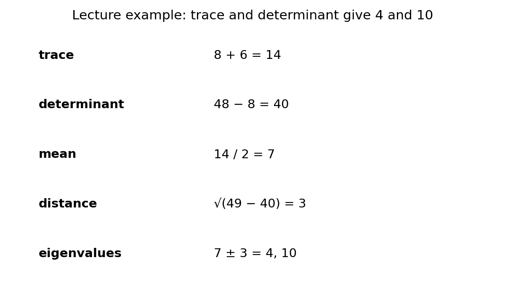
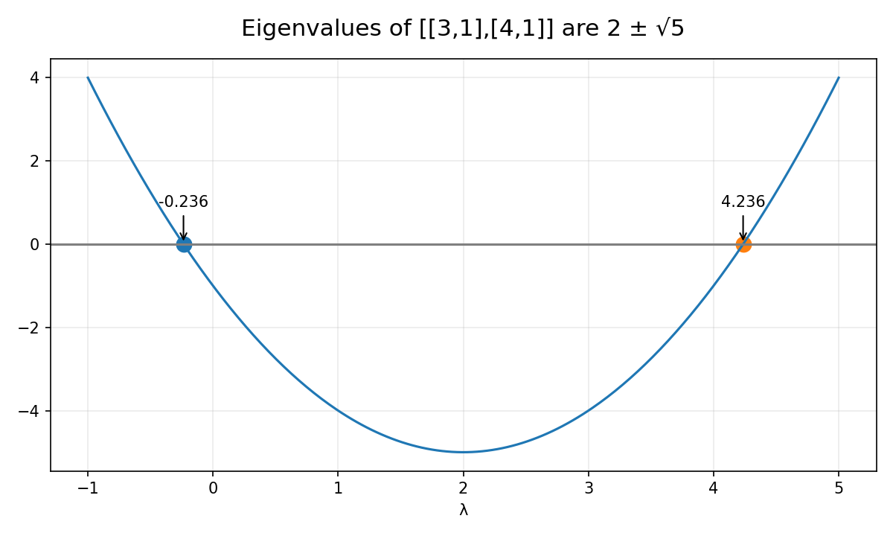
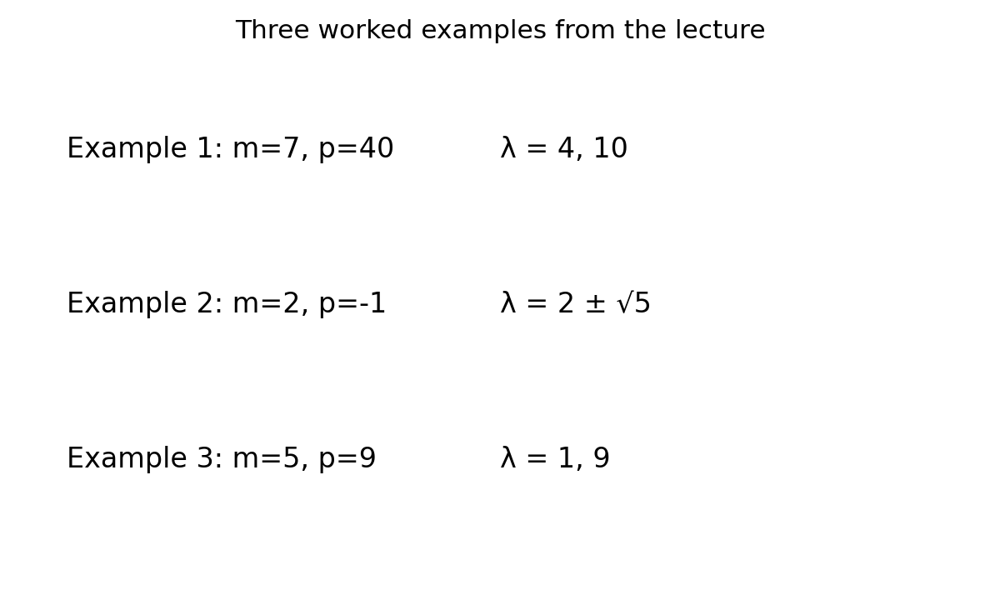
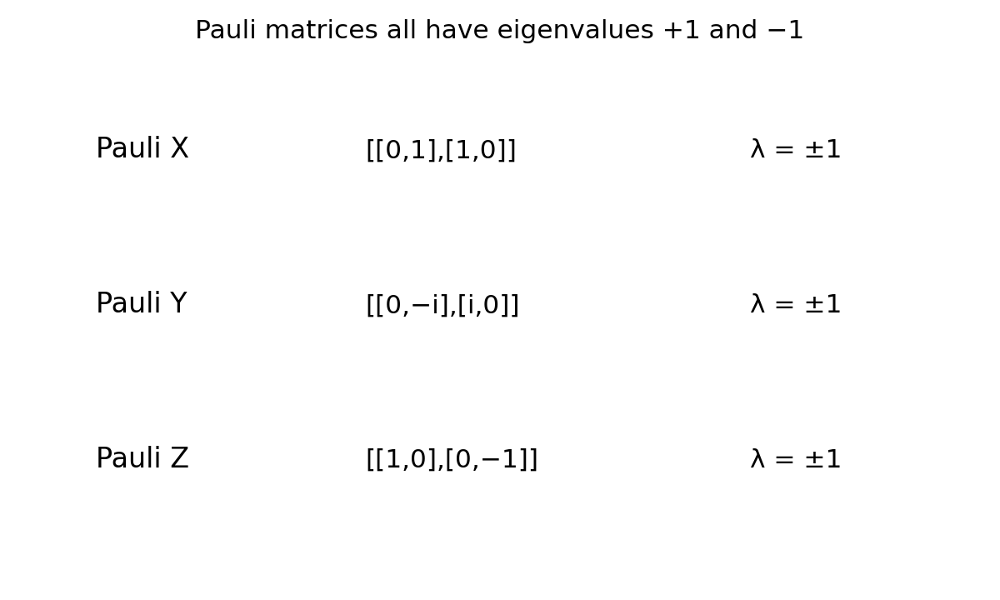
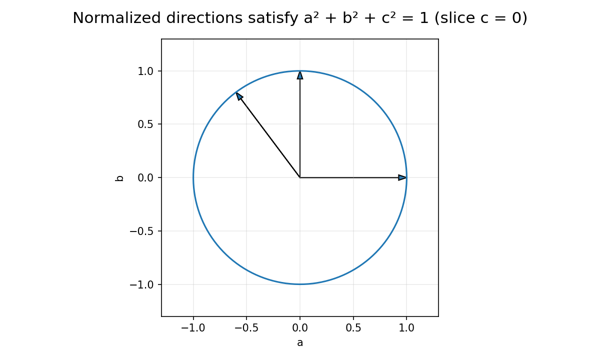
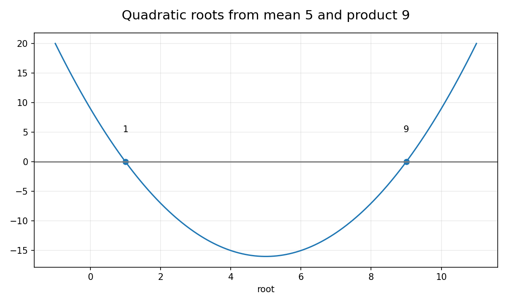

# 15 — A Quick Trick for Computing Eigenvalues
*Beginner-friendly lecture notes, following the lecture’s teaching sequence.*

> **Prerequisite note:** This chapter assumes you already know eigenvectors and eigenvalues. The short explanations marked **Beginner bridge** are added to make this chapter self-contained.

## 1. Why this lesson exists
This lecture is about finding the eigenvalues of a **2 × 2 matrix** quickly. Rather than memorizing a large formula, we will use two quantities you can read directly from the matrix: **trace** and **determinant**. This section first revisits the standard approach, then asks us to rediscover the shortcut.

## 2. Reminder: what are eigenvectors and eigenvalues?
Imagine applying a matrix to a vector. Most vectors change direction as well as length. But sometimes a nonzero vector stays on the same line, merely becoming longer, shorter, or reversing direction. That special vector is an **eigenvector**. The scaling factor is its **eigenvalue**, written with the Greek letter $\lambda$ (lambda).

$$
A\mathbf v=\lambda\mathbf v,\qquad \mathbf v\ne\mathbf0.
$$

**Symbol-by-symbol:** $A$ is the matrix/transformation; $\mathbf v$ is the special input vector; $\lambda$ is a number; $\lambda\mathbf v$ is the scaled version of the original vector.

**Beginner bridge:** If $A\mathbf v=3\mathbf v$, the vector points along the same line but is three times as long. If $A\mathbf v=-2\mathbf v$, it flips direction and doubles in length. An eigenvalue can also be zero: the eigenvector then maps to the zero vector.

## 3. Why the determinant must be zero
Starting with
$$
A\mathbf v=\lambda\mathbf v,
$$
move everything to one side:
$$
A\mathbf v-\lambda\mathbf v=\mathbf0.
$$
Since $I\mathbf v=\mathbf v$, write
$$
(A-\lambda I)\mathbf v=\mathbf0.
$$
Here $I$ is the identity matrix: it leaves every vector unchanged. Because $\mathbf v$ is **nonzero**, the matrix $A-\lambda I$ must squash at least one direction to zero. Therefore it cannot be invertible and
$$
\boxed{\det(A-\lambda I)=0.}
$$

## 4. The usual characteristic-polynomial method
For
$$
A=\begin{bmatrix}a&b\\c&d\end{bmatrix},
\quad
A-\lambda I=\begin{bmatrix}a-\lambda&b\\c&d-\lambda\end{bmatrix}.
$$
The determinant of a 2 × 2 matrix is first diagonal product minus second diagonal product:
$$
\det(A-\lambda I)=(a-\lambda)(d-\lambda)-bc.
$$
Expand carefully:
$$
ad-a\lambda-d\lambda+\lambda^2-bc=0,
$$
so
$$
\boxed{\lambda^2-(a+d)\lambda+(ad-bc)=0.}
$$
This is the **characteristic polynomial**. Its roots (the values of $\lambda$ that make it zero) are the eigenvalues. The traditional route uses the quadratic formula. The trick skips writing out this intermediate polynomial.

## 5. Three useful facts: trace, determinant, and mean/product
### Fact 1 — Trace is the sum of eigenvalues
The **trace** is the sum of diagonal entries:
$$
\operatorname{tr}(A)=a+d=\lambda_1+\lambda_2.
$$
Therefore their mean is
$$
\boxed{m=\frac{\lambda_1+\lambda_2}{2}=\frac{a+d}{2}.}
$$
*Mean* means average: add two numbers and divide by two. These equalities count eigenvalues with multiplicity, including complex eigenvalues.

### Fact 2 — Determinant is the product of eigenvalues
$$
\boxed{p=\det(A)=ad-bc=\lambda_1\lambda_2.}
$$
Geometrically, the determinant describes the signed area-scaling factor of the transformation. Eigenvalues describe scaling along special directions. Their product gives the determinant.

### Lecture example — mean 7, product 40
The lecture shows a matrix whose diagonal entries are $8$ and $6$, and whose off-diagonal product is $8$.
$$
m=\frac{8+6}{2}=7,\qquad p=8(6)-8=40.
$$
We now seek two numbers with average $7$ and product $40$.

## 6. Fact 3 — Recover two numbers from their mean and product
If the average is $m$, the numbers must be equally far from $m$. Call the distance $d$:
$$
\lambda_1=m+d,\qquad\lambda_2=m-d.
$$
Their product is
$$
p=(m+d)(m-d)=m^2-d^2.
$$
This uses the **difference of squares** identity:
$$
(u+v)(u-v)=u^2-v^2.
$$
Rearrange:
$$
d^2=m^2-p,\qquad d=\sqrt{m^2-p}.
$$
The two eigenvalues are therefore
$$
\boxed{\lambda_{1,2}=m\pm\sqrt{m^2-p}.}
$$
The symbol $\pm$ means calculate once with plus and once with minus. If $m^2-p<0$, the square root is imaginary and the eigenvalues are complex; this is not a failure of the method.

### Finish the earlier example
$$
d^2=7^2-40=49-40=9,\quad d=3.
$$
Thus
$$
\lambda_1=7+3=10,\qquad\lambda_2=7-3=4.
$$
Check: $10+4=14$, giving mean $7$; $10\cdot4=40$.

<strong>Interactive:</strong> See the two values move symmetrically around their mean

<iframe
 src="../animations/animation-01-mean-product.html"
 title="See the two values move symmetrically around their mean"
 width="100%"
 height="820"
 style="max-width:980px;border:1px solid #dce4ef;border-radius:12px;background:#f3f6fb;"
 loading="lazy">
</iframe>

<a href="../animations/animation-01-mean-product.html">Open See the two values move symmetrically around their mean in full tab</a> if the embed does not load.

## 7. Try the shortcut on a new matrix
Next, chooses
$$
A=\begin{bmatrix}3&1\\4&1\end{bmatrix}.
$$
**Step 1 — Mean from the diagonal:**
$$
m=\frac{3+1}{2}=2.
$$
**Step 2 — Product from the determinant:**
$$
p=3(1)-1(4)=3-4=-1.
$$
**Step 3 — Apply the shortcut:**
$$
\lambda=2\pm\sqrt{2^2-(-1)}
=2\pm\sqrt5.
$$
So the eigenvalues are approximately $4.236$ and $-0.236$. The negative eigenvalue indicates a direction that reverses.

## 8. A second quick example
The next matrix in the lecture has diagonal entries $2,8$ and off-diagonal entries $7,1$:
$$
B=\begin{bmatrix}2&7\\1&8\end{bmatrix}.
$$
$$
m=\frac{2+8}{2}=5,\qquad p=2(8)-7(1)=9.
$$
$$
\lambda=5\pm\sqrt{5^2-9}
=5\pm\sqrt{16}=5\pm4.
$$
**Answer:** $\boxed{9,\ 1}$.

Check: sum $10$, product $9$.

<strong>Interactive:</strong> Practice the shortcut on the lecture matrices

<iframe
 src="../animations/animation-02-matrix-eigenvalues.html"
 title="Practice the shortcut on the lecture matrices"
 width="100%"
 height="820"
 style="max-width:980px;border:1px solid #dce4ef;border-radius:12px;background:#f3f6fb;"
 loading="lazy">
</iframe>

<a href="../animations/animation-02-matrix-eigenvalues.html">Open Practice the shortcut on the lecture matrices in full tab</a> if the embed does not load.

## 9. Real-world connection: the Pauli spin matrices
Next, introduces three 2 × 2 matrices from quantum mechanics:
$$
X=\begin{bmatrix}0&1\\1&0\end{bmatrix},\quad
Y=\begin{bmatrix}0&-i\\i&0\end{bmatrix},\quad
Z=\begin{bmatrix}1&0\\0&-1\end{bmatrix}.
$$
Here $i$ is the imaginary unit, defined by $i^2=-1$. It is not the same as the $\hat i$ basis vector from earlier chapters.

For **all three**, the trace is zero, so $m=0$.

- $X$: $\det(X)=0-1=-1$.
- $Y$: $\det(Y)=0-(-i)(i)=-(1)=-1$, because $(-i)i=-i^2=1$.
- $Z$: $\det(Z)=1(-1)-0=-1$.

Thus each has
$$
\lambda=0\pm\sqrt{0-(-1)}=\boxed{\pm1}.
$$
These eigenvalues correspond to the two possible normalized outcomes for the associated Pauli spin observable. The physical spin angular momentum uses additional units and factors; the lecture is discussing the Pauli matrices themselves.

## 10. Why the Pauli example is both useful and funny
Note that for these **particular** matrices, the ordinary characteristic-polynomial method is just as quick:
$$
\det(X-\lambda I)=\lambda^2-1,
$$
whose roots are immediately $\pm1$. The same is true for $Y$. For $Z$, the eigenvalues are already visible on its diagonal.

So this example demonstrates real applications, but not necessarily a speed advantage for the shortcut.

## 11. A general spin direction
A more revealing example combines the three matrices:
$$
H=aX+bY+cZ
=\begin{bmatrix}
c&a-ib\\
a+ib&-c
\end{bmatrix}.
$$
Assumes a **normalized direction**:
$$
a^2+b^2+c^2=1,
$$
where $a,b,c$ are real numbers. This describes a direction vector of length one.

Trace:
$$
\operatorname{tr}(H)=c+(-c)=0\quad\Rightarrow\quad m=0.
$$
Determinant:
$$
\begin{aligned}
\det(H)&=c(-c)-(a-ib)(a+ib)\\
&=-c^2-(a^2+b^2)\\
&=-(a^2+b^2+c^2)=-1.
\end{aligned}
$$
So
$$
\boxed{\lambda=\pm1}
$$
for **every normalized direction**. Without normalization, the eigenvalues are $\pm\sqrt{a^2+b^2+c^2}$.

<strong>Interactive:</strong> Explore normalized Pauli combinations

<iframe
 src="../animations/animation-03-pauli-direction.html"
 title="Explore normalized Pauli combinations"
 width="100%"
 height="820"
 style="max-width:980px;border:1px solid #dce4ef;border-radius:12px;background:#f3f6fb;"
 loading="lazy">
</iframe>

<a href="../animations/animation-03-pauli-direction.html">Open Explore normalized Pauli combinations in full tab</a> if the embed does not load.

## 12. The shortcut is another form of the quadratic formula
Then connects the same idea to ordinary quadratic equations. For a monic quadratic
$$
t^2+bt+c=0,
$$
the two roots have sum $-b$ and product $c$. (*Monic* means the coefficient of $t^2$ is 1.)

Therefore
$$
m=-\frac b2,\qquad p=c,
$$
and
$$
\boxed{t=-\frac b2\pm\sqrt{\frac{b^2}{4}-c}.}
$$
This is algebraically equivalent to the familiar quadratic formula. It is easier to interpret because $m$ is the center of the roots, and the square-root term is their distance from that center.

**Supplementary worked example:**
$$
t^2-10t+9=0.
$$
Mean $m=5$, product $p=9$, so
$$
t=5\pm\sqrt{25-9}=5\pm4=\boxed{1,9}.
$$

## 13. Final insight: understanding beats memorization
The speed comes from reading the mean and product directly from a 2 × 2 matrix. More importantly, the shortcut reinforces three concepts worth knowing independently: **trace = eigenvalue sum**, **determinant = eigenvalue product**, and **roots are symmetric around their mean**.

### Remember this
For any 2 × 2 matrix $A$,
$$
\boxed{\displaystyle
\lambda=\frac{\operatorname{tr}(A)}2
\pm\sqrt{\left(\frac{\operatorname{tr}(A)}2\right)^2-\det(A)}.}
$$
This works over the complex numbers too. It finds eigenvalues, not eigenvectors; to find an eigenvector, solve $(A-\lambda I)\mathbf v=0$ for a nonzero $\mathbf v$.

### Common misconceptions
1. **Trace is not the mean.** Divide trace by two for a 2 × 2 matrix.
2. **Determinant is not the sum.** It is the product of eigenvalues.
3. **A negative value inside the square root does not mean no eigenvalues.** It means nonreal complex eigenvalues.
4. **Eigenvalues need not equal diagonal entries.** That is immediate for triangular matrices, not general matrices.
5. **The shortcut does not automatically generalize to 3 × 3 matrices.** Two numbers can be reconstructed from their sum and product; three generally cannot.

### Check your understanding
1. What is the difference between an eigenvector and an eigenvalue?
2. Why does $\det(A-\lambda I)=0$ hold for an eigenvalue?
3. For $A=\begin{bmatrix}5&0\\0&2\end{bmatrix}$, what are $m,p,\lambda_1,\lambda_2$?
4. For $A=\begin{bmatrix}0&-1\\1&0\end{bmatrix}$, what are the eigenvalues?
5. If eigenvalues have mean $6$ and product $27$, find them.
6. Why does a normalized Pauli combination have eigenvalues $\pm1$?

### Answers
1. Eigenvector is a nonzero vector whose direction line is preserved; eigenvalue is its scaling factor.
2. $A-\lambda I$ sends a nonzero vector to zero, so it is singular.
3. $m=3.5,\ p=10,\ \lambda=5,2$.
4. $m=0,\ p=1,\ \lambda=\pm i$.
5. $6\pm\sqrt{36-27}=6\pm3$, so $9,3$.
6. Its trace is zero and determinant is $-1$, so the shortcut gives $\pm1$.

---
*Notes follow the provided lecture; labeled beginner bridges and supplementary examples expand its explanations.*
