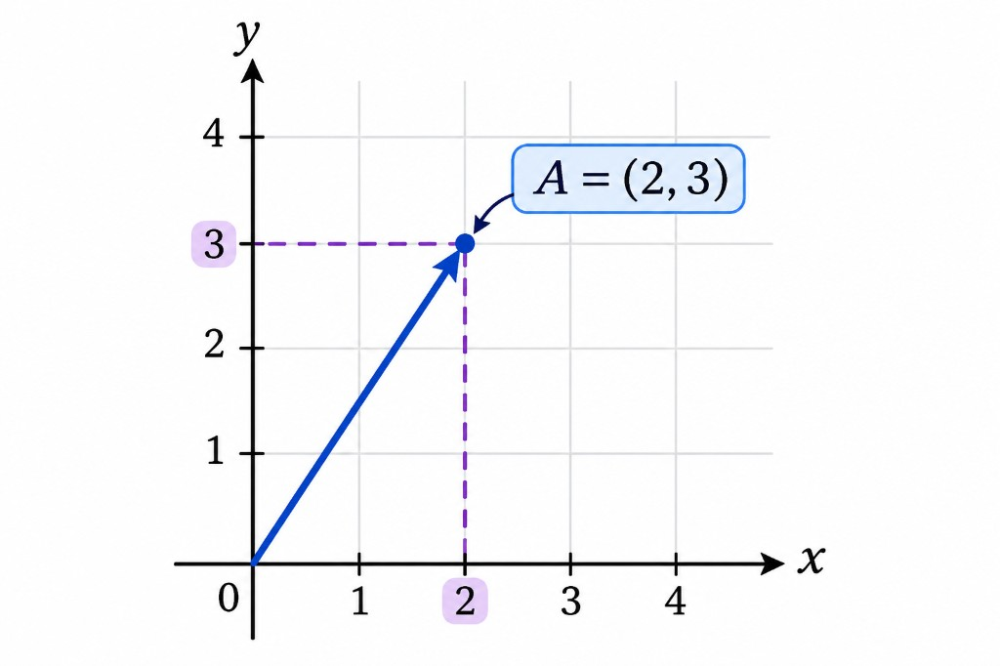
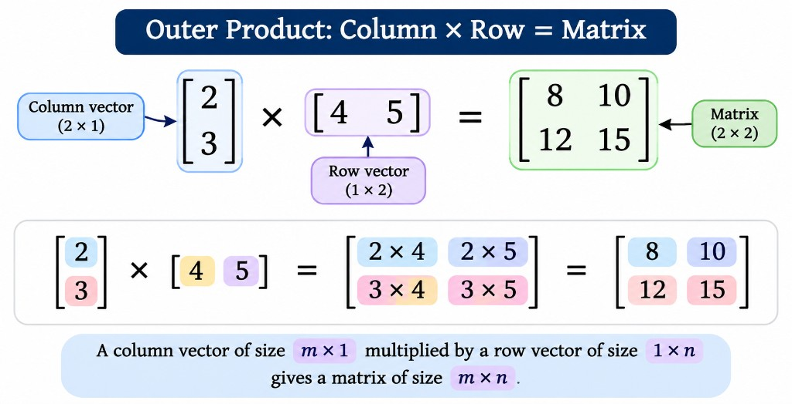
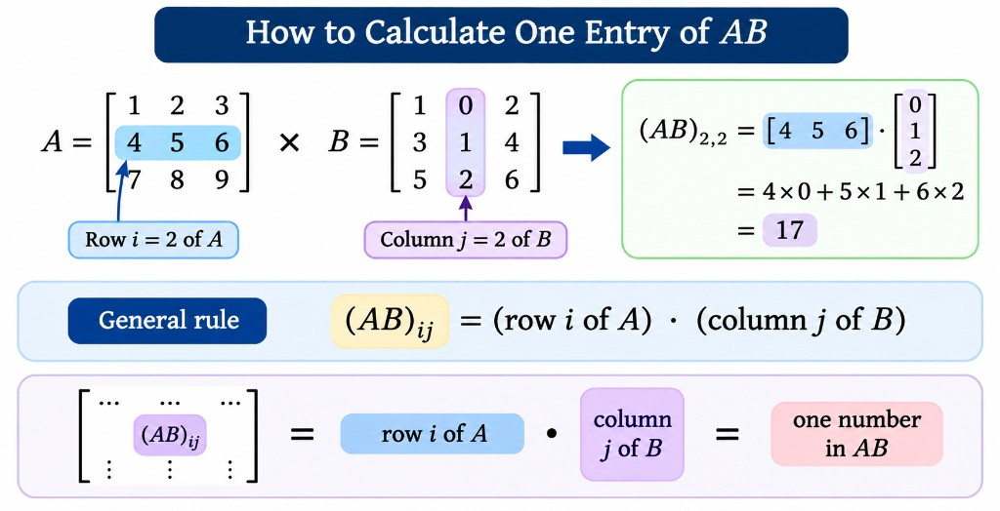
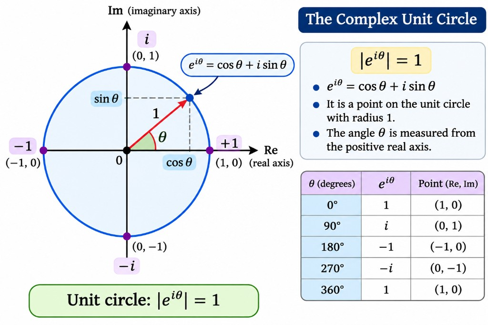
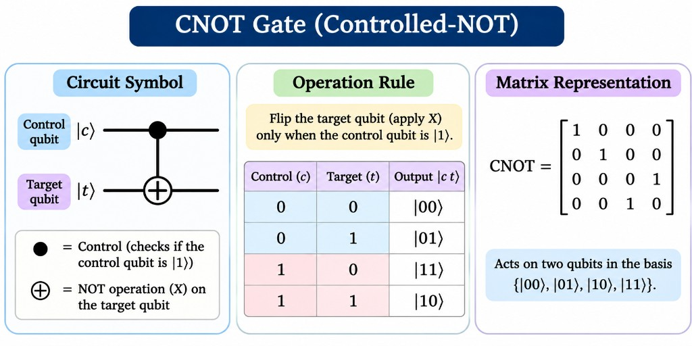
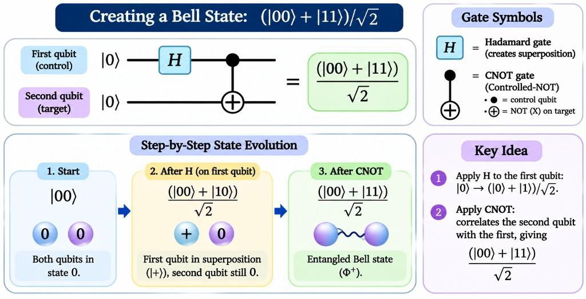
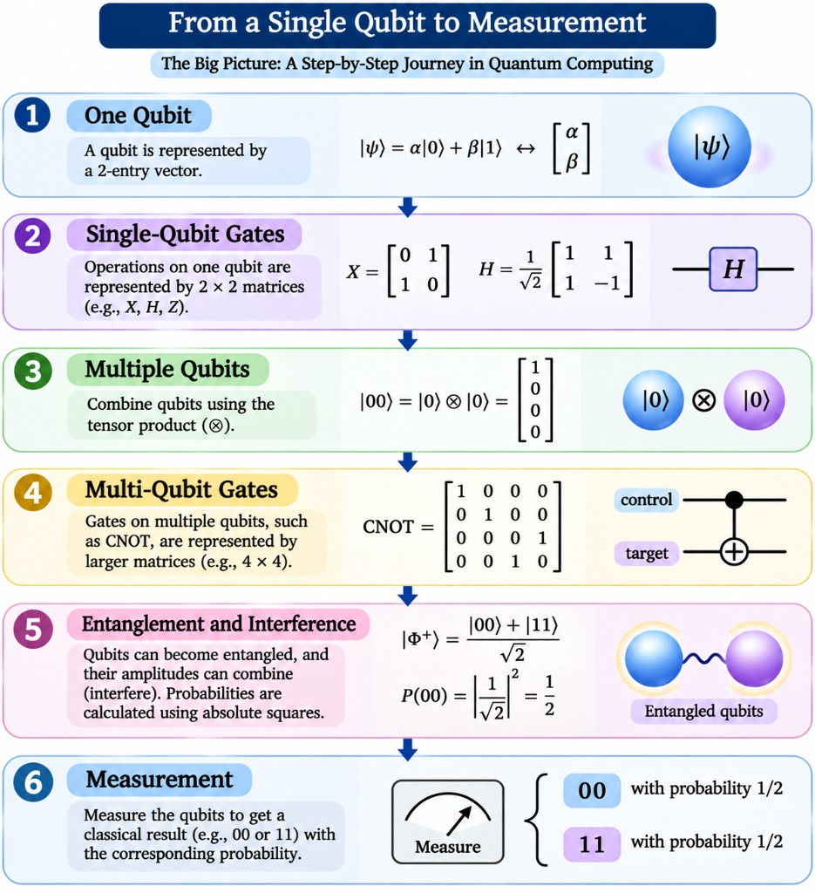

# From basic mathematics to quantum computing

*A beginner-friendly study guide covering vector operations, matrices,
qubits, complex amplitudes, quantum gates, CNOT and entanglement.*

---

## 1. Foundation: What does product mean?

### 1.1 Different products at a glance

The word **product** does not always mean the same operation. This table is a map of the products used in these notes. Each later section explains one row in detail.

| Product | Symbol | What do we multiply? | Result | Main purpose |
| --- | --- | --- | --- | --- |
| Ordinary multiplication | $a\times b$ | Number × number | Number | Basic arithmetic |
| Scalar multiplication | $cA$ | Number × vector | Vector | Scale a vector |
| Dot product | $A\cdot B$ | Row vector × column vector | Number (scalar) | Similarity, angles |
| Outer product | $\lvert a\rangle\langle b\rvert$ | Column vector × row vector | Matrix | Construct matrices, quantum projectors |
| Matrix multiplication | $AB$ | Matrix × matrix | Matrix | Combine transformations and quantum gates |
| Matrix-vector multiplication | $U\lvert\psi\rangle$ | Matrix × vector | Vector | Apply a quantum gate to a state |
| Tensor product (Kronecker product) | $A\otimes B$ | Vector × vector | Larger vector | Combine multiple quantum states |
| Tensor product of matrices | $A\otimes B$ | Matrix × matrix | Larger matrix | Construct multi-qubit gates |
| Complex inner product | $\langle A\vert B\rangle$ | Bra × ket | Complex number | Quantum state overlap and probabilities |

### 1.2 What does multiplication mean?

Multiplication is a way of combining quantities. For ordinary numbers:

$$
3 \times 4 = 12
$$

The answer is another number. In mathematics, the word **product**
simply means the result of a multiplication.
But multiplication does not always mean the same operation. Depending on
what we multiply, the answer can be:

- a number (scalar),
- a vector,
- or a matrix.
This distinction becomes important in quantum computing.

### 1.3 Scalars and vectors

A **scalar** is a single number, such as $5$, $-2$, or $0.75$.
A **vector** is an ordered collection of numbers. For example:

$$
A=
\begin{bmatrix}2\\3\end{bmatrix}
$$

This vector has two components:

- first component: 2
- second component: 3

We can picture it as an arrow with a horizontal and vertical component.

A vector can also represent a quantum state. A single qubit is
represented by a two-component column vector.

### 1.4 Row vectors, column vectors and transpose

A column vector is written vertically:

$$
A=
\begin{bmatrix}2\\3\end{bmatrix}
$$

Its row-vector version is:

$$
A^T=
\begin{bmatrix}2&3\end{bmatrix}
$$

The superscript $T$ means **transpose**. Transposing changes rows into
columns and columns into rows. For real-valued vectors, this is all we
need. For complex-valued quantum vectors, we will later use the
conjugate transpose.

### 1.5 Three different products

| Operation | Result |
| --- | --- |
| Dot product | A single number |
| Outer product | A matrix |
| Tensor product | A bigger vector |

Use these two column vectors:

$$
A=
\begin{bmatrix}2\\3\end{bmatrix}
, \qquad B=
\begin{bmatrix}4\\5\end{bmatrix}
$$

**1. Dot product**

$$
A\cdot B=2(4)+3(5)=8+15=23
$$

**2. Outer product**

$$
AB^T=
\begin{bmatrix}2\\3\end{bmatrix}
\begin{bmatrix}4&5\end{bmatrix}
=
\begin{bmatrix}
2(4)&2(5)\\
3(4)&3(5)
\end{bmatrix}
=
\begin{bmatrix}8&10\\12&15\end{bmatrix}
$$

**3. Tensor product**

$$
A\otimes B=
\begin{bmatrix}
2(4)\\2(5)\\3(4)\\3(5)
\end{bmatrix}
=
\begin{bmatrix}8\\10\\12\\15\end{bmatrix}
$$

The symbol $\otimes$ means tensor product, also called the
Kronecker product.

The order and meaning of the operation matter. These three products are
not interchangeable.

### 1.6 Why this matters for quantum computing

A qubit has two basis states:

$$
|0\rangle=
\begin{bmatrix}1\\0\end{bmatrix}
, \qquad |1\rangle=
\begin{bmatrix}0\\1\end{bmatrix}
$$

The notation $|0\rangle$ is read "ket zero." A ket is simply a
column vector written in Dirac notation.

Two qubits are combined using a tensor product:

$$
|0\rangle\otimes|1\rangle=|01\rangle
$$

So tensor products let us describe systems containing more than one
qubit.

---

## 2. Dot product

### 2.1 The basic rule

The dot product multiplies matching components and adds the results.

For:

$$
A=
\begin{bmatrix}a_1\\a_2\end{bmatrix}
, \qquad B=
\begin{bmatrix}b_1\\b_2\end{bmatrix}
$$

the dot product is:

$$
A\cdot B=a_1b_1+a_2b_2
$$

For three components:

$$
A\cdot B=a_1b_1+a_2b_2+a_3b_3
$$

### 2.2 Worked example

Let:

$$
A=
\begin{bmatrix}2\\3\end{bmatrix}
, \qquad B=
\begin{bmatrix}4\\5\end{bmatrix}
$$

Multiply corresponding components:

$$
2\times4=8
$$

$$
3\times5=15
$$

Add them:

$$
A\cdot B=8+15=\boxed{23}
$$

The answer is one number, not a vector or matrix.

### 2.3 Dot product and angles

The dot product is also related to the angle between two vectors:

$$
A\cdot B=|A||B|\cos\theta
$$

Here:

- $|A|$ means the length (magnitude) of vector $A$.
- $|B|$ means the length of vector $B$.
- $\theta$ is the angle between the vectors.
- $\cos\theta$ tells us how aligned the vectors are.

<iframe
  src="assets/vector_directions_animation.html"
  title="Animated vector directions: same, perpendicular, and opposite"
  width="100%"
  height="520"
  style="border:1px solid #dbe3ef;border-radius:12px;max-width:850px;display:block"
  loading="lazy">
</iframe>

*If the animation does not appear in preview, open [vector_directions_animation.html](assets/vector_directions_animation.html) in your browser.*

- Acute angle (less than 90°): positive dot product.
- Right angle (90°): zero dot product.
- Obtuse angle (greater than 90°): negative dot product.
A zero dot product means the vectors are **orthogonal** (perpendicular).

### 2.4 Vector magnitude and normalization

The magnitude of a real vector is its length.
For:

$$
v=
\begin{bmatrix}3\\4\end{bmatrix}
$$

$$
|v|=\sqrt{3^2+4^2} =\sqrt{9+16}
=\sqrt{25}=5
$$

To normalize a nonzero vector, divide every component by its magnitude:

$$
\hat v=\frac{v}{|v|} =\frac{1}{5}
\begin{bmatrix}3\\4\end{bmatrix}
=
\begin{bmatrix}3/5\\4/5\end{bmatrix}
$$

The normalized vector has length 1.

### 2.5 How dot products connect to quantum probabilities

The two computational basis states are:

$$
|0\rangle=
\begin{bmatrix}1\\0\end{bmatrix}
, \qquad |1\rangle=
\begin{bmatrix}0\\1\end{bmatrix}
$$

Their inner product (for these real vectors, the same calculation as the
dot product) is:

$$
\langle0|1\rangle=
\begin{bmatrix}1&0\end{bmatrix}
\begin{bmatrix}0\\1\end{bmatrix}
=1(0)+0(1)=0
$$

They are orthogonal.
A useful superposition is:

$$
|+\rangle=\frac{1}{\sqrt2}(|0\rangle+|1\rangle)
=\frac{1}{\sqrt2}
\begin{bmatrix}1\\1\end{bmatrix}
$$

The overlap between $|0\rangle$ and $|+\rangle$ is:

$$
\langle0|+\rangle=\frac{1}{\sqrt2}
$$

The probability of measuring 0 in state $|+\rangle$ is the
absolute square of this overlap:

$$
P(0)=|\langle0|+\rangle|^2
=\left|\frac{1}{\sqrt2}\right|^2
=\frac12
$$

Similarly, $P(1)=1/2$. Thus the outcomes are 50% and 50%.

### 2.6 Dot product versus inner product

The dot product and the inner product are closely related. The dot product is a special case of the inner product. Section 6 develops complex numbers in full; this section shows why quantum computing needs the more general operation.

**1. What is a dot product?**

A dot product takes two vectors and produces a single number (a scalar). Suppose

$$
A=\begin{bmatrix}2\\3\end{bmatrix}
\qquad
B=\begin{bmatrix}4\\5\end{bmatrix}
$$

Step 1: multiply corresponding elements.

$$
2\times 4=8
$$

$$
3\times 5=15
$$

Step 2: add the results.

$$
A\cdot B=(2\times 4)+(3\times 5)
$$

$$
\boxed{A\cdot B=23}
$$

The result is one number, not a vector or a matrix.

**2. What is an inner product?**

An inner product is the more general operation that measures how two vectors are related. It also takes two vectors and produces a single number.

For ordinary real vectors, the inner product is exactly the dot product:

$$
\langle A\vert B\rangle
=2(4)+3(5)=23
$$

| | Dot product | Inner product |
| --- | --- | --- |
| Symbol | $A\cdot B$ | $\langle A\vert B\rangle$ |
| Usual setting | Real vectors | General framework, including complex vectors |
| Arithmetic | Multiply matching entries and add | Same steps, and conjugation when entries are complex |
| Result | A scalar | A scalar, which may be complex |

The extra idea is needed once the entries can be complex.

**3. The difference appears with complex numbers**

A complex number has the form $z=a+bi$, where $a$ is the real part, $b$ is the imaginary part, and $i$ satisfies $i^2=-1$. Take

$$
A=\begin{bmatrix}1+i\\2\end{bmatrix}
\qquad
B=\begin{bmatrix}1\\i\end{bmatrix}
$$

For complex vectors, the inner product uses the complex conjugate of the first vector.

Step 1: conjugate $A$. The number $1+i$ becomes $1-i$, and $2$ stays $2$.

$$
A^\dagger=\begin{bmatrix}1-i&2\end{bmatrix}
$$

Step 2: multiply matching entries.

$$
\langle A\vert B\rangle=(1-i)(1)+(2)(i)
$$

Step 3: simplify.

$$
=1-i+2i
$$

$$
\boxed{\langle A\vert B\rangle=1+i}
$$

The result can itself be complex. That is the distinction: the complex inner product conjugates the first vector before multiplying.

**4. Why quantum computing needs it**

A qubit state is a complex vector

$$
\lvert\psi\rangle=
\begin{bmatrix}
\alpha\\
\beta
\end{bmatrix}
$$

Here $\alpha$ is the amplitude of $\lvert 0\rangle$ and $\beta$ is the amplitude of $\lvert 1\rangle$. Both may be complex.

The inner product of the state with itself is $\langle\psi\vert\psi\rangle$.

Step 1: form the bra by the conjugate transpose. The star means complex conjugate.

$$
\langle\psi\vert=
\begin{bmatrix}
\alpha^*&\beta^*
\end{bmatrix}
$$

Step 2: multiply the bra by the ket.

$$
\langle\psi\vert\psi\rangle
=
\begin{bmatrix}
\alpha^*&\beta^*
\end{bmatrix}
\begin{bmatrix}
\alpha\\
\beta
\end{bmatrix}
=\alpha^*\alpha+\beta^*\beta
$$

Step 3: use $\alpha^*\alpha=\lvert\alpha\rvert^2$ and $\beta^*\beta=\lvert\beta\rvert^2$.

$$
\langle\psi\vert\psi\rangle=\lvert\alpha\rvert^2+\lvert\beta\rvert^2
$$

A valid qubit is normalized, so this total equals 1:

$$
\boxed{\lvert\alpha\rvert^2+\lvert\beta\rvert^2=1}
$$

The probabilities of measuring 0 and 1 add up to 1.

**5. The two formulas**

Dot product, for real vectors:

$$
A\cdot B=\sum_i A_i B_i
$$

Multiply corresponding components and add.

Inner product, for complex vectors:

$$
\langle A\vert B\rangle=\sum_i A_i^* B_i
$$

Conjugate the components of the first vector, then multiply and add.

For a normalized quantum state:

$$
\langle\psi\vert\psi\rangle=1
$$

**6. What to remember**

| Feature | Dot product | Inner product |
| --- | --- | --- |
| Inputs | Two vectors | Two vectors |
| Output | A scalar | A scalar |
| Real vectors | Yes | Yes, and the result matches the dot product |
| Complex vectors | The ordinary dot product is not sufficient | Yes |
| Complex conjugation | Not used | Yes, on the first vector |
| Quantum computing | Limited | Essential |

$$
\boxed{\text{The dot product is a special case of the inner product}}
$$

When every entry is real, conjugation changes nothing, so the two operations agree. When any entry is complex, use the inner product.

---

## 3. Outer product

### 3.1 What is an outer product?

The outer product combines a column vector with a row vector. The result
is a matrix.
Using:

$$
A=
\begin{bmatrix}2\\3\end{bmatrix}
, \qquad B^T=
\begin{bmatrix}4&5\end{bmatrix}
$$

we get:

$$
AB^T=
\begin{bmatrix}2\\3\end{bmatrix}
\begin{bmatrix}4&5\end{bmatrix}
=
\begin{bmatrix}
8&10\\
12&15
\end{bmatrix}
$$

Every entry is formed by multiplying one component from the column by
one component from the row.

For two-component vectors:

$$
\begin{bmatrix}a\\b\end{bmatrix}
\begin{bmatrix}c&d\end{bmatrix}
=
\begin{bmatrix}ac&ad\\bc&bd\end{bmatrix}
$$

### 3.2 Dot product versus outer product

Order and orientation matter.

$$
\underbrace{\begin{bmatrix}2&3\end{bmatrix}
\begin{bmatrix}4\\5\end{bmatrix}}_{\text{row × column}}
=2(4)+3(5)=23
$$

This is an inner/dot product and gives a scalar.

$$
\underbrace{\begin{bmatrix}2\\3\end{bmatrix}
\begin{bmatrix}4&5\end{bmatrix}}_{\text{column × row}} =
\begin{bmatrix}8&10\\12&15\end{bmatrix}
$$

This is an outer product and gives a matrix.

### 3.3 Bra-ket notation

Quantum mechanics uses a compact notation:

- Ket $|\psi\rangle$: a column vector.
- Bra $\langle\psi|$: the conjugate transpose of the
    ket.
- Inner product $\langle\phi|\psi\rangle$: bra times ket, giving a number.
- Outer product $|\psi\rangle\langle\phi|$: ket times bra, giving a matrix.

For real vectors, conjugation does not change the entries. For complex
vectors, it does.

### 3.4 Projection: keeping one component of a state

Consider a general qubit:

$$
|\psi\rangle=\alpha|0\rangle+\beta|1\rangle
=
\begin{bmatrix}\alpha\\\beta\end{bmatrix}
$$

The outer product $|0\rangle\langle0|$ is:

$$
|0\rangle\langle0|=
\begin{bmatrix}1\\0\end{bmatrix}
\begin{bmatrix}1&0\end{bmatrix}
=
\begin{bmatrix}1&0\\0&0\end{bmatrix}
$$

Apply it to the state:

$$
|0\rangle\langle0|\psi\rangle =
\begin{bmatrix}1&0\\0&0\end{bmatrix}
\begin{bmatrix}\alpha\\\beta\end{bmatrix}
=
\begin{bmatrix}\alpha\\0\end{bmatrix}
=\alpha|0\rangle
$$

It keeps the $|0\rangle$ component and removes the

$|1\rangle$ component.

Similarly:

$$
|1\rangle\langle1|=
\begin{bmatrix}0&0\\0&1\end{bmatrix}
$$

and:

$$
|1\rangle\langle1|\psi\rangle =
\begin{bmatrix}0\\\beta\end{bmatrix}
=\beta|1\rangle
$$

These matrices are called projectors:

$$
P_0=|0\rangle\langle0|, \qquad
P_1=|1\rangle\langle1|
$$

They satisfy:

$$
P_0+P_1=I,\qquad P_0^2=P_0,\qquad P_1^2=P_1
$$

### 3.5 Density matrix of a pure state

The outer product of a state with itself is:

$$
\rho=|\psi\rangle\langle\psi|
$$

For $|\psi\rangle=\alpha|0\rangle+\beta|1\rangle$:

$$
\rho=
\begin{bmatrix}\alpha\\\beta\end{bmatrix}
\begin{bmatrix}\alpha^*&\beta^*\end{bmatrix}
=
\begin{bmatrix}
|\alpha|^2&\alpha\beta^*\\
\beta\alpha^*&|\beta|^2
\end{bmatrix}
$$

The diagonal entries are the computational-basis probabilities. The
off-diagonal entries contain coherence information, which is relevant to
interference.

---

## 4. Matrix multiplication

### 4.1 What is a matrix?

A matrix is a rectangular arrangement of numbers.

$$
A=
\begin{bmatrix}1&2\\3&4\end{bmatrix}
$$

This matrix has 2 rows and 2 columns, so its size is $2\times2$.

The entry $a_{ij}$ means the element in row $i$, column $j$.

### 4.2 When can we multiply two matrices?

The number of columns in the first matrix must equal the number of rows
in the second matrix.

$$
(m \times n)(n \times p) = (m \times p)
$$

The inside dimensions must match. The outside dimensions tell us the
size of the answer.
For example:

$$
(2 \times 3)(3 \times 4) = (2 \times 4)
$$

But a $2\times3$ matrix cannot be multiplied by a

$2\times2$ matrix in that order, because 3 does not equal 2.

### 4.3 Matrix times vector: a fully worked example

Let:

$$
A=
\begin{bmatrix}1&2\\3&4\end{bmatrix}
, \qquad v=
\begin{bmatrix}5\\6\end{bmatrix}
$$

The first output component comes from row 1 dotted with the vector:

$$
1(5)+2(6)=5+12=17
$$

The second output component comes from row 2 dotted with the vector:

$$
3(5)+4(6)=15+24=39
$$

Therefore:

$$
Av=
\begin{bmatrix}17\\39\end{bmatrix}
$$

**Visual rule:** Each output entry is one row of the first matrix dotted
with one column of the second matrix.

### 4.4 Matrix multiplied by matrix

Let:

$$
A=
\begin{bmatrix}1&2\\3&4\end{bmatrix}
, \qquad B=
\begin{bmatrix}5&6\\7&8\end{bmatrix}
$$

The answer has size $2\times2$.

Entry (row 1, column 1):

$$
1(5)+2(7)=5+14=19
$$

Entry (row 1, column 2):

$$
1(6)+2(8)=6+16=22
$$

Entry (row 2, column 1):

$$
3(5)+4(7)=15+28=43
$$

Entry (row 2, column 2):

$$
3(6)+4(8)=18+32=50
$$

So:

$$
AB=
\begin{bmatrix}19&22\\43&50\end{bmatrix}
$$

### 4.5 Matrix multiplication is not generally commutative

Usually:

$$
AB\ne BA
$$

For the matrices above:

$$
AB=
\begin{bmatrix}19&22\\43&50\end{bmatrix}
$$

while:

$$
BA=
\begin{bmatrix}23&34\\31&46\end{bmatrix}
$$

The order changes the result.

### 4.6 Identity matrix

The identity matrix is:

$$
I=
\begin{bmatrix}1&0\\0&1\end{bmatrix}
$$

It leaves a vector unchanged:

$$
I
\begin{bmatrix}a\\b\end{bmatrix}
=
\begin{bmatrix}a\\b\end{bmatrix}
$$

It also leaves a compatible matrix unchanged when multiplied on either
side.

In quantum computing, the identity gate means "do nothing."

### 4.7 Quantum gates are matrices

A quantum gate transforms a state by matrix multiplication:

$$
|\psi_{\text{new}}\rangle=U|\psi_{\text{old}}\rangle
$$

For example, the Pauli-X gate is:

$$
X=
\begin{bmatrix}0&1\\1&0\end{bmatrix}
$$

Apply it to $|0\rangle$:

$$
X|0\rangle=
\begin{bmatrix}0&1\\1&0\end{bmatrix}
\begin{bmatrix}1\\0\end{bmatrix}
=
\begin{bmatrix}0\\1\end{bmatrix}
=|1\rangle
$$

It flips the qubit.

### 4.8 Hadamard gate

The Hadamard gate is:

$$
H=\frac{1}{\sqrt2}
\begin{bmatrix}1&1\\1&-1\end{bmatrix}
$$

Apply it to $|0\rangle$:

$$
H|0\rangle =\frac{1}{\sqrt2}
\begin{bmatrix}1&1\\1&-1\end{bmatrix}
\begin{bmatrix}1\\0\end{bmatrix}
=\frac{1}{\sqrt2}
\begin{bmatrix}1\\1\end{bmatrix}
=|+\rangle
$$

Apply it to $|1\rangle$:

$$
H|1\rangle =\frac{1}{\sqrt2}
\begin{bmatrix}1&1\\1&-1\end{bmatrix}
\begin{bmatrix}0\\1\end{bmatrix}
=\frac{1}{\sqrt2}
\begin{bmatrix}1\\-1\end{bmatrix}
=|-\rangle
$$

Applying H twice returns the original state:

$$
H^2=I
$$

### 4.9 Order of gates

In an expression such as $XH|0\rangle$, the rightmost gate acts first:

1. Apply H to $|0\rangle$, giving $|+\rangle$.
2. Apply X to $|+\rangle$, which leaves $|+\rangle$ unchanged.

Thus $XH|0\rangle=|+\rangle$.

For $HX|0\rangle$:

1. Apply X to $|0\rangle$, giving $|1\rangle$.
2. Apply H to $|1\rangle$, giving $|-\rangle$.

Thus $HX|0\rangle=|-\rangle$. The order matters.

### 4.10 Unitary matrices and normalization

A valid quantum gate is represented by a unitary matrix:

$$
U^\dagger U=I
$$

Here $U^\dagger$ means conjugate transpose. A unitary operation
preserves the total probability of the state. It does not make a
normalized state become unnormalized.

**Important unitary matrices in quantum computing**

| Gate | Matrix | What it does |
| --- | --- | --- |
| Identity ($I$) | $\begin{bmatrix}1&0\\0&1\end{bmatrix}$ | Does nothing |
| Pauli-X | $\begin{bmatrix}0&1\\1&0\end{bmatrix}$ | Flips the qubit |
| Pauli-Y | $\begin{bmatrix}0&-i\\i&0\end{bmatrix}$ | Flips the qubit and changes phase |
| Pauli-Z | $\begin{bmatrix}1&0\\0&-1\end{bmatrix}$ | Changes phase |
| Hadamard ($H$) | $\frac{1}{\sqrt2}\begin{bmatrix}1&1\\1&-1\end{bmatrix}$ | Creates superposition |
| S | $\begin{bmatrix}1&0\\0&i\end{bmatrix}$ | Adds a $90°$ phase |
| T | $\begin{bmatrix}1&0\\0&e^{i\pi/4}\end{bmatrix}$ | Adds a $45°$ phase |
| CNOT | $\begin{bmatrix}1&0&0&0\\0&1&0&0\\0&0&0&1\\0&0&1&0\end{bmatrix}$ | Flips the target qubit when the control is $1$ |

All these matrices are unitary. Pauli-Y, S, T, and CNOT are worked out in Section 7.

---

## 5. Tensor product (Kronecker product)

### 5.1 Why do we need tensor products?

*Part 1 — Why do we need a tensor product?*

Let's start with a simple question.

Suppose you have one qubit. It can be in one of two computational basis
states:

$$
|0\rangle=
\begin{bmatrix}
1\\0
\end{bmatrix}
$$

or

$$
|1\rangle=
\begin{bmatrix}
0\\1
\end{bmatrix}
$$

A single qubit is represented using two amplitudes.

Now imagine you have two independent qubits:

- Qubit A is in state $|0\rangle$.
- Qubit B is in state $|1\rangle$.

How do we represent both qubits together?

Can we simply add them?

$$
|0\rangle+|1\rangle
$$

No. That would describe a superposition of a **single** qubit, not two
separate qubits.

Can we use the dot product?

$$
\langle 0|1\rangle
$$

No. That produces a single number, not a combined two-qubit state.

Can we use the outer product?

$$
|0\rangle\langle 1|
$$

No. That produces a matrix.

We need an operation that **combines the two quantum state spaces**. That
operation is the **tensor product**. Its symbol is:

$$
\boxed{\otimes}
$$

So we write:

$$
|0\rangle\otimes|1\rangle
$$

We often shorten this to:

$$
\boxed{|01\rangle}
$$

This is a two-qubit state.

**The important idea:** the tensor product combines the state spaces of
separate quantum systems into one larger state space. Two qubits together
have four computational basis states: $|00\rangle$, $|01\rangle$,
$|10\rangle$, and $|11\rangle$.

### 5.2 Tensor product of two vectors

*Part 2 — Understand the tensor product using ordinary numbers*

Before working with quantum states, use ordinary column vectors. Suppose

$$
A=
\begin{bmatrix}
2\\
3
\end{bmatrix}
\qquad\text{and}\qquad
B=
\begin{bmatrix}
4\\
5
\end{bmatrix}
$$

We want $A\otimes B$. The tensor product of these two column vectors is
found by multiplying **every** component of $A$ by the **entire** vector
$B$, then stacking the blocks. Let's work it out.

**Step 1 — first component of $A$.** The first component is $2$:

$$
2\times
\begin{bmatrix}
4\\5
\end{bmatrix}
=
\begin{bmatrix}
8\\10
\end{bmatrix}
$$

**Step 2 — second component of $A$.** The second component is $3$:

$$
3\times
\begin{bmatrix}
4\\5
\end{bmatrix}
=
\begin{bmatrix}
12\\15
\end{bmatrix}
$$

**Step 3 — stack the results.** Place the first block above the second:

$$
A\otimes B=
\begin{bmatrix}
8\\10\\12\\15
\end{bmatrix}
$$

**Final result:**

$$
\boxed{
\begin{bmatrix}
2\\3
\end{bmatrix}
\otimes
\begin{bmatrix}
4\\5
\end{bmatrix}
=
\begin{bmatrix}
8\\10\\12\\15
\end{bmatrix}}
$$

Notice that each original vector had $2$ components, but the result has
$4$. Why? Because $2\times 2=4$: the output dimension is the **product**
of the input dimensions.

For general column vectors

$$
A=
\begin{bmatrix}a\\b\end{bmatrix}
, \qquad B=
\begin{bmatrix}c\\d\end{bmatrix}
$$

the same rule gives

$$
A\otimes B=
\begin{bmatrix}
ac\\
ad\\
bc\\
bd
\end{bmatrix}
$$

If the first vector has $m$ entries and the second has $n$ entries, the
result has $mn$ entries.

### 5.3 Two-qubit computational basis

$$
|0\rangle=
\begin{bmatrix}1\\0\end{bmatrix}
, \qquad |1\rangle=
\begin{bmatrix}0\\1\end{bmatrix}
$$

Calculate each combination:

$$
\begin{aligned}
|0\rangle\otimes|0\rangle &=
\begin{bmatrix}1\\0\\0\\0\end{bmatrix}
=|00\rangle \\[4pt]
|0\rangle\otimes|1\rangle &=
\begin{bmatrix}0\\1\\0\\0\end{bmatrix}
=|01\rangle \\[4pt]
|1\rangle\otimes|0\rangle &=
\begin{bmatrix}0\\0\\1\\0\end{bmatrix}
=|10\rangle \\[4pt]
|1\rangle\otimes|1\rangle &=
\begin{bmatrix}0\\0\\0\\1\end{bmatrix}
=|11\rangle
\end{aligned}
$$

The standard ordering is $|00\rangle$, $|01\rangle$, $|10\rangle$,
$|11\rangle$. The first qubit is written on the left.

### 5.4 How many amplitudes do n qubits need?

Each qubit has 2 basis states. Therefore:

$$
\text{Number of computational basis states}=2^n
$$

| Number of qubits | Number of amplitudes |
| --- | --- |
| 1 | 2 |
| 2 | 4 |
| 3 | 8 |
| 4 | 16 |
| 5 | 32 |
| 10 | 1,024 |
| 20 | 1,048,576 |

For three qubits, there are $2^3=8$ basis states, from $|000\rangle$ through $|111\rangle$.

### 5.5 Tensor products of superposition states

Recall:

$$
|+\rangle=\frac{|0\rangle+|1\rangle}{\sqrt2}
$$

Combine $|+\rangle$ with $|0\rangle$:

$$
|+\rangle\otimes|0\rangle
=\frac{1}{\sqrt2}(|0\rangle+|1\rangle)\otimes|0\rangle
$$

Distribute the tensor product:

$$
=\frac{1}{\sqrt2}(|00\rangle+|10\rangle)
$$

Combine two plus states:

$$
|+\rangle\otimes|+\rangle
=\frac{1}{2}(|00\rangle+|01\rangle+|10\rangle+|11\rangle)
$$

Each of the four amplitudes is $1/2$, so each basis outcome has probability:

$$
\left|\frac{1}{2}\right|^2 = \frac{1}{4} = 25\%
$$

### 5.6 Tensor product of matrices

For matrices:

$$
A=
\begin{bmatrix}1&2\\3&4\end{bmatrix}
, \qquad B=
\begin{bmatrix}5&6\\7&8\end{bmatrix}
$$

The Kronecker product replaces each entry of A with that entry
multiplied by the entire matrix B:

$$
A\otimes B=
\begin{bmatrix}
1B&2B\\
3B&4B
\end{bmatrix}
$$

Therefore:

$$
A\otimes B=
\begin{bmatrix}
5&6&10&12\\
7&8&14&16\\
15&18&20&24\\
21&24&28&32
\end{bmatrix}
$$

If $A$ is $m \times n$ and $B$ is $p \times q$, then $A \otimes B$ is $(mp) \times (nq)$.

### 5.7 Applying a gate to one of two qubits

To apply H to the first qubit and leave the second unchanged, use:

$$
H\otimes I
$$

To apply I to the first qubit and H to the second, use:

$$
I\otimes H
$$

These are different operations because the qubit positions are
different.

### 5.8 Product states and entangled states

A **product state** can be written as a tensor product of individual
qubit states. For example:

$$
|+\rangle\otimes|0\rangle
=\frac{|00\rangle+|10\rangle}{\sqrt2}
$$

An **entangled state** cannot be written as a tensor product of two
individual one-qubit states. One example is:

$$
|\Phi^+\rangle=\frac{|00\rangle+|11\rangle}{\sqrt2}
$$

Tensor product is the operation used to build a multi-qubit system.
Entanglement is a property that some states of that system have.

---

## 6. Complex numbers and complex inner products

### 6.1 Why do we need complex numbers?

Real numbers include values such as $2$, $-3$, and $0.5$. But no real
number multiplied by itself gives $-1$.

Mathematics defines the imaginary unit $i$ by:

$$
i=\sqrt{-1},\qquad i^2=-1
$$

A complex number has the form:

$$
z=a+bi
$$

where $a$ is the real part and $b$ is the imaginary coefficient.
For example, in $3+2i$, the real part is $3$ and the imaginary coefficient
is $2$.

### 6.2 Powers of i

The powers repeat every four steps:

$$
\begin{aligned}
i^1 &= i \\
i^2 &= -1 \\
i^3 &= i^2 i = (-1)i = -i \\
i^4 &= i^2 i^2 = (-1)(-1) = 1
\end{aligned}
$$

Then the pattern starts again.

### 6.3 Adding and multiplying complex numbers

Add real parts together and imaginary parts together:

$$
(3+2i)+(4+5i) =(3+4)+(2i+5i)=7+7i
$$

For multiplication, use ordinary distribution and replace $i^2$ with
$-1$:

$$
\begin{aligned}
(2+3i)(4+5i)
&= 8+10i+12i+15i^2 \\
&= 8+22i+15(-1) \\
&= \boxed{-7+22i}
\end{aligned}
$$

### 6.4 Complex conjugate

The conjugate of $z=a+bi$ is:

$$
z^* = a - bi
$$

It changes the sign of the imaginary part:

$$
(3+4i)^* = 3-4i
$$

$$
(5-2i)^* = 5+2i
$$

A real number is unchanged by conjugation.

### 6.5 Magnitude and absolute square

For $z=a+bi$, the magnitude is:

$$
|z|=\sqrt{a^2+b^2}
$$

For $z=3+4i$:

$$
|z|=\sqrt{3^2+4^2} =\sqrt{9+16} =5
$$

The absolute square is

$$
|z|^2 = a^2 + b^2
$$

It is also the product of the number and its conjugate:

$$
zz^* = (a+bi)(a-bi) = a^2 + b^2
$$

For our example:

$$
(3+4i)(3-4i)=9-12i+12i-16i^2
$$

The middle terms cancel, and $i^2=-1$:

$$
9-16i^2=9-16(-1)=9+16=25
$$

Thus $|3+4i|^2=25$.

### 6.6 Complex inner product: how it differs from the real dot product

Section 2.6 introduces the distinction. Here is another worked example. For real vectors, the dot product is enough. For complex vectors, we
must conjugate the first vector before multiplying.
Suppose:

$$
|A\rangle=
\begin{bmatrix}1\\i\end{bmatrix}
, \qquad |B\rangle=
\begin{bmatrix}2\\3\end{bmatrix}
$$

First form the bra by taking the conjugate transpose of A:

$$
\langle A|=
\begin{bmatrix}1&-i\end{bmatrix}
$$

Now multiply:

$$
\langle A|B\rangle =
\begin{bmatrix}1&-i\end{bmatrix}
\begin{bmatrix}2\\3\end{bmatrix}
= 1(2)+(-i)(3) = 2-3i
$$

That is the complex inner product.
Why conjugate? Consider the vector:

$$
|\psi\rangle=
\begin{bmatrix}1\\i\end{bmatrix}
$$

Its inner product with itself must give its squared length:

$$
\langle\psi|\psi\rangle =
\begin{bmatrix}1&-i\end{bmatrix}
\begin{bmatrix}1\\i\end{bmatrix}
= 1(1)+(-i)(i) = 1-i^2 = 1-(-1) = 2
$$

Without conjugating, the result would incorrectly be $1+i^2=0$.
Conjugation ensures that the squared length is non-negative.

### 6.7 Quantum amplitudes and the Born rule

A general one-qubit state is:

$$
|\psi\rangle=\alpha|0\rangle+\beta|1\rangle
=
\begin{bmatrix}\alpha\\\beta\end{bmatrix}
$$

The complex numbers $\alpha$ and $\beta$ are called
**amplitudes**.

The Born rule says:

$$
P(0)=|\alpha|^2,\qquad P(1)=|\beta|^2
$$

Probabilities are real, non-negative values. They are obtained by taking
the absolute square of the amplitudes, not by simply squaring complex
numbers.
Example:

$$
|\psi\rangle = \frac{1}{\sqrt2}
\begin{bmatrix}1\\i\end{bmatrix}
$$

Then:

$$
P(0) = \left|\frac{1}{\sqrt2}\right|^2 = \frac12
$$

$$
P(1) = \left|\frac{i}{\sqrt2}\right|^2 = \frac{|i|^2}{2} = \frac12
$$

The outcomes each have 50% probability.

### 6.8 Normalization, derived one step at a time

A normalized quantum state must have total probability 1:

$$|\alpha|^2 + |\beta|^2 = 1$$

We can derive this from the inner product.
Start with the ket:

$$
|\psi\rangle =
\begin{bmatrix}\alpha\\\beta\end{bmatrix}
$$

Form the bra by conjugating each component and transposing:

$$
\langle\psi|=
\begin{bmatrix}\alpha^*&\beta^*\end{bmatrix}
$$

Multiply bra by ket:

$$
\langle\psi|\psi\rangle =
\begin{bmatrix}\alpha^*&\beta^*\end{bmatrix}
\begin{bmatrix}\alpha\\\beta\end{bmatrix}
$$

Multiply the matching entries and add:

$$
=\alpha^*\alpha+\beta^*\beta
$$

By the definition of absolute square:

$$
\alpha^*\alpha = |\alpha|^2
$$

$$
\beta^*\beta = |\beta|^2
$$

Therefore:

$$
\langle\psi|\psi\rangle=|\alpha|^2+|\beta|^2
$$

For a normalized state, the inner product of the state with itself is 1:

$$
\langle\psi|\psi\rangle=1
$$

So:

$$
\boxed{|\alpha|^2+|\beta|^2=1}
$$

This means the probabilities of all possible outcomes add up to 100%.

### 6.9 Euler's formula and phase

Euler's formula connects complex numbers to angles:

$$
e^{i\theta}=\cos\theta+i\sin\theta
$$

Some useful values are:

$$
e^{i0}=1,\quad e^{i\pi/2}=i,\quad
e^{i\pi}=-1,\quad e^{i3\pi/2}=-i
$$

A complex phase can be pictured as a rotation around the unit circle in
the complex plane.

### 6.10 Global phase and relative phase

Multiplying an entire quantum state by the same phase factor of
magnitude 1 is called a **global phase**. It does not change the
physical state or its measurement statistics in isolation.
For example:

$$
|\psi\rangle=\frac{|0\rangle+|1\rangle}{\sqrt2}
$$

and:

$$
i|\psi\rangle=\frac{i|0\rangle+i|1\rangle}{\sqrt2}
$$

represent the same physical state.

A **relative phase** is a phase difference between components. It can
affect interference.

For example:

$$
|+\rangle=\frac{|0\rangle+|1\rangle}{\sqrt2}
$$

$$
|-\rangle=\frac{|0\rangle-|1\rangle}{\sqrt2}
$$

Both have 50/50 probabilities in the computational basis, but they are
different states. Applying H gives:

$$
H|+\rangle=|0\rangle,\qquad H|-\rangle=|1\rangle
$$

The relative sign changes the interference result.

### 6.11 Quantum interference

Amplitudes combine before probabilities are calculated.

- Constructive interference: amplitudes reinforce each other.
- Destructive interference: amplitudes cancel each other.

For example:

$$
H|+\rangle
=\frac{1}{2}\left[(|0\rangle+|1\rangle)+(|0\rangle-|1\rangle)\right]
$$

Expand:

$$
=\frac12\left[|0\rangle+|1\rangle+|0\rangle-|1\rangle\right]
$$

The $|1\rangle$ terms cancel:

$$
=\frac12\left[2|0\rangle\right]=|0\rangle
$$

This is why phase matters even when two states have the same measurement
probabilities in one particular basis.

---

## 7. Advanced quantum examples

### 7.1 Pauli-X, Pauli-Y and Pauli-Z gates

The Pauli gates are important single-qubit gates.
**Pauli-X --- bit flip**

$$
X=
\begin{bmatrix}0&1\\1&0\end{bmatrix}
$$

$$
X|0\rangle=|1\rangle,\qquad X|1\rangle=|0\rangle
$$

It swaps the two computational basis states.

**Pauli-Y --- bit and phase change**

$$
Y=
\begin{bmatrix}0&-i\\i&0\end{bmatrix}
$$

$$
Y|0\rangle=i|1\rangle,\qquad Y|1\rangle=-i|0\rangle
$$

**Pauli-Z --- phase flip**

$$
Z=
\begin{bmatrix}1&0\\0&-1\end{bmatrix}
$$

$$
Z|0\rangle=|0\rangle,\qquad Z|1\rangle=-|1\rangle
$$

The Pauli gates represent 180-degree rotations around the X, Y and Z
axes of the Bloch sphere, up to a global phase.

### 7.2 S and T phase gates

The S gate leaves $|0\rangle$ unchanged and multiplies the $|1\rangle$ amplitude by $i$:

$$
S=
\begin{bmatrix}1&0\\0&i\end{bmatrix}
$$

$$
S|0\rangle=|0\rangle,\qquad S|1\rangle=i|1\rangle
$$

The T gate adds a 45-degree phase:

$$
T=
\begin{bmatrix}1&0\\0&e^{i\pi/4}\end{bmatrix}
$$

Since:

$$
e^{i\pi/4}=\frac{1+i}{\sqrt2}
$$

we can also write:

$$
T=
\begin{bmatrix}1&0\\0&(1+i)/\sqrt2\end{bmatrix}
$$

Useful relationships:

$$
S^2=Z,\qquad T^2=S,\qquad T^4=Z
$$

### 7.3 Comparing important single-qubit gates

| Gate | Matrix | Main effect |
| --- | --- | --- |
| X | $\begin{pmatrix}0&1\\1&0\end{pmatrix}$ | Flips $\lvert 0 \rangle$ and $\lvert 1 \rangle$ |
| Y | $\begin{pmatrix}0&-i\\i&0\end{pmatrix}$ | Bit flip with phase |
| Z | $\begin{pmatrix}1&0\\0&-1\end{pmatrix}$ | Phase flip on $\lvert 1 \rangle$ |
| H | $\frac{1}{\sqrt2}\begin{pmatrix}1&1\\1&-1\end{pmatrix}$ | Creates / undoes superposition |
| S | $\begin{pmatrix}1&0\\0&i\end{pmatrix}$ | Adds $90°$ phase |
| T | $\begin{pmatrix}1&0\\0&e^{i\pi/4}\end{pmatrix}$ | Adds $45°$ phase |

### 7.4 Controlled gates

A controlled gate applies an operation to a target qubit depending on
the value of a control qubit.
For CNOT:

- If control = 0, leave target unchanged.
- If control = 1, flip target.
- The control qubit itself is unchanged.

### 7.5 CNOT truth table

The first qubit is the control and the second is the target.

| Input | Output | Explanation |
| --- | --- | --- |
| $\lvert 00 \rangle$ | $\lvert 00 \rangle$ | Control 0: target unchanged |
| $\lvert 01 \rangle$ | $\lvert 01 \rangle$ | Control 0: target unchanged |
| $\lvert 10 \rangle$ | $\lvert 11 \rangle$ | Control 1: flip target |
| $\lvert 11 \rangle$ | $\lvert 10 \rangle$ | Control 1: flip target |

### 7.6 CNOT as a matrix

Using basis ordering $|00\rangle$, $|01\rangle$, $|10\rangle$, $|11\rangle$:

$$
CNOT=
\begin{bmatrix}
1&0&0&0\\
0&1&0&0\\
0&0&0&1\\
0&0&1&0
\end{bmatrix}
$$

For example:

$$
CNOT|10\rangle =
\begin{bmatrix}
1&0&0&0\\
0&1&0&0\\
0&0&0&1\\
0&0&1&0
\end{bmatrix}
\begin{bmatrix}0\\0\\1\\0\end{bmatrix}
=
\begin{bmatrix}0\\0\\0\\1\end{bmatrix}
=|11\rangle
$$

CNOT is reversible:

$$
CNOT^2=I
$$

Applying it twice restores the original state.

### 7.7 CNOT acting on a superposition creates entanglement

Start with the first qubit in $|+\rangle$ and the second in $|0\rangle$:

$$
|+\rangle\otimes|0\rangle
=\frac{|00\rangle+|10\rangle}{\sqrt2}
$$

Apply CNOT. Because quantum gates are linear, apply it to each term:

$$
CNOT\left(\frac{|00\rangle+|10\rangle}{\sqrt2}\right)
= \frac{CNOT|00\rangle+CNOT|10\rangle}{\sqrt2}
$$

We know:

$$
CNOT|00\rangle=|00\rangle
$$

$$
CNOT|10\rangle=|11\rangle
$$

Therefore:

$$
\boxed{
CNOT(|+\rangle\otimes|0\rangle)
=\frac{|00\rangle+|11\rangle}{\sqrt2}
}
$$

This is the Bell state $|\Phi^+\rangle$.

### 7.8 What is entanglement?

A two-qubit product state can be written as:

$$
(a|0\rangle+b|1\rangle)\otimes(c|0\rangle+d|1\rangle)
$$

An entangled state cannot be written in this separated form.

For the Bell state:

$$
|\Phi^+\rangle=\frac{|00\rangle+|11\rangle}{\sqrt2}
$$

if we assume it factors, expansion gives:

$$
ac|00\rangle+ad|01\rangle+bc|10\rangle+bd|11\rangle
$$

Matching coefficients requires:

$$
ac=\frac1{\sqrt2},\quad ad=0,\quad bc=0,\quad bd=\frac1{\sqrt2}
$$

Since $ac\neq 0$, both $a$ and $c$ are nonzero. From $ad=0$, $d$ must be zero. But then $bd=0$, contradicting $bd=1/\sqrt{2}$. The state cannot factor, so it is entangled.

### 7.9 The four Bell states

$$
|\Phi^+\rangle=\frac{|00\rangle+|11\rangle}{\sqrt2}
$$

$$
|\Phi^-\rangle=\frac{|00\rangle-|11\rangle}{\sqrt2}
$$

$$
|\Psi^+\rangle=\frac{|01\rangle+|10\rangle}{\sqrt2}
$$

$$
|\Psi^-\rangle=\frac{|01\rangle-|10\rangle}{\sqrt2}
$$

In the computational basis:

- $\Phi^+$ and $\Phi^-$ give matching results (00 or 11).
- $\Psi^+$ and $\Psi^-$ give opposite results (01 or 10).

The signs distinguish relative phases and affect interference in other
measurement bases.

### 7.10 Preparing a Bell state with H and CNOT

Start with:

$$
|00\rangle
$$

Step 1: Apply H to the first qubit and identity to the second:

$$
(H\otimes I)|00\rangle
=\frac{|00\rangle+|10\rangle}{\sqrt2}
$$

Step 2: Apply CNOT:

$$
CNOT\frac{|00\rangle+|10\rangle}{\sqrt2}
=\frac{|00\rangle+|11\rangle}{\sqrt2}
$$

Circuit drawing:

The first qubit is put into superposition by H. CNOT then correlates the
target with the control, creating entanglement.

### 7.11 Measuring an entangled Bell state

For:

$$
|\Phi^+\rangle=\frac{|00\rangle+|11\rangle}{\sqrt2}
$$

The two possible computational-basis outcomes are:

- $|00\rangle$, probability $1/2$.
- $|11\rangle$, probability $1/2$.

There is no chance of obtaining $|01\rangle$ or $|10\rangle$ in this measurement.

If the first qubit is measured as 0, the second is also 0. If the first
is measured as 1, the second is also 1. These are perfectly correlated
outcomes.

This does not mean that information travels faster than light.
Entanglement produces correlations between measurement results; it does
not provide a way to send a controllable message instantaneously.

### 7.12 A compact mental model

### 7.13 Formula sheet

| Topic | Formula |
| ----- | ------- |
| Dot product | $A \cdot B = \sum_i a_i b_i$ |
| Magnitude of real vector | $\|v\| = \sqrt{\sum_i v_i^2}$ |
| Outer product | $AB^T$ |
| Matrix multiplication | $(AB)_{ij} = \sum_k a_{ik} b_{kj}$ |
| Tensor product of vectors | $[a,b]^T \otimes [c,d]^T = [ac,ad,bc,bd]^T$ |
| Number of n-qubit amplitudes | $2^n$ |
| Imaginary unit | $i^2 = -1$ |
| Complex conjugate | $(a+bi)^* = a - bi$ |
| Complex absolute square | $\lvert z\rvert^2 = a^2 + b^2$ |
| Euler's formula | $e^{i\theta} = \cos\theta + i\sin\theta$ |
| Qubit normalization | $\lvert\alpha\rvert^2 + \lvert\beta\rvert^2 = 1$ |
| Born rule | $P(0) = \lvert\alpha\rvert^2$, $P(1) = \lvert\beta\rvert^2$ |
| Quantum gate | $\lvert\psi_{\mathrm{new}}\rangle = U\lvert\psi_{\mathrm{old}}\rangle$ |
| Unitary condition | $U^\dagger U = I$ |
| Bell state | $\lvert\Phi^+\rangle = \frac{\lvert 00\rangle + \lvert 11\rangle}{\sqrt2}$ |

---

# Embedded HTML quiz

Use the quiz below to check your understanding of vectors, products, matrices,
tensor products, complex amplitudes, quantum gates, CNOT, and entanglement.
Select one answer per question, then choose **Check answers**. The page works
offline; the source file is [quantum_maths_quiz.html](assets/quantum_maths_quiz.html).

<iframe
  src="assets/quantum_maths_quiz.html"
  title="From Mathematics to Quantum Computing — Quiz"
  width="100%"
  height="900"
  style="border:1px solid #dce2ed;border-radius:12px;max-width:850px;display:block"
  loading="lazy">
</iframe>

*If the quiz does not appear in preview, open [quantum_maths_quiz.html](assets/quantum_maths_quiz.html) in your browser.*

---

## End of notes

You have followed the progression from ordinary multiplication and
vectors to quantum states, gates, multi-qubit systems and entanglement.
The central connections are:

1. Vectors represent quantum states.
2. Matrices represent quantum operations.
3. Tensor products combine separate quantum systems.
4. Complex amplitudes carry magnitude and phase.
5. Absolute squares of amplitudes give measurement probabilities.
6. Controlled gates such as CNOT can create entanglement.
