# Mathematical Foundations Part A — Detailed Beginner Notes

**Who these notes are for:** someone new to quantum computing who wants the maths explained slowly, with every step shown.

> **How to read this.** The lecture had two halves. **Part I** is a big-picture tour of quantum computing. **Part II** is the actual maths: complex numbers. Most of these notes are about Part II, because that is the foundation everything else is built on. **The notes follow the same order as the transcript**, so you can read them side by side with the video. Anything that was *not* said in the lecture (extra examples, practice problems, a maths refresher) is labelled as an addition or placed in the Appendix at the end.

**Follow-along map: transcript heading and the matching section of these notes**

| Heading in the transcript | Section here |
|---|---|
| Part I: Programme Introduction and Quantum Computing Overview | 1.1 to 1.5 |
| Part II: Beginning the Mathematics Session (bits vs qubits, gates, measurement, $2^n$) | 2.1 to 2.3 |
| Same heading: the plan, $\mathbb{R}^2$ vs complex vectors, "why complex numbers in physics?" | 2.4 to 2.6 |
| Same heading: $x^2 + 1 = 0$, inventing $i$, number systems, "beyond complex numbers" | 3 |
| Complex Numbers: Definition (including the Argand diagram and addition) | 4 and 5 |
| Multiplication of Complex Numbers (including powers of $i$) | 6 and 7 |
| Complex Conjugates and Modulus; Properties of Conjugation | 8 |
| Division of Complex Numbers | 9 |
| Polar Form and Euler's Formula | 10 and 11 |
| Using Euler's Formula (unit circle, multiplication as rotation) | 12 and 13 |
| Roots of Unity (and the closing questions) | 14 and 15 |

---

## Table of contents

1. [The big picture (Part I: programme overview)](#1-the-big-picture-part-i-programme-overview)
2. [Why we need this maths (start of Part II)](#2-why-we-need-this-maths-start-of-part-ii)
3. [Why complex numbers exist](#3-why-complex-numbers-exist)
4. [What a complex number is](#4-what-a-complex-number-is)
5. [Adding complex numbers](#5-adding-complex-numbers)
6. [Multiplying complex numbers](#6-multiplying-complex-numbers)
7. [Powers of i](#7-powers-of-i)
8. [Complex conjugate and modulus](#8-complex-conjugate-and-modulus)
9. [Dividing complex numbers](#9-dividing-complex-numbers)
10. [Polar form](#10-polar-form)
11. [Euler's formula](#11-eulers-formula)
12. [Using Euler's formula](#12-using-eulers-formula)
13. [Multiplication is rotate-and-stretch](#13-multiplication-is-rotate-and-stretch)
14. [Roots of unity](#14-roots-of-unity)
15. [Questions from the class](#15-questions-from-the-class)
16. [Why quantum computing cares](#16-why-quantum-computing-cares)
17. [One-page cheat sheet](#17-one-page-cheat-sheet)
18. [Practice problems with answers](#18-practice-problems-with-answers)
19. [Glossary](#19-glossary)
20. [What comes next in the lecture series](#20-what-comes-next-in-the-lecture-series)

- [Appendix A: Maths you need first (refresher)](#appendix-a-maths-you-need-first-refresher)

---

# 1. The big picture (Part I: programme overview)

You do not need to memorise this part. It tells you *why* people care and what the course will cover.

## 1.1 Three threads of quantum computing

The first speaker described the history of the field as three threads that run side by side:

| Thread | The question it asks |
|---|---|
| **Algorithms** | What useful problems can a quantum computer solve faster? |
| **Hardware and error correction** | How do we build quantum computers that work reliably? |
| **Advantage** | Does the quantum computer really beat the best classical computer? |

## 1.2 A short timeline (as stated by the lecturer)

| Year | What happened | Why it matters |
|---|---|---|
| **1981** | Feynman proposed using quantum mechanics itself to do computation. | The original idea. |
| **1991–94** | "Toy" problems (Deutsch and others) showed quantum could beat classical on contrived tasks. | First hints of quantum advantage, mostly mathematical. |
| **1994** | **Shor's algorithm**: factors large numbers fast, so it can break **RSA** encryption. | First problem with real practical impact. |
| **1995–96** | Shor invents **quantum error correction**. **Grover** invents fast search. | People doubted real hardware could work; error correction answered that. |
| **2000s–2010s** | Real qubits appear. D-Wave builds commercial machines but could not clearly beat tuned classical algorithms. | Hardware era begins. |
| **2018** | The term **NISQ** (Noisy Intermediate-Scale Quantum) is coined. | Machines with roughly 50–1000 noisy qubits. |
| **Later** | IBM puts quantum machines on the cloud. Google and IBM argue about "supremacy". | Quantum becomes accessible to everyone. |
| **Now** | Error-correction era: aiming for fault-tolerant machines. | The current phase. |

> Dates and projections here are the speakers' statements, not independently verified.

## 1.3 Key ideas worth keeping

**Grover's search, in numbers.** Search a list of 1 billion items. A classical computer needs about 500 million checks on average. Grover's algorithm needs only about 25,000. The rule of thumb is that the quantum cost grows like the **square root** of the list size.

**Quantum does not solve impossible problems.** The lecturer stressed this: anything a quantum computer can do, a classical computer can also do *given enough time*. Quantum computing is about doing certain things **faster**, not about doing the impossible.

**Physical qubit vs logical qubit.** Qubits are fragile. To protect one reliable "logical" qubit you may need many "physical" qubits. The lecturer said ratios like 4 or 7 for classical-style codes, and potentially **20,000 or more physical qubits** for one logical qubit in quantum.

**In plain words: what does "physical vs logical" mean?** A **physical qubit** is the real, actual device in the lab (for example a tiny superconducting circuit). It is very delicate: heat, stray electromagnetic signals or even small imperfections in the control pulses can flip or disturb it, so it makes mistakes quite often. A **logical qubit** is a "safe" qubit that you get by *combining* many physical qubits so that, together, they behave like one qubit that almost never makes a mistake. You can think of it as a team of unreliable workers who constantly check each other's work, so the team as a whole is reliable even though each member is not.

The easiest way to see the idea is the classical version the lecturer mentioned. Suppose you want to send one bit, `0`, over a noisy line where a bit sometimes flips. If you send just `0`, one flip ruins it. Instead, send it three times: `000`. If one bit flips and the receiver sees `010`, they take a **majority vote** and still correctly decide it was `0`. You spent 3 physical bits to protect 1 logical bit. Stronger codes use 4, 7 or 9 bits when the noise is worse. That is where "4 or 7" in the lecture comes from.

Quantum is harder for two reasons. First, you cannot simply copy a qubit (there is a rule in quantum mechanics that forbids it), so the "send it three times" trick does not work directly; quantum error-correcting codes spread the information cleverly across many qubits instead. Second, qubits make errors more often than classical bits and can be disturbed in more ways, and the checking itself uses qubit operations that can introduce new errors. So a lot of extra qubits are needed just for checking and correcting, over and over. The lecturer's figure is that, depending on how noisy the hardware is, one reliable logical qubit might cost **thousands to 20,000 or more physical qubits**. That is a big reason why useful quantum computers are hard to build: a machine with a million physical qubits might only give you a few hundred reliable logical qubits. (The exact numbers depend on the hardware and the code used, so treat 20,000 as the lecturer's rough illustration, not a fixed rule.)

**Classical analogy:** to protect one bit during communication you send a few extra bits (a repetition code). Quantum error correction is the same spirit, but harder.

**RSA and qubit counts.** RSA protects UPI, online banking and more. The lecturer said early estimates for breaking 2048-bit RSA needed about $10^9$ qubits, newer estimates are below $10^6$, and building machines near a million qubits might be possible around 2030.

**Post-quantum cryptography (PQC).** New *classical* encryption schemes designed so that even a quantum computer cannot break them.

**Be sceptical of advantage claims.** Companies and academics claim "quantum supremacy". Often a smarter classical algorithm later closes the gap. This course aims to teach you enough to judge such claims.

## 1.4 Quantum computing is not obviously "better" in every way

Student questions were answered like this:

- **Lower power?** Debatable. The computation itself uses little power, but superconducting and semiconducting machines need a **dilution refrigerator** at about **10 millikelvin** (a tiny fraction of a degree above absolute zero), which uses a lot of energy.
- **More accurate than classical?** The question is too vague. Most quantum algorithms are **probabilistic**: they give the right answer with high probability, not certainty.
- **Where does the power come from?** From **superposition** and **entanglement**. You will meet both later.

## 1.5 Course structure

| Module | Content |
|---|---|
| 1 | Foundations: maths and quantum computing basics |
| 2 | Core algorithms: QFT, Shor, Grover |
| 3 | Circuits and hardware (so you also write programs) |
| 4 | Complexity and quantum machine learning |
| 5 | Cryptography (QKD, PQC) and quantum error correction |

- Classes on Saturdays, 10–12 and then after a break until about 2:30.
- Sunday sessions are doubt-clearing with problem solving. Solutions are released after about two weeks.
- Capstone projects: three small ones lead to a final application.
- Certificate of participation: 60% attendance. Certificate of completion: 50% attendance and 50% score.
- Books mentioned: a small online book on quantum computing for computer scientists (the one needing no physics), and the dense standard reference *Quantum Computation and Quantum Information* (confirm the exact edition against the slides).

---

# 2. Why we need this maths (start of Part II)

The Part II session opened with a very simple picture. Learn it, because it is the map for the whole course.

## 2.1 Bits vs qubits

A **classical bit** is either $0$ or $1$. On or off. True or false.

A **qubit** can be $0$, or $1$, or "somewhere in between" in a precise mathematical sense. The detailed meaning comes in a later class. For now, the key point:

> A qubit is described by a **vector**: a short list of numbers.

And those numbers can be **complex numbers**. That is why this course starts with complex numbers and then goes to vectors and matrices.

## 2.2 Three things you do in quantum computing

The lecturer drew a parallel between classical and quantum computing:

| Step | Classical computing | Quantum computing | Maths needed |
|---|---|---|---|
| **Represent information** | A bit: $0$ or $1$ | A qubit: a **vector** (possibly with complex entries) | Vectors, complex numbers |
| **Process information** | Logic gates (AND, OR, NOT) | **Unitary matrices** acting on vectors | Matrices, linear maps |
| **Read the answer** | Just look at the bit | **Measurement**, which gives **probabilities** | **Inner product** |

Explain it to yourself like this:

1. **Gates in classical computing** take bits in and give bits out. An OR gate follows a rule table: both inputs $0$ gives $0$, otherwise $1$.

   Here is an OR gate with its two input bits ($A$ and $B$) on the left and its one output bit on the right:

   ```
    Input A (0 or 1) ────┐   ┌────────┐
                         ├───┤   OR   ├──── Output (0 or 1)
    Input B (0 or 1) ────┘   └────────┘
   ```

   **Truth table** (every possible input, and the output the gate gives):

   | Input $A$ | Input $B$ | Output ($A$ OR $B$) |
   |---|---|---|
   | 0 | 0 | **0** |
   | 0 | 1 | **1** |
   | 1 | 0 | **1** |
   | 1 | 1 | **1** |

   In words: the output is $1$ if **at least one** input is $1$. It is $0$ only when **both** inputs are $0$. Notice two bits go in but only one bit comes out, so you cannot always work backwards from the output to the inputs (an output of $1$ could have come from three different input pairs). This will matter when we compare with quantum gates, which are always reversible.

2. **Gates in quantum computing** take a vector in and give a vector out. The tool that turns one vector into another is a **matrix**. Not every matrix is allowed: only special ones called **unitary** matrices.

   Here is a quantum gate drawn the same way as the OR gate. It has **one vector going in** (a list of numbers) and **one vector coming out**, and a **matrix** $U$ sits in the box:

```
                 ┌──────────────┐
                 │              │
Input vector ──> │  Matrix U    │──▶ Output vector
(list of         │              │    (list of
 numbers)        └──────────────┘     numbers)
```

   Simplified, the rule is just one line:

   $$
   \text{output vector} = U \times \text{input vector}
   $$

   **Dont worry if you dont understand the below now**

   > **A concrete example: the quantum NOT gate (called the Pauli-X gate).** Its matrix is
   >
   > $$
   > X = \begin{bmatrix} 0 & 1 \\ 1 & 0 \end{bmatrix}
   > $$
   >
   > The two basic qubit states are the vectors
   >
   > $$
   > |0\rangle = \begin{bmatrix} 1 \\ 0 \end{bmatrix}
   > \qquad
   > |1\rangle = \begin{bmatrix} 0 \\ 1 \end{bmatrix}
   > $$
   >
   > Multiplying the matrix by the vector (row times column) gives the **"truth table" of the quantum gate**. Here are the two calculations:
   >
   > **Input $\lvert 0\rangle$:**
   >
   > $$
   > \begin{bmatrix} 0 & 1 \\ 1 & 0 \end{bmatrix}
   > \begin{bmatrix} 1 \\ 0 \end{bmatrix}
   > =
   > \begin{bmatrix} 0\cdot1 + 1\cdot0 \\ 1\cdot1 + 0\cdot0 \end{bmatrix}
   > =
   > \begin{bmatrix} 0 \\ 1 \end{bmatrix}
   > = \lvert 1\rangle
   > $$
   >
   > **Input $\lvert 1\rangle$:**
   >
   > $$
   > \begin{bmatrix} 0 & 1 \\ 1 & 0 \end{bmatrix}
   > \begin{bmatrix} 0 \\ 1 \end{bmatrix}
   > =
   > \begin{bmatrix} 0\cdot0 + 1\cdot1 \\ 1\cdot0 + 0\cdot1 \end{bmatrix}
   > =
   > \begin{bmatrix} 1 \\ 0 \end{bmatrix}
   > = \lvert 0\rangle
   > $$
   >
   > And the summary (the "truth table" of the X gate):
   >
   > $$
   > \begin{array}{c|c}
   > \text{Input state} & \text{Output state} \\
   > \hline
   > \lvert 0\rangle & \lvert 1\rangle \\
   > \lvert 1\rangle & \lvert 0\rangle
   > \end{array}
   > $$
   >
   > In one line: $X\lvert 0\rangle = \lvert 1\rangle$ and $X\lvert 1\rangle = \lvert 0\rangle$.
   >
   > So $X$ turns $0$ into $1$ and $1$ into $0$, just like a classical NOT gate. The matrix simply **swaps the two entries** of the vector.
   >
   > A second example, the **Hadamard gate** $H$, does something with no classical equivalent. It takes a definite $0$ and produces a *mix* of $0$ and $1$ (a superposition):
   >
   > $$
   > H = \frac{1}{\sqrt2}\begin{bmatrix} 1 & 1 \\ 1 & -1 \end{bmatrix}
   > \qquad
   > H\begin{bmatrix} 1 \\ 0 \end{bmatrix} = \frac{1}{\sqrt2}\begin{bmatrix} 1 \\ 1 \end{bmatrix}
   > $$
   >
   > **What "unitary" means in plain words.** A matrix $U$ is unitary if it satisfies $U^\dagger U = I$, where $U^\dagger$ means "flip rows and columns, then take the conjugate of each entry" and $I$ is the identity matrix (the "do nothing" matrix). You do not need to master this yet; it is covered in a later class. For now, remember the two practical consequences:
   >
   > - **It never changes the length of a vector.** A quantum state must keep length $1$ so that probabilities add up to $100\%$. A unitary gate preserves that. A random matrix might stretch or shrink the vector and would break the probabilities.
   > - **It is always reversible.** You can always undo a unitary gate by applying $U^\dagger$. For $X$, applying it twice returns the original state. Compare with the classical OR gate above, which loses information and cannot be undone.

3. **Measuring** a quantum system does not give a plain yes/no. It gives outcomes with probabilities. To compute those probabilities you need the **inner product** of vectors.

## 2.3 The $2^n$ remark

A student asked about "$2^n$-dimensional vectors". The answer: with **$n$ qubits** you need a vector with **$2^n$ entries** to describe them.

| Number of qubits $n$ | Vector length $2^n$ |
|---|---|
| 1 | 2 |
| 2 | 4 |
| 3 | 8 |
| 10 | 1,024 |
| 50 | about $10^{15}$ |

The lecturer said not to worry about it yet. It is just a reason why quantum systems are hard to simulate on classical computers.

## 2.4 The plan for the session

The lecturer gave the plan for the day like this:

| When | Topics |
|---|---|
| First two hours | 1. Complex numbers. 2. Vector spaces. 3. Inner products. 4. Linear maps (matrices). |
| Last hour | Eigenvalues (he said he would "talk a little bit" about them). |

This transcript covers topic 1, complex numbers. The other topics follow in the next part of the lecture.

He also said that the $2^n$ remark above is something not to worry about yet: "This will become clear as we go on."

## 2.5 Why the lecturer only draws real examples ($\mathbb{R}^2$ vs complex vectors)

This is the part where the lecturer explains **what $\mathbb{R}^2$ means** and why complex vectors are hard to picture.

### What does $\mathbb{R}^2$ mean?

$\mathbb{R}$ means "the real numbers". $\mathbb{R}^2$ means "all vectors with **two** real coordinates". The lecturer's example: the vector with coordinates five and three, written $(5, 3)$.

You can draw it as a point on a flat plane. The first number is the **x coordinate** (how far across) and the second is the **y coordinate** (how far up):

```
 y
 4 |
 3 |                   *  (5, 3)
 2 |                   :
 1 |                   :
 0 +---+---+---+---+---+---+--> x
   0   1   2   3   4   5   6
```

- Its **x coordinate is 5**: go 5 steps to the right.
- Its **y coordinate is 3**: go 3 steps up.
- So the point is "five comma three", $(5, 3)$.

The same picture, drawn to scale. The blue arrow is the vector from the origin $(0, 0)$ to the point $(5, 3)$; the orange dashed lines show its two coordinates:

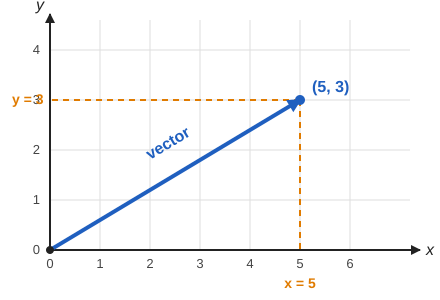

> **Transcript note:** the transcript says "draw them in the complex plane like this". Here the lecturer is drawing the ordinary **real** x-y plane (the complex plane comes later, in section 4).

Three real numbers, such as $(5, 3, 1)$, make a point in ordinary 3-D space. You can still draw that. You cannot draw four or more.

### Why complex vectors are hard to draw

Now suppose the coordinates are **complex numbers** instead of real numbers. The lecturer had not yet defined a complex number at this point (he does that shortly), but the idea is this:

- One complex number such as $3 + 2i$ is really **two real numbers** ($3$ and $2$). We will see in section 4 that it can be drawn as a point on a plane.
- A vector with **two complex coordinates**, for example $(3 + 2i,\ 1 - 4i)$, therefore needs **four real numbers**: $3, 2, 1, -4$. That is a point in **4-dimensional space**, and nobody can draw that.

| Kind of vector | Example | Real numbers needed | Can you draw it? |
|---|---|---|---|
| $\mathbb{R}$ | $5$ | 1 | Yes (a number line) |
| $\mathbb{R}^2$ | $(5, 3)$ | 2 | Yes (a flat plane) |
| $\mathbb{R}^3$ | $(5, 3, 1)$ | 3 | Yes (3-D space) |
| $\mathbb{C}$ | $3 + 2i$ | 2 | Yes (the complex plane) |
| $\mathbb{C}^2$ | $(3 + 2i,\ 1 - 4i)$ | 4 | **No** (needs 4-D) |
| $\mathbb{C}^3$ | three complex numbers | 6 | **No** |

### The lecturer's rule for the course

> "When I draw examples and draw pictures, I will always think of real numbers, but always keep this idea in the back of your mind that we're always dealing with [complex numbers]."

In other words: the **pictures** in class will use real vectors like $(5, 3)$ because they can be drawn. The **actual maths** (and quantum computing) uses complex vectors. Everything you learn from the real pictures carries over.

There are nicer ways to picture a **single qubit**, in three dimensions. The lecturer said a later session will show that. (This 3-D picture is usually called the Bloch sphere. That name is mine, not the lecturer's.)

## 2.6 "Why do complex numbers appear in physics at all?"

A student asked: *why are qubits, which are physical things, described by something as abstract as the complex plane?* The lecturer called it "a very good question" and gave an honest answer in several steps:

1. **It is empirical.** "Empirical" means found by experiment, not derived from something simpler. Physicists realised in the **1910s and 1920s** that quantum mechanics only works if you use complex numbers.
2. **There is no deeper explanation.** "We don't have a very good explanation of why complex numbers are really inherent in quantum physics."
3. **We treat it as an axiom.** An **axiom** is a starting rule that you accept without proof because everything built on it matches real experiments. Think of it like the rules of a game: you do not ask why the rules are what they are, you just play by them. As the lecturer put it: "You will have to just live with it."
4. **Probabilities are the same story.** Why does probability enter physics? Why do complex numbers? Nobody knows. "What we have understood is that you need these notions."

He said he would come back to this later.

> **Transcript note:** in this part the transcription twice says "quantum numbers" or "quantum, sorry, numbers". From context the lecturer means **complex numbers**.

---

# 3. Why complex numbers exist

This section follows the lecturer from the moment he asks: *why did people even define these strange objects?*

## 3.1 The problem: an equation with no solution

The lecturer's answer: "when you write down an equation, sometimes it will not have a solution." His example:

$$
x^2 + 1 = 0
$$

He asked: can we find a **real** number $x$ that works?

**Step by step.**

1. Take any real number $x$ and square it. The result is **never negative**. For example $3^2 = 9$, $(-3)^2 = 9$, $0^2 = 0$.
2. So $x^2 \ge 0$ always.
3. Therefore $x^2 + 1 \ge 1$ always. It can **never** equal $0$.

Here are some values of $x^2 + 1$:

| $x$ | $-3$ | $-2$ | $-1$ | $0$ | $1$ | $2$ | $3$ |
|---|---|---|---|---|---|---|---|
| $x^2 + 1$ | 10 | 5 | 2 | 1 | 2 | 5 | 10 |

And here is the picture. Each blue dot is one of the points from the table, on the curve $y = x^2 + 1$. Solving $x^2 + 1 = 0$ means asking where the curve touches the red line $y = 0$ (the horizontal axis). It never does; its lowest point is $y = 1$ (at $x = 0$):

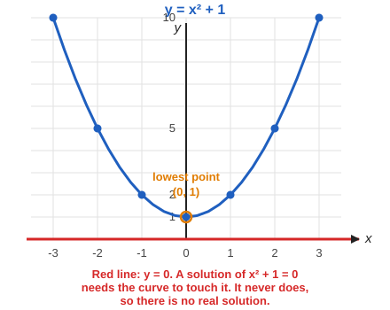

The curve stays above the line $y = 0$, so **there is no real solution**.

## 3.2 The fix: invent a new number

The lecturer: "we just sort of added an artificial sort of entity to it. We said, let us invent a number $i$." The only property we demand is:

$$
i^2 = -1
$$

Key points from the lecture:

- People call $i$ the **imaginary number**. The name is historical. It is just "an object, or a quantity" whose square is $-1$.
- We did not *discover* that the equation had a solution. We **artificially declared** a new number that is a solution: "let's just invent a new object, a new number, so that it is a solution to this equation."

With $i$ in hand, the equation $x^2 + 1 = 0$ now has solutions. (There are actually two of them, $x = i$ and $x = -i$, because $(-i)^2 = i^2 = -1$ as well.) On the complex plane (section 4), they sit one step above and one step below the origin:

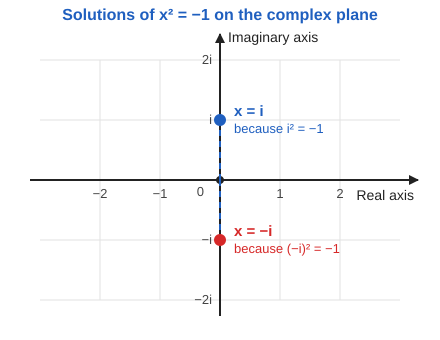

## 3.3 Why quantum computing needs complex numbers

A student asked the natural question: *do we really need them?* The lecturer's answer:

- "It turns out that in quantum computing... when we talk about **amplitudes**, they turn out to be **complex**. So it is inherently needed."
- "If you don't have complex numbers, you will not have **interference**."
- "Complex numbers are absolutely essential if you want to deal with quantum computing."

What do those words mean? You do not need the full details yet:

- An **amplitude** is a number attached to each possible outcome of a quantum system. It is the quantity that the quantum state is made of. (Later: probability of an outcome comes from the amplitude.)
- **Interference** means that two contributions can **add up** or **cancel out**, just like water waves. In a quantum algorithm, the wrong answers are arranged to cancel and the right answer is arranged to reinforce.

| Situation | Amplitudes | Total | Name |
|---|---|---|---|
| Pointing the same way | $\tfrac12 + \tfrac12$ | $1$ | constructive interference |
| Pointing opposite ways | $\tfrac12 + \left(-\tfrac12\right)$ | $0$ | destructive interference |

> **Honest nuance (my addition, not the lecturer's).** Ordinary positive and negative numbers can already cancel, as in the table. Complex numbers go further: an amplitude has a *direction* (an angle), so contributions can cancel or reinforce by any amount in between. The standard formulation of quantum mechanics uses complex amplitudes, which is the lecturer's point. You will see this clearly in sections 10 to 13, where multiplying by a complex number is a rotation.

## 3.4 The story of number systems: each one was invented to solve an equation

The lecturer then zoomed out: inventing $i$ is not unusual. It is the **latest step in a long pattern**.

> "Each of them was driven by our desire to solve more complex equations."

He went through the number systems one at a time. For each one he pointed to an equation on his slide ("an equation like this") and said that the old numbers could not solve it, so a new kind of number was invented.

> **About the equations below.** The slides are not part of the transcript, so the equations on the slides are not recorded. The equations here are the **standard textbook example for each step** and they match what the lecturer describes in words. They are my reconstruction, not a quote. If your slides use slightly different examples (for example $x + 1 = 0$ instead of $x + 5 = 0$), the idea is identical.

### The ladder at a glance

| Step | New numbers | Equation the old numbers cannot solve | Solution in the new numbers |
|---|---|---|---|
| 1 | **Natural numbers** $\mathbb{N}$: $1, 2, 3, \dots$ | none yet (this is the starting point, for counting) | |
| 2 | **Integers** $\mathbb{Z}$: add zero and **negative** numbers | $x + 5 = 0$ | $x = -5$ |
| 3 | **Rational numbers** $\mathbb{Q}$: add **fractions** | $3x = 1$ | $x = \tfrac13$ |
| 4 | **Real numbers** $\mathbb{R}$: add numbers like $\sqrt2$ and $\pi$ | $x^2 = 2$ | $x = \sqrt2$ (and $-\sqrt2$) |
| 5 | **Complex numbers** $\mathbb{C}$: add $i$ | $x^2 = -1$ | $x = i$ (and $-i$) |

Now each step in detail.

### Step 2: why negative numbers were invented

**Equation:**

$$
x + 5 = 0
$$

**Problem with natural numbers.** We are looking for a counting number $x$ so that adding $5$ gives $0$. But every natural number is at least $1$, so $x + 5$ is at least $6$. It can never be $0$. No solution.

**Fix.** Invent negative numbers. Define $-5$ to be "the number that gives $0$ when you add $5$ to it":

$$
x = -5
\qquad\text{Check: } (-5) + 5 = 0 \ \checkmark
$$

### Step 3: why rational numbers (fractions) were invented

**Equation:**

$$
3x = 1
$$

**Problem with integers.** We want a whole number $x$ so that three of it make exactly $1$. Try some:

| $x$ | $0$ | $1$ | $2$ | $-1$ |
|---|---|---|---|---|
| $3x$ | $0$ | $3$ | $6$ | $-3$ |

The value $1$ is never hit: $3x$ jumps from $0$ to $3$ and skips over $1$. No integer works.

**Fix.** Invent fractions. Define $\tfrac13$ to be "the number that gives $1$ when you multiply it by $3$":

$$
x = \frac{1}{3}
\qquad\text{Check: } 3\cdot\frac13 = 1 \ \checkmark
$$

### Step 4: why real numbers were invented

**Equation:**

$$
x^2 = 2
$$

**Problem with rational numbers.** We want a number whose square is exactly $2$. Fractions can get very close:

| Try $x$ | $x^2$ | Compared with $2$ |
|---|---|---|
| $1.4$ | $1.96$ | a bit too small |
| $1.41$ | $1.9881$ | a bit too small |
| $1.414$ | $1.999396$ | a bit too small |
| $1.4143$ | $2.00024\ldots$ | a bit too big |

The squares creep towards $2$, but **no fraction $p/q$ ever hits it exactly**. (This was proved in ancient Greece. Sketch: suppose $x = p/q$ in lowest terms. Then $p^2 = 2q^2$, so $p$ is even, so $q$ must be even too, which contradicts "lowest terms".)

**Fix.** Invent real numbers, which include the **irrational** numbers. Define $\sqrt2$ to be "the positive number whose square is $2$":

$$
x = \sqrt{2} \approx 1.41421356\ldots
\qquad\text{Check: } \left(\sqrt2\right)^2 = 2 \ \checkmark
$$

There is a second solution, $x = -\sqrt2$, because $\left(-\sqrt2\right)^2 = 2$ as well.

### Step 5: why complex numbers were invented

**Equation:**

$$
x^2 = -1
\qquad\text{(the same as } x^2 + 1 = 0 \text{)}
$$

**Problem with real numbers.** The square of any real number is $0$ or positive, never $-1$. No real solution (this is exactly section 3.1).

**Fix.** Invent $i$. Define $i$ to be "a number whose square is $-1$":

$$
x = i
\qquad\text{Check: } i^2 = -1 \ \checkmark
$$

And $x = -i$ works too, because $(-i)^2 = (-1)^2 i^2 = -1$.

### The pattern

In every step the recipe is the same:

1. Write down an equation that looks reasonable.
2. Show that the numbers we have so far cannot solve it.
3. **Invent** new numbers that can, and check that the old rules of arithmetic still work.

That is the lecturer's point: complex numbers are not strange. They are one more step on a ladder we have already climbed four times.

Each new system **contains** the previous one. Picture them as boxes inside boxes:

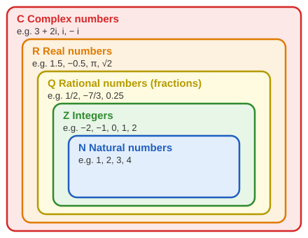

Another way to see the story is on the number line. Each step fills a gap or adds a new direction:

| Step | What it adds to the picture |
|---|---|
| $\mathbb{N}$ | Points on the line to the right of zero. |
| $\mathbb{Z}$ | Extends the line to the **left** (negative numbers). |
| $\mathbb{Q}$ | Fills in points **between** the integers (fractions). |
| $\mathbb{R}$ | Fills in **every** remaining gap (numbers like $\sqrt2$ and $\pi$), so the line is complete. |
| $\mathbb{C}$ | Adds a **second direction** (up and down). The line becomes a whole **plane**. |

This last step is why complex numbers can be drawn as points on a plane, which is the next topic.

## 3.5 Do we ever need to go beyond complex numbers?

The lecturer asked it himself: "do we need to go beyond complex numbers?" His answer: **no**.

> "There is a theory which says that you don't have to do that... Any equation that you write can always be solved in complex [numbers]. So that's the story."

This theorem is called the **Fundamental Theorem of Algebra**. In plain words: any polynomial equation (such as $x^2 + 1 = 0$, or $x^3 = 1$, or $x^5 - 2x + 7 = 0$) can be solved using complex numbers, and a degree-$n$ equation has exactly $n$ solutions when counted properly.

| Equation | Degree | Solutions in $\mathbb{R}$ | Solutions in $\mathbb{C}$ |
|---|---|---|---|
| $x^2 + 1 = 0$ | 2 | none | $i$ and $-i$ (two) |
| $x^2 = 1$ | 2 | $1$ and $-1$ | $1$ and $-1$ (two) |
| $x^3 = 1$ | 3 | only $1$ | three (see roots of unity, section 14) |
| $x^2 + 2x + 5 = 0$ | 2 | none | $-1 + 2i$ and $-1 - 2i$ (two) |

**Worked example: $x^2 + 2x + 5 = 0$.** Use the quadratic formula $x = \dfrac{-b \pm \sqrt{b^2 - 4ac}}{2a}$ with $a = 1$, $b = 2$, $c = 5$:

$$
x = \frac{-2 \pm \sqrt{4 - 20}}{2} = \frac{-2 \pm \sqrt{-16}}{2}
$$

With real numbers we would stop here, because $\sqrt{-16}$ does not exist. With $i$ we can continue: $\sqrt{-16} = 4i$, since $(4i)^2 = 16\,i^2 = -16$. So

$$
x = \frac{-2 \pm 4i}{2} = -1 \pm 2i
$$

Check one solution, $x = -1 + 2i$: $x^2 = 1 - 4i + 4i^2 = -3 - 4i$, and $2x = -2 + 4i$. Then $x^2 + 2x + 5 = (-3 - 4i) + (-2 + 4i) + 5 = 0$. $\checkmark$

Notice that both solutions are complex numbers, and that **no further new kind of number** was needed. This is what "any equation can always be solved in complex numbers" means.

So complex numbers are the **last stop**: no further new numbers are needed to solve equations.

---

# 4. What a complex number is

## 4.1 Definition

A **complex number** is a number of the form

$$
z = a + bi
\qquad\text{where } a, b \text{ are real numbers}
$$

- $a$ is the **real part**, written $\operatorname{Re}(z)$.
- $b$ is the **imaginary part**, written $\operatorname{Im}(z)$.

> **Important:** the imaginary part is the real number $b$, **not** $bi$. For $3 + 2i$ the imaginary part is $2$. (A student asked about this; the lecturer confirmed that both $a$ and $b$ are always real.)

## 4.2 Examples

| Complex number | Real part | Imaginary part |
|---|---|---|
| $5 + 6i$ | $5$ | $6$ |
| $3 + 2i$ | $3$ | $2$ |
| $-i$ (that is, $0 - 1\cdot i$) | $0$ | $-1$ |
| $3i$ (that is, $0 + 3i$) | $0$ | $3$ |
| $5$ (that is, $5 + 0i$) | $5$ | $0$ |

Every real number is a complex number with imaginary part $0$. So $\mathbb{R}\subset\mathbb{C}$.

## 4.3 The Argand diagram (complex plane)

A complex number is **two real numbers**, so we can draw it as a point on a flat plane:

- horizontal axis = **real axis** (the value of $a$)
- vertical axis = **imaginary axis** (the value of $b$)

$$
a + bi \;\longleftrightarrow\; \text{the point } (a, b)
$$

So:

| Complex number | Point |
|---|---|
| $3 + 2i$ | $(3, 2)$ |
| $2 + 3i$ | $(2, 3)$ |
| $3i$ | $(0, 3)$, on the vertical axis |
| $5$ | $(5, 0)$, on the horizontal axis |
| $i$ | $(0, 1)$ |

This picture is called the **Argand diagram**. It is the best tool for *seeing* what operations do.

Here is $3 + 2i$ drawn as an arrow from the origin. Compare it with the picture of the vector $(5, 3)$ in section 2.5: it is the same kind of picture, but the horizontal axis is now the **real part** and the vertical axis is the **imaginary part**:

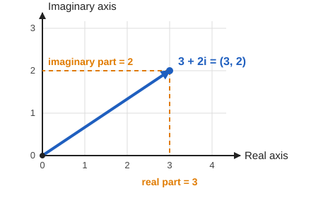

When the lecturer says "$\mathbb{C}$ is like $\mathbb{R}^2$", he means exactly this: each complex number corresponds to a pair of real numbers. Likewise:

- $\mathbb{C}$ looks like a 2-D plane ($\mathbb{R}^2$).
- $\mathbb{C}^2$ (a pair of complex numbers) looks like $\mathbb{R}^4$. This is why it is hard to draw.

---

# 5. Adding complex numbers

## 5.1 Rule

Add real parts together and imaginary parts together:

$$
(a + bi) + (c + di) = (a + c) + (b + d)i
$$

**Example.** Add $3 + 2i$ and $1 - 4i$.

$$
(3 + 1) + (2 - 4)i = 4 - 2i
$$

## 5.2 Geometric meaning

This is **exactly** vector addition. If $z$ is the point $(a, b)$ and $w$ is the point $(c, d)$, complete the parallelogram. The sum $z + w$ is the **diagonal**.

Here is the example from section 5.1 drawn on the complex plane. The blue arrow is $z = 3 + 2i$ and the red arrow is $w = 1 - 4i$. The dashed lines complete the parallelogram, and the green arrow along the diagonal is the sum $z + w = 4 - 2i$:

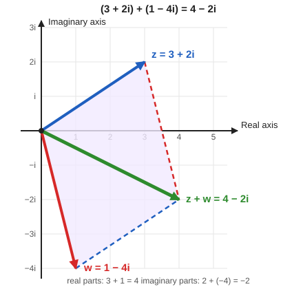

Compare with the plain vectors from the lecture: $(5, 1) + (1, 4) = (6, 5)$. Same operation.

---

# 6. Multiplying complex numbers

## 6.1 Rule

Multiply as usual (every term by every term), then use $i^2 = -1$:

$$
(a + bi)(c + di) = ac + adi + bci + bd\,i^2
$$

Since $i^2 = -1$, the last term becomes $-bd$:

$$
(a + bi)(c + di) = (ac - bd) + (ad + bc)i
$$

The result is again a complex number.

## 6.2 Worked example

Multiply $(3 + 2i)(1 - 4i)$:

$$
\begin{aligned}
(3 + 2i)(1 - 4i)
&= 3\cdot 1 + 3\cdot(-4i) + 2i\cdot 1 + 2i\cdot(-4i) \\
&= 3 - 12i + 2i - 8i^2 \\
&= 3 - 10i + 8 \\
&= 11 - 10i
\end{aligned}
$$

(We used $-8i^2 = -8(-1) = +8$.)

Another: $(3 + 2i)^2 = 9 + 12i + 4i^2 = 9 + 12i - 4 = 5 + 12i$.

---

# 7. Powers of i

## 7.1 The pattern repeats every 4 steps

Multiply $i$ by itself repeatedly:

| Power | Value | Reason |
|---|---|---|
| $i^1$ | $i$ | |
| $i^2$ | $-1$ | definition |
| $i^3$ | $-i$ | $i^2\cdot i = -i$ |
| $i^4$ | $1$ | $i^2\cdot i^2 = (-1)(-1)$ |
| $i^5$ | $i$ | back to the start |

The pattern repeats every **4** steps: $i, -1, -i, 1, i, -1, -i, 1, \dots$

## 7.2 Trick: reduce the exponent mod 4

To compute $i^{n}$, divide $n$ by 4 and keep the remainder:

| Remainder of $n \div 4$ | $i^n$ |
|---|---|
| 0 | $1$ |
| 1 | $i$ |
| 2 | $-1$ |
| 3 | $-i$ |

**Example from the lecture.** $i^{26}$: $26 = 4\cdot 6 + 2$, so remainder $2$, so

$$
i^{26} = (i^4)^6 \cdot i^2 = 1\cdot(-1) = -1
$$

## 7.3 The harder question

How would you compute $(3 + 2i)^5$ or $(1 + i)^{10}$? Multiplying out 10 times is painful. There is a much better way, which needs polar form and Euler's formula (below). The lecturer set this up as a motivating puzzle.

---

# 8. Complex conjugate and modulus

These two ideas are used constantly in quantum computing.

## 8.1 Complex conjugate

For $z = a + bi$, the **conjugate** flips the sign of the imaginary part:

$$
\bar z = a - bi
$$

(Also written $z^*$. Physicists usually write $z^*$; the lecturer wrote $\bar z$.)

**Geometry:** conjugating **reflects** the point across the real (horizontal) axis. The lecturer's words: "if this is your complex number, its conjugate geometrically sort of flips it... you get its reflection in the real axis."

Think of the real axis as a **mirror**. Place $z = 3 + 2i$ above the mirror, and its conjugate $3 - 2i$ is its mirror image below. The two points have the same real part, opposite imaginary parts, and the same distance from the origin:

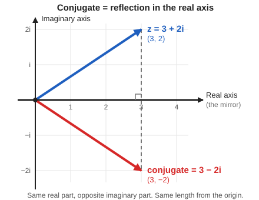

| $z$ | $\bar z$ |
|---|---|
| $3 + 2i$ | $3 - 2i$ |
| $-1 + 4i$ | $-1 - 4i$ |
| $5$ | $5$ (real numbers do not change) |
| $i$ | $-i$ |

## 8.2 Modulus (length)

The **modulus** of $z = a + bi$ is its distance from the origin:

$$
\lvert z\rvert = \sqrt{a^2 + b^2}
$$

This is just Pythagoras on the point $(a, b)$. The lecturer's reminder: "if a point in 2D has coordinates $a, b$, then the length is the square root of $a^2 + b^2$. So $\lvert z\rvert$ is essentially used to denote how far $z$ is away from the origin."

**Example:** $\lvert 3 + 4i\rvert = \sqrt{9 + 16} = 5$.

The picture below shows why. Go $3$ to the right (the real part $a$) and $4$ up (the imaginary part $b$). The straight line from the origin to $3 + 4i$ is the **hypotenuse** of a right-angled triangle with sides $3$ and $4$, so its length is $\sqrt{3^2 + 4^2} = 5$. The last line of the picture is the identity $z\,\bar z = \lvert z\rvert^2$ from section 8.3, checked with numbers:

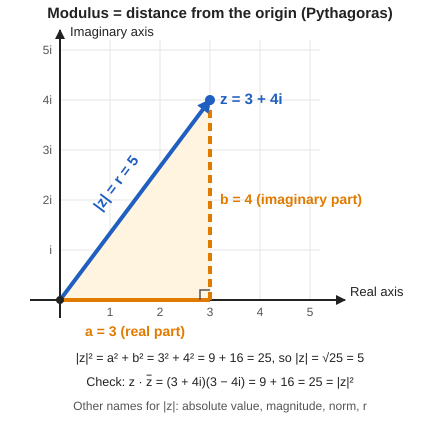

Other names: **absolute value**, **magnitude**, **norm**. Also called $r$.

## 8.3 The key identity

Multiply $z$ by its conjugate:

$$
z\,\bar z = (a + bi)(a - bi) = a^2 - (bi)^2 = a^2 - b^2 i^2 = a^2 + b^2
$$

So:

$$
\boxed{\,z\,\bar z = \lvert z\rvert^2\,}
$$

The result is **always a non-negative real number**. The lecturer said to remember this one above all: it will be used again and again. In quantum computing it becomes "**probability = amplitude times its conjugate**".

## 8.4 Properties

For any complex numbers $z$ and $w$:

| Property | Meaning |
|---|---|
| $\overline{z + w} = \bar z + \bar w$ | Conjugate of a sum = sum of conjugates |
| $\overline{z\,w} = \bar z\,\bar w$ | Conjugate of a product = product of conjugates |
| $\lvert z\,w\rvert = \lvert z\rvert\,\lvert w\rvert$ | Length of a product = product of lengths |
| $\overline{\bar z} = z$ | Conjugating twice undoes it |

> **Careful.** In the lecture it was said loosely that conjugate and modulus "commute with addition and multiplication". The accurate statement: the **conjugate** respects both addition and multiplication. The **modulus** respects **multiplication only**. In general $\lvert z + w\rvert \ne \lvert z\rvert + \lvert w\rvert$. For example, $z = 1$, $w = -1$ gives $\lvert z + w\rvert = 0$ but $\lvert z\rvert + \lvert w\rvert = 2$.

**The lecturer's proof for addition.** Let $z = a + bi$ and $w = c + di$.

- $z + w = (a + c) + (b + d)i$, so $\overline{z + w} = (a + c) - (b + d)i$.
- $\bar z + \bar w = (a - bi) + (c - di) = (a + c) - (b + d)i$.

They match.

## 8.5 Recovering real and imaginary parts

The lecturer's point: you do not need the letters $a$ and $b$. If you have $z$ and its conjugate $\bar z$, you can **recover both parts** from them. The idea is simple. $z$ and $\bar z$ have the **same real part** and **opposite imaginary parts**. So:

- **adding** them makes the imaginary parts **cancel**, leaving only the real part;
- **subtracting** them makes the real parts **cancel**, leaving only the imaginary part.

### Getting the real part (add)

$$
z + \bar z = (a + bi) + (a - bi) = a + a + bi - bi = 2a
$$

The $bi$ and $-bi$ cancel. We are left with $2a$, which is **twice** the real part. Divide by $2$ to get $a$ itself:

$$
\operatorname{Re}(z) = \frac{z + \bar z}{2}
$$

### Getting the imaginary part (subtract)

$$
z - \bar z = (a + bi) - (a - bi) = a - a + bi + bi = 2bi
$$

This time the $a$ and $-a$ cancel (be careful with the minus sign: subtracting $(a - bi)$ turns $-bi$ into $+bi$). We are left with $2bi$. That is **not yet** the imaginary part. The imaginary part is the real number $b$, but $2bi$ has an extra $2$ and an extra $i$. Divide by both, that is, by $2i$:

$$
\operatorname{Im}(z) = \frac{z - \bar z}{2i}
\qquad\text{because}\qquad
\frac{2bi}{2i} = b
$$

> The lecturer said that subtracting "gives the imaginary part". Strictly, you get $2bi$, so you also divide by $2i$ to get the real number $b$.

### Quick numerical check

Take $z = 3 + 2i$, so $\bar z = 3 - 2i$.

| | Calculation | Result |
|---|---|---|
| Real part | $\dfrac{z + \bar z}{2} = \dfrac{(3 + 2i) + (3 - 2i)}{2} = \dfrac{6}{2}$ | $3$ |
| Imaginary part | $\dfrac{z - \bar z}{2i} = \dfrac{(3 + 2i) - (3 - 2i)}{2i} = \dfrac{4i}{2i}$ | $2$ |

Both match $z = 3 + 2i$: real part $3$, imaginary part $2$.

### Picture it with the mirror

Recall that $\bar z$ is the mirror image of $z$ in the real axis (section 8.1). The point **halfway between** $z$ and its mirror image lies exactly **on the real axis**, directly below or above $z$. That halfway point is $\dfrac{z + \bar z}{2}$, which is why it equals the real part $a$.

---

# 9. Dividing complex numbers

## 9.1 The problem

For real numbers, $5 \div 3$ is easy. What is

$$
\frac{2 + 3i}{5 + 6i}\ ?
$$

You cannot just divide the parts separately.

## 9.2 The trick: multiply top and bottom by the conjugate of the denominator

Because $w\bar w = \lvert w\rvert^2$ is a **real** number, the denominator becomes real. Then you only need to divide by a real number.

$$
\frac{z}{w}
= \frac{z\,\bar w}{w\,\bar w}
= \frac{z\,\bar w}{\lvert w\rvert^2}
$$

(You multiply by $\bar w/\bar w$, which equals $1$, so the value does not change.)

## 9.3 Worked example from the lecture

Compute $\dfrac{3 + 2i}{1 - 4i}$.

The conjugate of the denominator is $1 + 4i$.

**Denominator:**

$$
(1 - 4i)(1 + 4i) = 1 + 16 = 17
$$

**Numerator:**

$$
(3 + 2i)(1 + 4i) = 3 + 12i + 2i + 8i^2 = 3 + 14i - 8 = -5 + 14i
$$

**Result:**

$$
\frac{3 + 2i}{1 - 4i} = \frac{-5 + 14i}{17} = -\frac{5}{17} + \frac{14}{17}\,i
$$

Real part $-5/17$, imaginary part $14/17$.

## 9.4 Extra example

$\dfrac{2 + 3i}{5 + 6i}$. Multiply by $\dfrac{5 - 6i}{5 - 6i}$:

$$
\text{numerator}: (2 + 3i)(5 - 6i) = 10 - 12i + 15i - 18i^2 = 28 + 3i
$$

$$
\text{denominator}: 5^2 + 6^2 = 61
$$

$$
\frac{2 + 3i}{5 + 6i} = \frac{28}{61} + \frac{3}{61}\,i
$$

## 9.5 Reciprocal of $i$

$$
\frac{1}{i} = \frac{1\cdot(-i)}{i\cdot(-i)} = \frac{-i}{-i^2} = \frac{-i}{1} = -i
$$

Check: $i \cdot (-i) = -i^2 = 1$. Correct.

## 9.6 General reciprocal

$$
\frac{1}{z} = \frac{\bar z}{\lvert z\rvert^2}
\qquad\text{or in parts:}\qquad
\frac{1}{a + bi} = \frac{a - bi}{a^2 + b^2}
$$

---

# 10. Polar form

## 10.1 Why we need a new way to write complex numbers

The lecturer starts with two questions, both of which the form $a + bi$ cannot answer well:

1. **How do I compute a big power?** For example, $(2 + 3i)^{10}$. Writing out $(2 + 3i)(2 + 3i)(2 + 3i)\cdots$ ten times is a lot of calculation, and it is easy to make a mistake.
2. **What does multiplication actually do?** When we multiplied two complex numbers earlier, we just expanded brackets. That gives the right answer but gives no *picture*. Where does the product end up on the plane?

His answer: "I have to come to a different way of representing a complex number." That new way is **polar form**.

## 10.2 The idea: length and direction instead of across and up

Right now we describe the point $z = a + bi$ by **"how far across, how far up"**: the pair $(a, b)$. These are the **Cartesian** coordinates.

There is another way to give directions to the same point. Instead of walking across and then up, you can **face the right direction and walk in a straight line**. You need two numbers for that as well:

- **How far to walk.** This is the length $r$ of the arrow from the origin to $z$. It is the modulus: $r = \lvert z\rvert$ (section 8.2). The lecturer: "$r$ is how far this $z$ is from the origin."
- **Which direction to face.** This is the angle $\theta$ (the Greek letter "theta"). It is measured **anticlockwise from the positive real axis** (the horizontal axis pointing right). The lecturer: "theta is the angle which this complex number makes with the real axis."

These two numbers $(r, \theta)$ are the **polar coordinates** of $z$. Here is the same picture for the lecturer's example $z = 2 + 3i$:

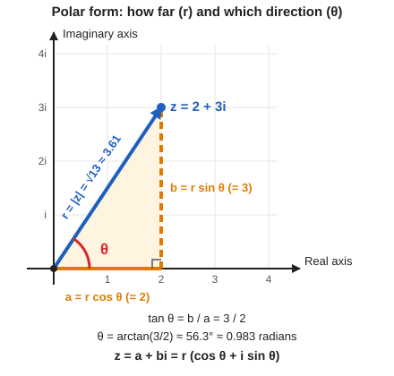

Reading the picture:

- The **blue arrow** is $z$. Its length is $r$.
- The **red arc** marks the angle $\theta$ between the positive real axis and the arrow.
- The **orange sides** are $a$ (the real part, along the axis) and $b$ (the imaginary part, going up). Together with the blue arrow they make a **right-angled triangle**, where $r$ is the hypotenuse.

| | Cartesian (what we have used so far) | Polar (new) |
|---|---|---|
| What you give | $a$ and $b$ | $r$ and $\theta$ |
| Meaning | across and up | length and direction |
| For $z = 2 + 3i$ | $a = 2,\ b = 3$ | $r = \sqrt{13} \approx 3.61,\ \theta \approx 56.3^\circ$ |

## 10.3 Converting between the two

### From $(r, \theta)$ to $(a, b)$

The lecturer's plan: "I want to express the real and the imaginary part of this complex number in terms of $r$ and $\theta$." He does it with a bit of trigonometry, which he introduces with the words "if you remember your trigonometry, let me just remind you".

Take the right-angled triangle from the picture above and look at it by itself. Its three sides have names:

- the **hypotenuse** is the long sloping side. Here it is $r$;
- the side **next to** the angle $\theta$ is $a$ (it runs along the real axis);
- the side **opposite** the angle $\theta$ is $b$ (it is the vertical side, on the far side from the angle).

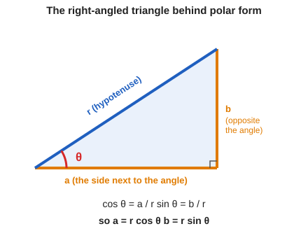

Recall from trigonometry (appendix A.5): $\cos\theta$ is the side **next to** the angle divided by the hypotenuse, and $\sin\theta$ is the side **opposite** the angle divided by the hypotenuse. In our triangle that gives (the lecturer: "this is all you need to know"):

$$
\cos\theta = \frac{a}{r}
\qquad
\sin\theta = \frac{b}{r}
$$

Multiply both sides by $r$ to solve for $a$ and $b$:

$$
a = r\cos\theta
\qquad
b = r\sin\theta
$$

Now substitute these into $z = a + bi$ and take out the common factor $r$:

$$
z = a + bi = r\cos\theta + i\,r\sin\theta = r(\cos\theta + i\sin\theta)
$$

Every complex number can be written this way. This is the **polar form** (in its first version; Euler's formula in the next section shortens it).

**Quick numerical check** with $z = 2 + 3i$, where $r = \sqrt{13} \approx 3.606$ and $\theta \approx 56.31^\circ$ (so $\cos\theta \approx 0.5547$ and $\sin\theta \approx 0.8321$):

| | Calculation | Result |
|---|---|---|
| Real part $a$ | $r\cos\theta \approx 3.606 \times 0.5547$ | $2.00$ |
| Imaginary part $b$ | $r\sin\theta \approx 3.606 \times 0.8321$ | $3.00$ |

We get back $2$ and $3$, so $z = 2 + 3i$ is the same number in both descriptions.

### Trigonometry basics: sine and cosine for any angle

The right-angled triangle above only works for angles between $0^\circ$ and $90^\circ$. Complex numbers can point in any direction (for example $-1 + i$ points up and to the left), so we need $\cos\theta$ and $\sin\theta$ for **every** angle. The trick is to look at them on a **circle** instead of a triangle.

#### The circle picture

Draw a circle of radius $r$ centred at the origin. Start at the positive $x$-axis and turn **anticlockwise** by the angle $\theta$. You land on a point of the circle, and the coordinates of that point are

$$
(a, b) = (r\cos\theta,\ r\sin\theta)
$$

This is exactly the formula $a = r\cos\theta$, $b = r\sin\theta$ from above, now valid for all angles. On the **unit circle** ($r = 1$) the point is simply $(\cos\theta, \sin\theta)$. So:

- $\cos\theta$ is **how far across** the point is (its $x$-coordinate);
- $\sin\theta$ is **how high up** the point is (its $y$-coordinate).

#### The four quadrants

The two axes cut the plane into four **quadrants**. They are numbered **anticlockwise**, starting at the top right:

| Quadrant | Where | Angles |
|---|---|---|
| I | top right | $0^\circ$ to $90^\circ$ |
| II | top left | $90^\circ$ to $180^\circ$ |
| III | bottom left | $180^\circ$ to $270^\circ$ |
| IV | bottom right | $270^\circ$ to $360^\circ$ |

**An easy way to remember the signs.** The first and second quadrants are the **top half** of the coordinate plane. Every point in the top half is **above** the $x$-axis, so its height $y$ is positive. And the height is exactly $\sin\theta$. Therefore

> **In quadrants I and II (the top half), $\sin\theta > 0$.**
> In quadrants III and IV (the bottom half), $\sin\theta < 0$.

In the same way, look at left and right. Quadrants I and IV are the **right half**, where the $x$-coordinate is positive, so $\cos\theta > 0$. Quadrants II and III are the **left half**, where $x$ is negative, so $\cos\theta < 0$.


In the picture, the green segment is $\sin\theta$ (the height) and the red segment is $\cos\theta$ (the sideways distance). At $50^\circ$ the red segment points right (cos positive). At $130^\circ$ it points left (cos negative), but the green segment still points up, because $130^\circ$ is also in the top half.

| Quadrant | $\cos\theta$ (sideways) | $\sin\theta$ (height) |
|---|---|---|
| I (top right) | $+$ | $+$ |
| II (top left) | $-$ | $+$ |
| III (bottom left) | $-$ | $-$ |
| IV (bottom right) | $+$ | $-$ |

**Mirror trick for the second quadrant.** An angle in quadrant II can be written as $180^\circ - \theta$ with $\theta$ in quadrant I. Its point is the mirror image of the first-quadrant point across the $y$-axis, so the height stays the same and the sideways distance flips sign:

$$
\sin(180^\circ - \theta) = \sin\theta
\qquad
\cos(180^\circ - \theta) = -\cos\theta
$$

For example, $135^\circ = 180^\circ - 45^\circ$, so $\sin 135^\circ = \dfrac{\sqrt2}{2}$ and $\cos 135^\circ = -\dfrac{\sqrt2}{2}$. This is why $-1 + i = \sqrt2\left(\cos 135^\circ + i\sin 135^\circ\right)$: check that $\sqrt2\cdot\left(-\tfrac{\sqrt2}{2}\right) = -1$ and $\sqrt2\cdot\tfrac{\sqrt2}{2} = 1$.

#### The values you should know by heart

Five angles appear again and again in quantum computing. Here are their sine and cosine:

| Degrees $\theta$ | Radians $\theta$ | $\sin\theta$ | $\cos\theta$ |
|---|---|---|---|
| $0^\circ$ | $0$ | $\frac{\sqrt{0}}{2}=0$ | $\frac{\sqrt{4}}{2}=1$ |
| $30^\circ$ | $\frac{\pi}{6}$ | $\frac{\sqrt{1}}{2}=\frac{1}{2}$ | $\frac{\sqrt{3}}{2}$ |
| $45^\circ$ | $\frac{\pi}{4}$ | $\frac{\sqrt{2}}{2}$ | $\frac{\sqrt{2}}{2}$ |
| $60^\circ$ | $\frac{\pi}{3}$ | $\frac{\sqrt{3}}{2}$ | $\frac{\sqrt{1}}{2}=\frac{1}{2}$ |
| $90^\circ$ | $\frac{\pi}{2}$ | $\frac{\sqrt{4}}{2}=1$ | $\frac{\sqrt{0}}{2}=0$ |

**How to read it, and a trick to remember it.**

- Look at the **sine column** from top to bottom. The numbers under the square root are $0, 1, 2, 3, 4$ (all over $2$). Just count up: $\sqrt0, \sqrt1, \sqrt2, \sqrt3, \sqrt4$.
- The **cosine column** is the same list **counted backwards**: $\sqrt4, \sqrt3, \sqrt2, \sqrt1, \sqrt0$.
- Some of them simplify, because $\sqrt0 = 0$, $\sqrt1 = 1$ and $\sqrt4 = 2$. That is why $\sin 0^\circ = \frac{0}{2} = 0$, $\sin 30^\circ = \frac12$, $\sin 90^\circ = \frac22 = 1$, and similarly for cosine.
- The columns are mirror images of each other because $\sin\theta = \cos(90^\circ - \theta)$. For example $\sin 30^\circ = \cos 60^\circ = \tfrac12$.
- At $45^\circ$ the point is on the diagonal, so across and up are equal: $\sin 45^\circ = \cos 45^\circ = \frac{\sqrt2}{2}$. This is the same number as $\frac{1}{\sqrt2}$ (multiply top and bottom by $\sqrt2$), which you saw in the $1 + i$ example.

**Quick check.** Each row must satisfy $\cos^2\theta + \sin^2\theta = 1$ (Pythagoras on the unit circle). For $30^\circ$: $\left(\tfrac{\sqrt3}{2}\right)^2 + \left(\tfrac12\right)^2 = \tfrac34 + \tfrac14 = 1$. For $45^\circ$: $\tfrac12 + \tfrac12 = 1$.

Here are the same five points on the unit circle. Each point is $(\cos\theta, \sin\theta)$, so the table can be read straight off the picture:

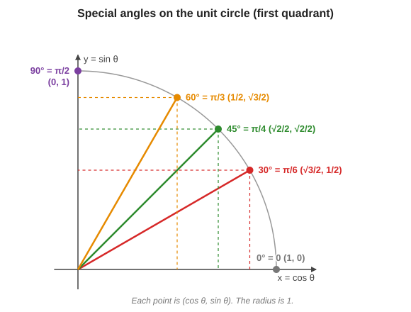

**Why are these values what they are?** They come from two familiar shapes (you can rebuild the table from them if you forget it):

- **Half of a square** with side $1$: it is a right triangle with two equal legs of length $1$ and two angles of $45^\circ$. By Pythagoras the hypotenuse is $\sqrt{1^2 + 1^2} = \sqrt2$. So $\sin 45^\circ = \dfrac{\text{opposite}}{\text{hypotenuse}} = \dfrac{1}{\sqrt2} = \dfrac{\sqrt2}{2}$, and $\cos 45^\circ$ is the same.
- **Half of an equilateral triangle** with side $2$: cut it down the middle. You get a right triangle with hypotenuse $2$, short leg $1$ (half of the base) and long leg $\sqrt{2^2 - 1^2} = \sqrt3$. The angles are $30^\circ$ (opposite the short leg) and $60^\circ$. So $\sin 30^\circ = \tfrac12$, $\cos 30^\circ = \tfrac{\sqrt3}{2}$, $\sin 60^\circ = \tfrac{\sqrt3}{2}$, $\cos 60^\circ = \tfrac12$.

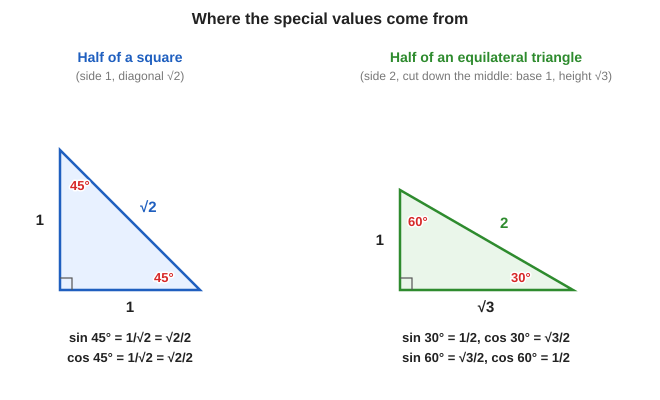

(The values for $0^\circ$ and $90^\circ$ come from the circle: at $0^\circ$ the point is $(1, 0)$ and at $90^\circ$ it is $(0, 1)$.)

### From $(a, b)$ to $(r, \theta)$

$$
r = \sqrt{a^2 + b^2}
\qquad
\theta = \arctan\!\left(\frac{b}{a}\right)
\ \text{(take care with the quadrant)}
$$

Where does the $\arctan$ come from? Divide the two equations $b = r\sin\theta$ and $a = r\cos\theta$: the $r$ cancels and we get $\dfrac{b}{a} = \dfrac{\sin\theta}{\cos\theta} = \tan\theta$. Then $\theta$ is the angle whose tangent is $b/a$.

For $z = 2 + 3i$: $r = \sqrt{2^2 + 3^2} = \sqrt{13} \approx 3.61$, and $\theta = \arctan(3/2) \approx 56.3^\circ$ (about $0.983$ radians).

**Taking care with the quadrant.** Your calculator's $\arctan$ only returns angles between $-90^\circ$ and $90^\circ$, so it cannot tell $1 + i$ from $-1 - i$ (both have $b/a = 1$). Always **sketch the point first** and check which corner of the plane it is in:

| Where the point is | Example | $\theta$ |
|---|---|---|
| Right half ($a > 0$) | $1 + i$ | $\arctan(b/a) = 45^\circ$ |
| Left half ($a < 0$) | $-1 + i$ | $\arctan(b/a)$ **plus $180^\circ$**, giving $135^\circ$ |
| Left half, below | $-1 - i$ | $\arctan(b/a) + 180^\circ = 225^\circ$ (or equally $-135^\circ$) |
| On the positive imaginary axis | $i$ | $90^\circ$ |
| On the negative real axis | $-1$ | $180^\circ$ |

### Why this helps (preview)

Back to the lecturer's two questions. In polar form, a **power** just raises the length to that power and **multiplies** the angle by it, and a **product** multiplies the lengths and **adds** the angles. That answers both questions, and it is exactly what we do in sections 12 and 13. First we need Euler's formula, which gives a compact way to write $\cos\theta + i\sin\theta$.

## 10.4 Example from the lecture: $z = 1 + i$

The lecturer's example: "if I give you a complex number $1 + i$, how will I know what $r$ and $\theta$ are?" Here are the steps, together with a picture:

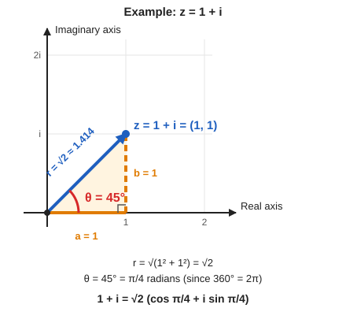

**Step 1: plot the point.** $1 + i = 1 + 1\cdot i$, so both the real part and the imaginary part are $1$. The point is $(1, 1)$. (The lecturer: "both the coordinates are 1 and 1".)

**Step 2: find the length $r$.** Pythagoras on the triangle with both sides equal to $1$:

$$
r = \sqrt{1^2 + 1^2} = \sqrt{2} \approx 1.414
$$

**Step 3: find the angle $\theta$.** The two sides of the triangle are equal, so the arrow bisects the right angle between the axes. That makes $\theta = 45^\circ$. (Check with the formula: $\tan\theta = b/a = 1/1 = 1$, and $\arctan 1 = 45^\circ$.)

**Step 4: convert the angle to radians.** Quantum computing uses radians, so convert. The lecturer: "if you remember, $360$ degrees is $2\pi$." Then

$$
45^\circ = \frac{45}{360}\times 2\pi = \frac{1}{8}\times 2\pi = \frac{\pi}{4}
$$

So $\theta = \dfrac{\pi}{4}$ radians.

**Step 5: write the polar form.** Substitute $r = \sqrt2$ and $\theta = \pi/4$ into $z = r(\cos\theta + i\sin\theta)$:

$$
1 + i = \sqrt2\left(\cos\frac{\pi}{4} + i\sin\frac{\pi}{4}\right)
$$

**Check.** $\cos(\pi/4) = \sin(\pi/4) = 1/\sqrt2$. So $\sqrt2\cdot\tfrac{1}{\sqrt2}(1 + i) = 1\cdot(1 + i) = 1 + i$. It matches the number we started with.

> **Transcript note:** the transcript says "this length here will be square $\sqrt{2}$". It means "the square root of 2", $\sqrt2$.

The lecturer pointed out the obvious complaint: this looks *more* complicated than $1 + i$. The payoff comes next.

---

# 11. Euler's formula

## 11.1 The formula

$$
\boxed{\,e^{i\theta} = \cos\theta + i\sin\theta\,}
$$

This is one of the most important formulas in all of mathematics. It lets you replace the two-term expression $\cos\theta + i\sin\theta$ with a single term $e^{i\theta}$.

So every complex number can be written as

$$
z = r\,e^{i\theta}
$$

where $r$ is the length and $\theta$ the angle. This is **polar form**.

For example:

$$
1 + i = \sqrt2\,e^{i\pi/4}
$$

**How do we get $\sqrt2\,e^{i\pi/4}$ from $1 + i$?** Follow the same steps as in section 10.4, and then apply Euler's formula once at the end:

1. **Length.** The point $1 + i$ is $(1, 1)$, so $r = \sqrt{1^2 + 1^2} = \sqrt2$. This is the number in front of the $e$.
2. **Angle.** The arrow points exactly halfway between the two axes, so $\theta = 45^\circ$. In radians, $45^\circ = \dfrac{\pi}{4}$. This is the number multiplying $i$ in the exponent.
3. **Polar form with cosine and sine.** Put $r$ and $\theta$ into $z = r(\cos\theta + i\sin\theta)$:

$$
1 + i = \sqrt2\left(\cos\frac{\pi}{4} + i\sin\frac{\pi}{4}\right)
$$

4. **Euler's formula.** The bracket is exactly the left-hand side of Euler's formula with $\theta = \pi/4$, so it equals $e^{i\pi/4}$:

$$
\cos\frac{\pi}{4} + i\sin\frac{\pi}{4} = e^{i\pi/4}
\quad\Longrightarrow\quad
1 + i = \sqrt2\;e^{i\pi/4}
$$

So in $\sqrt2\,e^{i\pi/4}$, the $\sqrt2$ is the **length** of the arrow and the $\pi/4$ (the angle, in radians) sits in the exponent next to $i$.

**Quick check, going backwards.** Expand $\sqrt2\,e^{i\pi/4}$ with Euler's formula. Since $\cos\frac{\pi}{4} = \sin\frac{\pi}{4} = \dfrac{1}{\sqrt2}$:

$$
\sqrt2\,e^{i\pi/4} = \sqrt2\left(\frac{1}{\sqrt2} + i\,\frac{1}{\sqrt2}\right) = 1 + i \ \checkmark
$$

(Section 11.3 below repeats this idea for other numbers and shows the general rule.)

## 11.2 "But what does $e^{i\theta}$ even mean?"

The lecturer raised this on purpose. $2^3$ means $2\cdot2\cdot2$, but "$e$ multiplied by itself $i\theta$ times" makes no sense. So we **define** the exponential differently, using an infinite sum:

$$
e^x = 1 + x + \frac{x^2}{2!} + \frac{x^3}{3!} + \frac{x^4}{4!} + \cdots
$$

Here $e \approx 2.718$. This works for any $x$, including complex $x$.

- Example: $e^2 = 1 + 2 + \tfrac{4}{2} + \tfrac{8}{6} + \cdots \approx 7.389$.
- The lecturer's complex example: $e^{5i} = 1 + 5i + \dfrac{(5i)^2}{2!} + \dfrac{(5i)^3}{3!} + \cdots$

Two things to take on trust (as the lecturer asked):

1. This sum always settles down to a single value.
2. The result obeys the **normal exponent rules**: $e^{A}e^{B} = e^{A+B}$ and $(e^{A})^{n} = e^{nA}$, even when $A, B$ are complex.

## 11.3 The payoff: two terms become one

Now the lecturer returns to the example $1 + i$ from section 10.4 and shows why Euler's formula is useful. His words: "So this is a truly magical formula... two terms get compressed into one term."

**Where we left off.** In section 10.4 we wrote

$$
1 + i = \sqrt2\left(\cos\frac{\pi}{4} + i\sin\frac{\pi}{4}\right)
$$

The bracket has **two terms**: a cosine term and an $i$ times sine term. The earlier complaint was that this looks more complicated than $1 + i$.

**Apply Euler's formula.** Euler's formula says $\cos\theta + i\sin\theta = e^{i\theta}$ for **any** angle $\theta$. Take $\theta = \pi/4$:

$$
\cos\frac{\pi}{4} + i\sin\frac{\pi}{4} = e^{i\pi/4}
$$

The two-term bracket collapses to a single term. Substitute this back:

$$
1 + i = \sqrt2\,e^{i\pi/4}
$$

Compare the three ways of writing the same number:

| Form | Expression for $1 + i$ | Number of pieces |
|---|---|---|
| Rectangular (real and imaginary parts) | $1 + i$ | 2 (the numbers $1$ and $1$) |
| Polar with cosine and sine | $\sqrt2\left(\cos\frac{\pi}{4} + i\sin\frac{\pi}{4}\right)$ | 3 (length, cosine, sine) |
| **Polar with Euler's formula** | $\sqrt2\,e^{i\pi/4}$ | **2 (length and angle)** |

The last form is the shortest *and* the most informative: you can read off the length $\sqrt2$ and the angle $\pi/4$ immediately.

### The general rule

The same thing works for **every** complex number. Start with the polar form from section 10.3 and compress the bracket:

$$
z = r\left(\cos\theta + i\sin\theta\right) = r\,e^{i\theta}
$$

The lecturer's summary: "every complex number $z$ can be written in this form, $z = r\,e^{i\theta}$, where $r$ is a real number and $e^{i\theta}$ is essentially denoting $\cos\theta + i\sin\theta$."

How to read it:

- $r$ is an ordinary **real number**, the **length** (how far from the origin). It stretches or shrinks.
- $e^{i\theta}$ carries the **direction**. It is a number of length exactly $1$ that points at angle $\theta$ (you will see in section 12.3 that it sits on the unit circle).

So $z = r\,e^{i\theta}$ means "**stretch** by $r$, **pointing** at angle $\theta$".

> **Transcript note:** the last sentence of this passage in the transcript is garbled ("$e^{i\theta}$ is essentially denoting $\cos\theta$ plus $i$ $z$ is equal to $\cos\theta$ plus $i$"). It is the lecturer repeating Euler's formula, $e^{i\theta} = \cos\theta + i\sin\theta$.

### More examples

| $z$ | Length $r$ | Angle $\theta$ | $z = r\,e^{i\theta}$ |
|---|---|---|---|
| $1 + i$ | $\sqrt2$ | $\pi/4$ | $\sqrt2\,e^{i\pi/4}$ |
| $2 + 3i$ | $\sqrt{13}$ | $\arctan(3/2) \approx 0.983$ | $\sqrt{13}\,e^{i\,0.983}$ |
| $3$ | $3$ | $0$ | $3\,e^{i0}$ |
| $i$ | $1$ | $\pi/2$ | $e^{i\pi/2}$ |
| $-1$ | $1$ | $\pi$ | $e^{i\pi}$ |
| $-2i$ | $2$ | $-\pi/2$ (a quarter turn clockwise) | $2\,e^{-i\pi/2}$ |

### Going back the other way

To turn $r\,e^{i\theta}$ back into $a + bi$, expand with Euler's formula. For example $2\,e^{i\pi/3}$:

$$
2\,e^{i\pi/3} = 2\left(\cos\frac{\pi}{3} + i\sin\frac{\pi}{3}\right) = 2\left(\frac12 + i\,\frac{\sqrt3}{2}\right) = 1 + i\sqrt3
$$

### Why bother?

The new form is not only shorter. Because $e^{i\theta}$ follows the **normal rules of exponents** (section 11.2), powers and products become easy. That is exactly what the lecturer does next, in section 12 (powers, such as $(1 + i)^{10}$) and section 13 (products and rotations).

## 11.4 Why Euler's formula is true (optional)

The lecturer said the proof uses the series above (a **Taylor series**) and skipped it. Here is the idea, for the curious.

Put $x = i\theta$ and use $i^2 = -1,\ i^3 = -i,\ i^4 = 1,\dots$:

$$
e^{i\theta} = 1 + i\theta - \frac{\theta^2}{2!} - i\frac{\theta^3}{3!} + \frac{\theta^4}{4!} + i\frac{\theta^5}{5!} - \cdots
$$

Group the terms **without** $i$ and the terms **with** $i$:

$$
e^{i\theta}
= \underbrace{\left(1 - \frac{\theta^2}{2!} + \frac{\theta^4}{4!} - \cdots\right)}_{\cos\theta}
+ i\,\underbrace{\left(\theta - \frac{\theta^3}{3!} + \frac{\theta^5}{5!} - \cdots\right)}_{\sin\theta}
$$

Those two brackets are exactly the known series for $\cos\theta$ and $\sin\theta$. So $e^{i\theta} = \cos\theta + i\sin\theta$.

## 11.5 Special values

| Angle | Point on the circle | Value |
|---|---|---|
| $\theta = 0$ | $(1, 0)$ | $e^{i0} = 1$ |
| $\theta = \pi/2$ | $(0, 1)$ | $e^{i\pi/2} = i$ |
| $\theta = \pi$ | $(-1, 0)$ | $e^{i\pi} = -1$ |
| $\theta = 3\pi/2$ | $(0, -1)$ | $e^{i3\pi/2} = -i$ |
| $\theta = 2\pi$ | $(1, 0)$ | $e^{i2\pi} = 1$ |

The line $e^{i\pi} = -1$ (equivalently $e^{i\pi} + 1 = 0$) is the famous **Euler's identity**.

---

# 12. Using Euler's formula

## 12.1 Powers become easy

**Example from the lecture: compute $(1 + i)^{10}$.**

Step 1. Write in polar form: $1 + i = \sqrt2\,e^{i\pi/4}$.

Step 2. Raise to the 10th power. Use $(AB)^n = A^n B^n$ and $(e^{x})^n = e^{nx}$:

$$
(1 + i)^{10} = \left(\sqrt2\right)^{10}\left(e^{i\pi/4}\right)^{10}
= 2^5\; e^{i\,10\pi/4}
= 32\,e^{i\,5\pi/2}
$$

Step 3. Convert back with Euler's formula:

$$
32\left(\cos\frac{5\pi}{2} + i\sin\frac{5\pi}{2}\right)
$$

Now $\dfrac{5\pi}{2} = 2\pi + \dfrac{\pi}{2}$, so it is the same as $\dfrac{\pi}{2}$ after one full turn: $\cos = 0$, $\sin = 1$. 

$$
(1 + i)^{10} = 32\,i
$$

## 12.2 General recipe: raising to a power

$$
\left(r\,e^{i\theta}\right)^n = r^n\,e^{i\,n\theta}
$$

Lengths get raised to the power $n$. Angles get **multiplied** by $n$. (This is called **de Moivre's theorem**.)

## 12.3 The unit circle: where is $e^{i\theta}$ on the plane?

The lecturer now asks: "What is the geometric meaning of all this? Where is $e^{i\theta}$ in our geometric picture?" Here is the answer, step by step.

### Step 1: find the real and imaginary parts of $e^{i\theta}$

By Euler's formula,

$$
e^{i\theta} = \cos\theta + i\sin\theta
$$

So $e^{i\theta}$ is a complex number with

- **real part** $\cos\theta$ (how far across),
- **imaginary part** $\sin\theta$ (how far up).

On the complex plane it is the point $(\cos\theta,\ \sin\theta)$. In the picture below, this is the blue point for $\theta = \pi/4$. The two orange sides of the triangle have lengths $\cos\theta$ and $\sin\theta$.

### Step 2: find its length (modulus)

The modulus of a complex number is the square root of (real part squared plus imaginary part squared) (section 8.2). Here that is

$$
\lvert e^{i\theta}\rvert = \sqrt{\cos^2\theta + \sin^2\theta} = \sqrt{1} = 1
$$

The step $\cos^2\theta + \sin^2\theta = 1$ is the identity from appendix A.5, which comes from Pythagoras. The lecturer: "What is the modulus of this complex number? The modulus is $1$. Why? Because $\cos^2\theta + \sin^2\theta$ is $1$."

### Step 3: the unit circle

A number of length $1$ is exactly $1$ unit away from the origin. All the points that are $1$ unit from the origin form a **circle of radius 1**, called the **unit circle**. So

> **$e^{i\theta}$ is the point on the unit circle that makes the angle $\theta$ with the positive real axis.**

You reach it by starting at the point $1$ on the real axis and walking along the circle, **anticlockwise**, until the angle is $\theta$. The lecturer: "I always start measuring from the real axis."

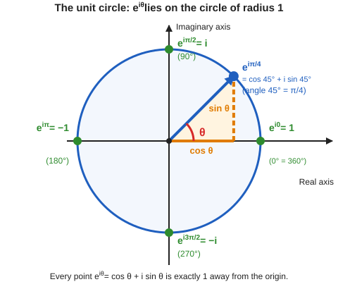

### Reading the picture: the examples from the lecture

| Expression | Angle | Where it sits | As a complex number |
|---|---|---|---|
| $e^{i0}$ | $0^\circ$ | right, on the real axis (the starting point) | $1$ |
| $e^{i\pi/4}$ | $45^\circ$ | halfway between right and top | $\cos 45^\circ + i\sin 45^\circ = \dfrac{1}{\sqrt2} + \dfrac{1}{\sqrt2}i$ |
| $e^{i\pi/2}$ | $90^\circ$ | top, on the imaginary axis | $i$ |
| $e^{i\pi}$ | $180^\circ$ | left, on the real axis | $-1$ |
| $e^{i3\pi/2}$ | $270^\circ$ | bottom, on the imaginary axis | $-i$ |
| $e^{i2\pi}$ | $360^\circ$ | back at the starting point | $1$ |

How to remember the angles: $\pi$ radians is $180^\circ$, a half turn. So $\pi/2$ is a quarter turn, $3\pi/2$ is three quarters of a turn, and $2\pi$ is a full turn.

**Why $e^{i\pi} = -1$.** After a half turn you are at the left end of the circle, the point $(-1, 0)$, which is the number $-1$. Check with the formula: $e^{i\pi} = \cos\pi + i\sin\pi = -1 + i\cdot 0 = -1$. This is Euler's identity from section 11.5.

> **Transcript note:** the transcript garbles this passage ("this is $e$ to the $i$, this is $e$ to the $i$ $3i\pi/2$ because that is $270$ degrees"). The lecturer is naming the points in order: $e^{i\pi/2}$ at $90^\circ$, $e^{i\pi}$ at $180^\circ$, $e^{i3\pi/2}$ at $270^\circ$, and then $e^{i0}$ is "back to the starting point".

## 12.4 Going around the circle

A full turn is $2\pi$, so you land on the same point:

$$
e^{i0} = e^{i2\pi} = e^{i4\pi} = \cdots
\qquad
e^{i(\theta + 2\pi)} = e^{i\theta}
$$

## 12.5 Negative angles

A negative angle means turning **clockwise**. For example, $e^{-i\pi/6}$ is the point $30^\circ$ **below** the positive real axis. Note also that $e^{-i\theta}$ is the **conjugate** of $e^{i\theta}$ (a reflection across the real axis).

---

# 13. Multiplication is rotate-and-stretch

This is the most important geometric idea of the lecture.

## 13.1 The rule

Take two complex numbers in polar form:

$$
z_1 = r_1 e^{i\theta_1}
\qquad
z_2 = r_2 e^{i\theta_2}
$$

Then

$$
z_1 z_2 = r_1 r_2\; e^{i(\theta_1 + \theta_2)}
$$

In words:

> **Lengths multiply. Angles add.**

**Why this is true.** Multiply the two numbers and regroup the factors. Multiplication of numbers can be done in any order, so the real numbers $r_1$, $r_2$ can be moved together, and so can the two exponentials:

$$
z_1 z_2 = \left(r_1 e^{i\theta_1}\right)\left(r_2 e^{i\theta_2}\right) = r_1 r_2\; e^{i\theta_1}\, e^{i\theta_2}
$$

Now use the exponent rule $e^{A}e^{B} = e^{A+B}$ (section 11.2: $e^{i\theta}$ "behaves like normal exponentiation"). With $A = i\theta_1$ and $B = i\theta_2$, the angles add in the exponent:

$$
e^{i\theta_1}\, e^{i\theta_2} = e^{i\theta_1 + i\theta_2} = e^{i(\theta_1 + \theta_2)}
$$

Putting the pieces together gives the rule above. This is the whole reason for writing numbers as $r\,e^{i\theta}$.

**The geometric picture.** The lecturer describes it with two arrows $z_1$ and $z_2$ drawn from the origin, at angles $\theta_1$ and $\theta_2$ measured from the real axis:

- The product $z_1 z_2$ is a **new arrow** that starts at the origin too.
- Its **angle** from the real axis is $\theta_1 + \theta_2$.
- Its **length** is $r_1 r_2$, the product of the two lengths.

In the picture below, $z_1$ has length $2$ at $20^\circ$ and $z_2$ has length $1.5$ at $60^\circ$. The product $z_1 z_2$ (red) has length $2 \times 1.5 = 3$ and sits at angle $20^\circ + 60^\circ = 80^\circ$. The red arc measures the angle $\theta_1 + \theta_2$ from the real axis; the dashed circle has radius $3$ and shows that the tip of the product lies at distance $r_1 r_2$ from the origin.

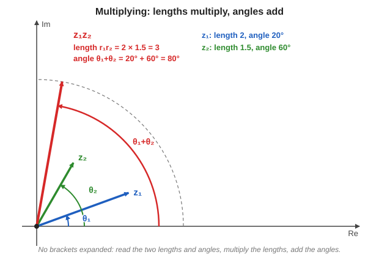

His point: "if I tell you where the initial two complex numbers were, you can figure out where the new complex number is." You never have to expand brackets. You just read off the two lengths and the two angles, multiply the lengths, and add the angles. (The picture for a specific example is in section 13.4.)

> **Transcript note:** the transcript says "its angle will be theta plus 1". It means $\theta_1 + \theta_2$.

## 13.2 Multiplying by a number on the unit circle only rotates

If $\lvert w\rvert = 1$, then $\lvert zw\rvert = \lvert z\rvert$. Length stays the same, only the angle changes. So **multiplying by $e^{i\phi}$ rotates $z$ by $\phi$**, without changing how big it is.

**Why.** Take $w = e^{i\phi}$. Its length is $r_2 = 1$ and its angle is $\phi$. The rule from 13.1 then says

$$
zw = (r_1\cdot 1)\, e^{i(\theta_1 + \phi)} = r_1\, e^{i(\theta_1 + \phi)}
$$

The length is still $r_1$ (multiplying by $1$ changes nothing) and the angle has grown by $\phi$. In the picture, $z$ has length $2.6$ at $25^\circ$ and $w = e^{i\,45^\circ}$ is the short purple arrow of length $1$. The product $zw$ is the same length as $z$ (it stays on the dashed circle) but is turned by $45^\circ$ anticlockwise, to $25^\circ + 45^\circ = 70^\circ$.

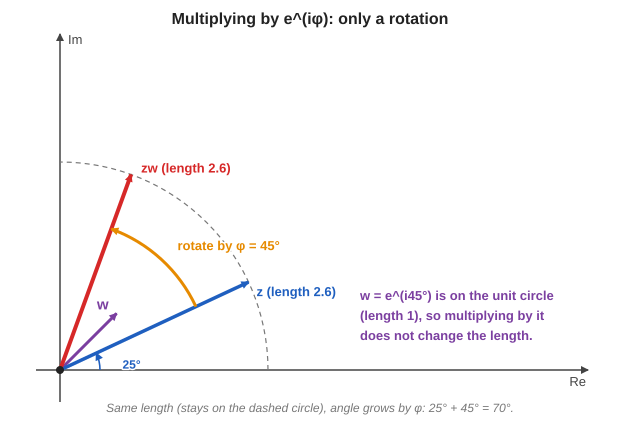

(Section 13.3 below is the special case $\phi = 90^\circ$, that is $w = i$.)

## 13.3 Multiplying by $i$ rotates by 90°

The lecturer's question: what happens when we multiply a complex number by $i$?

**Step 1: $i = e^{i\pi/2}$.** The lecturer gives two ways to see this.

- *Picture way.* Where does $i$ sit on the complex plane? Its real part is $0$ and its imaginary part is $1$, so it is the point $(0, 1)$, straight up the imaginary axis. That arrow has length $1$ and makes an angle of $\dfrac{\pi}{2}$ ($90^\circ$) with the real axis. In polar form (length $1$, angle $\pi/2$) that is $e^{i\pi/2}$. It is the orange dot in the picture below.
- *Formula way.* Use Euler's formula:

$$
e^{i\pi/2} = \cos\frac{\pi}{2} + i\sin\frac{\pi}{2} = 0 + i\cdot 1 = i
$$

**Step 2: apply the rule from 13.1.** Multiplying by $e^{i\pi/2}$ means:

- *Length:* $i$ has length $1$, and "lengths multiply", so the length of the number is multiplied by $1$ and **does not change**.
- *Angle:* "angles add", so the angle **increases by $\dfrac{\pi}{2}$**.

A turn with no change in size is a **rotation**. So multiplying by $i$ **rotates a complex number anticlockwise by $90^\circ$**. If you want to carry a number $z$ to the spot $z'$ that is a quarter-turn away, you multiply it by $i$.

The picture uses $z = 3 + 4i$. The **blue arrow** is $z$, the **green arrow** is $iz$ (the result), and the **red arc** is the $90^\circ$ turn between them. Both arrows end on the dashed circle, which shows that the length stays the same:

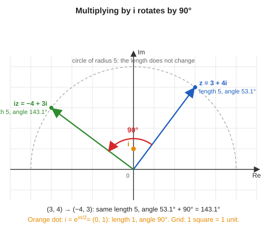

Notice the numbers: $(3, 4)$ becomes $(-4, 3)$. In general, $i(a + bi) = ai + bi^2 = -b + ai$, so $(a, b) \to (-b, a)$. That is exactly a quarter-turn.

> The transcript says "rotate it by 8"; this is a recognition error for "90 degrees".

**Check with numbers.** Take $z = 3 + 4i$. Then $iz = 3i + 4i^2 = -4 + 3i$. The point moved from $(3, 4)$ to $(-4, 3)$: a quarter turn anticlockwise, same length $5$.

**Why the lecturer calls this "the utility of Euler's formula".** Without the polar form, the rotation by $90^\circ$ is just a rule about $(a, b) \to (-b, a)$. With $i = e^{i\pi/2}$ it falls out of "angles add". The same trick makes powers easy: to compute $\left(e^{i\theta}\right)^8$ you just multiply the angle by $8$, as in section 12.1.

## 13.4 Recap example from the lecture

After the $i$ discussion the lecturer says "let's recap, let's take an example". He picks two numbers:

$$
z = 2\,e^{i\pi/10}
\qquad
w = 4\,e^{i\pi/2}
$$

Read off the two lengths and the two angles:

| | Length | Angle |
|---|---|---|
| $z = 2\,e^{i\pi/10}$ | $2$ | $\dfrac{\pi}{10}$ (that is $18^\circ$). "makes angle $\pi/10$ with the real axis, its length is two" |
| $w = 4\,e^{i\pi/2}$ | $4$ | $\dfrac{\pi}{2}$ (that is $90^\circ$). "sitting here ... length 4, angle $\pi/2$" |

**Step 1: multiply the lengths.**

$$
\text{new length} = 2\times4 = 8
$$

**Step 2: add the angles.** To add fractions we need a common denominator. Write $\dfrac{\pi}{2} = \dfrac{5\pi}{10}$:

$$
\text{new angle} = \frac{\pi}{10} + \frac{\pi}{2} = \frac{\pi}{10} + \frac{5\pi}{10} = \frac{6\pi}{10} = \frac{3\pi}{5}
$$

(In degrees this is $18^\circ + 90^\circ = 108^\circ$, and $\dfrac{3\pi}{5}$ radians is indeed $108^\circ$.)

**Step 3: write the answer.**

$$
zw = 8\,e^{i\,3\pi/5}
$$

Here is the picture. The **blue arrow** is $z$ (length $2$, angle $18^\circ$). The **red arrow** is $w$ (length $4$, pointing straight up at $90^\circ$). The **green arrow** is the product $zw$. It is $8$ long, and it points at $108^\circ$, which is the blue angle plus the red angle (the green dashed arc covers both):

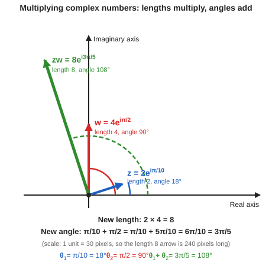

Think of it as a two-step move starting from $z$: **stretch** $z$ by a factor of $4$ (the length of $w$), and then **rotate** it by $90^\circ$ (the angle of $w$). Starting from the blue arrow at $18^\circ$ with length $2$, the stretch makes it $8$ long, and the rotation takes it from $18^\circ$ to $108^\circ$. That is the green arrow. The lecturer: "that is what it means to multiply."

**Connecting it back to multiplying by $i$.** Notice that $w = 4\,e^{i\pi/2} = 4i$. So multiplying $z$ by $w$ is really *two* easy moves that you already know:

1. **Multiply by $i$:** rotate $z$ by $90^\circ$ (the length stays $2$, the angle goes from $18^\circ$ to $108^\circ$). This is the orange arrow below.
2. **Multiply by $4$:** stretch the result by a factor of $4$ (the angle stays $108^\circ$, the length goes from $2$ to $8$). This is the green arrow.

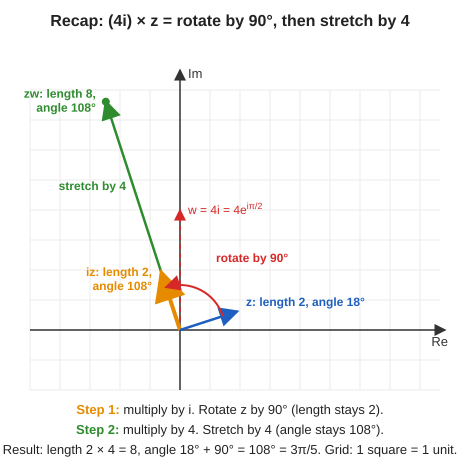

The order of the two moves does not matter (stretching first and then rotating gives the same arrow), because multiplication of numbers can be done in either order. Either way the arrow ends at "somewhere here": the point whose distance from the origin is $8$ and whose angle is $\dfrac{3\pi}{5}$. This is exactly what the lecturer means by "that is what it means to multiply."

## 13.5 Summary table

| Operation | Effect on length | Effect on angle |
|---|---|---|
| Multiply two numbers | multiply | **add** |
| Raise to power $n$ | raise to power $n$ | **multiply by** $n$ |
| Take conjugate | unchanged | **negate** |
| Take reciprocal | $r \to 1/r$ | **negate** |
| Multiply by $i$ | unchanged | $+\pi/2$ |
| Multiply by $-1$ | unchanged | $+\pi$ |

---

# 14. Roots of unity

## 14.1 The question

The lecturer asks: **why is the unit-circle picture useful?** One answer: it lets you find all the **roots of unity**. (He adds that this will be very useful later, when we get to algorithms.)

**What does "roots of unity" mean?** "Unity" is just another word for the number $1$. A "root of unity" is a number that gives $1$ when you raise it to some power. Think back to school:

- Solve $x^2 = 1$. This asks: which numbers have square equal to $1$? There are **two** answers, $1$ and $-1$. (Check: $1^2 = 1$ and $(-1)^2 = 1$.) These are the *square roots* of $1$.
- Solve $x^3 = 1$. These are the *cube roots* of $1$. Ideally there should be **three** numbers.
- In general, solve $z^n = 1$. Ideally there should be **$n$** different solutions. These are the **$n$-th roots of unity**.

The natural question: **where are these $n$ solutions?** With real numbers you find only one or two: for $x^3 = 1$ you find just $x = 1$, and the other two cube roots are invisible. Once you know complex numbers, you can find all of them, and the unit circle shows you exactly where they are.

> **Transcript note:** the lecturer says "three roots of unity" and "solution to $z$ cube is equal to one" for $n = 3$. He means the *cube* roots of unity.

## 14.2 The picture that solves it

**What do we know about a solution?** Suppose $z$ is a complex number with $z^n = 1$. Let's use the rule "lengths multiply, angles add" from section 13.1.

- *Length.* The right side, $1$, has length $1$. Raising $z$ to the power $n$ raises its length to the power $n$: $|z|^n = 1$. The only positive length with this property is $|z| = 1$. So every solution lies **on the unit circle** (length $1$). The lecturer says it this way: "its length will not change because its length is one."
- *Angle.* Say $z$ is at angle $\theta$. Multiplying $z$ by itself adds the angle each time: after $n$ factors of $z$ the angle is $n\theta$.

**Worked example: $z^{10} = 1$.** Draw the unit circle and divide it into **10 equal parts**, as the lecturer does. A full turn is $360^\circ = 2\pi$ radians, so each slice is

$$
\theta = \frac{2\pi}{10} = \frac{\pi}{5} = 36^\circ
$$

Here are the ten cut points. The orange dot at $0^\circ$ is the number $1$. The red dot is the first point, $z = e^{i2\pi/10}$:

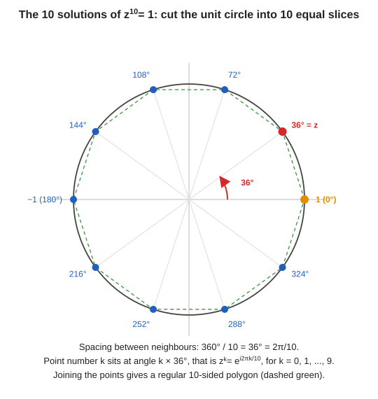

Now take the red point $z$ (angle $\theta = 36^\circ$) and ask: what is $z^{10}$?

- Its length stays $1$ ($1\times1\times\cdots = 1$).
- Each factor of $z$ adds another $36^\circ$ to the angle. Multiplying $z$ by itself ten times "keeps on rotating ten times", so the new angle is $10\theta = 10\times36^\circ = 360^\circ = 2\pi$.
- An angle of $360^\circ$ is a full turn. It points in the same direction as $0^\circ$, the point $1$.

So $z^{10} = 1$. In symbols: $z^{10} = \left(e^{i2\pi/10}\right)^{10} = e^{i\,2\pi} = 1$. The picture below shows the ten steps. You start at $1$ and every multiplication by $z$ hops $36^\circ$ anticlockwise: $z, z^2, z^3, \dots$ until $z^{10}$ lands back on $1$:

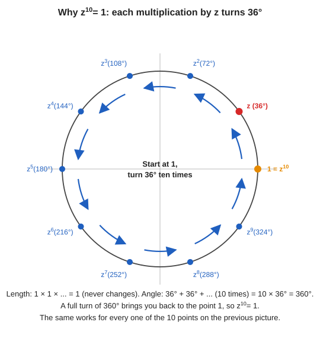

**And the other nine points?** The same argument works for each of them. The second point is at $72^\circ$, so ten rotations take you $10\times72^\circ = 720^\circ = 2$ full turns, back at $1$. The third is at $108^\circ$, so $1080^\circ = 3$ full turns, and so on. Every one of the ten cut points returns to $1$ after $10$ multiplications, so **all ten are solutions**. These are "the 10 roots of unity", and the lecturer's reason for saying "if you rotate this ... you will come back to the starting".

**General rule.** We need to land back at the point $1$, which is angle $0$, or any whole number of full turns: $n\theta = 2\pi k$.

So

$$
\theta = \frac{2\pi k}{n},\quad k = 0, 1, 2, \dots, n-1
$$

$$
\boxed{\,z_k = e^{\,i\,2\pi k/n}\,}
$$

**Meaning:** cut the unit circle into $n$ equal slices, starting at the point $1$. The $n$ cut points are the $n$ roots of unity. They form a regular $n$-sided polygon.

## 14.3 Examples

Here are the first few cases side by side. In each picture the unit circle is cut into $n$ equal slices, and the red arc is the slice angle $360^\circ/n$:

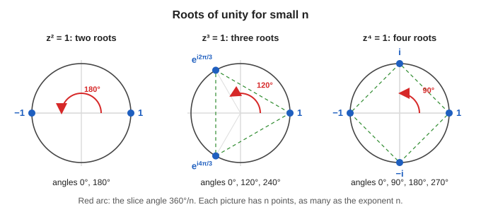

**Square roots of unity** ($n = 2$): divide the circle into $2$ parts of $180^\circ$. Angles $0$ and $\pi$ give $1$ and $-1$. This matches the school answer to $x^2 = 1$.

**Cube roots of unity** ($n = 3$): the lecturer says "divide the unit circle into three equal parts: this is one part, second part, third part". Each part has angle $\dfrac{2\pi}{3} = 120^\circ$ (the transcript says "2π by three, 120 degrees"). So the three roots are at $0,\ 2\pi/3,\ 4\pi/3$ (that is $0^\circ, 120^\circ, 240^\circ$):

$$
1,\qquad
e^{i2\pi/3} = -\tfrac12 + \tfrac{\sqrt3}{2}i,\qquad
e^{i4\pi/3} = -\tfrac12 - \tfrac{\sqrt3}{2}i
$$

**Fourth roots of unity** ($n = 4$): angles $0, \pi/2, \pi, 3\pi/2$:

$$
1,\quad i,\quad -1,\quad -i
$$

**Tenth roots of unity** ($n = 10$): ten points spaced $2\pi/10 = 36^\circ$ apart. This was the example the lecturer drew (see the two pictures in 14.2).

**Check the cube roots.** Let $\omega = e^{i2\pi/3}$. Then $\omega^3 = e^{i\,2\pi} = 1$ (three turns of $120^\circ$ make a full $360^\circ$). Likewise $\left(e^{i4\pi/3}\right)^3 = e^{i\,4\pi} = 1$ (two full turns). So the three points of the triangle really are the three solutions of $z^3 = 1$. This is the picture's use: **cut the circle into $n$ equal parts and read off all $n$ solutions**, with no need to solve the equation by algebra.

> **Lecturer's closing remark:** "So this allows you to solve for all the roots of unity. That's another utility of this. These things we will come to when we get to them. These are again some problems you can try; I will not do this. So this is my summary of complex numbers." Practice problems on this topic are in the "Practice problems with answers" section near the end of these notes.

Quick check for a 10th root $z = e^{i2\pi/10}$: $z^{10} = e^{i\,2\pi} = 1$. 

## 14.4 Solving $z^n = c$ in general

At the end the lecturer asked: solve $z^4 = 2$.

With real numbers there is one positive answer, $2^{1/4} \approx 1.189$. With complex numbers there are **four**:

> Take one solution and multiply by each of the four 4th roots of unity.

$$
z \in \left\{\,2^{1/4},\ \ i\cdot2^{1/4},\ \ -2^{1/4},\ \ -i\cdot2^{1/4}\,\right\}
$$

Check one: $\left(i\cdot2^{1/4}\right)^4 = i^4\cdot 2 = 2$. 

This is the general rule: a degree-$n$ equation has $n$ solutions in $\mathbb{C}$.

## 14.5 Why this matters later

Roots of unity are the backbone of the **Quantum Fourier Transform (QFT)**, which is used in **Shor's algorithm** from Part I. You will see them again.

---

# 15. Questions from the class

Short answers to the questions raised during the lecture.

| Question | Answer |
|---|---|
| Where does $3i$ sit? | It is $0 + 3i$, the point $(0, 3)$, on the imaginary axis. |
| Where does $5$ sit? | It is $5 + 0i$, the point $(5, 0)$, on the real axis. |
| Difference between $(0, 3)$ and $0, 3i$? | In $a + bi$, both $a$ and $b$ must be **real**. So write $3i$ as $0 + 3i$ with $b = 3$. |
| Is $\mathbb{C}^n$ the same as $\mathbb{R}^{2n}$? | As a real-number picture, yes: each complex entry is two real numbers. (The lecturer deferred the technical "topology" question.) |
| Is Euler's formula proved with a Taylor series? | Yes. See section 11.4. |
| Real-world use of Euler's formula? | Everywhere. Practical benefit: powers and products of complex numbers become simple. It also underlies waves, signals and quantum states. |
| Can $z^{\infty} = 1$ be solved? | No. Infinity is not a number, so the question has no meaning. But $z^{100} = 1$ or $z^{1000} = 1$ are fine. |
| Can angles be negative? | Yes. Positive is anticlockwise, negative is clockwise. Angles are measured from the positive real axis. |
| Why does physics need complex numbers or probabilities? | No known deeper reason. It is how nature is observed to behave. |
| Is the session recorded? | Yes; recordings will be shared after the course. |

---

# 16. Why quantum computing cares

The lecturer said many examples will use real numbers, but the following connections are the reason complex numbers appear.

## 16.1 Amplitudes are complex numbers

A single qubit state is a vector with two entries called **amplitudes**:

$$
\begin{bmatrix}\alpha \\ \beta\end{bmatrix}
\qquad \alpha,\beta\in\mathbb{C}
$$

## 16.2 Probability uses modulus squared

When you measure, the probability of an outcome is **modulus squared** of its amplitude:

$$
P = \lvert\alpha\rvert^2 = \alpha\,\bar\alpha
$$

This is the identity $z\bar z = \lvert z\rvert^2$ from section 8.3. The probabilities must add to 1:

$$
\lvert\alpha\rvert^2 + \lvert\beta\rvert^2 = 1
$$

## 16.3 Phase is $e^{i\theta}$

Writing an amplitude as $r\,e^{i\theta}$ separates its **size** $r$ (which controls probability) from its **phase** $\theta$ (an angle). Multiplying by $e^{i\phi}$ changes only the phase: a rotation on the unit circle.

Example: $e^{i\pi} = -1$, so a "phase flip" of $\pi$ just multiplies by $-1$.

## 16.4 Interference

Amplitudes **add** like vectors (section 5). Two amplitudes with the same length but opposite directions (for example $+\tfrac12$ and $-\tfrac12$) cancel to zero. That is **destructive interference**, and clever quantum algorithms arrange for wrong answers to cancel and right answers to reinforce. This is why complex numbers (with their angles) are essential.

## 16.5 Conjugates in inner products

The **inner product** (the tool for computing measurement probabilities, covered next in the course) conjugates one vector's entries. You just learned conjugation, so you are ready for it.

## 16.6 Roots of unity and the QFT

The QFT, central to Shor's algorithm, is built from the $n$-th roots of unity.

---

# 17. One-page cheat sheet

**Definition**

$$
i^2 = -1
\qquad
z = a + bi
\qquad
\operatorname{Re}(z) = a,\ \operatorname{Im}(z) = b
$$

**Operations**

| Operation | Formula |
|---|---|
| Add | $(a + bi) + (c + di) = (a + c) + (b + d)i$ |
| Multiply | $(a + bi)(c + di) = (ac - bd) + (ad + bc)i$ |
| Conjugate | $\overline{a + bi} = a - bi$ |
| Modulus | $\lvert z\rvert = \sqrt{a^2 + b^2}$ |
| Key identity | $z\bar z = \lvert z\rvert^2$ |
| Reciprocal | $1/z = \bar z / \lvert z\rvert^2$ |
| Divide | $z/w = z\bar w / \lvert w\rvert^2$ |

**Polar form**

$$
z = r e^{i\theta}
\qquad
e^{i\theta} = \cos\theta + i\sin\theta
\qquad
\lvert e^{i\theta}\rvert = 1
$$

**Rules**

$$
r_1e^{i\theta_1}\cdot r_2e^{i\theta_2} = r_1r_2\,e^{i(\theta_1 + \theta_2)}
\qquad
\left(re^{i\theta}\right)^n = r^n e^{in\theta}
$$

**Roots of unity**

$$
z^n = 1 \iff z = e^{i2\pi k/n},\quad k = 0,\dots,n-1
$$

**Special values**

$$
e^{i0} = 1,\quad e^{i\pi/2} = i,\quad e^{i\pi} = -1,\quad e^{i3\pi/2} = -i,\quad e^{i2\pi} = 1
$$

**Quick facts**

- Adding = vector addition (parallelogram).
- Multiplying = lengths multiply, angles add.
- Multiplying by $i$ = rotate $90^\circ$ anticlockwise.
- Conjugate = reflect across real axis.
- $i^n$ repeats every 4: $i, -1, -i, 1$.

---

# 18. Practice problems with answers

Try each one before looking at the answer.

## 18.1 Problems

1. Compute $(4 + 3i) + (2 - 5i)$.
2. Compute $(2 + i)(3 - 2i)$.
3. Find $\operatorname{Re}$, $\operatorname{Im}$, conjugate and modulus of $z = -3 + 4i$.
4. Compute $i^{43}$.
5. Compute $\dfrac{1 + 2i}{3 - i}$.
6. Write $-1 + i$ in polar form $r e^{i\theta}$.
7. Compute $(1 - i)^{8}$ using polar form.
8. Compute $2e^{i\pi/3}\cdot 3e^{i\pi/6}$.
9. Compute $i \cdot (2 + 5i)$ and say what happened geometrically.
10. Find all solutions of $z^3 = 1$.
11. Simplify $z\bar z$ for $z = 5 - 12i$.
12. Show that $\lvert e^{i\theta}\rvert = 1$.

## 18.2 Answers

1. $(4 + 2) + (3 - 5)i = \mathbf{6 - 2i}$.

2. $(2 + i)(3 - 2i) = 6 - 4i + 3i - 2i^2 = 6 - i + 2 = \mathbf{8 - i}$.

3. $\operatorname{Re} = -3$, $\operatorname{Im} = 4$, $\bar z = -3 - 4i$, $\lvert z\rvert = \sqrt{9 + 16} = 5$.

4. $43 = 4\cdot10 + 3$, remainder $3$, so $i^{43} = i^3 = \mathbf{-i}$.

5. Multiply by $\dfrac{3 + i}{3 + i}$: numerator $(1 + 2i)(3 + i) = 3 + i + 6i + 2i^2 = 1 + 7i$. Denominator $9 + 1 = 10$. Answer: $\mathbf{\dfrac{1}{10} + \dfrac{7}{10}i}$.

6. The point is $(-1, 1)$ in the second quadrant. $r = \sqrt{1 + 1} = \sqrt2$. The angle is $135^\circ = 3\pi/4$ (not $-45^\circ$, because the point is up-left). So $-1 + i = \mathbf{\sqrt2\,e^{i3\pi/4}}$.

7. $1 - i = \sqrt2\,e^{-i\pi/4}$. Then $(1 - i)^8 = (\sqrt2)^8 e^{-i\,8\pi/4} = 16\,e^{-i2\pi} = \mathbf{16}$. (Check: $(1 - i)^2 = -2i$, then $(-2i)^4 = 16\,i^4 = 16$.)

8. Lengths: $2\cdot3 = 6$. Angles: $\pi/3 + \pi/6 = \pi/2$. Answer: $6e^{i\pi/2} = \mathbf{6i}$.

9. $i(2 + 5i) = 2i + 5i^2 = \mathbf{-5 + 2i}$. The point $(2, 5)$ moved to $(-5, 2)$: a $90^\circ$ anticlockwise rotation about the origin, with length $\sqrt{29}$ unchanged.

10. $z = 1,\ e^{i2\pi/3} = -\tfrac12 + \tfrac{\sqrt3}{2}i,\ e^{i4\pi/3} = -\tfrac12 - \tfrac{\sqrt3}{2}i$.

11. $z\bar z = \lvert z\rvert^2 = 25 + 144 = \mathbf{169}$.

12. $\lvert e^{i\theta}\rvert^2 = \cos^2\theta + \sin^2\theta = 1$, so the length is $\sqrt1 = 1$.

---

# 19. Glossary

| Term | Plain-English meaning |
|---|---|
| **Imaginary unit $i$** | The number with $i^2 = -1$. |
| **Complex number** | A number $a + bi$ with real $a, b$. |
| **Real part / imaginary part** | The two real numbers $a$ and $b$. |
| **Argand diagram / complex plane** | The 2-D picture of complex numbers: real on the horizontal axis, imaginary on the vertical. |
| **Conjugate $\bar z$ or $z^*$** | Flip the sign of the imaginary part. Reflection across the real axis. |
| **Modulus $\lvert z\rvert$** | The length of $z$: its distance from the origin. |
| **Argument / angle $\theta$** | The angle from the positive real axis to $z$. |
| **Polar form** | Writing $z$ as $r e^{i\theta}$. |
| **Euler's formula** | $e^{i\theta} = \cos\theta + i\sin\theta$. |
| **Unit circle** | All complex numbers of length 1. |
| **Root of unity** | A solution of $z^n = 1$. |
| **Radian** | Angle measure where a full circle is $2\pi$. |
| **Taylor series** | Writing a function as an infinite sum of powers, such as $e^x = 1 + x + x^2/2! + \cdots$ |
| **Qubit** | The quantum version of a bit: described by a vector, possibly with complex entries. |
| **Amplitude** | A complex number in a quantum state vector. Its modulus squared is a probability. |
| **Unitary matrix** | A special kind of matrix used as a quantum gate. (Coming in a later class.) |
| **Inner product** | A way of multiplying two vectors to get a single number. Used for measurement probabilities. (Coming next.) |
| **NISQ** | Noisy Intermediate-Scale Quantum: today's noisy machines of roughly 50–1000 qubits. |
| **QEC** | Quantum error correction. |
| **PQC** | Post-quantum cryptography: classical encryption designed to resist quantum attacks. |
| **QKD** | Quantum key distribution. |

---

# 20. What comes next in the lecture series

After the break the lecturer moves on to:

1. **Vectors and vector spaces** (lists of numbers that can be added and scaled).
2. **Inner products** (how to measure overlap and length of vectors).
3. **Matrices and linear maps**, including unitary matrices.
4. **Eigenvalues** (the last hour).

Everything you just learned about complex numbers carries over directly: vectors will have complex entries, and the inner product will use the conjugate.

---

# Appendix A: Maths you need first (refresher)

This refresher is placed at the end so that the main notes follow the order of the lecture. Skip anything you already know. Everything here is used in the sections above.

## A.1 Number systems

Mathematicians kept inventing new kinds of numbers when old ones could not answer a question. (This is exactly the story the lecturer tells about complex numbers.)

| Name | Symbol | Examples | Invented to solve |
|---|---|---|---|
| Natural numbers | $\mathbb{N}$ | $1, 2, 3, \dots$ | Counting |
| Integers | $\mathbb{Z}$ | $\dots,-2,-1,0,1,2,\dots$ | $x + 5 = 0$ |
| Rational numbers | $\mathbb{Q}$ | $\tfrac12,\ -\tfrac{7}{3}$ | $3x = 1$ |
| Real numbers | $\mathbb{R}$ | $\sqrt2,\ \pi$ | $x^2 = 2$ |
| Complex numbers | $\mathbb{C}$ | $3 + 2i$ | $x^2 = -1$ |

Each set contains the previous ones: $\mathbb{N} \subset \mathbb{Z} \subset \mathbb{Q} \subset \mathbb{R} \subset \mathbb{C}$.

## A.2 Rules for exponents (powers)

$$
a^m \cdot a^n = a^{m+n}
\qquad
(a^m)^n = a^{mn}
\qquad
a^0 = 1
$$

Example: $2^3 \cdot 2^7 = 2^{10}$. The lecturer relies on these rules in the complex case, so be comfortable with them.

## A.3 Pythagoras

For a right-angled triangle with the two short sides $a$ and $b$, the long side (hypotenuse) $r$ satisfies

$$
r^2 = a^2 + b^2
\quad\Longrightarrow\quad
r = \sqrt{a^2 + b^2}
$$

This will be the **length** of a complex number.

## A.4 Degrees and radians

Angles can be measured in degrees or in **radians**. Quantum computing almost always uses radians. A full circle is $360^\circ = 2\pi$ radians, so $\pi$ radians is $180^\circ$.

| Degrees | Radians |
|---|---|
| $0^\circ$ | $0$ |
| $30^\circ$ | $\pi/6$ |
| $45^\circ$ | $\pi/4$ |
| $60^\circ$ | $\pi/3$ |
| $90^\circ$ | $\pi/2$ |
| $180^\circ$ | $\pi$ |
| $270^\circ$ | $3\pi/2$ |
| $360^\circ$ | $2\pi$ |

Conversion: radians $= \text{degrees} \times \dfrac{\pi}{180}$.

## A.5 Sine and cosine

Take a right-angled triangle with an angle $\theta$, hypotenuse $r$, side next to the angle $a$ and side opposite the angle $b$:

$$
\cos\theta = \frac{a}{r}
\qquad
\sin\theta = \frac{b}{r}
$$

Rearranged:

$$
a = r\cos\theta
\qquad
b = r\sin\theta
$$

Useful values:

| $\theta$ | $\cos\theta$ | $\sin\theta$ |
|---|---|---|
| $0$ | $1$ | $0$ |
| $\pi/2$ | $0$ | $1$ |
| $\pi$ | $-1$ | $0$ |
| $3\pi/2$ | $0$ | $-1$ |
| $2\pi$ | $1$ | $0$ |

And the identity that follows from Pythagoras:

$$
\cos^2\theta + \sin^2\theta = 1
$$

More on this (the four quadrants, the signs of $\cos$ and $\sin$, and the values for $30^\circ$, $45^\circ$, $60^\circ$) is in section 10.3, "Trigonometry basics".

> **Note on the transcript:** the lecturer briefly said "cos θ is b by h" and then corrected himself. The correct statement, with $a$ next to the angle, is $\cos\theta = a/r$.

## A.6 Factorials

$n!$ means "multiply all whole numbers from $1$ up to $n$":

$$
3! = 3\cdot2\cdot1 = 6
\qquad
4! = 24
\qquad
5! = 120
$$

By convention $0! = 1$. Factorials appear in the formula for $e^x$.

## A.7 Vectors as lists of numbers

A vector in the plane is a pair such as $(5, 3)$: go $5$ along the $x$-direction and $3$ along the $y$-direction. You add vectors by adding matching entries:

$$
(5, 1) + (1, 4) = (6, 5)
$$

Geometrically, you complete a **parallelogram**, and the sum is the diagonal. Complex numbers add the same way, as you will see.
