# Mathematical Foundations Part B: Vectors and Inner Products — Detailed Beginner Notes

**Sources:**

- [02_Linear_Algebra_Refresher_Corrected_Transcript.md](02_Linear_Algebra_Refresher_Corrected_Transcript.md) (corrected transcript of the lecture, Prof. Amit Kumar, IIT Delhi, Quantum Computing and AI programme)
- The lecture slides (`02 Linear_Algebra_Refresher_for_Quantum_Computing.pdf`). Only the **vector part** of the deck is used here: from the slide *"From Arrows to Lists of Numbers"* to the slide *"Worked Example: Rewriting a Vector in the Hadamard Basis"*. The earlier slides in the PDF are the complex-number slides, which are covered in the Part A notes on complex numbers.

**Who these notes are for:** someone new to quantum computing who has just finished complex numbers and now meets vectors. Every step of the maths is shown.

> **How to read this.** The notes follow **the same order as the transcript**, so you can read them side by side with the video. Each section starts with a line saying which part of the lecture it covers and which slide goes with it. Things the lecturer said only in passing are expanded. Things that were **not** in the lecture (extra examples, an extra practice set, a refresher) are labelled as additions, or are placed in the appendices at the end. Where the transcript is garbled, a **Transcript note** tells you what was most likely meant.

> **Real cartoons.** The lecturer says it again and again: *"when I draw a picture, I always draw real numbers, because I cannot draw complex numbers. But the algebra is for complex numbers."* All the pictures below are drawn in $\mathbb{R}^2$ or $\mathbb{R}^3$ for intuition. Whenever the maths needs complex numbers, the notes say so.

**Notation used in the slides (slide "Notation We Will Use")**

| Object | Notation | Example |
|---|---|---|
| Scalar (a complex number) | plain italic | $z$, $\alpha$, $\beta$ |
| Complex conjugate | $\overline{z}$ (physics books write $z^*$) | $\overline{3 + 2i} = 3 - 2i$ |
| Vector (a column) | bold | $\mathbf{u}$, $\mathbf{v}$, $\boldsymbol{\psi}$ |
| Standard basis | $\mathbf{e}_1, \dots, \mathbf{e}_n$ | $\mathbf{e}_1 = (1, 0)^T$ |
| Conjugate transpose | $\mathbf{v}^\dagger$, $A^\dagger$ | "$\mathbf{v}$ dagger" |
| Inner product | $\langle \mathbf{u}, \mathbf{v}\rangle$ | a complex number |
| Norm (length) | $\lVert \mathbf{v}\rVert$ | a non-negative real number |

In the text below, plain letters such as $u$, $v$ are also used for vectors when it is clear from the context (the lecturer does this when speaking).

**Follow-along map: transcript heading and the matching section of these notes**

| Heading in the transcript | Section here |
|---|---|
| Opening and transition to vectors (slides "From Arrows to Lists of Numbers", "Operations on $\mathbb{C}^n$", "Vector Space over $\mathbb{C}$") | 1 to 3 |
| Linear combinations and span (slides 7–8) | 4 |
| Subspaces (slide 9) | 5 |
| Linear independence (slides 10–14) | 6 |
| Basis and dimension (slides 15–17) | 7 |
| Change of basis and coordinates (slides 18–23) | 8 and 9 |
| Dot product, the complex inner product, norm (slides 24–40) | 10 to 12 |
| Inequalities and orthogonality (slides 41–46) | 13 and 14 |
| Orthonormal bases and coordinate extraction (slides 47–53) | 15 |
| Review, questions and next session | 16 |

---

## Table of contents

1. [From numbers to vectors](#1-from-numbers-to-vectors)
2. [Adding vectors and scaling vectors](#2-adding-vectors-and-scaling-vectors)
3. [Vector spaces](#3-vector-spaces)
4. [Linear combinations and span](#4-linear-combinations-and-span)
5. [Subspaces](#5-subspaces)
6. [Linear independence](#6-linear-independence)
7. [Basis and dimension](#7-basis-and-dimension)
8. [Coordinates and change of basis](#8-coordinates-and-change-of-basis)
9. [Questions before the break](#9-questions-before-the-break)
10. [The dot product (real numbers)](#10-the-dot-product-real-numbers)
11. [The complex inner product](#11-the-complex-inner-product)
12. [Norm (length) and unit vectors](#12-norm-length-and-unit-vectors)
13. [Two inequalities](#13-two-inequalities)
14. [Orthogonality](#14-orthogonality)
15. [Orthonormal bases](#15-orthonormal-bases)
16. [Review and what comes next](#16-review-and-what-comes-next)
17. [One-page cheat sheet](#17-one-page-cheat-sheet)
18. [Glossary](#18-glossary)

- [Appendix A: Extra practice (my additions)](#appendix-a-extra-practice-my-additions)
- [Appendix B: Maths you need first (refresher)](#appendix-b-maths-you-need-first-refresher)

---

# 1. From numbers to vectors

*Transcript: "Opening and transition to vectors". Slide: "From Arrows to Lists of Numbers".*

## 1.1 Where we are in the course

This is the **second session of the day**. In the first session you learned complex numbers. The lecturer strongly suggests trying the questions at the end of those slides, and says that more will be sent: *"till you try and become comfortable with these things, you will not enjoy this."*

Now we move to the next stage. **Instead of single numbers, we deal with vectors.**

## 1.2 A vector is a list of numbers

For real numbers, the lecturer says a vector is simply **a list of real numbers**.

- $\mathbf{v}$ with **two** numbers is in $\mathbb{R}^2$. In the slide, $\mathbf{v} = \begin{pmatrix} 2 \\ 1 \end{pmatrix}$.
- A list of **three** numbers is in $\mathbb{R}^3$.
- A list of **four** numbers is in $\mathbb{R}^4$. The lecturer's example is $2.3,\ -6,\ 3,\ 5.1$.

The name $\mathbb{R}^n$ means "lists of $n$ real numbers". The little $n$ is the length of the list.

The same idea works for complex numbers. A vector of **$n$ complex numbers** is a list of $n$ complex numbers, and the set of all of them is called $\mathbb{C}^n$. The lecturer's example (the slide shows it as a column) has first entry $1 + i$ and second entry $2$:

$$
\mathbf{v} = \begin{pmatrix} 1 + i \\ 2 \end{pmatrix} \in \mathbb{C}^2
$$

You can have $\mathbb{C}^2$, $\mathbb{C}^4$, $\mathbb{C}^{10}$, $\mathbb{C}^{100}$, and so on.

Here is the real picture. The arrow on the left is just a drawing of the list $(2, 1)$: go $2$ to the right and $1$ up. The boxes on the right show a list of 2 real numbers, a list of 4 real numbers, and a list of 2 complex numbers:

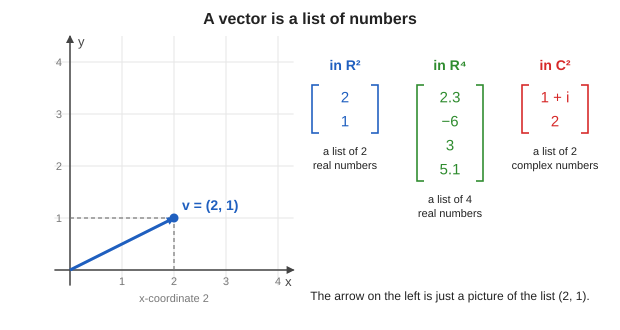

> **Important idea.** To a physicist an arrow and a list are the same object. The list is what you calculate with. The arrow is only a picture that helps when the list has 2 or 3 real numbers.

## 1.3 Why do we deal with vectors of complex numbers?

The lecturer's reason, in one line: **a qubit is described by complex numbers, and several qubits need more of them.**

- One qubit is represented using **two complex amplitudes**. So a one-qubit state is a vector in $\mathbb{C}^2$.
- With several qubits, the vectors have **more complex coordinates**.

(He says he has not yet told you what a qubit is. That comes in the next lecture. For now, just accept that these vectors are the objects quantum computing works with.)

## 1.4 The visualisation problem

A vector with **two real** coordinates is easy: it is a point in the plane, with an $x$ coordinate and a $y$ coordinate.

Now take a vector with **two complex** coordinates, such as $(1 + i,\ 2)$. Remember that **each complex number is a point in a plane**. So:

- $z_1 = 1 + i$ needs one plane (2 real numbers: the real part and the imaginary part).
- $z_2 = 2$ needs another plane (2 real numbers again).

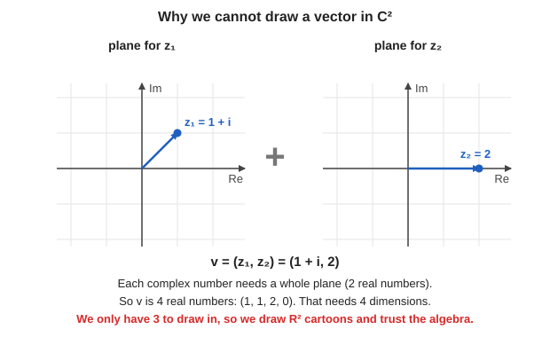

Altogether the vector is **four real numbers**, $(1, 1, 2, 0)$. To draw four real numbers we would need **four dimensions**, and we only have three. The lecturer's conclusion:

> *"We cannot draw a pair of complex numbers... So when I explain, I will draw them in two dimensions, but when we actually have to think about them, we will think in terms of $\mathbb{C}^n$. This is a translation that we will do as we go."*

(The slide says the same: "We cannot draw $\mathbb{C}^2$: it needs 4 real dimensions. So pictures today are $\mathbb{R}^2$ cartoons; the algebra is what carries over.")

## 1.5 What $\mathbb{C}^n$ means (notation)

- $\mathbb{C}^n$ means vectors with **$n$ components**, also called **coordinates**.
- The slide writes a vector as a column: $\mathbf{v} = (v_1, \dots, v_n)^T$ with each $v_j$ a complex number.

---

# 2. Adding vectors and scaling vectors

*Transcript: still "Opening and transition to vectors". Slide: "Operations on $\mathbb{C}^n$".*

## 2.1 Adding two vectors

It is very similar to adding complex numbers. **Add each coordinate separately.** This is why it is called "entrywise" addition.

The lecturer's example in $\mathbb{C}^2$ (the slide):

$$
\begin{pmatrix} 1 + i \\ 2 \end{pmatrix} + \begin{pmatrix} 3 \\ -i \end{pmatrix}
= \begin{pmatrix} (1 + i) + 3 \\ 2 + (-i) \end{pmatrix}
= \begin{pmatrix} 4 + i \\ 2 - i \end{pmatrix}
$$

First entries: $1 + i$ and $3$ give $4 + i$. Second entries: $2$ and $-i$ give $2 - i$.

In the real plane, adding vectors has a picture: draw both arrows from the origin, complete the **parallelogram**, and the fourth corner is the sum. (The lecturer uses this parallelogram again in section 5.)

## 2.2 Multiplying a vector by a number (scalar multiplication)

*"Multiplying two vectors, it's not clear what it means."* (He will not define a vector times a vector at all.)

But you **can** multiply a vector by a **number** (in this setting a complex number, called a **scalar**). Multiply **every coordinate** by that number. For $\mathbf{b} = (b_1, b_2)$ and a complex number $z$:

$$
z\begin{pmatrix} b_1 \\ b_2 \end{pmatrix} = \begin{pmatrix} z\, b_1 \\ z\, b_2 \end{pmatrix}
$$

The slide's example uses the complex number $i$:

$$
i \cdot \begin{pmatrix} 1 + i \\ 2 \end{pmatrix}
= \begin{pmatrix} i(1 + i) \\ 2i \end{pmatrix}
= \begin{pmatrix} i + i^2 \\ 2i \end{pmatrix}
= \begin{pmatrix} -1 + i \\ 2i \end{pmatrix}
$$

Here is what both operations look like for real vectors. On the left, adding $\mathbf{u} = (4, 1)$ and $\mathbf{v} = (1, 3)$ gives $(5, 4)$. On the right, scaling $\mathbf{v} = (2, 1)$ by $2$ and by $-1$:

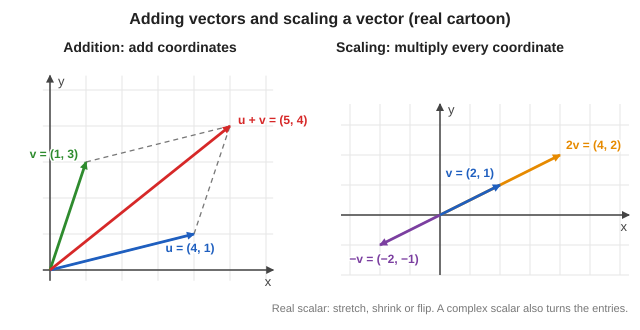

> **The big difference from school.** In school the scalar was a real number. Here the scalar can be **complex**. A complex scalar also *turns* the entries (remember: multiplying by a complex number rotates and stretches). The slide says: *"Scalars are now complex. That single change is what makes quantum linear algebra different from what many of you saw in school."*

## 2.3 Two questions from the class

**Question: "Is a vector something with magnitude and direction?"** That is how we think of force or momentum in the real world. The lecturer's answer: with complex numbers it is more complicated, so **do not think of a vector as "magnitude and direction"**. Think of it as *something with many components*.

**Question: "Why can't $n$ complex numbers be shown as $n$ separate points in a 2D plane?"**

You can draw $z_1$ in one plane and $z_2$ in another. The problem: *"when I do various operations on them, they will get mixed up with each other."* The two numbers behave as **one object**, not as two independent things.

He gives a simpler analogy. Why not think of the vector $(2, 1)$ as the number $2$ on one number line and the number $1$ on another? You can, but the pair $(2, 1)$ *jointly* is different from just "the number 2 and the number 1". There is a relation between the two entries, and that relation is preserved when you do transformations. So we think of the pair as **one point in a plane**, not as two unrelated numbers.

## 2.4 The zero vector, the negative of a vector, rows and columns

- **Zero vector:** every component is $0$. The slide writes $\mathbf{0} = (0, \dots, 0)^T$.
- **Negative of a vector:** multiply everything by $-1$. That is, $-\mathbf{v} = (-1)\,\mathbf{v}$: negate every entry.
- **Row vector and column vector.** A vector can be written standing up (a **column vector**) or lying down (a **row vector**). The lecturer: *"if I write something like this and something like this, they are not the same thing."* Taking the **transpose** (the little $T$ in $(v_1, \dots, v_n)^T$) turns a row into a column. The transpose of the row is the column.

So the little $T$ in the slide just says: "this list is meant to be written as a column."

## 2.5 The usual rules of algebra

These are the same rules you know for ordinary numbers (the slide lists them again in section 3):

- **Order does not matter** when adding: $\mathbf{u} + \mathbf{v} = \mathbf{v} + \mathbf{u}$. It is like $2 + 3 = 3 + 2$.
- **Grouping does not matter:** $(\mathbf{u} + \mathbf{v}) + \mathbf{w} = \mathbf{u} + (\mathbf{v} + \mathbf{w})$.
- **A vector plus its negative is zero:** $\mathbf{v} + (-\mathbf{v}) = \mathbf{0}$.

The lecturer says: *"these are the usual rules that we are all familiar with."*

---

# 3. Vector spaces

*Transcript: end of "Opening and transition to vectors". Slides: "Vector Space over $\mathbb{C}$: Definition" and "Examples and Non-Examples".*

## 3.1 What is a vector space?

A **vector space** is **a collection of vectors in which you can do two operations**:

1. **Add** two vectors: $\mathbf{u} + \mathbf{v}$ is again in the collection.
2. **Multiply a vector by a number** $\alpha$: $\alpha\mathbf{v}$ is again in the collection.

The lecturer warns that the official definition is abstract, so keep a concrete picture in the back of your mind: **think of $\mathbb{C}^n$**.

- If the numbers $\alpha$ are allowed to be **complex**, it is called a **complex vector space**. (This is what we need.)
- If $\alpha$ is only allowed to be **real**, it is called a **real vector space**.

So $\mathbb{C}^2$, $\mathbb{C}^3$, and so on are all vector spaces. He adds that there are "more complex" vector spaces too, and that he will come back to them.

## 3.2 The eight rules (slide)

For a set $V$ with addition and scalar multiplication to be a complex vector space, both results must **stay in $V$**, and for all $\mathbf{u}, \mathbf{v}, \mathbf{w} \in V$ and all $\alpha, \beta \in \mathbb{C}$:

| # | Rule | In words |
|---|---|---|
| 1 | $\mathbf{u} + \mathbf{v} = \mathbf{v} + \mathbf{u}$ | order of adding does not matter |
| 2 | $(\mathbf{u} + \mathbf{v}) + \mathbf{w} = \mathbf{u} + (\mathbf{v} + \mathbf{w})$ | grouping does not matter |
| 3 | there is $\mathbf{0}$ with $\mathbf{v} + \mathbf{0} = \mathbf{v}$ | a zero vector exists |
| 4 | each $\mathbf{v}$ has $-\mathbf{v}$ with $\mathbf{v} + (-\mathbf{v}) = \mathbf{0}$ | every vector has a negative |
| 5 | $\alpha(\mathbf{u} + \mathbf{v}) = \alpha\mathbf{u} + \alpha\mathbf{v}$ | scalars spread over a sum of vectors |
| 6 | $(\alpha + \beta)\mathbf{v} = \alpha\mathbf{v} + \beta\mathbf{v}$ | vectors spread over a sum of scalars |
| 7 | $\alpha(\beta\mathbf{v}) = (\alpha\beta)\mathbf{v}$ | scaling twice is scaling by the product |
| 8 | $1\,\mathbf{v} = \mathbf{v}$ | multiplying by 1 changes nothing |

The slide puts it in one sentence: *"In words: you can add and scale, and the ordinary rules of algebra hold. That is all."*

## 3.3 Examples and non-examples (slide)

| Set (with the usual $+$ and scaling by $\mathbb{C}$) | Vector space? | Why |
|---|---|---|
| $\mathbb{C}^n$ | Yes | the model example |
| All $m \times n$ complex matrices | Yes | add matrices entry by entry, scale every entry |
| Polynomials of degree at most $d$ with complex coefficients | Yes | adding two such polynomials, or scaling one, stays in the set |
| State space of $n$ qubits, $\mathbb{C}^{2^n}$ | Yes | it is just $\mathbb{C}^{2^n}$ |
| The vectors $(z_1, z_2)^T$ with $z_1 = 1$ | **No** | there is no zero vector (it would need $z_1 = 0$) |
| $\mathbb{R}^2$ with complex scalars | **No** | $i\cdot(1, 0)^T = (i, 0)^T$ is not in $\mathbb{R}^2$, so scaling leaves the set |
| Unit vectors in $\mathbb{C}^2$ | **No** | $\mathbf{e}_1 + \mathbf{e}_1$ has length $2$, so adding leaves the set |

The last row matters a lot. **Quantum states are unit vectors, so the set of quantum states is not itself a vector space.** The states *live inside* a vector space ($\mathbb{C}^{2^n}$), and we rescale ("re-normalise") when needed. (Normalising is in section 12.)

---

# 4. Linear combinations and span

*Transcript: "Linear combinations and span (slides 7–8)". Slide: "Linear Combinations and Span".*

## 4.1 Two small questions first

- **"What is the use of a zero vector?"** The lecturer: zero lets you define **negation**. Without a zero vector there would be no "$\mathbf{v}$ plus its negative equals $\mathbf{0}$". It is just a special vector that makes the rules work.
- **Row vs column representation.** The two forms hold the same numbers, *"but we will treat them differently, as you will see"* (this matters in section 11).

## 4.2 Linear combination

Take vectors $\mathbf{v}_1, \dots, \mathbf{v}_k$. Each is a column of numbers (for example $(5, 7, 8)^T$). Multiply each one by a number, and then **add** everything up:

$$
\alpha_1 \mathbf{v}_1 + \alpha_2 \mathbf{v}_2 + \cdots + \alpha_k \mathbf{v}_k, \qquad \alpha_j \in \mathbb{C}
$$

This is called a **linear combination** of $\mathbf{v}_1, \dots, \mathbf{v}_k$. The numbers $\alpha_j$ are the **weights** (you can pick them to be real or complex).

In words: *"scale each vector by some number, then add."*

## 4.3 Span

Take two vectors $\mathbf{v}_1$ and $\mathbf{v}_2$. The lecturer lists a few of the many combinations you could make:

$$
5\mathbf{v}_1 + \mathbf{v}_2,\quad 3\mathbf{v}_1 + 6\mathbf{v}_2,\quad 1.5\,\mathbf{v}_1 + i\,\mathbf{v}_2,\quad (2.1 + 3i)\,\mathbf{v}_1 + 6i\,\mathbf{v}_2, \quad \dots
$$

Now try **all possible ways** of combining them. You get an infinite collection of vectors. **That whole collection is called the span** of $\mathbf{v}_1, \dots, \mathbf{v}_k$:

$$
\operatorname{span}\{\mathbf{v}_1, \dots, \mathbf{v}_k\} = \{\alpha_1\mathbf{v}_1 + \cdots + \alpha_k\mathbf{v}_k : \alpha_j \in \mathbb{C}\}
$$

> **Why quantum computing cares (slide).** *A quantum "superposition" is exactly a linear combination.* The lecturer says it again later: a qubit will turn out to be a linear combination of the classical bits, so span "will come right away" in the next lecture.

It is very hard to picture a span of complex vectors. So, as promised, we fall back on **real vectors** to build intuition. *"There is always a difference between real and complex, but when you try to visualise, you will always visualise in terms of real vector space."*

## 4.4 Span of one vector

Take the single vector $\mathbf{v}_1 = (1, 3)$. What is $\operatorname{span}\{\mathbf{v}_1\}$?

By definition you multiply $\mathbf{v}_1$ by every possible number:

- $2\mathbf{v}_1 = (2, 6)$: *"twice the distance"* along the same direction.
- $-\mathbf{v}_1 = (-1, -3)$: the arrow pointing the opposite way.
- $-2\mathbf{v}_1 = (-2, -6)$: the opposite way, twice as far.

If you take **all** real numbers $\alpha$, you get the **entire line** through the origin and $\mathbf{v}_1$:

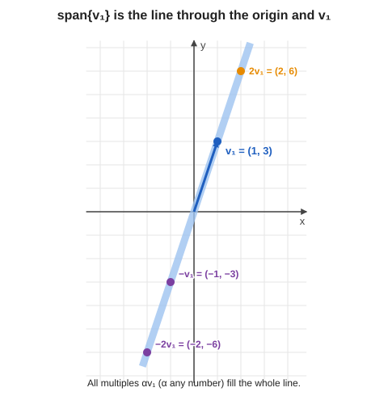

> **Span of one vector = a line through the origin.** The lecturer: *"span of $V_1$ will be the line which goes through the origin $O$ and the entire vector."*

## 4.5 Span of two vectors in the plane

Now two vectors. The lecturer starts with $\mathbf{v}_1 = (1, 3)$ and $\mathbf{v}_2 = (2, 0)$, then simplifies the question and uses the two simplest vectors, $(1, 0)$ and $(0, 1)$. These two have a special name: $\mathbf{e}_1$ and $\mathbf{e}_2$.

Take $5\,(1, 0) + 6\,(0, 1)$. That is $(5, 0) + (0, 6) = (5, 6)$. In general, **any point $(x, y)$** is

$$
(x, y) = x\,(1, 0) + y\,(0, 1) = x\,\mathbf{e}_1 + y\,\mathbf{e}_2
$$

So every point of the plane is a linear combination of the two vectors. **The span of $\mathbf{e}_1, \mathbf{e}_2$ is the entire plane.**

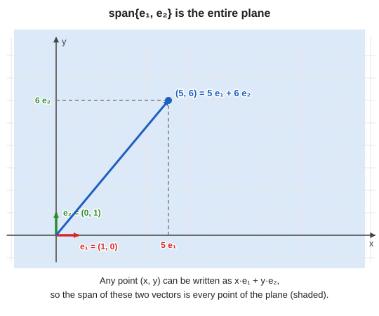

> **Transcript note:** the transcript says "I will get the point 6 comma 5". The arithmetic gives $(5, 6)$. Above, $5\cdot\mathbf{e}_1 + 6\cdot\mathbf{e}_2 = (5, 6)$.

(The lecturer's first pair $(1, 3)$ and $(2, 0)$ also span the whole plane, because they do not point along the same line. We will see the exact condition in section 6.)

## 4.6 Span of two vectors in 3D

Imagine you are in **3D** and you are given two vectors (the lecturer's illustration: one with coordinates like $(1, 2, 3)$ and another like $(1, 3, 5)$). What is their span?

- All combinations $\alpha\mathbf{a} + \beta\mathbf{b}$ with any numbers $\alpha, \beta$.
- Only two vectors, so you **cannot fill the whole 3D space**.
- You get a **flat sheet**: the plane that contains the origin and both vectors.

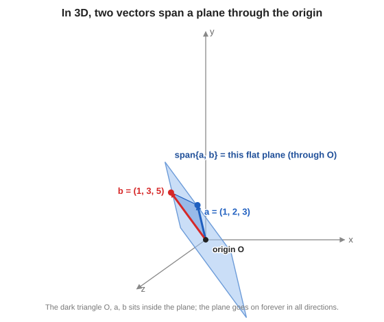

**What does "the plane through the triangle" mean?** (The lecturer was asked this.) Think about how you describe a line and a plane:

- To fix a **line** you need **two points** on it. If one of them is the origin, you need only one more point (one vector).
- To fix a **flat plane** in 3D you need **three points** on it. If one of them is the origin, you need two more points (two vectors).

So the origin and the two vectors $\mathbf{a}$ and $\mathbf{b}$ are three points. They form a triangle (the darker triangle in the picture), and the **plane through that triangle** is the span. **Span of two (suitable) vectors in 3D = a plane through the origin.**

## 4.7 The exception: vectors on one line

There is one exception to be careful about. Back in 2D, suppose $\mathbf{v}_1$ and $\mathbf{v}_2$ lie **on the same line through the origin** (one is a multiple of the other). Then every combination also stays on that line, so the span is **only that line**, not the plane.

If instead $\mathbf{v}_1, \mathbf{v}_2$ are *not* on a common line, the span is the whole 2D plane (take $\mathbf{v}_1, 2\mathbf{v}_1, 3\mathbf{v}_1, \dots$ and $\mathbf{v}_2, 2\mathbf{v}_2, \dots$ and add them: you reach every point between).

The lecturer: *"that's a very special case. In general, if this does not happen, their span will be the whole plane."* This is exactly the idea of **linear independence** in section 6.

## 4.8 Questions from the class

- **"In the picture, are $\alpha$ and $\beta$ real or complex?"** For quantum computing they are **complex**. But in the drawings they are real, because *"it's very hard to visualise what happens when you take complex numbers."*
- **"Do the vectors need to have the same dimension?"** Yes. To add two vectors they must have the same number of entries (the lecturer says "the same rows and columns"). All the $\mathbf{v}_j$ in a combination live in the same space.

---

# 5. Subspaces

*Transcript: "Subspaces (slide 9)". Slide: "Subspaces".*

## 5.1 The idea

Say we have a big vector space, such as 3D space. A **subspace** is a **smaller collection of vectors inside it** that is *itself* a vector space. For example:

- a **line through the origin** in 3D is a subspace;
- a **plane through the origin** in 3D is a subspace.

The formal test (from the slide): a subset $W$ of $V$ is a subspace if, whenever $\mathbf{u}, \mathbf{w} \in W$ and $\alpha \in \mathbb{C}$,

$$
\mathbf{u} + \mathbf{w} \in W \qquad\text{and}\qquad \alpha\mathbf{u} \in W
$$

In words: **if you add two vectors of $W$, or scale one, you never leave $W$.** The lecturer says it like this: *"I get the same vector set... I remain in the same set. So you do not go out of it."*

## 5.2 Why a plane through the origin passes the test

Take a plane through the origin in 3D. Pick two vectors in the plane and add them. How? **Complete the parallelogram** and take the far corner. That corner stays **inside the plane**, because the whole parallelogram lies in the plane. Now scale one of the vectors by any number: it stays on its line, and that line lies in the plane. So the plane never lets you escape.

(The picture of the plane in section 4.6 is a good one to keep in mind.)

## 5.3 The origin must always be in a subspace

Pick any vector in the subspace and multiply it by $0$. You get the zero vector, with all coordinates $0$. **So every subspace must contain the origin.** The lecturer says this is *"a mistake people often make."*

The picture below is the lecturer's green vs red line:

- **Green line (through the origin):** a subspace. Add two points on it and you land on it again.
- **Red line (shifted away from the origin):** **not** a subspace. Take any point on it and multiply by $0$: you land on the origin, but the origin is not on this line.

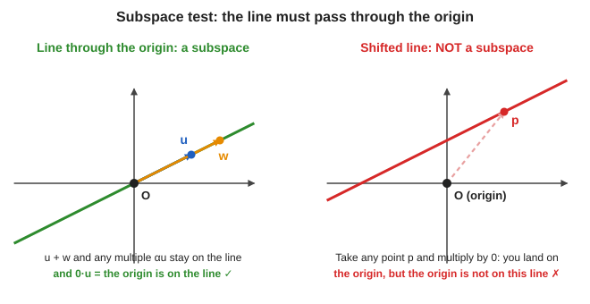

## 5.4 Every span is a subspace

Another way to think about it: take some vectors and look at their **span** (all linear combinations). What you get is always a subspace. It may not be the whole space, but it is a subspace. *"That's why people use the word subspace."*

- span of one vector: a line through the origin (a 1-dimensional subspace)
- span of two independent vectors in 3D: a plane through the origin (a 2-dimensional subspace)

---
# 6. Linear independence

*Transcript: "Linear independence (slides 10–14)". Slides: "Linear Independence" and "A Complex Twist".*

The lecturer calls this *"a technical definition... we will not use it very often, but you need to know what this is."*

## 6.1 Start from the picture

Remember the exception in section 4.7: two vectors $\mathbf{v}_1, \mathbf{v}_2$ on a common line. When you take their span, you **do not get the whole space**. The reason: **$\mathbf{v}_2$ is simply a multiple of $\mathbf{v}_1$.** It adds nothing new.

Here are the two situations side by side:

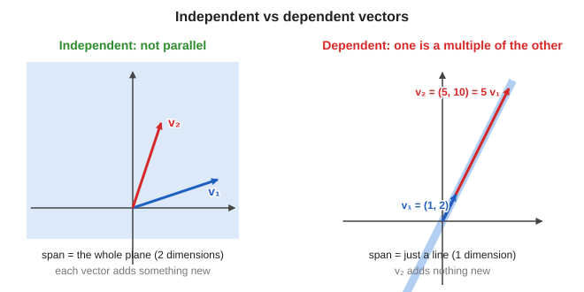

## 6.2 The definition in words

> A set of vectors is **linearly independent** if **none of them can be written in terms of the others.** Otherwise they are **linearly dependent**.

The lecturer's examples:

- $\mathbf{v}_1 = (1, 2)$ and $\mathbf{v}_2 = (5, 10)$. Since $\mathbf{v}_2 = 5\,\mathbf{v}_1$, one can be expressed in terms of the other, so they are **dependent**.
- Three vectors with $\mathbf{v}_3 = \mathbf{v}_1 + 2\mathbf{v}_2$. Here $\mathbf{v}_3$ is built from the other two, so the set is **dependent**.

> **Transcript note:** at one point the transcript says "anytime you have a set of vectors where one of them can be expressed as a linear combination of the others, they are called linearly independent". The lecturer means **linearly dependent**. (The next sentence, "otherwise, linearly independent", confirms it.)

The lecturer's reminder: *"You always have to keep a picture in mind. The thing about linear algebra is that if you do not keep a picture in mind, you will get confused."*

## 6.3 Why does a combination of two vectors stay in "their" plane?

*A question from the class: "Why is the span of $\mathbf{v}_1$ and $\mathbf{v}_2$ only the plane through them? Why not the whole 3D space?"*

Take two vectors in 3D: $\mathbf{v}_1 = (1, 0, 0)$ and $\mathbf{v}_2 = (0, 1, 0)$. A general combination is

$$
\alpha_1\,(1, 0, 0) + \alpha_2\,(0, 1, 0) = (\alpha_1,\ \alpha_2,\ 0)
$$

The **third coordinate is always $0$**. So the span is the flat $xy$-plane. It can never reach, for example, the point $(1, 1, 1)$, because there is no choice of $\alpha_1, \alpha_2$ that makes the third coordinate $1$.

*Intuition: any combination of two vectors stays in the plane defined by those two vectors. You never exit that plane.*

## 6.4 Dependent vectors give less than you expect

- Two vectors that lie on a common line: their span is a **line (1 dimension)**, not a plane.
- Three vectors in 3D that all lie in the same plane (say the $xy$-plane): their span is that plane, not 3D. Here one vector can be expressed using the other two, so they are **linearly dependent**.
- Otherwise they are **linearly independent**.

## 6.5 The technical definition (slide)

$\mathbf{v}_1, \dots, \mathbf{v}_k$ are **linearly independent** if

$$
\alpha_1\mathbf{v}_1 + \cdots + \alpha_k\mathbf{v}_k = \mathbf{0} \quad\Longrightarrow\quad \alpha_1 = \cdots = \alpha_k = 0
$$

In words: **the only way to combine them into the zero vector is to take every weight equal to zero.**

Why is this the same as the picture? Two directions:

- **Dependent means a non-trivial way to get zero.** Suppose $\mathbf{v}_2 = 5\,\mathbf{v}_1$. Then $\mathbf{v}_2 - 5\,\mathbf{v}_1 = \mathbf{0}$. We reached zero with weights $1$ and $-5$, which are not both zero. So $\mathbf{v}_1, \mathbf{v}_2$ are not independent.
- **A non-trivial way to get zero means dependent.** Suppose $\alpha_1\mathbf{v}_1 + \alpha_2\mathbf{v}_2 = \mathbf{0}$ with $\alpha_2 \neq 0$. Move terms around:

$$
\mathbf{v}_2 = -\frac{\alpha_1}{\alpha_2}\,\mathbf{v}_1
$$

So $\mathbf{v}_2$ is a multiple of $\mathbf{v}_1$: they are dependent.

The lecturer: *"It's an extremely basic definition, and you have to know what it is saying."*

## 6.6 Each independent vector adds one dimension

The picture to keep in mind:

1. Start with **one** vector. Its span is a **line**.
2. Add a **second** vector that is **not** on that line. Together they span a **plane**.
3. Add a **third** vector that is **not** in that plane. Together they span all of **3D**.

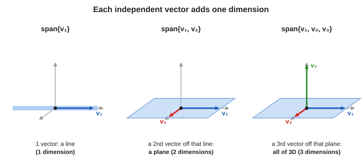

If the third vector *were* in the plane, the three would still only span that plane, and they would be dependent.

*"Each time you add a new vector, you are adding one more dimension."* This can go on to 4, 5, 6 dimensions, but we cannot visualise it. **That is why we need proper definitions:** past 3 dimensions the picture is gone. For example, "6 vectors in 6-dimensional space are independent" means that none of them can be written as, say, $\mathbf{v}_1 = \mathbf{v}_2 + 3\mathbf{v}_3 + 5\mathbf{v}_4 - 6\mathbf{v}_5$.

## 6.7 A complex twist

*Slide: "A Complex Twist".* The lecturer warns: *"we are dealing with complex numbers and not real numbers. Always remember this fact. Our intuition will come from real numbers, but when we write down our equations, we will use complex numbers."*

Take

$$
\mathbf{u} = \begin{pmatrix} 1 \\ i \end{pmatrix}, \qquad \mathbf{w} = \begin{pmatrix} i \\ -1 \end{pmatrix}
$$

**Are $\mathbf{u}$ and $\mathbf{w}$ linearly independent?** The question is: can I find a number $\alpha$ with $\mathbf{w} = \alpha\,\mathbf{u}$?

- **Over $\mathbb{R}$ (real scalars only):** no real number works. Multiply $(1, i)$ by $5$, $6$, $10$: you never get $(i, -1)$. So over the reals they are independent.
- **Over $\mathbb{C}$ (complex scalars):** multiply $\mathbf{u}$ by $i$:

$$
i\,\mathbf{u} = \begin{pmatrix} i\cdot 1 \\ i\cdot i \end{pmatrix} = \begin{pmatrix} i \\ i^2 \end{pmatrix} = \begin{pmatrix} i \\ -1 \end{pmatrix} = \mathbf{w}
$$

So $\mathbf{w}$ **is** a multiple of $\mathbf{u}$. Over $\mathbb{C}$ they are **dependent**.

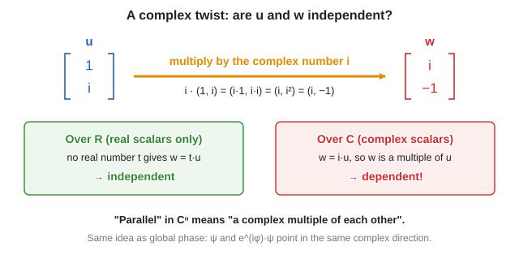

> **Moral (slide).** *"Parallel" in $\mathbb{C}^n$ means "a complex multiple". Vectors that look different can be the same direction.* This is the same phenomenon as **global phase** in quantum computing: $\boldsymbol\psi$ and $e^{i\varphi}\boldsymbol\psi$ point in the same complex direction. (Phases come back in the next lecture.)

The lecturer: *"It is just a sort of a technicality. Usually it will not matter, but you should remember this."* And: *"always in my diagrams I mean a real number, but in reality they have to be complex."*

---

# 7. Basis and dimension

*Transcript: "Basis and dimension (slides 15–17)". Slides: "Basis and Dimension" and "The Standard Basis of $\mathbb{C}^2$ and Qubits".*

*"This is one key definition... let me write it down because it is very important."*

## 7.1 Independence and dimension

If $\mathbf{v}_1, \dots, \mathbf{v}_n$ are **linearly independent**, then the only way to combine them to get $\mathbf{0}$ is with every weight $0$. For example, if $5\mathbf{v}_1 + 6\mathbf{v}_2 + 3\mathbf{v}_3 = \mathbf{0}$ were true, you could write $\mathbf{v}_1 = -\tfrac{6}{5}\mathbf{v}_2 - \tfrac{3}{5}\mathbf{v}_3$, which is not allowed for independent vectors. Another way to say it: the span of $n$ independent vectors is **$n$-dimensional**.

## 7.2 The reverse question: find vectors that span a given space

Now ask the question the other way round. **Start with a space and look for vectors that span it.**

**A line.** Take a line through the origin in the plane (a subspace). Is there a vector whose span is this line? Yes: any single vector $\mathbf{v}$ on the line works, and so does another vector $\mathbf{w}$ on the line. Each of them **is a basis of the line**. A vector $\mathbf{z}$ that points elsewhere is **not**, because its span is a different line.

**The entire plane.** Is there a set of vectors whose span is the whole 2D plane? Yes: two vectors $\mathbf{v}_1, \mathbf{v}_2$ that are not on a common line. They are a **basis of the plane**. There are many such pairs.

**A non-example.** Two vectors $\mathbf{v}_1, \mathbf{v}_2$ on one line: all their combinations stay on that line, so they do not span the plane. *"Two vectors which are linearly dependent will not be a basis of the plane. If they are linearly independent, they will be a basis. That is the main takeaway."*

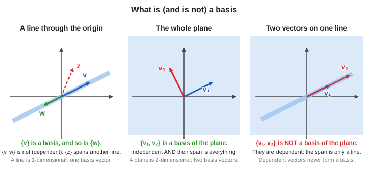

## 7.3 The definition (slide)

A **basis** of a vector space $V$ is a set of vectors $\mathbf{b}_1, \dots, \mathbf{b}_n$ with **two properties**:

1. **They span $V$.** Every vector in $V$ can be written as a linear combination of $\mathbf{b}_1, \dots, \mathbf{b}_n$.
2. **They are linearly independent.** There is no relation between them: none can be written using the others.

In short: **a basis is a linearly independent set that spans the space.**

The lecturer says this will matter *"all the time. The entire course, you will be dealing with basis"*, so make sure the idea is clear.

> **Not the same as orthogonality.** One student asked whether a basis has to be perpendicular. The lecturer: *"It has nothing to do with orthogonality. Let us not confuse things. Orthogonality is a different concept"* (it comes in section 14).

## 7.4 Can a span be a curved shape?

*A question from the class.* The answer is no. Reason: if a vector is in the span, then **every multiple of it is also in the span**. So the span contains the whole line through every point it contains. A curve does not do that. So a span always looks like **a line, a plane, or a higher-dimensional flat piece through the origin**: never a curve. In 5D, a span could be a 3D flat piece, and so on.

## 7.5 Examples of bases in $\mathbb{R}^2$

**Example 1: the standard basis.** $(1, 0)$ and $(0, 1)$.

- *Independent:* $(0, 1)$ is not a multiple of $(1, 0)$.
- *Spans the plane:* any $(x, y) = x\,(1, 0) + y\,(0, 1)$.

**Example 2: another basis.** $(1, 1)$ and $(1, -1)$.

- *Independent:* neither is a multiple of the other.
- *Spans the plane:* we need to find $\alpha, \beta$ with $(x, y) = \alpha\,(1, 1) + \beta\,(1, -1)$. Compare the two coordinates:

$$
\alpha + \beta = x, \qquad \alpha - \beta = y
$$

Add the two equations to get $2\alpha = x + y$. Subtract them to get $2\beta = x - y$. So

$$
\alpha = \frac{x + y}{2}, \qquad \beta = \frac{x - y}{2}
$$

*Check with numbers:* take $(x, y) = (3, 1)$. Then $\alpha = 2$, $\beta = 1$, and $2\,(1, 1) + 1\,(1, -1) = (2 + 1,\ 2 - 1) = (3, 1)$. It works.

> **Transcript note:** the transcript reads "alpha will be x plus y by 2 times 1 comma 1 plus x minus y over 2 times...". It is saying exactly the result above: $(x, y) = \dfrac{x + y}{2}\,(1, 1) + \dfrac{x - y}{2}\,(1, -1)$.

So $(1, 1)$ and $(1, -1)$ **form a basis**. Everything here was in $\mathbb{R}^2$; for $\mathbb{C}^2$ the same vectors work with complex weights.

## 7.6 Dimension

If a vector space is a line, a basis has just **one** vector: the lecturer's example is a line where $\mathbf{v}_1$ and $\mathbf{v}_2$ both lie on it. They span the line, **but they are not a basis**, because on a 1-dimensional line the basis has to have only one vector. So the basis is either just $\mathbf{v}_1$ or just $\mathbf{v}_2$. *"They have to be independent of each other."*

The general fact (slide): **all bases of a space have the same size. That size is the dimension**, written $\dim V$.

> **Dimension = how many basis vectors there are.** A line has dimension 1, a plane has dimension 2, and $\mathbb{C}^n$ has dimension $n$.

## 7.7 The standard basis of $\mathbb{C}^n$ (slides)

$$
\mathbf{e}_1 = (1, 0, \dots, 0)^T,\ \dots,\ \mathbf{e}_n = (0, \dots, 0, 1)^T, \qquad\text{so}\quad \dim_{\mathbb{C}}\mathbb{C}^n = n
$$

In $\mathbb{C}^2$ we have $\mathbf{e}_1 = \begin{pmatrix}1\\0\end{pmatrix}$ and $\mathbf{e}_2 = \begin{pmatrix}0\\1\end{pmatrix}$, and every vector is

$$
\begin{pmatrix}\alpha\\\beta\end{pmatrix} = \alpha\,\mathbf{e}_1 + \beta\,\mathbf{e}_2
$$

> **Always ask "dimension over which scalars?"** If we only allow *real* scalars, $\mathbb{C}^n$ has dimension $2n$ (real and imaginary parts separately). With complex scalars, it has dimension $n$. This is the same point as the complex twist in section 6.7.

**Qubits (slide).** A qubit's state is exactly such a vector. $\mathbf{e}_1$ and $\mathbf{e}_2$ stand for the classical bit values $0$ and $1$. With $n$ qubits the dimension is $2^n$:

| Qubits $n$ | Dimension $2^n$ |
|---|---|
| 1 | 2 |
| 2 | 4 (the bit strings 00, 01, 10, 11) |
| 10 | 1,024 |
| 50 | about $10^{15}$ |

---

# 8. Coordinates and change of basis

*Transcript: "Change of basis and coordinates (slides 18–23)". Slides: "Basis and Dimension" (coordinates), "The Standard Basis of $\mathbb{C}^2$ and Qubits", "A Second Basis: $h_+$ and $h_-$".*

## 8.1 Coordinates

If $\mathbf{b}_1, \mathbf{b}_2$ is a basis of the plane, then **every vector** can be written as

$$
\mathbf{v} = \alpha_1\mathbf{b}_1 + \alpha_2\mathbf{b}_2
$$

The numbers $\alpha_1, \alpha_2$ are the **coordinates of $\mathbf{v}$ in that basis**. In the slide's words: *every $\mathbf{v}$ is a unique combination $\mathbf{v} = \sum_j c_j\mathbf{b}_j$; the $c_j$ are its coordinates.*

## 8.2 The coordinates are unique

*"Very, very important."* A vector has **exactly one** way to be written in terms of a basis.

Why? Suppose $\mathbf{b}_1, \mathbf{b}_2$ are a basis (any two points not on a common line). Imagine a vector could be written in two ways:

$$
\mathbf{v} = 5\mathbf{b}_1 + 7\mathbf{b}_2 \qquad\text{and also}\qquad \mathbf{v} = -3\mathbf{b}_1 + 2\mathbf{b}_2
$$

Then the two right-hand sides are equal:

$$
5\mathbf{b}_1 + 7\mathbf{b}_2 = -3\mathbf{b}_1 + 2\mathbf{b}_2 \;\Longrightarrow\; 8\mathbf{b}_1 = -5\mathbf{b}_2
$$

That says $\mathbf{b}_1$ is a multiple of $\mathbf{b}_2$, so they are **dependent**. But a basis is independent. Contradiction. So there cannot be two different ways. (This is why independence is part of the definition of a basis.)

Here, the pair $(5, 7)$ would be "the coordinates of $\mathbf{v}$". They are special to that vector only.

## 8.3 Coordinates in the standard basis

In $\mathbb{C}^2$, the basis $\mathbf{e}_1, \mathbf{e}_2$ is *"always the easiest basis to write down."* A pair of complex numbers $(\alpha, \beta)$ is

$$
\alpha\,\mathbf{e}_1 + \beta\,\mathbf{e}_2
$$

So **in the basis $\{\mathbf{e}_1, \mathbf{e}_2\}$ its coordinates are $\alpha, \beta$**. This matches exactly what we normally call "the coordinates".

## 8.4 A second basis: $\mathbf{h}_+$ and $\mathbf{h}_-$ (slide)

Here is another basis of $\mathbb{C}^2$:

$$
\mathbf{h}_+ = \frac{1}{\sqrt2}\begin{pmatrix}1\\1\end{pmatrix}, \qquad \mathbf{h}_- = \frac{1}{\sqrt2}\begin{pmatrix}1\\-1\end{pmatrix}
$$

(The lecturer calls them $H_1, H_2$ on the board.)

**Why a basis?**

- They are **independent**: you can check that neither is a multiple of the other.
- They **span** $\mathbb{C}^2$: from section 7.5, every vector can be written with $(1, 1)$ and $(1, -1)$. Putting a factor $\tfrac{1}{\sqrt2}$ in front only changes the weights, not the span.

**Why the $\tfrac{1}{\sqrt 2}$?** *"It is a bit mysterious, so I will come back to that"* (section 12): it makes each vector have **length 1**.

**Coordinates of $(\alpha, \beta)$ in this basis.** We want numbers $c_+$ and $c_-$ with

$$
\begin{pmatrix}\alpha\\\beta\end{pmatrix} = c_+\,\frac{1}{\sqrt2}\begin{pmatrix}1\\1\end{pmatrix} + c_-\,\frac{1}{\sqrt2}\begin{pmatrix}1\\-1\end{pmatrix}
$$

Compare the first and second entries:

$$
\frac{c_+ + c_-}{\sqrt2} = \alpha, \qquad \frac{c_+ - c_-}{\sqrt2} = \beta
$$

Add: $\dfrac{2c_+}{\sqrt2} = \alpha + \beta$, so $c_+ = \dfrac{\alpha + \beta}{\sqrt2}$ (because $\dfrac{2}{\sqrt2} = \sqrt2$). Subtract: $c_- = \dfrac{\alpha - \beta}{\sqrt2}$. So

$$
\boxed{\ \text{coordinates in } \{\mathbf{h}_+, \mathbf{h}_-\} = \left(\frac{\alpha + \beta}{\sqrt2},\ \frac{\alpha - \beta}{\sqrt2}\right)\ }
$$

> **Transcript note:** the transcript reads "alpha plus beta by 2 times root 2" for these coordinates. The slide has $\dfrac{\alpha + \beta}{\sqrt2}$ and $\dfrac{\alpha - \beta}{\sqrt2}$; the "$\sqrt2$ cancels against $\sqrt2$" remark in the transcript is the step $\sqrt2\cdot\dfrac{1}{\sqrt2} = 1$.

## 8.5 The picture: same point, different coordinates

Here is what it means to **change the basis**. The lecturer draws a point with coordinates like $(5, 3)$ in the usual axes: drop a perpendicular to the $x$-axis and you read $5$; drop one to the $y$-axis and you read $3$. Then he changes the basis to two new arrows $\mathbf{b}_1, \mathbf{b}_2$. The **same point** now has different coordinates, say $(1, 1)$, meaning the point is $\mathbf{b}_1 + \mathbf{b}_2$. You find the new coordinates by drawing lines **parallel** to the two new axes.

(To keep the numbers consistent, the picture below uses the point $P = (4, 3)$, with the new basis $\mathbf{b}_1 = (3, 1)$, $\mathbf{b}_2 = (1, 2)$. Check: $\mathbf{b}_1 + \mathbf{b}_2 = (4, 3)$.)

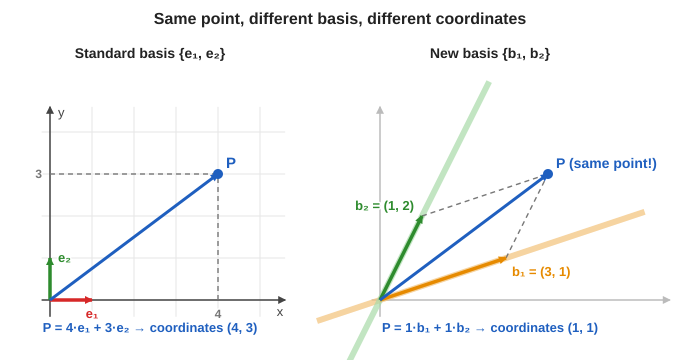

> **Coordinates tell you how to combine the basis vectors.** Change the basis vectors and the coordinates change, but the vector itself is the same.

## 8.6 What happens to $\mathbf{e}_1$ and $\mathbf{e}_2$ in the new basis

Take $\mathbf{e}_1 = (1, 0)$. In the old basis, its coordinates were $(1, 0)$, since $\mathbf{e}_1 = 1\cdot\mathbf{e}_1 + 0\cdot\mathbf{e}_2$. In the basis $\{\mathbf{h}_+, \mathbf{h}_-\}$, use the formula from section 8.4 with $(\alpha, \beta) = (1, 0)$:

$$
\left(\frac{1 + 0}{\sqrt2},\ \frac{1 - 0}{\sqrt2}\right) = \left(\frac{1}{\sqrt2},\ \frac{1}{\sqrt2}\right)
$$

Check by adding up the new basis vectors:

$$
\frac{1}{\sqrt2}\mathbf{h}_+ + \frac{1}{\sqrt2}\mathbf{h}_- = \frac{1}{\sqrt2}\cdot\frac{1}{\sqrt2}\begin{pmatrix}1\\1\end{pmatrix} + \frac{1}{\sqrt2}\cdot\frac{1}{\sqrt2}\begin{pmatrix}1\\-1\end{pmatrix} = \frac12\begin{pmatrix}2\\0\end{pmatrix} = \begin{pmatrix}1\\0\end{pmatrix} = \mathbf{e}_1
$$

For $\mathbf{e}_2 = (0, 1)$ we get coordinates $\left(\dfrac{1}{\sqrt2}, -\dfrac{1}{\sqrt2}\right)$. In summary (this is the slide's summary):

$$
\mathbf{e}_1 = \frac{1}{\sqrt2}\left(\mathbf{h}_+ + \mathbf{h}_-\right), \qquad \mathbf{e}_2 = \frac{1}{\sqrt2}\left(\mathbf{h}_+ - \mathbf{h}_-\right)
$$

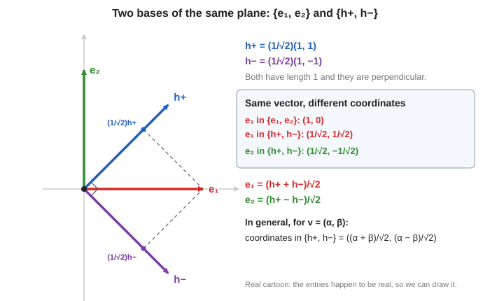

*In the picture the entries happen to be real, so it can be drawn. This is the "real cartoon".* The two blue and purple arrows are perpendicular to each other and both have length 1. The red arrow $\mathbf{e}_1$ is the diagonal of the dashed parallelogram built from $\tfrac{1}{\sqrt2}\mathbf{h}_+$ and $\tfrac{1}{\sqrt2}\mathbf{h}_-$.

## 8.7 Try it: the vector $(2, 4i)$

The lecturer's example (it is also a slide problem): how do you write $(2, 4i)$ in the basis $\{\mathbf{e}_1, \mathbf{e}_2\}$? *"Very simple."*

$$
\begin{pmatrix}2\\4i\end{pmatrix} = 2\,\mathbf{e}_1 + 4i\,\mathbf{e}_2
$$

So the coordinates are $(2, 4i)$.

Then he asks you to find its coordinates in $\{\mathbf{h}_+, \mathbf{h}_-\}$. Use the boxed formula with $\alpha = 2$ and $\beta = 4i$:

$$
\left(\frac{2 + 4i}{\sqrt2},\ \frac{2 - 4i}{\sqrt2}\right)
$$

*Check the first entry:* $\dfrac{1}{\sqrt2}\left(\dfrac{2 + 4i}{\sqrt2} + \dfrac{2 - 4i}{\sqrt2}\right) = \dfrac{1}{\sqrt2}\cdot\dfrac{4}{\sqrt2} = 2$. ✓ *Second entry:* $\dfrac{1}{\sqrt2}\left(\dfrac{2 + 4i}{\sqrt2} - \dfrac{2 - 4i}{\sqrt2}\right) = \dfrac{1}{\sqrt2}\cdot\dfrac{8i}{\sqrt2} = 4i$. ✓

## 8.8 The first summary (lecturer's recap of this half)

- A vector space can be thought of as **a list (column) of complex numbers**.
- **Span:** take some vectors and try out all ways of combining them: $\alpha_1\mathbf{v}_1 + \cdots + \alpha_n\mathbf{v}_n$ ("multiply them by some numbers and add them").
- Why it matters for quantum: *a qubit will turn out to be a linear combination of the classical bits.* Span comes up right away in the next lecture.
- **Independence:** none can be expressed using the others. **Why important?** (1) It lets us define a **basis**. (2) It guarantees that **there is only one way** of writing a vector in terms of a basis. Otherwise it would be very confusing: "if I say the coordinates of this vector are $(1, 0)$ and also $(2, 3)$, that would be very confusing." Linear independence stops that from happening.

---

# 9. Questions before the break

*Transcript: the passage "And so, this is what we have done so far... let's take a short break".*

The lecturer says there is nothing to submit right now. You should try the slide problems and come prepared. When a graded assignment is given, the deadline will be announced.

## 9.1 Practice: basis problems (slide "Problems")

Try these first, then check the solutions.

1. Is $\left\{\begin{pmatrix}1\\1\end{pmatrix}, \begin{pmatrix}1\\-1\end{pmatrix}\right\}$ a basis of $\mathbb{C}^2$?
2. Are $\begin{pmatrix}1\\i\end{pmatrix}$ and $\begin{pmatrix}-i\\1\end{pmatrix}$ independent over $\mathbb{C}$?
3. Write $\begin{pmatrix}2\\4i\end{pmatrix}$ using $\mathbf{e}_1, \mathbf{e}_2$.
4. Write $\mathbf{e}_2$ in the basis $\{\mathbf{h}_+, \mathbf{h}_-\}$ "without peeking".

**Solutions (from the slides, with extra steps).**

1. **Yes.** Suppose $a\,(1, 1)^T + b\,(1, -1)^T = \mathbf{0}$. The two entries give $a + b = 0$ and $a - b = 0$. Adding gives $a = 0$, and then $b = 0$. So they are independent. In a 2-dimensional space, two independent vectors form a basis.
2. **No.** $(-i)\cdot(1, i)^T = (-i,\ -i\cdot i)^T = (-i,\ -i^2)^T = (-i,\ 1)^T$. The second vector is $-i$ times the first, so they are dependent.
3. $2\,\mathbf{e}_1 + 4i\,\mathbf{e}_2$.
4. Solve $\mathbf{e}_2 = a\,\mathbf{h}_+ + b\,\mathbf{h}_-$. The first entry gives $\tfrac{1}{\sqrt2}(a + b) = 0$ and the second gives $\tfrac{1}{\sqrt2}(a - b) = 1$. So $a = \tfrac{1}{\sqrt2}$ and $b = -\tfrac{1}{\sqrt2}$. Hence $\mathbf{e}_2 = \tfrac{1}{\sqrt2}(\mathbf{h}_+ - \mathbf{h}_-)$. *(Solving a linear system works, but it is slow. After inner products, in section 15, we will read the coordinates off in one step.)*

## 9.2 Questions from the class

**"Why did you multiply by $\tfrac{1}{\sqrt2}$?"** Wait for section 12: it makes the length 1.

**"Proving that something is a basis is much harder than proving it is not."** True. To show that $\mathbf{v}_1, \mathbf{v}_2, \mathbf{v}_3$ are **not** a basis, you just need one dependence, for example $\mathbf{v}_1 = 2\mathbf{v}_2 + \mathbf{v}_3$. To show that they **are** a basis, you must show two things:

1. If $\alpha_1\mathbf{v}_1 + \alpha_2\mathbf{v}_2 + \alpha_3\mathbf{v}_3 = \mathbf{0}$, then the only solution is $\alpha_1 = \alpha_2 = \alpha_3 = 0$ (independence).
2. Every vector can be written as a combination of them (spanning).

**Are there shortcuts?** Yes. *If you know the dimension of the space, you only need to check one of the two conditions.*

- In 2D, any basis has exactly two vectors. If you show two vectors are independent, they automatically span, so they are a basis.
- In 3D: three vectors that span 3D are automatically independent, and three independent vectors automatically span 3D.

**"Any subspace of a vector space with the same dimension as the space..."** (the question is garbled, but the lecturer says: absolutely.) A subspace with the *same* dimension as the whole space is the whole space.

**"Is changing the basis a linear transformation?"** It is *one example* of one. Linear transformations are more general than changing basis, as you will see when matrices come.

**"Is a basis a subset of vectors that span the $n$-dimensional space?"** Yes. If a space has dimension $n$, any basis has exactly $n$ vectors. But the vectors must be independent: for a line, $\mathbf{v}_1$ and $\mathbf{v}_2$ on the line span it, yet they are not a basis, because a line needs only one.

**"Why use real vectors for the basis with complex coordinates?"** The lecturer: the examples are drawn with real numbers. In the course itself we only deal with complex numbers.

---
# 10. The dot product (real numbers)

*Transcript: "So let us come to dot product". Slide: "Warm-up: The Real Dot Product".*

Back to **high-school maths**. The dot product takes **two vectors** and gives you **one number**.

## 10.1 The formula

If $\mathbf{u} = (u_1, u_2)$ and $\mathbf{v} = (v_1, v_2)$, then

$$
\mathbf{u}\cdot\mathbf{v} = u_1 v_1 + u_2 v_2 \qquad\text{(in general } \textstyle\sum_j u_j v_j\text{)}
$$

**Example from the lecture.** $\mathbf{u} = (5, 1)$ and $\mathbf{v} = (3, 7)$:

$$
\mathbf{u}\cdot\mathbf{v} = 5\cdot 3 + 1\cdot 7 = 15 + 7 = 22
$$

It is just a number. What does that number mean?

## 10.2 The picture: length times length times cosine

If $\theta$ is the angle between $\mathbf{u}$ and $\mathbf{v}$, then

$$
\mathbf{u}\cdot\mathbf{v} = \lVert\mathbf{u}\rVert\,\lVert\mathbf{v}\rVert\,\cos\theta
$$

Another way to see it: **project $\mathbf{u}$ onto the line that $\mathbf{v}$ spans** (drop a perpendicular from the tip of $\mathbf{u}$ onto that line). The green piece in the picture below has length $\lVert\mathbf{u}\rVert\cos\theta$. Why? Recall from trigonometry: in a right-angled triangle with hypotenuse $r$ and the side next to the angle $a$, $\cos\theta = a/r$, so $a = r\cos\theta$. Here $r$ is $\lVert\mathbf{u}\rVert$ and $a$ is the green length. The dot product is that **projection length times the length of $\mathbf{v}$**.

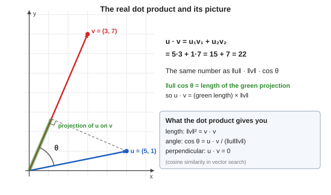

The lecturer adds that this is exactly **cosine similarity**, as in vector retrieval (searching for similar items).

## 10.3 What the dot product gives you

| You want | Use | Why |
|---|---|---|
| **Length** | $\lVert\mathbf{v}\rVert^2 = \mathbf{v}\cdot\mathbf{v}$ | with $\theta = 0$, $\cos 0 = 1$, so $\mathbf{v}\cdot\mathbf{v} = \lVert\mathbf{v}\rVert^2$. In coordinates: $v_1^2 + \cdots + v_n^2$ |
| **Angle** | $\cos\theta = \dfrac{\mathbf{u}\cdot\mathbf{v}}{\lVert\mathbf{u}\rVert\lVert\mathbf{v}\rVert}$ | rearrange the formula above |
| **Perpendicular?** | $\mathbf{u}\cdot\mathbf{v} = 0$ | $\cos 90^\circ = 0$ |

The slide says: *"Goal: the same toolkit for $\mathbb{C}^n$. In QC it will also give probabilities."* (When a student asked "how does the dot product give probability?", the lecturer replied: not yet, probability shows up "five slides down the line", after we meet qubits.)

## 10.4 Perpendicular non-zero vectors are independent

This is a nice use of the dot product. Let $\mathbf{u}$ and $\mathbf{v}$ be **non-zero** vectors with $\mathbf{u}\cdot\mathbf{v} = 0$. Claim: they are linearly independent.

*Proof.* Suppose $\alpha_1\mathbf{u} + \alpha_2\mathbf{v} = \mathbf{0}$. Take the dot product of both sides with $\mathbf{u}$:

$$
\alpha_1\,(\mathbf{u}\cdot\mathbf{u}) + \alpha_2\,(\mathbf{v}\cdot\mathbf{u}) = 0
$$

Since $\mathbf{u}\perp\mathbf{v}$, the second term is $0$. So $\alpha_1\,(\mathbf{u}\cdot\mathbf{u}) = 0$. Now $\mathbf{u}\cdot\mathbf{u} = \lVert\mathbf{u}\rVert^2 \neq 0$ (because $\mathbf{u}\neq\mathbf{0}$), so $\alpha_1 = 0$. In the same way (dot with $\mathbf{v}$) we get $\alpha_2 = 0$. Both weights are zero, so the vectors are independent. $\blacksquare$

Consequences, in the lecturer's words:

- Three vectors that are all perpendicular to each other are independent.
- **An easy way to build a basis:** in $\mathbb{R}^2$, take one vector and another one perpendicular to it. They are automatically independent, so they form a basis. In 3D, three mutually perpendicular vectors form a basis.

*"That is why the dot product is so useful: it gives you an instant way of checking if vectors are independent."*

---

# 11. The complex inner product

*Transcript: "Does the same definition work for complex numbers?" Slides: "The Conjugate Transpose $\mathbf{v}^\dagger$", "Why Do We Need the Conjugate?", "The Inner Product on $\mathbb{C}^n$", "Properties of the Inner Product".*

## 11.1 The question: does the same definition work?

We want to keep the nice property that the dot product of a vector with itself gives **the length squared**, a real, non-negative number. In the real case $\mathbf{v}\cdot\mathbf{v} = v_1^2 + v_2^2 + \cdots$.

For a **complex** vector $\mathbf{v} = (v_1, \dots, v_n)$ the length squared should be

$$
\lvert v_1\rvert^2 + \lvert v_2\rvert^2 + \cdots + \lvert v_n\rvert^2
$$

For example, the vector $(1 + i,\ 2)$ has length $\sqrt{\lvert 1 + i\rvert^2 + 2^2} = \sqrt{2 + 4} = \sqrt6$.

But if we copied the real formula, $\mathbf{v}\cdot\mathbf{v} = v_1^2 + v_2^2 + \cdots$, we would get $v_1^2 + \cdots$, **not** $\lvert v_1\rvert^2 + \cdots$. For complex numbers these are different:

- $v_1 = 1 + i$: $\quad v_1^2 = (1 + i)^2 = 1 + 2i + i^2 = \mathbf{2i}$ (a complex number).
- $\lvert v_1\rvert^2 = 1^2 + 1^2 = \mathbf{2}$ (a real number).

In the picture, $z^2 = 2i$ is on the imaginary axis, whereas $\lvert z\rvert^2 = 2$ is a plain length-squared on the real axis:

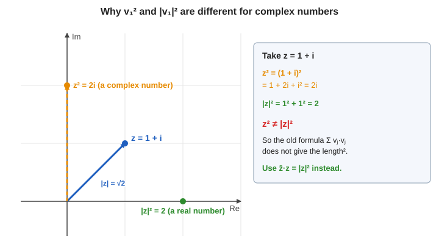

## 11.2 A disaster with the old formula (slide)

Try the naive formula $\sum_j v_j v_j$ on the vector $\mathbf{v} = \begin{pmatrix}1\\ i\end{pmatrix}$:

$$
1\cdot 1 + i\cdot i = 1 + (-1) = 0
$$

A **non-zero** vector with "length" zero. The lecturer: *"We would be in a very strange situation where $\mathbf{v}\cdot\mathbf{v}$ will be 0, but $\mathbf{v}$ is not a zero vector. I don't want this."*

## 11.3 The fix: conjugate one of the vectors

Recall from complex numbers: **a complex number times its conjugate is its modulus squared**, $z\,\overline{z} = \lvert z\rvert^2 \ge 0$. So instead of multiplying $v_j$ by $v_j$, multiply $v_j$ by its **conjugate** $\overline{v_j}$. Redo the example:

$$
\overline{1}\cdot 1 + \overline{i}\cdot i = 1\cdot 1 + (-i)\cdot i = 1 + 1 = 2 > 0
$$

The key point (slide): *$\overline{z}z = \lvert z\rvert^2 \ge 0$ is what makes lengths real and positive. This is why the complex inner product carries conjugates.*

## 11.4 The conjugate transpose $\mathbf{v}^\dagger$

Two ingredients, in the lecturer's words:

1. **Conjugate** every entry of the vector. For $\mathbf{v}$, take each entry and flip the sign of its imaginary part.
2. **Transpose:** turn the column into a row. *"Why do I want a row? Because I want to use the rules of matrix multiplication."*

Doing both gives the **conjugate transpose**, written $\mathbf{v}^\dagger$ ("$\mathbf{v}$ dagger", slide mnemonic: *dagger = flip and conjugate*). For a column vector $\mathbf{v}$, $\mathbf{v}^\dagger$ is a row of conjugated entries:

$$
\mathbf{v} = \begin{pmatrix}v_1\\ \vdots\\ v_n\end{pmatrix}\ \longmapsto\ \mathbf{v}^\dagger = \overline{\mathbf{v}}^{\,T} = \begin{pmatrix}\overline{v_1} & \cdots & \overline{v_n}\end{pmatrix}
$$

**Example (slide).**

$$
\mathbf{v} = \begin{pmatrix}1 + i\\ 2i\end{pmatrix} \quad\Rightarrow\quad \mathbf{v}^\dagger = \begin{pmatrix}1 - i & -2i\end{pmatrix}
$$

Books may write $\mathbf{v}^*$ or $\mathbf{v}^H$ for the same thing.

**What about a scalar?** If you multiply by $\alpha$ and then take the dagger, the scalar gets conjugated as well:

$$
(\alpha\mathbf{v})^\dagger = \overline{\alpha}\,\mathbf{v}^\dagger
$$

The lecturer: *"conjugate of $\alpha\mathbf{v}$ is the conjugate of $\alpha$ times the conjugate of $\mathbf{v}$."*

## 11.5 The definition of the inner product (slide)

$$
\boxed{\ \langle\mathbf{u}, \mathbf{v}\rangle = \mathbf{u}^\dagger\mathbf{v} = \sum_{j=1}^{n}\overline{u_j}\,v_j\ }
$$

**Conjugate the first vector, not the second.** (The lecturer says "people often make mistakes here".)

**Why a row times a column?** A $1\times n$ matrix (the row $\mathbf{u}^\dagger$) times an $n\times 1$ matrix (the column $\mathbf{v}$) gives a $1\times 1$ matrix, which is a single number. It is a fancy way of writing the sum $\overline{u_1}v_1 + \overline{u_2}v_2 + \cdots$.

Two things to note:

- The lecturer often says "dot product" when he means this **inner product**. The slides call it the inner product. They are the same idea (with conjugates for complex vectors).
- With this definition, $\langle\mathbf{v}, \mathbf{v}\rangle = \overline{v_1}v_1 + \cdots + \overline{v_n}v_n = \lvert v_1\rvert^2 + \cdots + \lvert v_n\rvert^2$, exactly the length squared we wanted.

**Example 1 (slide).** $\mathbf{u} = \begin{pmatrix}1\\ i\end{pmatrix}$ and $\mathbf{v} = \begin{pmatrix}i\\ 1\end{pmatrix}$:

$$
\langle\mathbf{u}, \mathbf{v}\rangle = \overline{1}\cdot i + \overline{i}\cdot 1 = i + (-i) = 0
$$

*"This is not clear by just looking at them, because now we are living in the complex world and cannot visualise them."* But the number $0$ tells you they are **perpendicular** in the sense of the next sections.

**Example 2 (slide).** The basis vectors of $\mathbb{C}^2$:

$$
\langle\mathbf{e}_1, \mathbf{e}_1\rangle = \langle\mathbf{e}_2, \mathbf{e}_2\rangle = 1, \qquad \langle\mathbf{e}_1, \mathbf{e}_2\rangle = 0, \qquad \langle\mathbf{h}_+, \mathbf{e}_1\rangle = \frac{1}{\sqrt2}
$$

(The last one: $\overline{\tfrac{1}{\sqrt2}}\cdot 1 + \overline{\tfrac{1}{\sqrt2}}\cdot 1\cdot 0 = \tfrac{1}{\sqrt2}$.)

## 11.6 Order matters: conjugate symmetry

In the real world $\mathbf{u}\cdot\mathbf{v} = \mathbf{v}\cdot\mathbf{u}$. Now the order matters, but in a controlled way:

$$
\langle\mathbf{u}, \mathbf{v}\rangle = \overline{u_1}v_1 + \overline{u_2}v_2 + \cdots \qquad
\langle\mathbf{v}, \mathbf{u}\rangle = \overline{v_1}u_1 + \overline{v_2}u_2 + \cdots
$$

Take the conjugate of the first sum, term by term. The conjugate of $\overline{u_1}v_1$ is $u_1\overline{v_1}$ (conjugating twice returns the original). That is exactly the first term of the second sum. So

$$
\langle\mathbf{v}, \mathbf{u}\rangle = \overline{\langle\mathbf{u}, \mathbf{v}\rangle}
$$

If one of them is $1 + i$ the other is $1 - i$. Swapping the order gives the complex conjugate.

## 11.7 Pulling out a scalar

- **Second slot:** $\langle\mathbf{u}, \alpha\mathbf{v}\rangle = \alpha\,\langle\mathbf{u}, \mathbf{v}\rangle$. The scalar comes out **as it is**.
- **First slot:** $\langle\alpha\mathbf{u}, \mathbf{v}\rangle = \overline{\alpha}\,\langle\mathbf{u}, \mathbf{v}\rangle$. The scalar comes out **conjugated**, because everything in the first slot is conjugated: $\overline{\alpha u_1}\,v_1 + \cdots = \overline{\alpha}\,\overline{u_1}v_1 + \cdots$.

## 11.8 The three properties (slide "Properties of the Inner Product")

For all $\mathbf{u}, \mathbf{v}, \mathbf{w}$ and $\alpha, \beta \in \mathbb{C}$:

1. **Conjugate symmetry:** $\langle\mathbf{u}, \mathbf{v}\rangle = \overline{\langle\mathbf{v}, \mathbf{u}\rangle}$.
2. **Linear in the second slot:** $\langle\mathbf{u}, \alpha\mathbf{v} + \beta\mathbf{w}\rangle = \alpha\langle\mathbf{u}, \mathbf{v}\rangle + \beta\langle\mathbf{u}, \mathbf{w}\rangle$.
3. **Positive definite:** $\langle\mathbf{v}, \mathbf{v}\rangle \ge 0$, with equality only when $\mathbf{v} = \mathbf{0}$.

A consequence of 1 and 2: $\langle\alpha\mathbf{u}, \mathbf{v}\rangle = \overline{\alpha}\langle\mathbf{u}, \mathbf{v}\rangle$ ("anti-linear in the first slot").

Property 3 is the one the whole definition was designed for: *"If $\langle\mathbf{v}, \mathbf{v}\rangle$ is 0, then $\mathbf{v}$ has to be 0, otherwise it will never be 0. That is how we have designed this thing."* The slide adds that any function satisfying 1 to 3 on a vector space is called an inner product. The one we use on $\mathbb{C}^n$ is $\sum\overline{u_j}v_j$. (When asked whether there can be other definitions, the lecturer says "technically you can, but let us not go there".)

## 11.9 Recap of the idea (the lecturer repeats it)

1. The real dot product $\sum u_jv_j$ would fail for complex vectors (it gives $0$ for $(1, i)$).
2. So we **conjugate the first vector**: $\overline{u_1}v_1 + \overline{u_2}v_2 + \cdots$.
3. Then $\langle\mathbf{v}, \mathbf{v}\rangle$ is the length squared, which is real and positive.

*Two small answers:* a student asked about "the bra of the ket". The lecturer is **not using that notation yet** (the next lecturer, Colin, will). Another asked how this gives probability. Not yet: see section 13.

---

# 12. Norm (length) and unit vectors

*Transcript: "Norm, normalisation, and unit vectors (slides 37–40)". Slides: "Norm (Length)" and "Normalisation and Quantum States".*

## 12.1 The norm

The **norm** (length) of a vector is

$$
\lVert\mathbf{v}\rVert = \sqrt{\langle\mathbf{v}, \mathbf{v}\rangle} = \sqrt{\lvert v_1\rvert^2 + \cdots + \lvert v_n\rvert^2}
$$

So $\langle\mathbf{v}, \mathbf{v}\rangle = \lVert\mathbf{v}\rVert^2$, matching what we wanted. Properties (slide):

- $\lVert\mathbf{v}\rVert \ge 0$, and $\lVert\mathbf{v}\rVert = 0$ only for $\mathbf{v} = \mathbf{0}$.
- $\lVert\alpha\mathbf{v}\rVert = \lvert\alpha\rvert\,\lVert\mathbf{v}\rVert$.

**Why $\lVert\alpha\mathbf{v}\rVert = \lvert\alpha\rvert\lVert\mathbf{v}\rVert$?** Compute the square: $\langle\alpha\mathbf{v}, \alpha\mathbf{v}\rangle$. The $\alpha$ in the first slot comes out conjugated, the one in the second comes out as is. So we get $\overline{\alpha}\,\alpha\,\langle\mathbf{v}, \mathbf{v}\rangle = \lvert\alpha\rvert^2\lVert\mathbf{v}\rVert^2$. Take the square root.

**Example (slide, and the lecturer's example).**

$$
\left\lVert\begin{pmatrix}1\\ 1 + i\end{pmatrix}\right\rVert = \sqrt{1 + \lvert 1 + i\rvert^2} = \sqrt{1 + 2} = \sqrt3
$$

*It is almost like the real case, but you have to be careful and use $\lvert\cdot\rvert^2$ for each entry.*

## 12.2 Distance between two vectors

$\lVert\mathbf{u} - \mathbf{v}\rVert$ is the **distance between $\mathbf{u}$ and $\mathbf{v}$**. In the real plane, $\mathbf{v} - \mathbf{w}$ is the arrow from $\mathbf{w}$ to $\mathbf{v}$, with coordinates $(v_1 - w_1,\ v_2 - w_2)$. If the vectors are far apart, $\mathbf{u} - \mathbf{v}$ is a large vector. If they are close, it is small. (Large and small refer to the length.)

## 12.3 Unit vectors and normalising

A vector of **length 1** is called a **unit vector**. *"This will become very important when we talk about qubits."*

In the real picture, unit vectors are the points on the **unit circle** (radius 1). A vector that is not on the circle can be **scaled** so that it lands on it.

If you scale a vector $\mathbf{v}$ by a real number $r$, its length is multiplied by $r$. So multiply by $\dfrac{1}{\lVert\mathbf{v}\rVert}$ to get length 1. This is called **normalising**:

$$
\hat{\mathbf{v}} = \frac{\mathbf{v}}{\lVert\mathbf{v}\rVert}
$$

As the lecturer says, if a vector has length 10, multiply all its coordinates by $\tfrac{1}{10}$ and the new vector has length 1.

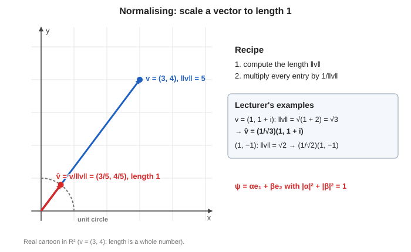

**The lecturer's examples.**

- $\mathbf{v} = \begin{pmatrix}1\\ 1 + i\end{pmatrix}$ has length $\sqrt3$, so $\hat{\mathbf{v}} = \dfrac{1}{\sqrt3}\begin{pmatrix}1\\ 1 + i\end{pmatrix}$.
- $\mathbf{v} = (1, -1)$ has length $\sqrt{1^2 + 1^2} = \sqrt2$, so $\hat{\mathbf{v}} = \dfrac{1}{\sqrt2}(1, -1)$.

## 12.4 Why the $\tfrac{1}{\sqrt2}$ in $\mathbf{h}_\pm$

Now the "mystery" of section 8.4 is solved: $(1, 1)$ and $(1, -1)$ each have length $\sqrt2$, and the factor $\tfrac{1}{\sqrt2}$ **normalises** them. So $\mathbf{h}_+$ and $\mathbf{h}_-$ have length 1. The lecturer: *"I like vectors which have length 1, because those are the vectors which will arise in quantum computing."*

**Quantum states are unit vectors (slide).** A qubit state is

$$
\boldsymbol\psi = \alpha\,\mathbf{e}_1 + \beta\,\mathbf{e}_2 \qquad\text{with}\qquad \lVert\boldsymbol\psi\rVert^2 = \lvert\alpha\rvert^2 + \lvert\beta\rvert^2 = 1
$$

*This is exactly the normalisation condition you will see in the next lecture.*

---

# 13. Two inequalities

*Transcript: "Inequalities and orthogonality (slides 41–46)". Slide: "Two Inequalities You Will Use Constantly".*

*"Two facts that you always have to know."*

## 13.1 Cauchy–Schwarz

$$
\lvert\langle\mathbf{u}, \mathbf{v}\rangle\rvert \le \lVert\mathbf{u}\rVert\,\lVert\mathbf{v}\rVert
$$

with equality if and only if $\mathbf{u}$ and $\mathbf{v}$ are parallel ($\mathbf{v} = \alpha\mathbf{u}$).

**Where it comes from (the real case).** $\mathbf{u}\cdot\mathbf{v} = \lVert\mathbf{u}\rVert\lVert\mathbf{v}\rVert\cos\theta$, and $\cos\theta$ lies between $-1$ and $1$. Take the absolute value: $\lvert\cos\theta\rvert \le 1$, so $\lvert\mathbf{u}\cdot\mathbf{v}\rvert \le \lVert\mathbf{u}\rVert\lVert\mathbf{v}\rVert$. For complex vectors the inner product is a **complex number**, so we take its modulus. The same inequality holds.

**Why quantum computing cares (slide).** For two **unit** vectors, Cauchy–Schwarz gives $\lVert\boldsymbol\phi\rVert\lVert\boldsymbol\psi\rVert = 1$, so

$$
0 \le \lvert\langle\boldsymbol\phi, \boldsymbol\psi\rangle\rvert^2 \le 1
$$

A number between $0$ and $1$ is exactly what a **probability** can be. This is where probabilities will appear later.

## 13.2 Triangle inequality

$$
\lVert\mathbf{u} + \mathbf{v}\rVert \le \lVert\mathbf{u}\rVert + \lVert\mathbf{v}\rVert
$$

The picture: draw $\mathbf{u}$ and $\mathbf{v}$ head to tail. Then $\mathbf{u} + \mathbf{v}$ is the **third side of a triangle**. The length of one side of a triangle is **at most the sum of the lengths of the other two sides**. Slide caption: *"The direct path is never longer than the detour."*

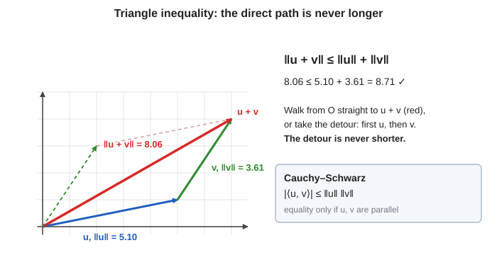

(The picture is a real cartoon: $\mathbf{u} = (5, 1)$ and $\mathbf{v} = (2, 3)$.)

---

# 14. Orthogonality

*Transcript: "Inequalities and orthogonality (slides 41–46)", second half. Slide: "Orthogonality".*

## 14.1 The definition

Two vectors are **orthogonal** (perpendicular), written $\mathbf{u}\perp\mathbf{v}$, if

$$
\langle\mathbf{u}, \mathbf{v}\rangle = 0
$$

Examples (slide):

- $\langle\mathbf{e}_1, \mathbf{e}_2\rangle = 0$.
- $\langle\mathbf{h}_+, \mathbf{h}_-\rangle = \dfrac12\,(1\cdot 1 + 1\cdot(-1)) = 0$.
- $\begin{pmatrix}1\\ i\end{pmatrix}\perp\begin{pmatrix}i\\ 1\end{pmatrix}$ (computed in section 11.5).

The lecturer points out that $\mathbf{h}_+$ and $\mathbf{h}_-$ **do not "interfere"** through the $\tfrac{1}{\sqrt2}$ factors: you multiply $1\cdot 1$ and $1\cdot(-1)$, giving $0$. He keeps the $\tfrac{1}{\sqrt2}$ because **their lengths are 1**. *"These are the two most important vectors you will see in quantum computing."*

## 14.2 Pythagoras's theorem

If $\mathbf{u}\perp\mathbf{v}$, then

$$
\lVert\mathbf{u} + \mathbf{v}\rVert^2 = \lVert\mathbf{u}\rVert^2 + \lVert\mathbf{v}\rVert^2
$$

*"It is like saying the hypotenuse squared is the sum of the squares of the two sides."*

**Why it is true.** Expand $\langle\mathbf{u} + \mathbf{v}, \mathbf{u} + \mathbf{v}\rangle$ using the distributive law:

$$
\langle\mathbf{u}, \mathbf{u}\rangle + \langle\mathbf{u}, \mathbf{v}\rangle + \langle\mathbf{v}, \mathbf{u}\rangle + \langle\mathbf{v}, \mathbf{v}\rangle
$$

The two middle terms are $0$ because $\mathbf{u}\perp\mathbf{v}$. What is left is $\lVert\mathbf{u}\rVert^2 + \lVert\mathbf{v}\rVert^2$. $\blacksquare$

In the picture below, $\mathbf{u} = (3, 1)$ and $\mathbf{v} = (-1, 3)$ are perpendicular ($3\cdot(-1) + 1\cdot 3 = 0$), each has squared length $10$, and $\mathbf{u} + \mathbf{v}$ has squared length $20 = 10 + 10$:

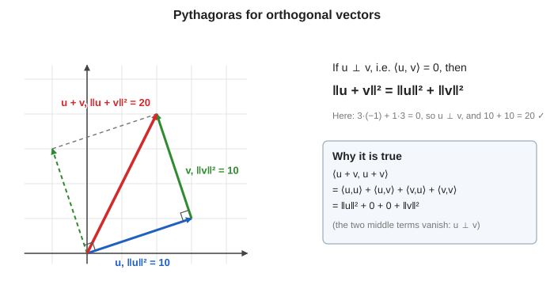

*"There is only a picture because in the complex world it does not look like this, but in the real world this is how it looks."* Physically (slide): **orthogonal states are perfectly distinguishable.** More on that later.

## 14.3 Questions from the class

**"Perpendicular vectors always form a basis. Is the opposite true: is every basis perpendicular?"** **No.** In $\mathbb{R}^2$, two vectors that are *not* perpendicular can still form a basis. (For example $(1, 0)$ and $(1, 1)$.) However, there is a theorem: *every subspace has some basis made of perpendicular vectors.* But not every basis is orthogonal.

**"Why was the word Hadamard used?"** Do not be scared of it. The lecturer never used the word in his explanation; $\mathbf{h}_+$ and $\mathbf{h}_-$ are just *a pair of vectors, a basis*. They are called Hadamard vectors because a mathematician named **Hadamard** studied them. (The Pauli basis is something for much later.)

---

# 15. Orthonormal bases

*Transcript: "Orthonormal bases and coordinate extraction (slides 47–53)". Slides: "Orthonormal Bases", "Coordinates in an ONB: Just Take Inner Products", "Worked Example: Rewriting a Vector in the Hadamard Basis".*

*"Now comes the most important statement about bases. We will use this a lot."*

## 15.1 The problem: finding coordinates is hard in a general basis

In the standard basis $\{(1, 0), (0, 1)\}$ the point $(5, 6)$ has coordinates $5$ and $6$. Immediate.

Now change the basis to $\mathbf{b}_1 = (3, 2)$ and $\mathbf{b}_2 = (1, 7)$. What are the coordinates of $(5, 6)$ in this basis? We need numbers $\alpha_1, \alpha_2$ with

$$
(5, 6) = \alpha_1\,(3, 2) + \alpha_2\,(1, 7)
$$

That is two equations in two unknowns:

$$
3\alpha_1 + \alpha_2 = 5, \qquad 2\alpha_1 + 7\alpha_2 = 6
$$

(Solving: from the first, $\alpha_2 = 5 - 3\alpha_1$. Substituting into the second gives $2\alpha_1 + 35 - 21\alpha_1 = 6$, so $\alpha_1 = \tfrac{29}{19}$ and $\alpha_2 = \tfrac{8}{19}$. Ugly.) And in a bigger space, 3D or 4D, you would have to solve a larger system.

**Why is the standard basis so easy and this one so hard?** That is the question this section answers.

## 15.2 Orthonormal basis (ONB)

A basis $\{\mathbf{e}_1, \dots, \mathbf{e}_n\}$ is **orthonormal** if two things hold:

1. **Orthogonal:** they are perpendicular to each other: $\langle\mathbf{e}_i, \mathbf{e}_j\rangle = 0$ for $i \ne j$.
2. **Normalised:** each has length 1: $\langle\mathbf{e}_i, \mathbf{e}_i\rangle = 1$.

The slide packs both into one line using the **Kronecker delta**:

$$
\langle\mathbf{e}_i, \mathbf{e}_j\rangle = \delta_{ij} = \begin{cases}1 & i = j\\ 0 & i \ne j\end{cases}
$$

## 15.3 Three standard orthonormal bases of $\mathbb{C}^2$ (slide)

| Name | Vectors |
|---|---|
| **Standard** | $\mathbf{e}_1 = (1, 0)^T,\ \mathbf{e}_2 = (0, 1)^T$ |
| **Hadamard** | $\mathbf{h}_\pm = \tfrac{1}{\sqrt2}(1, \pm1)^T$ |
| **Circular** | $\mathbf{c}_\pm = \tfrac{1}{\sqrt2}(1, \pm i)^T$ (needs complex numbers!) |

**Check that each is orthonormal.**

- *Standard:* clearly perpendicular and of length 1.
- *Hadamard:* $\lVert\mathbf{h}_+\rVert^2 = \tfrac12(1 + 1) = 1$, same for $\mathbf{h}_-$. And $\langle\mathbf{h}_+, \mathbf{h}_-\rangle = \tfrac12(1\cdot1 + 1\cdot(-1)) = 0$.
- *Circular:* $\lVert\mathbf{c}_+\rVert^2 = \tfrac12\left(\lvert1\rvert^2 + \lvert i\rvert^2\right) = \tfrac12(1 + 1) = 1$, and likewise for $\mathbf{c}_-$. Now the inner product, **remembering the conjugate on the first vector**:

$$
\langle\mathbf{c}_+, \mathbf{c}_-\rangle = \tfrac12\left(\overline{1}\cdot1 + \overline{i}\cdot(-i)\right) = \tfrac12\left(1 + (-i)(-i)\right) = \tfrac12\left(1 + i^2\right) = \tfrac12(1 - 1) = 0
$$

> **Transcript note:** the lecturer's spoken version of this check is jumbled ("$i$ into $-i$ is plus 1, not minus 1, but remember we have to take the conjugate, so this becomes $i$ minus 1, is 0"). The line above is the clean computation. The key point he makes: you must conjugate the first vector, and without the conjugate you would get the wrong sign.

He also stresses: **for the Hadamard basis you can see in the picture that the two vectors are perpendicular. For the circular basis you cannot**, because the vectors live in $\mathbb{C}^2$ and cannot be drawn. You have to do the calculation.

## 15.4 The big payoff: coordinates are just inner products

Let $\{\mathbf{e}_1, \dots, \mathbf{e}_n\}$ be **any** orthonormal basis. Suppose

$$
\mathbf{v} = \alpha_1\mathbf{e}_1 + \alpha_2\mathbf{e}_2 + \cdots + \alpha_n\mathbf{e}_n
$$

We want to find $\alpha_1, \dots, \alpha_n$. Take the inner product of **both sides with $\mathbf{e}_1$** (put $\mathbf{e}_1$ in the first slot):

$$
\langle\mathbf{e}_1, \mathbf{v}\rangle = \alpha_1\langle\mathbf{e}_1, \mathbf{e}_1\rangle + \alpha_2\langle\mathbf{e}_1, \mathbf{e}_2\rangle + \cdots + \alpha_n\langle\mathbf{e}_1, \mathbf{e}_n\rangle
$$

(The $\alpha_i$ come out of the **second** slot as they are, so they are not conjugated.) Now use orthonormality: $\langle\mathbf{e}_1, \mathbf{e}_1\rangle = 1$, and all the others are $0$. Only one term survives:

$$
\langle\mathbf{e}_1, \mathbf{v}\rangle = \alpha_1
$$

The same works for each $j$: $\langle\mathbf{e}_j, \mathbf{v}\rangle = \sum_i\alpha_i\,\delta_{ji} = \alpha_j$. So

$$
\boxed{\ \mathbf{v} = \sum_i\langle\mathbf{e}_i, \mathbf{v}\rangle\,\mathbf{e}_i\ }
$$

> **Conjugate on the first slot only.** The coordinate along $\mathbf{e}_j$ is $\langle\mathbf{e}_j, \mathbf{v}\rangle$, with the **basis vector first**. If you put them the other way round, you get the conjugate of the right answer.

**What the lecturer says in words.** *"If you want to find the coordinates of $\mathbf{v}$ with respect to this basis, all you have to do is to take the dot product."* The coordinate along $\mathbf{e}_1$ is $\langle\mathbf{e}_1, \mathbf{v}\rangle$ (the perpendicular projection of $\mathbf{v}$ along $\mathbf{e}_1$), along $\mathbf{e}_2$ it is $\langle\mathbf{e}_2, \mathbf{v}\rangle$, and so on. **No equations to solve:** each coordinate is one inner product. That is why we like orthonormal bases so much.

## 15.5 Worked example: rewriting a vector in the Hadamard basis (slide)

Let

$$
\mathbf{v} = \frac35\mathbf{e}_1 + \frac{4i}{5}\mathbf{e}_2 = \begin{pmatrix}3/5\\ 4i/5\end{pmatrix}
$$

We want $\mathbf{v} = c_+\mathbf{h}_+ + c_-\mathbf{h}_-$. Since $\{\mathbf{h}_+, \mathbf{h}_-\}$ is orthonormal, take inner products:

$$
c_+ = \langle\mathbf{h}_+, \mathbf{v}\rangle = \frac{1}{\sqrt2}\left(1\cdot\frac35 + 1\cdot\frac{4i}{5}\right) = \frac{1}{\sqrt2}\left(\frac{3}{5} + \frac{4i}{5}\right) = \frac{3 + 4i}{5\sqrt2}
$$

$$
c_- = \langle\mathbf{h}_-, \mathbf{v}\rangle = \frac{1}{\sqrt2}\left(1\cdot\frac35 - 1\cdot\frac{4i}{5}\right) = \frac{1}{\sqrt2}\left(\frac{3}{5} - \frac{4i}{5}\right) = \frac{3 - 4i}{5\sqrt2}
$$

(The entries of $\mathbf{h}_\pm$ are real, so conjugating them changes nothing.) Therefore

$$
\mathbf{v} = \frac{3 + 4i}{5\sqrt2}\,\mathbf{h}_+ + \frac{3 - 4i}{5\sqrt2}\,\mathbf{h}_-
$$

**Check:** recombine and see if you get $\mathbf{v}$ back.

$$
\text{first entry:}\quad \frac{1}{\sqrt2}\left(\frac{3 + 4i}{5\sqrt2} + \frac{3 - 4i}{5\sqrt2}\right) = \frac{1}{\sqrt2}\cdot\frac{6}{5\sqrt2} = \frac{6}{10} = \frac35\ \checkmark
$$

$$
\text{second entry:}\quad \frac{1}{\sqrt2}\left(\frac{3 + 4i}{5\sqrt2} - \frac{3 - 4i}{5\sqrt2}\right) = \frac{1}{\sqrt2}\cdot\frac{8i}{5\sqrt2} = \frac{8i}{10} = \frac{4i}{5}\ \checkmark
$$

The picture below is a **real cartoon** of the same idea with $\mathbf{v} = (3/5, 4/5)$. Left: coordinates in the standard basis are the projections $0.6$ and $0.8$. Right: coordinates in the Hadamard basis are the projections $\approx 0.99$ and $\approx -0.14$:

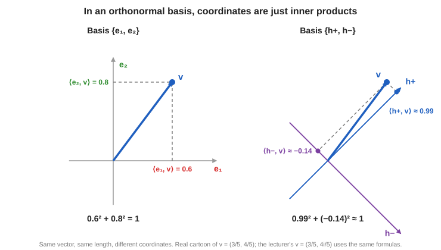

## 15.6 The length of a vector from its coordinates

The lecturer's last result. Suppose $\mathbf{v} = v_1\mathbf{e}_1 + \cdots + v_n\mathbf{e}_n$ in an orthonormal basis. What is $\lVert\mathbf{v}\rVert^2 = \langle\mathbf{v}, \mathbf{v}\rangle$?

Expand $\langle v_1\mathbf{e}_1 + \cdots,\ v_1\mathbf{e}_1 + \cdots\rangle$. All the cross terms $\langle\mathbf{e}_i, \mathbf{e}_j\rangle$ with $i \ne j$ are $0$ (perpendicular), and each $\langle\mathbf{e}_i, \mathbf{e}_i\rangle = 1$. What survives is

$$
\lVert\mathbf{v}\rVert^2 = \overline{v_1}v_1 + \cdots + \overline{v_n}v_n = \lvert v_1\rvert^2 + \cdots + \lvert v_n\rvert^2
$$

and each $v_i = \langle\mathbf{e}_i, \mathbf{v}\rangle$. In words: **the squared length is the sum of the squared sizes of the coordinates in any orthonormal basis.** The lecturer's geometric statement: if you give two different orthonormal bases and the coordinates of $\mathbf{v}$ along each, the length is $\lvert v_1\rvert^2 + \lvert v_2\rvert^2$ in both. It does not depend on which orthonormal basis you use.

**Check with the example.** In the standard basis: $\left\lvert\tfrac35\right\rvert^2 + \left\lvert\tfrac{4i}{5}\right\rvert^2 = \tfrac{9}{25} + \tfrac{16}{25} = 1$. In the Hadamard basis: $\lvert c_+\rvert^2 + \lvert c_-\rvert^2 = \tfrac{\lvert3 + 4i\rvert^2}{50} + \tfrac{\lvert3 - 4i\rvert^2}{50} = \tfrac{25}{50} + \tfrac{25}{50} = 1$. Same answer. (The lecturer admits: *"this did go a bit fast; when you do the exercises, you will understand."*)

## 15.7 Practice: inner product problems (slide "Problems")

Let $\mathbf{u} = \begin{pmatrix}1\\ i\end{pmatrix}$ and $\mathbf{v} = \begin{pmatrix}2\\ 1 - i\end{pmatrix}$.

1. Compute $\langle\mathbf{u}, \mathbf{v}\rangle$ and $\langle\mathbf{v}, \mathbf{u}\rangle$.
2. Compute $\lVert\mathbf{u}\rVert$ and $\lVert\mathbf{v}\rVert$.
3. Normalise $\mathbf{u}$ and $\mathbf{v}$.
4. Check Cauchy–Schwarz.

*Remember: conjugate the first vector.*

**Solutions (from the slides, with extra steps).**

1. $\langle\mathbf{u}, \mathbf{v}\rangle = \overline{1}\cdot2 + \overline{i}\,(1 - i) = 2 + (-i)(1 - i) = 2 - i + i^2 = 2 - i - 1 = \mathbf{1 - i}$. Then $\langle\mathbf{v}, \mathbf{u}\rangle = \overline{\langle\mathbf{u}, \mathbf{v}\rangle} = \mathbf{1 + i}$ (conjugate symmetry). *Direct check:* $\overline{2}\cdot1 + \overline{(1 - i)}\cdot i = 2 + (1 + i)i = 2 + i + i^2 = 1 + i$. ✓
2. $\lVert\mathbf{u}\rVert = \sqrt{1 + \lvert i\rvert^2} = \sqrt2$ and $\lVert\mathbf{v}\rVert = \sqrt{4 + \lvert1 - i\rvert^2} = \sqrt{4 + 2} = \sqrt6$.
3. $\hat{\mathbf{u}} = \dfrac{1}{\sqrt2}\begin{pmatrix}1\\ i\end{pmatrix}$ and $\hat{\mathbf{v}} = \dfrac{1}{\sqrt6}\begin{pmatrix}2\\ 1 - i\end{pmatrix}$.
4. $\lvert\langle\mathbf{u}, \mathbf{v}\rangle\rvert = \lvert1 - i\rvert = \sqrt2$, and $\lVert\mathbf{u}\rVert\lVert\mathbf{v}\rVert = \sqrt2\cdot\sqrt6 = \sqrt{12}$. Since $\sqrt2 \le \sqrt{12}$, Cauchy–Schwarz holds. ✓

---

# 16. Review and what comes next

*Transcript: "Review, questions and next session". Slide: "Summary: Vector Spaces over $\mathbb{C}$".*

## 16.1 What did we really do? (the lecturer's recap)

1. We introduced the **conjugate** and used it to define the **dot (inner) product**. We defined it that way because we want $\mathbf{v}\cdot\mathbf{v}$ to be a real number equal to the length squared. That is why the conjugate was needed.
2. We used the inner product to define **perpendicular** (orthogonal): two vectors are perpendicular if their inner product is $0$. *(Up to here, he says, everything is easy.)*
3. When you **change the basis, the coordinates of a vector change.** You are writing the same vector as a combination of different vectors.
4. If the basis is **orthonormal** (perpendicular and of length 1), finding the coordinates is **very easy**: each coordinate is one inner product.

*If you got lost somewhere:* it probably means you are not yet comfortable with **linear independence or basis**. Go back and try the slide problems.

## 16.2 Slide summary: vector spaces over $\mathbb{C}$

- $\mathbb{C}^n$: columns of complex numbers; add entrywise, scale by a complex $\alpha$.
- **Span** = all linear combinations = all superpositions.
- **Independence and dimension depend on the scalars** ($\mathbb{C}$ versus $\mathbb{R}$).
- **Basis $\Rightarrow$ unique coordinates.** Different bases give different coordinates, but the vector is the same.
- **Qubits:** $\mathbf{e}_1, \mathbf{e}_2$ are the standard basis of $\mathbb{C}^2$; $n$ qubits live in $\mathbb{C}^{2^n}$.
- **Missing so far:** *we can add and scale, but we cannot yet measure lengths or angles.* The inner product (sections 10 to 15) filled that gap.

## 16.3 What the lecturer wants you to do

- Do the slide problems. *"You will feel like you understand the concepts but are not able to connect them. That is fine. The moment you do more examples, it will click."* (Not being able to connect them means not yet seeing why they matter in quantum computing. That comes with the applications.)
- At the very least, know **how to define the inner product of two vectors**, and **what it means to define the length of a vector**.
- This is **only the beginning** and the course is heavy on maths. **Matrices and linear transformations** have not even started. They come next session. *"If I don't do that, you will not be able to understand what is going on in quantum."*
- **Tomorrow** (next session): no new concepts. Exercises first, with the teaching assistant. The lecturer plans to start the session and go over some of the exercises. The **Pauli basis** is much later.
- The slides will be shared. *There is no submission for these exercises right now.*

---

# 17. One-page cheat sheet

**Vectors**

- $\mathbb{C}^n$: columns of $n$ complex numbers. Add entry by entry. Scale every entry by a complex number.
- Zero vector $\mathbf{0}$, negative $-\mathbf{v} = (-1)\mathbf{v}$.

**Span, subspace, independence, basis**

| Idea | Definition | Picture (real) |
|---|---|---|
| Linear combination | $\alpha_1\mathbf{v}_1 + \cdots + \alpha_k\mathbf{v}_k$ | scale and add |
| Span | all linear combinations | line, plane, ... through the origin |
| Subspace | closed under $+$ and scaling (so it contains $\mathbf{0}$) | line or plane **through the origin** |
| Linearly independent | $\sum\alpha_j\mathbf{v}_j = \mathbf{0}$ forces all $\alpha_j = 0$ | none lies in the span of the others |
| Basis | independent and spans | gives **unique** coordinates |
| Dimension | number of basis vectors | line 1, plane 2, $\mathbb{C}^n$ has $n$ |

**Inner product and length**

| Formula | Meaning |
|---|---|
| $\mathbf{v}^\dagger = \overline{\mathbf{v}}^{\,T}$ | flip column to row **and** conjugate |
| $\langle\mathbf{u}, \mathbf{v}\rangle = \mathbf{u}^\dagger\mathbf{v} = \sum\overline{u_j}v_j$ | inner product (conjugate the **first**) |
| $\langle\mathbf{v}, \mathbf{u}\rangle = \overline{\langle\mathbf{u}, \mathbf{v}\rangle}$ | swap order gives the conjugate |
| $\langle\mathbf{u}, \alpha\mathbf{v}\rangle = \alpha\langle\mathbf{u}, \mathbf{v}\rangle$, $\ \langle\alpha\mathbf{u}, \mathbf{v}\rangle = \overline{\alpha}\langle\mathbf{u}, \mathbf{v}\rangle$ | scalar comes out as it is in slot 2, conjugated in slot 1 |
| $\lVert\mathbf{v}\rVert = \sqrt{\langle\mathbf{v}, \mathbf{v}\rangle} = \sqrt{\sum\lvert v_j\rvert^2}$ | length |
| $\hat{\mathbf{v}} = \mathbf{v}/\lVert\mathbf{v}\rVert$ | unit vector (normalising) |
| $\mathbf{u}\perp\mathbf{v} \iff \langle\mathbf{u}, \mathbf{v}\rangle = 0$ | orthogonal |
| $\lvert\langle\mathbf{u}, \mathbf{v}\rangle\rvert \le \lVert\mathbf{u}\rVert\lVert\mathbf{v}\rVert$ | Cauchy–Schwarz |
| $\lVert\mathbf{u} + \mathbf{v}\rVert \le \lVert\mathbf{u}\rVert + \lVert\mathbf{v}\rVert$ | triangle inequality |
| $\mathbf{u}\perp\mathbf{v}\Rightarrow \lVert\mathbf{u} + \mathbf{v}\rVert^2 = \lVert\mathbf{u}\rVert^2 + \lVert\mathbf{v}\rVert^2$ | Pythagoras |

**Orthonormal bases**

- ONB: $\langle\mathbf{e}_i, \mathbf{e}_j\rangle = \delta_{ij}$.
- Three ONBs of $\mathbb{C}^2$: standard $\mathbf{e}_{1,2}$; Hadamard $\mathbf{h}_\pm = \tfrac{1}{\sqrt2}(1, \pm1)^T$; circular $\mathbf{c}_\pm = \tfrac{1}{\sqrt2}(1, \pm i)^T$.
- Coordinates: $\mathbf{v} = \sum_i\langle\mathbf{e}_i, \mathbf{v}\rangle\,\mathbf{e}_i$ (no equations to solve).
- Length: $\lVert\mathbf{v}\rVert^2 = \sum_i\lvert\langle\mathbf{e}_i, \mathbf{v}\rangle\rvert^2$.
- For $\mathbf{v} = (\alpha, \beta)^T$ in the Hadamard basis: $\left(\dfrac{\alpha + \beta}{\sqrt2},\ \dfrac{\alpha - \beta}{\sqrt2}\right)$.

**Quantum links**

- A qubit state is a **unit vector** in $\mathbb{C}^2$: $\boldsymbol\psi = \alpha\mathbf{e}_1 + \beta\mathbf{e}_2$ with $\lvert\alpha\rvert^2 + \lvert\beta\rvert^2 = 1$.
- $n$ qubits live in $\mathbb{C}^{2^n}$.
- Superposition = linear combination.
- For unit vectors, $0 \le \lvert\langle\boldsymbol\phi, \boldsymbol\psi\rangle\rvert^2 \le 1$ can be a probability.

---

# 18. Glossary

| Term | Meaning |
|---|---|
| **Vector** | a list of numbers (here a column of complex numbers) |
| **Scalar** | an ordinary number (real or complex) used to scale a vector |
| **$\mathbb{C}^n$** | the set of all columns of $n$ complex numbers |
| **Component, coordinate, entry** | one number in the list |
| **Row vector, column vector** | the list written lying down or standing up |
| **Transpose ($T$)** | turn a column into a row (and the other way) |
| **Conjugate transpose, dagger ($\dagger$)** | transpose and conjugate every entry |
| **Vector space** | a collection of vectors closed under addition and scaling (with the eight rules) |
| **Linear combination** | $\alpha_1\mathbf{v}_1 + \cdots + \alpha_k\mathbf{v}_k$ |
| **Span** | the set of all linear combinations |
| **Superposition** | the quantum name for a linear combination |
| **Subspace** | a part of a vector space that is itself a vector space; must contain $\mathbf{0}$ |
| **Linearly independent** | no vector is a combination of the others |
| **Basis** | an independent set that spans the space |
| **Dimension** | the number of vectors in a basis |
| **Coordinates** | the weights that write a vector in a basis |
| **Standard basis** | $\mathbf{e}_1, \dots, \mathbf{e}_n$: all zeros except one 1 |
| **Inner product** | $\langle\mathbf{u}, \mathbf{v}\rangle = \sum\overline{u_j}v_j$ |
| **Norm** | length, $\sqrt{\langle\mathbf{v}, \mathbf{v}\rangle}$ |
| **Unit vector** | a vector of length 1 |
| **Normalising** | dividing a vector by its length |
| **Orthogonal** | inner product is 0 |
| **Orthonormal basis (ONB)** | a basis of unit vectors that are pairwise orthogonal |
| **Cauchy–Schwarz inequality** | $\lvert\langle\mathbf{u}, \mathbf{v}\rangle\rvert \le \lVert\mathbf{u}\rVert\lVert\mathbf{v}\rVert$ |
| **Triangle inequality** | $\lVert\mathbf{u} + \mathbf{v}\rVert \le \lVert\mathbf{u}\rVert + \lVert\mathbf{v}\rVert$ |
| **Hadamard basis** | $\mathbf{h}_\pm = \tfrac{1}{\sqrt2}(1, \pm1)^T$ |
| **Kronecker delta** | $\delta_{ij} = 1$ if $i = j$ and $0$ otherwise |

---

# Appendix A: Extra practice (my additions)

These are **not** from the lecture. Try them, then check.

1. Is $\left\{\begin{pmatrix}1\\2\end{pmatrix}, \begin{pmatrix}3\\6\end{pmatrix}\right\}$ linearly independent in $\mathbb{R}^2$?
2. Compute $\langle\mathbf{u}, \mathbf{v}\rangle$ for $\mathbf{u} = \begin{pmatrix}1 + i\\ 1\end{pmatrix}$ and $\mathbf{v} = \begin{pmatrix}i\\ 2\end{pmatrix}$.
3. Find the norm of $\begin{pmatrix}3\\ 4i\end{pmatrix}$ and normalise it.
4. Is $\begin{pmatrix}1\\1\end{pmatrix}\perp\begin{pmatrix}1\\-1\end{pmatrix}$?
5. Write $\mathbf{e}_1 = (1, 0)^T$ in the **circular basis** $\mathbf{c}_\pm = \tfrac{1}{\sqrt2}(1, \pm i)^T$.
6. Do the vectors $(1, 0)$ and $(1, 1)$ form a basis of $\mathbb{R}^2$? Are they orthogonal?

**Answers.**

1. **No, dependent.** $(3, 6) = 3\,(1, 2)$.
2. $\langle\mathbf{u}, \mathbf{v}\rangle = \overline{(1 + i)}\cdot i + \overline{1}\cdot2 = (1 - i)\,i + 2 = i - i^2 + 2 = i + 1 + 2 = \mathbf{3 + i}$.
3. $\lVert\mathbf{v}\rVert = \sqrt{3^2 + \lvert4i\rvert^2} = \sqrt{9 + 16} = 5$, so $\hat{\mathbf{v}} = \left(\tfrac35,\ \tfrac{4i}{5}\right)^T$. (This is the vector from the worked example in section 15.5.)
4. **Yes.** $\overline{1}\cdot1 + \overline{1}\cdot(-1) = 1 - 1 = 0$.
5. $\langle\mathbf{c}_+, \mathbf{e}_1\rangle = \tfrac{1}{\sqrt2}\left(\overline{1}\cdot1 + \overline{i}\cdot0\right) = \tfrac{1}{\sqrt2}$ and $\langle\mathbf{c}_-, \mathbf{e}_1\rangle = \tfrac{1}{\sqrt2}$. So $\mathbf{e}_1 = \tfrac{1}{\sqrt2}\mathbf{c}_+ + \tfrac{1}{\sqrt2}\mathbf{c}_-$. *Check:* $\tfrac{1}{\sqrt2}\cdot\tfrac{1}{\sqrt2}\left[(1, i) + (1, -i)\right] = \tfrac12(2, 0) = (1, 0)$. ✓
6. **A basis but not orthogonal.** They are independent (neither is a multiple of the other), so in 2D they form a basis. But $(1, 0)\cdot(1, 1) = 1 \ne 0$, so they are not perpendicular. This is the lecturer's point that every basis need not be orthogonal.

---

# Appendix B: Maths you need first (refresher)

## B.1 Complex numbers in one paragraph

A complex number is $z = a + bi$ with $i^2 = -1$. Its **conjugate** is $\overline{z} = a - bi$ (flip the sign of the imaginary part). Its **modulus** is $\lvert z\rvert = \sqrt{a^2 + b^2}$. The key identity is $z\,\overline{z} = a^2 + b^2 = \lvert z\rvert^2$. (Full treatment: the Part A notes on complex numbers.)

Two more facts used in these notes: $\overline{\overline{z}} = z$, and $\overline{zw} = \overline{z}\,\overline{w}$.

## B.2 Matrix multiplication of a row by a column

A **row** with $n$ entries times a **column** with $n$ entries gives **one number**: multiply the entries in pairs and add.

$$
\begin{pmatrix}a_1 & a_2\end{pmatrix}\begin{pmatrix}b_1\\ b_2\end{pmatrix} = a_1b_1 + a_2b_2
$$

This is exactly the shape of $\mathbf{u}^\dagger\mathbf{v}$: the row is $\mathbf{u}^\dagger$ and the column is $\mathbf{v}$.

## B.3 Cosine in a right-angled triangle

For an angle $\theta$ in a right-angled triangle, $\cos\theta = \dfrac{\text{side next to the angle}}{\text{hypotenuse}}$. So the side next to the angle is (hypotenuse) $\times\cos\theta$. This is how the length $\lVert\mathbf{u}\rVert\cos\theta$ of the projection arises in section 10.2.

## B.4 Solving two equations in two unknowns

To solve $\alpha + \beta = x$ and $\alpha - \beta = y$: **add** the equations to get $2\alpha = x + y$, and **subtract** them to get $2\beta = x - y$. This is used in sections 7.5 and 8.4.
