# Mathematical Foundations Part B: Vectors and Inner Products — Detailed Notes

**Notation used**

| Object | Notation | Example |
|---|---|---|
| Scalar (a complex number) | plain italic | $z$, $\alpha$, $\beta$ |
| Complex conjugate | $\overline{z}$ (physics books write $z^*$) | $\overline{3 + 2i} = 3 - 2i$ |
| Vector (a column) | bold | $\mathbf{u}$, $\mathbf{v}$, $\boldsymbol{\psi}$ |
| Standard basis | $\mathbf{e}_1, \dots, \mathbf{e}_n$ | $\mathbf{e}_1 = (1, 0)^T$ |
| Conjugate transpose | $\mathbf{v}^\dagger$, $A^\dagger$ | "$\mathbf{v}$ dagger" |
| Inner product | $\langle \mathbf{u}, \mathbf{v}\rangle$ | a complex number |
| Norm (length) | $\lVert \mathbf{v}\rVert$ | a non-negative real number |
| Standard coordinates | $\alpha$, $\beta$ | scalars in $\{\mathbf{e}_1, \mathbf{e}_2\}$ |
| Hadamard coordinates | $a_+$, $a_-$ | scalars in $\{\mathbf{h}_+, \mathbf{h}_-\}$ |
| Circular coordinates | $r_+$, $r_-$ | scalars in $\{\mathbf{c}_+, \mathbf{c}_-\}$ |

In the text below, plain letters such as $u$, $v$ are also used for vectors when it is clear from the context. **Bold** letters are vectors; **$a_\pm$** and **$r_\pm$** are scalars (coordinates), not to be confused with circular basis vectors $\mathbf{c}_\pm$.

---

## Table of contents

1. [From numbers to vectors](#1-from-numbers-to-vectors)
2. [Adding vectors and scaling vectors](#2-adding-vectors-and-scaling-vectors)
3. [Vector spaces](#3-vector-spaces)
4. [Linear combinations and span](#4-linear-combinations-and-span)
5. [Subspaces](#5-subspaces)
6. [Linear independence](#6-linear-independence)
7. [Basis and dimension](#7-basis-and-dimension)
8. [Coordinates and change of basis](#8-coordinates-and-change-of-basis)
9. [Core ideas at a glance](#9-core-ideas-at-a-glance)
10. [Questions before the break](#10-questions-before-the-break)
11. [The dot product (real numbers)](#11-the-dot-product-real-numbers)
12. [The complex inner product](#12-the-complex-inner-product)
13. [Norm (length) and unit vectors](#13-norm-length-and-unit-vectors)
14. [Two inequalities](#14-two-inequalities)
15. [Orthogonality](#15-orthogonality)
16. [Orthonormal bases and Parseval’s identity](#16-orthonormal-bases-and-parsevals-identity)
17. [Review and what comes next](#17-review-and-what-comes-next)
18. [One-page cheat sheet](#18-one-page-cheat-sheet)
19. [Glossary](#19-glossary)

- [Appendix A: Extra practice (my additions)](#appendix-a-extra-practice-my-additions)
- [Appendix B: Maths you need first (refresher)](#appendix-b-maths-you-need-first-refresher)

---

# 1. From numbers to vectors

## 1.1 Where we are in the course

This is the **second session of the day**. In the first session we learned complex numbers.

Now we move to the next stage. **Instead of single numbers, we deal with vectors.**

## 1.2 A vector is a list of numbers

For real numbers, the vector is simply **a list of real numbers**.

- $\mathbf{v}$ with **two** numbers is in $\mathbb{R}^2$. In the slide, $\mathbf{v} = \begin{pmatrix} 2 \\ 1 \end{pmatrix}$.
- A list of **three** numbers is in $\mathbb{R}^3$.
- A list of **four** numbers is in $\mathbb{R}^4$. The example is ($2.3,\ -6,\ 3,\ 5.1$).

The name $\mathbb{R}^n$ means "lists of $n$ real numbers". The little $n$ is the length of the list.

The same idea works for complex numbers. A vector of **$n$ complex numbers** is a list of $n$ complex numbers, and the set of all of them is called $\mathbb{C}^n$. The example (the slide shows it as a column) has first entry $1 + i$ and second entry $2$:

$$
\mathbf{v} = \begin{pmatrix} 1 + i \\ 2 \end{pmatrix} \in \mathbb{C}^2
$$

You can have $\mathbb{C}^2$, $\mathbb{C}^4$, $\mathbb{C}^{10}$, $\mathbb{C}^{100}$, and so on.

Here is the real picture. The arrow on the left is just a drawing of the list $(2, 1)$: go $2$ to the right and $1$ up. The boxes on the right show a list of 2 real numbers, a list of 4 real numbers, and a list of 2 complex numbers:

> **Important idea.** To a physicist an arrow and a list are the same object. The list is what you calculate with. The arrow is only a picture that helps when the list has 2 or 3 real numbers.

## 1.3 Why do we deal with vectors of complex numbers?

The reason, in one line: **a qubit is described by complex numbers, and several qubits need more of them.**

- One qubit is represented using **two complex amplitudes**. So a one-qubit state is a vector in $\mathbb{C}^2$.
- With several qubits, the vectors have **more complex coordinates**.

(We have not yet been told what a qubit is. That comes in the next lecture. For now, just accept that these vectors are the objects quantum computing works with.)

## 1.4 The visualisation problem

A vector with **two real** coordinates is easy: it is a point in the plane, with an $x$ coordinate and a $y$ coordinate.

Now take a vector with **two complex** coordinates, such as $(1 + i,\ 2)$. Remember that **each complex number is a point in a plane**. So:

- $z_1 = 1 + i$ needs one plane (2 real numbers: the real part and the imaginary part).
- $z_2 = 2$ needs another plane (2 real numbers again).

Altogether the vector is **four real numbers**, $(1, 1, 2, 0)$. To draw four real numbers we would need **four dimensions**, and we only have three. The conclusion:

> *"We cannot draw a pair of complex numbers... So when I explain, I will draw them in two dimensions, but when we actually have to think about them, we will think in terms of $\mathbb{C}^n$. This is a translation that we will do as we go."*

(The slide says the same: "We cannot draw $\mathbb{C}^2$: it needs 4 real dimensions. So pictures today are $\mathbb{R}^2$ cartoons; the algebra is what carries over.")

## 1.5 What $\mathbb{C}^n$ means (notation)

- $\mathbb{C}^n$ means vectors with **$n$ components**, also called **coordinates**.
- The slide writes a vector as a column: $\mathbf{v} = (v_1, \dots, v_n)^T$ with each $v_j$ a complex number.

---

# 2. Adding vectors and scaling vectors

## 2.1 Adding two vectors

It is very similar to adding complex numbers. **Add each coordinate separately.** This is why it is called "entrywise" addition.

The example in $\mathbb{C}^2$ (the slide):

$$
\begin{pmatrix} 1 + i \\ 2 \end{pmatrix} + \begin{pmatrix} 3 \\ -i \end{pmatrix}
= \begin{pmatrix} (1 + i) + 3 \\ 2 + (-i) \end{pmatrix}
= \begin{pmatrix} 4 + i \\ 2 - i \end{pmatrix}
$$

First entries: $1 + i$ and $3$ give $4 + i$. Second entries: $2$ and $-i$ give $2 - i$.

In the real plane, adding vectors has a picture: draw both arrows from the origin, complete the **parallelogram**, and the fourth corner is the sum. (This parallelogram is used again in section 5.)

## 2.2 Multiplying a vector by a number (scalar multiplication)

*"Multiplying two vectors, it's not clear what it means."* (A vector times a vector is not defined at all.)

But you **can** multiply a vector by a **number** (in this setting a complex number, called a **scalar**). Multiply **every coordinate** by that number. For $\mathbf{b} = (b_1, b_2)$ and a complex number $z$:

$$
z\begin{pmatrix} b_1 \\ b_2 \end{pmatrix} = \begin{pmatrix} z\, b_1 \\ z\, b_2 \end{pmatrix}
$$

The slide's example uses the complex number $i$:

$$
i \cdot \begin{pmatrix} 1 + i \\ 2 \end{pmatrix}
= \begin{pmatrix} i(1 + i) \\ 2i \end{pmatrix}
= \begin{pmatrix} i + i^2 \\ 2i \end{pmatrix}
= \begin{pmatrix} -1 + i \\ 2i \end{pmatrix}
$$

Here is what both operations look like for real vectors. On the left, adding $\mathbf{u} = (4, 1)$ and $\mathbf{v} = (1, 3)$ gives $(5, 4)$. On the right, scaling $\mathbf{v} = (2, 1)$ by $2$ and by $-1$:

> **The big difference from school.** In school the scalar was a real number. Here the scalar can be **complex**. A complex scalar also *turns* the entries (remember: multiplying by a complex number rotates and stretches). The slide says: *"Scalars are now complex. That single change is what makes quantum linear algebra different from what many of you saw in school."*

## 2.3 Two questions from the class

**Question: "Is a vector something with magnitude and direction?"** That is how we think of force or momentum in the real world. The answer: with complex numbers it is more complicated, so **do not think of a vector as "magnitude and direction"**. Think of it as *something with many components*.

**Question: "Why can't $n$ complex numbers be shown as $n$ separate points in a 2D plane?"**

Both $(2, 3)$ and $2 + 3i$ can be drawn as an arrow ending at the point $(2, 3)$. The confusion is **what we mean by a coordinate**. Here is the distinction, then the answer to the question.

**1. A vector with real coordinates.** $\mathbf{v} = (2, 3)$ is a list of **two real numbers**: first coordinate $2$, second coordinate $3$. Move 2 horizontally and 3 vertically. This vector lives in $\mathbb{R}^2$ (“2” means two real coordinates).

**2. One complex number (not a vector yet).** $z = 2 + 3i$ is **one** complex number, but it carries two real pieces of information: real part $2$, imaginary part $3$. So it can be drawn on the complex plane at $(2, 3)$.

| Expression | What the coordinates are |
|---|---|
| $(2, 3) \in \mathbb{R}^2$ | Two **real** numbers (two coordinates) |
| $2 + 3i \in \mathbb{C}$ | **One** complex number (one coordinate, two real parts inside it) |

The picture can look the same; the **type** of object is different.

**3. A vector whose entries are complex numbers.** A vector in $\mathbb{C}^2$ is a list whose **entries** are complex numbers, for example

$$
\mathbf{w} = (2 + 3i,\; 4 + i).
$$

Compare:

$$
\begin{aligned}
\mathbf{v} &= (2,\; 3) &&\text{two real entries}\\
\mathbf{w} &= (2 + 3i,\; 4 + i) &&\text{two complex entries}
\end{aligned}
$$

For $\mathbf{w}$, the **first coordinate** is the whole number $2 + 3i$; the **second** is $4 + i$. The $2$ and $3$ are parts of the **first** entry only — they are not the two coordinates of $\mathbf{w}$.

To specify $\mathbf{w}$ completely you need **four** real numbers:

| Complex entry | Real part | Imaginary part |
|---|---|---|
| First: $2 + 3i$ | $2$ | $3$ |
| Second: $4 + i$ | $4$ | $1$ |

So $\mathbf{w} \in \mathbb{C}^2$ has **two complex coordinates**, which is the same information as **four real** numbers. (Section 1.4 counts the same way for $(1 + i,\, 2)$.)

> **Rule of thumb.** One **real** coordinate holds one real number. One **complex** coordinate holds two real numbers (real and imaginary parts). “Two coordinates” does not always mean “two real numbers” — it depends what kind of numbers the coordinates are.

**4. Can we still draw something?** Yes, on one sheet you can draw **two labelled arrows**: one for the first entry $(2, 3)$ (meaning $2 + 3i$) and one for the second $(4, 1)$ (meaning $4 + i$). Together they describe **one** vector in $\mathbb{C}^2$.

What you **cannot** do in the usual 2D picture is represent that whole vector as **one** arrow with only two real coordinates: the object needs four real degrees of freedom, not two.

**Why $n$ points on one ordinary plane is not enough.** You *can* put $z_1$ and $z_2$ on planes (or two points on one diagram), but in quantum linear algebra they are **one column vector**. When you add vectors or multiply by a complex scalar, **both entries are updated together** (section 2.1–2.2). They are not two unrelated dots; they are one object.

In the lecture: *"when I do various operations on them, they will get mixed up with each other."*

**Shorter analogy (real case).** Why not read $(2, 1)$ as “the number $2$” and “the number $1$” on separate lines? You can draw that, but the pair $(2, 1)$ **together** is one vector in a plane — the entries stay tied when we transform the vector. The same idea applies in $\mathbb{C}^2$, with complex entries and four underlying real numbers.

## 2.4 The zero vector, the negative of a vector, rows and columns

- **Zero vector:** every component is $0$. The slide writes $\mathbf{0} = (0, \dots, 0)^T$.
- **Negative of a vector:** multiply everything by $-1$. That is, $-\mathbf{v} = (-1)\,\mathbf{v}$: negate every entry.
- **Row vector and column vector.** A vector can be written standing up (a **column vector**) or lying down (a **row vector**). In the lecture: *"if I write something like this and something like this, they are not the same thing."* Taking the **transpose** (the little $T$ in $(v_1, \dots, v_n)^T$) turns a row into a column. The transpose of the row is the column.

So the little $T$ in the slide just says: "this list is meant to be written as a column."

## 2.5 The usual rules of algebra

These are the same rules you know for ordinary numbers (the slide lists them again in section 3):

- **Order does not matter** when adding: $\mathbf{u} + \mathbf{v} = \mathbf{v} + \mathbf{u}$. It is like $2 + 3 = 3 + 2$.
- **Grouping does not matter:** $(\mathbf{u} + \mathbf{v}) + \mathbf{w} = \mathbf{u} + (\mathbf{v} + \mathbf{w})$.
- **A vector plus its negative is zero:** $\mathbf{v} + (-\mathbf{v}) = \mathbf{0}$.

In the lecture: *"these are the usual rules that we are all familiar with."*

---

# 3. Vector spaces

> **The floor picture (sections 3–7).** Picture movement on a flat floor: east–west and north–south. A vector is an **instruction for movement**. For example $(3, 2)$ means “move 3 steps east and 2 steps north.” Negative entries mean the opposite direction: $(-3, 0)$ is 3 steps west. The next five sections use this same picture for **vector space**, **linear combination**, **span**, **subspace**, **independence**, **basis**, and **dimension**. In quantum computing the vectors live in $\mathbb{C}^n$ and scalars can be complex; the floor is our real $\mathbb{R}^2$ cartoon.

## 3.1 What is a vector space?

A **vector space** is **a collection of vectors in which you can do two operations**:

1. **Add** two vectors: $\mathbf{u} + \mathbf{v}$ is again in the collection.
2. **Multiply a vector by a number** $\alpha$: $\alpha\mathbf{v}$ is again in the collection.

The official definition is abstract, so keep a concrete picture in the back of your mind: **think of $\mathbb{C}^n$**.

**On the floor (vector space = the whole world of allowed movements).** Allow every movement on the flat floor: east, west, north, south, and any diagonal. That collection is a vector space because:

- adding two movements gives another allowed movement, for example $(3, 2) + (1, 4) = (4, 6)$;
- scaling a movement by any real number is allowed, for example $2(3, 2) = (6, 4)$ (double the trip) or $-1\cdot(3, 2) = (-3, -2)$ (reverse it);
- zero movement $(0, 0)$ is included.

> **Remember:** a vector space is a world where **adding** and **scaling** work and the usual rules of algebra hold (section 3.2). Vectors can also be lists of complex numbers, matrices, or polynomials; the floor arrows are our starting example.

- If the numbers $\alpha$ are allowed to be **complex**, it is called a **complex vector space**. (This is what we need.)
- If $\alpha$ is only allowed to be **real**, it is called a **real vector space**.

So $\mathbb{C}^2$, $\mathbb{C}^3$, and so on are all vector spaces. There are also "more complex" vector spaces, which will be revisited later.

## 3.2 The eight rules (slide)

For a set $V$ with addition and scalar multiplication to be a complex vector space, both results must **stay in $V$**, and for all $\mathbf{u}, \mathbf{v}, \mathbf{w} \in V$ and all $\alpha, \beta \in \mathbb{C}$:

| # | Rule | In words |
|---|---|---|
| 1 | $\mathbf{u} + \mathbf{v} = \mathbf{v} + \mathbf{u}$ | order of adding does not matter |
| 2 | $(\mathbf{u} + \mathbf{v}) + \mathbf{w} = \mathbf{u} + (\mathbf{v} + \mathbf{w})$ | grouping does not matter |
| 3 | there is $\mathbf{0}$ with $\mathbf{v} + \mathbf{0} = \mathbf{v}$ | a zero vector exists |
| 4 | each $\mathbf{v}$ has $-\mathbf{v}$ with $\mathbf{v} + (-\mathbf{v}) = \mathbf{0}$ | every vector has a negative |
| 5 | $\alpha(\mathbf{u} + \mathbf{v}) = \alpha\mathbf{u} + \alpha\mathbf{v}$ | scalars spread over a sum of vectors |
| 6 | $(\alpha + \beta)\mathbf{v} = \alpha\mathbf{v} + \beta\mathbf{v}$ | vectors spread over a sum of scalars |
| 7 | $\alpha(\beta\mathbf{v}) = (\alpha\beta)\mathbf{v}$ | scaling twice is scaling by the product |
| 8 | $1\,\mathbf{v} = \mathbf{v}$ | multiplying by 1 changes nothing |

The slide puts it in one sentence: *"In words: you can add and scale, and the ordinary rules of algebra hold. That is all."*

## 3.3 Examples and non-examples (slide)

| Set (with the usual $+$ and scaling by $\mathbb{C}$) | Vector space? | Why |
|---|---|---|
| $\mathbb{C}^n$ | Yes | the model example |
| All $m \times n$ complex matrices | Yes | add matrices entry by entry, scale every entry |
| Polynomials of degree at most $d$ with complex coefficients | Yes | adding two such polynomials, or scaling one, stays in the set |
| State space of $n$ qubits, $\mathbb{C}^{2^n}$ | Yes | it is just $\mathbb{C}^{2^n}$ |
| The vectors $(z_1, z_2)^T$ with $z_1 = 1$ | **No** | there is no zero vector (it would need $z_1 = 0$) |
| $\mathbb{R}^2$ with complex scalars | **No** | $i\cdot(1, 0)^T = (i, 0)^T$ is not in $\mathbb{R}^2$, so scaling leaves the set |
| Unit vectors in $\mathbb{C}^2$ | **No** | $\mathbf{e}_1 + \mathbf{e}_1$ has length $2$, so adding leaves the set |

The last row matters a lot. **Quantum states are unit vectors, so the set of quantum states is not itself a vector space.** The states *live inside* a vector space ($\mathbb{C}^{2^n}$), and we rescale ("re-normalise") when needed. (Normalising is in section 13.)

---

# 4. Linear combinations and span

## 4.1 Two small questions first

- **"What is the use of a zero vector?"** Zero lets us define **negation**. Without a zero vector there would be no "$\mathbf{v}$ plus its negative equals $\mathbf{0}$". It is just a special vector that makes the rules work.
- **Row vs column representation.** The two forms hold the same numbers, *"but we will treat them differently, as you will see"* (this matters in section 12).

## 4.2 Linear combination

Take vectors $\mathbf{v}_1, \dots, \mathbf{v}_k$. Each is a column of numbers (for example $(5, 7, 8)^T$). Multiply each one by a number, and then **add** everything up:

$$
\alpha_1 \mathbf{v}_1 + \alpha_2 \mathbf{v}_2 + \cdots + \alpha_k \mathbf{v}_k, \qquad \alpha_j \in \mathbb{C}
$$

This is called a **linear combination** of $\mathbf{v}_1, \dots, \mathbf{v}_k$. The numbers $\alpha_j$ are the **weights** or **coefficients** (they can be real or complex).

In words: *"scale each vector by some number, then add."*

**On the floor.** Let $\mathbf{u} = (1, 0)$ (one step east) and $\mathbf{v} = (0, 1)$ (one step north). Then

$$
3\mathbf{u} + 2\mathbf{v} = 3(1, 0) + 2(0, 1) = (3, 2),
$$

the same instruction as “3 east, 2 north.” The coefficients $3$ and $2$ tell how much of each direction to use.

> **Remember:** linear combination = **multiply, then add.**

## 4.3 Span

Take two vectors $\mathbf{v}_1$ and $\mathbf{v}_2$. Here are a few of the many combinations we could make:

$$
5\mathbf{v}_1 + \mathbf{v}_2,\quad 3\mathbf{v}_1 + 6\mathbf{v}_2,\quad 1.5\,\mathbf{v}_1 + i\,\mathbf{v}_2,\quad (2.1 + 3i)\,\mathbf{v}_1 + 6i\,\mathbf{v}_2, \quad \dots
$$

Now try **all possible ways** of combining them. You get an infinite collection of vectors. **That whole collection is called the span** of $\mathbf{v}_1, \dots, \mathbf{v}_k$:

$$
\operatorname{span}\{\mathbf{v}_1, \dots, \mathbf{v}_k\} = \{\alpha_1\mathbf{v}_1 + \cdots + \alpha_k\mathbf{v}_k : \alpha_j \in \mathbb{C}\}
$$

**On the floor.**

- With $\mathbf{u} = (1, 0)$ and $\mathbf{v} = (0, 1)$, suitable coefficients reach **every** point on the floor: $\operatorname{span}\{\mathbf{u}, \mathbf{v}\}$ is the **whole plane**.
- With only $\mathbf{u} = (1, 0)$, we get $\alpha\mathbf{u} = (\alpha, 0)$: east–west movement only. The north–south coordinate stays $0$. So $\operatorname{span}\{\mathbf{u}\}$ is the **east–west line through the origin**.

A single linear combination is **one** destination. The **span** is the set of **all** destinations you can reach with those directions.

> **Remember:** span = **all possible destinations** from the chosen vectors.

> **Why quantum computing cares.** *A quantum "superposition" is exactly a linear combination.* A qubit state will be a linear combination of basis directions; the span is the set of all states built from those directions.

It is very hard to picture a span of complex vectors. So, as promised, we fall back on **real vectors** to build intuition. *"There is always a difference between real and complex, but when you try to visualise, you will always visualise in terms of real vector space."*

## 4.4 Span of one vector

Take the single vector $\mathbf{v}_1 = (1, 3)$. What is $\operatorname{span}\{\mathbf{v}_1\}$?

By definition you multiply $\mathbf{v}_1$ by every possible number:

- $2\mathbf{v}_1 = (2, 6)$: *"twice the distance"* along the same direction.
- $-\mathbf{v}_1 = (-1, -3)$: the arrow pointing the opposite way.
- $-2\mathbf{v}_1 = (-2, -6)$: the opposite way, twice as far.

If you take **all** real numbers $\alpha$, you get the **entire line** through the origin and $\mathbf{v}_1$:

> **Span of one vector = a line through the origin.** In the lecture: *"span of $V_1$ will be the line which goes through the origin $O$ and the entire vector."*

## 4.5 Span of two vectors in the plane

Now two vectors. We start with $\mathbf{v}_1 = (1, 3)$ and $\mathbf{v}_2 = (2, 0)$, then simplify the question and use the two simplest vectors, $(1, 0)$ and $(0, 1)$. These two have a special name: $\mathbf{e}_1$ and $\mathbf{e}_2$.

Take $5\,(1, 0) + 6\,(0, 1)$. That is $(5, 0) + (0, 6) = (5, 6)$. In general, **any point $(x, y)$** is

$$
(x, y) = x\,(1, 0) + y\,(0, 1) = x\,\mathbf{e}_1 + y\,\mathbf{e}_2
$$

So every point of the plane is a linear combination of the two vectors. **The span of $\mathbf{e}_1, \mathbf{e}_2$ is the entire plane.**

(The first pair $(1, 3)$ and $(2, 0)$ also span the whole plane, because they do not point along the same line. We will see the exact condition in section 6.)

## 4.6 Span of two vectors in 3D

Imagine you are in **3D** and you are given two vectors (the illustration: one with coordinates like $(1, 2, 3)$ and another like $(1, 3, 5)$). What is their span?

- All combinations $\alpha\mathbf{a} + \beta\mathbf{b}$ with any numbers $\alpha, \beta$.
- Only two vectors, so you **cannot fill the whole 3D space**.
- You get a **flat sheet**: the plane that contains the origin and both vectors.

**What does "the plane through the triangle" mean?** (This was asked in class.) Think about how you describe a line and a plane:

- To fix a **line** you need **two points** on it. If one of them is the origin, you need only one more point (one vector).
- To fix a **flat plane** in 3D you need **three points** on it. If one of them is the origin, you need two more points (two vectors).

So the origin and the two vectors $\mathbf{a}$ and $\mathbf{b}$ are three points. They form a triangle (the darker triangle in the picture), and the **plane through that triangle** is the span. **Span of two (suitable) vectors in 3D = a plane through the origin.**

## 4.7 The exception: vectors on one line

There is one exception to be careful about. Back in 2D, suppose $\mathbf{v}_1$ and $\mathbf{v}_2$ lie **on the same line through the origin** (one is a multiple of the other). Then every combination also stays on that line, so the span is **only that line**, not the plane.

If instead $\mathbf{v}_1, \mathbf{v}_2$ are *not* on a common line, the span is the whole 2D plane (take $\mathbf{v}_1, 2\mathbf{v}_1, 3\mathbf{v}_1, \dots$ and $\mathbf{v}_2, 2\mathbf{v}_2, \dots$ and add them: you reach every point between).

In the lecture: *"that's a very special case. In general, if this does not happen, their span will be the whole plane."* This is exactly the idea of **linear independence** in section 6.

## 4.8 Questions from the class

- **"In the picture, are $\alpha$ and $\beta$ real or complex?"** For quantum computing they are **complex**. But in the drawings they are real, because *"it's very hard to visualise what happens when you take complex numbers."*
- **"Do the vectors need to have the same dimension?"** Yes. To add two vectors they must have the same number of entries (in the lecture: "the same rows and columns"). All the $\mathbf{v}_j$ in a combination live in the same space.

---

# 5. Subspaces

## 5.1 The idea

Say we have a big vector space, such as 3D space. A **subspace** is a **smaller collection of vectors inside it** that is *itself* a vector space. For example:

- a **line through the origin** in 3D is a subspace;
- a **plane through the origin** in 3D is a subspace.

**On the floor.** The **east–west line through the origin** is a subspace of the whole floor:

- $(0, 0)$ is on the line (zero movement);
- adding movements along the line stays on the line, for example $(2, 0) + (-5, 0) = (-3, 0)$;
- scaling keeps you on the line, for example $3(2, 0) = (6, 0)$.

A line **one step north** of the start, described by $y = 1$, is **not** a subspace: it does not contain $(0, 0)$, and scaling a point on that line would leave the line.

> **Remember:** a subspace is a **smaller space inside a bigger one**, with the same add-and-scale rules. It can be the whole space or just $\{\mathbf{0}\}$.

### The formal test (what the slide is really saying)

Notation first:

| Symbol | Meaning |
|---|---|
| $V$ | The **big** vector space you start with (for example all of $\mathbb{C}^2$, or the whole floor). |
| $W$ | A **smaller collection** of vectors picked out of $V$ (for example only vectors on the east–west line). |
| $\mathbf{u}, \mathbf{w} \in W$ | Both vectors are **already inside** that smaller collection. |
| $\alpha \in \mathbb{C}$ | Any complex number (a real number like $2$ or $-5$ counts too). |

$W$ is a **subspace** of $V$ only if these two rules always work:

$$
\mathbf{u} + \mathbf{w} \in W \qquad\text{and}\qquad \alpha\mathbf{u} \in W
$$

**Rule 1 — closed under addition.** Pick any two vectors that are both in $W$. Add them. The sum must land **back in $W$**, not outside it.

**Rule 2 — closed under scaling.** Pick any vector in $W$ and any scalar $\alpha$. Multiply. The result must land **back in $W$**.

Together, these are exactly: *"If I add or scale using only vectors from $W$, I never escape $W$."* That is what the quote means by *"I remain in the same set."*

**Floor example (passes the test).** Let $V$ be the whole floor $\mathbb{R}^2$ and let $W$ be the east–west line: all vectors $(x, 0)$.

- $\mathbf{u} = (2, 0)$ and $\mathbf{w} = (-5, 0)$ are in $W$. Their sum is $(-3, 0)$ — still on the line, still in $W$. Rule 1 works.
- $\mathbf{u} = (2, 0)$ and $\alpha = 3$. Then $3\mathbf{u} = (6, 0)$ — still on the line. Rule 2 works.

So the east–west line is a subspace.

**Floor example (fails the test).** Let $W$ be the line $y = 1$ (one step north of the origin): vectors like $(2, 1)$, $(-1, 1)$.

- $\mathbf{u} = (2, 1)$ and $\mathbf{w} = (-1, 1)$ are in $W$. Their sum is $(1, 2)$. The second coordinate is $2$, not $1$, so the sum is **not** on the line $y = 1$. Rule 1 already fails.
- Even worse: $\alpha = 0$ gives $0\cdot(2, 1) = (0, 0)$, which is not on $y = 1$. Rule 2 fails too.

In the picture, $\mathbf{u}$ and $\mathbf{w}$ lie on the red line $y = 1$, but the parallelogram sum $\mathbf{u}+\mathbf{w}$ lands at $(1, 2)$, off that line. The origin is marked too: $0\cdot\mathbf{u}$ would send you there, which is also not on $y = 1$.

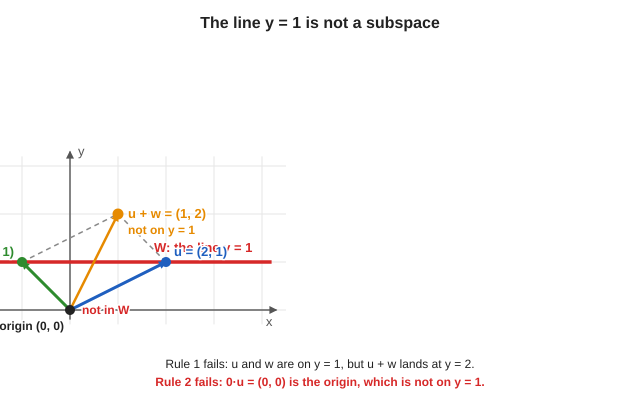

So that shifted line is **not** a subspace.

**Why both rules matter.**

- **Addition** is how we combine movements. If adding two allowed movements could leave the collection, it would not behave like a vector space.
- **Scaling** includes multiplying by $0$ (you get $\mathbf{0}$), by negative numbers (reverse direction), and by complex numbers in $\mathbb{C}^n$. If scaling could kick you out, the collection is not closed.

**Quick checklist.** To show $W$ is a subspace, you do **not** have to list every vector in $W$. You show: whenever inputs lie in $W$, the outputs of **add** and **scale** also lie in $W$. (Section 5.3 explains why scaling by $0$ forces the origin to be in every subspace.)

> **One-line summary:** $W$ is a subspace when it is a part of $V$ that you cannot fall out of by adding or scaling.

## 5.2 Why a plane through the origin passes the test

Take a plane through the origin in 3D. Pick two vectors in the plane and add them. How? **Complete the parallelogram** and take the far corner. That corner stays **inside the plane**, because the whole parallelogram lies in the plane. Now scale one of the vectors by any number: it stays on its line, and that line lies in the plane. So the plane never lets you escape.

In the picture, $\mathbf{u}$ and $\mathbf{w}$ both lie in the blue plane. The dashed sides complete the parallelogram, and the far corner $\mathbf{u}+\mathbf{w}$ is still on the plane. The longer arrow $2\mathbf{u}$ is $\mathbf{u}$ scaled by $2$: it stays on the same line, and that line lies in the plane too.

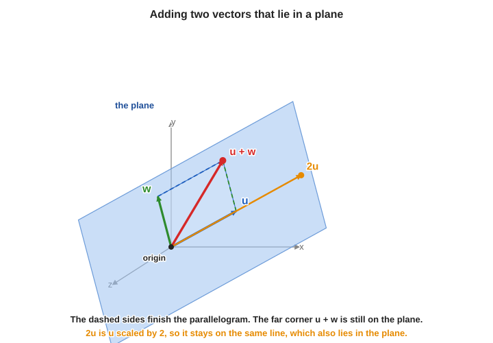

(The picture of the plane in section 4.6 is a good one to keep in mind.)

## 5.3 The origin must always be in a subspace

Pick any vector in the subspace and multiply it by $0$. You get the zero vector, with all coordinates $0$. **So every subspace must contain the origin.** This is *"a mistake people often make."*

The picture below shows a green line versus a red line:

- **Green line (through the origin):** a subspace. Add two points on it and you land on it again.
- **Red line (shifted away from the origin):** **not** a subspace. Take any point on it and multiply by $0$: you land on the origin, but the origin is not on this line.

## 5.4 Every span is a subspace

Another way to think about it: take some vectors and look at their **span** (all linear combinations). What you get is always a subspace. It may not be the whole space, but it is a subspace. *"That's why people use the word subspace."*

- span of one vector: a line through the origin (a 1-dimensional subspace)
- span of two independent vectors in 3D: a plane through the origin (a 2-dimensional subspace)

---

# 6. Linear independence

## 6.1 Start from the picture

Remember the exception in section 4.7: two vectors $\mathbf{v}_1, \mathbf{v}_2$ on a common line. When you take their span, you **do not get the whole space**. The reason: **$\mathbf{v}_2$ is simply a multiple of $\mathbf{v}_1$.** It adds nothing new.

Here are the two situations side by side:

## 6.2 The definition in words

> A set of vectors is **linearly independent** if **none of them can be written in terms of the others.** Otherwise they are **linearly dependent**.

Examples:

- $\mathbf{v}_1 = (1, 2)$ and $\mathbf{v}_2 = (5, 10)$. Since $\mathbf{v}_2 = 5\,\mathbf{v}_1$, one can be expressed in terms of the other, so they are **dependent**.
- Three vectors with $\mathbf{v}_3 = \mathbf{v}_1 + 2\mathbf{v}_2$. Here $\mathbf{v}_3$ is built from the other two, so the set is **dependent**.

**On the floor.**

- $\mathbf{u} = (1, 0)$ and $\mathbf{v} = (0, 1)$: you cannot get northward movement using only east–west steps. Each vector adds something the other cannot. They are **linearly independent**.
- $\mathbf{u} = (1, 0)$ and $\mathbf{w} = (2, 0)$: since $\mathbf{w} = 2\mathbf{u}$, the second direction is redundant. They are **linearly dependent**.

> **Remember:** independent = **no unnecessary vector.** More precisely: no vector in the set can be built as a linear combination of the others.

A reminder: *"You always have to keep a picture in mind. The thing about linear algebra is that if you do not keep a picture in mind, you will get confused."*

## 6.3 Why does a combination of two vectors stay in "their" plane?

*A question from the class: "Why is the span of $\mathbf{v}_1$ and $\mathbf{v}_2$ only the plane through them? Why not the whole 3D space?"*

Take two vectors in 3D: $\mathbf{v}_1 = (1, 0, 0)$ and $\mathbf{v}_2 = (0, 1, 0)$. A general combination is

$$
\alpha_1\,(1, 0, 0) + \alpha_2\,(0, 1, 0) = (\alpha_1,\ \alpha_2,\ 0)
$$

The **third coordinate is always $0$**. So the span is the flat $xy$-plane. It can never reach, for example, the point $(1, 1, 1)$, because there is no choice of $\alpha_1, \alpha_2$ that makes the third coordinate $1$.

*Intuition: any combination of two vectors stays in the plane defined by those two vectors. You never exit that plane.*

## 6.4 Dependent vectors give less than you expect

- Two vectors that lie on a common line: their span is a **line (1 dimension)**, not a plane.
- Three vectors in 3D that all lie in the same plane (say the $xy$-plane): their span is that plane, not 3D. Here one vector can be expressed using the other two, so they are **linearly dependent**.
- Otherwise they are **linearly independent**.

## 6.5 The technical definition (slide)

$\mathbf{v}_1, \dots, \mathbf{v}_k$ are **linearly independent** if

$$
\alpha_1\mathbf{v}_1 + \cdots + \alpha_k\mathbf{v}_k = \mathbf{0} \quad\Longrightarrow\quad \alpha_1 = \cdots = \alpha_k = 0
$$

In words: **the only way to combine them into the zero vector is to take every weight equal to zero.**

Why is this the same as the picture? Two directions:

- **Dependent means a non-trivial way to get zero.** Suppose $\mathbf{v}_2 = 5\,\mathbf{v}_1$. Then $\mathbf{v}_2 - 5\,\mathbf{v}_1 = \mathbf{0}$. We reached zero with weights $1$ and $-5$, which are not both zero. So $\mathbf{v}_1, \mathbf{v}_2$ are not independent.
- **A non-trivial way to get zero means dependent.** Suppose $\alpha_1\mathbf{v}_1 + \alpha_2\mathbf{v}_2 = \mathbf{0}$ with $\alpha_2 \neq 0$. Move terms around:

$$
\mathbf{v}_2 = -\frac{\alpha_1}{\alpha_2}\,\mathbf{v}_1
$$

So $\mathbf{v}_2$ is a multiple of $\mathbf{v}_1$: they are dependent.

In the lecture: *"It's an extremely basic definition, and you have to know what it is saying."*

## 6.6 Each independent vector adds one dimension

The picture to keep in mind:

1. Start with **one** vector. Its span is a **line**.
2. Add a **second** vector that is **not** on that line. Together they span a **plane**.
3. Add a **third** vector that is **not** in that plane. Together they span all of **3D**.

If the third vector *were* in the plane, the three would still only span that plane, and they would be dependent.

*"Each time you add a new vector, you are adding one more dimension."* This can go on to 4, 5, 6 dimensions, but we cannot visualise it. **That is why we need proper definitions:** past 3 dimensions the picture is gone. For example, "6 vectors in 6-dimensional space are independent" means that none of them can be written as, say, $\mathbf{v}_1 = \mathbf{v}_2 + 3\mathbf{v}_3 + 5\mathbf{v}_4 - 6\mathbf{v}_5$.

## 6.7 A complex twist

*Slide: "A Complex Twist".* The warning: *"we are dealing with complex numbers and not real numbers. Always remember this fact. Our intuition will come from real numbers, but when we write down our equations, we will use complex numbers."*

Take

$$
\mathbf{u} = \begin{pmatrix} 1 \\ i \end{pmatrix}, \qquad \mathbf{w} = \begin{pmatrix} i \\ -1 \end{pmatrix}
$$

**Are $\mathbf{u}$ and $\mathbf{w}$ linearly independent?** The question is: can I find a number $\alpha$ with $\mathbf{w} = \alpha\,\mathbf{u}$?

- **Over $\mathbb{R}$ (real scalars only):** no real number works. Multiply $(1, i)$ by $5$, $6$, $10$: you never get $(i, -1)$. So over the reals they are independent.
- **Over $\mathbb{C}$ (complex scalars):** multiply $\mathbf{u}$ by $i$:

$$
i\,\mathbf{u} = \begin{pmatrix} i\cdot 1 \\ i\cdot i \end{pmatrix} = \begin{pmatrix} i \\ i^2 \end{pmatrix} = \begin{pmatrix} i \\ -1 \end{pmatrix} = \mathbf{w}
$$

So $\mathbf{w}$ **is** a multiple of $\mathbf{u}$. Over $\mathbb{C}$ they are **dependent**.

> **Moral (slide).** *"Parallel" in $\mathbb{C}^n$ means "a complex multiple". Vectors that look different can be the same direction.* This is the same phenomenon as **global phase** in quantum computing: $\boldsymbol\psi$ and $e^{i\varphi}\boldsymbol\psi$ point in the same complex direction. (Phases come back in the next lecture.)

In the lecture: *"It is just a sort of a technicality. Usually it will not matter, but you should remember this."* And: *"always in my diagrams I mean a real number, but in reality they have to be complex."*

---

# 7. Basis and dimension

## 7.1 Independence and dimension

If $\mathbf{v}_1, \dots, \mathbf{v}_n$ are **linearly independent**, then the only way to combine them to get $\mathbf{0}$ is with every weight $0$. For example, if $5\mathbf{v}_1 + 6\mathbf{v}_2 + 3\mathbf{v}_3 = \mathbf{0}$ were true, you could write $\mathbf{v}_1 = -\tfrac{6}{5}\mathbf{v}_2 - \tfrac{3}{5}\mathbf{v}_3$, which is not allowed for independent vectors. Another way to say it: the span of $n$ independent vectors is **$n$-dimensional**.

## 7.2 The reverse question: find vectors that span a given space

Now ask the question the other way round. **Start with a space and look for vectors that span it.**

**A line.** Take a line through the origin in the plane (a subspace). Is there a vector whose span is this line? Yes: any single vector $\mathbf{v}$ on the line works, and so does another vector $\mathbf{w}$ on the line. Each of them **is a basis of the line**. A vector $\mathbf{z}$ that points elsewhere is **not**, because its span is a different line.

**The entire plane.** Is there a set of vectors whose span is the whole 2D plane? Yes: two vectors $\mathbf{v}_1, \mathbf{v}_2$ that are not on a common line. They are a **basis of the plane**. There are many such pairs.

**A non-example.** Two vectors $\mathbf{v}_1, \mathbf{v}_2$ on one line: all their combinations stay on that line, so they do not span the plane. *"Two vectors which are linearly dependent will not be a basis of the plane. If they are linearly independent, they will be a basis. That is the main takeaway."*

## 7.3 The definition (slide)

A **basis** of a vector space $V$ is a set of vectors $\mathbf{b}_1, \dots, \mathbf{b}_n$ with **two properties**:

1. **They span $V$.** Every vector in $V$ can be written as a linear combination of $\mathbf{b}_1, \dots, \mathbf{b}_n$.
2. **They are linearly independent.** There is no relation between them: none can be written using the others.

In short: **a basis is a linearly independent set that spans the space.**

**On the floor.** $\{(1, 0), (0, 1)\}$ is a basis because you can reach every point and neither vector is redundant.

| Chosen vectors on the floor | Basis for the plane? | Reason |
|---|---|---|
| $(1, 0)$ only | No | Cannot reach north or south |
| $(1, 0)$, $(2, 0)$ | No | Redundant; span is only the east–west line |
| $(1, 0)$, $(0, 1)$ | Yes | Reach everywhere; no redundancy |
| $(1, 0)$, $(0, 1)$, $(1, 1)$ | No | Third equals first plus second |

> **Remember:** a basis = **enough vectors to reach everywhere, with no extras.**

This will matter *"all the time. The entire course, you will be dealing with basis"*, so make sure the idea is clear.

> **Not the same as orthogonality.** One student asked whether a basis has to be perpendicular. In the lecture: *"It has nothing to do with orthogonality. Let us not confuse things. Orthogonality is a different concept"* (it comes in section 15).

## 7.4 Can a span be a curved shape?

*A question from the class.* The answer is no. Reason: if a vector is in the span, then **every multiple of it is also in the span**. So the span contains the whole line through every point it contains. A curve does not do that. So a span always looks like **a line, a plane, or a higher-dimensional flat piece through the origin**: never a curve. In 5D, a span could be a 3D flat piece, and so on.

## 7.5 Examples of bases in $\mathbb{R}^2$

**Example 1: the standard basis.** $(1, 0)$ and $(0, 1)$.

- *Independent:* $(0, 1)$ is not a multiple of $(1, 0)$.
- *Spans the plane:* any $(x, y) = x\,(1, 0) + y\,(0, 1)$.

**Example 2: another basis.** $(1, 1)$ and $(1, -1)$.

- *Independent:* neither is a multiple of the other.
- *Spans the plane:* we need to find $\alpha, \beta$ with $(x, y) = \alpha\,(1, 1) + \beta\,(1, -1)$. Compare the two coordinates:

$$
\alpha + \beta = x, \qquad \alpha - \beta = y
$$

Add the two equations to get $2\alpha = x + y$. Subtract them to get $2\beta = x - y$. So

$$
\alpha = \frac{x + y}{2}, \qquad \beta = \frac{x - y}{2}
$$

*Check with numbers:* take $(x, y) = (3, 1)$. Then $\alpha = 2$, $\beta = 1$, and $2\,(1, 1) + 1\,(1, -1) = (2 + 1,\ 2 - 1) = (3, 1)$. It works.

So $(1, 1)$ and $(1, -1)$ **form a basis**. Everything here was in $\mathbb{R}^2$; for $\mathbb{C}^2$ the same vectors work with complex weights.

The picture below is the same point $(3, 1)$ written in two ways. On the left, the **basis vectors** are $(1, 0)$ and $(0, 1)$; the **coordinates** are $3$ and $1$ (how many of each you need). On the right, the basis vectors are $(1, 1)$ and $(1, -1)$; the coordinates are $2$ and $1$. The **arrow to $(3, 1)$** is the same vector in both panels; only the basis and the coordinate numbers change.

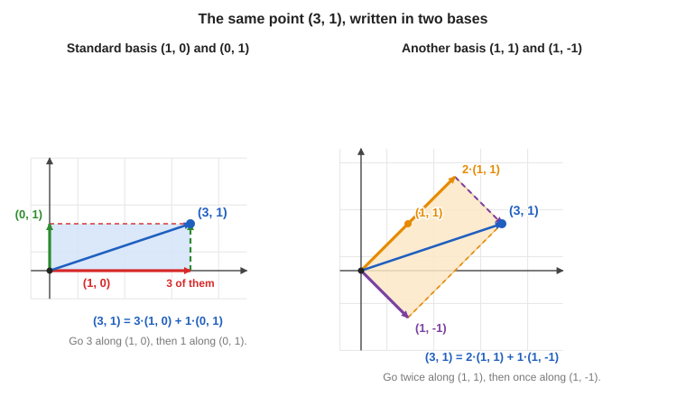

## 7.6 Dimension

If a vector space is a line, a basis has just **one** vector: the example is a line where $\mathbf{v}_1$ and $\mathbf{v}_2$ both lie on it. They span the line, **but they are not a basis**, because on a 1-dimensional line the basis has to have only one vector. So the basis is either just $\mathbf{v}_1$ or just $\mathbf{v}_2$. *"They have to be independent of each other."*

The general fact (slide): **all bases of a space have the same size. That size is the dimension**, written $\dim V$.

> **Dimension = how many basis vectors there are.** A line has dimension 1, a plane has dimension 2, and $\mathbb{C}^n$ has dimension $n$.

**On the floor.**

| Space | Number of basis vectors | Dimension |
|---|---|---|
| East–west line through the origin | 1 | 1 |
| Flat floor (plane) | 2 | 2 |
| Ordinary 3D space | 3 | 3 |

Every basis for the same space has the same number of vectors.

> **Remember:** dimension **counts** the basis vectors.

**The whole story in one line.** In a vector space we form **linear combinations**. All their possible results form a **span**. That span is a **subspace**. If the chosen vectors have no redundancy, they are **independent**. If they also cover the whole space, they form a **basis**. Count the basis vectors to get the **dimension**.

## 7.7 The standard basis of $\mathbb{C}^n$ 

$$
\mathbf{e}_1 = (1, 0, \dots, 0)^T,\ \dots,\ \mathbf{e}_n = (0, \dots, 0, 1)^T, \qquad\text{so}\quad \dim_{\mathbb{C}}\mathbb{C}^n = n
$$

In $\mathbb{C}^2$ we have $\mathbf{e}_1 = \begin{pmatrix}1\\0\end{pmatrix}$ and $\mathbf{e}_2 = \begin{pmatrix}0\\1\end{pmatrix}$, and every vector is

$$
\begin{pmatrix}\alpha\\\beta\end{pmatrix} = \alpha\,\mathbf{e}_1 + \beta\,\mathbf{e}_2
$$

> **Always ask "dimension over which scalars?"** If we only allow *real* scalars, $\mathbb{C}^n$ has dimension $2n$ (real and imaginary parts separately). With complex scalars, it has dimension $n$. This is the same point as the complex twist in section 6.7.

**Qubits (slide).** A qubit's state is exactly such a vector. $\mathbf{e}_1$ and $\mathbf{e}_2$ stand for the classical bit values $0$ and $1$. With $n$ qubits the dimension is $2^n$:

| Qubits $n$ | Dimension $2^n$ |
|---|---|
| 1 | 2 |
| 2 | 4 (the bit strings 00, 01, 10, 11) |
| 10 | 1,024 |
| 50 | about $10^{15}$ |

---

# 8. Coordinates and change of basis

This section is about one idea: **once you fix a basis, every vector has a recipe** (how much of each basis vector to add). The recipe is written as numbers; those numbers are the **coordinates**. The thing that often feels confusing is that **both the basis and the vector you are describing are vectors**. They play different roles.

## 8.1 Three things to keep separate

| What | Symbol (typical) | Is it a vector? | Role |
|---|---|---|---|
| **Basis vectors** | $\mathbf{b}_1$, $\mathbf{b}_2$ (or $\mathbf{e}_1$, $\mathbf{e}_2$) | Yes | Fixed "direction arrows" you agree to use as building blocks. There are **two** of them in the plane. |
| **The vector you are describing** | $\mathbf{v}$ (or a column like $\begin{pmatrix}\alpha\\\beta\end{pmatrix}$) | Yes | **One** object: the point / arrow you care about. |
| **Coordinates** | $\alpha_1$, $\alpha_2$ (or $\alpha$, $\beta$) | **No** — they are **numbers** (scalars) | How much of each basis vector to add. They are **not** basis vectors. |

**Short rule.** Basis vectors are the **ingredients**. The vector $\mathbf{v}$ is the **dish**. Coordinates are the **amounts** in the recipe.

**Analogy (real plane).** Basis vectors might be "one step east" and "one step north". The vector $\mathbf{v}$ is a particular trip from the origin. Coordinates might be $(3, 1)$ meaning: $3$ steps east and $1$ step north. The steps east/north are not the same thing as the numbers $3$ and $1$.

**In $\mathbb{C}^2$.** The same picture works; $\alpha$ and $\beta$ can be **complex** numbers. $\mathbf{e}_1$ and $\mathbf{e}_2$ are still vectors; $\alpha$ and $\beta$ are still just numbers.

## 8.2 Writing every vector in terms of a basis

If $\{\mathbf{b}_1, \mathbf{b}_2\}$ is a **basis** of the plane (section 7), then **every** vector $\mathbf{v}$ in that plane can be written as

$$
\mathbf{v} = \alpha_1\mathbf{b}_1 + \alpha_2\mathbf{b}_2
$$

- $\mathbf{b}_1$ and $\mathbf{b}_2$ are **not** chosen fresh for each $\mathbf{v}$. You fix a basis once (for example $(1,0)$ and $(0,1)$, or $(1,1)$ and $(1,-1)$).
- $\alpha_1$ and $\alpha_2$ **depend on** $\mathbf{v}$. Different vectors need different amounts.

**Example (standard basis).** Take $\mathbf{b}_1 = (1, 0)$, $\mathbf{b}_2 = (0, 1)$ and $\mathbf{v} = (3, 1)$. Then

$$
\mathbf{v} = 3\,(1, 0) + 1\,(0, 1)
$$

So **in this basis** the coordinates of $\mathbf{v}$ are $(3, 1)$. Those numbers are the $\alpha_1$ and $\alpha_2$ in the formula.

**Example (other basis).** Same $\mathbf{v} = (3, 1)$, but now $\mathbf{b}_1 = (1, 1)$, $\mathbf{b}_2 = (1, -1)$. From section 7.5,

$$
\mathbf{v} = 2\,(1, 1) + 1\,(1, -1)
$$

So **in this basis** the coordinates of $\mathbf{v}$ are $(2, 1)$ — not $(3, 1)$. The vector is the same; the coordinate numbers changed because the basis changed (see the figure in section 7.5).

> **Common confusion.** "$(3, 1)$" sometimes means the **vector** (the list in the standard basis) and sometimes people say "the coordinates are $(2, 1)$" in another basis. Always ask: **coordinates in which basis?**

## 8.3 Coordinates are unique (for a fixed basis)

For a **fixed** basis $\mathbf{b}_1, \mathbf{b}_2$, a vector has **exactly one** recipe. It cannot be written in two different ways using the same basis.

Suppose $\mathbf{b}_1, \mathbf{b}_2$ are any two independent vectors in the plane (not on one line). If the same $\mathbf{v}$ could be written as

$$
\mathbf{v} = 5\mathbf{b}_1 + 7\mathbf{b}_2 \qquad\text{and also}\qquad \mathbf{v} = -3\mathbf{b}_1 + 2\mathbf{b}_2,
$$

then subtract one expression from the other:

$$
5\mathbf{b}_1 + 7\mathbf{b}_2 = -3\mathbf{b}_1 + 2\mathbf{b}_2
\;\Longrightarrow\;
8\mathbf{b}_1 = -5\mathbf{b}_2
$$

So $\mathbf{b}_1$ is a multiple of $\mathbf{b}_2$ (move everything to one side: $\mathbf{b}_1 = -\tfrac{5}{8}\mathbf{b}_2$). That means $\mathbf{b}_1$ and $\mathbf{b}_2$ are **linearly dependent** — they do not form a basis. Contradiction.

So for a true basis there is only one pair $(\alpha_1, \alpha_2)$. That pair **is** the coordinates of $\mathbf{v}$ in that basis. In the example above, if the first writing were correct, the coordinates would be $(5, 7)$ and no other pair would work.

**Why independence matters.** Uniqueness of coordinates is exactly why a basis must be **independent** as well as **spanning**. If two basis directions were really the same line, you could swap amounts between them in many ways and the same $\mathbf{v}$ would have many recipes.

## 8.4 Coordinates in the standard basis of $\mathbb{C}^2$

The **standard basis** is the easiest one to write down:

$$
\mathbf{e}_1 = \begin{pmatrix}1\\0\end{pmatrix}, \qquad \mathbf{e}_2 = \begin{pmatrix}0\\1\end{pmatrix}
$$

Take **any** vector written as a column of two complex numbers:

$$
\mathbf{v} = \begin{pmatrix}\alpha\\\beta\end{pmatrix}
$$

Here $\alpha$ and $\beta$ are **scalars** (complex numbers). Expand using $\mathbf{e}_1$ and $\mathbf{e}_2$:

$$
\begin{pmatrix}\alpha\\\beta\end{pmatrix}
= \alpha \begin{pmatrix}1\\0\end{pmatrix} + \beta \begin{pmatrix}0\\1\end{pmatrix}
= \alpha\,\mathbf{e}_1 + \beta\,\mathbf{e}_2
$$

**How to read this without mixing things up.**

| Object | In this example |
|---|---|
| Basis vectors | $\mathbf{e}_1$, $\mathbf{e}_2$ (the columns with a $1$ in one row and $0$ in the other) |
| The vector | $\mathbf{v} = \begin{pmatrix}\alpha\\\beta\end{pmatrix}$ — one column |
| Coordinates **in** $\{\mathbf{e}_1, \mathbf{e}_2\}$ | $(\alpha, \beta)$ — the same two numbers that appear **inside** the column |

So in the standard basis, "the entries of the column" and "the coordinates" are the **same** thing. That is why the standard basis feels so natural.

**Qubits (same slide as section 7.7).** A one-qubit state is a vector in $\mathbb{C}^2$ of this form. We write it as $\alpha\,\mathbf{e}_1 + \beta\,\mathbf{e}_2$. The basis vectors $\mathbf{e}_1$ and $\mathbf{e}_2$ are associated with classical bit values $0$ and $1$. The numbers $\alpha$ and $\beta$ are amplitudes (coordinates in this basis), not separate vectors. With $n$ qubits, the space has dimension $2^n$ over $\mathbb{C}$ (see the table in section 7.7).

**If you use another basis** (for example $\mathbf{h}_+, \mathbf{h}_-$ in the next section), the **same** $\mathbf{v}$ is still one column, but the coordinate pair $(\alpha_1, \alpha_2)$ in that new basis is usually **different** from $(\alpha, \beta)$. The vector does not change; the recipe changes.

## 8.5 A second basis: $\mathbf{h}_+$ and $\mathbf{h}_-$

Here is another basis of $\mathbb{C}^2$:

$$
\mathbf{h}_+ = \frac{1}{\sqrt2}\begin{pmatrix}1\\1\end{pmatrix}, \qquad \mathbf{h}_- = \frac{1}{\sqrt2}\begin{pmatrix}1\\-1\end{pmatrix}
$$

(On the board they are called $H_1, H_2$.)

**Why a basis?**

- They are **independent**: you can check that neither is a multiple of the other.
- They **span** $\mathbb{C}^2$: from section 7.5, every vector can be written with $(1, 1)$ and $(1, -1)$. Putting a factor $\tfrac{1}{\sqrt2}$ in front only changes the weights, not the span.

**Why the $\tfrac{1}{\sqrt 2}$?** *"It is a bit mysterious, so I will come back to that"* (section 13): it makes each vector have **length 1**.

**Coordinates of $(\alpha, \beta)$ in the Hadamard basis.** We want scalars $a_+$ and $a_-$ (not bold — these are coordinates, not vectors) with

$$
\begin{pmatrix}\alpha\\\beta\end{pmatrix} = a_+\,\frac{1}{\sqrt2}\begin{pmatrix}1\\1\end{pmatrix} + a_-\,\frac{1}{\sqrt2}\begin{pmatrix}1\\-1\end{pmatrix}
$$

Compare the first and second entries:

$$
\frac{a_+ + a_-}{\sqrt2} = \alpha, \qquad \frac{a_+ - a_-}{\sqrt2} = \beta
$$

Add: $\dfrac{2a_+}{\sqrt2} = \alpha + \beta$, so $a_+ = \dfrac{\alpha + \beta}{\sqrt2}$ (because $\dfrac{2}{\sqrt2} = \sqrt2$). Subtract: $a_- = \dfrac{\alpha - \beta}{\sqrt2}$. So

$$
\boxed{\ (a_+, a_-) = \left(\frac{\alpha + \beta}{\sqrt2},\ \frac{\alpha - \beta}{\sqrt2}\right)\ }
$$

## 8.6 The picture: same point, different coordinates

Sections 8.1–8.2 said: fix a basis, then every vector has a **recipe** (how much of each basis arrow to add). The numbers in that recipe are the **coordinates**. This section is the **geometry** of that idea: one fixed arrow $P$ from the origin, two different bases, two different recipes.

### One point, two ways to describe it

Work in the real plane $\mathbb{R}^2$ (the floor cartoon). Let $P$ be the point with **standard** coordinates $(4, 3)$ — meaning the column $\begin{pmatrix}4\\3\end{pmatrix}$ if we use $\mathbf{e}_1, \mathbf{e}_2$.

**Step 1 — read $(4, 3)$ in the standard basis $\{\mathbf{e}_1, \mathbf{e}_2\}$.**

- $\mathbf{e}_1 = (1, 0)$ is one unit along the $x$-axis; $\mathbf{e}_2 = (0, 1)$ is one unit along the $y$-axis.
- From the origin, go $4$ steps along $\mathbf{e}_1$ and $3$ steps along $\mathbf{e}_2$. You land on $P$.
- On the graph, the usual trick works because the axes are perpendicular: drop a vertical line from $P$ to the $x$-axis — you hit $x = 4$. Drop a horizontal line to the $y$-axis — you hit $y = 3$.

So the recipe in the **standard** basis is

$$
P = 4\mathbf{e}_1 + 3\mathbf{e}_2.
$$

The coordinate pair **in** $\{\mathbf{e}_1, \mathbf{e}_2\}$ is $(4, 3)$: first number = how much $\mathbf{e}_1$, second = how much $\mathbf{e}_2$ (section 8.1).

**Step 2 — keep $P$ fixed, change only the basis.**

Now agree on a **different** pair of building blocks (still a basis of the plane):

$$
\mathbf{b}_1 = (3, 1), \qquad \mathbf{b}_2 = (1, 2).
$$

These are two ordinary vectors from the origin — not perpendicular, not unit length. They point in new directions, but they still **span** the plane (they are not multiples of each other).

**Step 3 — find the new recipe for the same $P$.**

Add the basis vectors once each:

$$
\mathbf{b}_1 + \mathbf{b}_2 = (3, 1) + (1, 2) = (4, 3).
$$

That is exactly $P$. So we do **not** need four of $\mathbf{e}_1$ and three of $\mathbf{e}_2$ anymore; in the new basis we need **one** of each block:

$$
P = (4, 3) = 1\,\mathbf{b}_1 + 1\,\mathbf{b}_2.
$$

| Basis used | Recipe for the vector $P$ | Coordinates of $P$ in that basis |
|---|---|---|
| $\mathbf{e}_1, \mathbf{e}_2$ | $4\mathbf{e}_1 + 3\mathbf{e}_2$ | $(4, 3)$ |
| $\mathbf{b}_1, \mathbf{b}_2$ | $1\mathbf{b}_1 + 1\mathbf{b}_2$ | $(1, 1)$ |

**The arrow stays in the same place. The recipe changes.**

$P$ is still the same tip of the blue arrow in the figure. Nothing moved on the floor. What changed is **which directions you count in** and **how many steps along each**. Writing “coordinates $(1, 1)$ in $\{\mathbf{b}_1, \mathbf{b}_2\}$” means: **one** $\mathbf{b}_1$ plus **one** $\mathbf{b}_2$ — not “$1$ along $x$ and $1$ along $y$”. The first slot is always “how much $\mathbf{b}_1$”; the second is “how much $\mathbf{b}_2$”.

> **Coordinates tell you how to combine the basis vectors.** Change the basis and the coordinate numbers change; the vector $P$ does not.

### How the right-hand panel of the picture works

The left panel uses perpendiculars to $x$ and $y$ because $\mathbf{e}_1$ and $\mathbf{e}_2$ are axis-aligned. The right panel uses the **parallelogram rule** for the new basis.

1. Draw $\mathbf{b}_1$ from the origin (orange). Draw $\mathbf{b}_2$ from the origin (green). Both tips lie on lines through the origin — those lines are the “new axes”, even though they are skewed.
2. To build $1\mathbf{b}_1 + 1\mathbf{b}_2$, walk along $\mathbf{b}_1$, then along a copy of $\mathbf{b}_2$ placed at the tip of $\mathbf{b}_1$ (or the other order). The far corner of that parallelogram is $P$.
3. To **read off** coordinates $(c_1, c_2)$ in $\{\mathbf{b}_1, \mathbf{b}_2\}$ for **any** point: draw lines through $P$ **parallel** to $\mathbf{b}_2$ until they meet the line through the origin along $\mathbf{b}_1$ — that meeting point tells you $c_1\mathbf{b}_1$. Similarly, lines parallel to $\mathbf{b}_1$ meet the $\mathbf{b}_2$-line and give $c_2\mathbf{b}_2$. For our $P$, both weights come out $1$, so $(c_1, c_2) = (1, 1)$.

The dashed gray segments in the figure are those parallel lines: they show that $P$ is reached by one $\mathbf{b}_1$-step and one $\mathbf{b}_2$-step from the origin.

### Same numbers, algebraically (optional check)

If $P = c_1\mathbf{b}_1 + c_2\mathbf{b}_2$ with $\mathbf{b}_1 = (3,1)$ and $\mathbf{b}_2 = (1,2)$, then

$$
c_1\begin{pmatrix}3\\1\end{pmatrix} + c_2\begin{pmatrix}1\\2\end{pmatrix} = \begin{pmatrix}4\\3\end{pmatrix}
\quad\Longrightarrow\quad
\begin{cases}
3c_1 + c_2 = 4 \\
c_1 + 2c_2 = 3
\end{cases}
$$

Subtract or substitute: $c_1 = 1$, $c_2 = 1$. That matches the table and the picture.

**Takeaway.** $(4, 3)$ and $(1, 1)$ are **not** two different points. They are two **labels** for the same vector $P$, measured against two different bases. Always ask: coordinates **in which basis?** (Section 8.2.)

## 8.7 What happens to $\mathbf{e}_1$ and $\mathbf{e}_2$ in the new basis

Take $\mathbf{e}_1 = (1, 0)$. In the old basis, its coordinates were $(1, 0)$, since $\mathbf{e}_1 = 1\cdot\mathbf{e}_1 + 0\cdot\mathbf{e}_2$. In the basis $\{\mathbf{h}_+, \mathbf{h}_-\}$, use the formula from section 8.5 with $(\alpha, \beta) = (1, 0)$:

$$
\left(\frac{1 + 0}{\sqrt2},\ \frac{1 - 0}{\sqrt2}\right) = \left(\frac{1}{\sqrt2},\ \frac{1}{\sqrt2}\right)
$$

Check by adding up the new basis vectors:

$$
\frac{1}{\sqrt2}\mathbf{h}_+ + \frac{1}{\sqrt2}\mathbf{h}_- = \frac{1}{\sqrt2}\cdot\frac{1}{\sqrt2}\begin{pmatrix}1\\1\end{pmatrix} + \frac{1}{\sqrt2}\cdot\frac{1}{\sqrt2}\begin{pmatrix}1\\-1\end{pmatrix} = \frac12\begin{pmatrix}2\\0\end{pmatrix} = \begin{pmatrix}1\\0\end{pmatrix} = \mathbf{e}_1
$$

For $\mathbf{e}_2 = (0, 1)$ we get coordinates $\left(\dfrac{1}{\sqrt2}, -\dfrac{1}{\sqrt2}\right)$. In summary (this is the slide's summary):

$$
\mathbf{e}_1 = \frac{1}{\sqrt2}\left(\mathbf{h}_+ + \mathbf{h}_-\right), \qquad \mathbf{e}_2 = \frac{1}{\sqrt2}\left(\mathbf{h}_+ - \mathbf{h}_-\right)
$$

*In the picture the entries happen to be real, so it can be drawn. This is the "real cartoon".* The two blue and purple arrows are perpendicular to each other and both have length 1. The red arrow $\mathbf{e}_1$ is the diagonal of the dashed parallelogram built from $\tfrac{1}{\sqrt2}\mathbf{h}_+$ and $\tfrac{1}{\sqrt2}\mathbf{h}_-$.

## 8.8 Try it: the vector $(2, 4i)$

The example (it is also a slide problem): how do you write $(2, 4i)$ in the basis $\{\mathbf{e}_1, \mathbf{e}_2\}$? *"Very simple."*

$$
\begin{pmatrix}2\\4i\end{pmatrix} = 2\,\mathbf{e}_1 + 4i\,\mathbf{e}_2
$$

So the coordinates are $(2, 4i)$.

Then we find its coordinates in $\{\mathbf{h}_+, \mathbf{h}_-\}$. Use the boxed formula with $\alpha = 2$ and $\beta = 4i$:

$$
\left(\frac{2 + 4i}{\sqrt2},\ \frac{2 - 4i}{\sqrt2}\right)
$$

*Check the first entry:* $\dfrac{1}{\sqrt2}\left(\dfrac{2 + 4i}{\sqrt2} + \dfrac{2 - 4i}{\sqrt2}\right) = \dfrac{1}{\sqrt2}\cdot\dfrac{4}{\sqrt2} = 2$. ✓ *Second entry:* $\dfrac{1}{\sqrt2}\left(\dfrac{2 + 4i}{\sqrt2} - \dfrac{2 - 4i}{\sqrt2}\right) = \dfrac{1}{\sqrt2}\cdot\dfrac{8i}{\sqrt2} = 4i$. ✓

## 8.9 The first summary (recap of this half)

- A vector space can be thought of as **a list (column) of complex numbers**.
- **Span:** take some vectors and try out all ways of combining them: $\alpha_1\mathbf{v}_1 + \cdots + \alpha_n\mathbf{v}_n$ ("multiply them by some numbers and add them").
- Why it matters for quantum: *a qubit will turn out to be a linear combination of the classical bits.* Span comes up right away in the next lecture.
- **Independence:** none can be expressed using the others. **Why important?** (1) It lets us define a **basis**. (2) It guarantees that **there is only one way** of writing a vector in terms of a basis. Otherwise it would be very confusing: "if I say the coordinates of this vector are $(1, 0)$ and also $(2, 3)$, that would be very confusing." Linear independence stops that from happening.

For a one-page **memory map** of vector space, span, basis, coordinates, and the rest, see **section 9**.

---

# 9. Core ideas at a glance

After sections 3–8, these eight ideas fit together. Use this table as a **memory map** before practice problems and the inner-product half of the lecture. Details and proofs are in the sections cited in the last column.

| Concept | Easy way to remember | Small example | Where in these notes |
|---|---|---|---|
| **Vector space** | A world where adding and scaling work. | All real vectors $(x,y)$ form a vector space: adding or scaling them gives another vector in the plane. | §3 |
| **Linear combination** | Multiply, then add. | $2(1,0)+3(0,1)=(2,3)$. | §4.2 |
| **Span** | Everywhere your chosen vectors can take you. | The span of $(1,0)$ is the entire horizontal axis: all $(a,0)$, where $a$ is real. | §4.3 |
| **Subspace** | A vector space inside a bigger vector space. | The horizontal axis is a subspace of the plane. Adding and scaling its vectors keeps you on that axis. | §5 |
| **Linear independence** | No unnecessary vector. | $(1,0)$ and $(0,1)$ are independent: neither can be made by scaling the other. | §6 |
| **Basis** | Enough to reach everywhere, with none redundant. | $\{(1,0),(0,1)\}$ is a basis for the plane: every $(x,y)=x(1,0)+y(0,1)$. | §7 |
| **Dimension** | How many vectors are in a basis. | The plane has dimension **2**, because its basis contains **2 vectors**. | §7.6 |
| **Coordinates** | How much of each basis vector to use. | If $\mathbf{u}=(1,1)$ and $\mathbf{v}=(1,-1)$, then $(5,3)=4\mathbf{u}+1\mathbf{v}$. Its coordinates in the ordered basis $(\mathbf{u},\mathbf{v})$ are **$(4,1)$**. | §8 |

> **Same arrow, different recipes.** Coordinates are always relative to a **chosen basis**. The standard column $(5,3)$ is one recipe; $(4,1)$ in the basis $\{\mathbf{u},\mathbf{v}\}$ is another recipe for the same point in the plane (see §8.6).

---

# 10. Questions before the break

There is nothing to submit right now. We should try the slide problems and come prepared. When a graded assignment is given, the deadline will be announced.

## 10.1 Practice: basis problems (slide "Problems")

Try these first, then check the solutions.

1. Is $\left\{\begin{pmatrix}1\\1\end{pmatrix}, \begin{pmatrix}1\\-1\end{pmatrix}\right\}$ a basis of $\mathbb{C}^2$?
2. Are $\begin{pmatrix}1\\i\end{pmatrix}$ and $\begin{pmatrix}-i\\1\end{pmatrix}$ independent over $\mathbb{C}$?
3. Write $\begin{pmatrix}2\\4i\end{pmatrix}$ using $\mathbf{e}_1, \mathbf{e}_2$.
4. Write $\mathbf{e}_2$ in the basis $\{\mathbf{h}_+, \mathbf{h}_-\}$ "without peeking".

**Solutions (from the slides, with extra steps).**

1. **Yes.** Suppose $a\,(1, 1)^T + b\,(1, -1)^T = \mathbf{0}$. The two entries give $a + b = 0$ and $a - b = 0$. Adding gives $a = 0$, and then $b = 0$. So they are independent. In a 2-dimensional space, two independent vectors form a basis.
2. **No.** $(-i)\cdot(1, i)^T = (-i,\ -i\cdot i)^T = (-i,\ -i^2)^T = (-i,\ 1)^T$. The second vector is $-i$ times the first, so they are dependent.
3. $2\,\mathbf{e}_1 + 4i\,\mathbf{e}_2$.
4. Solve $\mathbf{e}_2 = a\,\mathbf{h}_+ + b\,\mathbf{h}_-$. The first entry gives $\tfrac{1}{\sqrt2}(a + b) = 0$ and the second gives $\tfrac{1}{\sqrt2}(a - b) = 1$. So $a = \tfrac{1}{\sqrt2}$ and $b = -\tfrac{1}{\sqrt2}$. Hence $\mathbf{e}_2 = \tfrac{1}{\sqrt2}(\mathbf{h}_+ - \mathbf{h}_-)$. *(Solving a linear system works, but it is slow. After inner products, in section 16, we will read the coordinates off in one step.)*

## 10.2 Questions from the class

**"Why did you multiply by $\tfrac{1}{\sqrt2}$?"** Wait for section 13: it makes the length 1.

**"Proving that something is a basis is much harder than proving it is not."** True. To show that $\mathbf{v}_1, \mathbf{v}_2, \mathbf{v}_3$ are **not** a basis, you just need one dependence, for example $\mathbf{v}_1 = 2\mathbf{v}_2 + \mathbf{v}_3$. To show that they **are** a basis, you must show two things:

1. If $\alpha_1\mathbf{v}_1 + \alpha_2\mathbf{v}_2 + \alpha_3\mathbf{v}_3 = \mathbf{0}$, then the only solution is $\alpha_1 = \alpha_2 = \alpha_3 = 0$ (independence).
2. Every vector can be written as a combination of them (spanning).

**Are there shortcuts?** Yes. *If you know the dimension of the space, you only need to check one of the two conditions.*

- In 2D, any basis has exactly two vectors. If you show two vectors are independent, they automatically span, so they are a basis.
- In 3D: three vectors that span 3D are automatically independent, and three independent vectors automatically span 3D.

**"Any subspace of a vector space with the same dimension as the space..."** (the question is garbled, but the answer is: absolutely.) A subspace with the *same* dimension as the whole space is the whole space.

**"Is changing the basis a linear transformation?"** It is *one example* of one. Linear transformations are more general than changing basis, as you will see when matrices come.

**"Is a basis a subset of vectors that span the $n$-dimensional space?"** Yes. If a space has dimension $n$, any basis has exactly $n$ vectors. But the vectors must be independent: for a line, $\mathbf{v}_1$ and $\mathbf{v}_2$ on the line span it, yet they are not a basis, because a line needs only one.

**"Why use real vectors for the basis with complex coordinates?"** The examples are drawn with real numbers. In the course itself we only deal with complex numbers.

---
# 11. The dot product (real numbers)

Back to **high-school maths**. The dot product takes **two vectors** and gives you **one number**.

## 11.1 The formula

If $\mathbf{u} = (u_1, u_2)$ and $\mathbf{v} = (v_1, v_2)$, then

$$
\mathbf{u}\cdot\mathbf{v} = u_1 v_1 + u_2 v_2 \qquad\text{(in general } \textstyle\sum_j u_j v_j\text{)}
$$

**Example from the lecture.** $\mathbf{u} = (5, 1)$ and $\mathbf{v} = (3, 7)$:

$$
\mathbf{u}\cdot\mathbf{v} = 5\cdot 3 + 1\cdot 7 = 15 + 7 = 22
$$

It is just a number. What does that number mean?

## 11.2 The picture: length times length times cosine

### What $\lVert\mathbf{u}\rVert$ and $\lVert\mathbf{v}\rVert$ mean

The double bars $\lVert\cdot\rVert$ mean **length** (also called the **norm**) of a vector. Think of the arrow from the origin to the point: $\lVert\mathbf{u}\rVert$ is how long that arrow is — the straight-line distance from the tip back to the origin. The same for $\lVert\mathbf{v}\rVert$ and $\mathbf{v}$.

> **Single bars** $\lvert z\rvert$ usually mean the **size of a number** (a scalar). **Double bars** $\lVert\mathbf{u}\rVert$ usually mean the **size of a vector**.

| Symbol | Reads as | Meaning |
|---|---|---|
| $\lVert\mathbf{u}\rVert$ | "norm of $\mathbf{u}$" or "length of $\mathbf{u}$" | Size of the arrow $\mathbf{u}$ |
| $\lVert\mathbf{v}\rVert$ | "norm of $\mathbf{v}$" or "length of $\mathbf{v}$" | Size of the arrow $\mathbf{v}$ |

**Example of the single-bar rule:** $\lvert u_1\rvert$ is the absolute value of one **entry** of $\mathbf{u}$, not the length of the whole vector $\lVert\mathbf{u}\rVert$.

**Real plane, from coordinates.** If $\mathbf{u} = (u_1, u_2)$ in $\mathbb{R}^2$, the length comes from the Pythagorean theorem on the horizontal and vertical steps:

$$
\lVert\mathbf{u}\rVert = \sqrt{u_1^2 + u_2^2}.
$$

For the vectors in section 11.1, $\mathbf{u} = (5, 1)$ and $\mathbf{v} = (3, 7)$:

$$
\lVert\mathbf{u}\rVert = \sqrt{5^2 + 1^2} = \sqrt{26}, \qquad
\lVert\mathbf{v}\rVert = \sqrt{3^2 + 7^2} = \sqrt{58}.
$$

Those are just numbers (about $5.1$ and $7.6$). They are **not** vectors — they measure how far each arrow reaches.

**Same idea as "length squared" from the dot product.** When a vector is dotted with itself, $\mathbf{u}\cdot\mathbf{u} = u_1^2 + u_2^2 = \lVert\mathbf{u}\rVert^2$. So the norm is the square root of that sum. Section 12 gives the full definition for complex vectors too ($\lVert\mathbf{v}\rVert = \sqrt{\lvert v_1\rvert^2 + \cdots}$).

### The geometric formula

If $\theta$ is the angle between $\mathbf{u}$ and $\mathbf{v}$, then

$$
\mathbf{u}\cdot\mathbf{v} = \lVert\mathbf{u}\rVert\,\lVert\mathbf{v}\rVert\,\cos\theta
$$

In words: the dot product is **(length of $\mathbf{u}$) $\times$ (length of $\mathbf{v}$) $\times$ (cosine of the angle between them)**. Two long arrows that point nearly the same way give a large positive dot product; two long arrows at right angles give $0$ because $\cos 90^\circ = 0$.

Another way to see it: **project $\mathbf{u}$ onto the line that $\mathbf{v}$ spans** (drop a perpendicular from the tip of $\mathbf{u}$ onto that line). The green piece in the picture below has length $\lVert\mathbf{u}\rVert\cos\theta$. Why? Recall from trigonometry: in a right-angled triangle with hypotenuse $r$ and the side next to the angle $a$, $\cos\theta = a/r$, so $a = r\cos\theta$. Here $r$ is $\lVert\mathbf{u}\rVert$ and $a$ is the green length. The dot product is that **projection length times the length of $\mathbf{v}$**.

This is exactly **cosine similarity**, as used in vector retrieval (searching for similar items).

## 11.3 What the dot product gives you

| You want | Use | Why |
|---|---|---|
| **Length** | $\lVert\mathbf{v}\rVert^2 = \mathbf{v}\cdot\mathbf{v}$ | with $\theta = 0$, $\cos 0 = 1$, so $\mathbf{v}\cdot\mathbf{v} = \lVert\mathbf{v}\rVert^2$. In coordinates: $v_1^2 + \cdots + v_n^2$ |
| **Angle** | $\cos\theta = \dfrac{\mathbf{u}\cdot\mathbf{v}}{\lVert\mathbf{u}\rVert\lVert\mathbf{v}\rVert}$ | rearrange the formula above |
| **Perpendicular?** | $\mathbf{u}\cdot\mathbf{v} = 0$ | $\cos 90^\circ = 0$ |

The slide says: *"Goal: the same toolkit for $\mathbb{C}^n$. In QC it will also give probabilities."* (When a student asked "how does the dot product give probability?", the reply was: not yet, probability shows up "five slides down the line", after we meet qubits.)

## 11.4 Perpendicular non-zero vectors are independent

This is a nice use of the dot product. Let $\mathbf{u}$ and $\mathbf{v}$ be **non-zero** vectors with $\mathbf{u}\cdot\mathbf{v} = 0$. Claim: they are linearly independent.

*Proof.* Suppose $\alpha_1\mathbf{u} + \alpha_2\mathbf{v} = \mathbf{0}$. Take the dot product of both sides with $\mathbf{u}$:

$$
\alpha_1\,(\mathbf{u}\cdot\mathbf{u}) + \alpha_2\,(\mathbf{v}\cdot\mathbf{u}) = 0
$$

Since $\mathbf{u}\perp\mathbf{v}$, the second term is $0$. So $\alpha_1\,(\mathbf{u}\cdot\mathbf{u}) = 0$. Now $\mathbf{u}\cdot\mathbf{u} = \lVert\mathbf{u}\rVert^2 \neq 0$ (because $\mathbf{u}\neq\mathbf{0}$), so $\alpha_1 = 0$. In the same way (dot with $\mathbf{v}$) we get $\alpha_2 = 0$. Both weights are zero, so the vectors are independent. $\blacksquare$

Consequences:

- Three vectors that are all perpendicular to each other are independent.
- **An easy way to build a basis:** in $\mathbb{R}^2$, take one vector and another one perpendicular to it. They are automatically independent, so they form a basis. In 3D, three mutually perpendicular vectors form a basis.

*"That is why the dot product is so useful: it gives you an instant way of checking if vectors are independent."*

---

# 12. The complex inner product

## 12.1 The question: does the same definition work?

We want to keep the nice property that the dot product of a vector with itself gives **the length squared**, a real, non-negative number. In the real case $\mathbf{v}\cdot\mathbf{v} = v_1^2 + v_2^2 + \cdots$.

For a **complex** vector $\mathbf{v} = (v_1, \dots, v_n)$ the length squared should be

$$
\lvert v_1\rvert^2 + \lvert v_2\rvert^2 + \cdots + \lvert v_n\rvert^2
$$

For example, the vector $(1 + i,\ 2)$ has length $\sqrt{\lvert 1 + i\rvert^2 + 2^2} = \sqrt{2 + 4} = \sqrt6$.

But if we copied the real formula, $\mathbf{v}\cdot\mathbf{v} = v_1^2 + v_2^2 + \cdots$, we would get $v_1^2 + \cdots$, **not** $\lvert v_1\rvert^2 + \cdots$. For complex numbers these are different:

- $v_1 = 1 + i$: $\quad v_1^2 = (1 + i)^2 = 1 + 2i + i^2 = \mathbf{2i}$ (a complex number).
- $\lvert v_1\rvert^2 = 1^2 + 1^2 = \mathbf{2}$ (a real number).

In the picture, $z^2 = 2i$ is on the imaginary axis, whereas $\lvert z\rvert^2 = 2$ is a plain length-squared on the real axis:

## 12.2 A disaster with the old formula (slide)

Try the naive formula $\sum_j v_j v_j$ on the vector $\mathbf{v} = \begin{pmatrix}1\\ i\end{pmatrix}$:

$$
1\cdot 1 + i\cdot i = 1 + (-1) = 0
$$

A **non-zero** vector with "length" zero. In the lecture: *"We would be in a very strange situation where $\mathbf{v}\cdot\mathbf{v}$ will be 0, but $\mathbf{v}$ is not a zero vector. I don't want this."*

## 12.3 The fix: conjugate one of the vectors

Recall from complex numbers: **a complex number times its conjugate is its modulus squared**, $z\,\overline{z} = \lvert z\rvert^2 \ge 0$. So instead of multiplying $v_j$ by $v_j$, multiply $v_j$ by its **conjugate** $\overline{v_j}$. Redo the example:

$$
\overline{1}\cdot 1 + \overline{i}\cdot i = 1\cdot 1 + (-i)\cdot i = 1 + 1 = 2 > 0
$$

The key point (slide): *$\overline{z}z = \lvert z\rvert^2 \ge 0$ is what makes lengths real and positive. This is why the complex inner product carries conjugates.*

## 12.4 The conjugate transpose $\mathbf{v}^\dagger$

Two ingredients:

1. **Conjugate** every entry of the vector. For $\mathbf{v}$, take each entry and flip the sign of its imaginary part.
2. **Transpose:** turn the column into a row. *"Why do I want a row? Because I want to use the rules of matrix multiplication."*

Doing both gives the **conjugate transpose**, written $\mathbf{v}^\dagger$ ("$\mathbf{v}$ dagger", slide mnemonic: *dagger = flip and conjugate*). For a column vector $\mathbf{v}$, $\mathbf{v}^\dagger$ is a row of conjugated entries:

$$
\mathbf{v} = \begin{pmatrix}v_1\\ \vdots\\ v_n\end{pmatrix}\ \longmapsto\ \mathbf{v}^\dagger = \overline{\mathbf{v}}^{\,T} = \begin{pmatrix}\overline{v_1} & \cdots & \overline{v_n}\end{pmatrix}
$$

**Example (slide).**

$$
\mathbf{v} = \begin{pmatrix}1 + i\\ 2i\end{pmatrix} \quad\Rightarrow\quad \mathbf{v}^\dagger = \begin{pmatrix}1 - i & -2i\end{pmatrix}
$$

Books may write $\mathbf{v}^*$ or $\mathbf{v}^H$ for the same thing.

**What about a scalar?** If you multiply by $\alpha$ and then take the dagger, the scalar gets conjugated as well:

$$
(\alpha\mathbf{v})^\dagger = \overline{\alpha}\,\mathbf{v}^\dagger
$$

In the lecture: *"conjugate of $\alpha\mathbf{v}$ is the conjugate of $\alpha$ times the conjugate of $\mathbf{v}$."*

## 12.5 The definition of the inner product (slide)

$$
\boxed{\ \langle\mathbf{u}, \mathbf{v}\rangle = \mathbf{u}^\dagger\mathbf{v} = \sum_{j=1}^{n}\overline{u_j}\,v_j\ }
$$

**Conjugate the first vector, not the second.** (People often make mistakes here.)

**Why a row times a column?** A $1\times n$ matrix (the row $\mathbf{u}^\dagger$) times an $n\times 1$ matrix (the column $\mathbf{v}$) gives a $1\times 1$ matrix, which is a single number. It is a fancy way of writing the sum $\overline{u_1}v_1 + \overline{u_2}v_2 + \cdots$.

Two things to note:

- "Dot product" is often said when the **inner product** is meant. The slides call it the inner product. They are the same idea (with conjugates for complex vectors).
- With this definition, $\langle\mathbf{v}, \mathbf{v}\rangle = \overline{v_1}v_1 + \cdots + \overline{v_n}v_n = \lvert v_1\rvert^2 + \cdots + \lvert v_n\rvert^2$, exactly the length squared we wanted.

**Example 1 (slide).** $\mathbf{u} = \begin{pmatrix}1\\ i\end{pmatrix}$ and $\mathbf{v} = \begin{pmatrix}i\\ 1\end{pmatrix}$. We compute $\langle\mathbf{u}, \mathbf{v}\rangle$ slowly, **conjugate first** (always the **first** vector in the brackets).

**Step 0 — what “conjugate” means on one number.**

A complex number is $z = a + bi$ with real $a, b$. Its **complex conjugate** $\overline{z}$ keeps the real part and flips the sign of the imaginary part:

$$
\overline{a + bi} = a - bi.
$$

Examples you need here:

| $z$ | $\overline{z}$ | Why |
|---|---|---|
| $1$ | $1$ | Purely real: nothing to flip |
| $i$ | $-i$ | $i = 0 + 1\cdot i$, so $\overline{i} = 0 - 1\cdot i = -i$ |
| $-i$ | $i$ | Same rule |

Useful check: $\overline{z}\,z = \lvert z\rvert^2$ (a **real** number $\ge 0$). For $z = i$: $(-i)\cdot i = -i^2 = 1$.

**Step 1 — write the definition with coordinates.**

$\mathbf{u}$ has entries $u_1 = 1$, $u_2 = i$. $\mathbf{v}$ has $v_1 = i$, $v_2 = 1$. The rule is **conjugate the $u$’s, multiply by the matching $v$’s, add**:

$$
\langle\mathbf{u}, \mathbf{v}\rangle = \overline{u_1}\,v_1 + \overline{u_2}\,v_2 = \overline{1}\cdot i + \overline{i}\cdot 1.
$$

Nothing is conjugated in $\mathbf{v}$ in this formula. If you accidentally conjugate both vectors, or conjugate $\mathbf{v}$ instead of $\mathbf{u}$, you get a different (wrong) answer.

**Step 2 — conjugate each entry of $\mathbf{u}$ (first vector only).**

$$
\overline{u_1} = \overline{1} = 1, \qquad \overline{u_2} = \overline{i} = -i.
$$

So the sum becomes

$$
\langle\mathbf{u}, \mathbf{v}\rangle = (1)\cdot i + (-i)\cdot 1.
$$

**Step 3 — multiply and add.**

- First term: $1\cdot i = i$.
- Second term: $(-i)\cdot 1 = -i$.
- Total: $i + (-i) = 0$.

$$
\boxed{\ \langle\mathbf{u}, \mathbf{v}\rangle = 0\ }
$$

**Same calculation with $\mathbf{u}^\dagger$ (row) times $\mathbf{v}$ (column).**

Turn $\mathbf{u}$ into a row of conjugated entries (section 12.4):

$$
\mathbf{u}^\dagger = \begin{pmatrix}\overline{1} & \overline{i}\end{pmatrix} = \begin{pmatrix}1 & -i\end{pmatrix}.
$$

Matrix multiply (row $\times$ column):

$$
\mathbf{u}^\dagger\mathbf{v}
= \begin{pmatrix}1 & -i\end{pmatrix}\begin{pmatrix}i\\ 1\end{pmatrix}
= 1\cdot i + (-i)\cdot 1 = 0.
$$

**What does $0$ mean?** In the real plane, $\mathbf{u}\cdot\mathbf{v} = 0$ means the arrows are perpendicular. In $\mathbb{C}^2$ we cannot draw the picture as easily, but the **same definition** is used: inner product $0$ means **orthogonal** (perpendicular in the complex sense). These two non-zero vectors are orthogonal even though their entries look “mixed up”.

*"This is not clear by just looking at them, because now we are living in the complex world and cannot visualise them."* The algebra is what you trust: conjugate the **first** vector, then $\sum \overline{u_j}v_j$.

**Example 2 (slide).** The basis vectors of $\mathbb{C}^2$:

$$
\langle\mathbf{e}_1, \mathbf{e}_1\rangle = \langle\mathbf{e}_2, \mathbf{e}_2\rangle = 1, \qquad \langle\mathbf{e}_1, \mathbf{e}_2\rangle = 0, \qquad \langle\mathbf{h}_+, \mathbf{e}_1\rangle = \frac{1}{\sqrt2}
$$

(The last one: $\overline{\tfrac{1}{\sqrt2}}\cdot 1 + \overline{\tfrac{1}{\sqrt2}}\cdot 1\cdot 0 = \tfrac{1}{\sqrt2}$.)

## 12.6 Order matters: conjugate symmetry

In the real world $\mathbf{u}\cdot\mathbf{v} = \mathbf{v}\cdot\mathbf{u}$. Now the order matters, but in a controlled way:

$$
\langle\mathbf{u}, \mathbf{v}\rangle = \overline{u_1}v_1 + \overline{u_2}v_2 + \cdots \qquad
\langle\mathbf{v}, \mathbf{u}\rangle = \overline{v_1}u_1 + \overline{v_2}u_2 + \cdots
$$

Take the conjugate of the first sum, term by term. The conjugate of $\overline{u_1}v_1$ is $u_1\overline{v_1}$ (conjugating twice returns the original). That is exactly the first term of the second sum. So

$$
\langle\mathbf{v}, \mathbf{u}\rangle = \overline{\langle\mathbf{u}, \mathbf{v}\rangle}
$$

If one of them is $1 + i$ the other is $1 - i$. Swapping the order gives the complex conjugate.

## 12.7 Pulling out a scalar

- **Second slot:** $\langle\mathbf{u}, \alpha\mathbf{v}\rangle = \alpha\,\langle\mathbf{u}, \mathbf{v}\rangle$. The scalar comes out **as it is**.
- **First slot:** $\langle\alpha\mathbf{u}, \mathbf{v}\rangle = \overline{\alpha}\,\langle\mathbf{u}, \mathbf{v}\rangle$. The scalar comes out **conjugated**, because everything in the first slot is conjugated: $\overline{\alpha u_1}\,v_1 + \cdots = \overline{\alpha}\,\overline{u_1}v_1 + \cdots$.

## 12.8 The three properties (slide "Properties of the Inner Product")

For all $\mathbf{u}, \mathbf{v}, \mathbf{w}$ and $\alpha, \beta \in \mathbb{C}$:

1. **Conjugate symmetry:** $\langle\mathbf{u}, \mathbf{v}\rangle = \overline{\langle\mathbf{v}, \mathbf{u}\rangle}$.
2. **Linear in the second slot:** $\langle\mathbf{u}, \alpha\mathbf{v} + \beta\mathbf{w}\rangle = \alpha\langle\mathbf{u}, \mathbf{v}\rangle + \beta\langle\mathbf{u}, \mathbf{w}\rangle$.
3. **Positive definite:** $\langle\mathbf{v}, \mathbf{v}\rangle \ge 0$, with equality only when $\mathbf{v} = \mathbf{0}$.

A consequence of 1 and 2: $\langle\alpha\mathbf{u}, \mathbf{v}\rangle = \overline{\alpha}\langle\mathbf{u}, \mathbf{v}\rangle$ ("anti-linear in the first slot").

Property 3 is the one the whole definition was designed for: *"If $\langle\mathbf{v}, \mathbf{v}\rangle$ is 0, then $\mathbf{v}$ has to be 0, otherwise it will never be 0. That is how we have designed this thing."* The slide adds that any function satisfying 1 to 3 on a vector space is called an inner product. The one we use on $\mathbb{C}^n$ is $\sum\overline{u_j}v_j$. (When asked whether there can be other definitions, the answer was "technically you can, but let us not go there".)

## 12.9 Recap of the idea (repeated in the lecture)

1. The real dot product $\sum u_jv_j$ would fail for complex vectors (it gives $0$ for $(1, i)$).
2. So we **conjugate the first vector**: $\overline{u_1}v_1 + \overline{u_2}v_2 + \cdots$.
3. Then $\langle\mathbf{v}, \mathbf{v}\rangle$ is the length squared, which is real and positive.

*Two small answers:* a student asked about "the bra of the ket". That notation is **not used yet** (it comes in the next lecture, from Colin). Another asked how this gives probability. Not yet: see section 14.

---

# 13. Norm (length) and unit vectors

## 13.1 The norm

The **norm** (length) of a vector is

$$
\lVert\mathbf{v}\rVert = \sqrt{\langle\mathbf{v}, \mathbf{v}\rangle} = \sqrt{\lvert v_1\rvert^2 + \cdots + \lvert v_n\rvert^2}
$$

So $\langle\mathbf{v}, \mathbf{v}\rangle = \lVert\mathbf{v}\rVert^2$, matching what we wanted. Properties (slide):

- $\lVert\mathbf{v}\rVert \ge 0$, and $\lVert\mathbf{v}\rVert = 0$ only for $\mathbf{v} = \mathbf{0}$.
- $\lVert\alpha\mathbf{v}\rVert = \lvert\alpha\rvert\,\lVert\mathbf{v}\rVert$.

**Why $\lVert\alpha\mathbf{v}\rVert = \lvert\alpha\rvert\lVert\mathbf{v}\rVert$?** Compute the square: $\langle\alpha\mathbf{v}, \alpha\mathbf{v}\rangle$. The $\alpha$ in the first slot comes out conjugated, the one in the second comes out as is. So we get $\overline{\alpha}\,\alpha\,\langle\mathbf{v}, \mathbf{v}\rangle = \lvert\alpha\rvert^2\lVert\mathbf{v}\rVert^2$. Take the square root.

**Example (slide and lecture).** $\begin{pmatrix}1\\ 1 + i\end{pmatrix}$ has norm $\sqrt{1 + \lvert 1 + i\rvert^2} = \sqrt3$. *It is almost like the real case, but you must use $\lvert\cdot\rvert^2$ on each entry — not $v_j^2$ alone.* A full step-by-step calculation (and then $\hat{\mathbf{v}}$) is in **section 13.3**, just before the examples list.

## 13.2 Distance between two vectors

Subtracting two vectors tells us the **movement** from one endpoint to the other. The **length** of that movement is the **distance** between them.

We work in the real plane $\mathbb{R}^2$ (the floor map). Fix two vectors $\mathbf{u}$ and $\mathbf{v}$ and think of their tips as two places on the map.

Suppose

$$
\mathbf{u} = (1, 1), \qquad \mathbf{v} = (4, 5).
$$

### 1. What movement takes us from $\mathbf{u}$ to $\mathbf{v}$?

Starting at $(1, 1)$, we need to reach $(4, 5)$:

- Horizontal movement: $4 - 1 = 3$ to the right.
- Vertical movement: $5 - 1 = 4$ up.

Therefore

$$
\boxed{\mathbf{v} - \mathbf{u} = (4 - 1,\; 5 - 1) = (3, 4).}
$$

The rule is

$$
\boxed{\text{movement} = \text{destination} - \text{starting position}.}
$$

You can check by adding that movement to the starting position:

$$
\mathbf{u} + (\mathbf{v} - \mathbf{u}) = (1, 1) + (3, 4) = (4, 5) = \mathbf{v}.
$$

In general, $\mathbf{v} - \mathbf{u}$ is the arrow from the tip of $\mathbf{u}$ to the tip of $\mathbf{v}$, with coordinates $(v_1 - u_1,\ v_2 - u_2)$.

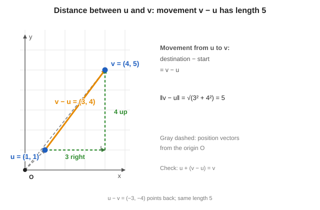

### 2. How far apart are the endpoints?

The movement $(3, 4)$ forms a right triangle: $3$ horizontally and $4$ vertically (see the green dashed legs in the figure). Using Pythagoras:

$$
\text{distance} = \lVert\mathbf{v} - \mathbf{u}\rVert
= \sqrt{3^2 + 4^2}
= \sqrt{25}
= \boxed{5}.
$$

Notice the difference:

| Expression | Meaning | Result |
|---|---|---|
| $\mathbf{v} - \mathbf{u}$ | Movement from $\mathbf{u}$ to $\mathbf{v}$ | The **vector** $(3, 4)$ |
| $\lVert\mathbf{v} - \mathbf{u}\rVert$ | Length of that movement | The **number** $5$ |

Single bars $\lvert\cdot\rvert$ on a **scalar** and double bars $\lVert\cdot\rVert$ on a **vector** are the same distinction as in section 11.2: the norm turns the difference **vector** into one **distance number**.

The formal definition (for any dimension, real or complex entries) is

$$
\lVert\mathbf{u} - \mathbf{v}\rVert = \sqrt{\langle\mathbf{u} - \mathbf{v},\ \mathbf{u} - \mathbf{v}\rangle},
$$

which agrees with $\sqrt{(u_1 - v_1)^2 + (u_2 - v_2)^2}$ in the real plane.

### 3. What if we subtract in the opposite order?

$$
\mathbf{u} - \mathbf{v} = (1 - 4,\; 1 - 5) = (-3, -4).
$$

This points from $\mathbf{v}$ **back** to $\mathbf{u}$: $3$ left and $4$ down. Its length is still

$$
\lVert\mathbf{u} - \mathbf{v}\rVert = \sqrt{(-3)^2 + (-4)^2} = 5.
$$

So reversing the journey changes the **direction**, but the **distance** stays the same:

$$
\boxed{\text{distance between }\mathbf{u}\text{ and }\mathbf{v} = \lVert\mathbf{u} - \mathbf{v}\rVert = \lVert\mathbf{v} - \mathbf{u}\rVert.}
$$

When we say the difference vector is **large** or **small**, we mean its **length**: a long connecting arrow means the endpoints are far apart; a short connecting arrow means they are close together.

## 13.3 Unit vectors and normalising

A vector of **length 1** is called a **unit vector**. *"This will become very important when we talk about qubits."*

In the real picture, unit vectors are the points on the **unit circle** (radius 1). A vector that is not on the circle can be **scaled** so that it lands on it.

If you scale a vector $\mathbf{v}$ by a real number $r$, its length is multiplied by $r$. So multiply by $\dfrac{1}{\lVert\mathbf{v}\rVert}$ to get length 1. This is called **normalising**:

$$
\hat{\mathbf{v}} = \frac{\mathbf{v}}{\lVert\mathbf{v}\rVert}
$$

**What is $\hat{\mathbf{v}}$ called?** The symbol $\hat{\mathbf{v}}$ is read **“$\mathbf{v}$ hat”** (or **“unit $\mathbf{v}$”** in some books). It is the **unit vector** you get by **normalising** $\mathbf{v}$:

| Symbol | Name | Length | Same direction as $\mathbf{v}$? |
|---|---|---|---|
| $\mathbf{v}$ | just “the vector $\mathbf{v}$” | $\lVert\mathbf{v}\rVert$ (any non-negative number) | — |
| $\hat{\mathbf{v}}$ | the **normalised** $\mathbf{v}$, or **unit vector in the direction of** $\mathbf{v}$ | **always $1$** (by construction) | yes |

So **$\hat{\mathbf{v}}$ is a unit vector** — not a different kind of object. The hat is a reminder: “this one has been scaled to length $1$.” If $\mathbf{v}$ already has length $1$, then $\hat{\mathbf{v}} = \mathbf{v}$ and you may omit the hat.

For example, if a vector has length 10, multiply all its coordinates by $\tfrac{1}{10}$ and the new vector has length 1; that new vector is $\hat{\mathbf{v}}$.

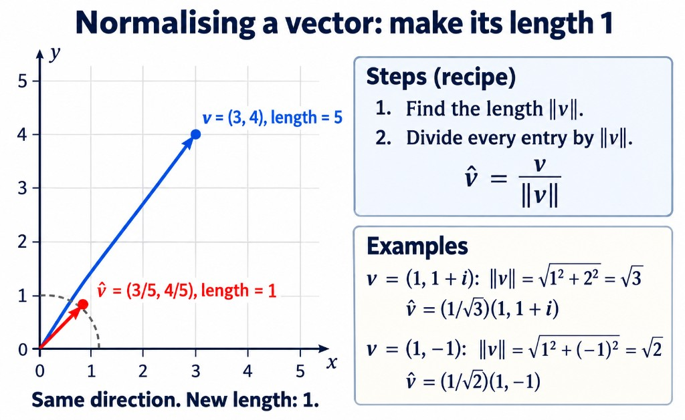

The figure shows the **same direction, new length $1$**: blue $\mathbf{v}=(3,4)$ with $\lVert\mathbf{v}\rVert=5$, red $\hat{\mathbf{v}}=(3/5,4/5)$ on the unit circle. The **Steps (recipe)** box is $\hat{\mathbf{v}}=\mathbf{v}/\lVert\mathbf{v}\rVert$. The **Examples** box matches the lecture; for $v=(1,1+i)$ the second term under the radical is $\lvert 1+i\rvert^2=2$ (not $2^2$). Below we derive that length in full before writing $\hat{\mathbf{v}}$.

### How long is $\mathbf{v} = \begin{pmatrix}1\\ 1 + i\end{pmatrix}$? (needed for normalising)

Normalising starts with step 1 of the recipe: **find $\lVert\mathbf{v}\rVert$**. The vector is

$$
\mathbf{v} = \begin{pmatrix}1\\ 1 + i\end{pmatrix}.
$$

For complex entries, length uses the **modulus squared of each component** (section 13.1):

$$
\lVert\mathbf{v}\rVert = \sqrt{\lvert v_1\rvert^2 + \lvert v_2\rvert^2}.
$$

**Step 1 — first entry $1$.**

$$
\lvert 1\rvert^2 = 1.
$$

**Step 2 — second entry $1 + i$.**

For $a + bi$, $\lvert a + bi\rvert^2 = a^2 + b^2$. Here $a = 1$, $b = 1$:

$$
\lvert 1 + i\rvert^2 = 1^2 + 1^2 = 2.
$$

**Step 3 — add and take the square root.**

$$
\lVert\mathbf{v}\rVert = \sqrt{\lvert 1\rvert^2 + \lvert 1 + i\rvert^2}
= \sqrt{1 + 2}
= \boxed{\sqrt3}.
$$

**Step 4 — normalise.** Multiply every entry by $1/\lVert\mathbf{v}\rVert = 1/\sqrt3$:

$$
\hat{\mathbf{v}} = \frac{1}{\sqrt3}\begin{pmatrix}1\\ 1 + i\end{pmatrix},
\qquad\text{and now }\lVert\hat{\mathbf{v}}\rVert = 1.
$$

**Examples.**

- $\mathbf{v} = \begin{pmatrix}1\\ 1 + i\end{pmatrix}$: length $\sqrt3$ and unit vector as above (steps just above).
- $\mathbf{v} = (1, -1)$ has length $\sqrt{1^2 + 1^2} = \sqrt2$, so $\hat{\mathbf{v}} = \dfrac{1}{\sqrt2}(1, -1)$.

## 13.4 Why the $\tfrac{1}{\sqrt2}$ in $\mathbf{h}_\pm$

Now the "mystery" of section 8.5 is solved: $(1, 1)$ and $(1, -1)$ each have length $\sqrt2$, and the factor $\tfrac{1}{\sqrt2}$ **normalises** them. So $\mathbf{h}_+$ and $\mathbf{h}_-$ have length 1. In the lecture: *"I like vectors which have length 1, because those are the vectors which will arise in quantum computing."*

**Quantum states are unit vectors (slide).** A qubit state is

$$
\boldsymbol\psi = \alpha\,\mathbf{e}_1 + \beta\,\mathbf{e}_2 \qquad\text{with}\qquad \lVert\boldsymbol\psi\rVert^2 = \lvert\alpha\rvert^2 + \lvert\beta\rvert^2 = 1
$$

*This is exactly the normalisation condition you will see in the next lecture.*

---

# 14. Two inequalities

*"Two facts that you always have to know."*

## 14.1 Cauchy–Schwarz

$$
\lvert\langle\mathbf{u}, \mathbf{v}\rangle\rvert \le \lVert\mathbf{u}\rVert\,\lVert\mathbf{v}\rVert
$$

with equality if and only if $\mathbf{u}$ and $\mathbf{v}$ are parallel ($\mathbf{v} = \alpha\mathbf{u}$).

**Where it comes from (the real case).** $\mathbf{u}\cdot\mathbf{v} = \lVert\mathbf{u}\rVert\lVert\mathbf{v}\rVert\cos\theta$, and $\cos\theta$ lies between $-1$ and $1$. Take the absolute value: $\lvert\cos\theta\rvert \le 1$, so $\lvert\mathbf{u}\cdot\mathbf{v}\rvert \le \lVert\mathbf{u}\rVert\lVert\mathbf{v}\rVert$. For complex vectors the inner product is a **complex number**, so we take its modulus. The same inequality holds.

**Why quantum computing cares (slide).** For two **unit** vectors, Cauchy–Schwarz gives $\lVert\boldsymbol\phi\rVert\lVert\boldsymbol\psi\rVert = 1$, so

$$
0 \le \lvert\langle\boldsymbol\phi, \boldsymbol\psi\rangle\rvert^2 \le 1
$$

A number between $0$ and $1$ is exactly what a **probability** can be. This is where probabilities will appear later.

## 14.2 Triangle inequality

$$
\lVert\mathbf{u} + \mathbf{v}\rVert \le \lVert\mathbf{u}\rVert + \lVert\mathbf{v}\rVert
$$

The picture: draw $\mathbf{u}$ and $\mathbf{v}$ head to tail. Then $\mathbf{u} + \mathbf{v}$ is the **third side of a triangle**. The length of one side of a triangle is **at most the sum of the lengths of the other two sides**. Slide caption: *"The direct path is never longer than the detour."*

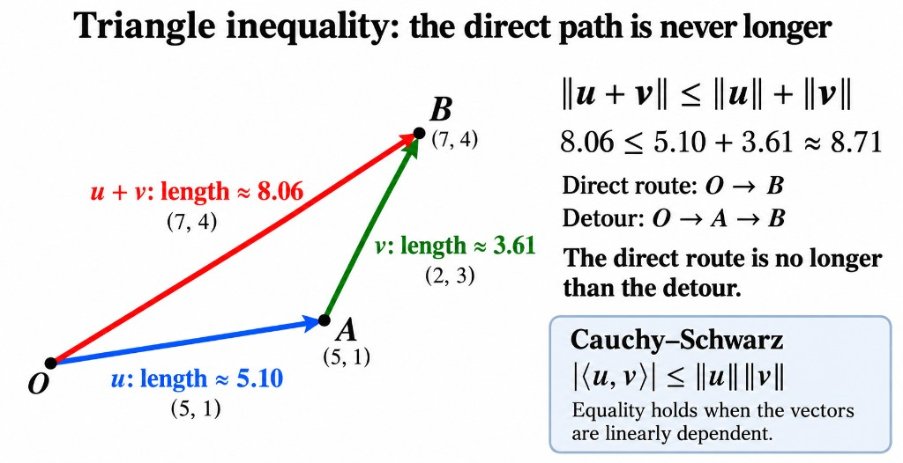

(Real cartoon: $\mathbf{u} = (5, 1)$ from $O$ to $A$, $\mathbf{v} = (2, 3)$ from $A$ to $B=(7,4)$, so $\mathbf{u}+\mathbf{v}$ is the direct segment $O\to B$. The figure also restates Cauchy–Schwarz from section 14.1.)

---

# 15. Orthogonality

*Lecture thread: perpendicular directions → Pythagoras → (later) why coordinates are easy in an orthonormal basis.*

## 15.0 Prerequisite recap (vectors, bases, coordinates)

**Extra beginner explanation.** Before “orthogonal,” fix three words that are easy to mix up:

| Word | What it is | Example |
|---|---|---|
| **Vector** | The single object (one arrow / one column) | $\mathbf{w}$ |
| **Basis vectors** | Fixed building blocks you agree on | $\mathbf{e}_1$, $\mathbf{e}_2$ |
| **Coordinates** | Scalars that say how much of each basis vector to add | $3$ and $4$ below |

Take the **target vector** $\mathbf{w} = (3, 4)$ in $\mathbb{R}^2$ and the **standard basis** $\mathbf{e}_1 = (1, 0)$, $\mathbf{e}_2 = (0, 1)$:

$$
\mathbf{w} = 3\mathbf{e}_1 + 4\mathbf{e}_2.
$$

- **Vector:** $\mathbf{w}$ (the point / arrow).
- **Basis vectors:** $\mathbf{e}_1$, $\mathbf{e}_2$.
- **Coordinates (coefficients):** $3$ and $4$ — not the same thing as $\mathbf{w}$ itself.

The column $(3,4)^T$ is $\mathbf{w}$ written **in the standard basis**. In another basis the **same** $\mathbf{w}$ gets **different** coordinate numbers.

**Notation (gentle).** $[\mathbf{w}]_{\mathcal{E}}$ means “the coordinate list of $\mathbf{w}$ in basis $\mathcal{E}$.” Example: $[\mathbf{w}]_{\mathcal{E}} = (3, 4)^T$ for the standard basis $\mathcal{E} = \{\mathbf{e}_1, \mathbf{e}_2\}$. In the Hadamard ONB $\mathcal{H} = \{\mathbf{h}_+, \mathbf{h}_-\}$, section 16.8 derives $[\mathbf{w}]_{\mathcal{H}} = (a_+, a_-)^T = \bigl(7/\sqrt2,\ -1/\sqrt2\bigr)^T$ for the **same** $\mathbf{w}$. Changing basis changes the list; $\mathbf{w}$ does not move.

**Hadamard vectors in the standard basis.** The lecture’s $\mathbf{h}_+ = \tfrac{1}{\sqrt2}(1, 1)^T$ is a **vector**. The entries $1/\sqrt2$ and $1/\sqrt2$ in the column are its **coordinates in the standard basis** — not a separate kind of object.

**Symbols you will see again**

- $\lvert z\rvert$ for a **number** $z$: size / modulus. For $z = a + bi$, $\lvert z\rvert = \sqrt{a^2 + b^2}$.
- $\lVert\mathbf{v}\rVert$ for a **vector**: length. $\lVert\mathbf{v}\rVert^2 = \langle\mathbf{v}, \mathbf{v}\rangle$ (length **squared**, not the same as $\lVert\mathbf{v}\rVert$).

---

## 15.1 What question are we answering?

**Question:** When are two directions “at right angles,” in a way that works for complex vectors?

**Everyday idea:** “Right” and “up” do not overlap — neither is a scaling of the other, and they meet at $90^\circ$.

**Definition (after we can measure angles via inner products):** $\mathbf{u}$ and $\mathbf{v}$ are **orthogonal** (written $\mathbf{u} \perp \mathbf{v}$) when

$$
\langle\mathbf{u}, \mathbf{v}\rangle = 0.
$$

**Inner product reminder:** $\langle\mathbf{u}, \mathbf{v}\rangle = \sum_j \overline{u_j}\,v_j$ — **conjugate the first** vector’s entries (section 12).

---

## 15.2 Real example: “right” and “up”

Let $\mathbf{u} = (1, 0)$ and $\mathbf{v} = (0, 1)$.

**First slot conjugated:** $\overline{1} = 1$, $\overline{0} = 0$.

$$
\langle\mathbf{u}, \mathbf{v}\rangle = \overline{1}\cdot 0 + \overline{0}\cdot 1 = 0\cdot 0 + 0\cdot 1 = 0.
$$

So $\mathbf{u} \perp \mathbf{v}$.

**Extra beginner explanation.** Orthogonal vectors need **not** have length $1$. Take $\mathbf{u} = (3, 0)$ and $\mathbf{v} = (0, 4)$:

$$
\langle\mathbf{u}, \mathbf{v}\rangle = \overline{3}\cdot 0 + \overline{0}\cdot 4 = 0 + 0 = 0.
$$

Still orthogonal; lengths are $\lVert\mathbf{u}\rVert = 3$ and $\lVert\mathbf{v}\rVert = 4$.

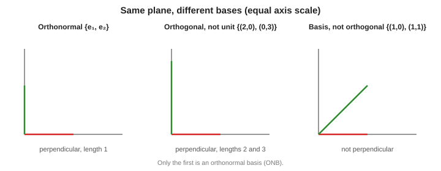

---

## 15.3 Lecture examples (real and complex)

**Standard basis:** $\langle\mathbf{e}_1, \mathbf{e}_2\rangle = 0$ (same calculation as above).

**Hadamard (before normalising):** $(1,1)$ and $(1,-1)$ are orthogonal because

$$
\langle(1,1), (1,-1)\rangle = \overline{1}\cdot 1 + \overline{1}\cdot(-1) = 1 - 1 = 0.
$$

After dividing by $\sqrt2$ to get $\mathbf{h}_\pm$, inner products stay $0$ (scaling both entries the same way does not change orthogonality).

**Complex pair (section 12.5):** $\mathbf{u} = (1, i)^T$, $\mathbf{v} = (i, 1)^T$.

$$
\langle\mathbf{u}, \mathbf{v}\rangle = \overline{1}\cdot i + \overline{i}\cdot 1 = i + (-i) = 0.
$$

**Extra beginner explanation.** For $\mathbb{C}^2$ we **define** orthogonality by $\langle\cdot,\cdot\rangle = 0$. Pictures in the real plane are **motivation**; complex vectors are not honest single arrows in $\mathbb{R}^2$.

---

## 15.4 Misconception check: orthogonal vs “forms a basis”

| Statement | Verdict |
|---|---|
| Nonzero vectors that are pairwise orthogonal are **linearly independent** | True |
| Two orthogonal nonzero vectors in $\mathbb{R}^2$ **span the plane** → they are a **basis** | True (in $\mathbb{R}^2$) |
| “Perpendicular ⇒ always a basis of the whole space” without checking dimension | **False** in general — you need enough independent directions |
| Every **basis** is orthogonal | **False** — e.g. $\{(1,0), (1,1)\}$ is a basis but not orthogonal |

In the lecture: every **subspace** has *some* orthogonal basis, but a random basis need not be orthogonal.

---

## 15.5 Pythagoras for orthogonal vectors

**Question:** If $\mathbf{u} \perp \mathbf{v}$, how is $\lVert\mathbf{u}+\mathbf{v}\rVert$ related to $\lVert\mathbf{u}\rVert$ and $\lVert\mathbf{v}\rVert$?

**Everyday idea:** Right triangle — hypotenuse squared = sum of squares of the legs.

**General formula (after the algebra):**

$$
\lVert\mathbf{u} + \mathbf{v}\rVert^2 = \lVert\mathbf{u}\rVert^2 + \lVert\mathbf{v}\rVert^2 \quad\text{when }\mathbf{u}\perp\mathbf{v}.
$$

**Expand without skipping steps:**

$$
\langle\mathbf{u}+\mathbf{v}, \mathbf{u}+\mathbf{v}\rangle
= \langle\mathbf{u},\mathbf{u}\rangle + \langle\mathbf{u},\mathbf{v}\rangle + \langle\mathbf{v},\mathbf{u}\rangle + \langle\mathbf{v},\mathbf{v}\rangle.
$$

If $\mathbf{u}\perp\mathbf{v}$, then $\langle\mathbf{u},\mathbf{v}\rangle = 0$ and $\langle\mathbf{v},\mathbf{u}\rangle = \overline{\langle\mathbf{u},\mathbf{v}\rangle} = 0$. So

$$
\lVert\mathbf{u}+\mathbf{v}\rVert^2 = \lVert\mathbf{u}\rVert^2 + \lVert\mathbf{v}\rVert^2.
$$

**Numerical check:** $\mathbf{u}=(3,1)$, $\mathbf{v}=(-1,3)$. Dot product $3(-1)+1\cdot 3 = 0$. $\lVert\mathbf{u}\rVert^2 = 10$, $\lVert\mathbf{v}\rVert^2 = 10$, $\lVert\mathbf{u}+\mathbf{v}\rVert^2 = \lVert(2,4)\rVert^2 = 20$.

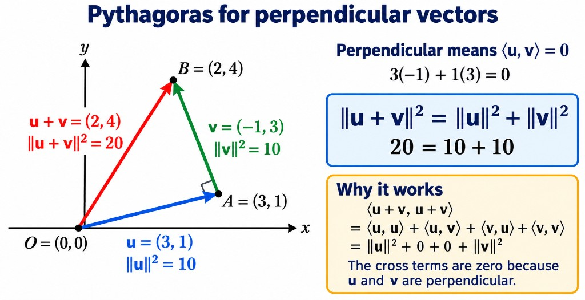

---

## 15.6 Questions from the class

**“Is every basis perpendicular?”** No — see table in §15.4.

**“Why Hadamard?”** Name only; $\mathbf{h}_\pm$ are a useful orthonormal pair (Pauli basis comes much later).

---

# 16. Orthonormal bases and Parseval’s identity

*Lecture thread: hard coordinates in a general basis → orthonormal bases → inner products read off coordinates → length² from coordinates (Parseval).*

## 16.1 Why are coordinates hard in a general basis?

**Question:** In basis $\{\mathbf{b}_1, \mathbf{b}_2\}$, what numbers $\alpha_1, \alpha_2$ make $\mathbf{w} = \alpha_1\mathbf{b}_1 + \alpha_2\mathbf{b}_2$?

**Lecture example:** $\mathbf{w} = (5, 6)$, $\mathbf{b}_1 = (3, 2)$, $\mathbf{b}_2 = (1, 7)$.

$$
(5, 6) = \alpha_1(3, 2) + \alpha_2(1, 7)
\Rightarrow
\begin{cases}
3\alpha_1 + \alpha_2 = 5 \\
2\alpha_1 + 7\alpha_2 = 6
\end{cases}
$$

From the first equation, $\alpha_2 = 5 - 3\alpha_1$. Substitute:

$$
2\alpha_1 + 7(5 - 3\alpha_1) = 6
\Rightarrow 2\alpha_1 + 35 - 21\alpha_1 = 6
\Rightarrow -19\alpha_1 = -29
\Rightarrow \alpha_1 = \tfrac{29}{19},\quad \alpha_2 = \tfrac{8}{19}.
$$

**Meaning:** A general basis is fine, but finding coordinates means **solving linear equations**. In $\mathbb{C}^n$ with large $n$, that is work. The standard basis $(1,0), (0,1)$ felt easy because $\mathbf{w} = 5\mathbf{e}_1 + 6\mathbf{e}_2$ reads off immediately.

---

## 16.2 Orthogonal, normalised, basis — three separate ideas

| Idea | Meaning |
|---|---|
| **Orthogonal** | $\langle\mathbf{b}_i, \mathbf{b}_j\rangle = 0$ for $i \ne j$ |
| **Normalised (unit length)** | $\lVert\mathbf{b}_i\rVert = 1$ for each $i$ |
| **Basis** | Independent set that **spans** the whole space |

**Orthonormal basis (ONB):** all three at once.

**Extra beginner explanation — compare in $\mathbb{R}^2$:**

| Set | Orthogonal? | Each length $1$? | Basis of plane? |
|---|---|---|---|
| $\{\mathbf{e}_1, \mathbf{e}_2\}$ | Yes | Yes | Yes → **ONB** |
| $\{(2,0), (0,3)\}$ | Yes | No (lengths $2$, $3$) | Yes |
| $\{(1,0), (1,1)\}$ | No | No | Yes |

**Packed form (optional, after the two-vector case):** $\langle\mathbf{e}_i, \mathbf{e}_j\rangle = \delta_{ij}$ where $\delta_{ij} = 1$ if $i=j$ and $0$ if $i\ne j$ (**Kronecker delta** — “pick out matching indices only”).

---

## 16.3 Deriving the factor $1/\sqrt2$ in $\mathbf{h}_\pm$

**Unnormalised** $(1,1)^T$ has length

$$
\lVert(1,1)\rVert = \sqrt{\lvert 1\rvert^2 + \lvert 1\rvert^2} = \sqrt{2}.
$$

To make length $1$, divide **every entry** by $\sqrt2$:

$$
\mathbf{h}_+ = \frac{1}{\sqrt2}\begin{pmatrix}1\\1\end{pmatrix}.
$$

Similarly $\mathbf{h}_- = \tfrac{1}{\sqrt2}(1, -1)^T$. That is why the lecture keeps $1/\sqrt2$ — **normalising** $(1,\pm 1)$ to unit vectors.

---

## 16.4 Three standard ONBs of $\mathbb{C}^2$

| Name | Vectors (columns) |
|---|---|
| **Standard** | $\mathbf{e}_1 = (1, 0)^T$, $\mathbf{e}_2 = (0, 1)^T$ |
| **Hadamard** | $\mathbf{h}_\pm = \tfrac{1}{\sqrt2}(1, \pm1)^T$ |
| **Circular** | $\mathbf{c}_\pm = \tfrac{1}{\sqrt2}(1, \pm i)^T$ |

> **Coordinates vs basis vectors (three ONBs of $\mathbb{C}^2$)**
>
> | Role | Standard | Hadamard | Circular |
> |---|---|---|---|
> | **Basis vectors** (bold) | $\mathbf{e}_1$, $\mathbf{e}_2$ | $\mathbf{h}_+$, $\mathbf{h}_-$ | $\mathbf{c}_+$, $\mathbf{c}_-$ |
> | **Coordinates** (scalars) | $\alpha$, $\beta$ | $a_+$, $a_-$ | $r_+$, $r_-$ |
> | **Expansion** | $\mathbf{v} = \alpha\mathbf{e}_1 + \beta\mathbf{e}_2$ | $\mathbf{v} = a_+\mathbf{h}_+ + a_-\mathbf{h}_-$ | $\mathbf{v} = r_+\mathbf{c}_+ + r_-\mathbf{c}_-$ |
> | **Read off via ONB** | $\alpha = \langle\mathbf{e}_1,\mathbf{v}\rangle$, … | $a_+ = \langle\mathbf{h}_+,\mathbf{v}\rangle$, $a_- = \langle\mathbf{h}_-,\mathbf{v}\rangle$ | $r_+ = \langle\mathbf{c}_+,\mathbf{v}\rangle$, $r_- = \langle\mathbf{c}_-,\mathbf{v}\rangle$ |

**Circular orthogonality — expanded walkthrough**

We want to check $\mathbf{c}_+ \perp \mathbf{c}_-$ using $\langle\mathbf{c}_+, \mathbf{c}_-\rangle = 0$. Write the two columns explicitly (each already includes the factor $1/\sqrt2$):

$$
\mathbf{c}_+ = \frac{1}{\sqrt2}\begin{pmatrix}1\\ i\end{pmatrix},
\qquad
\mathbf{c}_- = \frac{1}{\sqrt2}\begin{pmatrix}1\\ -i\end{pmatrix}.
$$

**Step 1 — recall the inner product rule (section 12).** For $\mathbf{u} = (u_1, u_2)^T$ and $\mathbf{v} = (v_1, v_2)^T$,

$$
\langle\mathbf{u}, \mathbf{v}\rangle = \overline{u_1}\,v_1 + \overline{u_2}\,v_2.
$$

**Conjugate only the first vector’s entries.** Here the first vector is $\mathbf{c}_+$, so we conjugate its components $1$ and $i$ before multiplying.

**Step 2 — pull out the common scalar $1/\sqrt2$.** Each basis vector is $(\text{something})/\sqrt2$. When you multiply two such vectors in the inner product, the $\sqrt2$ factors combine:

$$
\langle\mathbf{c}_+, \mathbf{c}_-\rangle
= \left\langle \frac{1}{\sqrt2}\begin{pmatrix}1\\ i\end{pmatrix},\ \frac{1}{\sqrt2}\begin{pmatrix}1\\ -i\end{pmatrix} \right\rangle
= \frac{1}{\sqrt2}\cdot\frac{1}{\sqrt2}\ \left\langle \begin{pmatrix}1\\ i\end{pmatrix},\ \begin{pmatrix}1\\ -i\end{pmatrix} \right\rangle
= \frac12\ \left\langle \begin{pmatrix}1\\ i\end{pmatrix},\ \begin{pmatrix}1\\ -i\end{pmatrix} \right\rangle.
$$

That is why a factor **$\tfrac12$** appears in front — it is $(1/\sqrt2)^2$, not a separate trick.

**Step 3 — first slot.** Top entry of the first vector is $1$, so $\overline{1} = 1$. Top entry of the second is $1$. Product: $\overline{1}\cdot 1 = 1$.

**Step 4 — second slot.** Bottom entry of the first vector is $i$, so $\overline{i} = -i$. Bottom entry of the second is $-i$. Product:

$$
\overline{i}\cdot(-i) = (-i)\cdot(-i) = (-i)^2 = i^2 = -1.
$$

(You can also multiply as $(-i)(-i) = i^2$ directly once you know $\overline{i} = -i$.)

**Step 5 — add the slots and finish.**

$$
\langle\mathbf{c}_+, \mathbf{c}_-\rangle
= \frac12\bigl(\overline{1}\cdot 1 + \overline{i}\cdot(-i)\bigr)
= \frac12\bigl(1 + (-1)\bigr)
= \frac12\cdot 0
= 0.
$$

So $\mathbf{c}_+$ and $\mathbf{c}_-$ are **orthogonal**, as required for an ONB.

**What each symbol meant:** $\mathbf{c}_\pm$ are **vectors**; $1$, $i$, $-i$ are **entries** (complex numbers); $\overline{\cdot}$ is **conjugate on the first vector only**; the result $0$ is a **scalar** saying the two directions are perpendicular in the inner-product sense.

Hadamard can be pictured as perpendicular lines in the real plane; circular basis vectors live in $\mathbb{C}^2$ — here we rely on the algebra above rather than a 2D arrow picture.

---

## 16.5 How inner products extract coordinates (two vectors first)

**Question:** If $\mathbf{w} = c_1\mathbf{b}_1 + c_2\mathbf{b}_2$ and $\{\mathbf{b}_1, \mathbf{b}_2\}$ is **orthonormal**, how do we find $c_1$?

**Take $\langle\mathbf{b}_1, \cdot\rangle$ of both sides:**

$$
\langle\mathbf{b}_1, \mathbf{w}\rangle
= \langle\mathbf{b}_1, c_1\mathbf{b}_1 + c_2\mathbf{b}_2\rangle
= c_1\langle\mathbf{b}_1, \mathbf{b}_1\rangle + c_2\langle\mathbf{b}_1, \mathbf{b}_2\rangle.
$$

Orthonormal: $\langle\mathbf{b}_1, \mathbf{b}_1\rangle = 1$, $\langle\mathbf{b}_1, \mathbf{b}_2\rangle = 0$. So

$$
\langle\mathbf{b}_1, \mathbf{w}\rangle = c_1\cdot 1 + c_2\cdot 0 = c_1.
$$

Similarly $c_2 = \langle\mathbf{b}_2, \mathbf{w}\rangle$.

**Extra beginner explanation — scalar vs vector piece**

- $c_1$ is a **number** (coordinate / coefficient).
- $c_1\mathbf{b}_1$ is a **vector** (one piece of $\mathbf{w}$ along $\mathbf{b}_1$).

Perpendicularity **kills** the unwanted coefficient; unit length **leaves** the wanted one unchanged.

**$n$ dimensions (general formula, after the two-vector case):**

$$
\mathbf{v} = \sum_{i=1}^{n} \langle\mathbf{e}_i, \mathbf{v}\rangle\,\mathbf{e}_i,
\qquad \alpha_j = \langle\mathbf{e}_j, \mathbf{v}\rangle.
$$

> **Conjugate on the first slot only.** $\langle\mathbf{v}, \mathbf{e}_j\rangle$ is the conjugate of the coordinate — not the coordinate.

---

## 16.6 Worked example: $\mathbf{v} = (3/5, 4i/5)^T$ in the Hadamard basis

### What are we trying to do?

**One vector, two recipes.** $\mathbf{v}$ is a single object in $\mathbb{C}^2$. You can describe it with different **coordinates** depending on which **basis** you use:

| Basis | Basis vectors | Question |
|---|---|---|
| **Standard** $\mathcal{E} = \{\mathbf{e}_1, \mathbf{e}_2\}$ | $(1,0)^T$, $(0,1)^T$ | “How much $\mathbf{e}_1$ and how much $\mathbf{e}_2$?” |
| **Hadamard** $\mathcal{H} = \{\mathbf{h}_+, \mathbf{h}_-\}$ | $\mathbf{h}_\pm = \tfrac{1}{\sqrt2}(1,\pm1)^T$ | “How much $\mathbf{h}_+$ and how much $\mathbf{h}_-$?” |

The **lecture already gives** the standard recipe:

$$
\mathbf{v} = \frac35\mathbf{e}_1 + \frac{4i}{5}\mathbf{e}_2
\quad\Leftrightarrow\quad
[\mathbf{v}]_{\mathcal{E}} = \begin{pmatrix}3/5 \\ 4i/5\end{pmatrix}.
$$

The column $(3/5,\,4i/5)^T$ is **not** “the vector” by itself — it is $\mathbf{v}$ written in the **standard** basis.

**Goal of this section:** find the **Hadamard coordinates** $a_+$ and $a_-$ (scalars) such that

$$
\mathbf{v} = a_+\mathbf{h}_+ + a_-\mathbf{h}_-,
\qquad
[\mathbf{v}]_{\mathcal{H}} = \begin{pmatrix}a_+ \\ a_-\end{pmatrix}.
$$

We are **not** changing $\mathbf{v}$. We are **not** solving a $2\times 2$ linear system by hand (section 16.1 style). Because $\{\mathbf{h}_+, \mathbf{h}_-\}$ is an **orthonormal basis**, section 16.5 says:

$$
a_+ = \langle\mathbf{h}_+, \mathbf{v}\rangle,
\qquad
a_- = \langle\mathbf{h}_-, \mathbf{v}\rangle.
$$

Each inner product is **one number** — the “how much” of that Hadamard direction.

**Why this vector?** $\lVert\mathbf{v}\rVert^2 = \lvert 3/5\rvert^2 + \lvert 4i/5\rvert^2 = 9/25 + 16/25 = 1$, so it is a **unit** vector (useful later for Parseval and quantum examples).

*Figure (real cartoon):* the arrow is drawn as $\mathbf{v} = (3/5,\,4/5)$ in $\mathbb{R}^2$ so it can be plotted. **This section’s algebra** uses the lecture column $(3/5,\,4i/5)^T$ — same standard coordinate $3/5$ on $\mathbf{e}_1$, but a **complex** coefficient on $\mathbf{e}_2$. Inner products and $a_\pm$ are unchanged in form; only the second entry is $4i/5$ instead of $4/5$.

---

### Step A — compute $a_+ = \langle\mathbf{h}_+, \mathbf{v}\rangle$

**What we are computing.** $a_+$ is the **Hadamard coordinate**: the scalar in

$$
\mathbf{v} = a_+\mathbf{h}_+ + (\text{other pieces}).
$$

Section 16.5 says: because $\mathbf{h}_+$ is part of an ONB, $a_+ = \langle\mathbf{h}_+, \mathbf{v}\rangle$ — one inner product, no solving equations.

**Step A.1 — write both columns.**

$$
\mathbf{h}_+ = \frac{1}{\sqrt2}\begin{pmatrix}1\\1\end{pmatrix}
= \begin{pmatrix}1/\sqrt2\\ 1/\sqrt2\end{pmatrix},
\qquad
\mathbf{v} = \begin{pmatrix}3/5\\ 4i/5\end{pmatrix}.
$$

$\mathbf{h}_+$ is **first** in $\langle\mathbf{h}_+, \mathbf{v}\rangle$; $\mathbf{v}$ is **second**.

**Step A.2 — inner product rule (two slots).** For $\mathbf{u} = (u_1, u_2)^T$ and $\mathbf{w} = (w_1, w_2)^T$,

$$
\langle\mathbf{u}, \mathbf{w}\rangle = \overline{u_1}\,w_1 + \overline{u_2}\,w_2.
$$

Here $\mathbf{u} = \mathbf{h}_+$ and $\mathbf{w} = \mathbf{v}$, so $u_1 = 1/\sqrt2$, $u_2 = 1/\sqrt2$, $w_1 = 3/5$, $w_2 = 4i/5$.

| Slot | Entry of $\mathbf{h}_+$ (first) | Entry of $\mathbf{v}$ (second) | Conjugate of first | Product |
|---|---|---|---|---|
| 1 (top) | $1/\sqrt2$ | $3/5$ | $\overline{1/\sqrt2} = 1/\sqrt2$ | $(1/\sqrt2)(3/5)$ |
| 2 (bottom) | $1/\sqrt2$ | $4i/5$ | $\overline{1/\sqrt2} = 1/\sqrt2$ | $(1/\sqrt2)(4i/5)$ |

**Step A.3 — add the two products.**

$$
a_+ = \frac{1}{\sqrt2}\cdot\frac35 + \frac{1}{\sqrt2}\cdot\frac{4i}{5}.
$$

**Step A.4 — factor the common $1/\sqrt2$.** Step A.3 already has $1/\sqrt2$ in **both** terms, so factor it once:

$$
a_+ = \frac{1}{\sqrt2}\left(\frac35 + \frac{4i}{5}\right).
$$

For this course, **A.2–A.4 are enough** — use the actual entries of $\mathbf{h}_+$ ($1/\sqrt2$, $1/\sqrt2$) in the table. You do not need a second method that factors out $1/\sqrt2$ and uses $(1,1)^T$ separately.

**Step A.5 — combine fractions inside the bracket.** Both terms have denominator $5$:

$$
\frac35 + \frac{4i}{5} = \frac{3 + 4i}{5}.
$$

**Step A.6 — final answer.**

$$
a_+ = \frac{1}{\sqrt2}\cdot\frac{3 + 4i}{5} = \frac{3 + 4i}{5\sqrt2}.
$$

**Read the result:** $a_+$ is one **complex number** (scalar), not a vector. It is “how much $\mathbf{h}_+$” you add when you rebuild $\mathbf{v}$ in the Hadamard basis.

---

### Step B — compute $a_- = \langle\mathbf{h}_-, \mathbf{v}\rangle$

Now $\mathbf{h}_- = \tfrac{1}{\sqrt2}(1, -1)^T$. The inner product uses **$\mathbf{h}_-$ in the first slot**, so conjugate its entries: $\overline{1}=1$, $\overline{(-1)}=-1$.

$$
a_- = \frac{1}{\sqrt2}\left(\overline{1}\cdot\frac35 + \overline{(-1)}\cdot\frac{4i}{5}\right)
= \frac{1}{\sqrt2}\left(\frac35 + (-1)\cdot\frac{4i}{5}\right)
= \frac{1}{\sqrt2}\left(\frac35 - \frac{4i}{5}\right)
= \frac{3 - 4i}{5\sqrt2}.
$$

(With $\mathbf{h}_+$, the second entry is $+1$, so you get $3/5 + 4i/5$ inside the bracket — that is why $a_+$ has a **plus** between $3$ and $4i$, and $a_-$ has a **minus**.)

---

### Step C — state the Hadamard recipe

$$
\mathbf{v} = a_+\mathbf{h}_+ + a_-\mathbf{h}_-
= \frac{3 + 4i}{5\sqrt2}\,\mathbf{h}_+ + \frac{3 - 4i}{5\sqrt2}\,\mathbf{h}_-.
$$

**Misconception check:** $a_+\mathbf{h}_+$ is a **vector** (a piece of $\mathbf{v}$ along $\mathbf{h}_+$). $a_+$ alone is the **coordinate** (a number).

---

### Step D — why the “check” at the end?

Adding $a_+\mathbf{h}_+ + a_-\mathbf{h}_-$ should **rebuild the same column** $(3/5,\,4i/5)^T$. The check expands each Hadamard vector into standard entries and adds:

$$
a_+\mathbf{h}_+ + a_-\mathbf{h}_-
= \frac{a_+}{\sqrt2}\begin{pmatrix}1\\1\end{pmatrix} + \frac{a_-}{\sqrt2}\begin{pmatrix}1\\-1\end{pmatrix}
= \frac{1}{\sqrt2}\begin{pmatrix}a_+ + a_- \\ a_+ - a_- \end{pmatrix}.
$$

**First entry** (top component):

$$
\frac{1}{\sqrt2}(a_+ + a_-)
= \frac{1}{\sqrt2}\left(\frac{3+4i}{5\sqrt2} + \frac{3-4i}{5\sqrt2}\right)
= \frac{1}{\sqrt2}\cdot\frac{6}{5\sqrt2}
= \frac{6}{10} = \frac35.
$$

The $4i$ and $-4i$ **cancel** in $a_+ + a_-$, leaving only $6/(5\sqrt2\cdot\sqrt2)$.

**Second entry** (bottom component):

$$
\frac{1}{\sqrt2}(a_+ - a_-)
= \frac{1}{\sqrt2}\left(\frac{3+4i}{5\sqrt2} - \frac{3-4i}{5\sqrt2}\right)
= \frac{1}{\sqrt2}\cdot\frac{8i}{5\sqrt2}
= \frac{8i}{10} = \frac{4i}{5}.
$$

Here the $3$’s cancel and the $4i$ terms **add**: $(4i - (-4i)) = 8i$.

If both entries match the lecture column, the Hadamard coordinates are correct.

---

### One-line summary

| Step | What you did |
|---|---|
| Given | $\mathbf{v}$ in standard form: $3/5$ on $\mathbf{e}_1$, $4i/5$ on $\mathbf{e}_2$ |
| Wanted | Scalars $a_+$, $a_-$ so $\mathbf{v} = a_+\mathbf{h}_+ + a_-\mathbf{h}_-$ |
| Method | $a_\pm = \langle\mathbf{h}_\pm, \mathbf{v}\rangle$ (ONB from §16.5) |
| Check | Add $a_+\mathbf{h}_+ + a_-\mathbf{h}_-$ and recover $(3/5,\,4i/5)^T$ |

---

## 16.7 Length squared from ONB coordinates

### What are we doing, and why?

**Goal.** You already know $\lVert\mathbf{v}\rVert^2 = \langle\mathbf{v}, \mathbf{v}\rangle$ (section 13). In an **orthonormal basis** $\{\mathbf{e}_1, \mathbf{e}_2, \ldots\}$, section 16.5 writes

$$
\mathbf{v} = c_1\mathbf{e}_1 + c_2\mathbf{e}_2 + \cdots,
\qquad c_j = \langle\mathbf{e}_j, \mathbf{v}\rangle.
$$

Here $c_1$, $c_2$ are **generic coordinate names** (scalars along $\mathbf{e}_1$, $\mathbf{e}_2$) — not the Hadamard $a_\pm$ or circular $r_\pm$ unless you have chosen that basis.

**Question:** Can we express $\lVert\mathbf{v}\rVert^2$ using only the numbers $c_1, c_2, \ldots$?

**Why bother:** If the answer is $\lvert c_1\rvert^2 + \lvert c_2\rvert^2 + \cdots$, then **length squared** is just “add squared sizes of the coordinates” — that is Parseval (section 16.8). The hard part is proving that formula; this section does the proof for **two** basis directions first.

**Plan.** Substitute $\mathbf{v} = c_1\mathbf{e}_1 + c_2\mathbf{e}_2$ into $\langle\mathbf{v}, \mathbf{v}\rangle$ and expand carefully. Orthogonality ($\mathbf{e}_1 \perp \mathbf{e}_2$) will kill the “mixed” terms; unit length ($\lVert\mathbf{e}_j\rVert = 1$) turns the remaining terms into $\lvert c_j\rvert^2$.

---

### Step 1 — write length squared as an inner product

$$
\lVert\mathbf{v}\rVert^2 = \langle\mathbf{v}, \mathbf{v}\rangle.
$$

Set $\mathbf{A} = c_1\mathbf{e}_1$ and $\mathbf{B} = c_2\mathbf{e}_2$, so $\mathbf{v} = \mathbf{A} + \mathbf{B}$. Then

$$
\lVert\mathbf{v}\rVert^2 = \langle\mathbf{A} + \mathbf{B},\ \mathbf{A} + \mathbf{B}\rangle.
$$

Same idea as multiplying $(a + b)^2$ in algebra — but the inner product is **not** ordinary multiplication (order and conjugates matter).

---

### Step 2 — expand into four inner products (FOIL)

The inner product is **linear in the second slot** and **conjugate-linear in the first** (section 12.8). So you can “multiply out” $(\mathbf{A}+\mathbf{B})$ against $(\mathbf{A}+\mathbf{B})$ and get **four** terms:

| FOIL (algebra) | Inner product term |
|---|---|
| first × first | $\langle\mathbf{A}, \mathbf{A}\rangle$ |
| first × second | $\langle\mathbf{A}, \mathbf{B}\rangle$ |
| second × first | $\langle\mathbf{B}, \mathbf{A}\rangle$ |
| second × second | $\langle\mathbf{B}, \mathbf{B}\rangle$ |

Substitute $\mathbf{A} = c_1\mathbf{e}_1$, $\mathbf{B} = c_2\mathbf{e}_2$:

$$
\langle c_1\mathbf{e}_1 + c_2\mathbf{e}_2,\; c_1\mathbf{e}_1 + c_2\mathbf{e}_2\rangle
$$

$$
= \langle c_1\mathbf{e}_1, c_1\mathbf{e}_1\rangle + \langle c_1\mathbf{e}_1, c_2\mathbf{e}_2\rangle + \langle c_2\mathbf{e}_2, c_1\mathbf{e}_1\rangle + \langle c_2\mathbf{e}_2, c_2\mathbf{e}_2\rangle.
$$

**Name the pieces:**

| Term | Nickname | Typical fate (ONB) |
|---|---|---|
| $\langle c_1\mathbf{e}_1, c_1\mathbf{e}_1\rangle$ | **self** term for $\mathbf{e}_1$ | becomes $\lvert c_1\rvert^2$ |
| $\langle c_2\mathbf{e}_2, c_2\mathbf{e}_2\rangle$ | **self** term for $\mathbf{e}_2$ | becomes $\lvert c_2\rvert^2$ |
| $\langle c_1\mathbf{e}_1, c_2\mathbf{e}_2\rangle$ | **cross** term | $0$ (orthogonal basis) |
| $\langle c_2\mathbf{e}_2, c_1\mathbf{e}_1\rangle$ | **cross** term | $0$ |

---

### Step 3 — simplify each self term (scalar in the **first** slot)

**Top-left term:**

$$
\langle c_1\mathbf{e}_1, c_1\mathbf{e}_1\rangle
= \overline{c_1}\,\langle\mathbf{e}_1, c_1\mathbf{e}_1\rangle
= \overline{c_1}\,c_1\,\langle\mathbf{e}_1, \mathbf{e}_1\rangle.
$$

- First step: pull $\overline{c_1}$ out of the **first** slot (section 12.7).
- Second step: pull $c_1$ out of the **second** slot (no conjugate).

**Orthonormal:** $\langle\mathbf{e}_1, \mathbf{e}_1\rangle = \lVert\mathbf{e}_1\rVert^2 = 1$. And $\overline{c_1}\,c_1 = \lvert c_1\rvert^2$. So this term is **$\lvert c_1\rvert^2$**.

**Bottom-right term** (same pattern):

$$
\langle c_2\mathbf{e}_2, c_2\mathbf{e}_2\rangle = \lvert c_2\rvert^2.
$$

---

### Step 4 — show cross terms are zero

**Cross term 1:**

$$
\langle c_1\mathbf{e}_1, c_2\mathbf{e}_2\rangle
= \overline{c_1}\,c_2\,\langle\mathbf{e}_1, \mathbf{e}_2\rangle.
$$

**Orthogonal basis:** $\langle\mathbf{e}_1, \mathbf{e}_2\rangle = 0$, so the whole term is **$0$** (even if $c_1, c_2$ are nonzero).

**Cross term 2:**

$$
\langle c_2\mathbf{e}_2, c_1\mathbf{e}_1\rangle
= \overline{c_2}\,c_1\,\langle\mathbf{e}_2, \mathbf{e}_1\rangle = 0.
$$

That is why orthogonality matters: mixed directions do not contribute to $\lVert\mathbf{v}\rVert^2$.

---

### Step 5 — add what is left

$$
\lVert\mathbf{v}\rVert^2
= \lvert c_1\rvert^2 + 0 + 0 + \lvert c_2\rvert^2
= \lvert c_1\rvert^2 + \lvert c_2\rvert^2.
$$

In $n$ dimensions the same expansion gives a sum of $n$ squares and $(n^2 - n)$ cross terms; every cross term contains $\langle\mathbf{e}_i, \mathbf{e}_j\rangle = 0$ for $i \ne j$.

**Link to coordinates:** when $\{\mathbf{e}_j\}$ is the ONB you are using, $c_j = \langle\mathbf{e}_j, \mathbf{v}\rangle$, so

$$
\lVert\mathbf{v}\rVert^2 = \sum_j \lvert c_j\rvert^2 = \sum_j \lvert\langle\mathbf{e}_j, \mathbf{v}\rangle\rvert^2.
$$

**Misconception check:** $\lvert c_1\rvert^2$ uses the **modulus** of a possibly complex coordinate. For real $c_1 = 3$, $\lvert c_1\rvert^2 = 9$ — same as $3^2$ in the $(3,4)$ Pythagoras example in section 16.8.

---

## 16.8 Parseval’s identity

**Start real:** $\mathbf{w} = (3,4) = 3\mathbf{e}_1 + 4\mathbf{e}_2$.

- $\lVert\mathbf{w}\rVert = \sqrt{3^2 + 4^2} = 5$.
- $\lVert\mathbf{w}\rVert^2 = 25 = 3^2 + 4^2$.

**Meaning (geometry):** The **vector** $\mathbf{w}$ is the hypotenuse; **coordinates** $3$ and $4$ are leg lengths along perpendicular axes; **squared lengths of coordinates** add to **squared length of $\mathbf{w}$** — not “projections add to length.”

**Plain language — what Parseval is saying**

Imagine walking on a city grid. From the origin you go **$3$ blocks east** and **$4$ blocks north** (perpendicular directions). The straight-line distance to your corner is **$5$** blocks — not $3+4=7$. Pythagoras is about **squares**: $3^2 + 4^2 = 5^2$.

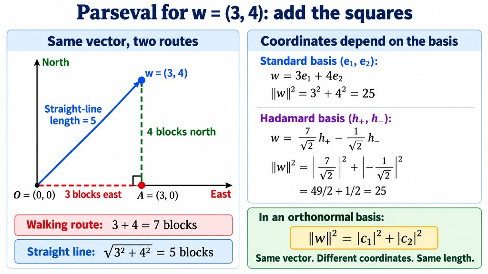

- **$\mathbf{w}$** is the trip as one arrow (the diagonal).
- **$3$ and $4$** are how far you went along each **axis** (coordinates in the standard basis).
- **Wrong picture:** “add the legs to get the diagonal” ($3+4=7$).
- **Right picture:** “add the **squares** of the legs to get the square of the diagonal” ($9+16=25$).

**General formula in everyday terms.** Pick a “measuring frame” made of **perpendicular unit directions** $\mathbf{e}_1, \mathbf{e}_2, \ldots$ (an ONB). For any arrow $\mathbf{v}$:

1. For each direction $\mathbf{e}_j$, ask: **how much of $\mathbf{v}$ points that way?** That number is the coordinate $\langle\mathbf{e}_j, \mathbf{v}\rangle$ (one inner product).
2. **Square** that amount (use $\lvert\cdot\rvert^2$ if it is complex).
3. **Add** all those squares.

Parseval says: that sum **always equals** the squared length of $\mathbf{v}$ itself, $\lVert\mathbf{v}\rVert^2$.

You can change the frame (standard vs Hadamard vs circular): the **list of coordinates changes**, but the **sum of their squares** stays the same — like describing the same diagonal with different “east/north” vs “northeast/northwest” numbers; $3^2+4^2$ and $a_+^2+a_-^2$ both give $25$ for $(3,4)$.

**Second form in everyday terms** (two arrows $\mathbf{u}$ and $\mathbf{v}$). The inner product $\langle\mathbf{u}, \mathbf{v}\rangle$ measures how much two arrows **align** (including phase for complex vectors). Parseval’s second line says: you can compute that alignment by **the same coordinate list**:

- Split $\mathbf{u}$ into pieces along each $\mathbf{e}_j$; split $\mathbf{v}$ the same way.
- For each axis $j$, take **$\mathbf{u}$’s piece** (conjugated) times **$\mathbf{v}$’s piece** on that axis.
- Add over all axes.

When $\mathbf{u}$ and $\mathbf{v}$ are the **same** arrow, “alignment with yourself” is just your squared length, and this second formula reduces to the first (sum of squared coordinates).

**General (ONB $\{\mathbf{e}_j\}$):**

$$
\lVert\mathbf{v}\rVert^2 = \sum_{j} \lvert\langle\mathbf{e}_j, \mathbf{v}\rangle\rvert^2.
$$

**Second form** (two different vectors):

$$
\langle\mathbf{u}, \mathbf{v}\rangle = \sum_{j} \overline{\langle\mathbf{e}_j, \mathbf{u}\rangle}\,\langle\mathbf{e}_j, \mathbf{v}\rangle.
$$

**Misconception check:** If $\mathbf{u} = \mathbf{v}$, the second formula becomes $\lVert\mathbf{v}\rVert^2 = \sum_j \lvert\langle\mathbf{e}_j, \mathbf{v}\rangle\rvert^2$ directly — the same as Parseval. You do **not** need a separate step of “taking $\lvert\cdot\rvert^2$ on both sides” of the two-vector formula.

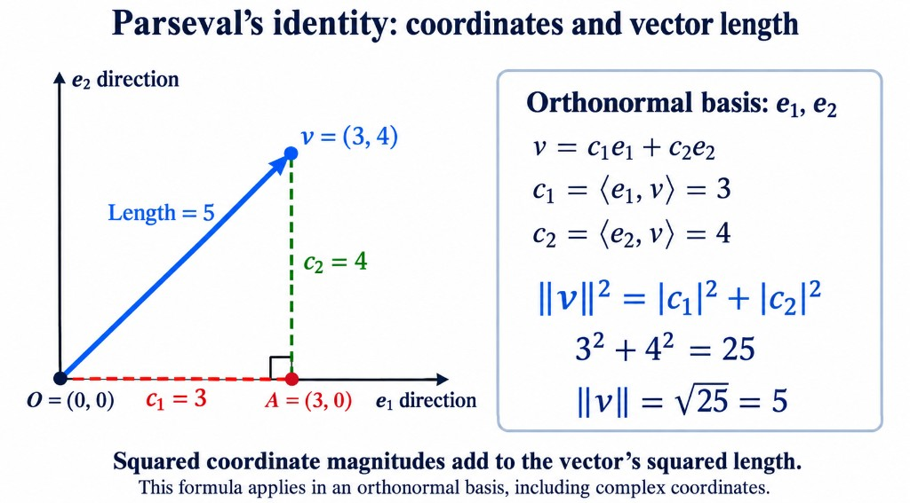

*Figure:* $\mathbf{v} = (3,4)$ in the standard ONB; $c_1 = \langle\mathbf{e}_1,\mathbf{v}\rangle = 3$, $c_2 = 4$; $\lVert\mathbf{v}\rVert^2 = 3^2 + 4^2 = 25$. Cross terms in the expansion vanish because $\mathbf{e}_1 \perp \mathbf{e}_2$ (section 16.7).

**Hadamard coordinates of $\mathbf{w}=(3,4)$ (derived, not quoted):**

$$
a_+ = \langle\mathbf{h}_+, \mathbf{w}\rangle = \frac{1}{\sqrt2}(3 + 4) = \frac{7}{\sqrt2}, \qquad
a_- = \frac{1}{\sqrt2}(3 - 4) = -\frac{1}{\sqrt2}.
$$

$$
\lvert a_+\rvert^2 + \lvert a_-\rvert^2 = \frac{49}{2} + \frac{1}{2} = 25 = \lVert\mathbf{w}\rVert^2.
$$

**Lecture complex example:** $\mathbf{v} = (3/5, 4i/5)^T$ — standard: $\lvert 3/5\rvert^2 + \lvert 4i/5\rvert^2 = 9/25 + 16/25 = 1$. Hadamard coordinates from section 16.6: $a_+ = (3+4i)/(5\sqrt2)$, $a_- = (3-4i)/(5\sqrt2)$. Then

$$
\lvert a_+\rvert^2 = \frac{\lvert 3+4i\rvert^2}{50} = \frac{25}{50} = \frac12,\qquad
\lvert a_-\rvert^2 = \frac{\lvert 3-4i\rvert^2}{50} = \frac12,\qquad
\lvert a_+\rvert^2 + \lvert a_-\rvert^2 = 1 = \lVert\mathbf{v}\rVert^2.
$$

**Why orthonormality matters — counterexample:** Basis $\mathbf{b}_1=(2,0)$, $\mathbf{b}_2=(0,2)$ (orthogonal, not unit). Vector $(2,2) = 1\cdot\mathbf{b}_1 + 1\cdot\mathbf{b}_2$ has coordinates $(1,1)$, but

$$
1^2 + 1^2 = 2 \ne 8 = \lVert(2,2)\rVert^2.
$$

Parseval’s sum of squares **fails** without unit-length basis vectors.

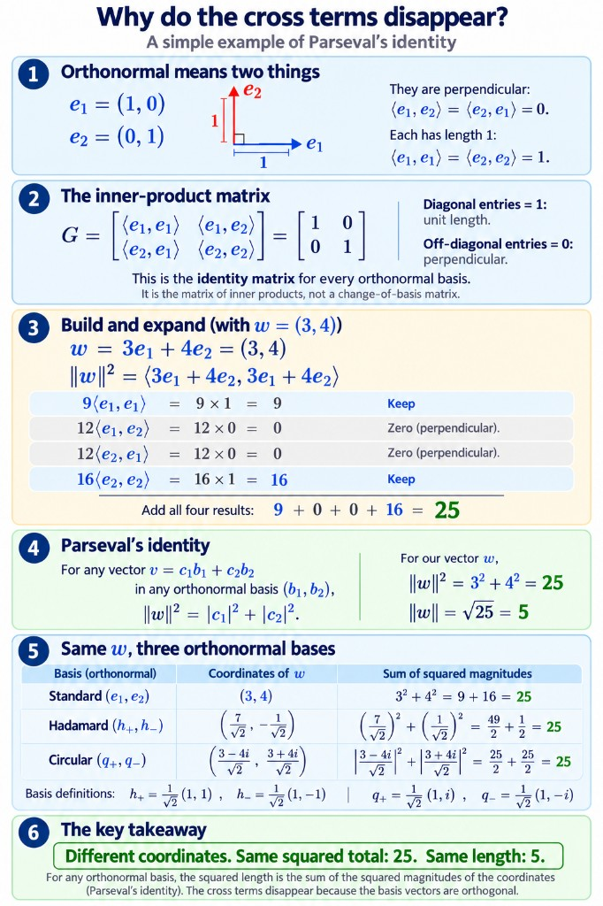

---

## 16.9 Optional preview — quantum states (added context)

**Extra beginner explanation.** Not part of the orthogonality lecture proof chain; motivation only.

Take $\boldsymbol\psi = \tfrac35\mathbf{e}_1 + \tfrac45\mathbf{e}_2$ (real coefficients first).

$$
\lVert\boldsymbol\psi\rVert^2 = \left(\frac35\right)^2 + \left(\frac45\right)^2 = \frac{9+16}{25} = 1.
$$

So $\lVert\boldsymbol\psi\rVert = 1$. **Rename** coefficients $\alpha = 3/5$, $\beta = 4/5$ when you move to $\mathbb{C}$.

- A **normalised pure state** is represented by a **unit vector** in the state space ($\lVert\boldsymbol\psi\rVert = 1$) — not every vector has length $1$.
- **Parseval** links $\lVert\boldsymbol\psi\rVert^2$ to $\sum_j \lvert\langle\mathbf{e}_j, \boldsymbol\psi\rangle\rvert^2$.
- The **Born rule** (later) **interprets** $\lvert\langle\mathbf{e}_j, \boldsymbol\psi\rangle\rvert^2$ as probability for outcome $j$ in that ONB — Parseval alone does not prove that interpretation.
- Individual probabilities can change when you change measurement basis; their **total** stays $1$ for a unit state.

---

## 16.10 Comparison table

| Topic | Orthogonal | ONB | Parseval |
|---|---|---|---|
| Vectors satisfy | $\langle\mathbf{b}_i,\mathbf{b}_j\rangle=0$ for $i\ne j$ | Also $\lVert\mathbf{b}_i\rVert=1$ | Uses ONB |
| Coordinates | Hard in general | $c_j = \langle\mathbf{e}_j,\mathbf{v}\rangle$ | — |
| Length² | — | — | $\sum_j \lvert\text{(coord)}_j\rvert^2$ e.g. $\lvert a_+\rvert^2+\lvert a_-\rvert^2$ |

---

## 16.11 Practice (orthogonality, ONB, Parseval)

1. **Real:** Show $(2,-1) \perp (1,2)$ by computing $\langle\cdot,\cdot\rangle$.
2. **Real:** $\mathbf{w}=(3,4)$. Find $[\mathbf{w}]_{\mathcal{H}} = (a_+, a_-)^T$ in the Hadamard ONB; verify $\lvert a_+\rvert^2 + \lvert a_-\rvert^2 = 25$.
3. **Real:** Why is $\{(1,0),(1,1)\}$ a basis but not an ONB?
4. **Norm:** $\lVert(1, i)^T\rVert$ — show $\lVert\mathbf{v}\rVert^2 = 2$.
5. **Complex:** $\langle(1,i)^T, (i,1)^T\rangle$ with conjugate on the first vector.

**Solutions**

1. $\overline{2}\cdot 1 + \overline{(-1)}\cdot 2 = 2 - 2 = 0$.
2. $a_+ = 7/\sqrt2$, $a_- = -1/\sqrt2$; $\frac{49+1}{2}=25$.
3. $\langle(1,0),(1,1)\rangle = 1 \ne 0$; not orthogonal. (It still spans $\mathbb{R}^2$.)
4. $\lvert 1\rvert^2 + \lvert i\rvert^2 = 1+1=2$, so $\lVert\mathbf{v}\rVert=\sqrt2$.
5. $\overline{1}\cdot i + \overline{i}\cdot 1 = i - i = 0$.

---

## 16.12 Inner product drill (lecture slide)

Let $\mathbf{u} = \begin{pmatrix}1\\ i\end{pmatrix}$ and $\mathbf{v} = \begin{pmatrix}2\\ 1 - i\end{pmatrix}$.

1. Compute $\langle\mathbf{u}, \mathbf{v}\rangle$ and $\langle\mathbf{v}, \mathbf{u}\rangle$.
2. Compute $\lVert\mathbf{u}\rVert$ and $\lVert\mathbf{v}\rVert$.
3. Normalise $\mathbf{u}$ and $\mathbf{v}$.
4. Check Cauchy–Schwarz.

**Solutions**

1. $\langle\mathbf{u}, \mathbf{v}\rangle = 1 - i$; $\langle\mathbf{v}, \mathbf{u}\rangle = 1 + i$.
2. $\lVert\mathbf{u}\rVert = \sqrt2$, $\lVert\mathbf{v}\rVert = \sqrt6$.
3. $\hat{\mathbf{u}} = \mathbf{u}/\sqrt2$, $\hat{\mathbf{v}} = \mathbf{v}/\sqrt6$.
4. $\lvert\langle\mathbf{u},\mathbf{v}\rangle\rvert = \sqrt2 \le \sqrt{12}$.

---

# 17. Review and what comes next

## 17.1 What did we really do? (recap)

1. We introduced the **conjugate** and used it to define the **dot (inner) product**. We defined it that way because we want $\mathbf{v}\cdot\mathbf{v}$ to be a real number equal to the length squared. That is why the conjugate was needed.
2. We used the inner product to define **perpendicular** (orthogonal): two vectors are perpendicular if their inner product is $0$. *(Up to here, everything is easy.)*
3. When you **change the basis, the coordinates of a vector change.** You are writing the same vector as a combination of different vectors.
4. If the basis is **orthonormal** (perpendicular and of length 1), finding the coordinates is **very easy**: each coordinate is one inner product (section 16.5).
5. **Parseval's identity** (section 16.8): in an ONB, $\lVert\mathbf{v}\rVert^2 = \sum_j \lvert\langle\mathbf{e}_j, \mathbf{v}\rangle\rvert^2$ — squared length equals the sum of squared coordinate magnitudes (not “vector pieces add to length”); for a **unit** qubit state in the standard basis, $\lvert\alpha\rvert^2 + \lvert\beta\rvert^2 = 1$.

*If you got lost somewhere:* it probably means you are not yet comfortable with **linear independence or basis**. Go back and try the slide problems.

## 17.2 Slide summary: vector spaces over $\mathbb{C}$

- $\mathbb{C}^n$: columns of complex numbers; add entrywise, scale by a complex $\alpha$.
- **Span** = all linear combinations = all superpositions.
- **Independence and dimension depend on the scalars** ($\mathbb{C}$ versus $\mathbb{R}$).
- **Basis $\Rightarrow$ unique coordinates.** Different bases give different coordinates, but the vector is the same.
- **Qubits:** $\mathbf{e}_1, \mathbf{e}_2$ are the standard basis of $\mathbb{C}^2$; $n$ qubits live in $\mathbb{C}^{2^n}$.
- **Missing so far:** *we can add and scale, but we cannot yet measure lengths or angles.* The inner product (sections 11 to 16) filled that gap.

## 17.3 What we should do next

- Do the slide problems. *"You will feel like you understand the concepts but are not able to connect them. That is fine. The moment you do more examples, it will click."* (Not being able to connect them means not yet seeing why they matter in quantum computing. That comes with the applications.)
- At the very least, know **how to define the inner product of two vectors**, and **what it means to define the length of a vector**.
- This is **only the beginning** and the course is heavy on maths. **Matrices and linear transformations** have not even started. They come next session. *"If I don't do that, you will not be able to understand what is going on in quantum."*
- **Tomorrow** (next session): no new concepts. Exercises first, with the teaching assistant. The session starts by going over some of the exercises. The **Pauli basis** is much later.
- The slides will be shared. *There is no submission for these exercises right now.*

---

# 18. One-page cheat sheet

**Vectors**

- $\mathbb{C}^n$: columns of $n$ complex numbers. Add entry by entry. Scale every entry by a complex number.
- Zero vector $\mathbf{0}$, negative $-\mathbf{v} = (-1)\mathbf{v}$.

**Span, subspace, independence, basis**

| Idea | Definition | Picture (real) |
|---|---|---|
| Linear combination | $\alpha_1\mathbf{v}_1 + \cdots + \alpha_k\mathbf{v}_k$ | scale and add |
| Span | all linear combinations | line, plane, ... through the origin |
| Subspace | closed under $+$ and scaling (so it contains $\mathbf{0}$) | line or plane **through the origin** |
| Linearly independent | $\sum\alpha_j\mathbf{v}_j = \mathbf{0}$ forces all $\alpha_j = 0$ | none lies in the span of the others |
| Basis | independent and spans | gives **unique** coordinates |
| Dimension | number of basis vectors | line 1, plane 2, $\mathbb{C}^n$ has $n$ |

**Inner product and length**

| Formula | Meaning |
|---|---|
| $\mathbf{v}^\dagger = \overline{\mathbf{v}}^{\,T}$ | flip column to row **and** conjugate |
| $\langle\mathbf{u}, \mathbf{v}\rangle = \mathbf{u}^\dagger\mathbf{v} = \sum\overline{u_j}v_j$ | inner product (conjugate the **first**) |
| $\langle\mathbf{v}, \mathbf{u}\rangle = \overline{\langle\mathbf{u}, \mathbf{v}\rangle}$ | swap order gives the conjugate |
| $\langle\mathbf{u}, \alpha\mathbf{v}\rangle = \alpha\langle\mathbf{u}, \mathbf{v}\rangle$, $\ \langle\alpha\mathbf{u}, \mathbf{v}\rangle = \overline{\alpha}\langle\mathbf{u}, \mathbf{v}\rangle$ | scalar comes out as it is in slot 2, conjugated in slot 1 |
| $\lVert\mathbf{v}\rVert = \sqrt{\langle\mathbf{v}, \mathbf{v}\rangle} = \sqrt{\sum\lvert v_j\rvert^2}$ | length |
| $\hat{\mathbf{v}} = \mathbf{v}/\lVert\mathbf{v}\rVert$ | unit vector (normalising) |
| $\mathbf{u}\perp\mathbf{v} \iff \langle\mathbf{u}, \mathbf{v}\rangle = 0$ | orthogonal |
| $\lvert\langle\mathbf{u}, \mathbf{v}\rangle\rvert \le \lVert\mathbf{u}\rVert\lVert\mathbf{v}\rVert$ | Cauchy–Schwarz |
| $\lVert\mathbf{u} + \mathbf{v}\rVert \le \lVert\mathbf{u}\rVert + \lVert\mathbf{v}\rVert$ | triangle inequality |
| $\mathbf{u}\perp\mathbf{v}\Rightarrow \lVert\mathbf{u} + \mathbf{v}\rVert^2 = \lVert\mathbf{u}\rVert^2 + \lVert\mathbf{v}\rVert^2$ | Pythagoras |

**Orthonormal bases**

- ONB: $\langle\mathbf{e}_i, \mathbf{e}_j\rangle = \delta_{ij}$.
- Three ONBs of $\mathbb{C}^2$: standard $\mathbf{e}_{1,2}$; Hadamard $\mathbf{h}_\pm = \tfrac{1}{\sqrt2}(1, \pm1)^T$; circular $\mathbf{c}_\pm = \tfrac{1}{\sqrt2}(1, \pm i)^T$.
- Coordinates: $\mathbf{v} = \sum_i\langle\mathbf{e}_i, \mathbf{v}\rangle\,\mathbf{e}_i$ (no equations to solve).
- **Parseval:** $\lVert\mathbf{v}\rVert^2 = \sum_i\lvert\langle\mathbf{e}_i, \mathbf{v}\rangle\rvert^2$; also $\langle\mathbf{u}, \mathbf{v}\rangle = \sum_i \overline{\langle\mathbf{e}_i, \mathbf{u}\rangle}\langle\mathbf{e}_i, \mathbf{v}\rangle$ (section 16.8). With $\mathbf{u}=\mathbf{v}$, the second line is the first.
- Hadamard coordinates: $(a_+, a_-) = \left(\dfrac{\alpha + \beta}{\sqrt2},\ \dfrac{\alpha - \beta}{\sqrt2}\right)$ when $\mathbf{v} = (\alpha, \beta)^T$ in the standard basis.

**Quantum links**

- A qubit state is a **unit vector** in $\mathbb{C}^2$: $\boldsymbol\psi = \alpha\mathbf{e}_1 + \beta\mathbf{e}_2$ with $\lvert\alpha\rvert^2 + \lvert\beta\rvert^2 = 1$.
- $n$ qubits live in $\mathbb{C}^{2^n}$.
- Superposition = linear combination.
- For unit vectors, $0 \le \lvert\langle\boldsymbol\phi, \boldsymbol\psi\rangle\rvert^2 \le 1$ can be a probability.

---

# 19. Glossary

| Term | Meaning |
|---|---|
| **Vector** | a list of numbers (here a column of complex numbers) |
| **Scalar** | an ordinary number (real or complex) used to scale a vector |
| **$\mathbb{C}^n$** | the set of all columns of $n$ complex numbers |
| **Component, coordinate, entry** | one number in the list |
| **Row vector, column vector** | the list written lying down or standing up |
| **Transpose ($T$)** | turn a column into a row (and the other way) |
| **Conjugate transpose, dagger ($\dagger$)** | transpose and conjugate every entry |
| **Vector space** | a collection of vectors closed under addition and scaling (with the eight rules) |
| **Linear combination** | $\alpha_1\mathbf{v}_1 + \cdots + \alpha_k\mathbf{v}_k$ |
| **Span** | the set of all linear combinations |
| **Superposition** | the quantum name for a linear combination |
| **Subspace** | a part of a vector space that is itself a vector space; must contain $\mathbf{0}$ |
| **Linearly independent** | no vector is a combination of the others |
| **Basis** | an independent set that spans the space |
| **Dimension** | the number of vectors in a basis |
| **Coordinates** | the weights that write a vector in a basis |
| **Standard basis** | $\mathbf{e}_1, \dots, \mathbf{e}_n$: all zeros except one 1 |
| **Inner product** | $\langle\mathbf{u}, \mathbf{v}\rangle = \sum\overline{u_j}v_j$ |
| **Norm** | length, $\sqrt{\langle\mathbf{v}, \mathbf{v}\rangle}$ |
| **Unit vector** | a vector of length 1 |
| **$\hat{\mathbf{v}}$ (v hat)** | the unit vector $\mathbf{v}/\lVert\mathbf{v}\rVert$; same direction as $\mathbf{v}$, length 1 |
| **Normalising** | dividing a vector by its length to obtain $\hat{\mathbf{v}}$ |
| **Orthogonal** | inner product is 0 |
| **Orthonormal basis (ONB)** | a basis of unit vectors that are pairwise orthogonal |
| **Parseval's identity** | in an ONB, $\lVert\mathbf{v}\rVert^2 = \sum_j \lvert\langle\mathbf{e}_j, \mathbf{v}\rangle\rvert^2$; ties squared length to squared coordinate magnitudes (section 16.8) |
| **Cauchy–Schwarz inequality** | $\lvert\langle\mathbf{u}, \mathbf{v}\rangle\rvert \le \lVert\mathbf{u}\rVert\lVert\mathbf{v}\rVert$ |
| **Triangle inequality** | $\lVert\mathbf{u} + \mathbf{v}\rVert \le \lVert\mathbf{u}\rVert + \lVert\mathbf{v}\rVert$ |
| **Hadamard basis** | $\mathbf{h}_\pm = \tfrac{1}{\sqrt2}(1, \pm1)^T$ |
| **Hadamard coordinates** | scalars $a_+$, $a_-$ with $\mathbf{v} = a_+\mathbf{h}_+ + a_-\mathbf{h}_-$ |
| **Circular coordinates** | scalars $r_+$, $r_-$ with $\mathbf{v} = r_+\mathbf{c}_+ + r_-\mathbf{c}_-$ |
| **Kronecker delta** | $\delta_{ij} = 1$ if $i = j$ and $0$ otherwise |

---

# Appendix A: Extra practice (my additions)

These are **not** from the lecture. Try them, then check.

1. Is $\left\{\begin{pmatrix}1\\2\end{pmatrix}, \begin{pmatrix}3\\6\end{pmatrix}\right\}$ linearly independent in $\mathbb{R}^2$?
2. Compute $\langle\mathbf{u}, \mathbf{v}\rangle$ for $\mathbf{u} = \begin{pmatrix}1 + i\\ 1\end{pmatrix}$ and $\mathbf{v} = \begin{pmatrix}i\\ 2\end{pmatrix}$.
3. Find the norm of $\begin{pmatrix}3\\ 4i\end{pmatrix}$ and normalise it.
4. Is $\begin{pmatrix}1\\1\end{pmatrix}\perp\begin{pmatrix}1\\-1\end{pmatrix}$?
5. Write $\mathbf{e}_1 = (1, 0)^T$ in the **circular basis** $\mathbf{c}_\pm = \tfrac{1}{\sqrt2}(1, \pm i)^T$.
6. Do the vectors $(1, 0)$ and $(1, 1)$ form a basis of $\mathbb{R}^2$? Are they orthogonal?

**Answers.**

1. **No, dependent.** $(3, 6) = 3\,(1, 2)$.
2. $\langle\mathbf{u}, \mathbf{v}\rangle = \overline{(1 + i)}\cdot i + \overline{1}\cdot2 = (1 - i)\,i + 2 = i - i^2 + 2 = i + 1 + 2 = \mathbf{3 + i}$.
3. $\lVert\mathbf{v}\rVert = \sqrt{3^2 + \lvert4i\rvert^2} = \sqrt{9 + 16} = 5$, so $\hat{\mathbf{v}} = \left(\tfrac35,\ \tfrac{4i}{5}\right)^T$. (Same numbers as the lecture example in section 16.6.)
4. **Yes.** $\overline{1}\cdot1 + \overline{1}\cdot(-1) = 1 - 1 = 0$.
5. Circular coordinates of $\mathbf{e}_1$: $r_+ = \langle\mathbf{c}_+, \mathbf{e}_1\rangle = \tfrac{1}{\sqrt2}\left(\overline{1}\cdot1 + \overline{i}\cdot0\right) = \tfrac{1}{\sqrt2}$ and $r_- = \langle\mathbf{c}_-, \mathbf{e}_1\rangle = \tfrac{1}{\sqrt2}$. So $\mathbf{e}_1 = r_+\mathbf{c}_+ + r_-\mathbf{c}_- = \tfrac{1}{\sqrt2}\mathbf{c}_+ + \tfrac{1}{\sqrt2}\mathbf{c}_-$. *Check:* $\tfrac{1}{\sqrt2}\cdot\tfrac{1}{\sqrt2}\left[(1, i) + (1, -i)\right] = \tfrac12(2, 0) = (1, 0)$. ✓
6. **A basis but not orthogonal.** They are independent (neither is a multiple of the other), so in 2D they form a basis. But $(1, 0)\cdot(1, 1) = 1 \ne 0$, so they are not perpendicular. This is the point that not every basis need be orthogonal.

---

# Appendix B: Maths you need first (refresher)

## B.1 Complex numbers in one paragraph

A complex number is $z = a + bi$ with $i^2 = -1$. Its **conjugate** is $\overline{z} = a - bi$ (flip the sign of the imaginary part). Its **modulus** is $\lvert z\rvert = \sqrt{a^2 + b^2}$. The key identity is $z\,\overline{z} = a^2 + b^2 = \lvert z\rvert^2$. (Full treatment: the Part A notes on complex numbers.)

Two more facts used in these notes: $\overline{\overline{z}} = z$, and $\overline{zw} = \overline{z}\,\overline{w}$.

## B.2 Matrix multiplication of a row by a column

A **row** with $n$ entries times a **column** with $n$ entries gives **one number**: multiply the entries in pairs and add.

$$
\begin{pmatrix}a_1 & a_2\end{pmatrix}\begin{pmatrix}b_1\\ b_2\end{pmatrix} = a_1b_1 + a_2b_2
$$

This is exactly the shape of $\mathbf{u}^\dagger\mathbf{v}$: the row is $\mathbf{u}^\dagger$ and the column is $\mathbf{v}$.

## B.3 Cosine in a right-angled triangle

For an angle $\theta$ in a right-angled triangle, $\cos\theta = \dfrac{\text{side next to the angle}}{\text{hypotenuse}}$. So the side next to the angle is (hypotenuse) $\times\cos\theta$. This is how the length $\lVert\mathbf{u}\rVert\cos\theta$ of the projection arises in section 11.2.

## B.4 Solving two equations in two unknowns

To solve $\alpha + \beta = x$ and $\alpha - \beta = y$: **add** the equations to get $2\alpha = x + y$, and **subtract** them to get $2\beta = x - y$. This is used in sections 7.5 and 8.5.
