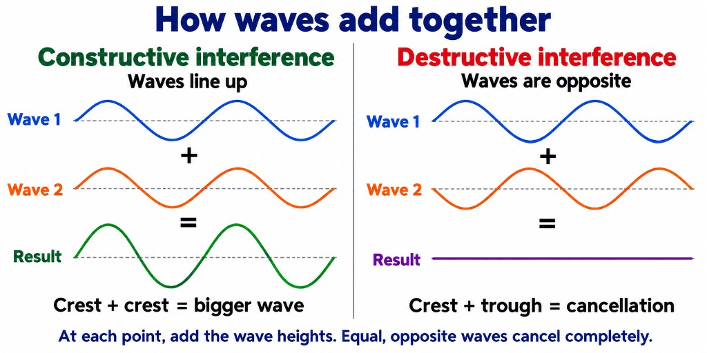
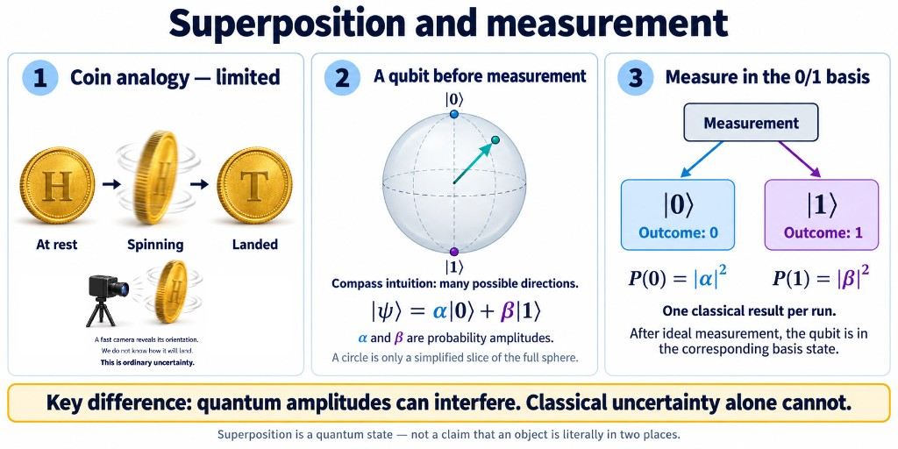
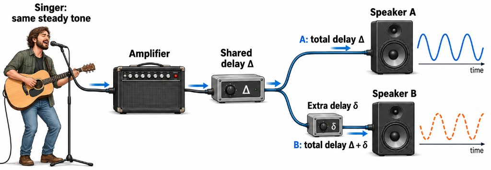

# QC Foundations Part A — Beginner Notes

**Lecturer:** Prof. Kolin Paul (IIT Delhi)  
**Session:** QC Foundations [1/4] — intuition and physics before formal algebra  
**Sources:** `01 QC Foundations Part A.pdf` (slides) and `QC_Foundations_Part_A_Corrected_Transcription.md` (edited transcript)

These notes turn the lecture into a **study guide** for someone **new to quantum computing** who may need a **math refresher** (linear algebra from the previous week is assumed at a gentle level).

**Companion maths (do not skip):** [02 Linear Algebra Refresher for Quantum Computing Notes](../02%20Mathematical%20Foundations%20Part%20A/02%20Linear%20Algebra%20Refresher%20for%20Quantum%20Computing%20Notes.md) — vectors in $\mathbb{C}^2$, inner products, orthonormal bases, Hadamard basis, Parseval.

---

## Table of contents

1. [How this lecture fits the course](#1-how-this-lecture-fits-the-course)
2. [Math you need (short refresher)](#2-math-you-need-short-refresher)
3. [Ket notation — shorthand for column vectors](#3-ket-notation--shorthand-for-column-vectors)
4. [The polarizer puzzle (why quantum?)](#4-the-polarizer-puzzle-why-quantum)
5. [Physical qubits beyond polarization](#5-physical-qubits-beyond-polarization)
6. [Classical bits and measurement](#6-classical-bits-and-measurement)
7. [Superposition — what it means (and what it does not)](#7-superposition--what-it-means-and-what-it-does-not)
8. [One qubit as a state in $\mathbb{C}^2$](#8-one-qubit-as-a-state-in-mathbbc2)
9. [Global phase vs relative phase](#9-global-phase-vs-relative-phase)
10. [Bloch sphere — picturing one qubit](#10-bloch-sphere--picturing-one-qubit)
11. [Six named states on the sphere](#11-six-named-states-on-the-sphere)
12. [Gates as rotations; link to matrices](#12-gates-as-rotations-link-to-matrices)
13. [The X gate (quantum NOT)](#13-the-x-gate-quantum-not)
14. [The H gate (superposition)](#14-the-h-gate-superposition)
15. [The Z gate (phase on the equator)](#15-the-z-gate-phase-on-the-equator)
16. [HZH — building an X from H and Z](#16-hzh--building-an-x-from-h-and-z)
17. [Measurement — shadows, randomness, collapse](#17-measurement--shadows-randomness-collapse)
18. [Polarizers again — filters as measurements](#18-polarizers-again--filters-as-measurements)
19. [Two qubits — product vs entangled](#19-two-qubits--product-vs-entangled)
20. [CNOT and the Bell pair](#20-cnot-and-the-bell-pair)
21. [Three ideas to remember](#21-three-ideas-to-remember)
22. [Glossary](#22-glossary)
23. [Practice questions (with brief answers)](#23-practice-questions-with-brief-answers)

---

# 1. How this lecture fits the course

**Last week (math):** linear algebra over the complex numbers — vectors, inner products, bases, lengths, orthogonality. No heavy calculus.

**This lecture (physics + intuition):** *why* those vectors describe quantum systems, using **polarized light**, **coins**, and the **Bloch sphere**. Very little new algebra; formal Dirac algebra and tensors come in later sessions.

**Professor’s message**

- Quantum computing in this course is **computer science shaped**, but you need a **little physics intuition** (not abstract fantasy — real devices).
- **Complex numbers** are a **notation tool** (like $j$ in impedance), not “unreal magic.”
- Tomorrow / next sessions: more formal math (Amit), then programming demos.

---

# 2. Math you need (short refresher)

If your last math class was long ago, focus on these ideas from the linear-algebra notes:

| Idea | Plain language | Qubit link |
|---|---|---|
| **Vector** | A list of numbers (here, 2 complex numbers) | State of one qubit |
| **Basis** | Two independent directions you measure along | Usually $\lvert 0\rangle$, $\lvert 1\rangle$ (computational basis) |
| **Coordinates** | Scalars that say how much of each basis vector | Often written $\alpha$, $\beta$ |
| **Length squared** | $\lVert\mathbf{v}\rVert^2 = \langle\mathbf{v},\mathbf{v}\rangle$ | Must be $1$ for a **normalized** state |
| **Orthonormal basis** | Perpendicular unit directions | Computational, Hadamard, circular bases in $\mathbb{C}^2$ |

**Probability rule (Born rule, one qubit):** if

$$
\lvert\psi\rangle = \alpha\lvert 0\rangle + \beta\lvert 1\rangle,
$$

then measuring in the computational basis gives outcome $\lvert 0\rangle$ with probability $\lvert\alpha\rvert^2$ and $\lvert 1\rangle$ with probability $\lvert\beta\rvert^2$, and

$$
\lvert\alpha\rvert^2 + \lvert\beta\rvert^2 = 1.
$$

Amplitudes $\alpha,\beta$ are complex; **probabilities** use $\lvert\cdot\rvert^2$.

---

# 3. Ket notation — shorthand for column vectors

**Ket** $\lvert\text{label}\rangle$: a **column vector** written compactly. The label ($\psi$, $\phi$, $0$, $+$, …) is just a **name**, not a magic extra object.

**Computational basis (standard in QC)**

$$
\lvert 0\rangle = \begin{pmatrix}1\\0\end{pmatrix},
\qquad
\lvert 1\rangle = \begin{pmatrix}0\\1\end{pmatrix}.
$$

**General state**

$$
\lvert\psi\rangle = \alpha\lvert 0\rangle + \beta\lvert 1\rangle
\quad\text{(same as column } (\alpha,\beta)^T\text{ in this basis).}
$$

**Bra** $\langle\psi\rvert$: row vector (conjugate transpose). Used later for inner products $\langle\phi\vert\psi\rangle$. This lecture only needs kets.

**Example from slides — $\lvert+\rangle$ (Hadamard “plus”)**

$$
\lvert+\rangle = \frac{1}{\sqrt2}\lvert 0\rangle + \frac{1}{\sqrt2}\lvert 1\rangle.
$$

The factor $1/\sqrt2$ makes the state **unit length** so $\lvert\alpha\rvert^2+\lvert\beta\rvert^2=1$ (here $\tfrac12+\tfrac12=1$).

**Misconception check:** $\lvert+\rangle$ is **one** vector, not “0 and 1 at the same time” as two classical bits. It is one quantum state that yields **random** 0/1 outcomes when measured.

---

# 4. The polarizer puzzle (why quantum?)

**Polarizer:** a filter that only passes light polarized along one direction (sunglasses, camera filters, LCD layers — often polymer films today; historically studied with calcite — **Malus’s law**, $\cos^2\theta$).

**Classical picture (two filters)**

- Horizontal filter, then **vertical** filter: **no light** (vertical blocks what horizontal passed).
- Same directions aligned: light passes (with reduced intensity).

**Quantum puzzle (three filters)**

Order matters. Chain: **horizontal → 45° → vertical** can pass **about 25%** of the light, even though horizontal→vertical alone passes **none**. That pattern is **not** explained by classical “intensity only” stories; the course uses **quantum** amplitudes and measurement.

**Slide mapping (definitions for this lecture)**

| Polarization | Ket (computational) |
|---|---|
| Vertical | $\lvert 0\rangle$ |
| Horizontal | $\lvert 1\rangle$ |
| 45° diagonal | $\lvert+\rangle = \tfrac{1}{\sqrt2}(\lvert 0\rangle+\lvert 1\rangle)$ |

**Takeaway:** **Photon polarization** is a real **physical qubit**. The lecture’s polarizer demo is the hook for superposition, interference, and measurement later in Part A.

*(In class, a video demonstrated the effect; if you missed it, search “three polarizer quantum” or use any Malus-law demo — the logic is in the slides.)*

---

# 5. Physical qubits beyond polarization

A **qubit** = a system with **two stable states** plus **quantum** behavior (superposition, etc.).

| Platform | Two states (informal) |
|---|---|
| **Photon polarization** | Two orthogonal polarizations |
| **Electron spin** | Spin up / spin down |
| **Superconducting circuits** | Two energy levels |
| **Trapped ions** | Two internal levels |
| **NV centers in diamond** | Two spin-related states |

Different hardware (IBM, Google, IonQ, Intel, IIT Delhi, IISc, RRI, …); **same math** for one qubit in $\mathbb{C}^2$.

---

# 6. Classical bits and measurement

**Classical bit:** only **0** or **1** (e.g. 0 V vs 1.8 V; horizontal vs vertical polarization **after** you treat them as definite).

**NOT gate:** $0\leftrightarrow 1$. **Deterministic:** measure the output, you always get the predicted bit.

**Measurement (classical):** read the wire; result is **one bit**, **repeatable**, no randomness.

**Quantum contrast (preview):** one measurement → one bit outcome, but outcomes can be **random** with probabilities $\lvert\alpha\rvert^2$, $\lvert\beta\rvert^2$; repeating on the **same** prepared state gives a **statistics** pattern; after measurement the state **changes** (collapse).

---

# 7. Superposition — what it means (and what it does not)

**Wave intuition:** in everyday physics, two waves at the same place do not “fight for one answer”—their **heights add**.

- **Constructive interference:** crest meets crest (and trough meets trough). The waves are **in phase**; the result is a **larger** wave.
- **Destructive interference:** crest meets trough. The waves are **out of phase**; they can **cancel** to a flat line when the two contributions are equal and opposite.

At every point along the line, you **add the wave heights** (positive up, negative down). That is **linear superposition** in the wave picture.

**Link to qubits (intuition only for now):** a state like $\alpha\lvert 0\rangle + \beta\lvert 1\rangle$ is not “maybe 0, maybe 1” in the classical coin sense. The amplitudes $\alpha$ and $\beta$ are **complex numbers** that can **add or interfere** when you combine operations (gates) before you measure. Probabilities come later from **squaring magnitudes** ($\lvert\alpha\rvert^2$, $\lvert\beta\rvert^2$); interference is about how those amplitudes combine **before** that step. Part A’s circuits (Hadamard, phase gates, Bell states) rely on this wave-like addition.

**Coin intuition (lecture):** we use a spinning coin to *introduce* the words “superposition” and “measurement.” The coin is **only a story**—a real qubit is described by amplitudes $\alpha$ and $\beta$, not by a hidden heads/tails face.

Read the figure **left to right:**

1. **Coin analogy — limited**
   - **At rest:** you see **heads** or **tails** — a definite classical bit.
   - **Spinning:** you **do not know** how it will land yet. That is **ordinary uncertainty**: the coin still has one face at each instant; a fast camera would show it.
   - **Landed:** classical again — one outcome.
   - This is **not** the same as a quantum superposition. It only helps you remember that *before you look*, you may use probabilities.

2. **A qubit before measurement**
   - The state is written $\lvert\psi\rangle = \alpha\lvert 0\rangle + \beta\lvert 1\rangle$.
   - Think **compass / Bloch sphere:** the arrow can point in **many directions** on the sphere (not only north $|0\rangle$ or south $|1\rangle$).
   - $\alpha$ and $\beta$ are **probability amplitudes** (complex numbers). They fix the state **before** you measure. The 2D circle in some drawings is just a **slice** of the full sphere picture.

3. **Measure in the $0/1$ basis**
   - One run of the experiment → **one classical answer:** outcome `0` or `1`.
   - Chances: $P(0) = \lvert\alpha\rvert^2$, $P(1) = \lvert\beta\rvert^2$ (must add to 1).
   - After an ideal measurement, the qubit is left in $\lvert 0\rangle$ or $\lvert 1\rangle$ — the basis state that matched your result.

**Key difference (bottom of the figure):** quantum **amplitudes can interfere** (see wave picture above). Classical “I don’t know which face” **cannot** produce that extra behaviour on its own.

**One line to keep straight:** superposition is a **quantum state** in $\mathbb{C}^2$, not a claim that the object is literally in two places at once.

---

# 8. One qubit as a state in $\mathbb{C}^2$

**State space:** one qubit lives in $\mathbb{C}^2$ (two complex amplitudes).

**General normalized state**

$$
\lvert\psi\rangle = \alpha\lvert 0\rangle + \beta\lvert 1\rangle,
\qquad
\lvert\alpha\rvert^2 + \lvert\beta\rvert^2 = 1.
$$

**Classical vs quantum (picture)**

- **Classical bit:** only the two “corner” states $\lvert 0\rangle$, $\lvert 1\rangle$.
- **Qubit:** any **unit** vector in $\mathbb{C}^2$ (continuum of states until measured).

**Real-plane cartoon:** sometimes drawn in the real $(x,y)$ plane for intuition; true amplitudes are **complex**.

**Dice / six states:** not a qubit — need **two** stable distinguishable states for the basic model.

---

# 9. Global phase vs relative phase

## 9.1 What “phase” means

**Phase** means *where you are within a repeating cycle*. Picture a wave going:

**middle → peak → middle → trough → middle** again.

One full trip is **360°**. A shift of **180°** is half a cycle: a peak becomes a trough.

In formulas, a phase rotation is written $e^{i\phi}$ (Euler’s form). For a qubit, each amplitude can carry its own phase factor.

| Phase angle $\phi$ | Factor $e^{i\phi}$ |
|---|---|
| $0°$ | $1$ |
| $180°$ | $-1$ |
| $360°$ | $1$ again |

**Phase = an angle on the unit circle.** A pure phase is $e^{i\phi}=\cos\phi+i\sin\phi$ — an arrow of length 1 at angle $\phi$. See §7 for wave **interference** (constructive / destructive).

**Interactive phasor explorer** (one arrow, one tone): open [`interactive/phasor-explorer.html`](interactive/phasor-explorer.html) or use the frame below.

<iframe src="interactive/phasor-explorer.html" title="Phase and phasor explorer" width="100%" height="900" style="max-width:1080px;border:1px solid #dce3ef;border-radius:16px;display:block;margin:16px auto;"></iframe>

*Phase is an angle; for interference, **relative** phase between two contributions matters (§9.2–9.3).*

## 9.2 Two speakers: shared delay Δ vs extra delay δ

The lecture’s **two-speaker** picture is about **timing**: the same steady tone splits to two speakers. A **shared delay Δ** hits both branches; an **extra delay δ** on branch B only changes how the waves **add** at your ear.

**Interactive model** (waves + phasors + presets): [`interactive/speaker-phase-corrected.html`](interactive/speaker-phase-corrected.html) — or the frame below if your preview supports it.

<iframe src="interactive/speaker-phase-corrected.html" title="Two speakers: shared and extra delay" width="100%" height="1050" style="max-width:1080px;border:1px solid #d7e0ed;border-radius:12px;display:block;margin:16px auto;"></iframe>

**Try the three presets in the explorer:**

| Preset | What it shows |
|---|---|
| **Start: aligned** | Peaks line up → combined wave stronger (constructive). |
| **Both delayed ¼ cycle** | **Common** phase: both moved, still aligned → same interference as start. |
| **Only B delayed ½ cycle** | **Relative** phase 180° → cancellation at the listener. |

**Takeaways (also in the HTML):** shared Δ rotates both phasors together — interference **strength** unchanged. Extra δ on B only changes the **angle between** the two arrows. Real sound can be compared to an external clock; **quantum global phase** on an isolated state is not observable the same way (§9.3).

## 9.3 Back to qubits

Compare:

$$
\lvert\psi\rangle=\frac{\lvert 0\rangle+\lvert 1\rangle}{\sqrt2},
\qquad
\lvert\chi\rangle=\frac{\lvert 0\rangle-\lvert 1\rangle}{\sqrt2}.
$$

The **minus** on $\lvert 1\rangle$ is a **180° relative phase** between the two amplitudes. Statistics for a direct $0/1$ measurement are the same for both states, but **gates such as $H$ mix amplitudes differently** — interference can **cancel** or **add** (lecture example: $H\lvert+\rangle\to\lvert 0\rangle$).

**Global phase on the whole state:** multiply everything by $-1$:

$$
-\lvert\psi\rangle=\frac{-\lvert 0\rangle-\lvert 1\rangle}{\sqrt2}.
$$

That is $e^{i\pi}\lvert\psi\rangle$ — **both** amplitudes pick up the same factor. **Same** $P(0)$, $P(1)$ as $\lvert\psi\rangle$; unobservable by measurement alone.

| | What moves? | Effect on $0/1$ measurement odds | Effect after gates / interference |
|---|---|---|---|
| **Global phase** | Whole state $\times e^{i\gamma}$ | Unchanged | Unchanged |
| **Relative phase** | Phase of one amplitude vs the other | Can be unchanged for immediate readout | **Can change** — observable via interference |

**Why QC cares:** algorithms prepare **superposition**, then use **relative phase** and gates so **wrong paths cancel** and **right paths reinforce**.

---

# 10. Bloch sphere — picturing one qubit

**Problem:** $\alpha,\beta \in \mathbb{C}$ look like four real numbers — hard to draw.

**Constraints that shrink parameters**

1. **Normalization:** $\lvert\alpha\rvert^2+\lvert\beta\rvert^2=1$ (probabilities sum to 1).
2. **Global phase:** drop one overall $e^{i\gamma}$ (unobservable).

**Result:** any qubit state can be drawn as a point on a **unit sphere** (Bloch sphere) with two angles (latitude $\theta$, longitude $\phi$). Slide form (one common convention):

$$
\lvert\psi\rangle = \cos\frac{\theta}{2}\lvert 0\rangle + e^{i\phi}\sin\frac{\theta}{2}\lvert 1\rangle.
$$

- **North pole:** $\lvert 0\rangle$ — measure $\lvert 0\rangle$ with probability 1.
- **South pole:** $\lvert 1\rangle$ — measure $\lvert 1\rangle$ with probability 1.
- **Equator:** equal $\lvert 0\rvert$ and $\lvert 1\rvert$ probability (e.g. $\lvert+\rangle$, $\lvert-\rangle$, $\lvert\mathrm{i}\rangle$, $\lvert-\mathrm{i}\rangle$).

**Measurement axis:** you measure **one** basis at a time (like projecting a 3D stick’s **shadow** on one ground direction — lecture analogy). You cannot get full “3D information” from one classical readout.

**Coin link:** pole = definite head/tail; equator = 50–50 when measured in computational basis.

---

# 11. Six named states on the sphere

| State | Role |
|---|---|
| $\lvert 0\rangle$, $\lvert 1\rangle$ | Computational basis; **classical** outcomes |
| $\lvert+\rangle$, $\lvert-\rangle$ | Hadamard basis on equator |
| $\lvert\mathrm{i}\rangle$, $\lvert-\mathrm{i}\rangle$ | Circular-basis points (phase on equator) |

$\lvert+\rangle$, $\lvert-\rangle$ are **orthogonal** in $\mathbb{C}^2$ (inner product 0), not “opposite on the globe” in the everyday sense — on the Bloch sphere, $\lvert 0\rangle$ and $\lvert 1\rangle$ are **antipodal** (maximally different).

Plus/minus are Hadamard basis vectors (see math notes: $\mathbf{h}_\pm$, coordinates $a_\pm$).

---

# 12. Gates as rotations; link to matrices

**Gate:** an operation on a qubit — lecture picture: **rotation** on the Bloch sphere.

**Classical NOT:** flip $0\leftrightarrow 1$ → flip north $\leftrightarrow$ south on the sphere.

**Quantum gates are**

- **Linear** (matrices on vectors),
- **Reversible** (unitary — can undo),
- Described for one qubit by **$2\times 2$** matrices (formal session later).

**Classical irreversible example:** AND — output 0 could come from 00, 01, or 10 → cannot recover inputs. Quantum gates avoid this (no AND as a basic reversible gate).

**Sizes:** 1-qubit gate → $2\times 2$; 2-qubit gate → $4\times 4$.

---

# 13. The X gate (quantum NOT)

**Action on computational basis**

$$
X\lvert 0\rangle = \lvert 1\rangle,
\qquad
X\lvert 1\rangle = \lvert 0\rangle.
$$

**Matrix (Pauli X)**

$$
X = \begin{pmatrix}0&1\\1&0\end{pmatrix}.
$$

**Bloch:** $180^\circ$ rotation about an axis that swaps $\lvert 0\rangle\leftrightarrow\lvert 1\rangle$.

**On $\lvert+\rangle$:** $X$ does **not** simply “flip plus to minus” by the same rule as 0/1 — need algebra or sphere picture ($X\lvert+\rangle = \lvert-\rangle$ up to phase conventions).

---

# 14. The H gate (superposition)

**Hadamard gate** — no classical single-bit analog that creates **equal** superposition.

$$
H\lvert 0\rangle = \lvert+\rangle,
\qquad
H\lvert 1\rangle = \lvert-\rangle.
$$

**Matrix (one convention)**

$$
H = \frac{1}{\sqrt2}\begin{pmatrix}1&1\\1&-1\end{pmatrix}.
$$

**Bloch:** moves pole states to **equator** ($\lvert+\rangle$, $\lvert-\rangle$).

**$H^2 = I$:** apply $H$ twice, return to start — like undoing a rotation.

**Interference example (lecture):** $H\lvert+\rangle = \lvert 0\rangle$ because amplitudes from $\lvert 0\rangle$ and $\lvert 1\rangle$ parts **cancel** or **add** (relative phase $-1$ on one path). This is **superposition + interference**, core to quantum algorithms.

**Measurement:** we usually measure in **computational** basis ($\lvert 0\rangle,\lvert 1\rangle$), not “plus/minus” directly. $\lvert+\rangle$ gives 50% 0, 50% 1.

---

# 15. The Z gate (phase on the equator)

**Action (computational basis)**

$$
Z\lvert 0\rangle = \lvert 0\rangle,
\qquad
Z\lvert 1\rangle = -\lvert 1\rangle.
$$

**Matrix**

$$
Z = \begin{pmatrix}1&0\\0&-1\end{pmatrix}.
$$

**Bloch:** rotation about **north–south axis** — **latitude $\theta$ unchanged**, **longitude $\phi$ shifts** (phase on equator).

**Effect on Hadamard states:** $Z\lvert+\rangle = \lvert-\rangle$, $Z\lvert-\rangle = \lvert+\rangle$ (swap on equator).

**No classical NOT-like meaning:** only adds a **phase** on $\lvert 1\rangle$ component.

---

# 16. HZH — building an X from H and Z

**Circuit:** $H \to Z \to H$.

**On $\lvert 0\rangle$:** $H\to\lvert+\rangle$, $Z\to\lvert-\rangle$, $H\to\lvert 1\rangle$.

**On $\lvert 1\rangle$:** end at $\lvert 0\rangle$.

So **$HZH = X$** (same as NOT on computational basis).

**Why care:** hardware may prefer native $H$ and $Z$; you can **compose** gates to emulate others.

---

# 17. Measurement — shadows, randomness, collapse

**Instrument analogy:** tape for length, radar for distance — you interact with the system.

**Tree shadow analogy:** sunlight casts a **1D shadow** on the ground — you learn a **projection**, not full 3D shape in one shot.

**Qubit**

- State $\lvert\psi\rangle$ before measurement.
- Choose **basis** (usually computational).
- Outcome **0** or **1** with probabilities $\lvert\alpha\rvert^2$, $\lvert\beta\rvert^2$.
- **After** measurement: state **collapses** to the outcome (e.g. measured $\lvert 0\rangle$ → repeat measurement gives 0 with probability 1).

**Destroys superposition:** like billiards — probing disturbs the system.

**Not the same as coin flip:** $\lvert+\rangle$ gives 50–50, but applying $H$ again returns $\lvert 0\rangle$ — **phase structure** matters; a classical random bit does not.

**Statistics:** one run = one bit; many runs estimate probabilities.

---

# 18. Polarizers again — filters as measurements

Each filter **measures** polarization in its own direction and **removes** the orthogonal component — **destroys** earlier superposition.

**Sketch of 25% (H → 45° → V chain, intensity language from slides)**

- First filter (e.g. horizontal): roughly half intensity (unpolarized → one line).
- Second (45°): fraction passes depending on angle (Malus).
- Third (vertical): another projection.

Combined probability for photons to survive all three can be **$\tfrac14$** in the standard quantum calculation — the lecture’s **25%** headline. (Exact factors depend on unpolarized vs already filtered input; trust the slide’s quantum account for the course.)

**Four-step story (lecture):** qubit state → superposition → interference → measurement.

**Plus vs minus:** same $\lvert 0\rvert^2,\lvert 1\rvert^2$ statistics, but **different** after $H$ — **relative phase** is **physical** (observable via gates).

**Global phase:** still unobservable; algorithms focus on **relative** phase.

---

# 19. Two qubits — product vs entangled

**Two independent qubits (no interaction):** state space **$\mathbb{C}^2 \otimes \mathbb{C}^2$** → dimension **4**. Basis kets:

$$
\lvert 00\rangle,\ \lvert 01\rangle,\ \lvert 10\rangle,\ \lvert 11\rangle.
$$

**Product state:** each qubit has its own story (clock + weighing scale at the shop — independent).

**Entangled state:** cannot write as “qubit A state $\times$ qubit B state.” Measuring one **correlates** the other (sleep at 4 am ↔ jog at 5 am — correlated, not independent).

**Amplitude count:** $n$ qubits → $2^n$ complex amplitudes (e.g. 10 qubits → 1024 numbers).

**Tensor product $\otimes$:** formal way to combine spaces (covered in math follow-up). Symbol $\lvert 0\rangle\otimes\lvert 1\rangle = \lvert 01\rangle$.

---

# 20. CNOT and the Bell pair

**CNOT (controlled-NOT):** 2-qubit gate.

- **Control** qubit: if $\lvert 0\rangle$, do nothing on target; if $\lvert 1\rangle$, flip target ($X$ on target).
- Classical truth table on $\lvert 00\rangle,\lvert 01\rangle,\lvert 10\rangle,\lvert 11\rangle$ matches reversible XOR pattern.

**Cannot** be written as separate 1-qubit gates on each line — **creates entanglement**.

**Bell pair (EPR / $\lvert\Phi^+\rangle$) — recipe from slides**

1. Start $\lvert 00\rangle$.
2. $H$ on first qubit: $\tfrac{1}{\sqrt2}(\lvert 00\rangle+\lvert 10\rangle)$.
3. CNOT (control first, target second): $\tfrac{1}{\sqrt2}(\lvert 00\rangle+\lvert 11\rangle)$.

**Measurement:** measure one qubit → other **instantly correlated** (0 with 0, 1 with 1). **Does not** send faster-than-light **signals**, but correlations are real and tested in experiments.

**Not a point on a single-qubit Bloch sphere** — lives in the **four-dimensional** two-qubit space.

---

# 21. Three ideas to remember

| # | Idea | Lecture hook |
|---|---|---|
| 1 | **Superposition** | Polarizer, $H$ gate, $\lvert+\rangle$ |
| 2 | **Interference** | $H\lvert+\rangle\to\lvert 0\rangle$, relative phase, $H$–$Z$–$H$ |
| 3 | **Entanglement** | CNOT, Bell pair, EPR |

**Plus:** measurement is **probabilistic**, **basis-dependent**, and **collapses** the state.

**Next in course:** formal linear maps, tensors, simulators / browser labs, quantum algorithms.

---

# 22. Glossary

| Term | Meaning |
|---|---|
| **Qubit** | Quantum two-level system; state in $\mathbb{C}^2$ (normalized) |
| **Computational basis** | $\lvert 0\rangle$, $\lvert 1\rangle$ |
| **Amplitude** | Complex coefficient $\alpha,\beta$ before measurement |
| **Born rule** | Probability = $\lvert\text{amplitude}\rvert^2$ |
| **Superposition** | Linear combination $\alpha\lvert 0\rangle+\beta\lvert 1\rangle$ |
| **Gate** | Unitary operation (rotation on Bloch sphere) |
| **$X$** | Quantum NOT / bit flip |
| **$H$** | Hadamard; creates $\lvert+\rangle,\lvert-\rangle$ from poles |
| **$Z$** | Phase flip on $\lvert 1\rangle$ |
| **Bloch sphere** | Unit-sphere picture of one qubit |
| **Global phase** | Overall $e^{i\gamma}$; unobservable alone |
| **Relative phase** | Phase difference between amplitudes; observable via interference |
| **Measurement** | Basis-dependent random outcome; collapses state |
| **Product state** | Two qubits independent |
| **Entanglement** | Non-product joint state; correlated measurements |
| **CNOT** | Controlled-NOT; entangling gate |
| **Bell pair** | $\tfrac{1}{\sqrt2}(\lvert 00\rangle+\lvert 11\rangle)$ |

---

# 23. Practice questions (with brief answers)

1. **Why use complex numbers?**  
   Compact notation for phase and interference; probabilities stay real via $\lvert\cdot\rvert^2$.

2. **Horizontal then vertical polarizer — light?**  
   Essentially none (orthogonal filters).

3. **Why insert 45° between H and V?**  
   Quantum amplitudes allow transmission where classical “blocking” story fails; ~25% in standard demo.

4. **Write $\lvert+\rangle$ in numbers.**  
   $\tfrac{1}{\sqrt2}(1,1)^T$ in computational basis.

5. **If $\lvert\psi\rangle=\lvert+\rangle$, what are $P(0)$, $P(1)$?**  
   Both $\tfrac12$.

6. **After measuring $\lvert+\rangle$ and getting 0, what is the state?**  
   $\lvert 0\rangle$; next measurement gives 0 with probability 1.

7. **$H^2$ on any state?**  
   Returns original state ($H$ is self-inverse up to the usual definition).

8. **What does $Z$ do to $\lvert+\rangle$?**  
   $\lvert-\rangle$ (phase on equator).

9. **$HZH\lvert 1\rangle$?**  
   $\lvert 0\rangle$ (behaves like $X$).

10. **How many amplitudes for 3 qubits?**  
    $2^3 = 8$.

11. **Bell pair: measure first qubit 0 — second qubit?**  
    $\lvert 0\rangle$ with certainty (correlation).

12. **Is CNOT a product of single-qubit gates?**  
    No — it is genuinely two-qubit (entangling).

---

*End of Part A notes. Part B continues in the next lecture file and transcription.*
