# 03 — Problem Solving on Quantum Computing Foundations

## Contents

1. [The big picture: why are we studying this?](#1-the-big-picture-why-are-we-studying-this)
2. [Math refresher: numbers, vectors, complex numbers and length](#2-math-refresher-numbers-vectors-complex-numbers-and-length)
3. [Inner products, orthogonality and orthonormal bases](#3-inner-products-orthogonality-and-orthonormal-bases)
4. [Changing basis: standard versus Hadamard](#4-changing-basis-standard-versus-hadamard)
5. [What exactly is a single qubit?](#5-what-exactly-is-a-single-qubit)
6. [Measurement and why the basis changes the result](#6-measurement-and-why-the-basis-changes-the-result)
7. [Linear maps: changing a vector without measuring](#7-linear-maps-changing-a-vector-without-measuring)
8. [Why a linear map can be written as a matrix](#8-why-a-linear-map-can-be-written-as-a-matrix)
9. [How to read geometrical transformations](#9-how-to-read-geometrical-transformations)
10. [Three quantum gates: X, Z and H](#10-three-quantum-gates-x-z-and-h)
11. [Applying gates in sequence: order matters](#11-applying-gates-in-sequence-order-matters)
12. [Projection, bras, kets and outer products](#12-projection-bras-kets-and-outer-products)
13. [The adjoint and Hermitian matrices](#13-the-adjoint-and-hermitian-matrices)
14. [Invertible maps: can we undo the operation?](#14-invertible-maps-can-we-undo-the-operation)
15. [Unitary matrices: what makes a valid quantum gate?](#15-unitary-matrices-what-makes-a-valid-quantum-gate)
16. [Putting the entire lesson together](#16-putting-the-entire-lesson-together)
17. [Questions asked in class and common confusions](#17-questions-asked-in-class-and-common-confusions)
18. [Practice questions with detailed answers](#18-practice-questions-with-detailed-answers)
19. [Formula sheet and glossary](#19-formula-sheet-and-glossary)

---

## 1. The big picture: why are we studying this?

A **classical bit** has value `0` or `1`. A **qubit** is described by a vector of two complex-number *amplitudes*. When we **measure** the qubit, we obtain a classical outcome, but before measurement the state can be a superposition.

During quantum computation we want to do three different things. They are easy to confuse, so keep them separate:

| Action | Plain-English meaning | Math language |
|---|---|---|
| Describe the state | Write what the qubit currently is | A vector $\lvert\psi\rangle$ |
| Change the state | Apply a gate **without reading the qubit** | A linear map / unitary matrix $U$ |
| Read the state | Perform a measurement in a chosen basis | Probabilities from squared amplitudes; state changes after measurement |

The lecture focuses on the mathematics that connects these actions: **vectors → bases → measurements → linear maps → matrices → quantum gates → unitary matrices**.

You **do not** need to visualize every complex-number vector in ordinary 2D space. A 2D drawing is a teaching analogy. What matters is learning to calculate reliably.

If you understand *orthonormal bases* and *how a matrix acts on the basis vectors*, much of the first part of quantum computing becomes easier.

---

## 2. Math refresher: numbers, vectors, complex numbers and length

### 2.1 Start with something familiar: a vector is an arrow

In a real 2D plane, the vector

$$
\mathbf v=\begin{pmatrix}2\\3\end{pmatrix}
$$

means: start at the origin $(0,0)$, move **2 right** and **3 up**. You reach $(2,3)$. The same vector is often written $(2,3)$ horizontally; the column is convenient for matrix multiplication.

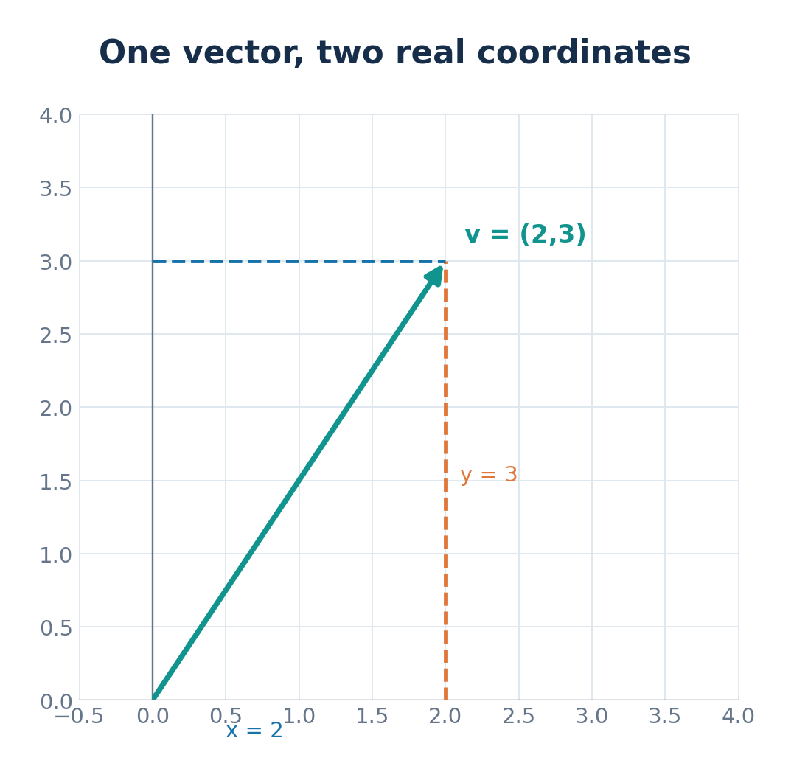

Its length is the Pythagorean distance:

$$
\|\mathbf v\|=\sqrt{2^2+3^2}=\sqrt{13}.
$$

The two entries $2$ and $3$ are **coordinates**. They are numbers that describe the vector relative to chosen axes; the vector itself is not literally an addition of two unrelated numbers.

### 2.2 What is a complex number?

A complex number has a **real part** and an **imaginary part**:

$$z=a+ib,\qquad i^2=-1.$$

For example, $z=2+3i$ has real part 2 and imaginary part 3. You can draw **this one complex number** as an arrow in its own plane: horizontal coordinate 2, vertical coordinate 3.

Its **magnitude** (distance from origin) is

$$|2+3i|=\sqrt{2^2+3^2}=\sqrt{13}.$$

Its **complex conjugate** is obtained by reversing the sign in front of $i$:

$$\overline{2+3i}=2-3i.$$

A very useful identity is

$$
|z|^2=\overline z\,z=a^2+b^2.
$$

For instance,

$$
|2+3i|^2=(2-3i)(2+3i)=4+9=13.
$$

**Why the conjugate?** Without it, squaring a complex number can give a negative or complex result. Multiplying a number by its conjugate gives a **nonnegative real number**—exactly what we need when dealing with lengths and probabilities.

### 2.3 What is a vector of complex numbers?

This is a common confusion. Compare:

- $2+3i$ is **one complex number**.
- $(2,3)$ is **two real numbers**, i.e. one vector in $\mathbb R^2$.
- $(1+i,2-3i)$ is **two complex numbers**, i.e. one vector in $\mathbb C^2$.

The last vector contains the real information

$$
(\underbrace{1,1}_{\text{first complex number}},\;\underbrace{2,-3}_{\text{second complex number}}).
$$

That is **four real coordinates**, not two. You can draw each complex entry in a separate complex plane, but you cannot show all four independent real coordinates with a single ordinary 2D arrow.

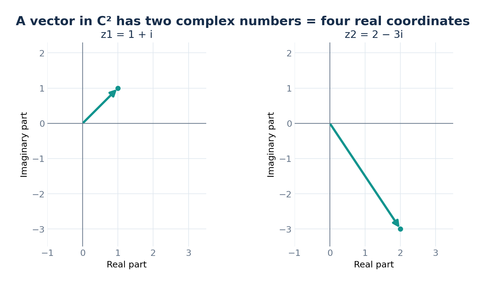

**Important distinction:** Saying $\mathbb C^2$ has *complex dimension 2* is compatible with saying it has *real dimension 4*. Each complex dimension carries two real numbers.

### 2.4 How do we find the length of a complex vector?

For a vector $\mathbf v=(z_1,z_2)^T$, the symbol $\|\mathbf v\|$ is the **norm** (length) of the vector:

$$
\|\mathbf v\|=\sqrt{|z_1|^2+|z_2|^2}.
$$

For example, $\mathbf v=(1+i,2)^T$ has

$$
\|\mathbf v\|^2=|1+i|^2+|2|^2=2+4=6,
\quad\|\mathbf v\|=\sqrt6.
$$

A **unit vector** has length exactly 1. A qubit state must be represented by a unit vector.

> **Pause and try:** Is $(1,1)^T$ a unit vector? No. Its length is $\sqrt2$. Dividing each coordinate by $\sqrt2$ makes it a unit vector.

---

## 3. Inner products, orthogonality and orthonormal bases

### 3.1 What is an inner product?

For real vectors, the familiar dot product is

$$
(2,3)\cdot(4,5)=2(4)+3(5)=23.
$$

For **complex vectors**, the lecture uses a modified rule. If

$$
\mathbf u=\begin{pmatrix}u_1\\u_2\end{pmatrix},\qquad
\mathbf v=\begin{pmatrix}v_1\\v_2\end{pmatrix},
$$

then the inner product is

$$
\boxed{\langle\mathbf u,\mathbf v\rangle
=\overline{u_1}v_1+\overline{u_2}v_2
=\mathbf u^\dagger\mathbf v.}
$$

**How to calculate it:** (1) conjugate the first vector; (2) turn that column into a row; (3) multiply corresponding entries and add.

**Worked complex example.** Let $\mathbf u=(1+i,2)^T$ and $\mathbf v=(i,3)^T$. Then

$$
\begin{aligned}
\langle\mathbf u,\mathbf v\rangle
&=(1-i)i+2(3)\\
&=i-i^2+6\\
&=7+i.
\end{aligned}
$$

The symbol $\dagger$, pronounced **dagger**, means *conjugate transpose*. We will revisit it for matrices.

### 3.2 Why do we need an inner product?

The inner product lets us calculate **lengths**, **orthogonality** and **coordinates in an orthonormal basis**.

For length:

$$
\langle\mathbf v,\mathbf v\rangle=\|\mathbf v\|^2.
$$

For orthogonality (perpendicular directions):

$$
\boxed{\langle\mathbf u,\mathbf v\rangle=0.}
$$

For example, $(1,0)$ and $(0,1)$ have inner product $0$ and so are perpendicular. In $\mathbb C^n$, the equation $\langle u,v\rangle=0$ is how we **define** orthogonality, even when we cannot draw the vectors.

### 3.3 Basis means independent directions sufficient to build any vector

In 2D, take

$$
\mathbf e_1=\begin{pmatrix}1\\0\end{pmatrix},\qquad
\mathbf e_2=\begin{pmatrix}0\\1\end{pmatrix}.
$$

Then every vector $(x,y)$ can be built as

$$
\underbrace{\begin{pmatrix}x\\y\end{pmatrix}}_{\text{vector}}
=x\underbrace{\begin{pmatrix}1\\0\end{pmatrix}}_{\mathbf e_1}
+y\underbrace{\begin{pmatrix}0\\1\end{pmatrix}}_{\mathbf e_2}.
$$

Why the **sum**? Because vector addition combines separate movements: $x$ units along one direction **plus** $y$ units along the other. This is different from trying to write $\mathbf v=\alpha+\beta$, which adds two *numbers*, not two basis-direction contributions.

A **basis** must both span the space and contain no redundant direction. A basis does **not** have to be orthogonal. In quantum computing we usually choose **orthonormal** ones because they simplify the calculations.

### 3.4 What does orthonormal mean?

**Ortho = perpendicular; normal = length 1.** An orthonormal basis (ONB) therefore satisfies

$$
\langle\mathbf e_i,\mathbf e_j\rangle=
\begin{cases}1,&i=j,\\0,&i\ne j.\end{cases}
$$

If $\mathbf v$ is expanded as $\mathbf v=\alpha_1\mathbf e_1+\alpha_2\mathbf e_2$, the **simplest way to find coordinates** is

$$
\boxed{\alpha_j=\langle\mathbf e_j,\mathbf v\rangle.}
$$

For a basis that is not orthonormal, these two straightforward inner products are generally **not** the coordinates.

---

## 4. Changing basis: standard versus Hadamard

> **Interactive lesson (recommended before the algebra):** Open **[Standard ↔ Hadamard basis](animations/standard_to_hadamard_basis.html)** in Chrome (file sits in the `animations` folder next to this note). Two panels show the **same arrow** while you change only the measuring directions. Use **Play** for the eight-step walkthrough, sliders for your own $(x,y)$, and step 8 for the matrix $H$ versus the Hadamard **gate**. The animation stresses an easy intuition: *the vector in the plane does not move; only its coordinate numbers change.*

### 4.1 A basis is like choosing a new pair of measuring directions

Suppose a point in a room stays fixed, but you rotate your ruler and the directions in which you measure distances. Its *coordinates* change even though the point has not moved.

The standard basis is $\mathbf e_1=(1,0)^T,\ \mathbf e_2=(0,1)^T$. The **Hadamard basis** is

$$
\boxed{\begin{aligned}
\mathbf h_+&=\frac1{\sqrt2}\begin{pmatrix}1\\1\end{pmatrix},\\
\mathbf h_-&=\frac1{\sqrt2}\begin{pmatrix}1\\-1\end{pmatrix}.
\end{aligned}}
$$

In a real-plane drawing these correspond to the diagonal directions $+45^\circ$ and $-45^\circ$, which are perpendicular. The names $h_+$ and $h_-$ do not mean addition/subtraction of vectors by themselves: they are **names of two basis vectors**.

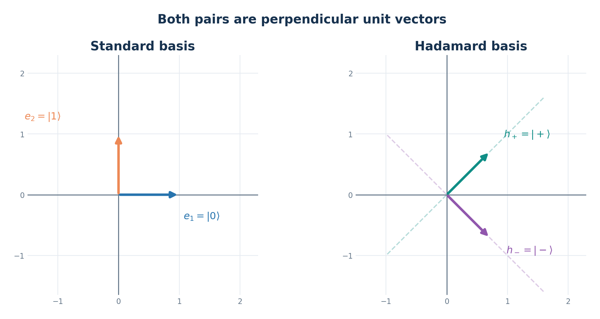

Check their lengths:

$$
\|\mathbf h_+\|^2=\tfrac12+\tfrac12=1,\qquad
\|\mathbf h_-\|^2=1.
$$

Check perpendicularity:

$$
\langle\mathbf h_+,\mathbf h_-\rangle
=\tfrac12(1-1)=0.
$$

### 4.2 The example: point $(4,5)$ in two bases

Originally,

$$
\mathbf p=\begin{pmatrix}4\\5\end{pmatrix}=4\mathbf e_1+5\mathbf e_2.
$$

What are its coordinates relative to $\mathbf h_+$ and $\mathbf h_-$? Call them $a_+$ and $a_-$. The coordinate rule gives

$$
\begin{aligned}
a_+&=\langle\mathbf h_+,\mathbf p\rangle
=\frac1{\sqrt2}(4+5)=\frac9{\sqrt2},\\
a_-&=\langle\mathbf h_-,\mathbf p\rangle
=\frac1{\sqrt2}(4-5)=-\frac1{\sqrt2}.
\end{aligned}
$$

Therefore,

$$
\boxed{\mathbf p=\frac9{\sqrt2}\mathbf h_+
-\frac1{\sqrt2}\mathbf h_-.}
$$

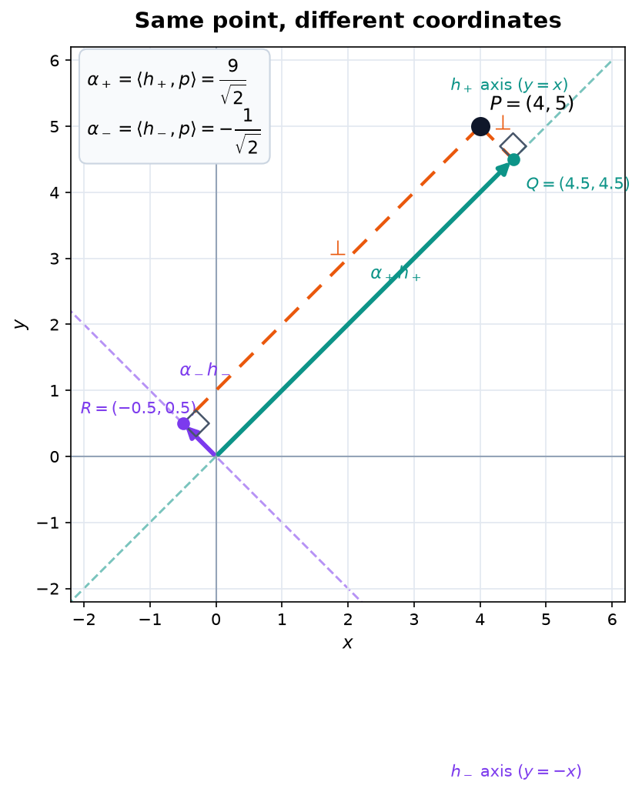

**Check the answer** instead of merely memorizing it:

$$
\begin{aligned}
\tfrac9{\sqrt2}\mathbf h_+-\tfrac1{\sqrt2}\mathbf h_-
&=\tfrac92\begin{pmatrix}1\\1\end{pmatrix}
-\tfrac12\begin{pmatrix}1\\-1\end{pmatrix}\\
&=\begin{pmatrix}4\\5\end{pmatrix}.
\end{aligned}
$$

The point is still $(4,5)$ in the original coordinate system. Its *new coordinate pair* is $(9/\sqrt2,-1/\sqrt2)$.

### 4.3 Two easily confused statements about Hadamard

1. The **Hadamard basis vectors** point along diagonals in the real-plane drawing.
2. The **Hadamard gate** is the *specific matrix* $H=\tfrac1{\sqrt2}\left(\begin{smallmatrix}1&1\\1&-1\end{smallmatrix}\right)$, which maps the old standard basis to those two vectors.

> **Pause and try:** What are the coordinates of $(1,0)$ in the Hadamard basis? Answer: $(1/\sqrt2,1/\sqrt2)$.

---

## 5. What exactly is a single qubit?

### 5.1 The computational basis states are ordinary column vectors

Quantum notation gives these vectors special names:

$$
\boxed{|0\rangle=\begin{pmatrix}1\\0\end{pmatrix},\qquad
|1\rangle=\begin{pmatrix}0\\1\end{pmatrix}.}
$$

Read $|0\rangle$ aloud as **ket zero**, and $|1\rangle$ as **ket one**. The upright bar and angled bracket are part of the name; they do not mean absolute value.

The general one-qubit state is

$$
\boxed{|\psi\rangle=\alpha|0\rangle+\beta|1\rangle
=\begin{pmatrix}\alpha\\\beta\end{pmatrix},\quad \alpha,\beta\in\mathbb C.}
$$

Here $\alpha$ and $\beta$ are complex **amplitudes** (coefficients), not necessarily probabilities.

### 5.2 Why do we use a *sum* of basis states?

Because $|0\rangle$ and $|1\rangle$ form a basis. In any basis, a vector is a **linear combination of basis vectors**. The expression $\alpha|0\rangle+\beta|1\rangle$ is precisely the quantum version of $(x,y)=x(1,0)+y(0,1)$.

In physics this linear combination is called **superposition**. It does **not** mean that, before measuring, the qubit has a known classical 0 or classical 1 hiding somewhere.

### 5.3 Why must amplitudes be normalized?

A qubit is a unit vector:

$$
\boxed{\langle\psi|\psi\rangle=|\alpha|^2+|\beta|^2=1.}
$$

Consider the unnormalized vector $|0\rangle+|1\rangle$. Its squared length is $1^2+1^2=2$, so it is **not** normalized. Divide by $\sqrt2$:

$$
\boxed{|+\rangle=\frac{|0\rangle+|1\rangle}{\sqrt2}.}
$$

Now $|1/\sqrt2|^2+|1/\sqrt2|^2=1/2+1/2=1$.

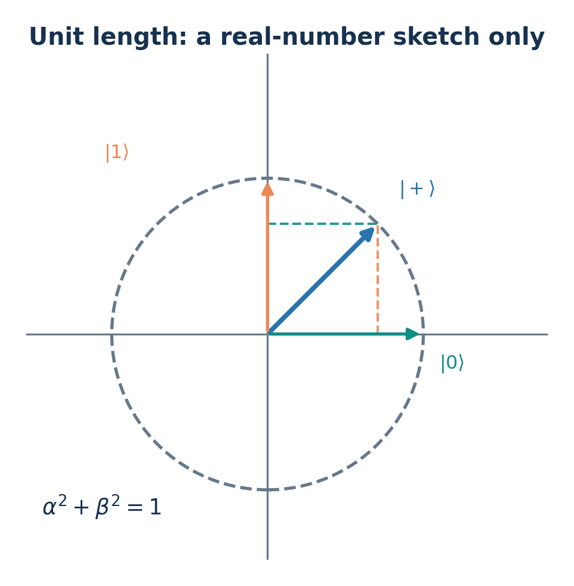

**Important:** The unit-circle picture is only for real amplitudes. Because $\alpha$ and $\beta$ can be complex, a single qubit is not literally an arrow drawn in a simple 2D circle. The Bloch-sphere picture from the earlier lecture is a more useful way of representing *physical* pure-qubit states.

### 5.4 Why not allow arbitrary amplitudes such as 3 and 4?

The vector $3|0\rangle+4|1\rangle$ has squared length $3^2+4^2=25$. Divide by its length 5:

$$
|\psi\rangle=\frac35|0\rangle+\frac45|1\rangle.
$$

Now $9/25+16/25=1$. The word **normalization** simply means rescaling the total length to 1.

### 5.5 Probabilities are the *squared magnitudes* of amplitudes

If we measure in the computational basis, the basic quantum measurement rule says

$$
\boxed{P(0)=|\alpha|^2,\qquad P(1)=|\beta|^2.}
$$

For $|\psi\rangle=(\sqrt3/2)|0\rangle+(1/2)|1\rangle$:

$$
P(0)=\left|\frac{\sqrt3}2\right|^2=\frac34=75\%,\quad
P(1)=\left|\frac12\right|^2=\frac14=25\%.
$$

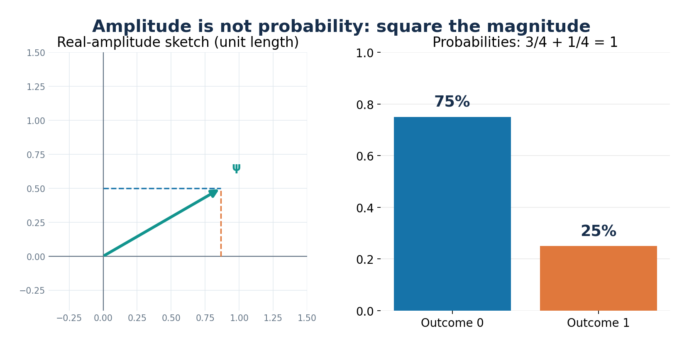

The square of a magnitude, $|\alpha|^2$, is not the same as $\alpha^2$ if $\alpha$ is complex. For example $|i|^2=1$ but $i^2=-1$. **A probability cannot be $-1$.**

---

## 6. Measurement and why the basis changes the result

### 6.1 What is measurement actually doing?

Imagine a measuring instrument set up to distinguish two **orthonormal** states. For the computational basis it has two possible classical output labels, `0` and `1`. For the Hadamard basis it has `+` and `−`.

The rules for an ideal projective measurement in a two-vector ONB $\{|b_1\rangle,|b_2\rangle\}$ are:

1. Express the state in **that** basis: $|\psi\rangle=c_1|b_1\rangle+c_2|b_2\rangle$.
2. Possible results are the two basis labels, with probabilities $|c_1|^2$ and $|c_2|^2$.
3. Immediately after the measurement, if result $b_j$ occurred, the state is $|b_j\rangle$.

**The rule is a postulate of quantum mechanics.**

### 6.2 Example A: measure $|+\rangle$ in the computational basis

We know

$$
|+\rangle=\frac1{\sqrt2}|0\rangle+\frac1{\sqrt2}|1\rangle.
$$

Therefore $P(0)=1/2$ and $P(1)=1/2$. You do **not** get both outcomes at once in a single measurement. One run produces **one** outcome. If the experiment is reset and repeated many times, approximately half the outcomes will be 0 and half 1.

### 6.3 Example B: measure the same $|+\rangle$ in the Hadamard basis

The Hadamard basis is $\{|+\rangle,|-\rangle\}$, where

$$
|-\rangle=\frac{|0\rangle-|1\rangle}{\sqrt2}.
$$

The input is already exactly $|+\rangle$:

$$
|+\rangle=1\cdot|+\rangle+0\cdot|-\rangle.
$$

Therefore $P(+)=1$, $P(-)=0$. **Same input state, different chosen measurement basis, different result probabilities.**

### 6.4 Example C: measure $|0\rangle$ in the Hadamard basis

Express it using the Hadamard basis:

$$
\boxed{|0\rangle=\frac{|+\rangle+|-\rangle}{\sqrt2}.}
$$

Thus $P(+)=1/2$ and $P(-)=1/2$. Yet measuring $|0\rangle$ in the *computational* basis gives 0 with 100% probability.

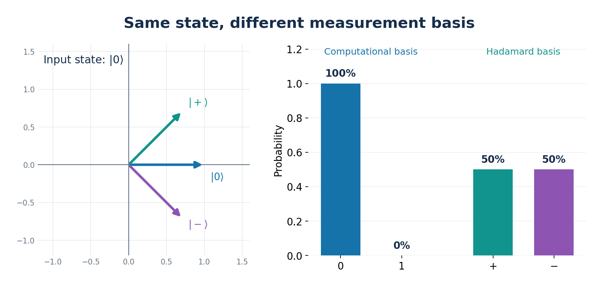

### 6.5 Why measurement is not just another gate

After measuring $|+\rangle$ in the computational basis and observing `0`, the state has become $|0\rangle$. From that result alone you cannot recover that the original state was $|+\rangle$: many different pre-measurement states could have produced `0`.

A unitary **gate** changes the quantum state reversibly without revealing a classical outcome. An ideal projective **measurement** reveals an outcome and generally causes an irreversible loss of information about an unknown input state.

> **The central idea:** Measurement probability is calculated from the coordinates **in the measurement basis**, not just from any pair of numbers attached to the state.

---

## 7. Linear maps: changing a vector without measuring

### 7.1 What is a map?

A map (function) is a rule that takes an input and gives an output. Example: $f(x)=2x$ takes 3 to 6. For vectors, a map might take $(x,y)$ to $(2x,2y)$, or rotate every arrow by the same angle.

The lecture uses the notation

$$T:V\to W,\qquad \mathbf v\mapsto T(\mathbf v).$$

Read this as “a transformation called $T$ takes vectors from space $V$ into space $W$.” The dimensions of $V$ and $W$ do not have to be equal for a general linear map.

### 7.2 What makes the map *linear*?

A map is linear when it respects **addition** and **scalar multiplication**:

$$
\boxed{\begin{aligned}
T(\mathbf u+\mathbf v)&=T(\mathbf u)+T(\mathbf v),\\
T(c\mathbf v)&=cT(\mathbf v).
\end{aligned}}
$$

Combine these two statements:

$$
\boxed{T(a\mathbf u+b\mathbf v)=aT(\mathbf u)+bT(\mathbf v).}
$$

For quantum computing, the scalars $a,b$ may be **complex**.

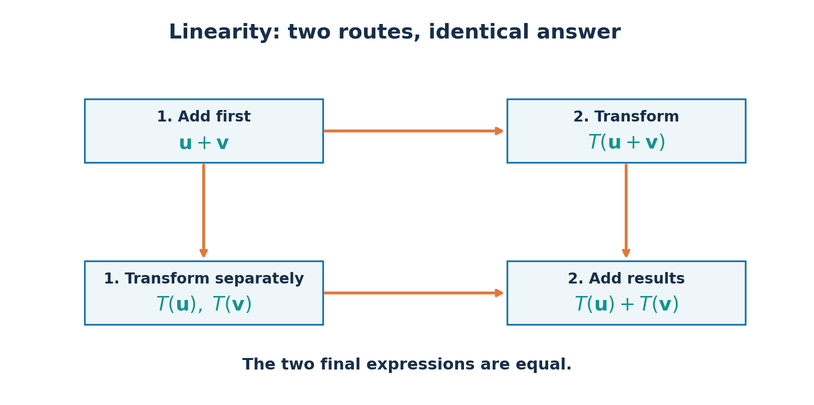

An intuitive analogy is a **consistent rule for moving arrows**: if you know how a linear rule transforms two arrows, you automatically know how it transforms their sum and any scaled versions.

### 7.3 A concrete example: double every coordinate

> **Interactive demo:** Open **[One transformation, two routes](animations/linearity_double_every_coordinate.html)** (in the `animations` folder). Side-by-side panels animate $T(x,y)=(2x,2y)$ with $\mathbf u=(1,2)$ and $\mathbf v=(3,1)$: **add then transform** versus **transform then add**, and the scaling check $T(3\mathbf u)=3T(\mathbf u)$. Use **Play** or **Next step**; switch examples with the dropdown.

Let $T(x,y)=(2x,2y)$. Choose $\mathbf u=(1,2)$ and $\mathbf v=(3,1)$.

**Add first, then transform:**

$$
T(\mathbf u+\mathbf v)=T(4,3)=(8,6).
$$

**Transform first, then add:**

$$
T(\mathbf u)+T(\mathbf v)=(2,4)+(6,2)=(8,6).
$$

Both routes agree. The scaling rule works too: $T(3\mathbf u)=T(3,6)=(6,12)=3T(\mathbf u)$.

### 7.4 An operation that is NOT linear: shift every point right by 1

Suppose

$$T(x,y)=(x+1,y).$$

Then $T(0,0)=(1,0)$. But every linear map has to obey

$$\boxed{T(\mathbf 0)=\mathbf 0.}$$

Why? $T(2\cdot\mathbf0)=2T(\mathbf0)$, but $2\cdot\mathbf0=\mathbf0$. The only vector equal to twice itself is the zero vector. Hence $T(\mathbf0)=\mathbf0$.

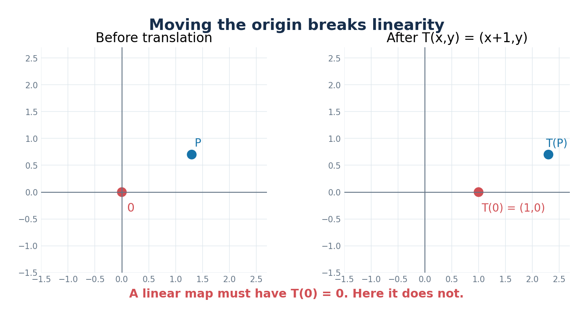

The origin test is **necessary, not sufficient**: a map can send $\mathbf 0$ to $\mathbf 0$ and still break the addition or scaling rules. Below are the two further on-examples. Both are worth understanding slowly, because they look like harmless "rules on vectors" but fail the same tests you checked in §7.3.

#### 7.4.1 Non-example A: $T(\mathbf v)=\|\mathbf v\|$ (take the length)

Here the **input** is a vector and the **output is one number**—its length (a nonnegative real). So $T$ might send $\mathbb R^2$ or $\mathbb C^2$ into $\mathbb R$. That different sizes of spaces is allowed in general; this particular $T$ is still **not linear**.

**What linearity would demand**

$$
T(\mathbf u+\mathbf v)=T(\mathbf u)+T(\mathbf v),
\qquad
T(c\mathbf v)=c\,T(\mathbf v).
$$

**Addition fails (concrete 2D picture).** Let $\mathbf u=(1,0)$ and $\mathbf v=(0,1)$.

$$
T(\mathbf u+\mathbf v)=\|(1,1)\|=\sqrt2,
\qquad
T(\mathbf u)+T(\mathbf v)=1+1=2.
$$

So $T(\mathbf u+\mathbf v)\neq T(\mathbf u)+T(\mathbf v)$. Intuitively: lengths do not add when you add arrows—the hypotenuse $\|(1,1)\|$ is not $1+1$.

**Scaling fails too.** For $\mathbf v\neq\mathbf 0$ and a **negative** real scalar, say $c=-2$:

$$
T(c\mathbf v)=\|c\mathbf v\|=|c|\,\|\mathbf v\|=2\|\mathbf v\|,
\qquad
c\,T(\mathbf v)=-2\|\mathbf v\|.
$$

So $T(c\mathbf v)\neq c\,T(\mathbf v)$ in general. (For complex scalars the same kind of failure appears because $|c|$ is not the same as multiplying by $c$.)

**Summary:** $T(\mathbf v)=\|\mathbf v\|$ **does** satisfy $T(\mathbf 0)=0$, but it violates both linearity rules. That is why the slide lists it as a non-example even though it "only measures size."

#### 7.4.2 Non-example B: coordinatewise complex conjugation (not **complex**-linear)

Define $T$ on a column of complex numbers by conjugating **each entry** (no transpose):

$$
T\begin{pmatrix} z_1 \\ z_2 \end{pmatrix}
=
\begin{pmatrix} \overline{z_1} \\ \overline{z_2} \end{pmatrix}.
$$

**Addition is fine:** $\overline{z_1+z_2}=\overline{z_1}+\overline{z_2}$, so $T(\mathbf u+\mathbf v)=T(\mathbf u)+T(\mathbf v)$.

**Complex scaling is not.** For **complex** linearity we need $T(\lambda\mathbf v)=\lambda T(\mathbf v)$ for every complex $\lambda$. But conjugation turns a product into conjugates:

$$
T(\lambda\mathbf v)=\overline{\lambda\mathbf v}=\overline{\lambda}\,T(\mathbf v),
$$

and usually $\overline{\lambda}\neq\lambda$ (for example $\lambda=i$).

**Worked check.** Take $\mathbf v=\begin{pmatrix}1\\0\end{pmatrix}$ and $\lambda=i$:

$$
T(i\mathbf v)=T\begin{pmatrix}i\\0\end{pmatrix}=\begin{pmatrix}-i\\0\end{pmatrix},
\qquad
i\,T(\mathbf v)=i\begin{pmatrix}1\\0\end{pmatrix}=\begin{pmatrix}i\\0\end{pmatrix}.
$$

Those are different, so this $T$ is **not complex-linear**. (If you restricted scalars to **real** numbers only, entrywise conjugation would satisfy $T(c\mathbf v)=cT(\mathbf v)$ because $\overline c=c$ for real $c$—but qubit gates use **complex** scalars, so we need complex linearity.)

**Do not confuse this with the dagger.** In quantum notation, $\mathbf v^\dagger$ means **conjugate transpose** (row built from the column). That is a standard way to write inner products. The slide's warning is about using "conjugate every coordinate" as if it were a **linear map on state vectors** in $\mathbb C^n$—it is not, for complex $\lambda$.

> **Pause and try:** Does $T(x,y)=x$ (keep only the first coordinate) pass both linearity tests? Yes—it is linear, even though the output lives in $\mathbb R$ while the input lives in $\mathbb R^2$.

### 7.5 Two subtle points

- A linear map can send $\mathbb R^2$ to $\mathbb R$: for example $T(x,y)=x$. Same-dimensional input and output are **not required**.
- Not every linear map is a valid quantum gate. For example, doubling the length of a qubit vector is linear, but makes a normalized vector invalid. We will impose a stronger condition called **unitarity** later.

---

## 8. Why a linear map can be written as a matrix

### 8.1 This is one of the lecture's most important observations

Remember that any vector in the standard 2D basis is

$$
\begin{pmatrix}x\\y\end{pmatrix}=x\mathbf e_1+y\mathbf e_2.
$$

Using linearity:

$$
T\begin{pmatrix}x\\y\end{pmatrix}
=xT(\mathbf e_1)+yT(\mathbf e_2).
$$

So to define the **whole** transformation it is enough to specify the two outputs $T(\mathbf e_1)$ and $T(\mathbf e_2)$.

### 8.2 A numerical example

#### 8.2.1 Step 1 — Understand the standard basis vectors

We have two standard basis vectors

$$
\mathbf e_1=\begin{pmatrix}1\\0\end{pmatrix},
\qquad
\mathbf e_2=\begin{pmatrix}0\\1\end{pmatrix}.
$$

Think of them as **building blocks**:

- $\mathbf e_1$ is one unit in the **horizontal** direction.
- $\mathbf e_2$ is one unit in the **vertical** direction.

Any 2D vector (in the standard coordinates) is built by taking some amount of $\mathbf e_1$ plus some amount of $\mathbf e_2$.

#### 8.2.2 Step 2 — A concrete input vector

Suppose

$$
\mathbf p=\begin{pmatrix}3\\7\end{pmatrix}.
$$

Read this as: move **3** units horizontally and **7** units vertically. In basis language,

$$
\mathbf p=3\mathbf e_1+7\mathbf e_2.
$$

Substitute the columns and multiply:

$$
\begin{aligned}
\mathbf p
&=3\begin{pmatrix}1\\0\end{pmatrix}
+7\begin{pmatrix}0\\1\end{pmatrix}\\
&=\begin{pmatrix}3\\0\end{pmatrix}
+\begin{pmatrix}0\\7\end{pmatrix}
=\boxed{\begin{pmatrix}3\\7\end{pmatrix}}.
\end{aligned}
$$

The numbers **3** and **7** are **coefficients**: how many copies of each basis direction you use.

#### 8.2.3 Step 3 — Why this matters for a linear map $T$

Imagine a transformation machine $T$. Suppose we are **only** told where the basis vectors go:

$$
T(\mathbf e_1)=\begin{pmatrix}2\\4\end{pmatrix},
\qquad
T(\mathbf e_2)=\begin{pmatrix}5\\1\end{pmatrix}.
$$

Because $\mathbf p=3\mathbf e_1+7\mathbf e_2$ and $T$ is **linear**,

$$
T(\mathbf p)=3T(\mathbf e_1)+7T(\mathbf e_2).
$$

No separate rule is needed for every possible input—knowing $T(\mathbf e_1)$ and $T(\mathbf e_2)$ is enough.

Place the **first output** in the **first column** of a matrix and the **second output** in the **second column**:

$$
\boxed{M=\begin{pmatrix}2&5\\4&1\end{pmatrix}.}
$$

(Check: first column is $T(\mathbf e_1)$, second column is $T(\mathbf e_2)$.) For any $(x,y)$,

$$
T\begin{pmatrix}x\\y\end{pmatrix}
=M\begin{pmatrix}x\\y\end{pmatrix}
=\begin{pmatrix}2x+5y\\4x+y\end{pmatrix}.
$$

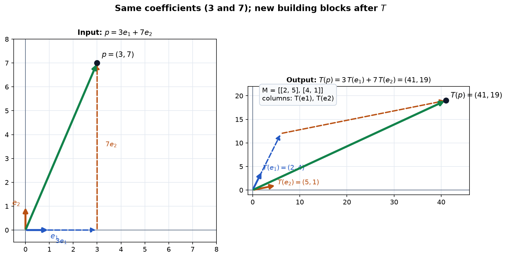

#### 8.2.4 Step 4 — Two different sets of numbers (do not mix them up)

| Numbers | What they mean |
|---|---|
| **3** and **7** | Coefficients in the **input**—how much of each **original** basis vector $\mathbf e_1,\mathbf e_2$ |
| **$(2,4)$** and **$(5,1)$** | Where $T$ sends the **basis vectors** (columns of $M$) |
| **$(41,19)$** | The **final output** $T(\mathbf p)$ |

**Remember:** a vector is a combination of basis pieces; a linear $T$ acts on each basis piece, and you **reuse the same input coefficients** on the transformed pieces.

### 8.3 Find $T(\mathbf p)$ for $\mathbf p=(3,7)$, step by step

We want $T(\mathbf p)$ when $\mathbf p=\begin{pmatrix}3\\7\end{pmatrix}$.

**Route 1 — linearity (same coefficients):**

$$
\begin{aligned}
T\begin{pmatrix}3\\7\end{pmatrix}
&=3T(\mathbf e_1)+7T(\mathbf e_2)\\
&=3\begin{pmatrix}2\\4\end{pmatrix}
+7\begin{pmatrix}5\\1\end{pmatrix}\\
&=\begin{pmatrix}6\\12\end{pmatrix}
+\begin{pmatrix}35\\7\end{pmatrix}\\
&=\boxed{\begin{pmatrix}41\\19\end{pmatrix}}.
\end{aligned}
$$

**Route 2 — matrix multiplication:**

$$
\begin{pmatrix}2&5\\4&1\end{pmatrix}
\begin{pmatrix}3\\7\end{pmatrix}
=\begin{pmatrix}2\cdot3+5\cdot7\\4\cdot3+1\cdot7\end{pmatrix}
=\boxed{\begin{pmatrix}41\\19\end{pmatrix}}.
$$

Both routes are the same mathematics written differently.

**Matrix multiplication reminder:** Each output entry is the dot product of a *row of the matrix* with the *input column*. You must not multiply the matrix and vector “entry by entry.”

### 8.4 Why this matters for quantum gates

If a linear gate sends $|0\rangle$ to $|a\rangle$ and $|1\rangle$ to $|b\rangle$, then

$$
T(\alpha|0\rangle+\beta|1\rangle)
=\alpha|a\rangle+\beta|b\rangle.
$$

**Knowing the two basis outputs is enough to know what the gate does to every superposition.** This is precisely why gate descriptions can be so compact.

For a basis $\{\mathbf e_1,\ldots,\mathbf e_n\}$, the same result holds:

$$
\mathbf v=\sum_j v_j\mathbf e_j
\quad\Rightarrow\quad
T(\mathbf v)=\sum_j v_jT(\mathbf e_j).
$$

**Caution:** The matrix-columns rule assumes the basis in which the input coordinates are written and the chosen coordinate system for outputs. In the lecture's examples, the **standard basis** is used for both.

---

## 9. How to read geometrical transformations

> **Interactive demo:** Open **[See what the matrix does](animations/geometrical-transformations.html)** in Chrome (in the `animations` folder). Watch the grey **F** become the orange **F**, drag the slider or press **Play**, and switch the dropdown to match each row in the table below. The blue and purple arrows are **A e₁** and **A e₂**—the same “columns as destinations” idea as §8.2. Footer notes: **Z**, **X**, and **H** are unitary; stretch, shear, and projection are linear but not unitary.

The lecture slides show a **grey letter F** being transformed into an **orange letter F**, while basis vectors indicate what happened to the coordinate directions. Those pictures become clearer once we inspect the columns of the matrices. The static gallery below summarizes the main examples; the animation lets you scrub from the identity to each final matrix **M** and read off **M e₁** and **M e₂** at every frame.

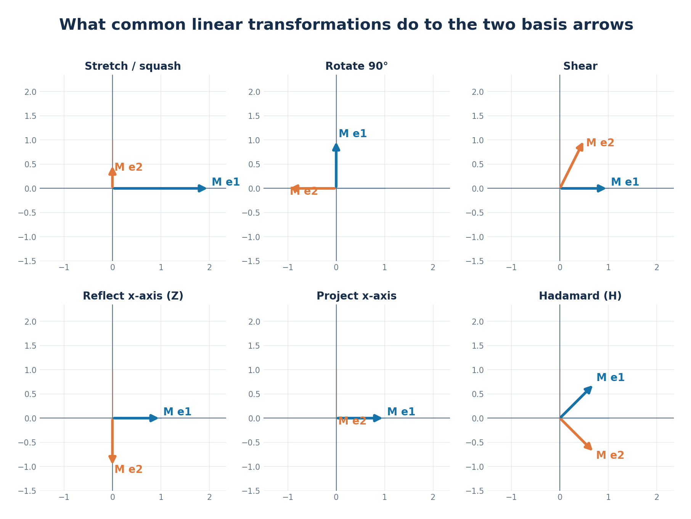

| Operation | Matrix | What it does | Important property |
|---|---|---|---|
| Scale x and squash y | $\begin{pmatrix}2&0\\0&1/2\end{pmatrix}$ | $(x,y)\to(2x,y/2)$ | Linear, not unitary |
| Rotate 90° counterclockwise | $\begin{pmatrix}0&-1\\1&0\end{pmatrix}$ | $(x,y)\to(-y,x)$ | Preserves lengths and angles |
| Shear sideways | $\begin{pmatrix}1&1/2\\0&1\end{pmatrix}$ | $(x,y)\to(x+y/2,y)$ | Does not preserve right angles |
| Reflect across x-axis | $\begin{pmatrix}1&0\\0&-1\end{pmatrix}$ | $(x,y)\to(x,-y)$ | Same matrix as Z gate |
| Reflect across line y=x | $\begin{pmatrix}0&1\\1&0\end{pmatrix}$ | $(x,y)\to(y,x)$ | Same matrix as X gate |
| Project onto x-axis | $\begin{pmatrix}1&0\\0&0\end{pmatrix}$ | $(x,y)\to(x,0)$ | Throws information away |
| Hadamard | $\frac1{\sqrt2}\begin{pmatrix}1&1\\1&-1\end{pmatrix}$ | $(x,y)\to((x+y)/\sqrt2,(x-y)/\sqrt2)$ | Unitary; a reflection in real-plane picture |

**Important distinction:** “Linear” does **not** imply “reversible,” “unit length preserved,” or “allowed as an isolated-qubit gate.” A scaling, shear, and projection can be linear without being unitary. Use the interactive page to see **projection** collapse the F to a line (second basis arrow goes to **0**) and to compare **Hadamard** with a simple rotation—the real-plane **H** is a reflection, as in §4.3.

---

## 10. Three quantum gates: X, Z and H

Let's build this from the basics. This section introduces one of the most important ideas in quantum computing: **quantum gates**.

The key distinction:

| Symbol | Role |
|---|---|
| $\|0\rangle$, $\|1\rangle$ | **Quantum states** (vectors) |
| $X$, $Z$, $H$ | **Operations** that change those states |

Think of a quantum gate as a machine that takes a quantum state as input and produces another quantum state as output.

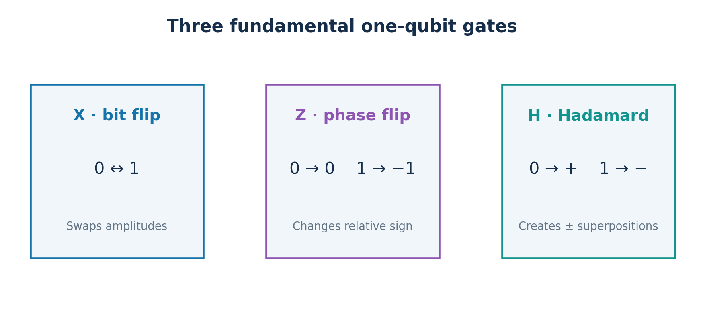

### 10.1 First, what is a qubit?

A **qubit** is the basic unit of quantum information. Unlike a classical bit, which is either 0 or 1, a qubit can exist in a **superposition** of both.

We represent the two basic states using column vectors:

$$
|0\rangle=
\begin{pmatrix}1\\0\end{pmatrix},
\qquad
|1\rangle=
\begin{pmatrix}0\\1\end{pmatrix}.
$$

These are the **computational basis states**.

A general qubit state is

$$
|\psi\rangle=\alpha|0\rangle+\beta|1\rangle
=
\begin{pmatrix}\alpha\\\beta\end{pmatrix},
\qquad \alpha,\beta\in\mathbb C.
$$

Here $\alpha$ and $\beta$ are **probability amplitudes** (not probabilities themselves). Measurement probabilities use squared magnitudes:

$$
|\alpha|^2+|\beta|^2=1.
$$

For example,

$$
|\psi\rangle=
\frac1{\sqrt2}|0\rangle+
\frac1{\sqrt2}|1\rangle
$$

is an equal superposition of 0 and 1.

### 10.2 What is a quantum gate?

A **quantum gate** is an operation that updates the qubit state. In the ideal circuit model, a one-qubit gate is a **2×2 matrix** $U$ acting on a column vector:

$$
|\psi_{\text{new}}\rangle=U|\psi_{\text{old}}\rangle.
$$

| Stage | Meaning |
|---|---|
| **Input** — $\|\psi\rangle=\begin{pmatrix}\alpha\\\beta\end{pmatrix}$ | Current state (amplitudes $\alpha$, $\beta$) |
| **Gate** — $U=\begin{pmatrix}a&b\\c&d\end{pmatrix}$ | The operation (matrix multiplication) |
| **Output** — $\|\psi'\rangle=U\|\psi\rangle$ | New state after the gate |

The matrix has size 2×2 because a single qubit has two amplitudes. Below we study three important gates: **X**, **Z**, and **H**.

### 10.3 Pauli-X gate (bit-flip gate)

The **X gate** is the quantum analogue of a classical NOT: it sends $|0\rangle$ to $|1\rangle$ and $|1\rangle$ to $|0\rangle$.

$$
\boxed{X=
\begin{pmatrix}
0&1\\
1&0
\end{pmatrix}.}
$$

**Example 1 — apply $X$ to $|0\rangle$:**

$$
X|0\rangle=
\begin{pmatrix}0&1\\1&0\end{pmatrix}
\begin{pmatrix}1\\0\end{pmatrix}
=\begin{pmatrix}0\\1\end{pmatrix}
\quad\Rightarrow\quad
\boxed{X|0\rangle=|1\rangle.}
$$

**Example 2 — apply $X$ to $|1\rangle$:**

$$
X|1\rangle=
\begin{pmatrix}0&1\\1&0\end{pmatrix}
\begin{pmatrix}0\\1\end{pmatrix}
=\begin{pmatrix}1\\0\end{pmatrix}
\quad\Rightarrow\quad
\boxed{X|1\rangle=|0\rangle.}
$$

**On a general state** (using linearity from §7):

$$
\begin{aligned}
X(\alpha|0\rangle+\beta|1\rangle)
&=\alpha|1\rangle+\beta|0\rangle
=\boxed{\beta|0\rangle+\alpha|1\rangle}.
\end{aligned}
$$

So $X$ **swaps the two amplitudes**. The probability of outcome 0 after $X$ equals the old probability of 1, and vice versa.

### 10.4 Pauli-Z gate (phase-flip gate)

The **Z gate** leaves $|0\rangle$ unchanged and multiplies $|1\rangle$ by $-1$:

$$
\boxed{Z=
\begin{pmatrix}
1&0\\
0&-1
\end{pmatrix}.}
$$

**Example 1 — apply $Z$ to $|0\rangle$:**

$$
Z|0\rangle=
\begin{pmatrix}1&0\\0&-1\end{pmatrix}
\begin{pmatrix}1\\0\end{pmatrix}
=\begin{pmatrix}1\\0\end{pmatrix}
\quad\Rightarrow\quad
\boxed{Z|0\rangle=|0\rangle.}
$$

**Example 2 — apply $Z$ to $|1\rangle$:**

$$
Z|1\rangle=
\begin{pmatrix}1&0\\0&-1\end{pmatrix}
\begin{pmatrix}0\\1\end{pmatrix}
=\begin{pmatrix}0\\-1\end{pmatrix}
=-|1\rangle
\quad\Rightarrow\quad
\boxed{Z|1\rangle=-|1\rangle.}
$$

The vector $-|1\rangle$ is the same as $|1\rangle$ up to an overall **global phase** when you only look at $|1\rangle$ alone. In a **superposition**, however, flipping the sign of the $|1\rangle$ piece changes **relative phase**—for example $Z|+\rangle=|-\rangle$, which is a different state even though computational-basis measurement probabilities stay 50/50 for both $|+\rangle$ and $|-\rangle$.

**On a general state:**

$$
\boxed{Z(\alpha|0\rangle+\beta|1\rangle)
=\alpha|0\rangle-\beta|1\rangle.}
$$

**What is “phase flip”?** It changes the **relative sign** between the $|0\rangle$ and $|1\rangle$ parts. Multiplying the $|1\rangle$ amplitude by $-1$ is a $180^\circ$ ($\pi$) phase shift on that component.

### 10.5 Hadamard gate (H gate)

The **Hadamard gate** maps $|0\rangle$ and $|1\rangle$ to equal superpositions along the $|+\rangle$ and $|-\rangle$ directions:

$$
\boxed{H=\frac1{\sqrt2}
\begin{pmatrix}
1&1\\
1&-1
\end{pmatrix}.}
$$

**Example 1 — apply $H$ to $|0\rangle$:**

$$
H|0\rangle=
\frac1{\sqrt2}
\begin{pmatrix}1&1\\1&-1\end{pmatrix}
\begin{pmatrix}1\\0\end{pmatrix}
=\frac1{\sqrt2}\begin{pmatrix}1\\1\end{pmatrix}
\quad\Rightarrow\quad
\boxed{H|0\rangle=|+\rangle,}
$$

where $|+\rangle=\dfrac1{\sqrt2}(|0\rangle+|1\rangle)$.

**Example 2 — apply $H$ to $|1\rangle$:**

$$
H|1\rangle=
\frac1{\sqrt2}
\begin{pmatrix}1&1\\1&-1\end{pmatrix}
\begin{pmatrix}0\\1\end{pmatrix}
=\frac1{\sqrt2}\begin{pmatrix}1\\-1\end{pmatrix}
\quad\Rightarrow\quad
\boxed{H|1\rangle=|-\rangle,}
$$

where $|-\rangle=\dfrac1{\sqrt2}(|0\rangle-|1\rangle)$.

For a general column $(\alpha,\beta)^T$,

$$
\boxed{H\begin{pmatrix}\alpha\\\beta\end{pmatrix}
=\frac1{\sqrt2}\begin{pmatrix}\alpha+\beta\\\alpha-\beta\end{pmatrix}.}
$$

**Check:** $|+\rangle=(1/\sqrt2,1/\sqrt2)^T$ gives $H|+\rangle=|0\rangle$. Also $H|0\rangle=|+\rangle$, so **applying $H$ twice returns the starting vector** ($H^2=I$).

### 10.6 Compare the three gates

| Gate | Nickname | Action on $\|0\rangle$ | Action on $\|1\rangle$ |
|---|---|---|---|
| **X** | Bit flip | $\|1\rangle$ | $\|0\rangle$ |
| **Z** | Phase flip | $\|0\rangle$ | $-\|1\rangle$ |
| **H** | Superposition builder | $\|+\rangle$ | $\|-\rangle$ |

### 10.7 Why must quantum gates be unitary?

In the standard model, acceptable one-qubit gates are **unitary** matrices. A matrix $U$ is **unitary** when

$$
\boxed{U^\dagger U=I,}
$$

where $U^\dagger$ is the conjugate transpose and $I$ is the identity.

**Why it matters:** a qubit state must satisfy $|\alpha|^2+|\beta|^2=1$. Unitary maps **preserve that total “length”** in $\mathbb C^2$, so probabilities stay normalized after the gate. The matrices **X**, **Z**, and **H** are all unitary (we check unitarity carefully in §15).

### 10.8 States versus gates — keep the symbols separate

| Symbol | What is it? | Meaning |
|---|---|---|
| $\|0\rangle$, $\|1\rangle$ | State vectors | Computational basis kets |
| $X$, $Z$, $H$ | Gates / operations | Bit flip, phase flip, Hadamard |

- A **state** describes what the qubit *is* right now.
- A **gate** describes what we *do* to that state.
- **Matrix multiplication** computes the new state:

$$
\boxed{|\psi_{\text{new}}\rangle=U|\psi_{\text{old}}\rangle.}
$$

The vertical bars in $|0\rangle$ name a vector; they are **not** the same as writing $X$ or $H$, which stand for operators.

### 10.9 A simple quantum circuit picture

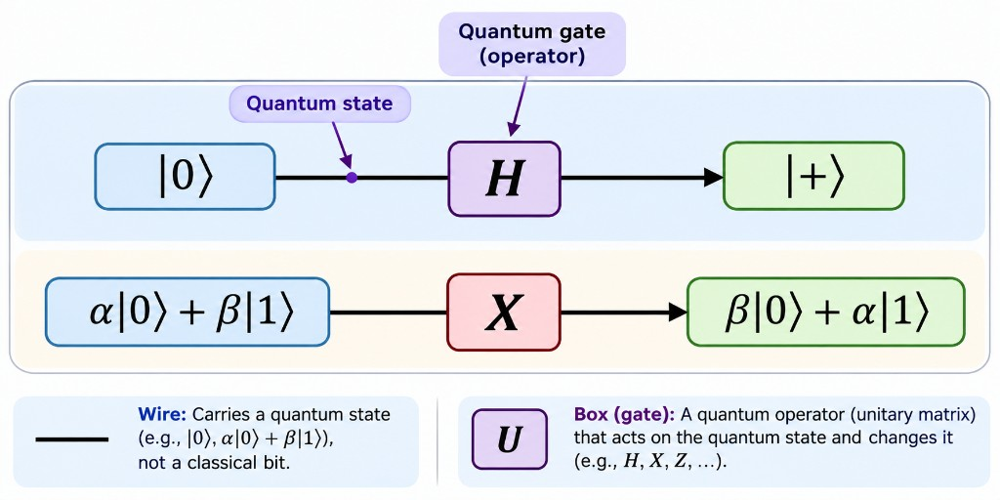

The diagram shows two common patterns: $|0\rangle \xrightarrow{H} |+\rangle$ and $(\alpha|0\rangle+\beta|1\rangle) \xrightarrow{X} (\beta|0\rangle+\alpha|1\rangle)$. Read time from **left to right**—state in, operator in the middle, new state out.

---

## 11. Applying gates in sequence: order matters

### 11.1 Reading mathematical order versus time order

Suppose the circuit does $X$ **first**, then $Z$:

$$
|\psi\rangle\xrightarrow{X}X|\psi\rangle
\xrightarrow{Z}Z(X|\psi\rangle)=(ZX)|\psi\rangle.
$$

**Time order:** X, then Z.  
**Matrix product written left-to-right:** ZX.

This follows ordinary function composition: the operation closest to the state on the right acts first.

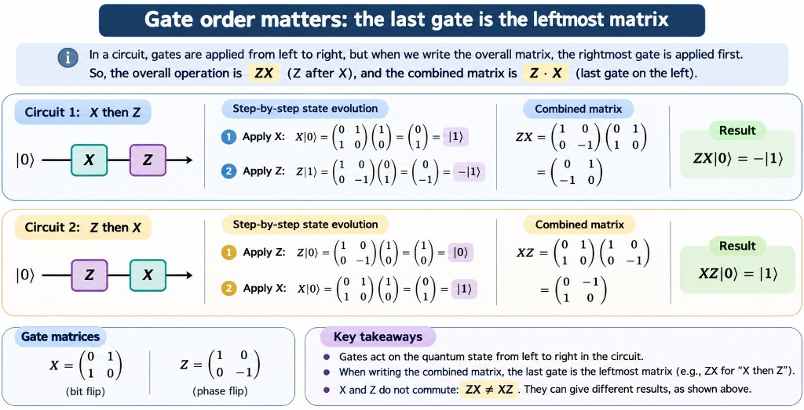

### 11.2 Multiply X and Z

$$
X=\begin{pmatrix}0&1\\1&0\end{pmatrix},\quad
Z=\begin{pmatrix}1&0\\0&-1\end{pmatrix}.
$$

**First X, then Z:**

$$
ZX=
\begin{pmatrix}1&0\\0&-1\end{pmatrix}
\begin{pmatrix}0&1\\1&0\end{pmatrix}
=\boxed{\begin{pmatrix}0&1\\-1&0\end{pmatrix}}.
$$

**First Z, then X:**

$$
XZ=
\begin{pmatrix}0&1\\1&0\end{pmatrix}
\begin{pmatrix}1&0\\0&-1\end{pmatrix}
=\boxed{\begin{pmatrix}0&-1\\1&0\end{pmatrix}}.
$$

Hence $ZX\ne XZ$. In general, **matrix multiplication is not commutative**; you cannot reorder gates freely.

### 11.3 An interesting nuance: global phase

In this **specific** example, $ZX=-XZ$. Applying these to the same state produces vectors differing by an overall factor $-1$, which is an **unobservable global phase** for the final isolated state. The operators are algebraically different, however, and order differences in other gate sequences can make observable changes.

This subsection answers three questions in order:

1. **Why** $ZX=-XZ$?
2. **What** is an overall factor of $-1$?
3. **Why** is that called an **unobservable global phase**?

#### 11.3.1 X and Z in this example (quick recall)

**X gate (bit flip):**

$$
X=\begin{pmatrix}0&1\\1&0\end{pmatrix},
\qquad
X|0\rangle=|1\rangle,\quad X|1\rangle=|0\rangle.
$$

**Z gate (phase flip):**

$$
Z=\begin{pmatrix}1&0\\0&-1\end{pmatrix},
\qquad
Z|0\rangle=|0\rangle,\quad Z|1\rangle=-|1\rangle.
$$

$Z$ flips the **sign** of the $|1\rangle$ piece; $X$ **swaps** $|0\rangle$ and $|1\rangle$.

#### 11.3.2 Apply X first, then Z (time order: X, then Z)

Start with $|\psi\rangle=|0\rangle$.

1. Apply $X$: $X|0\rangle=|1\rangle$.
2. Apply $Z$ to that result: $Z|1\rangle=-|1\rangle$.

Therefore

$$
\boxed{ZX|0\rangle=-|1\rangle.}
$$

In the product $ZX$, the matrix on the **right** ($X$) acts on the state **first**—the same rule as in §11.1.

#### 11.3.3 Apply Z first, then X (time order: Z, then X)

Again $|\psi\rangle=|0\rangle$.

1. Apply $Z$: $Z|0\rangle=|0\rangle$.
2. Apply $X$: $X|0\rangle=|1\rangle$.

Therefore

$$
\boxed{XZ|0\rangle=|1\rangle.}
$$

#### 11.3.4 Compare the two outcomes (the overall factor $-1$)

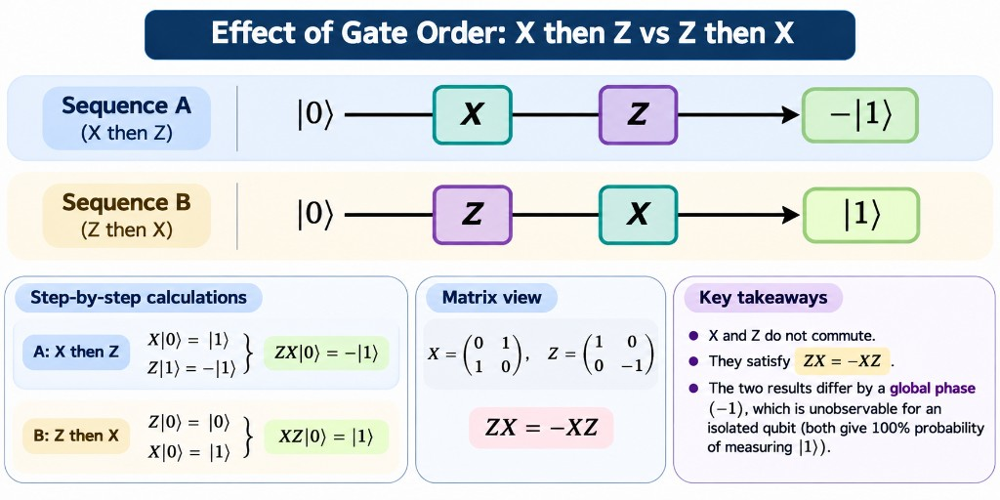

The two final vectors differ only by a minus sign:

$$
-|1\rangle \quad\text{versus}\quad |1\rangle.
$$

So for this starting state,

$$
\boxed{ZX|0\rangle=-XZ|0\rangle.}
$$

That is what we mean by “differing by an overall factor $-1$”: one result is the other multiplied by $-1$.

#### 11.3.5 Why is this an unobservable global phase?

Compare two **whole** state vectors:

$$
|\psi_1\rangle=|1\rangle,
\qquad
|\psi_2\rangle=-|1\rangle.
$$

They are **not** the same column vector. But if you measure this **isolated** qubit in the computational basis, both give outcome 1 with probability 100%:

$$
P(1)=|1|^2=1,
\qquad
P(1)=|-1|^2=1.
$$

The minus sign does **not** change the probability. Multiplying the **entire** state by a complex number of modulus 1 only adds a **global phase**:

$$
|\psi'\rangle=e^{i\theta}|\psi\rangle.
$$

In particular,

$$
-|1\rangle=e^{i\pi}|1\rangle
\quad\text{(global phase } \pi \text{ radians, i.e. } 180^\circ\text{)}.
$$

That phase is **unobservable** for this single-qubit measurement—we cannot tell $|1\rangle$ from $-|1\rangle$ using $P(0)$ and $P(1)$ alone.

#### 11.3.6 When a minus sign *does* matter: relative phase

Now compare two **superpositions** (not related by multiplying the whole state by $-1$):

$$
|\psi_1\rangle=\frac1{\sqrt2}(|0\rangle+|1\rangle)=|+\rangle,
\qquad
|\psi_2\rangle=\frac1{\sqrt2}(|0\rangle-|1\rangle)=|-\rangle.
$$

Only the **relative sign** between $|0\rangle$ and $|1\rangle$ changed. That is **relative phase**, not global phase.

Measure in the Hadamard ($+/-$) basis:

| State | Form | $P(+)$ | $P(-)$ |
|---|---|---|---|
| $\|\psi_1\rangle$ | $\|+\rangle$ | 100% | 0% |
| $\|\psi_2\rangle$ | $\|-\rangle$ | 0% | 100% |

A **global** minus sign on the whole vector often leaves measurement probabilities unchanged (as with $|1\rangle$ vs $-|1\rangle$). A **relative** minus sign between components can change which outcomes you see (as with $|+\rangle$ vs $|-\rangle$).

#### 11.3.7 Plain-language reading of the opening paragraph

| Original idea | Simple meaning |
|---|---|
| $ZX=-XZ$ | Swapping the order of $X$ and $Z$ flips the **sign of the whole operator** (they anti-commute here). |
| Vectors differ by $-1$ | One sequence gives $\|1\rangle$, the other $-\|1\rangle$. |
| Unobservable global phase | That minus sign does not change computational-basis probabilities for this isolated final state. |
| Operators algebraically different | The matrices $ZX$ and $XZ$ are **not equal**—only negatives of each other. |
| Other sequences can differ observably | Other gate orders can produce **different** physics, not just a global sign. |

#### 11.3.8 Three ideas to keep

1. **Global phase:** Multiplying the **entire** state by $-1$ (or any $e^{i\theta}$) does not change the usual measurement probabilities for that state alone.

2. **Relative phase:** Changing the sign of **one part** of a superposition can change probabilities (e.g. $|+\rangle$ vs $|-\rangle$).

3. **Gate order:** Matrix multiplication is generally **not commutative**:

$$
\boxed{ZX\neq XZ.}
$$

For **these** two gates specifically,

$$
\boxed{ZX=-XZ.}
$$

Two column vectors can look different yet describe the **same physical pure state** if they differ only by a global phase.

You should retain both lessons: **do not swap matrix order**, and **two state vectors differing only by an overall phase represent the same physical pure state**.

### 11.4 Associativity versus commutativity

With several gates:

$$
C(B(A|\psi\rangle))=(CBA)|\psi\rangle.
$$

Parentheses may be regrouped (**associative**), but the sequence usually may **not** be rearranged (**not commutative**).

---

## 12. Projection, bras, kets and outer products

### 12.1 What does projection do?

Imagine a vector $(3,4)$ and a light shining straight down onto the x-axis. Its “shadow” lies at $(3,0)$. The x-component is retained; the y-component is discarded.

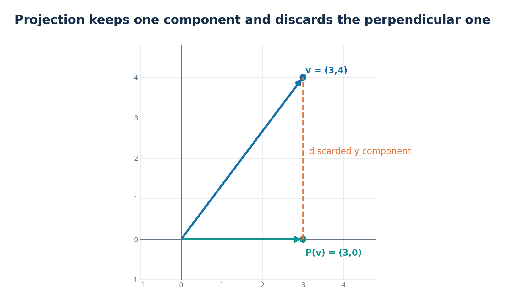

The matrix that does this is

$$
\boxed{P_x=\begin{pmatrix}1&0\\0&0\end{pmatrix}.}
$$

Check:

$$
P_x\begin{pmatrix}3\\4\end{pmatrix}
=\begin{pmatrix}3\\0\end{pmatrix}.
$$

Since $(3,4)$ and $(3,-2)$ both project to $(3,0)$, we cannot reverse the operation uniquely.

### 12.2 Ket versus bra, explained carefully

A **ket** $|u\rangle$ is a column vector. If

$$|u\rangle=\begin{pmatrix}u_1\\u_2\end{pmatrix},$$

then its **bra** $\langle u|$ is the conjugate-transposed row:

$$\langle u|=\begin{pmatrix}\overline{u_1}&\overline{u_2}\end{pmatrix}.$$

Now the order matters:

- **Bra × ket:** $\langle u|v\rangle$ is an **inner product** and returns **one complex number**.
- **Ket × bra:** $|u\rangle\langle v|$ is an **outer product** and returns a **matrix**.

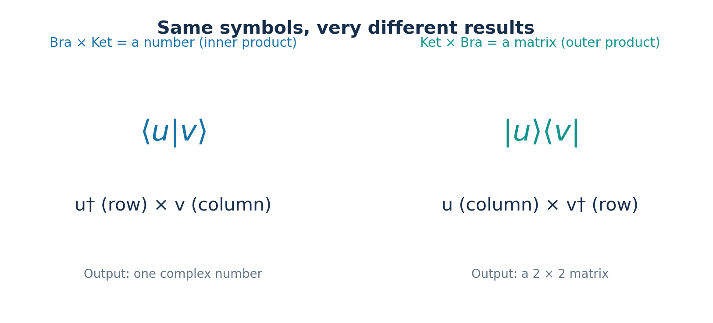

**Numerical example.** With $|0\rangle=(1,0)^T$,

$$
\underbrace{\langle0|0\rangle}_{\text{scalar}}
=(1,0)\begin{pmatrix}1\\0\end{pmatrix}=1,
$$

but

$$
\underbrace{|0\rangle\langle0|}_{\text{matrix}}
=\begin{pmatrix}1\\0\end{pmatrix}(1,0)
=\begin{pmatrix}1&0\\0&0\end{pmatrix}.
$$

### 12.3 A projector is an outer product

A **projector** is an operation that keeps the part of a vector along a chosen direction and drops the rest. If a vector points diagonally, projecting onto the horizontal direction gives only the horizontal piece—the same picture as §12.1 with $(3,4)\mapsto(3,0)$.

#### 12.3.1 What we are trying to do

Take a **normalized** direction (here, the horizontal unit vector):

$$
|e\rangle=
\begin{pmatrix}1\\0\end{pmatrix},
\qquad
|v\rangle=
\begin{pmatrix}3\\4\end{pmatrix}.
$$

We want the component of $v$ along $e$. Because $e$ is horizontal, that component is

$$
\boxed{\text{projection}=
\begin{pmatrix}3\\0\end{pmatrix}.}
$$

How do we compute that with linear algebra? We build a **projector** matrix and multiply it by $|v\rangle$.

#### 12.3.2 What is an outer product?

For a normalized direction $|e\rangle$,

$$
\boxed{P_e=|e\rangle\langle e|.}
$$

**Ket** (column):

$$
|e\rangle=
\begin{pmatrix}1\\0\end{pmatrix}.
$$

**Bra** (conjugate-transpose row):

$$
\langle e|=
\begin{pmatrix}1&0\end{pmatrix}.
$$

**Outer product** (ket × bra → matrix):

$$
P_e=|e\rangle\langle e|
=
\begin{pmatrix}1\\0\end{pmatrix}
\begin{pmatrix}1&0\end{pmatrix}
=
\boxed{
\begin{pmatrix}
1&0\\
0&0
\end{pmatrix}.}
$$

Two vectors multiplied in this order produce a **2×2 matrix**. That is the same $P_x$ from §12.1.

#### 12.3.3 What does the projector do to $|v\rangle$?

$$
P_e|v\rangle
=
\begin{pmatrix}1&0\\0&0\end{pmatrix}
\begin{pmatrix}3\\4\end{pmatrix}
=
\begin{pmatrix}
1\cdot 3+0\cdot 4\\
0\cdot 3+0\cdot 4
\end{pmatrix}
=
\boxed{
\begin{pmatrix}3\\0\end{pmatrix}.}
$$

The input was $\begin{pmatrix}3\\4\end{pmatrix}$; the output is $\begin{pmatrix}3\\0\end{pmatrix}$. The vertical part is gone—only the horizontal part remains.

#### 12.3.4 The formula as two steps

The compact identity from the notes is

$$
\boxed{P_e|v\rangle
=
|e\rangle
\underbrace{\langle e|v\rangle}_{\text{coordinate along }e}.}
$$

**Step 1 — inner product (coordinate along $e$):**

$$
\langle e|v\rangle
=
\begin{pmatrix}1&0\end{pmatrix}
\begin{pmatrix}3\\4\end{pmatrix}
=3.
$$

**Step 2 — rebuild the vector along $e$:**

$$
|e\rangle\langle e|v\rangle
=3\begin{pmatrix}1\\0\end{pmatrix}
=
\begin{pmatrix}3\\0\end{pmatrix}.
$$

| Step | Formula | Meaning |
|---|---|---|
| 1 | $\langle e\vert v\rangle=3$ | How much of $v$ lies along $e$ |
| 2 | $3\|e\rangle=\begin{pmatrix}3\\0\end{pmatrix}$ | Scale the direction $e$ by that coordinate |

- The **inner product** measures “how much” along $e$.
- The **outer product** $|e\rangle\langle e|$ builds the **operator** that extracts that piece.
- **$P_e|v\rangle$** applies the operator to get the projected vector.

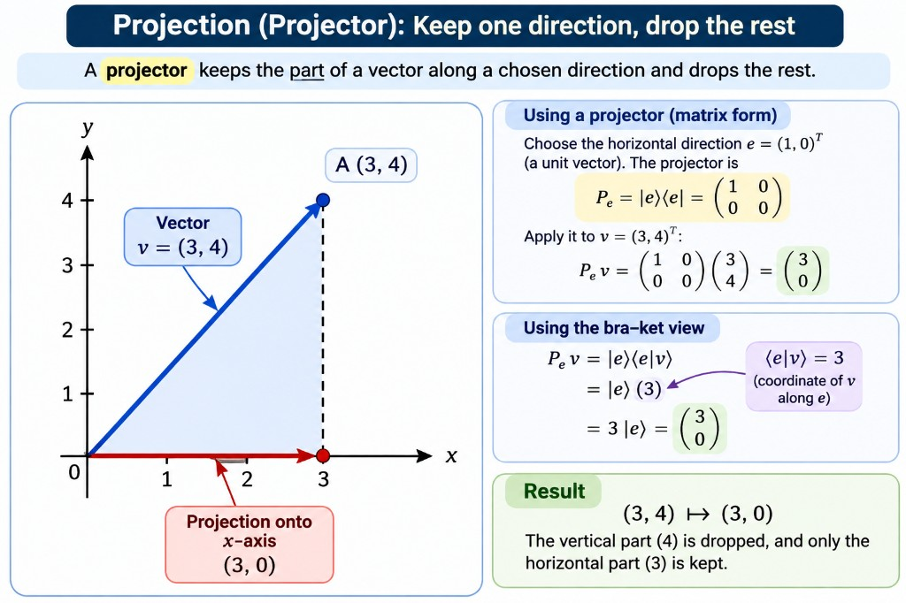

The figure matches §12.1’s picture and shows both ways to compute the same projection: multiply by $P_e=|e\rangle\langle e|$, or read $\langle e|v\rangle=3$ and then form $3|e\rangle$.

#### 12.3.5 Why must $|e\rangle$ be normalized?

A **unit** direction satisfies

$$
\langle e|e\rangle=1.
$$

Then $P_e=|e\rangle\langle e|$ is the standard **orthogonal projector** onto the line spanned by $e$. If $|e\rangle$ is not normalized, use

$$
\boxed{
P_e=\frac{|e\rangle\langle e|}{\langle e|e\rangle}.}
$$

#### 12.3.6 Projectors in quantum mechanics

Projectors are how we describe **measurement** on a qubit: probabilities of each outcome, and the state **after** an outcome occurs. The example below uses the same $P_0=|0\rangle\langle0|$ from §12.3.2–12.3.5, but now on a **superposition** instead of only on $(3,4)^T$.

**1. What are we trying to achieve?**

Suppose the qubit is

$$
|\psi\rangle=\frac1{\sqrt2}
\begin{pmatrix}1\\1\end{pmatrix}
=\frac1{\sqrt2}|0\rangle+\frac1{\sqrt2}|1\rangle.
$$

We measure in the computational basis. There are two possible outcomes: **0** and **1**. We want:

1. $P(0)$ — probability of outcome 0  
2. $P(1)$ — probability of outcome 1  
3. $|\psi_{\text{after}}\rangle$ — state **if** outcome 0 occurs  

Projectors answer all three.

**2. The projector $P_0$ (outcome 0)**

$$
P_0=|0\rangle\langle0|,
\qquad
|0\rangle=\begin{pmatrix}1\\0\end{pmatrix},
\qquad
\langle0|=\begin{pmatrix}1&0\end{pmatrix}.
$$

Outer product:

$$
P_0=
\begin{pmatrix}1\\0\end{pmatrix}
\begin{pmatrix}1&0\end{pmatrix}
=
\boxed{
\begin{pmatrix}
1&0\\
0&0
\end{pmatrix}.}
$$

This matrix **keeps** the $|0\rangle$ part and **removes** the $|1\rangle$ part—like a filter:

| Stage | What happens |
|---|---|
| Input | $\|\psi\rangle=\dfrac1{\sqrt2}\|0\rangle+\dfrac1{\sqrt2}\|1\rangle$ |
| Apply $P_0$ | Keep $\|0\rangle$, drop $\|1\rangle$ |
| Component along 0 | $\dfrac1{\sqrt2}\|0\rangle$ (not yet a full measurement story by itself) |

**3. Apply $P_0$ to $|\psi\rangle$**

$$
P_0|\psi\rangle=
\begin{pmatrix}1&0\\0&0\end{pmatrix}
\frac1{\sqrt2}
\begin{pmatrix}1\\1\end{pmatrix}
=
\frac1{\sqrt2}
\begin{pmatrix}
1\cdot1+0\cdot1\\
0\cdot1+0\cdot1
\end{pmatrix}
=
\boxed{
\frac1{\sqrt2}
\begin{pmatrix}1\\0\end{pmatrix}
=\frac1{\sqrt2}|0\rangle.}
$$

The $|1\rangle$ piece is gone. The factor $1/\sqrt2$ is still there—that matters next.

**4. Why is $P_0|\psi\rangle$ not normalized?**

A normalized state satisfies $\langle\psi|\psi\rangle=1$ (equivalently $\|\psi\|=1$). For

$$
\frac1{\sqrt2}\begin{pmatrix}1\\0\end{pmatrix},
$$

the norm is

$$
\sqrt{\left|\frac1{\sqrt2}\right|^2+0^2}=\frac1{\sqrt2}\neq 1.
$$

The projector **kept only part** of the original vector, so the result is generally **not** unit length. That is expected; we use it to find **probability**, then **renormalize** if that outcome happens.

**5. Probability of outcome 0 (and 1)**

$$
\boxed{P(0)=\langle\psi|P_0|\psi\rangle.}
$$

With $\langle\psi|=\dfrac1{\sqrt2}(1,1)$ and $P_0|\psi\rangle=\dfrac1{\sqrt2}(1,0)^T$,

$$
P(0)=
\frac1{\sqrt2}
\begin{pmatrix}1&1\end{pmatrix}
\frac1{\sqrt2}
\begin{pmatrix}1\\0\end{pmatrix}
=\frac12(1\cdot1+1\cdot0)
=
\boxed{\frac12=50\%.}
$$

For outcome 1, $P_1=|1\rangle\langle1|=\begin{pmatrix}0&0\\0&1\end{pmatrix}$ gives $\boxed{P(1)=50\%}$, and $P(0)+P(1)=100\%$.

**6. State after outcome 0 occurs**

If the instrument reports **0**, the post-measurement state is the projected component **normalized**:

$$
\boxed{
|\psi_{\text{after}}\rangle=
\frac{P_0|\psi\rangle}{\sqrt{P(0)}}.}
$$

Substitute:

$$
|\psi_{\text{after}}\rangle=
\frac{\dfrac1{\sqrt2}\begin{pmatrix}1\\0\end{pmatrix}}{\dfrac1{\sqrt2}}
=
\begin{pmatrix}1\\0\end{pmatrix}
=
\boxed{|0\rangle.}
$$

**7. Ideal projective measurement in four steps**

| Step | Action | Result |
| --- | --- | --- |
| 1 | Start | $(\|0\rangle+\|1\rangle)/\sqrt{2}$ — equal superposition |
| 2 | Compute $P_0\|\psi\rangle$ | $\|0\rangle/\sqrt{2}$ (0-component, not normalized) |
| 3 | Probability | $P(0)=1/2$ |
| 4 | Outcome 0 observed | $\|\psi_{\text{after}}\rangle=\|0\rangle$ |

(Similarly: $P_1\|\psi\rangle=\|1\rangle/\sqrt{2}$, $P(1)=1/2$, and outcome 1 gives $\|\psi_{\text{after}}\rangle=\|1\rangle$.)

**8. Why projectors matter — and one distinction**

| Concept | Role |
|---|---|
| Projector $P_k$ | Picks out the part of $\|\psi\rangle$ tied to outcome $k$ |
| $P(k)=\langle\psi\vert P_k\vert\psi\rangle$ | Probability of outcome $k$ |
| $P_k\|\psi\rangle/\sqrt{P(k)}$ | Normalized state **conditional on** outcome $k$ |

Projectors link **geometry** (components), **probabilities**, and **state update** in one framework—essential beyond single qubits.

**Important:** Computing $P_0|\psi\rangle$ is a **mathematical** step (the “0 component”). It does **not** by itself mean the measurement already returned 0. The physical measurement yields 0 or 1 **at random** with probabilities $P(0)$ and $P(1)$; only **after** you know the outcome do you apply the normalization in step 6.

#### 12.3.7 Summary

| Concept | Meaning |
|---|---|
| Ket $\|e\rangle$ | Column vector |
| Bra $\langle e\vert$ | Conjugate-transpose row |
| Outer product $\|e\rangle\langle e\vert$ | Builds a matrix from ket and bra |
| Projector $P_e$ | Keeps the component along $e$ |
| Inner product $\langle e\vert v\rangle$ | Coordinate of $v$ along $e$ |
| $P_e\|v\rangle$ | The projected vector |

Remember:

$$
\boxed{
P_e|v\rangle
=
|e\rangle\langle e|v\rangle.
}
$$

Inner product → how much along the direction; outer product → operator; projector applied to $|v\rangle$ → the extracted component.

### 12.4 Matrix entries as inner products

This idea links **matrix multiplication**, **basis vectors**, and **inner products**—the same tools as §§12.2–12.3.

The compact statement is

$$
\boxed{A_{ij}=\langle e_i|A|e_j\rangle.}
$$

In words: use the **$j$-th basis vector** as input, apply $A$, then read the **coordinate along the $i$-th basis vector**. That number sits in **row $i$, column $j$**.

#### 12.4.1 Standard basis (2D)

$$
|e_1\rangle=\begin{pmatrix}1\\0\end{pmatrix},
\qquad
|e_2\rangle=\begin{pmatrix}0\\1\end{pmatrix}
$$

(same as $\lvert 0\rangle$ and $\lvert 1\rangle$). They are **orthonormal**: unit length and perpendicular. Any vector is a combination of $|e_1\rangle$ and $|e_2\rangle$.

#### 12.4.2 Example matrix

$$
A=
\begin{pmatrix}
4&1\\
5&-3
\end{pmatrix}.
$$

| Entry | Value |
| --- | --- |
| $A_{11}$ | 4 |
| $A_{12}$ | 1 |
| $A_{21}$ | 5 |
| $A_{22}$ | $-3$ |

Where do these four numbers come from? From $A$ acting on each basis vector, then taking inner products.

#### 12.4.3 First column — input $|e_1\rangle$

$$
A|e_1\rangle=
\begin{pmatrix}4&1\\5&-3\end{pmatrix}
\begin{pmatrix}1\\0\end{pmatrix}
=
\boxed{\begin{pmatrix}4\\5\end{pmatrix}.}
$$

Extract entries with bras (same as §12.3.4):

$$
A_{11}=\langle e_1|A|e_1\rangle=
\begin{pmatrix}1&0\end{pmatrix}
\begin{pmatrix}4\\5\end{pmatrix}
=\boxed{4},
$$

$$
A_{21}=\langle e_2|A|e_1\rangle=
\begin{pmatrix}0&1\end{pmatrix}
\begin{pmatrix}4\\5\end{pmatrix}
=\boxed{5}.
$$

So **column 1** of $A$ is exactly $A|e_1\rangle=(4,5)^T$:

$$
\begin{pmatrix}
\boxed{4}&1\\
\boxed{5}&-3
\end{pmatrix}.
$$

#### 12.4.4 Second column — input $|e_2\rangle$

$$
A|e_2\rangle=
\begin{pmatrix}4&1\\5&-3\end{pmatrix}
\begin{pmatrix}0\\1\end{pmatrix}
=
\boxed{\begin{pmatrix}1\\-3\end{pmatrix}.}
$$

$$
A_{12}=\langle e_1|A|e_2\rangle=
\begin{pmatrix}1&0\end{pmatrix}
\begin{pmatrix}1\\-3\end{pmatrix}
=\boxed{1},
\qquad
A_{22}=\langle e_2|A|e_2\rangle=
\begin{pmatrix}0&1\end{pmatrix}
\begin{pmatrix}1\\-3\end{pmatrix}
=\boxed{-3}.
$$

**Column 2** is $A|e_2\rangle=(1,-3)^T$:

$$
\begin{pmatrix}
4&\boxed{1}\\
5&\boxed{-3}
\end{pmatrix}.
$$

#### 12.4.5 All four entries at a glance

| Entry | Formula | Value |
| --- | --- | --- |
| $A_{11}$ | $\langle e_1\vert A\vert e_1\rangle$ | 4 |
| $A_{21}$ | $\langle e_2\vert A\vert e_1\rangle$ | 5 |
| $A_{12}$ | $\langle e_1\vert A\vert e_2\rangle$ | 1 |
| $A_{22}$ | $\langle e_2\vert A\vert e_2\rangle$ | $-3$ |

**Index rule:** $j$ = which basis vector goes **in** (column index); $i$ = which direction you **measure** on the output (row index).

#### 12.4.6 Picture for both columns

**Column 1:** $|e_1\rangle \xrightarrow{A} (4,5)^T$ with coordinates $\langle e_1|Ae_1\rangle=4$, $\langle e_2|Ae_1\rangle=5$.

**Column 2:** $|e_2\rangle \xrightarrow{A} (1,-3)^T$ with $\langle e_1|Ae_2\rangle=1$, $\langle e_2|Ae_2\rangle=-3$.

Columns of $A$ are **images of basis vectors**; entries are **coordinates** of those images.

#### 12.4.7 Takeaway

$A_{ij}=\langle e_i|A|e_j\rangle$ means: (1) input $|e_j\rangle$, (2) apply $A$, (3) inner product with $\langle e_i|$, (4) store in row $i$, column $j$. In quantum mechanics, gates and observables are matrices; their entries are often computed this way.

#### 12.4.8 Building $I$, $X$, and $Z$ from outer products

The general expansion $A=\sum_{i,j}A_{ij}|e_i\rangle\langle e_j|$ is optional until you are comfortable with columns and $A_{ij}=\langle e_i|A|e_j\rangle$. Below we **build the three Pauli gates** by adding or subtracting outer products—same idea as projectors in §12.3.

##### 12.4.8.1 Basis kets and bras

$$
|0\rangle=\begin{pmatrix}1\\0\end{pmatrix},
\qquad
|1\rangle=\begin{pmatrix}0\\1\end{pmatrix},
$$

$$
\langle0|=\begin{pmatrix}1&0\end{pmatrix},
\qquad
\langle1|=\begin{pmatrix}0&1\end{pmatrix}.
$$

**Ket × bra → matrix** (outer product); **bra × ket → number** (inner product). Here we only need outer products.

##### 12.4.8.2 Identity gate ($I$)

$I$ leaves every state unchanged. In bra–ket form:

$$
I=|0\rangle\langle0|+|1\rangle\langle1|.
$$

First term:

$$
|0\rangle\langle0|=
\begin{pmatrix}1\\0\end{pmatrix}
\begin{pmatrix}1&0\end{pmatrix}
=
\begin{pmatrix}1&0\\0&0\end{pmatrix}.
$$

Second term:

$$
|1\rangle\langle1|=
\begin{pmatrix}0\\1\end{pmatrix}
\begin{pmatrix}0&1\end{pmatrix}
=
\begin{pmatrix}0&0\\0&1\end{pmatrix}.
$$

Add:

$$
I=
\begin{pmatrix}1&0\\0&0\end{pmatrix}
+
\begin{pmatrix}0&0\\0&1\end{pmatrix}
=
\boxed{\begin{pmatrix}1&0\\0&1\end{pmatrix}.}
$$

##### 12.4.8.3 Pauli-$X$ gate

$X|0\rangle=|1\rangle$, $X|1\rangle=|0\rangle$:

$$
X=|0\rangle\langle1|+|1\rangle\langle0|.
$$

$$
|0\rangle\langle1|=
\begin{pmatrix}1\\0\end{pmatrix}
\begin{pmatrix}0&1\end{pmatrix}
=
\begin{pmatrix}0&1\\0&0\end{pmatrix},
\qquad
|1\rangle\langle0|=
\begin{pmatrix}0\\1\end{pmatrix}
\begin{pmatrix}1&0\end{pmatrix}
=
\begin{pmatrix}0&0\\1&0\end{pmatrix}.
$$

$$
X=
\begin{pmatrix}0&1\\0&0\end{pmatrix}
+
\begin{pmatrix}0&0\\1&0\end{pmatrix}
=
\boxed{\begin{pmatrix}0&1\\1&0\end{pmatrix}.}
$$

##### 12.4.8.4 Pauli-$Z$ gate

$Z|0\rangle=|0\rangle$, $Z|1\rangle=-|1\rangle$:

$$
Z=|0\rangle\langle0|-|1\rangle\langle1|.
$$

Reuse the projectors from §8.2:

$$
Z=
\begin{pmatrix}1&0\\0&0\end{pmatrix}
-
\begin{pmatrix}0&0\\0&1\end{pmatrix}
=
\boxed{\begin{pmatrix}1&0\\0&-1\end{pmatrix}.}
$$

##### 12.4.8.5 Side-by-side summary

$$
\begin{aligned}
I&=|0\rangle\langle0|+|1\rangle\langle1|
=\begin{pmatrix}1&0\\0&1\end{pmatrix},\\[0.5em]
X&=|0\rangle\langle1|+|1\rangle\langle0|
=\begin{pmatrix}0&1\\1&0\end{pmatrix},\\[0.5em]
Z&=|0\rangle\langle0|-|1\rangle\langle1|
=\begin{pmatrix}1&0\\0&-1\end{pmatrix}.
\end{aligned}
$$

##### 12.4.8.6 Pattern to remember

Each term below is a **2×2 outer product** with exactly **one** entry equal to **1** and the other three equal to **0**.

| Outer product (ket × bra) | The entry that is 1 | The other three entries |
| --- | --- | --- |
| $\lvert 0 \rangle \langle 0 \rvert$ | Row 1, column 1 (top-left) | 0 |
| $\lvert 1 \rangle \langle 1 \rvert$ | Row 2, column 2 (bottom-right) | 0 |
| $\lvert 0 \rangle \langle 1 \rvert$ | Row 1, column 2 (top-right) | 0 |
| $\lvert 1 \rangle \langle 0 \rvert$ | Row 2, column 1 (bottom-left) | 0 |

Check: $\lvert 0 \rangle \langle 0 \rvert = \begin{pmatrix}1&0\\0&0\end{pmatrix}$, $\lvert 0 \rangle \langle 1 \rvert = \begin{pmatrix}0&1\\0&0\end{pmatrix}$, and so on.

**Rule of thumb:** the **ket** (left factor) picks the **row** of the 1; the **bra** (right factor) picks the **column**. $I$ adds both diagonal projectors; $X$ adds the two off-diagonal ones; $Z$ keeps $\lvert 0 \rangle \langle 0 \rvert$ and **subtracts** $\lvert 1 \rangle \langle 1 \rvert$, which turns the bottom-right **1** into **−1**.

---

## 13. The adjoint and Hermitian matrices

### 13.1 What is the adjoint of a matrix?

Earlier, for a vector, dagger meant “conjugate transpose.” The same is true for a matrix $A$:

$$
\boxed{A^\dagger=\overline A^{\,T}.}
$$

**Two steps:** (1) swap rows and columns (**transpose**), (2) replace each $i$ by $-i$ and each $-i$ by $i$ (**complex conjugate**).

**Worked example for practice** (illustrative values chosen to make the calculation clear):

$$
A=\begin{pmatrix}1&i\\2&3-i\end{pmatrix}.
$$

Transpose:

$$
A^T=\begin{pmatrix}1&2\\i&3-i\end{pmatrix}.
$$

Conjugate:

$$
\boxed{A^\dagger=\begin{pmatrix}1&2\\-i&3+i\end{pmatrix}.}
$$

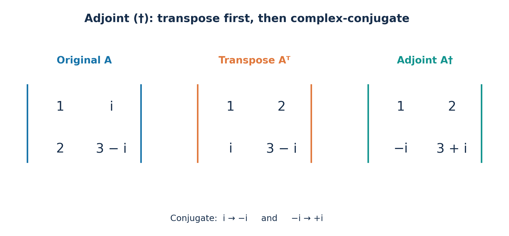

If the matrix contains only **real** entries, its conjugate does nothing, so $A^\dagger=A^T$.

### 13.2 Why the dagger is useful

**Main idea:** instead of applying $A$ to the vector on the **right** inside an inner product, you can move $A$ to the **left** vector—but you must replace it with the **adjoint** $A^\dagger$:

$$
\boxed{\langle u,Av\rangle=\langle A^\dagger u,v\rangle.}
$$

**Convention (physics):** $\langle u,v\rangle=u^\dagger v$ (conjugate the **first** argument).

**1. What is $A^\dagger$?**

The **adjoint** is the **conjugate transpose**: (1) complex-conjugate every entry, (2) transpose. Example:

$$
A=\begin{pmatrix}1&i\\2&3\end{pmatrix}
\quad\Rightarrow\quad
A^*=\begin{pmatrix}1&-i\\2&3\end{pmatrix}
\quad\Rightarrow\quad
\boxed{A^\dagger=
\begin{pmatrix}1&2\\-i&3\end{pmatrix}.}
$$

(See §13.1 and the step-by-step figure for another worked matrix.)

**2. Goal — check both sides with numbers**

$$
u=\begin{pmatrix}1\\i\end{pmatrix},
\qquad
v=\begin{pmatrix}2\\1\end{pmatrix},
\qquad
A=\begin{pmatrix}1&i\\2&3\end{pmatrix}.
$$

We verify $\langle u,Av\rangle=\langle A^\dagger u,v\rangle$.

**3. Left-hand side: $\langle u,Av\rangle$**

$$
Av=
\begin{pmatrix}1&i\\2&3\end{pmatrix}
\begin{pmatrix}2\\1\end{pmatrix}
=
\begin{pmatrix}2+i\\7\end{pmatrix}.
$$

$$
u^\dagger=\begin{pmatrix}1&-i\end{pmatrix}
\quad\Rightarrow\quad
\langle u,Av\rangle=
\begin{pmatrix}1&-i\end{pmatrix}
\begin{pmatrix}2+i\\7\end{pmatrix}
=(2+i)-7i
=
\boxed{2-6i.}
$$

**4. Right-hand side: $\langle A^\dagger u,v\rangle$**

$$
A^\dagger u=
\begin{pmatrix}1&2\\-i&3\end{pmatrix}
\begin{pmatrix}1\\i\end{pmatrix}
=
\begin{pmatrix}1+2i\\2i\end{pmatrix}.
$$

$$
(A^\dagger u)^\dagger=\begin{pmatrix}1-2i&-2i\end{pmatrix}
\quad\Rightarrow\quad
\langle A^\dagger u,v\rangle=
\begin{pmatrix}1-2i&-2i\end{pmatrix}
\begin{pmatrix}2\\1\end{pmatrix}
=2-4i-2i
=
\boxed{2-6i.}
$$

**5. Both sides match**

$$
\boxed{\langle u,Av\rangle=\langle A^\dagger u,v\rangle=2-6i.}
$$

**6. Why the identity holds (short proof)**

$$
\langle u,Av\rangle=u^\dagger Av=(u^\dagger A)v.
$$

For any column $w$, $(A^\dagger w)^\dagger=w^\dagger A$. Take $w=u$:

$$
(u^\dagger A)v=(A^\dagger u)^\dagger v=\langle A^\dagger u,v\rangle.
$$

So moving $A$ across the inner product forces the **dagger**.

**7. Use in quantum mechanics (unitary gates)**

A matrix $U$ is **unitary** when $\boxed{U^\dagger U=I}$. Then

$$
\langle Uu,Uv\rangle
=\langle u,U^\dagger Uv\rangle
=\langle u,v\rangle.
$$

A unitary gate **preserves inner products**, hence **norms**, **overlaps**, and **orthogonality**—properties we need for valid quantum evolution (developed further in §15).

**8. Summary**

| Concept | Meaning |
| --- | --- |
| $A^\dagger$ | Conjugate transpose of $A$ |
| $\langle u,Av\rangle$ | Apply $A$ to $v$, then inner product with $u$ |
| $\langle A^\dagger u,v\rangle$ | Apply $A^\dagger$ to $u$, then inner product with $v$ |
| Dagger identity | Move an operator across $\langle\cdot,\cdot\rangle$ by using $A^\dagger$ |
| Unitary $U$ | $\langle Uu,Uv\rangle=\langle u,v\rangle$ |

Remember:

$$
\boxed{\langle u,Av\rangle=\langle A^\dagger u,v\rangle.}
$$

Moving the matrix to the other side always means replacing $A$ with $A^\dagger$.

### 13.3 What does Hermitian mean?

A matrix is **Hermitian** if it equals its own adjoint:

$$
\boxed{A=A^\dagger.}
$$

Easy examples are

$$
I=\begin{pmatrix}1&0\\0&1\end{pmatrix},\qquad
Z=\begin{pmatrix}1&0\\0&-1\end{pmatrix}.
$$

Both are real and symmetric, so both equal their conjugate transpose. A complex Hermitian example is

$$
B=\begin{pmatrix}0&i\\-i&0\end{pmatrix};\qquad B^\dagger=B.
$$

**Do not confuse Hermitian with unitary.** Hermitian means $A=A^\dagger$. Unitary means $U^\dagger U=I$. Some matrices, such as $X,Z,H$, have **both** properties. But the two definitions are different.

More about why they matter will come later.

---

## 14. Invertible maps: can we undo the operation?

### 14.1 What does invertible mean?

**Central question:** if you know the **output** of a transformation, can you work backwards and find **exactly one** original input?

- **Yes** → the map is **invertible** (reversible).  
- **No** (zero or many inputs match the same output) → **non-invertible**.

**1. Transformations as machines**

A transformation $T$ takes a vector in and sends a vector out:

$$
v \xrightarrow{T} T(v).
$$

Example on numbers: $T(x)=2x$. If $T(3)=6$, then $x=6/2=3$—we can **undo** the map. That is invertibility in one dimension.

**2. Inverse**

The **inverse** $T^{-1}$ undoes $T$:

$$
T(v)=w \quad\Rightarrow\quad T^{-1}(w)=v,
\qquad
\boxed{T^{-1}(T(v))=v.}
$$

For an invertible **square matrix** $A$, the same idea is

$$
\boxed{A^{-1}A=AA^{-1}=I,}
$$

where $I$ leaves every vector unchanged: $I\begin{pmatrix}x\\y\end{pmatrix}=\begin{pmatrix}x\\y\end{pmatrix}$.

Four geometric examples follow.

**3. Example 1 — rotation by $30^\circ$ (invertible)**

Let $v=\begin{pmatrix}3\\2\end{pmatrix}$ (any vector works). Rotation by $30^\circ$ is $T(v)=R_{30^\circ}v$ with

$$
R_{30^\circ}=
\begin{pmatrix}
\cos30^\circ&-\sin30^\circ\\
\sin30^\circ&\cos30^\circ
\end{pmatrix}.
$$

Given only the **rotated** output, recover the original by rotating **$-30^\circ$**:

$$
R_{-30^\circ}R_{30^\circ}v=v.
$$

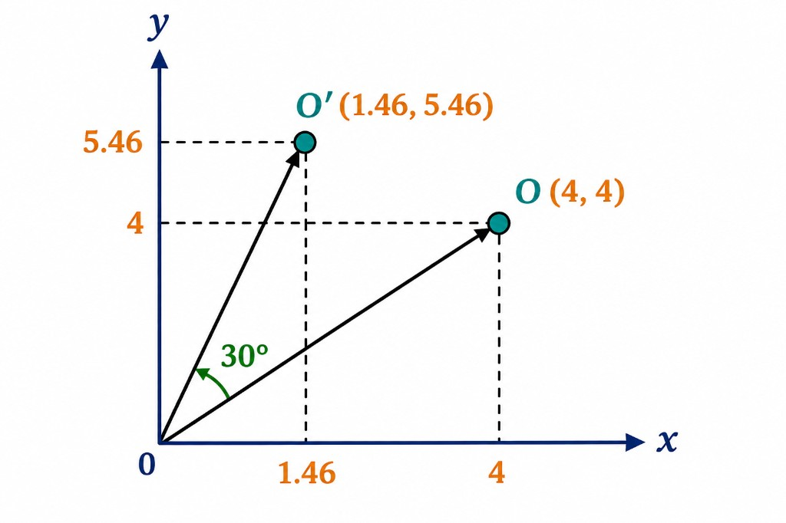

**Invertible** — rotation moves the vector but does not erase information about its direction and length.

**4. Example 2 — reflection across the $x$-axis (invertible)**

$v=\begin{pmatrix}3\\4\end{pmatrix}$, $T(x,y)=(x,-y)$, matrix $R_x=\begin{pmatrix}1&0\\0&-1\end{pmatrix}$:

$$
T\begin{pmatrix}3\\4\end{pmatrix}
=
\begin{pmatrix}3\\-4\end{pmatrix}.
$$

Reflect again: $T\begin{pmatrix}3\\-4\end{pmatrix}=\begin{pmatrix}3\\4\end{pmatrix}$.

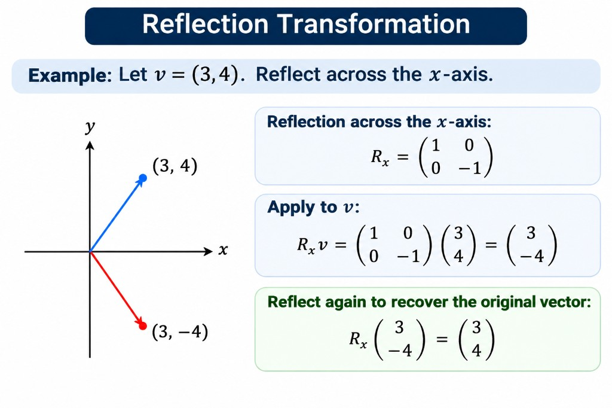

**Invertible** — doing the same reflection twice returns the start.

**5. Example 3 — scale coordinates by 2 (invertible)**

$T(x,y)=(2x,2y)$, matrix $T=\begin{pmatrix}2&0\\0&2\end{pmatrix}$:

$$
T\begin{pmatrix}3\\4\end{pmatrix}=\begin{pmatrix}6\\8\end{pmatrix},
\qquad
T^{-1}(x,y)=\left(\frac x2,\frac y2\right),
\qquad
T^{-1}\begin{pmatrix}6\\8\end{pmatrix}=\begin{pmatrix}3\\4\end{pmatrix}.
$$

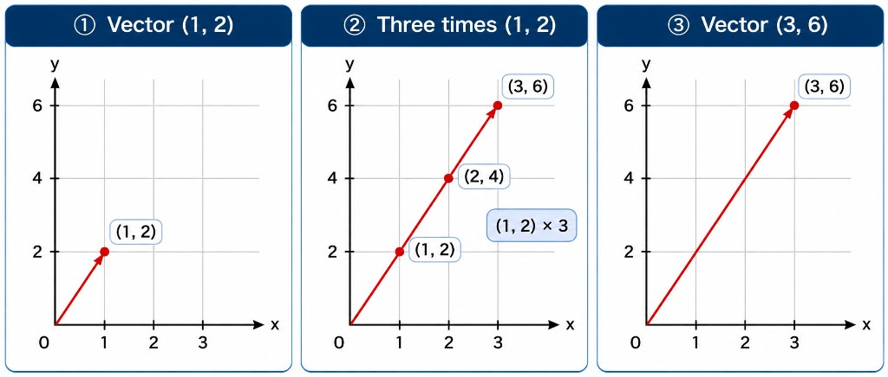

**Invertible** — multiply by 2, undo by dividing by 2.

**6. Example 4 — projection onto the $x$-axis (non-invertible)**

$T(x,y)=(x,0)$, matrix $P_x=\begin{pmatrix}1&0\\0&0\end{pmatrix}$:

$$
T\begin{pmatrix}3\\4\end{pmatrix}=\begin{pmatrix}3\\0\end{pmatrix}.
$$

But $(3,7)$, $(3,4)$, and $(3,-2)$ all map to $(3,0)$. From output $(3,0)$ alone you **cannot** recover the original $y$.

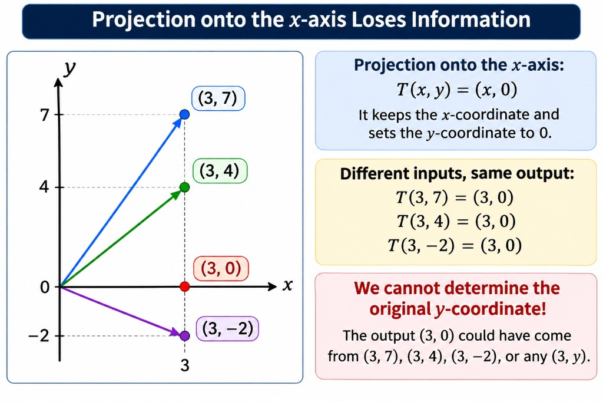

**Non-invertible** — information (here, the $y$-coordinate) is lost.

**7. Compare the four examples**

| Transformation | How to undo | Invertible? |
| --- | --- | --- |
| Rotate $+30^\circ$ | Rotate $-30^\circ$ | Yes |
| Reflect across $x$-axis | Reflect again | Yes |
| Multiply by 2 | Divide by 2 | Yes |
| Project onto $x$-axis | Cannot recover $y$ | No |

**8. Matrix shortcut: the determinant**

Sections 3–6 asked a **geometric** question: “Can I undo this map?” For **2×2 matrices** there is a quick **algebraic** test without drawing pictures.

**What is $\det(A)$?**  
For a square matrix $A$, the **determinant** $\det(A)$ is a single number built from the entries. For **2×2** matrices the formula is

$$
\boxed{
\det\begin{pmatrix}a&b\\c&d\end{pmatrix}=ad-bc.
}
$$

**Intuition (2D) — columns, area, and invertibility**

> **Interactive demo:** Open **[Determinant: area and invertibility](animations/determinant_area_invertibility.html)** (in the `animations` folder). Use **Animate transformation** to morph the unit square into a parallelogram. Switch **Invertible** vs **Non-invertible** and compare **det(A)**, **area**, and the status message.

Picture the **standard basis** vectors $\mathbf e_1=(1,0)^T$ and $\mathbf e_2=(0,1)^T$. The **unit square** has corners $0$, $\mathbf e_1$, $\mathbf e_2$, and $\mathbf e_1+\mathbf e_2$—its area is **1**.

A linear map $A$ sends:

- $\mathbf e_1 \mapsto$ **first column** of $A$ (call it $A\mathbf e_1$),
- $\mathbf e_2 \mapsto$ **second column** of $A$ ($A\mathbf e_2$),

and the square becomes the **parallelogram** spanned by those two column arrows from the origin.

| Quantity | Meaning |
| --- | --- |
| Blue arrow | First column: where $A$ sends $\mathbf e_1$ |
| Teal arrow | Second column: where $A$ sends $\mathbf e_2$ |
| Orange region | Image of the unit square (parallelogram) |
| $\|\det(A)\|$ | **Area** of that parallelogram (when we start from area 1) |
| Sign of $\det(A)$ | Whether orientation flips (advanced; area uses $\|\det(A)\|$) |

**Two cases:**

1. **$\det(A)\neq 0$** — the column arrows **do not** lie on one line. The parallelogram has **nonzero area**. The map stretches or shears the plane but does not **collapse** it onto a line, so different inputs stay distinguishable and **$A^{-1}$ exists** (you can undo $A$).

2. **$\det(A)=0$** — the columns are **parallel** (or one column is zero). The parallelogram **collapses** to a segment or a point (**area 0**). Many inputs can share the same output (like projection in Example 4), so there is **no** unique inverse.

That is why the determinant test matches the stories in §14.1 Examples 3–4: scaling by 2 gives $\det=4$ (area ×4); projection $P_x$ has a zero column so $\det=0$ (area crushed to 0).

**Rule (square matrices):**

$$
\boxed{A\text{ has an inverse }A^{-1}\ \Leftrightarrow\ \det(A)\neq 0.}
$$

So: **zero determinant → not invertible**; **nonzero determinant → invertible** (for square $A$).

**Check 1 — projection matrix (Example 4, non-invertible)**

$$
A=P_x=\begin{pmatrix}1&0\\0&0\end{pmatrix}.
$$

Identify $a=1$, $b=0$, $c=0$, $d=0$:

$$
\det(A)=ad-bc=(1)(0)-(0)(0)=0.
$$

$$
\boxed{\det(A)=0.}
$$

The second column is $(0,0)^T$, so the map sends **every** vector’s $y$-part to zero—same failure as Example 4. No matrix $A^{-1}$ exists.

**Check 2 — scaling matrix (Example 3, invertible)**

$$
B=\begin{pmatrix}2&0\\0&2\end{pmatrix}.
$$

Here $a=2$, $b=0$, $c=0$, $d=2$:

$$
\det(B)=ad-bc=(2)(2)-(0)(0)=4.
$$

$$
\boxed{\det(B)=4\neq 0.}
$$

So $B$ **is** invertible (indeed $B^{-1}=\begin{pmatrix}1/2&0\\0&1/2\end{pmatrix}$, which matches “divide by 2”).

**How to use this in practice:** after you write a 2×2 matrix for a linear map, compute $ad-bc$. If you get **0**, stop looking for an inverse—the map loses information like projection. If you get **nonzero**, an inverse exists (finding $A^{-1}$ explicitly is a separate calculation).

**9. Takeaway**

- **Invertible:** enough information survives to recover **one** original input.  
- **Non-invertible:** distinct inputs can share an output (projection drops the $y$-coordinate).  

That distinction between **reversible** and **irreversible** maps is what we need before linking invertible matrices to unitary quantum gates in §15.

### 14.2 Undo a sequence in reverse order

If the chronological order is $A$ then $B$, the combined transformation is $BA$. To undo it you apply $B^{-1}$ **first**, then $A^{-1}$:

$$
\boxed{(BA)^{-1}=A^{-1}B^{-1}.}
$$

Think of putting on a shirt, then a jacket. To reverse the process, remove the **jacket** first, then the shirt.

### 14.3 X, Z and H are their own inverses

These gates are **self-inverse** (also called **involutory**): applying the same gate **twice** is the same as doing **nothing**—because $U^{-1}=U$ when $U^2=I$.

$$
\boxed{X^2=Z^2=H^2=I.}
$$

Below we check each identity by matrix multiplication and by one qubit example.

**1. Pauli-X: $X^2=I$**

$$
X=\begin{pmatrix}0&1\\1&0\end{pmatrix},
\qquad
X^2=
\begin{pmatrix}0&1\\1&0\end{pmatrix}
\begin{pmatrix}0&1\\1&0\end{pmatrix}
=
\begin{pmatrix}
0\cdot0+1\cdot1&0\cdot1+1\cdot0\\
1\cdot0+0\cdot1&1\cdot1+0\cdot0
\end{pmatrix}
=
\boxed{\begin{pmatrix}1&0\\0&1\end{pmatrix}=I.}
$$

On states: $|0\rangle\xrightarrow{X}|1\rangle\xrightarrow{X}|0\rangle$ — flip twice restores the bit.

**2. Pauli-Z: $Z^2=I$**

$$
Z=\begin{pmatrix}1&0\\0&-1\end{pmatrix},
\qquad
Z^2=
\begin{pmatrix}1&0\\0&-1\end{pmatrix}
\begin{pmatrix}1&0\\0&-1\end{pmatrix}
=
\begin{pmatrix}
1&0\\
0&(-1)(-1)
\end{pmatrix}
=
\boxed{\begin{pmatrix}1&0\\0&1\end{pmatrix}=I.}
$$

For $|\psi\rangle=\alpha|0\rangle+\beta|1\rangle$: one $Z$ gives $\alpha|0\rangle-\beta|1\rangle$; a second $Z$ multiplies the $|1\rangle$ piece by $(-1)^2=+1$, so $|\psi\rangle$ returns.

**3. Hadamard: $H^2=I$**

$$
H=\frac1{\sqrt2}\begin{pmatrix}1&1\\1&-1\end{pmatrix},
\qquad
H^2=
\frac1{\sqrt2}\begin{pmatrix}1&1\\1&-1\end{pmatrix}
\cdot
\frac1{\sqrt2}\begin{pmatrix}1&1\\1&-1\end{pmatrix}
=
\frac12
\begin{pmatrix}
1+1&1-1\\
1-1&1+1
\end{pmatrix}
=
\frac12\begin{pmatrix}2&0\\0&2\end{pmatrix}
=
\boxed{I.}
$$

On states: $H|0\rangle=|+\rangle$, then $H|+\rangle=|0\rangle$ (§10.5) — two Hadamards restore the starting vector.

**4. Compare the three gates**

| Gate | After one application | After two applications |
| --- | --- | --- |
| **X** | $\lvert 0 \rangle \to \lvert 1 \rangle$ (bit flip) | $\lvert 0 \rangle$ again |
| **Z** | Relative sign on $\lvert 1 \rangle$ flips ($\beta \to -\beta$) | Same superposition as before |
| **H** | $\lvert 0 \rangle \to \lvert + \rangle$ | $\lvert + \rangle \to \lvert 0 \rangle$ |

Here $\lvert + \rangle = (\lvert 0 \rangle + \lvert 1 \rangle)/\sqrt{2}$. Two applications of the same gate return the starting state in each case because $X^2=Z^2=H^2=I$.

This is also why thinking of the Hadamard matrix as an ordinary $45^\circ$ **rotation** is **misleading**: rotating the plane by $45^\circ$ twice gives $90^\circ$, not the identity—whereas $H^2=I$ because $H$ is a reflection-like basis change, not a fixed-angle rotation of the real plane.

---

## 15. Unitary matrices: what makes a valid quantum gate?

Ideal gates on an **isolated** qubit must keep states **normalized** ($|\alpha|^2+|\beta|^2=1$). This section shows why **not every linear matrix** qualifies, defines **unitary** maps, and gives tests and examples.

### 15.1 Why isn't every matrix allowed?

**Three ideas:** (1) valid qubits have norm 1; (2) gates must preserve that; (3) **unitary** matrices do—see §15.3 for the definition $U^\dagger U=I$ and §15.6 for the proof that probabilities stay at 100%.

A qubit $|\psi\rangle=(\alpha,\beta)^T$ must satisfy $\boxed{|\alpha|^2+|\beta|^2=1}$ (§5). Take the equal superposition

$$
|\psi\rangle=\frac1{\sqrt2}\begin{pmatrix}1\\1\end{pmatrix}=\lvert+\rangle,
\qquad P(0)=P(1)=\tfrac12.
$$

**Counterexample — $2I$ is linear but not a gate.** With $2I=\begin{pmatrix}2&0\\0&2\end{pmatrix}$,

$$
2I|\psi\rangle=\begin{pmatrix}\sqrt2\\\sqrt2\end{pmatrix},
\qquad
P(0)+P(1)=|\sqrt2|^2+|\sqrt2|^2=4.
$$

Probabilities cannot sum to 400%; the vector **length** doubled from 1 to 2. **Linearity** (§7) does not imply a valid reversible gate.

| | $2I$ | Unitary gate (e.g. $H$) |
| --- | --- | --- |
| Changes amplitudes? | Yes | Yes |
| Preserves norm / total probability? | No | Yes (§15.6) |

Hadamard maps $\lvert+\rangle\to\lvert 0\rangle$ while keeping $P(0)+P(1)=1$; algebraically $H^\dagger H=I$ (§15.4). The rest of §15 explains **what unitary means** and **how to check** a matrix.

### 15.2 Geometry: columns stay orthonormal

Suppose the two input basis vectors are perpendicular and each has length 1. A unitary transformation must send them to output vectors that are **still perpendicular and still length 1**.

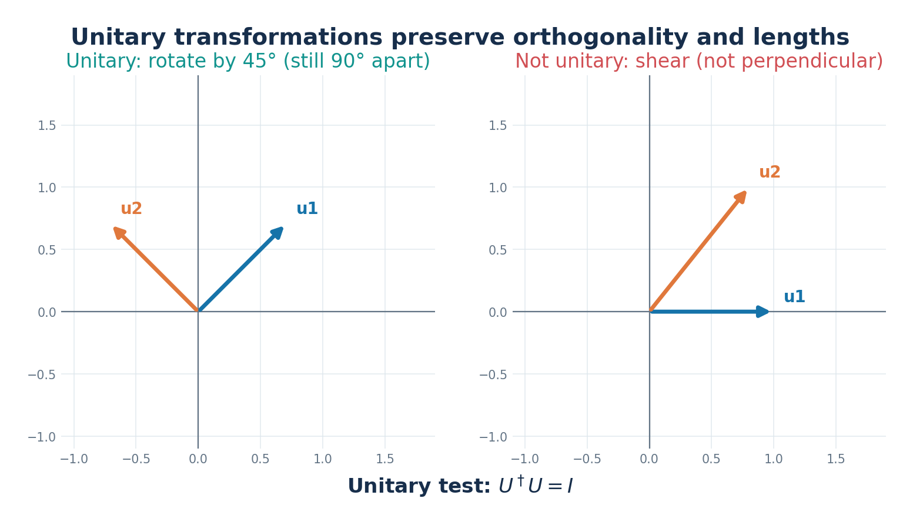

Since columns 1 and 2 of a matrix are the transformed basis vectors, a **square matrix is unitary when its columns are an orthonormal basis**—equivalent to $U^\dagger U=I$ in §15.3.

### 15.3 Algebraic test: $U^\dagger U=I$

$$
\boxed{U^\dagger U=I.}
$$

($U^\dagger$ = conjugate transpose.) Write columns $u_1,u_2$:

$$
U=\begin{pmatrix}|&|\\u_1&u_2\\|&|\end{pmatrix},
\qquad
U^\dagger U=
\begin{pmatrix}
\langle u_1,u_1\rangle&\langle u_1,u_2\rangle\\
\langle u_2,u_1\rangle&\langle u_2,u_2\rangle
\end{pmatrix}.
$$

Orthonormal columns ⟺ diagonal 1, off-diagonal 0 ⟺ $U^\dagger U=I$. Use this as a **computable** test without a picture.

### 15.4 Worked check: is Hadamard unitary?

Since $H$ is real and symmetric, $H^\dagger=H$. From §14.3,

$$
H^\dagger H=H^2=I.
$$

**Hadamard is unitary**; the same pattern applies to real symmetric Pauli gates $X$ and $Z$ ($X^2=Z^2=I$).

### 15.5 Complex example: conjugates in inner products

Consider

$$
U=\frac1{\sqrt2}\begin{pmatrix}1&i\\i&1\end{pmatrix},
\quad
u_1=\frac1{\sqrt2}\begin{pmatrix}1\\i\end{pmatrix},
\quad
u_2=\frac1{\sqrt2}\begin{pmatrix}i\\1\end{pmatrix}.
$$

Both columns have unit length, and (conjugate the **first** argument)

$$
\langle u_1,u_2\rangle=\tfrac12(\overline1\cdot i+\overline i\cdot1)=\tfrac12(i-i)=0.
$$

So $U$ is unitary. If $u_2'=(i,i)^T/\sqrt2$ instead, $\langle u_1,u_2'\rangle\neq0$ even though $\|u_2'\|=1$—**unit length of each column is not enough; they must be orthogonal**.

### 15.6 Why unitary gates preserve probability

For unitary $U$ and any $u,v$ (using §13.2),

$$
\langle Uu,Uv\rangle=\langle u,U^\dagger Uv\rangle=\langle u,v\rangle.
$$

Set $u=v=\psi$:

$$
\|U\psi\|^2=\|\psi\|^2=1
\quad\Rightarrow\quad
\boxed{|\alpha'|^2+|\beta'|^2=1}
$$

for the amplitudes $\alpha',\beta'$ after the gate. This is the **payoff** for §15.1: unitary evolution cannot turn a physical qubit into something with total probability 400%.

### 15.7 Inverse and scope

For square unitary $U$,

$$
\boxed{U^{-1}=U^\dagger.}
$$

Every ideal gate on a closed system is **reversible** in this sense. **Scope:** measurement, noise, and tracing out part of a system are not modeled as unitary on the qubit alone—§15 describes **ideal** gates, not every lab operation.

**§15 in one glance:** normalize with $|\alpha|^2+|\beta|^2=1$; require $U^\dagger U=I$; check columns or multiply $U^\dagger U$; expect $\|U\psi\|=1$ and $U^{-1}=U^\dagger$.

---

## 16. Putting the entire lesson together

This section ties **§§1–15** into one story. You already have the formulas in **§19** and drills in **§18**; here the goal is **how the pieces fit**, not new definitions.

### 16.1 Roadmap: what each block contributed

Read top to bottom once; each row matches one **numbered section** in these notes (§1–§15).

| § | Section title (short) | You use it when… |
| --- | --- | --- |
| **1** | Big picture | Separating *state*, *gate*, and *measurement* |
| **2** | Math refresher | Complex numbers, vectors, norm |
| **3** | Inner products & ONB | $\langle u,v\rangle$, orthogonality, coordinates |
| **4** | Change of basis | Same vector, new coordinates; Hadamard directions |
| **5** | Single qubit | $\lvert\psi\rangle$, normalization, amplitudes |
| **6** | Measurement | Born rule; basis fixes $P(0),P(1)$ |
| **7** | Linear maps | Linearity; gates before measurement |
| **8** | Matrices | Columns = $T(e_1),T(e_2)$; matrix–vector multiply |
| **9** | Geometry gallery | Visual link: columns, unitary vs shear/projection |
| **10** | Gates $X,Z,H$ | Bit flip, phase flip, superposition |
| **11** | Gate order | $ZX\neq XZ$; composition vs time |
| **12** | Bras, kets, projectors | $P_k$, measurement update (§12.3.6) |
| **13** | Adjoint & Hermitian | $A^\dagger$; dagger identity (§13.2) |
| **14** | Invertible maps | Undo vs collapse; $X^2=Z^2=H^2=I$ |
| **15** | Unitary gates | $U^\dagger U=I$; why $2I$ fails |

### 16.2 Three actions (same as §1, now with machinery)

| Action | Example in this section | Math |
| --- | --- | --- |
| **Describe** | Start in $\lvert 0\rangle$ | Column vector, norm 1 |
| **Change (no readout)** | Apply $H$ | Unitary matrix: $H^\dagger H=I$ (§15) |
| **Read** | Measure $\lvert+\rangle$ in $Z$ or $X$ basis | Projectors / Born rule (§6, §12) |

Gates **do not** collapse the state; measurement **does** (and is not unitary on the qubit alone—§15.7).

### 16.3 One end-to-end experiment (prepare → gate → measure)

**Prepare — state (§5).**

$$
|\psi\rangle=\lvert 0\rangle=\begin{pmatrix}1\\0\end{pmatrix},
\qquad P(0)=1,\ P(1)=0.
$$

**Evolve — unitary gate (§10, §15).** Hadamard builds superposition without breaking normalization:

$$
|\psi\rangle \xrightarrow{H}
H\lvert 0\rangle=\frac{\lvert 0\rangle+\lvert 1\rangle}{\sqrt2}=\lvert+\rangle.
$$

Check: $\bigl|\frac1{\sqrt2}\bigr|^2+\bigl|\frac1{\sqrt2}\bigr|^2=1$. This is **not** “secretly 0 or 1” (§17 Q4)—it is one vector until measurement.

**Measure — basis choice (§6).** The **same** $\lvert+\rangle$ gives different statistics:

| Measurement basis | Outcomes | Probabilities |
| --- | --- | --- |
| Computational ($Z$) | $\lvert 0\rangle$ or $\lvert 1\rangle$ | $P(0)=P(1)=\tfrac12$ |
| Hadamard ($X$ / $\pm$) | $\lvert+\rangle$ vs $\lvert-\rangle$ | $P(+)=1$, $P(-)=0$ for this state |

One lab run yields **one** classical outcome; the state **after** that outcome is the matching basis ket (§12.3.6), not $\lvert+\rangle$ anymore.

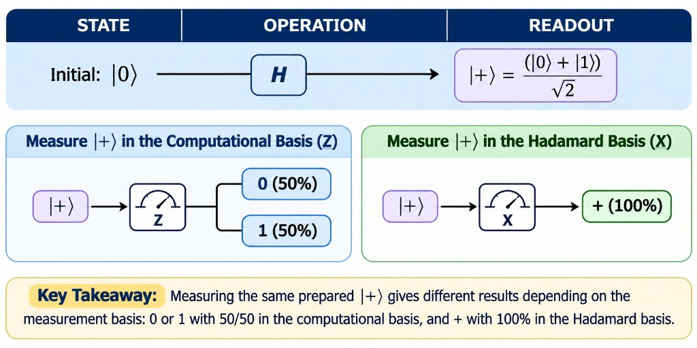

**If you repeat the circuit:** prepare $\lvert 0\rangle$ again, apply $H$ again, measure again—outcomes are random where probabilities are not 0 or 1. The **gate** step is deterministic; the **measurement** step is probabilistic.

### 16.4 Ideas that sit behind the picture

- **Coordinates ≠ state (§4):** $\lvert+\rangle$ has different numbers in the $Z$ basis than in the $+/-$ basis; the vector is the same object.
- **Order (§11):** $H$ then $X$ is not the same as $X$ then $H$ as matrices; do not commute freely.
- **Phase (§10, §11.3):** $Z$ changes **relative** phase; global phase does not change $Z$-basis probabilities but can matter in interference later.
- **Projectors (§12):** $P(0)=\langle\psi\vert P_0\vert\psi\rangle$ links amplitudes to $P(0)$; $P_0\lvert\psi\rangle$ is not the full measurement rule by itself.
- **Why $H$ only (§14–§15):** ideal gates are **unitary** (length-preserving); projection and scaling $2I$ illustrate what **fails** that test.
- **$H$ vs rotation (§14.3, §17 Q6):** $H^2=I$; a fixed $45^\circ$ rotation squared is **not** $I$.

### 16.5 Checklist before moving on

You can navigate single-qubit foundations if you can:

1. Expand $|\psi\rangle$ in an ONB and read coordinates as inner products (§3–§4).  
2. Compute $P(0),P(1)$ in a stated basis (§6).  
3. Multiply a gate matrix into a column; read **columns** as $U\lvert 0\rangle$, $U\lvert 1\rangle$ (§8–§10).  
4. Test $U^\dagger U=I$ or cite $U^2=I$ for Pauli/$H$ (§15).  
5. Tell **linear** from **unitary**, and **gate** from **measurement** (§1, §7, §15).

Multi-qubit entanglement and tensor products are **previewed** in §17 but not developed here—the next lectures build on this single-qubit toolkit.

---

## 17. Questions asked in class and common confusions

### Q1. If measurement returns just one classical bit, where is the quantum advantage?

The professor opened with this question and introduced **entanglement** as one of the special features of multiple qubits. However, simply obtaining correlated outcomes is not sufficient to explain quantum speedups. Algorithms also use coherent superposition, interference and structured gate sequences. The formal multi-qubit topic was **deferred** to a subsequent lecture.

### Q2. Are all bases orthogonal?

**No.** A basis only needs to consist of independent vectors spanning the space. The lecture mainly uses **orthonormal** bases because coordinates and measurements have simple inner-product formulas.

### Q3. Why do coordinates change when I change basis?

Because coordinates are **measurements against directions**, not the vector itself. The point $(4,5)$ is unchanged when it receives Hadamard-basis coordinates $(9/\sqrt2,-1/\sqrt2)$.

### Q4. Is a qubit “half zero and half one” before measurement?

No. A state such as $(|0\rangle+|1\rangle)/\sqrt2$ is a *superposition*. It is not equivalent to a classical coin that secretly chose 0 or 1 and hasn't been examined yet. The probabilities describe the outcomes of a selected measurement.

### Q5. Why square the amplitude?

That is the **Born-rule postulate**. It produces real nonnegative probabilities by taking a **magnitude squared**, and normalization ensures the outcomes add up to 1.

### Q6. Is Hadamard a rotation by 45°?

Its **basis arrows** lie at diagonal $45^\circ$ directions in the real-plane cartoon. But the **Hadamard operator** is not the same matrix as a 45° rotation. The supplied slide explicitly treats it as a **reflection about an axis at 22.5°**. $H^2=I$ is a useful way to remember the difference.

### Q7. Is linear the same as unitary?

**No.** A map is linear if it respects addition and scaling. It is unitary if, additionally, it preserves inner products ($U^\dagger U=I$ for a square matrix). Every ideal unitary gate is linear, but not every linear map is unitary.

### Q8. Is “ket” the same as “bra”?

No. $|u\rangle$ is a column **ket**; $\langle u|$ is its conjugate-transposed **bra**. Bra × ket gives one number, while ket × bra gives a matrix.

### Q9. Why not directly study tensor products and entanglement now?

The professor explicitly postponed multiple qubits. The final discussion briefly says the appropriate space for several qubits is built using **tensor products**, not merely ordinary Cartesian products. For two qubits, the computational basis will contain $|00\rangle,|01\rangle,|10\rangle,|11\rangle$. That is a **preview only**; the calculations were not developed in this provided lecture.

### Q10. How do the Bloch sphere and $\mathbb C^2$ connect?

The professor referred back to earlier Bloch-sphere teaching. Two complex amplitudes have **four real numbers**; normalization imposes one real constraint, leaving three parameters; physical states also identify overall **global phases**, leaving **two physically relevant angles** for a pure single-qubit state. Your earlier Bloch-sphere notes provide the full $\theta/2,\phi$ explanation, which is not rederived in this lecture.

### Q11. Is the transcript's “entangled coins that always agree” analogy complete?

No. It is only an analogy for **correlation**. Classical correlated coins can also agree. Entanglement has a more specific quantum mathematical structure, and does not allow faster-than-light messaging.

### Q12. What should I review before the next class?

Be comfortable with complex conjugates, vector addition, basis expansion, matrix-vector multiplication, $|\alpha|^2+|\beta|^2=1$, and the meaning of $U^\dagger U=I$. The lecturer said eigenvalues and tensor products would be addressed later, and emphasized practicing rather than memorizing a large new collection of definitions.

---

## 18. Practice questions with detailed answers

Try the problems *before* expanding the answers mentally. The first questions are deliberately simple.

### Problems

1. Write $(3,2)^T$ as a linear combination of the standard basis $e_1,e_2$.
2. Find the length of $(3,4)^T$. Is it a unit vector?
3. Find the conjugate and squared magnitude of $z=1-2i$.
4. Compute $\langle (1+i,2)^T,(1,0)^T\rangle$.
5. Check whether $h_+$ and $h_-$ are perpendicular.
6. Find the coordinates of $p=(2,0)^T$ in the Hadamard basis.
7. Is $|0\rangle+|1\rangle$ a normalized qubit? If not, normalize it.
8. A qubit has amplitudes $\sqrt3/2$ and $i/2$. Find $P(0)$ and $P(1)$.
9. For the state $|0\rangle$, what are the probabilities when measured in the Hadamard basis?
10. Is $T(x,y)=(x+2,y)$ a linear map? Give a one-line reason.
11. If $T(e_1)=(2,1)^T$ and $T(e_2)=(-1,3)^T$, write its matrix and find $T(2,3)$.
12. What does $X(\alpha|0\rangle+\beta|1\rangle)$ equal?
13. Starting with $|0\rangle$, apply $H$ twice. What is the output?
14. Calculate $P_0|\psi\rangle$ for $|\psi\rangle=\alpha|0\rangle+\beta|1\rangle$. Is the result necessarily normalized?
15. Find the adjoint of $A=\begin{pmatrix}2&i\\0&1-i\end{pmatrix}$.
16. If $U$ is unitary, what is $U^{-1}$? Why does it preserve a qubit's normalization?
17. If the first gate is X and the second is Z, is the final matrix $XZ$ or $ZX$?
18. Explain in one or two sentences why a projection is not invertible.

### Detailed answers

**1.** $(3,2)^T=3(1,0)^T+2(0,1)^T=3e_1+2e_2$. We add the two **basis-direction vectors**, not the two scalar coordinates by themselves.

**2.** Length $\sqrt{3^2+4^2}=5$. It is not a unit vector; $(3/5,4/5)^T$ is the normalized version.

**3.** $\overline z=1+2i$. Magnitude squared $|z|^2=1^2+(-2)^2=5$.

**4.** Conjugate the first vector: $(1-i,2)$. Then $(1-i)(1)+2(0)=1-i$.

**5.** $\langle h_+,h_-\rangle=\tfrac12(1\cdot1+1\cdot(-1))=0$, so they are orthogonal; each also has length 1.

**6.** $\langle h_+,p\rangle=(2+0)/\sqrt2=\sqrt2$ and $\langle h_-,p\rangle=(2-0)/\sqrt2=\sqrt2$. Thus $p=\sqrt2h_++\sqrt2h_-$.

**7.** No. Its squared norm is 2. The normalized state is $(|0\rangle+|1\rangle)/\sqrt2$.

**8.** $P(0)=|\sqrt3/2|^2=3/4$; $P(1)=|i/2|^2=(|i|/2)^2=1/4$. Do not square $i$ directly without the modulus.

**9.** Since $|0\rangle=(|+\rangle+|-\rangle)/\sqrt2$, each outcome has probability $1/2$.

**10.** No: $T(0,0)=(2,0)\ne(0,0)$. A linear map must leave the origin at the origin.

**11.** Columns are the two images: $M=\begin{pmatrix}2&-1\\1&3\end{pmatrix}$. Multiply: $M(2,3)^T=(4-3,2+9)^T=(1,11)^T$.

**12.** $X(\alpha|0\rangle+\beta|1\rangle)=\alpha|1\rangle+\beta|0\rangle=\beta|0\rangle+\alpha|1\rangle$.

**13.** $H(H|0\rangle)=H|+\rangle=|0\rangle$. Equivalently $H^2=I$.

**14.** $P_0=\begin{pmatrix}1&0\\0&0\end{pmatrix}$, so $P_0|\psi\rangle=\alpha|0\rangle$. It has norm $|\alpha|$, so it need **not** be normalized; the measurement rule supplies the outcome probability and normalized post-measurement state separately.

**15.** First transpose, then conjugate: $A^\dagger=\begin{pmatrix}2&0\\-i&1+i\end{pmatrix}$.

**16.** $U^{-1}=U^\dagger$. Because $U^\dagger U=I$, we get $\|U\psi\|^2=\psi^\dagger U^\dagger U\psi=\psi^\dagger\psi=1$.

**17.** $ZX$. The last gate to act, Z, appears on the left in the matrix product.

**18.** Many vectors have the same projection. For instance $(3,4)$ and $(3,-2)$ both become $(3,0)$ under x-axis projection, so the output cannot uniquely determine the input.

---

## 19. Formula sheet and glossary

### 19.1 Essential formulas on one screen

| Concept | Formula | How to interpret it |
| --- | --- | --- |
| Complex conjugate | $\overline{a+ib}=a-ib$ | Change the sign of the imaginary part |
| Complex magnitude | $\lvert a+ib\rvert^2=a^2+b^2$ | Nonnegative size squared |
| Complex inner product | $\langle u,v\rangle=u^\dagger v$ | Conjugate the first vector |
| Norm | $\lVert v\rVert^2=\langle v,v\rangle$ | Vector length squared |
| Orthogonality | $\langle u,v\rangle=0$ | Perpendicular in inner-product sense |
| ONB coordinate | $c_j=\langle e_j,v\rangle$ | Projection onto basis direction |
| Single-qubit state | $\lvert\psi\rangle=\alpha\lvert 0\rangle+\beta\lvert 1\rangle$ | Two complex amplitudes |
| Qubit normalization | $\lvert\alpha\rvert^2+\lvert\beta\rvert^2=1$ | Probabilities add to one |
| Measurement | $P(0)=\lvert\alpha\rvert^2$ | In the computational basis |
| Linearity | $T(au+bv)=aT(u)+bT(v)$ | Distribute across a combination |
| Matrix columns | $M=[T(e_1)\;T(e_2)]$ | Where basis vectors go |
| Matrix entry | $A_{ij}=\langle e_i\vert A\vert e_j\rangle$ | Input $e_j$, measure output along $e_i$ |
| Adjoint | $A^\dagger=\overline A^{\,T}$ | Conjugate transpose |
| Hermitian | $A=A^\dagger$ | Equals its own adjoint |
| Inverse | $A^{-1}A=I$ | Undo a transformation |
| Unitary | $U^\dagger U=I$ | Preserves all inner products |
| Unitary inverse | $U^{-1}=U^\dagger$ | Every ideal gate reversible |
| Projector | $P_e=\lvert e\rangle\langle e\vert$ | Keeps component along $\lvert e\rangle$ |
| Born (0 outcome) | $P(0)=\langle\psi\vert P_0\vert\psi\rangle$ | §12.3.6 |

### 19.2 One-qubit gate cheat sheet

$$
X=\begin{pmatrix}0&1\\1&0\end{pmatrix},\qquad
Z=\begin{pmatrix}1&0\\0&-1\end{pmatrix},\qquad
H=\frac1{\sqrt2}\begin{pmatrix}1&1\\1&-1\end{pmatrix}.
$$

$$
X^2=Z^2=H^2=I.
$$

### 19.3 Short glossary

- **Amplitude:** a complex coefficient of a basis state, e.g. $\alpha$ or $\beta$.
- **Basis:** an independent set of vectors sufficient to express every vector in a space.
- **Orthonormal basis:** basis whose vectors have length 1 and are mutually orthogonal.
- **Computational basis:** $\{\lvert 0\rangle,\lvert 1\rangle\}$ for a single qubit.
- **Hadamard basis:** $\{\lvert +\rangle,\lvert -\rangle\}$.
- **Ket:** a column state vector written $\lvert\psi\rangle$.
- **Bra:** its conjugate-transposed row $\langle\psi\vert$.
- **Inner product:** bra × ket; gives a scalar.
- **Outer product:** ket × bra; gives a matrix.
- **Linear transformation:** respects vector addition and scalar multiplication.
- **Quantum gate:** an ideal state-changing operation represented by a unitary matrix on a closed system.
- **Projector:** linear map selecting a particular direction or subspace.
- **Adjoint:** the conjugate transpose of a matrix.
- **Hermitian:** self-adjoint, $A=A^\dagger$.
- **Unitary:** norm- and inner-product-preserving, $U^\dagger U=I$.
- **Invertible:** the input can be uniquely recovered from the output.
- **Tensor product:** the mathematical construction used for combined quantum systems; formally studied next.
- **Entanglement:** a multi-system quantum feature that cannot generally be captured by separate pure-state descriptions of each part; only previewed here.

### 19.4 Final study advice

After your first reading, be able to answer five questions in your own words:

1. What is $\alpha\lvert 0\rangle+\beta\lvert 1\rangle$, and why is its length 1?
2. Why can changing a measurement basis change the outcome probabilities?
3. Why do the **columns of a matrix** tell you what happens to basis vectors?
4. Why is a **linear** map not always a valid quantum **gate**?
5. What does $U^\dagger U=I$ guarantee?

If you can solve the practice problems through question 16 in **§18** and explain these five ideas, you are ready for the next lecture's introduction to multiple qubits and tensor products.
