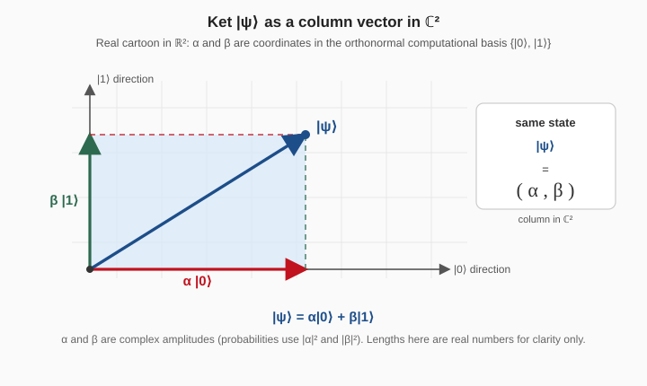
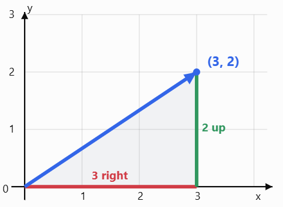

# QC Foundations [1/4] — Beginner-Friendly Study Notes

**Quantum Computing — CEP, IIT Delhi**  
**Lecture:** Prof. Kolin Paul · 24 October 2026 · Morning session  
**Prepared from:** *01 QC Foundations Part A* slides and the supplied corrected lecture transcript.

> **Who these notes are for:** Someone starting quantum computing after a long break from school mathematics. You can start here without remembering matrices, trigonometry, or complex numbers perfectly.
>
> **How to use these notes:** Read in order the first time. Pause at each **Try it** question. Equations are explained symbol by symbol; don't try to memorise them all on day one.
>
> **Source boundary:** The lecture introduces these concepts mostly through intuition and defers some formal derivations. The step-by-step arithmetic, everyday comparisons, and practice questions labelled **Learning aid** are added explanations, not quotations from the lecture recording. A few misleading spoken analogies are qualified in **Be careful** notes. The lecture recording provided stops after its Bell-pair discussion; the slides also show Quirk/Qiskit exercises and further reading, which are included as **slide-only activities**, not purported speech.

---

## Your learning roadmap

| Stage | What you will learn | Why you need it |
|---|---|---|
| 1 | Bits, vectors, numbers, matrices | To read a qubit written as a column |
| 2 | Ket notation and quantum states | To understand the language of quantum computing |
| 3 | Superposition, amplitudes, probability | To see why a qubit differs from a bit |
| 4 | Phase and the Bloch sphere | To picture the information that probability alone misses |
| 5 | X, H, Z gates and interference | To see how quantum computation manipulates states |
| 6 | Measurement and polarizers | To connect the equations with a physical experiment |
| 7 | Two qubits, CNOT, Bell pairs | To understand the first example of entanglement |

**Main message of the lecture:** Quantum computation uses **superposition**, **interference**, and **entanglement**, with quantum **gates** manipulating states and **measurement** producing classical outcomes.

---

# Part 0 — Tiny maths refresher

## 0.1 What is a number? Real versus complex

A **real number** is an ordinary number that you can place on a single number line: `-3`, `0`, `0.5`, `2`, `√2`. We write the set of real numbers as **ℝ**.

A **complex number** has two real components:

$$z=a+bi$$

- `a`: **real part**.
- `b`: **imaginary-part coefficient**.
- `i`: a special symbol defined by $i^2=-1$.

For example, $z=2+3i$ means real part `2`, imaginary part `3`. Draw it as the point `(2,3)` in the **complex plane**. The horizontal axis is real; the vertical axis is imaginary.

**Learning aid — why this matters:** A qubit has *two complex coefficients*. Each complex coefficient needs two real numbers. The four underlying real numbers are a source of confusion later; that does **not** mean we need to draw four separate qubit states.

### A complex number's magnitude

For $z=a+bi$, its magnitude is

$$|z|=\sqrt{a^2+b^2}.$$

For $z=3+4i$, $|z|=\sqrt{3^2+4^2}=5$, so $|z|^2=25$.

The notation $|z|^2$ is the **squared magnitude**, *not* the ordinary square $z^2$. This distinction is essential in quantum probability.

### Euler's formula — recognise it first, derive it later

$$e^{i\phi}=\cos\phi+i\sin\phi.$$

Read it as: “a complex number with magnitude one, pointing at an angle $\phi$ in the complex plane.” Here $\phi$ (phi) denotes an **angle**, measured in radians.

Useful values:

| Angle | $e^{i\phi}$ |
|---|---|
| $0$ | $1$ |
| $\pi/2$ (90°) | $i$ |
| $\pi$ (180°) | $-1$ |
| $3\pi/2$ (270°) | $-i$ |

You don't need calculus to use these facts in this lesson.

## 0.2 Vectors: an ordered collection of coordinates

A vector can be written as a **column**:

$$\begin{pmatrix}2\\3\end{pmatrix}.$$

This says “two units along the first coordinate direction and three along the second.” In the ordinary real plane you can picture an arrow from `(0,0)` to `(2,3)`.

The same values may be written horizontally as `(2,3)`, but **column vectors** are the usual representation of quantum **kets** (§1.3: a single-qubit ket is a column in $\mathbb{C}^2$).

Two simple directions are

$$\begin{pmatrix}1\\0\end{pmatrix}\quad\text{and}\quad\begin{pmatrix}0\\1\end{pmatrix}.$$

The first is along the horizontal coordinate direction; the second is along the vertical. They are **orthogonal** (perpendicular). Each has length one, so they are **orthonormal**.

A **basis** is a set of directions you can combine to make any vector in the space. For example:

$$\begin{pmatrix}2\\3\end{pmatrix}=2\begin{pmatrix}1\\0\end{pmatrix}+3\begin{pmatrix}0\\1\end{pmatrix}.$$

What happened? Multiply the first direction by `2`, the second by `3`, then add the columns entry by entry. This is a **linear combination**.

## 0.3 What is $\mathbb C^2$?

- $\mathbb C$ means **complex numbers**.
- Superscript `2` means **two coordinates**, **each of which is complex**.

Example:

$$\begin{pmatrix}1+i\\2-3i\end{pmatrix}\in\mathbb C^2.$$

The symbol $\in$ means “belongs to.” This vector contains **two complex entries**, requiring **four real values**: `1`, `1`, `2`, and `-3`.

**Be careful:** $\mathbb C^2$ is not just the ordinary two-dimensional drawing plane. You can draw each complex entry on its own complex plane, but the *pair* has four real coordinates. A Bloch sphere will later represent a **normalised single-qubit state up to global phase** using only two angles.

## 0.4 Matrices: instructions for changing vectors

A matrix is a rectangular arrangement of numbers:

$$M=\begin{pmatrix}a&b\\c&d\end{pmatrix}.$$

A 2×2 matrix multiplies a two-entry column this way:

$$\begin{pmatrix}a&b\\c&d\end{pmatrix}\begin{pmatrix}x\\y\end{pmatrix}=\begin{pmatrix}ax+by\\cx+dy\end{pmatrix}.$$

**Learning aid:** Think of the matrix as a *recipe* for producing a new vector. The quantum gates in this lecture are particular 2×2 matrix recipes.

**Try it:** Calculate $\begin{pmatrix}0&1\\1&0\end{pmatrix}\begin{pmatrix}1\\0\end{pmatrix}$. Answer: $\begin{pmatrix}0\\1\end{pmatrix}$.

---

# Part 1 — From classical bits to qubits

## 1.1 Classical bit: only two values

A classical bit is either `0` or `1`. These may physically correspond to two distinguishable voltage levels. A classical **NOT** operation flips the bit:

| Before NOT | After NOT |
|---|---|
| 0 | 1 |
| 1 | 0 |

If the input is known, the output is certain. We start with this familiar picture before introducing the qubit.

## 1.2 What is a qubit?

A **qubit** is a quantum system described using two chosen basis states, written $|0\rangle$ and $|1\rangle$. Here the unusual brackets are called **ket notation** (explained next).

A general *pure* single-qubit state is

$$\boxed{|\psi\rangle=\alpha|0\rangle+\beta|1\rangle}$$

Read aloud: “ket psi equals alpha times ket zero plus beta times ket one.”

- $|\psi\rangle$: the **whole quantum state**; psi is merely its name.
- $|0\rangle$, $|1\rangle$: two **basis states**.
- $\alpha$, $\beta$: complex **probability amplitudes**.
- `+`: a **linear combination**, also called a **superposition** when both coefficients are nonzero.

**Do not interpret this as:** a qubit is secretly either 0 or 1 and we simply don't know which. The lecture distinguishes a definite quantum superposition from a classical coin whose outcome is unknown.

## 1.3 Ket notation without fear (slides 3 and 8)

Dirac invented **ket notation** so multi-qubit expressions stay readable. For this course, the key fact is simple:

> A **ket** is a name for a **column vector in $\mathbb{C}^2$** (one qubit lives in this two-dimensional complex vector space; see §0.3).

The symbol $|\;\rangle$ is not an absolute-value sign. The whole piece $|\text{label}\rangle$ is one object: a column vector written with respect to a chosen basis. The *label* inside (psi, plus, zero, …) is just a tag—it can be any symbol the lecturer uses to name that vector.

The lecture's computational-basis picture matches the ordinary 2D coordinate story from §0.2:

- $|0\rangle$ and $|1\rangle$ are **orthonormal basis directions** (often drawn on the horizontal and vertical axes in a cartoon).
- $\alpha$ is the **component along $|0\rangle$**; $\beta$ is the **component along $|1\rangle$**—the projections (coordinates) on those basis lines.
- The pair $(\alpha,\beta)$ is the same information as the column $\begin{pmatrix}\alpha\\\beta\end{pmatrix}$.



In column form, the computational basis vectors are

$$|0\rangle=\begin{pmatrix}1\\0\end{pmatrix},\qquad |1\rangle=\begin{pmatrix}0\\1\end{pmatrix}.$$

Compare these equivalent representations:

$$|\psi\rangle=\alpha|0\rangle+\beta|1\rangle=\begin{pmatrix}\alpha\\\beta\end{pmatrix}\in\mathbb{C}^2.$$

Why? Substitute the two basis columns:

$$\alpha\begin{pmatrix}1\\0\end{pmatrix}+\beta\begin{pmatrix}0\\1\end{pmatrix}=\begin{pmatrix}\alpha\\\beta\end{pmatrix}.$$

So **ket notation is shorthand for a column vector in $\mathbb{C}^2$, expressed in the computational basis**—not a new arithmetic operation. (When $\alpha$ and $\beta$ are real, you can sketch the same idea in the ordinary plane as in the figure; for a general qubit they are complex.)

The paired **bra** notation looks like $\langle\psi|$. The class defers the detailed mathematics of bras, inner products, and outer products to a later session.

## 1.4 What is a computational basis?

A **computational basis** is a set of basic vectors we use to represent the state of a qubit.

For a single qubit there are exactly two computational basis vectors:

$$|0\rangle=\begin{pmatrix}1\\0\end{pmatrix}\qquad|1\rangle=\begin{pmatrix}0\\1\end{pmatrix}.$$

(You already met these as columns in §1.3; here we build the *idea* from ordinary 2D coordinates.)

### 1.4.1 Basis vectors from ordinary maths

Suppose you have a vector $(3,2)$ on a plane. You can reach $(3,2)$ by moving **3 units right** along the $x$-axis and **2 units up** along the $y$-axis:



The **standard basis** vectors are

$$e_1=\begin{pmatrix}1\\0\end{pmatrix},\qquad e_2=\begin{pmatrix}0\\1\end{pmatrix}.$$

So

$$(3,2)=3e_1+2e_2.$$

These two directions are perpendicular and each has length 1—they form an **orthonormal basis** for ordinary $\mathbb{R}^2$ (see §0.2).

### 1.4.2 The same idea in quantum notation

In quantum computing we give those two basic columns special names:

| Ordinary maths | Quantum notation |
|---|---|
| $e_1=\begin{pmatrix}1\\0\end{pmatrix}$ | $\lvert 0\rangle$ |
| $e_2=\begin{pmatrix}0\\1\end{pmatrix}$ | $\lvert 1\rangle$ |

Together, $\lvert 0\rangle$ and $\lvert 1\rangle$ are the **computational basis states**.

Any single-qubit state can be written as a combination of them:

$$\boxed{|\psi\rangle=\alpha|0\rangle+\beta|1\rangle}$$

- $|\psi\rangle$: the qubit’s state (“ket psi”).
- $\alpha$: amplitude associated with $\lvert 0\rangle$.
- $\beta$: amplitude associated with $\lvert 1\rangle$.
- $\alpha$ and $\beta$ are **complex** (unlike the real numbers `3` and `2` in the plane picture).

**Learning aid:** “East amount” and “north amount” tell you where you are only after you fix *which directions* count as east and north. The computational basis fixes those directions as $\lvert 0\rangle$ and $\lvert 1\rangle$.

*Examples such as $|+\rangle$ and what happens when you measure are in Part 2—once $|\alpha|^2$ and $|\beta|^2$ are defined.*

### 1.4.3 Why “computational”?

These are the **standard states for encoding and reading binary information** in quantum circuits: hardware and algorithms usually treat $\lvert 0\rangle$ and $\lvert 1\rangle$ as the binary labels `0` and `1`.

Other orthonormal bases are allowed—for example the Hadamard basis $\{\lvert +\rangle,\lvert -\rangle\}$—but the computational basis is the default choice in this course, not the only mathematically valid one.

> **One sentence to remember:** The computational basis is the pair $\lvert 0\rangle$ and $\lvert 1\rangle$ used to describe a single qubit, just as $e_1$ and $e_2$ are used to describe an ordinary 2D vector.

## 1.5 Real physical qubits: photon polarisation (slide 5)

The lecture chooses this convention:

| Physical polarisation | Qubit notation |
|---|---|
| Vertical | $\lvert V\rangle= \lvert 0\rangle$ |
| Horizontal | $\lvert H\rangle= \lvert 1\rangle$ |
| 45° diagonal | $\lvert +\rangle=(\lvert 0\rangle+ \lvert 1\rangle)/\sqrt{2}$ |

Light polarisation is **one physical implementation of a qubit**, not merely a story. The slides also mention electron spin, superconducting-circuit energy levels, trapped-ion internal states and nitrogen-vacancy (NV) centres in diamond.

**Be careful:** The identification vertical = `0` is a **chosen convention** for this lecture. A different lab or textbook may swap those labels without changing the physics.

---

# Part 2 — Superposition and quantum probabilities

## 2.1 The spinning-coin analogy — and its limit (slide 7)

The lecture compares a qubit with a coin that starts as heads or tails, spins, then lands heads or tails. This helps introduce the idea that the *outcome of a later observation* can be unpredictable.

**But here is the limit of the analogy:** An ordinary spinning coin has a classical physical orientation at each instant. We might not know it, but it exists. A genuine quantum state such as $|+\rangle$ is not merely a hidden classical answer. It can be distinguished from a classical 50/50 mixture through later quantum operations and interference.

The slide's intended key phrase: **superposition is a definite quantum state, not simply “being in two places at once.”**

## 2.2 Why $1/\sqrt2$ keeps appearing

The **plus state** is

$$\boxed{|+\rangle=\frac{|0\rangle+|1\rangle}{\sqrt2}}$$

In column form:

$$|+\rangle=\frac1{\sqrt2}\begin{pmatrix}1\\1\end{pmatrix}=\begin{pmatrix}1/\sqrt2\\1/\sqrt2\end{pmatrix}.$$

The coefficients are $\alpha=1/\sqrt2$ and $\beta=1/\sqrt2$.

To obtain **measurement probabilities**, take the **squared magnitudes**:

$$P(0)=|\alpha|^2=\left|\frac1{\sqrt2}\right|^2=\frac12,$$

$$P(1)=|\beta|^2=\frac12.$$

So measuring a freshly prepared plus state in the computational basis produces `0` with 50% probability and `1` with 50% probability.

**Learning aid:** If the amplitudes had been `1` and `1`, their squared magnitudes would sum to `2`, not `1`. Multiplying both by $1/\sqrt2$ makes the total probability `1`.

## 2.3 Normalisation and the Born rule (slides 8 and 23)

For $|\psi\rangle=\alpha|0\rangle+\beta|1\rangle$:

$$\boxed{|\alpha|^2+|\beta|^2=1}$$

This is **normalisation**. The two measurement outcomes must account for 100% of the possibilities.

The **Born rule** says:

$$\boxed{P(0)=|\alpha|^2,\qquad P(1)=|\beta|^2.}$$

The `P` stands for **probability**. The two vertical bars around an amplitude mean **magnitude**. If an amplitude is complex, *never simply square it without the bars* to obtain a probability.

### Worked example: unequal chances

Suppose

$$|\psi\rangle=\frac12|0\rangle+\frac{\sqrt3}{2}|1\rangle.$$

Then

$$P(0)=\left(\frac12\right)^2=\frac14=25\%,$$

$$P(1)=\left(\frac{\sqrt3}{2}\right)^2=\frac34=75\%.$$

Check: $25\%+75\%=100\%$.

A measurement gives **one outcome**, not “25% of a zero and 75% of a one.”

## 2.4 Does one measurement reveal the original state?

No. If a qubit is measured in the computational basis, you get `0` or `1`. A single result generally cannot reveal the original amplitudes. Repeated experiments require **repreparing the same initial state** each time to estimate probabilities.

**Be careful:** Even equal 50/50 probabilities cannot by themselves prove the qubit was $|+\rangle$; the distinct state $|-\rangle$ also gives 50/50 probabilities in that basis.

---

# Part 3 — Phase: a crucial extra ingredient

## 3.1 What is interference? (slide 9)

Waves can reinforce or cancel one another:

- **Constructive interference:** wave contributions line up and add.
- **Destructive interference:** some contributions have opposite signs or phases and cancel.

We use two speakers and a shared sound signal to motivate **phase**: how one waveform is shifted relative to another. Noise-cancelling headphones are another analogy.

## 3.2 Global phase versus relative phase

Compare

$$|\psi\rangle=\alpha|0\rangle+\beta|1\rangle$$

with

$$e^{i\gamma}|\psi\rangle=e^{i\gamma}\alpha|0\rangle+e^{i\gamma}\beta|1\rangle.$$

Both amplitudes gained the **same phase factor** $e^{i\gamma}$. This is called **global phase**. No experiment on the state alone distinguishes the two.

But compare

$$|+\rangle=\frac{|0\rangle+|1\rangle}{\sqrt2},\quad |-\rangle=\frac{|0\rangle-|1\rangle}{\sqrt2}.$$

The minus sign applies to **only the $|1\rangle$ part**. This changes the **relative phase**.

These two states have the same computational-basis measurement probabilities, but quantum gates can later reveal their difference.

**Be careful:** The `Z` gate does **not** merely add an unobservable global phase to every qubit. It changes the phase of the $|1\rangle$ component relative to the $|0\rangle$ component in a superposition. For the isolated state $|1\rangle$ alone, $Z$ adds only an overall minus sign.

## 3.3 Why $|+\rangle$ and $|-\rangle$ are different

Their columns are:

$$|+\rangle=\frac1{\sqrt2}\begin{pmatrix}1\\1\end{pmatrix},\qquad |-\rangle=\frac1{\sqrt2}\begin{pmatrix}1\\-1\end{pmatrix}.$$

Both produce 50/50 results if **measured immediately** in the computational basis. But the Hadamard gate (introduced in Part 5) turns them into different certain outcomes:

$$H|+\rangle=|0\rangle,\qquad H|-\rangle=|1\rangle.$$

So **relative phase contains meaningful quantum information**.

---

# Part 4 — The Bloch sphere: drawing one qubit

## 4.1 Why a sphere? (slides 10–11)

A general qubit requires two complex coefficients, $\alpha$ and $\beta$:

$$\alpha=a+bi,\qquad\beta=c+di.$$

That appears to be **four real numbers**: $a,b,c,d$.

But two facts reduce the number of independent parameters:

1. **Normalisation:** $|\alpha|^2+|\beta|^2=1$ gives one condition. Four real parameters become **three**.
2. **Global phase is unobservable:** You may choose an equivalent representation where $\alpha$ is nonnegative and real. Three become **two**.

Two angles specify a point on the **surface** of a sphere, just as latitude and longitude locate places on a globe.

**Be careful:** It is the set of **physical pure one-qubit states** (normalised state vectors ignoring global phase) that can be pictured by this sphere. We are not literally turning the full $\mathbb C^2$ vector space into an ordinary sphere.

## 4.2 The Bloch-sphere formula, one symbol at a time

$$\boxed{|\psi\rangle=\cos\left(\frac\theta2\right)|0\rangle+e^{i\phi}\sin\left(\frac\theta2\right)|1\rangle}$$

- $\theta$ (theta): the polar angle, measured from the **north pole**; ranges from $0$ to $\pi$ (0° to 180°).
- $\phi$ (phi): the azimuthal angle, measuring rotation around the sphere; ranges from $0$ to $2\pi$ (0° to 360°).
- $\cos(\theta/2)$: the size of the coefficient of $|0\rangle$.
- $\sin(\theta/2)$: the size of the coefficient of $|1\rangle$.
- $e^{i\phi}$: the **relative phase** attached to the $|1\rangle$ amplitude.

These functions satisfy

$$\cos^2\left(\frac\theta2\right)+\sin^2\left(\frac\theta2\right)=1,$$

so the state is automatically normalised.

### Where are 0, 1, and plus?

| State | $\theta$ | $\phi$ | Position |
|---|---|---|---|
| $\lvert 0\rangle$ | 0 | irrelevant at pole | North pole |
| $\lvert 1\rangle$ | $\pi$ | irrelevant at pole | South pole |
| $\lvert +\rangle$ | $\pi/2$ | 0 | Equator, +x |
| $\lvert -\rangle$ | $\pi/2$ | $\pi$ | Equator, −x |

The **poles** are special: all longitude values at a given pole describe the same point on the sphere.

## 4.3 Latitude/polar angle controls measurement probabilities (slide 12)

$$P(0)=\cos^2\left(\frac\theta2\right),\quad P(1)=\sin^2\left(\frac\theta2\right).$$

At $\theta=0$, $P(0)=1$. At $\theta=\pi/2$, both outcomes have probability $1/2$. At $\theta=\pi$, $P(1)=1$.

**Learning aid:** As the arrow moves from the north pole towards the south pole, outcome `0` becomes less likely and outcome `1` becomes more likely (when measured in the computational basis).

The lecture informally calls $\theta$ “latitude,” but geometrically it is the **polar angle**, measured down from the north pole. Standard geographic latitude is defined differently.

## 4.4 Longitude controls relative phase (slide 13)

For an equator state, $\theta=\pi/2$, so:

$$|\psi\rangle=\frac{|0\rangle+e^{i\phi}|1\rangle}{\sqrt2}.$$

When $\phi=0$, this is $|+\rangle$. When $\phi=\pi$, since $e^{i\pi}=-1$, it becomes $|-\rangle$.

Both remain 50/50 if measured along `0/1`, but they interfere differently after other gates.

## 4.5 Six named states (slide 14)

| Name | Formula | Bloch direction |
|---|---|---|
| Zero | $\lvert 0\rangle$ | +z |
| One | $\lvert 1\rangle$ | −z |
| Plus | $(\lvert 0\rangle+ \lvert 1\rangle)/\sqrt{2}$ | +x |
| Minus | $(\lvert 0\rangle- \lvert 1\rangle)/\sqrt{2}$ | −x |
| Plus-i | $(\lvert 0\rangle+i\lvert 1\rangle)/\sqrt{2}$ | +y |
| Minus-i | $(\lvert 0\rangle-i\lvert 1\rangle)/\sqrt{2}$ | −y |

The six points are useful **landmarks**, not the only states. There are continuously many possible directions on the Bloch sphere.

**Be careful about orthogonality:** Opposite **Bloch points** represent orthogonal pure qubit states; the arrows in three-dimensional Bloch space are antiparallel, not 90° apart. The orthogonality refers to the quantum-state inner product, not the ordinary angle between those Bloch arrows.

---

# Part 5 — Quantum gates: change the qubit state

## 5.1 What is a gate? (slides 15–16)

A quantum gate is an operation that takes an input quantum state and produces an output quantum state. In the lecture, the gates are **unitary matrices**.

$$U|\psi\rangle=|\psi_{\mathrm{out}}\rangle.$$

Unitary means, among other things, that it preserves the total squared magnitude (`1`) and is **reversible**. A single-qubit unitary acts like a rotation of the Bloch sphere's state direction (ignoring global phase).

We contrast reversible NOT with ordinary irreversible AND: when AND outputs `0`, its input could have been `00`, `01`, or `10`, so you cannot recover the unique input.

### A linear gate

$$U(\alpha|0\rangle+\beta|1\rangle)=\alpha U|0\rangle+\beta U|1\rangle.$$

This says: the gate acts on each component, retaining its amplitude, and the outputs are added. This is how gates work on superpositions. A formal proof is postponed in the lecture.

## 5.2 X gate: quantum NOT (slide 17)

$$\boxed{X=\begin{pmatrix}0&1\\1&0\end{pmatrix}}$$

It swaps the two basis states:

$$X|0\rangle=|1\rangle,\qquad X|1\rangle=|0\rangle.$$

**Worked multiplication:**

$$\begin{pmatrix}0&1\\1&0\end{pmatrix}\begin{pmatrix}1\\0\end{pmatrix}=\begin{pmatrix}0\\1\end{pmatrix}.$$

On the Bloch sphere it corresponds to a **180° rotation around the x-axis**.

A surprise:

$$X|+\rangle=|+\rangle,\qquad X|-\rangle=-|-\rangle.$$

The minus state changes only by an overall minus sign, which does not alter its measurement probabilities.

## 5.3 H gate: Hadamard, the superposition gate (slide 18)

$$\boxed{H=\frac1{\sqrt2}\begin{pmatrix}1&1\\1&-1\end{pmatrix}}$$

Important actions:

| Input | Output |
|---|---|
| $\lvert 0\rangle$ | $\lvert +\rangle$ |
| $\lvert 1\rangle$ | $\lvert -\rangle$ |
| $\lvert +\rangle$ | $\lvert 0\rangle$ |
| $\lvert -\rangle$ | $\lvert 1\rangle$ |

Read the first line as “Hadamard applied to zero gives plus.”

**Why do we call H a superposition gate?** It takes the definite computational-basis state $|0\rangle$ and produces $|+\rangle$, containing two nonzero amplitudes.

## 5.4 Applying H twice returns the original state (slide 19)

$$\boxed{H^2=I}$$

Here `I` is the **identity**: an operation that leaves the state unchanged. Therefore:

$$|0\rangle\xrightarrow{H}|+\rangle\xrightarrow{H}|0\rangle.$$

### Step-by-step: where interference happens

Start with

$$|+\rangle=\frac{|0\rangle+|1\rangle}{\sqrt2}.$$

Apply H to both components:

$$H|+\rangle=\frac{H|0\rangle+H|1\rangle}{\sqrt2}=\frac{|+\rangle+|-\rangle}{\sqrt2}.$$

Substitute the definitions:

$$=\frac12\left[(|0\rangle+|1\rangle)+(|0\rangle-|1\rangle)\right].$$

The $+|1\rangle$ and $-|1\rangle$ terms **cancel**. The two $|0\rangle$ terms **reinforce**:

$$=\frac12(2|0\rangle)=|0\rangle.$$

This is the lecture's central example of **destructive and constructive interference**.

## 5.5 Z gate: phase flip (slide 20)

$$\boxed{Z=\begin{pmatrix}1&0\\0&-1\end{pmatrix}}$$

Its actions are:

$$Z|0\rangle=|0\rangle,\qquad Z|1\rangle=-|1\rangle,$$

$$Z|+\rangle=|-\rangle,\qquad Z|-\rangle=|+\rangle.$$

Notice: Z does not exchange 0 and 1. It changes a sign, which can change the **relative phase** in a superposition. On the Bloch sphere, it corresponds to a 180° rotation around z.

## 5.6 The H–Z–H poll (slide 21)

Question: Start at $|0\rangle$. Apply H, then Z, then H. Where do you end?

$$|0\rangle\xrightarrow{H}|+\rangle\xrightarrow{Z}|-\rangle\xrightarrow{H}|1\rangle.$$

Result: **$|1\rangle$**.

Indeed:

$$\boxed{HZH=X}.$$

That means the three-gate sequence H–Z–H performs the same transformation as one X gate.

## 5.7 Gate cheat sheet

| Gate | Informal purpose | Key effect |
|---|---|---|
| `X` | Flip | $\lvert 0\rangle\leftrightarrow \lvert 1\rangle$ |
| `H` | Make/undo equal superposition | $\lvert 0\rangle\leftrightarrow \lvert +\rangle$ |
| `Z` | Phase flip | $\lvert +\rangle\leftrightarrow \lvert -\rangle$ |
| `CNOT` | Conditional flip using two qubits | Flip target if control is 1 |

---

# Part 6 — Measurement: getting an ordinary answer

## 6.1 What does “measurement” mean? (slides 22–23)

The lecturer uses a **shadow analogy**: you don't get an entire object by looking at one projection of it. In quantum computing you first choose a **measurement basis**, such as $\{|0\rangle,|1\rangle\}$, then obtain a particular classical outcome.

For a qubit $\alpha|0\rangle+\beta|1\rangle$, a standard computational-basis measurement yields `0` with probability $|\alpha|^2$ or `1` with probability $|\beta|^2$.

In the ideal projective-measurement model taught here, after observing `0` the state is $|0\rangle$; after observing `1` it is $|1\rangle$. This is called **collapse** in the lecture.

## 6.2 Measuring a plus state (slide 24)

Prepare $|+\rangle$ and measure in the computational basis:

- Chance of `0`: 50%.
- Chance of `1`: 50%.
- If the outcome was `0`, an **immediate repeat in the same basis**, with no intervening gate, gives `0` with certainty.

**Learning aid:** Imagine making 100 independent preparations of the *same* $|+\rangle$ state. You may get approximately 50 zeros and 50 ones. It need not be exactly 50 of each in any particular batch.

**Be careful:** A measurement can be described in **different bases**, not just the computational basis. The lecture concentrates on the latter because it is the readout used for its first circuits.

## 6.3 Why measurement differs from reading stored classical data

Reading a classical bit tells you its definite value. Reading a qubit in a basis generally yields just one of that basis's possible outcomes and can alter the quantum state. This is why quantum algorithms arrange interference **before** readout.

---

# Part 7 — The three-polariser puzzle

## 7.1 What the lecturer demonstrates (slides 4, 25–28)

Place two ideal polarizers at perpendicular angles:

`vertical (0°) → horizontal (90°)`

A photon that passes the vertical filter is vertically polarised. It cannot pass the horizontal filter: **transmission probability 0**.

Now insert a 45° polarizer:

`vertical (0°) → diagonal (45°) → horizontal (90°)`

Surprisingly, some light now passes through all three.

## 7.2 Explain it using qubit states

Use the lecture's labels:

$$|V\rangle=|0\rangle,\quad |H\rangle=|1\rangle,\quad |D\rangle=|+\rangle.$$

Step 1: A photon that passed vertical is in $|0\rangle$.

Step 2: The diagonal filter passes it with probability

$$|\langle+|0\rangle|^2=\frac12.$$

If it passes, its new state is $|+\rangle$.

Step 3: The horizontal filter passes that diagonal state with probability

$$|\langle1|+\rangle|^2=\frac12.$$

Thus, **conditional on passing the first vertical filter**, the fraction that passes the next two filters is

$$\boxed{\frac12\times\frac12=\frac14=25\%.}$$

The middle filter does not “preserve the vertical label.” It prepares the transmitted photons in a new diagonal state; the final filter now has a nonzero chance of transmitting them.

### What about 1/8 = 12.5% of the *original* light?

For **ideal unpolarised incident light**, the first ideal polarizer transmits half. So relative to original incident light:

$$\frac12\times\frac12\times\frac12=\frac18=12.5\%.$$

**Important distinction:** The slides' **25%** is *of the photons that already passed the first polarizer*, while the spoken explanation also mentions **1/8 of the initial intensity** for unpolarised input. Both are compatible when their **starting reference points differ**. Real polarizers also have losses not considered in this ideal calculation.

## 7.3 Malus's law connection

The slides link the polariser calculation to **Malus's law**, which gives intensity transmission as $\cos^2\delta$, where $\delta$ is the angle between the incoming linear polarisation and a polarizer axis. At 45°, $\cos^2 45^\circ=1/2$.

**Learning aid:** You don't need to memorise the trigonometry to understand the lesson: a filter changes which polarisation passes; consecutive 45° differences each have a 50% ideal transmission probability.

---

# Part 8 — Two qubits and entanglement

## 8.1 Why two qubits have four basis states (slide 30)

One qubit has two basis possibilities: `0` and `1`. Put two together, and list every pair:

$$|00\rangle,\quad|01\rangle,\quad|10\rangle,\quad|11\rangle.$$

Count: **4 = 2×2**.

For three qubits, list all three-bit strings: `000`, `001`, `010`, `011`, `100`, `101`, `110`, `111`. Count: **8 = 2×2×2**.

In general, **n qubits have $2^n$ computational-basis states**.

| Qubits | Basis-state count ($2^n$) |
|---|---:|
| 1 | 2 |
| 2 | 4 |
| 3 | 8 |
| 10 | 1,024 |
| 50 | 1,125,899,906,842,624 |

A general **pure** two-qubit state is

$$|\psi\rangle=\alpha_{00}|00\rangle+\alpha_{01}|01\rangle+\alpha_{10}|10\rangle+\alpha_{11}|11\rangle.$$

Each $\alpha_{ij}$ is a complex amplitude; their squared magnitudes add to one.

**Be careful:** Having $2^n$ amplitudes does **not** mean you can read out all $2^n$ values in one measurement.

## 8.2 Tensor products: combining two systems (slide 31)

The tensor product is written $\otimes$ (“tensor”). For single-qubit kets:

$$|0\rangle\otimes|1\rangle=|01\rangle.$$

If two qubits are independently describable by their own pure states, their joint state is a **product state** $|a\rangle\otimes|b\rangle$.

The lecture offers an everyday illustration: a grocery machine with a clock and a weighing scale, each working independently. This is only a picture to motivate the idea of a product state.

The detailed tensor-product arithmetic is deferred to the next maths session.

## 8.3 What is entanglement?

A joint pure state is **entangled** if you cannot express it as a tensor product of one state for qubit A and one for qubit B.

**Important:** Entanglement is stronger than ordinary correlations between classical objects. The lecture motivates it using correlations, then introduces a state that cannot be written as a product.

## 8.4 CNOT: controlled NOT (slide 32)

CNOT is a **two-qubit gate**. The first designated qubit is the **control**, the second is the **target**. If the control is `1`, flip the target; if control is `0`, don't flip.

Using the slide's ordering `q1 q0` (control first):

| Input | Output | Why |
|---|---|---|
| $\lvert 00\rangle$ | $\lvert 00\rangle$ | Control 0; leave target |
| $\lvert 01\rangle$ | $\lvert 01\rangle$ | Control 0; leave target |
| $\lvert 10\rangle$ | $\lvert 11\rangle$ | Control 1; flip 0→1 |
| $\lvert 11\rangle$ | $\lvert 10\rangle$ | Control 1; flip 1→0 |

CNOT is itself reversible: applying it twice returns the original two-qubit state.

**Be careful:** CNOT does **not** entangle every input state. It can produce entanglement when used with suitable superposition inputs, as in the next example.

## 8.5 Building a Bell pair (slides 33–34)

Start from two zero qubits:

$$|00\rangle.$$

**Step 1:** Apply Hadamard to the first qubit, leaving the second unchanged:

$$|00\rangle\xrightarrow{H\otimes I}\frac{|00\rangle+|10\rangle}{\sqrt2}.$$

Why? The first $|0\rangle$ becomes $(|0\rangle+|1\rangle)/\sqrt2$, while the second is still $|0\rangle$.

**Step 2:** Apply CNOT with the first qubit as control and second as target:

- $|00\rangle$ stays $|00\rangle$.
- $|10\rangle$ becomes $|11\rangle$.

Therefore:

$$\boxed{|\Phi^+\rangle=\frac{|00\rangle+|11\rangle}{\sqrt2}.}$$

This is a **Bell state**, and it is entangled: there are no single-qubit kets $|a\rangle$ and $|b\rangle$ whose product equals this state.

**Be careful:** A Bell pair is a *two-qubit state*. It cannot be shown as a single point on **one qubit's Bloch sphere**. That sphere pictures a single pure qubit, not the entire joint entangled system.

## 8.6 Measuring a Bell pair (slide 34)

For $|\Phi^+\rangle=(|00\rangle+|11\rangle)/\sqrt2$:

- Measuring one qubit yields `0` or `1` with equal probability.
- If you obtain `0`, a measurement of the other qubit in the same computational basis will also yield `0`.
- If you obtain `1`, the other will also yield `1`.

So the two outcomes are **perfectly correlated**, yet either local result by itself is unpredictable. The slides explicitly say this **cannot be used to send information faster than light**.

The lecturer refers to Einstein's “spooky action at a distance” and the EPR discussion as motivation; detailed foundations and proofs are outside this session.

---

# Part 9 — Putting it together: a short quantum computation

Follow this conceptual sequence:

1. **Prepare** a known quantum state, such as $|0\rangle$ or $|00\rangle$.
2. **Apply gates**, represented by unitary matrices.
3. **Create superposition** using gates like H.
4. **Use phase and interference** so desired amplitudes reinforce and unwanted ones cancel.
5. **Use multi-qubit interactions** such as CNOT when needed.
6. **Measure**, obtaining ordinary classical bits.

The lecture's afternoon follow-up develops an actual algorithm using these same ingredients. The morning session builds the vocabulary and intuition first.

---

# Part 10 — Slide-only practical exercises

The slide deck includes the following practice tasks after the portion covered by the attached transcript. They are **from the slides**, not additional spoken transcription.

## 10.1 Quirk browser simulator (slide 35)

The slides point to **Quirk**, a browser-based drag-and-drop quantum circuit simulator: https://algassert.com/quirk

The slide also introduces this minimal **Qiskit** example for a Bell pair:

```python
from qiskit import QuantumCircuit

qc = QuantumCircuit(2)
qc.h(0)
qc.cx(0, 1)
```

**Learning aid:** `qc.h(0)` applies H to qubit 0; `qc.cx(0, 1)` applies CNOT with control 0 and target 1. Qubit labels in programming may be ordered differently from the `q1 q0` order used in the slides, so always check the convention.

## 10.2 Three puzzles from slide 36

**Puzzle A.** Start from $|0\rangle$. Reach $|1\rangle$ using H and Z only.  
**Answer:** H → Z → H, because $HZH=X$.

**Puzzle B.** Modify the Bell circuit to produce $(|01\rangle+|10\rangle)/\sqrt2$.  
**Answer:** Apply X to the second/bottom qubit of $(|00\rangle+|11\rangle)/\sqrt2$.

**Puzzle C.** What one gate returns $|+\rangle$ to $|0\rangle$?  
**Answer:** H.

---

# Part 11 — Common beginner confusions, answered

### “If I already know (2,3), why do I need a vector?”

A vector expresses the **whole ordered object**, while `(2,3)` specifies its coordinates in a chosen basis. In quantum mechanics, the entries can be complex and gates act on the whole column.

### “Two complex numbers are two coordinates. Why four real numbers?”

Because each complex number has a real and imaginary part:

$$(1+2i,\ 3-4i)\longleftrightarrow(1,2,3,-4).$$

Four real values describe two complex entries. Normalisation and global-phase equivalence then let us picture a physical pure qubit using **two Bloch-sphere angles**.

### “Is $|0\rangle$ the ordinary number zero?”

No. It is the **name of a vector**, usually $\begin{pmatrix}1\\0\end{pmatrix}$. Writing $|0\rangle$ is not the same as writing scalar `0`.

### “Does $|+\rangle$ mean the computer outputs 0 and 1 together?”

No. If measured in the `0/1` basis, the outcome is one classical bit, not both. Its two amplitudes can influence later gates **before** measurement.

### “Is a 50/50 quantum outcome just a coin toss?”

The observed frequencies can be similar, but the underlying descriptions differ. A qubit in $|+\rangle$ can be sent through H and deterministically become $|0\rangle$. The lecture uses that interference effect to separate quantum superposition from classical uncertainty.

### “Why square amplitudes?”

That is the Born rule: measurement probabilities are the **squared magnitudes** of the amplitudes in the measurement basis. This is a foundational physical rule, not a mathematical choice made just to tidy up fractions.

### “If I measure a qubit, can I measure it again?”

Yes. In the ideal setting taught here, immediately repeating the *same* projective measurement returns the same outcome, provided no other operation changes the state in between.

### “Why are plus and minus not the same if both are 50/50?”

Their **relative phases** differ. Applying H gives $|0\rangle$ from plus and $|1\rangle$ from minus.

### “Does more qubits mean we can read exponentially many answers?”

No. An $n$-qubit pure state has $2^n$ basis amplitudes, but a standard measurement returns one $n$-bit outcome. Algorithms must exploit interference to make a useful outcome likely.

### “Does CNOT always make entanglement?”

No. For example, $\mathrm{CNOT}|00\rangle=|00\rangle$ is still a product state. Applying H before CNOT in the Bell-pair circuit creates an entangled result.

---

# Part 12 — Mini glossary

| Term | Simple meaning |
|---|---|
| Bit | Classical 0 or 1 |
| Qubit | Two-level quantum system |
| Ket $\lvert \psi\rangle$ | Column vector in $\mathbb{C}^2$ (compact state notation) |
| Basis | A chosen set of building-block directions |
| Orthonormal | Perpendicular directions, each of length 1 |
| Amplitude | Complex coefficient in a quantum state |
| Probability | Squared magnitude of an amplitude |
| Normalisation | Total probability sums to 1 |
| Superposition | Quantum linear combination of basis states |
| Phase | Angle carried by a complex amplitude |
| Global phase | Same phase factor on the entire state; unobservable |
| Relative phase | Phase difference between components; can affect interference |
| Bloch sphere | Visual model for a single pure qubit state |
| Gate | Reversible/unitary quantum-state operation |
| X | Quantum NOT gate |
| H | Hadamard gate |
| Z | Phase-flip gate |
| CNOT | Two-qubit controlled-NOT gate |
| Measurement | Producing a classical outcome in a chosen basis |
| Born rule | Probabilities from squared amplitude magnitudes |
| Tensor product | Mathematical combination of separate quantum systems |
| Product state | Joint state that factors into individual states |
| Entanglement | Joint state that cannot factor into individual pure states |
| Bell pair | Two-qubit entangled state such as $(\lvert 00\rangle+ \lvert 11\rangle)/\sqrt{2}$ |

---

# Part 13 — Check your understanding

Don't look at the answers immediately. Try to explain **why** each answer is right.

1. What are the real and imaginary parts of $4-2i$?
2. What is the difference between the scalar `0` and the ket $|0\rangle$?
3. Express $3|0\rangle+2|1\rangle$ as a column vector. Is this a valid **normalised qubit** as written?
4. For $|\psi\rangle=(\sqrt3/2)|0\rangle+(1/2)|1\rangle$, what are $P(0)$ and $P(1)$?
5. Why is the spinning coin only an incomplete model of a quantum superposition?
6. Where are $|0\rangle$, $|1\rangle$, and $|+\rangle$ on the Bloch sphere?
7. What does H do to $|0\rangle$? What if you apply H again?
8. What does Z do to $|+\rangle$?
9. Compute the final ket after H → Z → H applied to $|0\rangle$.
10. Why can a 45° filter between crossed ideal polarizers let some photons through?
11. How many computational-basis states exist for three qubits?
12. Apply CNOT (first qubit controls second) to $|10\rangle$. What do you get?
13. What gates create $|\Phi^+\rangle$ from $|00\rangle$?
14. If a Bell-pair measurement of one qubit gives `1`, what result will measurement of the other qubit in the same basis give?

<details>
<summary>Answers</summary>

1. Real 4, imaginary coefficient −2.
2. `0` is a number; $|0\rangle$ is a basis vector $\begin{pmatrix}1\\0\end{pmatrix}$.
3. $\begin{pmatrix}3\\2\end{pmatrix}$; no, $3^2+2^2=13\ne1$.
4. $P(0)=3/4$ and $P(1)=1/4$.
5. The classical coin has an underlying orientation; quantum superposition supports interference that classical ignorance alone does not.
6. North pole, south pole, +x equator.
7. $H|0\rangle=|+\rangle$; then $H|+\rangle=|0\rangle$.
8. $Z|+\rangle=|-\rangle$.
9. $|1\rangle$.
10. The middle filter prepares transmitted photons diagonally, giving nonzero conditional probability of passing the last filter.
11. $2^3=8$.
12. $|11\rangle$.
13. H on the first qubit, then CNOT with that qubit controlling the second.
14. `1`, with certainty in the ideal model.

</details>

---

# Part 14 — A manageable revision plan

**First pass (understanding):** Read Parts 0–2. Write down $|0\rangle$, $|1\rangle$, $|+\rangle$, and the Born rule on paper. Calculate 50/50 and 25/75 examples yourself.

**Second pass (visualising):** Read Parts 3–4. Memorise the six named points on the Bloch sphere **only after** you understand how plus and minus differ.

**Third pass (doing):** Read Parts 5–7 and reproduce the H–H cancellation and the three-polariser 25% calculation without looking.

**Fourth pass (connecting):** Read Part 8. List `00,01,10,11`, then walk through H followed by CNOT to make a Bell pair.

**Finally:** Attempt the questions in Part 13 and use Quirk to see single-qubit state directions change when X, H or Z is applied.

---

## Sources and limits

**Source material:** Prof. Kolin Paul, *QC Foundations [1/4]*, IIT Delhi, 24 October 2026, supplied slide PDF and corrected lecture transcription. Slide references appear in the relevant section headings.

**Based on slides and spoken explanations:** Ket notation; polarisation; classical bits; superposition; $\mathbb C^2$; amplitudes and Born rule; phase; Bloch sphere; six states; X, H, Z gates; HZH; measurement; polariser experiment; two-qubit basis; tensor-product preview; CNOT; Bell pair; entanglement.

**Added for easier study:** elementary arithmetic/complex-number/vector refreshers, calculations between lecture steps, the glossary, exercise answers, revision schedule, and explicit warnings about the limits of illustrative analogies. These are explanatory aids rather than claimed verbatim lecture content.

**Next step after Part A:** The supplied Part B lecture develops the Deutsch/Deutsch–Jozsa speedup, reversible oracles and phase kickback. Study that **after** you feel comfortable with H, Z, CNOT and relative phase.
