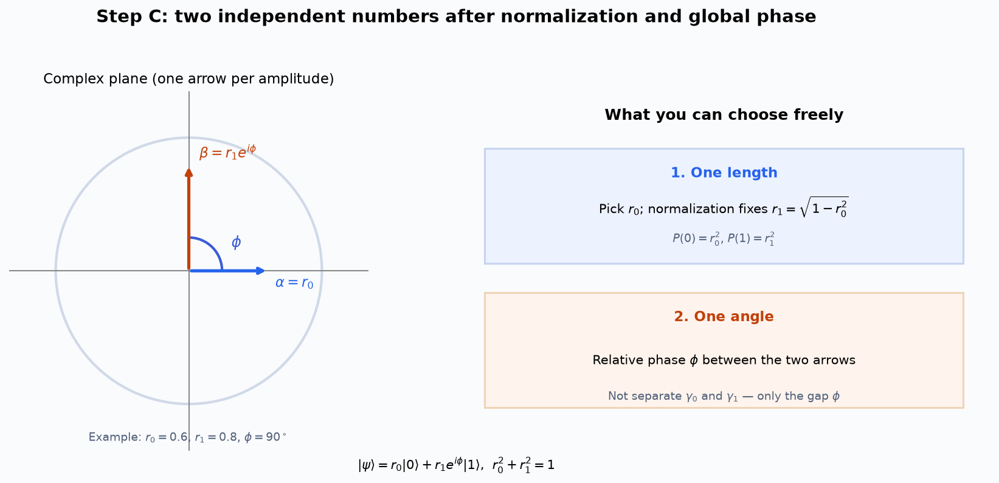
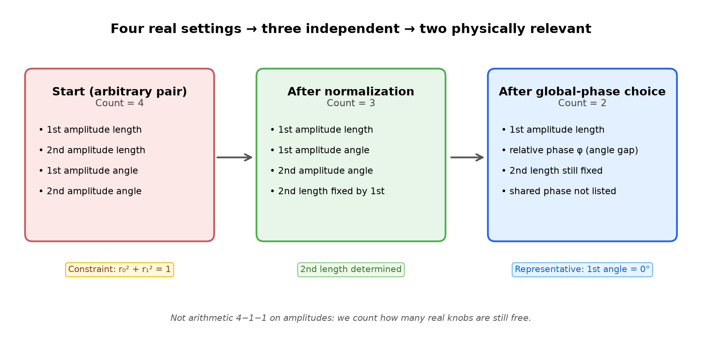
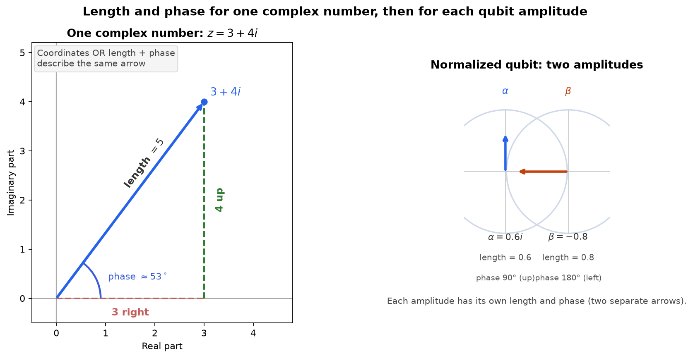
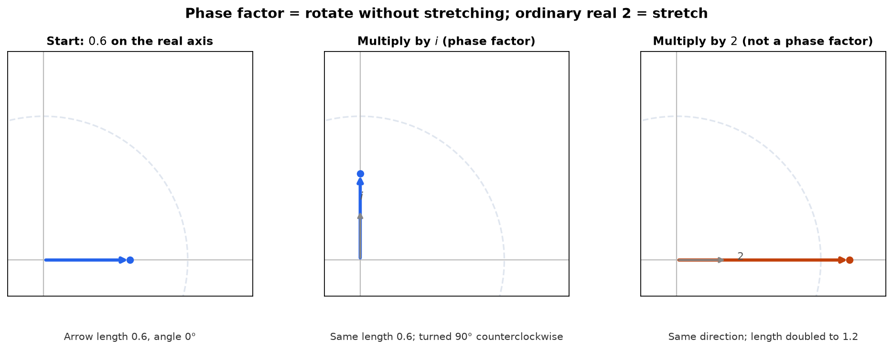
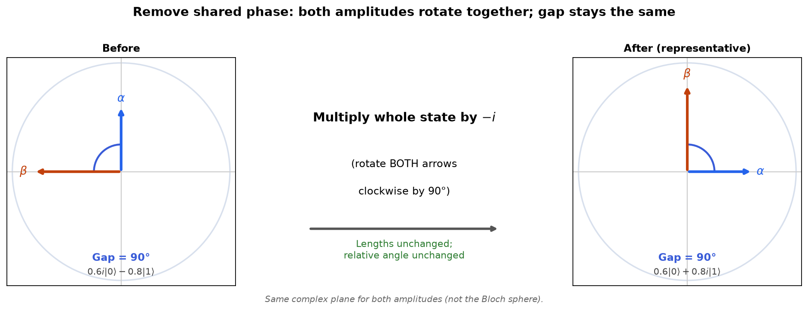
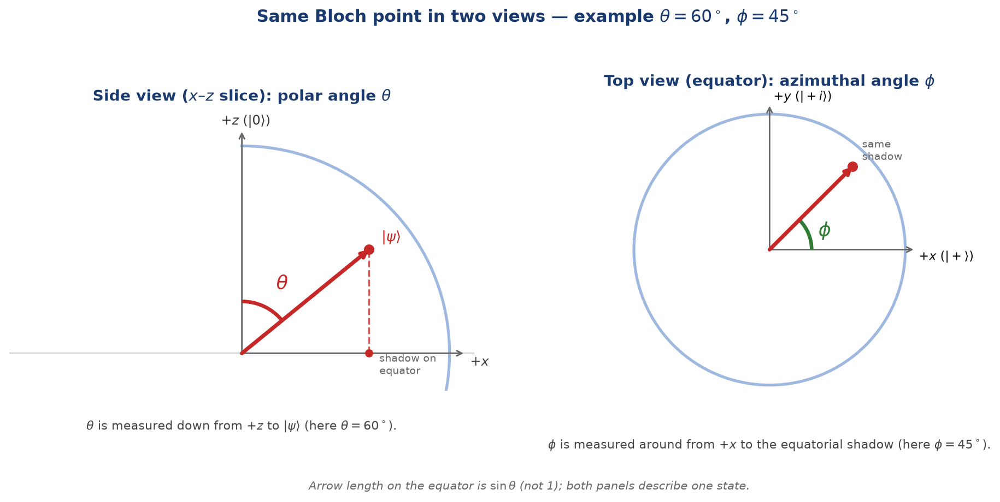
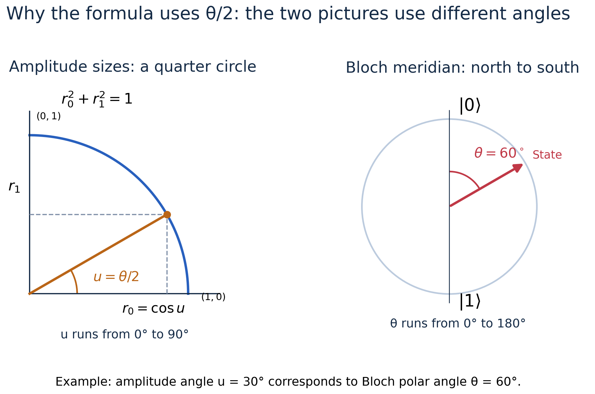
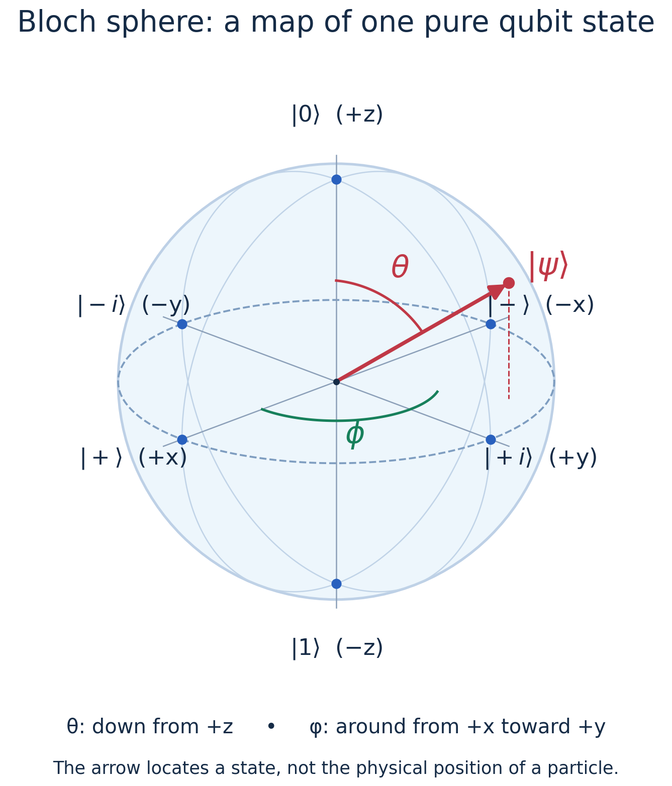
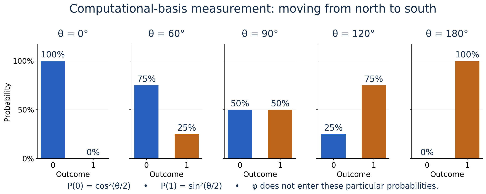

# Why do we draw a qubit on a sphere?

## A complete beginner’s guide: four numbers → two angles → one point

Start with Sections 1–6 for the purpose and the counting. Sections 7 and 8 rebuild length, phase factors, and global phase from concrete diagrams and arithmetic. Section 9 explicitly draws both Bloch angles; Sections 10 onward connect them to the sphere and measurement.

**How to read this update:** pause after each picture and read the “Read the picture” explanation. You do not need to memorize the exponential notation before understanding the arrows.

**Scope:** We first discuss one qubit in a **pure state**, described by a state vector. Pure states occupy the surface of the Bloch sphere. More general, mixed states occupy its interior.

For now, “pure” means the qubit can be fully described by one ket $|\psi\rangle$. A mixed state, for example, can arise when a preparation randomly selects between states and we do not know which was selected. It cannot in general be described by one ket. You do not need mixed-state mathematics for this lecture’s derivation.

## 1. What are we trying to explain?

We want a picture of **the whole state of one qubit**. The formula contains two complex amplitudes, but we would like to represent its physical content using one point on a sphere.

We are not making the qubit physically smaller or deleting part of it. We are finding a simpler way to **describe the same state**.

The previous explanation jumped over several steps. Here is what each step means, before we do the mathematics.

### Step A — Some numbers cannot be chosen separately

The two probabilities must add to 100%. If one is 36%, the other must be 64%. You cannot independently choose 36% and 90% for the two outcomes of the same measurement.

So some of the numbers in our description are tied together. This relationship is called **normalization**.

### Step B — Some changes to the formula do not describe a different physical state

If **both** complex amplitudes are multiplied by the **same** factor $e^{i\gamma}$ (same rotation for both arrows), every measurement prediction stays the same. We call that a **global phase change**.

**What “a family of equivalent descriptions” means (plain language):** many different-looking formulas can stand for the **same** qubit. They are like different ways of writing the same recipe:

$$
|\psi\rangle,\qquad e^{i\gamma}|\psi\rangle,\qquad e^{i\gamma'}|\psi\rangle,\qquad \ldots
$$

all describe **one** physical state. No experiment that only measures this qubit can tell which formula you wrote down.

**What “choose one convenient description” means:** we are allowed to **pick one member of that family** to work with—usually the version where the first amplitude is **real and nonnegative** (arrow pointing along the positive real axis). That is a bookkeeping choice, not a new state.

**Example (numbers only):** $0.6i|0\rangle - 0.8|1\rangle$ and $0.6|0\rangle + 0.8i|1\rangle$ are related by multiplying the whole state by $-i$. The 0/1 probabilities are still 36% and 64% for both.

**What this step does *not* do:** it does **not** let you change $\alpha$ and $\beta$ independently. You may only multiply **both** by the same $e^{i\gamma}$. Changing the phase of **one** amplitude relative to the other is a different story—that is **relative phase**, and it can matter for interference (Section 8).

### Step C — We can now specify the state using two independent numbers

Those numbers can be:

1. **The length of the first amplitude.** Normalization then fixes the length of the second.
2. **The angle difference between the amplitudes.** This is their relative phase, $\phi$.

Notice: at this stage, we have **one length and one angle**, not two phase angles.

*(If the figure does not appear in preview, open `images/06-step-c-length-and-relative-phase.png` or `.svg` in the `bloch-sphere-notes/images` folder.)*

**Read the diagram:**

- **Left:** after Step B we use a convenient representative: $\alpha$ is drawn **real** along the horizontal axis with length $r_0$; $\beta$ has length $r_1$ and sits at angle $\phi$ from that axis. So $\beta=r_1 e^{i\phi}$ (up to the global-phase convention).
- **Right — knob 1:** choose $r_0$; then $r_1=\sqrt{1-r_0^2}$ from normalization (so $P(0)=r_0^2$, $P(1)=r_1^2$).
- **Right — knob 2:** choose the **gap** $\phi$ between the two arrows. That is **one** angle, not independent $\gamma_0$ and $\gamma_1$.

**Example on the picture:** $r_0=0.6$, $r_1=0.8$, $\phi=90^\circ$ is **not** a universal choice—it is the running example from Step B. After multiplying $0.6i|0\rangle-0.8|1\rangle$ by $-i$ you get $0.6|0\rangle+0.8i|1\rangle$, so $\beta=0.8e^{i\pi/2}$ and the gap between the two arrows is $90^\circ$. Another state would use another $\phi$.

### Step D — Replace that remaining length with a convenient angle

We can express the first length as $\cos(\theta/2)$. The second length is then $\sin(\theta/2)$. We will explain the sine, cosine, and half-angle carefully in Section 10.

Now the same information is labelled by two angles: $\theta$ and $\phi$. The Bloch-sphere map uses those two angles to locate a point.

**The missing link:** $\phi$ comes from a difference of phase angles; $\theta$ is a new way to describe the amplitude lengths. They do not come from the same step.

## 2. Why is this useful? Is it required?

You can calculate with qubits without drawing a Bloch sphere. The sphere is a visualization tool, not a compulsory extra step in every calculation.

It helps you see:

- Which states give mostly 0 or mostly 1 in a particular measurement.
- Why states with the same 0/1 probabilities can still be different.
- What relative phase contributes.
- How many single-qubit gates move states around the sphere.
- Why one qubit has more possible states than just the two basis states.

**The main benefit is understanding the structure of a qubit state.** It does not mean one measurement can read out two arbitrary real numbers from one qubit.

## 3. Start with the qubit formula, one symbol at a time

$$
|\psi\rangle=\alpha|0\rangle+\beta|1\rangle.
$$

| Symbol | Beginner meaning |
|---|---|
| $\lvert \psi\rangle$ | The name of the whole qubit state. Say “ket psi.” |
| $\lvert 0\rangle$ | The first standard basis vector. |
| $\lvert 1\rangle$ | The second standard basis vector. |
| $\alpha$ | The amplitude multiplying the first basis vector. |
| $\beta$ | The amplitude multiplying the second basis vector. |
| $+$ | Vector addition: combine the two weighted basis vectors. |

In column-vector notation:

$$
|0\rangle=\begin{pmatrix}1\\0\end{pmatrix},
\qquad
|1\rangle=\begin{pmatrix}0\\1\end{pmatrix},
\qquad
|\psi\rangle=\begin{pmatrix}\alpha\\\beta\end{pmatrix}.
$$

**The labels 0 and 1 are not ordinary numbers being added here.** They name two basis vectors.

For measurement in this basis, the possible outcomes are 0 and 1. The corresponding probabilities are:

$$
P(0)=|\alpha|^2,
\qquad P(1)=|\beta|^2.
$$

An amplitude is not itself a probability. It can be complex; the probability obtained from its squared magnitude is real and nonnegative.

## 4. Why do two complex amplitudes look like four real numbers?

A complex number has two real-number parts:

$$
\alpha=x_0+i y_0,
\qquad
\beta=x_1+i y_1.
$$

So the pair of amplitudes can be specified using:

$$
x_0,\ y_0,\ x_1,\ y_1.
$$

That is **four real numbers**. A *parameter* is simply a number used to specify something.

For example, take:

$$
\alpha=0+0.6i,
\qquad
\beta=-0.8+0i.
$$

The four real numbers are:

$$
0,\ 0.6,\ -0.8,\ 0.
$$

You can draw the two complex numbers as two labelled points on one complex plane. But the **pair** still requires four coordinates: two to locate the point labelled $\alpha$, and two to locate the point labelled $\beta$.

That is different from representing the whole pair using one point with just two coordinates.

**We want one point for the whole physical qubit state.**

## 5. What does “four parameters become three, then two” actually mean?

A **parameter** is a number used to specify something. An **independent** parameter is one you can choose without another rule having already fixed it.

Suppose ₹100 is divided between two envelopes. There are two amounts written down, but only one independent choice. Choose ₹36 for the first, and ₹64 is forced for the second.

For complex amplitudes, it is easier to count using **length and angle** than horizontal and vertical coordinates. Each complex arrow has one length and one phase angle. Section 7 draws these explicitly.

| Stage | What you can choose | What is already determined or unnecessary? | Count |
|---|---|---|---|
| Start with an arbitrary amplitude pair | First length, second length, first angle, second angle | No normalization rule has been applied yet | 4 |
| Require a normalized pair | First length, first angle, second angle | The second length is determined by the first | 3 |
| Choose a representative with first angle 0° | First length, angle difference $\phi$ | The second length is still determined; the common phase is not needed to distinguish physical states | 2 |

The arbitrary pair in the first row is not necessarily a normalized qubit state yet.

This table is **not subtraction of numerical values**. We are not computing $4-1-1$ on the amplitudes. We are counting how many real-number settings are still needed.

Keep the distinction between the two reductions:

- **Normalization:** “If I choose this length, what must the other length be?”
- **Global-phase equivalence:** “Do these different angle labels actually describe different physical states?”

## 6. First reduction: normalization fixes one length

For a measurement with outcomes 0 and 1:

$$
P(0)+P(1)=1.
$$

Since the probabilities are the squared lengths of the amplitudes:

$$
P(0)=|\alpha|^2,\qquad P(1)=|\beta|^2,
$$

we require:

$$
\boxed{|\alpha|^2+|\beta|^2=1.}
$$

Let $r_0$ mean the length of $\alpha$, and $r_1$ the length of $\beta$. Then:

$$
r_0^2+r_1^2=1.
$$

### Follow one example, without phase angles yet

Choose the first amplitude's length to be $r_0=0.6$.

1. Its probability is $0.6^2=0.36$, or 36%.
2. The remaining probability must be $1-0.36=0.64$, or 64%.
3. The second amplitude's length must therefore be $\sqrt{0.64}=0.8$.

$$
\boxed{r_0=0.6\quad\Longrightarrow\quad r_1=0.8.}
$$

The square-root sign means: “Which nonnegative number, multiplied by itself, gives 0.64?” Here that number is 0.8.

**Why not choose $r_1=0.7$ instead?** Because $0.6^2+0.7^2=0.85$, not 1. That pair is not normalized as written.

In general:

$$
r_1=\sqrt{1-r_0^2}.
$$

Therefore, the two lengths are **one independent choice**, not two. Normalization does not fix either phase angle. We still have:

> One independently chosen length + two phase angles = three real parameters.

### How does this relate to the four real coordinates in the lecture?

If $\alpha=x_0+iy_0$ and $\beta=x_1+iy_1$, then:

$$
|\alpha|^2=x_0^2+y_0^2,\qquad
|\beta|^2=x_1^2+y_1^2.
$$

So the same normalization rule is:

$$
x_0^2+y_0^2+x_1^2+y_1^2=1.
$$

This is one real equation restricting four real entries. The length-and-angle description makes the same reduction easier to see; switching descriptions does not itself remove any information.

**Do not confuse these statements:**

- The **whole ket vector** is normalized to length 1.
- Each individual amplitude need not have length 1. In our example their lengths are 0.6 and 0.8.
- The number 1 is the **total of the squared lengths**, not the total of the lengths. Here $0.36+0.64=1$, while $0.6+0.8=1.4$.

## 7. Each amplitude has a length and a direction: a visual explanation

### 7.1 Begin with an ordinary complex number

Take:

$$
z=3+4i.
$$

Draw an arrow from the origin to the point with horizontal coordinate 3 and vertical coordinate 4.

You can describe that arrow in two equivalent ways:

| Description | Information you give |
|---|---|
| Horizontal and vertical coordinates | Go 3 right and 4 up |
| Length and angle | Draw an arrow of length 5, pointing about 53.13° counterclockwise from the positive real axis |

The length is $\sqrt{3^2+4^2}=5$, from the Pythagorean theorem. You do not need to calculate the angle yourself to understand this change of description.

**Read the left picture:** the blue arrow has one length and one angle, even though it also has two coordinates. Both descriptions specify the same arrow.

**Read the right picture:** our qubit has two amplitudes, so it has two such arrows. Blue is $\alpha=0.6i$, pointing up. Orange is $\beta=-0.8$, pointing left.

The number $3+4i$ on the left is a general complex-number example. The pair on the right is a normalized qubit example. We are not claiming the length-5 arrow is a normalized qubit.

### 7.2 What do “magnitude” and “phase” mean here?

- **Magnitude** means the arrow's length, always nonnegative.
- **Phase** means the arrow's angle, measured from the positive real axis.

Angle landmarks:

| Direction | Complex number of length 1 | Phase angle |
|---|---|---|
| Right | $1$ | 0° |
| Up | $i$ | 90° |
| Left | $-1$ | 180° |
| Down | $-i$ | 270°, or equivalently −90° |

An angle of −90° means turn clockwise by 90°. Adding 360° gives the same direction again.

### 7.3 What does $\alpha=r_0e^{i\gamma_0}$ actually say?

Read it as an instruction:

> “Start with length $r_0$ pointing right. Turn it through angle $\gamma_0$. The resulting complex number is $\alpha$.”

Similarly:

$$
\boxed{\alpha=r_0e^{i\gamma_0},\qquad
\beta=r_1e^{i\gamma_1}.}
$$

| Symbol | Plain-language meaning | In our example |
|---|---|---|
| $r_0=\lvert\alpha\rvert$ | Length of the first amplitude arrow | 0.6 |
| $\gamma_0$ | Direction of the first amplitude arrow | 90° |
| $r_1=\lvert\beta\rvert$ | Length of the second amplitude arrow | 0.8 |
| $\gamma_1$ | Direction of the second amplitude arrow | 180° |

The subscripts 0 and 1 tell us which amplitude we mean. They are labels, not multiplication or additional angles.

For the numerical example:

$$
\alpha=0.6e^{i\pi/2}=0.6i,
$$

$$
\beta=0.8e^{i\pi}=-0.8.
$$

Here $\pi/2$ radians means 90°, and $\pi$ radians means 180°.

**Important:** $r_0$ and $r_1$ are lengths, not probabilities. Their squares are the probabilities for computational-basis measurement.

### 7.4 What is a “length-1 complex number”?

It means the number is located one unit from the origin in the complex plane. It does **not** mean the number must equal the ordinary real number 1.

For example:

- $1$ is one unit right of the origin, so its length is 1.
- $i$ is one unit above the origin, so its length is also 1.
- $-1$ is one unit left of the origin, so its length is also 1.

The complex number $0.6+0.8i$ also has length 1 because $\sqrt{0.6^2+0.8^2}=1$.

All these numbers are points on the **unit circle**: a circle of radius 1 in the complex plane. This circle is not the Bloch sphere.

### 7.5 Why does multiplying by a phase factor rotate an arrow?

A useful rule of complex multiplication is:

> **Multiply the lengths, and add the angles.**

A phase factor has length 1, so it multiplies the old length by 1: the length stays unchanged. Its angle is added to the old angle: the arrow turns.

You can see the rule without advanced mathematics. Start with the number 0.6, an arrow pointing right:

$$
0.6\times i=0.6i.
$$

The result points up, but its length is still 0.6. Multiplication by $i$ has turned it 90°.

By comparison:

$$
0.6\times2=1.2.
$$

This result still points right, but it is twice as long. The multiplier 2 is **not a phase factor**.

We write the phase factor for a general angle $\gamma$ as $e^{i\gamma}$. For now, you can read this as **“the complex multiplier that turns an arrow through angle $\gamma$ without stretching it.”**

| Multiplier | Length of multiplier | Effect on an existing arrow |
|---|---|---|
| $e^{i0}=1$ | 1 | Turn by 0° |
| $e^{i\pi/2}=i$ | 1 | Turn counterclockwise by 90° |
| $e^{i\pi}=-1$ | 1 | Turn by 180° |
| $e^{-i\pi/2}=-i$ | 1 | Turn clockwise by 90° |

### 7.6 Where does that exponential expression come from?

The mathematical identity is:

$$
e^{i\gamma}=\cos\gamma+i\sin\gamma.
$$

Its coordinates are $(\cos\gamma,\sin\gamma)$, a point on the unit circle. Therefore its length is:

$$
\sqrt{\cos^2\gamma+\sin^2\gamma}=1.
$$

This explains “length 1.” You do not need to derive the identity to follow the rest of these notes.

For example, at 90° the horizontal coordinate is 0 and the vertical coordinate is 1, giving $0+i=i$.

### 7.7 Count again, now that the four quantities are visible

Before normalization we have two lengths and two angles:

$$
r_0,\quad r_1,\quad\gamma_0,\quad\gamma_1.
$$

After normalization, choosing $r_0$ fixes $r_1$. So we need only:

$$
\boxed{r_0,\quad\gamma_0,\quad\gamma_1.}
$$

That is the **four-to-three** step. We have not removed any phase yet.

## 8. Global phase: why we remove it, and exactly how

### 8.1 Why do another step at all?

At this point our description still keeps two individual angles: $\gamma_0$ and $\gamma_1$.

But quantum physics tells us that rotating **both amplitude arrows by the same amount** changes no measurement predictions for the qubit. It is another mathematical description of the **same physical state**.

Here “the same physical state” means no choice of measurement on the qubit, including after a fixed quantum operation, distinguishes the two descriptions through different outcome probabilities.

So why store two individual phase angles if only their difference distinguishes physical states? We choose a convenient representative in which the first angle is zero, and retain the angle difference.

**We are simplifying the description. No physical rotation of a particle or laboratory procedure is required.**

### 8.2 “Global” means applying the SAME multiplier to BOTH amplitudes

The starting state is:

$$
|\psi\rangle=0.6i|0\rangle-0.8|1\rangle.
$$

Its amplitude angles are:

- First amplitude: 90°.
- Second amplitude: 180°.
- Difference: $180^\circ-90^\circ=90^\circ$.

**The two starting angles do not have to be equal.** “Global” refers to applying the same change to both, not to the amplitudes pointing in the same direction.

We choose to turn both clockwise by 90°. Why this particular amount? Because it makes the first angle $90^\circ-90^\circ=0^\circ$.

Read the diagram from left to right:

| Quantity | Before | After subtracting 90° from BOTH angles |
|---|---|---|
| First arrow's length | 0.6 | 0.6 |
| Second arrow's length | 0.8 | 0.8 |
| First arrow's angle | 90° | 0° |
| Second arrow's angle | 180° | 90° |
| Angle difference | 90° | 90° |

The first amplitude now points right, so it is real and positive. The second points up. The **relative phase** is unchanged.

These are complex-amplitude arrows. They are not Bloch arrows. The Bloch-sphere point stays the same under a global phase change.

### 8.3 Do the multiplication using ordinary complex arithmetic

Clockwise 90° rotation is multiplication by $-i$. Apply it to the whole ket:

$$
(-i)|\psi\rangle
=(-i)(0.6i)|0\rangle+(-i)(-0.8)|1\rangle.
$$

For the first amplitude:

$$
(-i)(0.6i)=-0.6i^2=-0.6(-1)=0.6.
$$

For the second amplitude:

$$
(-i)(-0.8)=0.8i.
$$

So the convenient representative is:

$$
\boxed{|\psi_{\mathrm{rep}}\rangle
=0.6|0\rangle+0.8i|1\rangle.}
$$

The symbol “rep” means “representative”: one chosen vector describing the physical state.

**We made $\alpha$ real; we did not make it equal to 1.** Its length is still 0.6, which matters for the probabilities.

### 8.4 What exactly was “shared” in the original expression?

We can factor the original expression like this:

$$
0.6i|0\rangle-0.8|1\rangle
=i\left(0.6|0\rangle+0.8i|1\rangle\right).
$$

Check by multiplying the bracket by $i$:

- $i\times0.6=0.6i$.
- $i\times0.8i=0.8i^2=-0.8$.

The **outside $i$** multiplies the whole state. That outside factor is the global phase in this factorization. Leaving it out gives our convenient representative.

**Do not simply delete every $i$ you see.** The $i$ inside the bracket, multiplying 0.8, expresses the relative phase. Removing it would generally describe a different physical state.

### 8.5 Why is the angle difference still needed?

Compare our convenient representative with what would happen if we rotated only the first amplitude of the original state:

| Description | Amplitude pair | Relative phase | Computational-basis probabilities |
|---|---|---|---|
| Original | $(0.6i,-0.8)$ | 90° | 36% and 64% |
| Rotate BOTH clockwise 90° | $(0.6,0.8i)$ | 90° | 36% and 64% |
| Rotate ONLY the first clockwise 90° | $(0.6,-0.8)$ | 180° | 36% and 64% |

The first two describe the same physical state. The third generally does not, even though this particular measurement gives the same probabilities.

Here is one way to distinguish the third state. In an X-basis measurement, one possible outcome is labelled $+$, and its probability is:

$$
P(+)=\frac{|\alpha+\beta|^2}{2}.
$$

You do not need to derive this formula yet; it gives us a concrete example of a measurement that combines amplitudes and therefore depends on their phase relationship.

For the original and the global-phase-adjusted representative:

$$
\frac{|0.6i-0.8|^2}{2}
=\frac{0.36+0.64}{2}=0.5,
$$

$$
\frac{|0.6+0.8i|^2}{2}
=\frac{0.36+0.64}{2}=0.5.
$$

For the state where only the first amplitude was rotated:

$$
\frac{|0.6-0.8|^2}{2}
=\frac{0.04}{2}=0.02.
$$

That is **50% versus 2%**. Relative phase can affect interference and measurement results.

The physical rule is stronger than this one example: a genuine global phase leaves predictions unchanged for **every** measurement. Matching probabilities in just one basis is not enough to establish equivalence.

### 8.6 Now do the same thing for arbitrary amplitudes

We have understood the example. The general algebra follows exactly the same steps.

Start with:

$$
\alpha=r_0e^{i\gamma_0},\qquad
\beta=r_1e^{i\gamma_1}.
$$

To make the first angle zero, subtract $\gamma_0$ from **both** angles. The required multiplier is $e^{-i\gamma_0}$.

For the first amplitude:

$$
\alpha'=e^{-i\gamma_0}r_0e^{i\gamma_0}
=r_0e^{i0}=r_0.
$$

For the second amplitude:

$$
\beta'=e^{-i\gamma_0}r_1e^{i\gamma_1}
=r_1e^{i(\gamma_1-\gamma_0)}.
$$

The prime marks a quantity in the new representative. It does not label a new physical qubit.

Name the remaining angle difference:

$$
\boxed{\phi=\gamma_1-\gamma_0\pmod{2\pi}.}
$$

The last notation means angles differing by a full turn are equivalent. For example, −90° and 270° describe the same phase.

Then:

$$
\boxed{|\psi_{\mathrm{rep}}\rangle
=r_0|0\rangle+r_1e^{i\phi}|1\rangle.}
$$

**Why choose the first amplitude?** It is a convenient convention when it is nonzero. We could instead use the second amplitude as the reference and obtain another equally valid description. The usual Bloch formula chooses the first amplitude real and nonnegative.

### 8.7 Where did the third parameter go?

After normalization, we needed:

$$
r_0,\quad\gamma_0,\quad\gamma_1.
$$

After choosing the first phase to be zero, we only need:

$$
\boxed{r_0,\quad\phi.}
$$

Once these are supplied:

1. Compute $r_1=\sqrt{1-r_0^2}$.
2. Take the first amplitude to be the real number $r_0$.
3. Take the second amplitude to have length $r_1$ and angle $\phi$.

For our example, just **0.6 and 90°** are enough to reconstruct the representative $0.6|0\rangle+0.8i|1\rangle$.

We cannot reconstruct the original common angle from these two numbers, but we do not need it: every choice of common angle gives the same physical state.

### 8.8 What this operation does NOT mean

- It does not mean $\gamma_0$ and $\gamma_1$ were equal.
- It does not make both amplitudes real.
- It does not set either amplitude length to 1.
- It does not remove or introduce a relative phase; it preserves the existing difference.
- It does not move the physical state to a new point on the Bloch sphere.

If the first amplitude is zero, its phase is undefined. Use the nonzero amplitude as the phase reference instead. This special case is the south pole, where longitude carries no additional information.

## 9. Where do θ and φ appear? They are not the two original phase angles

The result of Section 8 is **one independent length and one relative phase**:

$$
r_0,\quad\phi.
$$

We have not yet obtained two angles. To get the Bloch-sphere description, we replace $r_0$ with a new angle $\theta$ using:

$$
r_0=\cos\frac{\theta}{2}.
$$

Normalization then gives:

$$
r_1=\sin\frac{\theta}{2}.
$$

Section 10 explains why these formulas work. For now, focus on where the information comes from:

| Bloch-sphere angle | Comes from | Meaning |
|---|---|---|
| $\theta$ | The remaining independent amplitude length $r_0$ | How far down from the north-pole direction the state arrow points |
| $\phi$ | The difference $\gamma_1-\gamma_0$ | How far around the equator its horizontal projection points |

**Left picture — where is $\theta$?** Start at the upward axis, pointing toward $|0\rangle$. Measure down from that axis to the state arrow. The red arc is $\theta$.

**Right picture — where is $\phi$?** Look down on the sphere from above. Project the state arrow onto the equatorial plane: imagine its shadow on that horizontal plane. Measure around from the positive x-axis to that projected direction. The green arc is $\phi$.

The two panels show two views of one example with $\theta=60^\circ$, $\phi=45^\circ$. It is a geometric example, not the 0.6-and-0.8 numerical example, whose $\theta$ is about 106.26° and $\phi$ is 90°.

**There is no weighing scale in this diagram:** both angles are explicitly drawn. The earlier weighing-scale picture represented a probability balance, not the actual angle $\theta$, so it did not show where $\theta$ was.

Keep the symbols separate:

| Symbol | What it means |
|---|---|
| $\gamma_0$ | Original phase angle of the first complex amplitude |
| $\gamma_1$ | Original phase angle of the second complex amplitude |
| $\phi$ | Their angle difference; used as Bloch azimuth |
| $\theta$ | An angle describing amplitude sizes; used as Bloch polar angle |

The two original phase angles $\gamma_0,\gamma_1$ are **not** the two Bloch angles $\theta,\phi$.

Knowing how far down and how far around determines a point on the unit sphere, except that “around” has no effect at a pole. This is how we draw the physical state using two angles.

## 10. Why do cosine, sine, and θ/2 appear?

### 10.1 Sine and cosine automatically satisfy normalization

On a unit circle, a point at angle $u$ has coordinates:

$$
(\cos u,\sin u).
$$

These always satisfy:

$$
\cos^2u+\sin^2u=1.
$$

That matches the equation for the two amplitude sizes. So we can write:

$$
r_0=\cos u,\qquad r_1=\sin u,
\qquad 0\leq u\leq90^\circ.
$$

We use only a quarter circle here because both **sizes** are nonnegative. The signs and complex directions have been handled through phase.

### 10.2 Why call this angle θ/2 instead of θ?

The usual Bloch-sphere convention uses an angle $\theta$ that runs from 0° at the north pole to 180° at the south pole.

But the amplitude-size angle $u$ only needs to run from 0° to 90°.

The two are related by:

$$
\theta=2u,\qquad u=\frac{\theta}{2}.
$$

Therefore:

$$
r_0=\cos\frac{\theta}{2},
\qquad
r_1=\sin\frac{\theta}{2}.
$$

These are **two different pictures**: a circle of amplitude sizes and a meridian of the Bloch sphere. Their angles are not the same angle.

Check the endpoints:

| Bloch angle $\theta$ | $\theta/2$ | First amplitude size | Second amplitude size | State |
|---|---|---|---|---|
| 0° | 0° | 1 | 0 | $\lvert 0\rangle$ |
| 90° | 45° | $1/\sqrt2$ | $1/\sqrt2$ | Equal 0/1 probabilities |
| 180° | 90° | 0 | 1 | $\lvert 1\rangle$, up to global phase |

If we used $\cos\theta$ and $\sin\theta$ with $\theta=180^\circ$ at the south pole, we would get $-1$ and 0. That would describe $-|0\rangle$, physically the north-pole state again! The half-angle gives the correct north-to-south correspondence.

The familiar Bloch coordinates below also show why the doubled angle is natural: they contain $\sin\theta$ and $\cos\theta$.

## 11. The final formula, with every piece explained

$$
\boxed{
|\psi\rangle
=\cos\frac{\theta}{2}|0\rangle
+e^{i\phi}\sin\frac{\theta}{2}|1\rangle
}
$$

Here we have chosen the representative with its first amplitude real and nonnegative.

| Piece | What it does |
|---|---|
| $\cos(\theta/2)$ | Gives the size of the amplitude for 0. |
| $\sin(\theta/2)$ | Gives the size of the amplitude for 1. |
| $e^{i\phi}$ | Gives the second amplitude its phase relative to the first. |
| $0\leq\theta\leq\pi$ | Moves from north to south. |
| $0\leq\phi<2\pi$ | Moves around the sphere. |

Angle conversion: $\pi$ radians = 180°, and $2\pi$ radians = 360°.

**Do not memorize the formula first.** Remember what it packages: two normalized amplitude sizes and their relative phase.

## 12. Why does this give a sphere rather than just any two-dimensional picture?

Two parameters alone do not prove that something is a sphere; a flat rectangle also takes two coordinates. We need a specific correspondence.

From the qubit formula, define three real coordinates:

$$
x=\sin\theta\cos\phi,
\qquad y=\sin\theta\sin\phi,
\qquad z=\cos\theta.
$$

These are ordinary spherical-coordinate formulas for a unit sphere.

They satisfy:

$$
\begin{aligned}
x^2+y^2+z^2
&=\sin^2\theta(\cos^2\phi+\sin^2\phi)+\cos^2\theta\\
&=\sin^2\theta+\cos^2\theta\\
&=1.
\end{aligned}
$$

So the point lies on the unit sphere.

The identification is physically meaningful: $x,y,z$ are the differences between the two outcome probabilities for measurements along the corresponding X, Y, and Z axes. They are not arbitrary decorative coordinates.

**The sphere’s surface has two degrees of freedom**, even though we draw it in three-dimensional space. Once a point is restricted to the surface, its three Cartesian coordinates obey $x^2+y^2+z^2=1$.

This is like a location on Earth’s surface: you do not need to specify an independent distance from Earth’s center as well as the two angles.

However, $\theta$ is technically the **polar angle**, measured down from the north pole. It is not geographic latitude. Geographic latitude would be $90^\circ-\theta$. The globe analogy helps, but the names should be distinguished.

### Special case: at the poles

At the north pole, the second amplitude is zero, so its phase does not matter. At the south pole, the first amplitude is zero, and the remaining phase is entirely global.

Consequently, longitude $\phi$ does not label different states at either pole. This is just like all longitudes meeting at Earth’s poles.

If $\alpha=0$, its phase is undefined, so the instruction “multiply by the negative phase of $\alpha$” cannot literally be used. Instead, remove the phase of the nonzero amplitude. The state is still represented by the south pole.

## 13. What does θ tell us about measurement?

For measurement in the computational basis, also called Z-basis measurement:

$$
\boxed{P(0)=\cos^2\frac{\theta}{2},
\qquad P(1)=\sin^2\frac{\theta}{2}.}
$$

The factor $e^{i\phi}$ disappears from these probabilities because its magnitude is 1:

$$
\left|e^{i\phi}\sin\frac{\theta}{2}\right|^2
=\sin^2\frac{\theta}{2}.
$$

| Location | $\theta$ | $P(0)$ | $P(1)$ |
|---|---|---|---|---|
| North pole | 0° | 100% | 0% |
| Northern hemisphere example | 60° | 75% | 25% |
| Equator | 90° | 50% | 50% |
| Southern hemisphere example | 120° | 25% | 75% |
| South pole | 180° | 0% | 100% |

For example, 75% means that if you repeatedly prepare the same state and measure each prepared qubit, roughly 75% of the outcomes will be 0 over many trials. It does not guarantee exactly 75 zeros in every set of 100 trials.

**One measurement returns an outcome, not the whole probability distribution.** To estimate the distribution, repeatedly prepare the state and repeat the experiment. Repeatedly measuring the same qubit without re-preparing it is a different experiment: an ideal first Z measurement leaves it in the corresponding Z-basis state.

## 14. If φ does not affect those probabilities, why keep it?

Because it affects measurements in other bases and interference under suitable operations.

Consider three equatorial states:

$$
|+\rangle=\frac{|0\rangle+|1\rangle}{\sqrt2},
$$

$$
|+i\rangle=\frac{|0\rangle+i|1\rangle}{\sqrt2},
$$

$$
|-\rangle=\frac{|0\rangle-|1\rangle}{\sqrt2}.
$$

All have $\theta=90^\circ$, so all give 50/50 outcomes in the Z basis. Their relative phases are 0°, 90°, and 180°, respectively.

An X-basis measurement asks a different question: does the outcome correspond to $|+\rangle$ or $|-\rangle$?

| Prepared state | Relative phase $\phi$ | Z measurement: $P(0)$ | X measurement: $P(+)$ |
|---|---|---|---|
| $\lvert +\rangle$ | 0° | 50% | 100% |
| $\lvert +i\rangle$ | 90° | 50% | 50% |
| $\lvert -\rangle$ | 180° | 50% | 0% |

For the first state, equal-sign contributions reinforce in the $+$ measurement amplitude. For the last state, opposite-sign contributions cancel in that amplitude.

**Same probabilities for one chosen measurement do not imply the same state.** This is why both $\theta$ and $\phi$ matter.

Global phase is different: it leaves all measurement predictions unchanged, not merely the Z-basis probabilities.

## 15. What are the six commonly labelled points?

| Sphere position | State | Formula | $\theta$ | $\phi$ |
|---|---|---|---|---|
| North / +Z | $\lvert 0\rangle$ | $\lvert 0\rangle$ | 0° | Irrelevant |
| South / −Z | $\lvert 1\rangle$ | $\lvert 1\rangle$ | 180° | Irrelevant |
| +X equator | $\lvert +\rangle$ | $(\lvert 0\rangle+\lvert 1\rangle)/\sqrt2$ | 90° | 0° |
| −X equator | $\lvert -\rangle$ | $(\lvert 0\rangle-\lvert 1\rangle)/\sqrt2$ | 90° | 180° |
| +Y equator | $\lvert +i\rangle$ | $(\lvert 0\rangle+i\lvert 1\rangle)/\sqrt2$ | 90° | 90° |
| −Y equator | $\lvert -i\rangle$ | $(\lvert 0\rangle-i\lvert 1\rangle)/\sqrt2$ | 90° | 270° |

There are infinitely many other surface points; these six are useful landmarks.

A warning about two different kinds of arrows: $|0\rangle$ and $|1\rangle$ are perpendicular basis vectors in the original complex vector space. On the Bloch sphere they are **opposite poles**. The Bloch representation is a new map of physical states; its arrows are not the original two-component ket vectors drawn in ordinary space.

## 16. One worked example from amplitudes all the way to the sphere

Start with:

$$
|\psi\rangle=0.6i|0\rangle-0.8|1\rangle.
$$

**Step 1 — Check normalization.**

$$
0.6^2+0.8^2=0.36+0.64=1.
$$

**Step 2 — Remove the shared phase.** Multiply the whole state by $-i$:

$$
|\psi_{\mathrm{rep}}\rangle=0.6|0\rangle+0.8i|1\rangle.
$$

**Step 3 — Find the relative phase.** Since $i=e^{i90^\circ}$:

$$
\phi=90^\circ.
$$

**Step 4 — Find the polar angle.** Match the first amplitude to the formula:

$$
\cos\frac{\theta}{2}=0.6.
$$

The angle whose cosine is 0.6 is approximately 53.13°. Therefore:

$$
\theta\approx2\times53.13^\circ=106.26^\circ.
$$

You can use an inverse-cosine button on a calculator in degree mode for this step. Understanding the purpose of the angle matters more than calculating it by hand.

**Step 5 — Interpret the point.** It is slightly south of the equator because $\theta>90^\circ$. Thus outcome 1 is more likely:

$$
P(0)=36\%,\qquad P(1)=64\%.
$$

**Step 6 — Optional Cartesian check.** The Bloch point is:

$$
(x,y,z)=(0,0.96,-0.28).
$$

Its radius is 1 because:

$$
0^2+0.96^2+(-0.28)^2=0.9216+0.0784=1.
$$

We started with four real entries, but the same physical state is located by just two angles: approximately $(106.26^\circ,90^\circ)$.

## 17. Important corrections to the lecture transcription

These corrections target the wording in the passage and the annotations you shared, rather than treating every transcription error as verbatim lecture wording.

| Confusing wording | Correct explanation |
|---|---|
| “Alpha squared gives the probability.” | Use $\lvert\alpha\rvert^2$, the squared magnitude. For complex numbers, $\alpha^2$ can be complex or negative. |
| “If $\alpha=x+iy$, alpha squared is $x^2+y^2$.” | $\lvert\alpha\rvert^2=x^2+y^2$. Ordinary squaring instead gives $(x+iy)^2=x^2-y^2+2ixy$. |
| “Both amplitude radii can be set to 1.” | No. They satisfy $r_0^2+r_1^2=1$. They cannot both equal 1 in a normalized state. |
| “Multiplying by a global phase introduces a relative phase.” | It preserves the existing phase difference; factoring makes that difference explicit. |
| “Beta becomes just $e^{i\phi}$.” | Its size must remain: $\beta=r_1e^{i\phi}$, unless a special example has $r_1=1$. |
| “Global phase is any number.” | Its angle can be any real angle, but the phase factor has magnitude 1. Multiplying by 2 is not a phase change. |
| “Theta is latitude.” | In this formula $\theta$ is polar angle from the north pole; geographic latitude equals $90^\circ-\theta$. |
| “All qubit states lie on the surface.” | All pure single-qubit states do. Mixed states lie inside the Bloch ball. |
| “The only measurable thing is probability.” | Individual experiments yield outcomes. Repeated preparations let us estimate outcome probabilities and averages. Relative phase can be inferred using appropriate measurements. |
| “X or Y measurement is a geometric projection of the Bloch arrow.” | A Bloch coordinate controls outcome probabilities; the apparatus does not simply return that coordinate as one measurement result. |
| “A spinning coin is a qubit superposition.” | It is a limited analogy. Ordinary uncertainty about a coin does not reproduce quantum coherence and interference. |

For X and Y measurements: you may measure them sequentially, but the first generally disturbs the state relevant to the second. They cannot generally be jointly measured as sharp, undisturbed properties of a single qubit. To estimate different components of an unknown state, use separate, identically prepared qubits for the different measurement settings.

## 18. The entire lecture, rewritten in plain language

“A pure qubit is written using two complex amplitudes. Each complex amplitude has two real parts of data, so the written formula initially contains four real numbers.

“But those four numbers are not freely independent. The two measurement probabilities must add to 1, so normalization removes one independent choice.

“Also, rotating both complex amplitudes by the same phase changes no measurement predictions. We can choose a convenient representative in which the first amplitude is real and nonnegative. This removes one shared phase angle, while keeping the phase difference between the amplitudes.

“Now we only need two independent quantities: the balance between the amplitude sizes and their relative phase. We represent the size balance using a polar angle $\theta$, and the relative phase using an azimuthal angle $\phi$.

“Those two angles locate one point on a sphere. Near the north pole, a Z-basis measurement is more likely to give 0. Near the south pole, it is more likely to give 1. Around the equator, the Z-basis probabilities remain 50/50, but different relative phases can lead to different interference and different results in other measurement bases.”

## 19. What to remember before revisiting the video

1. **The goal is a picture:** the Bloch sphere is a map of one qubit’s state.
2. **Four real numbers appear initially:** two parts for each complex amplitude.
3. **Normalization ties the sizes together:** probabilities add to 1.
4. **Global phase is redundant:** both amplitudes rotating equally describe the same physical state.
5. **Relative phase remains:** changing their angle difference can change interference.
6. **Two angles are enough:** $\theta$ sets the Z-measurement balance; $\phi$ sets the relative phase away from the poles.

**Name the quantities as you count:**

- Four: two lengths and two phase angles.
- Three: one independent length and two phase angles; normalization fixes the other length.
- Two: one independent length and one phase difference; the shared phase is unnecessary.
- Two angles: express the remaining length using $\theta$ and keep the phase difference $\phi$.

The essential chain is:

$$
\boxed{\text{4 real parameters}
\xrightarrow{\text{normalization}}3
\xrightarrow{\text{ignore global phase}}2
\xrightarrow{\theta,\phi}\text{a point on the Bloch sphere}.}
$$

## Optional mathematical appendix: a direct check that global phase disappears

If you want to verify the mapping directly from amplitudes, the Bloch coordinates are:

$$
x=2\operatorname{Re}(\alpha^*\beta),
\qquad y=2\operatorname{Im}(\alpha^*\beta),
\qquad z=|\alpha|^2-|\beta|^2.
$$

The star means complex conjugation: change the sign of the imaginary part. For example, $(a+ib)^*=a-ib$. Re and Im mean real part and imaginary part.

After a global phase change, $\alpha'=e^{i\eta}\alpha$ and $\beta'=e^{i\eta}\beta$. Their product becomes:

$$
(\alpha')^*\beta'
=e^{-i\eta}\alpha^*e^{i\eta}\beta
=\alpha^*\beta.
$$

Their squared magnitudes also stay unchanged. Therefore $x,y,z$ all remain unchanged: **the Bloch point does not move**.

For a normalized pure state:

$$
\begin{aligned}
x^2+y^2+z^2
&=4|\alpha|^2|\beta|^2+(|\alpha|^2-|\beta|^2)^2\\
&=(|\alpha|^2+|\beta|^2)^2\\
&=1.
\end{aligned}
$$

This proves directly that the physical state maps to the unit sphere, while global phase has disappeared.

---

**Diagram notes:** All eight diagrams were plotted from exact geometric or probability formulas. The five new diagrams explain amplitude length and phase, phase-factor multiplication, removal of a shared phase, parameter counting, and the two Bloch angles in separate views. Earlier probability and sphere diagrams are retained. These are representations of states and amplitudes, not photographs or literal particle locations.
