# Mathematical Foundations Part C

**Linear Algebra for Quantum Computing, Part 3** 

| If you’re revising… | Start with |
| --- | --- |
| How two qubits fit into one vector | §§1–9 |
| What makes a state entangled | §§10–12 |
| How gates act on two qubits | §§13–18 |
| What measurement returns | §§19–20 |
| One-page recap of tools and workflows | §21 |
| Eigenvectors, measurement bases, and Q&A | §§22–23 |

**Notation to keep handy.** A *ket* such as $\lvert 0\rangle$ names a column vector. The symbol $\otimes$ means tensor product. A superscript $T$ turns a written row of entries into a column, and $\dagger$ means conjugate transpose. In a two-qubit ket the left digit is qubit 1 and the right digit is qubit 2 throughout.

## 1. From one qubit to two

One qubit can be in a state $\alpha\lvert 0\rangle+\beta\lvert 1\rangle$ with complex amplitudes $\alpha,\beta$. It is a unit vector, so $\lvert\alpha\rvert^2+\lvert\beta\rvert^2=1$. If you measure it in the computational basis, you get $0$ with probability $\lvert\alpha\rvert^2$ and $1$ with probability $\lvert\beta\rvert^2$. For a complex number $x+iy$, the squared magnitude is $x^2+y^2$.

Two qubits are introduced by the same kind of rule, taken here as a postulate. A pure state is one unit vector, written as a linear combination of four basis states.

One unit vector represents the joint pure state of both qubits. It has four entries, and its length is $1$.

In the basis order $\lvert 00\rangle$, $\lvert 01\rangle$, $\lvert 10\rangle$, $\lvert 11\rangle$, the vector is

$$
\lvert\psi\rangle=
\begin{pmatrix}a\\b\\c\\d\end{pmatrix},
\qquad
\lVert\psi\rVert=\sqrt{\lvert a\rvert^2+\lvert b\rvert^2+\lvert c\rvert^2+\lvert d\rvert^2}=1.
$$

The same state in ket notation is

$$
\lvert\psi\rangle=a\lvert 00\rangle+b\lvert 01\rangle+c\lvert 10\rangle+d\lvert 11\rangle,
\qquad
\lvert a\rvert^2+\lvert b\rvert^2+\lvert c\rvert^2+\lvert d\rvert^2=1.
$$

The four labels are the strings two classical bits can store. What “the state” means is different.

Two classical bits hold **one** of $00$, $01$, $10$, or $11$. In the figure below, the register is $10$, and that string is the whole state.

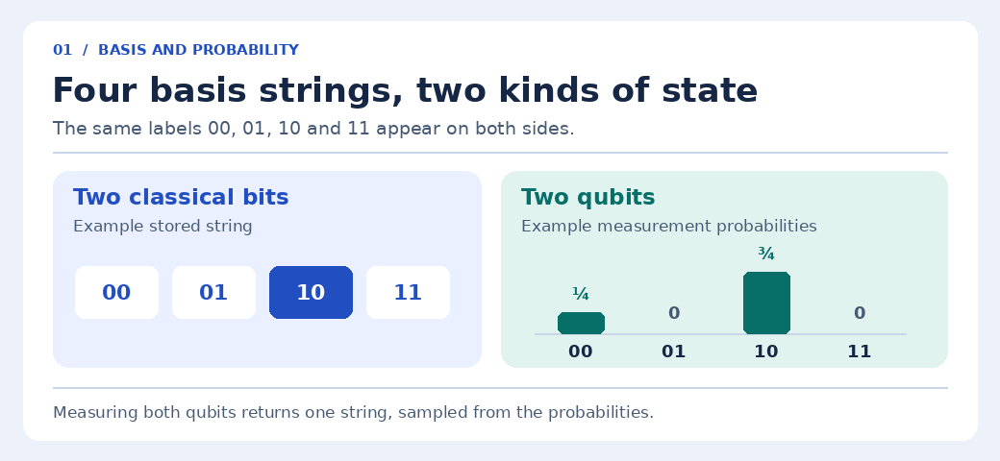

A **register** here is just two bits grouped together. The highlighted $10$ means the first bit holds $1$ and the second bit holds $0$.

Think of two switches side by side. The first is ON and the second is OFF. Once you know both switch positions, you know their whole state. In the same way, $10$ tells you everything about what the two bits currently store. The other boxes show the other possible settings. If you read this register, you get $10$. Those bits are not in several of the four strings at the same time, and they are not a weighted combination of several of them.

On the qubit side of the figure, $10$ is a measurement result you get with $75\%$ probability. Before measurement, the state of both qubits is the joint vector we discussed earlier.

Two qubits can put a **different complex amplitude** on each basis state at the same time. In the expression above, $a$ weights $\lvert00\rangle$, $b$ weights $\lvert01\rangle$, $c$ weights $\lvert10\rangle$, and $d$ weights $\lvert11\rangle$. Several of those amplitudes may be nonzero together, so the state is one vector that is a combination of several basis strings. The first figure is an example. The bars are probabilities, $\lvert a\rvert^2=1/4$ on $00$ and $\lvert c\rvert^2=3/4$ on $10$, with $b=d=0$. Before measurement the state is that combination. A computational-basis measurement of both qubits then returns one string, sampled with those probabilities.

The next figure lists the four amplitudes and their measurement probabilities. For this state, $a=\tfrac{1}{2}$, $b=0$, $c=\tfrac{\sqrt{3}}{2}$, and $d=0$, so $\lvert\psi\rangle=\tfrac{1}{2}\lvert 00\rangle+\tfrac{\sqrt{3}}{2}\lvert 10\rangle$. With $b=d=0$ and $a,c$ real, the joint vector lies on a unit circle in the $(\lvert 00\rangle,\lvert 10\rangle)$ plane.

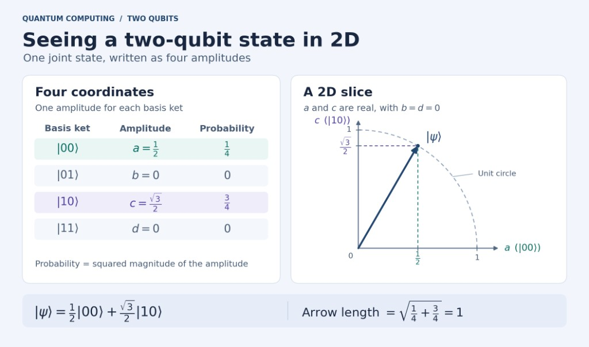

| | Two classical bits | Two qubits |
| --- | --- | --- |
| Labels | $00$, $01$, $10$, $11$ | The same four strings, as basis kets |
| What is stored | Exactly one string | One vector, with an amplitude on each basis ket |
| Several labels at once | The bits are a single string | Several amplitudes may be nonzero together |
| What a reading returns | That one string | One string: probability $\lvert a\rvert^2$ for $00$, and likewise for the other three |

There are four **basis states**, meaning four building blocks. The amplitudes are continuous complex numbers, subject only to the unit-length condition, so there are infinitely many possible two-qubit states. Two classical bits have four possible configurations.

This is the two-qubit version of $\alpha\lvert0\rangle+\beta\lvert1\rangle$. Section 4 builds the special case in which the four amplitudes are products of two single-qubit amplitudes. A general joint state need not factor that way; that is §11.

## 2. Tensor products combine vector spaces

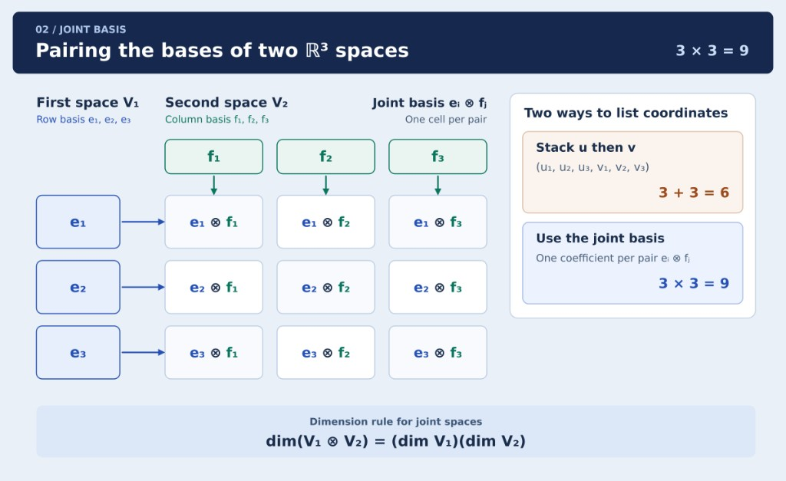

Suppose the first space has basis $e_1,e_2,e_3$ and the second has basis $f_1,f_2,f_3$. To build the joint space, pair **every** first-space basis vector with **every** second-space basis vector.

| First choice | Pair it with $f_1$ | Pair it with $f_2$ | Pair it with $f_3$ |
| --- | --- | --- | --- |
| $e_1$ | $e_1\otimes f_1$ | $e_1\otimes f_2$ | $e_1\otimes f_3$ |
| $e_2$ | $e_2\otimes f_1$ | $e_2\otimes f_2$ | $e_2\otimes f_3$ |
| $e_3$ | $e_3\otimes f_1$ | $e_3\otimes f_2$ | $e_3\otimes f_3$ |

These nine pairs are the **basis** of the tensor-product space. A general joint vector is a linear combination of all nine, so it needs **nine** coordinates. The subsections below use explicit coordinates to show why stacking is $3+3$ but tensoring is $3\times 3$.

### Two vectors, two systems

Let

$$
u=\begin{pmatrix}1\\2\\3\end{pmatrix},
\qquad
v=\begin{pmatrix}4\\5\\6\end{pmatrix}.
$$

Each vector has three components. Think of $u$ as describing one system and $v$ as describing another. The same ideas work with $(u_1,u_2,u_3)$ and $(v_1,v_2,v_3)$ in the bases $e_i$ and $f_j$ above.

### Stacking: one list below the other

**Stacking** (concatenation; sometimes written $u\oplus v$) places all of $u$ first and all of $v$ second:

$$
u\oplus v=
\begin{pmatrix}
1\\2\\3\\
4\\5\\6
\end{pmatrix}.
$$

| | $u$ | $v$ | Combined |
| --- | --- | --- | --- |
| Entries | $1,2,3$ (3) | $4,5,6$ (3) | $1,2,3,4,5,6$ (**6**) |

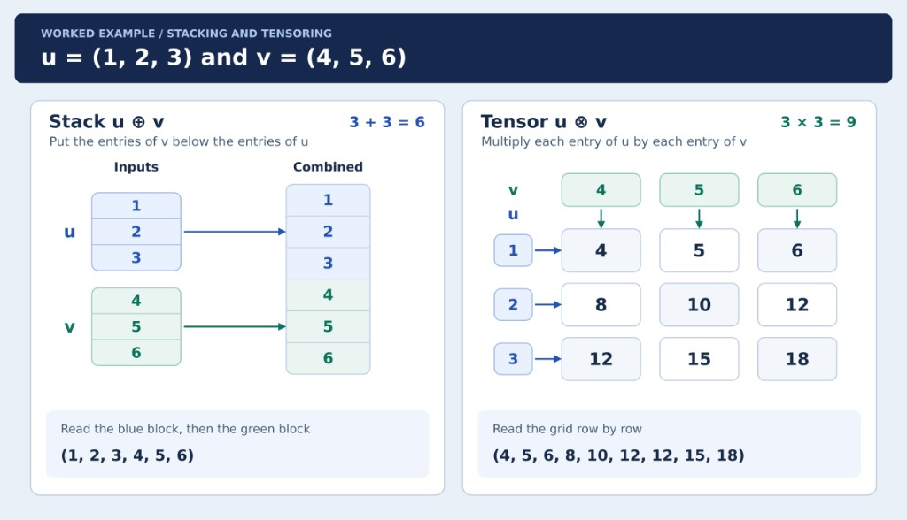

You get a **6-dimensional** vector. The first three components still belong to $u$; the last three still belong to $v$. No new numbers were formed by **mixing** a component of $u$ with a component of $v$. Stacking only **carries** both vectors in one column.

In the abstract form from the joint-basis picture,

$$
\begin{pmatrix}u_1\\u_2\\u_3\\v_1\\v_2\\v_3\end{pmatrix}
$$

has length $3+3=6$, but there is still no entry labeled “coefficient on $e_1\otimes f_2$,” for example.

### Tensor product: all pairwise products

The **tensor product** $u\otimes v$ multiplies **every** component of $u$ with **every** component of $v$:

$$
u\otimes v=
\begin{pmatrix}1\\2\\3\end{pmatrix}\otimes
\begin{pmatrix}4\\5\\6\end{pmatrix}
=
\begin{pmatrix}
1\cdot 4\\1\cdot 5\\1\cdot 6\\
2\cdot 4\\2\cdot 5\\2\cdot 6\\
3\cdot 4\\3\cdot 5\\3\cdot 6
\end{pmatrix}
=
\begin{pmatrix}
4\\5\\6\\8\\10\\12\\12\\15\\18
\end{pmatrix}.
$$

Each block of three entries is $u_i$ times the whole vector $v$, in order $u_1$, then $u_2$, then $u_3$.

**Pairwise grid** ($u$ down, $v$ across). Every cell is one product $u_i v_j$:

| $u$ ↓ / $v$ → | $4$ | $5$ | $6$ |
| --- | ---: | ---: | ---: |
| $1$ | $4$ | $5$ | $6$ |
| $2$ | $8$ | $10$ | $12$ |
| $3$ | $12$ | $15$ | $18$ |

You get a **9-dimensional** vector: $3\times 3=9$. Each coordinate is one pair $(i,j)$. That matches the nine joint basis directions $e_i\otimes f_j$.

### Stack vs tensor

| | Stacking $u\oplus v$ | Tensor product $u\otimes v$ |
| --- | --- | --- |
| Operation | Concatenation | Multiply each pair of components |
| Length | $3+3=6$ | $3\times 3=9$ |
| Meaning | Keep two vectors side by side in one list | Combine every component of $u$ with every component of $v$ |
| Dimension rule | Add sizes | Multiply sizes |

For two $\mathbb{R}^3$ factors, a **joint basis** state needs one coefficient per $e_i\otimes f_j$, not a six-number stack.

### Why quantum computing uses tensor products

Suppose qubit A is in state $\lvert u\rangle$ and qubit B is in state $\lvert v\rangle$. The combined pure state is written $\lvert u\rangle\otimes\lvert v\rangle$, living in the **tensor-product** Hilbert space — not a stacked list of separate coordinates.

Each qubit has computational basis $\lvert0\rangle$, $\lvert1\rangle$. The joint basis has four kets:

$$
\lvert0\rangle\otimes\lvert0\rangle=\lvert00\rangle,\quad
\lvert0\rangle\otimes\lvert1\rangle=\lvert01\rangle,\quad
\lvert1\rangle\otimes\lvert0\rangle=\lvert10\rangle,\quad
\lvert1\rangle\otimes\lvert1\rangle=\lvert11\rangle.
$$

| | Qubit A | Qubit B | Joint (two-qubit) basis |
| --- | --- | --- | --- |
| Labels | $\lvert0\rangle$, $\lvert1\rangle$ | $\lvert0\rangle$, $\lvert1\rangle$ | $\lvert00\rangle$, $\lvert01\rangle$, $\lvert10\rangle$, $\lvert11\rangle$ |
| Count | $2$ | $2$ | $2\times 2=4$ (see §1) |

Tensor products let us represent **several** quantum systems in one joint state vector. The dimension multiplies: $\dim(V_1\otimes V_2)=(\dim V_1)(\dim V_2)$.

**Analogy.** **Stacking** is piling two books on a shelf — you still have two separate books. A **tensor product** pairs every chapter of the first book with every chapter of the second, naming **all** chapter pairs — the joint space is built from those combinations, not from “book one, then book two” in one list.

## 3. Tensor product of two vectors

Take the first entry of $u$ and multiply **all of** $v$ by it. Do the same with the second entry of $u$. Stack the two resulting blocks in order.

$$
u\otimes v=
\begin{pmatrix}u_1\\u_2\end{pmatrix}\otimes
\begin{pmatrix}v_1\\v_2\end{pmatrix}
=\begin{pmatrix}u_1v_1\\u_1v_2\\u_2v_1\\u_2v_2\end{pmatrix}.
$$

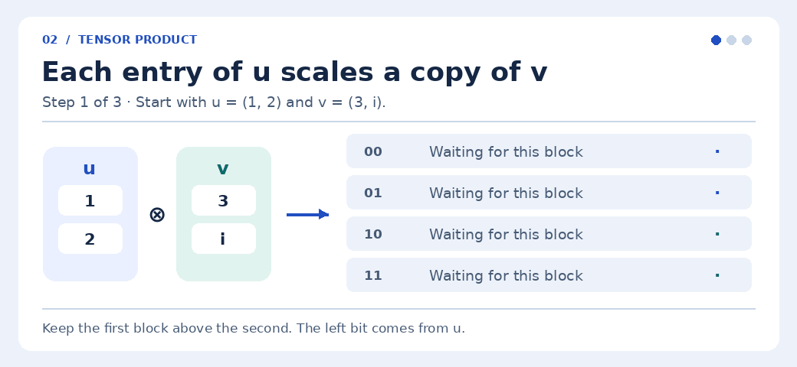

The same recipe works with unequal sizes. If $u=(2,3)^T$ and $v=(1,0,4)^T$, then $u\otimes v=(2,0,8,3,0,12)^T$. The first three entries came from $2v$ and the last three from $3v$.

## 4. Combining two independently prepared qubits

Take $\lvert u\rangle=\alpha\lvert0\rangle+\beta\lvert1\rangle$ and $\lvert v\rangle=\alpha'\lvert0\rangle+\beta'\lvert1\rangle$. To get the amplitude of $\lvert01\rangle$, choose $\alpha$ from the first qubit and $\beta'$ from the second. The amplitude is their product.

| Joint basis ket | Choose from qubit 1 | Choose from qubit 2 | Joint amplitude |
| --- | --- | --- | --- |
| $\lvert00\rangle$ | $\alpha$ | $\alpha'$ | $\alpha\alpha'$ |
| $\lvert01\rangle$ | $\alpha$ | $\beta'$ | $\alpha\beta'$ |
| $\lvert10\rangle$ | $\beta$ | $\alpha'$ | $\beta\alpha'$ |
| $\lvert11\rangle$ | $\beta$ | $\beta'$ | $\beta\beta'$ |

The table is the general rule. The steps below show how two **individual** qubit states combine into **one** joint state, using $\lvert+\rangle\otimes\lvert0\rangle$.

### Worked example: $\lvert+\rangle\otimes\lvert0\rangle$

The joint state is

$$
\lvert+\rangle\otimes\lvert0\rangle=\frac{\lvert00\rangle+\lvert10\rangle}{\sqrt{2}}.
$$

**First qubit** ($\lvert+\rangle$):

$$
\lvert+\rangle=\frac{\lvert0\rangle+\lvert1\rangle}{\sqrt{2}}.
$$

So the first qubit is in superposition: amplitude $1/\sqrt{2}$ on $\lvert0\rangle$ and $1/\sqrt{2}$ on $\lvert1\rangle$. A computational-basis measurement on qubit A alone gives $0$ or $1$ with equal probability $1/2$.

**Second qubit** ($\lvert0\rangle$): a definite state, not a superposition. Qubit B always reads $0$ in the computational basis.

**Apply the tensor product.** Substitute $\lvert+\rangle$ and pull the scalar outside (tensor products are bilinear):

$$
\lvert+\rangle\otimes\lvert0\rangle
=\left(\frac{\lvert0\rangle+\lvert1\rangle}{\sqrt{2}}\right)\otimes\lvert0\rangle
=\frac{1}{\sqrt{2}}\bigl[(\lvert0\rangle+\lvert1\rangle)\otimes\lvert0\rangle\bigr].
$$

**Distribute** $\otimes$ over addition, then use $\lvert a\rangle\otimes\lvert b\rangle=\lvert ab\rangle$:

$$
=\frac{1}{\sqrt{2}}\bigl[\lvert0\rangle\otimes\lvert0\rangle+\lvert1\rangle\otimes\lvert0\rangle\bigr]
=\frac{\lvert00\rangle+\lvert10\rangle}{\sqrt{2}}.
$$

**Why the second digit stays $0$.** In a two-qubit ket, the **left** digit is qubit 1 and the **right** digit is qubit 2 (see the notation line at the top of these notes). The second input was $\lvert0\rangle$, so only joint strings ending in $0$ appear.

| Input | Contribution to joint strings |
| --- | --- |
| Qubit 1: $\lvert+\rangle$ (mix of $\lvert0\rangle$, $\lvert1\rangle$) | First digit can be $0$ or $1$ |
| Qubit 2: $\lvert0\rangle$ | Second digit is always $0$ |
| Joint terms | $\lvert00\rangle$ (first $0$, second $0$); $\lvert10\rangle$ (first $1$, second $0$) |

There is no $\lvert01\rangle$ or $\lvert11\rangle$ because the second qubit never contributes a $1$.

**Measurement.** With $\lvert\psi\rangle=(\lvert00\rangle+\lvert10\rangle)/\sqrt{2}$, measuring both qubits in the computational basis gives:

| Result | Probability |
| --- | ---: |
| $\lvert00\rangle$ | $50\%$ |
| $\lvert10\rangle$ | $50\%$ |
| $\lvert01\rangle$ | $0\%$ |
| $\lvert11\rangle$ | $0\%$ |

Each nonzero outcome has amplitude $1/\sqrt{2}$, so $P=\lvert 1/\sqrt{2}\rvert^2=1/2$.

**Same pattern with $\lvert1\rangle$ on qubit 2:**

$$
\lvert+\rangle\otimes\lvert1\rangle=\frac{\lvert01\rangle+\lvert11\rangle}{\sqrt{2}}.
$$

Now the second digit stays $1$ in both terms.

**Takeaway.** The tensor product pairs every possibility of the first system with every possibility of the second — but if the second system is only $\lvert0\rangle$, only joint kets whose **second** digit is $0$ survive. States built this way from two separate qubits are **product states**. A general two-qubit state need not factor into one ket per wire; that is §11 (entanglement).

## 5. Tensor product examples and order

Example: $(1,2)^T$ and $(3,i)^T$, where $i^2=-1$.

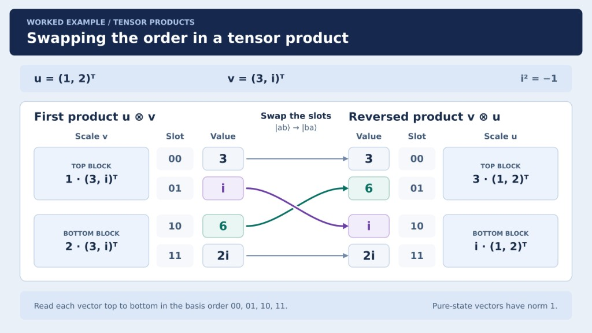

$$
(1,2)^T\otimes(3,i)^T=(3,i,6,2i)^T,\qquad
(3,i)^T\otimes(1,2)^T=(3,6,i,2i)^T.
$$

In the first expression the blocks are $1(3,i)^T$ and $2(3,i)^T$. In the second they are $3(1,2)^T$ and $i(1,2)^T$. Exchanging the two slots swaps the $01$ and $10$ entries in this ordering. These input vectors illustrate arithmetic. A physical pure-state vector needs norm $1$.

## 6. Standard basis and ket notation

Start with one qubit. In the basis order $\lvert0\rangle,\lvert1\rangle$, the two entries tell you how much of each basis ket is in the state. For example, $\lvert0\rangle=1\lvert0\rangle+0\lvert1\rangle$, so its column is $\binom{1}{0}$:

$$
\lvert0\rangle=\begin{pmatrix}1\\0\end{pmatrix},
\qquad
\lvert1\rangle=\begin{pmatrix}0\\1\end{pmatrix}.
$$

The compact ket $\lvert ab\rangle$ means $\lvert a\rangle\otimes\lvert b\rangle$. The table lists every two-qubit basis ket in order $\lvert00\rangle,\lvert01\rangle,\lvert10\rangle,\lvert11\rangle$, with the corresponding column vectors. A superscript $T$ on a row written horizontally means “read this as a column.”

| Basis ket | First qubit | Second qubit | Column vector |
| --- | --- | --- | --- |
| $\lvert00\rangle$ | $0$ | $0$ | $(1,0,0,0)^T$ |
| $\lvert01\rangle$ | $0$ | $1$ | $(0,1,0,0)^T$ |
| $\lvert10\rangle$ | $1$ | $0$ | $(0,0,1,0)^T$ |
| $\lvert11\rangle$ | $1$ | $1$ | $(0,0,0,1)^T$ |

### How each column vector is built

Take $\lvert01\rangle$. The first qubit is $\lvert0\rangle$ and the second is $\lvert1\rangle$, so tensor their columns. Multiply the whole second column by $1$ for the **top** block (first qubit $0$) and by $0$ for the **bottom** block (first qubit $1$):

$$
\lvert01\rangle
=\begin{pmatrix}1\\0\end{pmatrix}
\otimes\begin{pmatrix}0\\1\end{pmatrix}
=\begin{pmatrix}
1\cdot 0\\1\cdot 1\\0\cdot 0\\0\cdot 1
\end{pmatrix}
=\begin{pmatrix}0\\1\\0\\0\end{pmatrix}.
$$

That is the second row of the table, $(0,1,0,0)^T$.

You can place the $1$ in any table row the same way:

- The **first digit** picks the block: $0$ → top two entries ($\lvert00\rangle,\lvert01\rangle$), $1$ → bottom two ($\lvert10\rangle,\lvert11\rangle$).
- The **second digit** picks the spot within that block: $0$ → first slot in the block, $1$ → second slot.

For $\lvert10\rangle$, pick the bottom block, first slot — the **third** entry overall — so the column is $(0,0,1,0)^T$.

Each basis row has a single $1$ and three zeros. That makes it easy to move between ket notation and the four coordinates of any two-qubit state.

## 7. Rules for tensor products

**Bilinear** means the tensor product is linear in each slot while you hold the other slot fixed. It distributes over addition in either slot, and a scalar in either slot can move outside:

$$
\begin{aligned}
(u+w)\otimes v&=u\otimes v+w\otimes v,\\
u\otimes(v+r)&=u\otimes v+u\otimes r,\\
(ku)\otimes v&=u\otimes(kv)=k(u\otimes v).
\end{aligned}
$$

The rest of this section focuses on the **first** identity: adding on the left before $\otimes$ matches tensoring first and then adding. That is the **distributive** law for the tensor product in the first slot:

$$
\boxed{(u+w)\otimes v=u\otimes v+w\otimes v}.
$$

### Tensor product rule (two components each)

For $a=(a_1,a_2)^T$ and $b=(b_1,b_2)^T$,

$$
a\otimes b=
\begin{pmatrix}a_1b_1\\a_1b_2\\a_2b_1\\a_2b_2\end{pmatrix}.
$$

Multiply the first entry of $a$ through all of $b$, then the second entry of $a$ through all of $b$, and stack the two blocks. Two 2-vectors produce a 4-vector (for example $(2,3)^T\otimes(4,5)^T=(8,10,12,15)^T$).

### Worked example: add first vs tensor first

Let

$$
u=\begin{pmatrix}1\\2\end{pmatrix},
\qquad
w=\begin{pmatrix}0\\1\end{pmatrix},
\qquad
v=\begin{pmatrix}1\\3\end{pmatrix}.
$$

**Approach 1 — add first, then $\otimes$.** Compute $u+w$:

$$
u+w=
\begin{pmatrix}1\\2\end{pmatrix}+
\begin{pmatrix}0\\1\end{pmatrix}
=\begin{pmatrix}1\\3\end{pmatrix}.
$$

Then

$$
(u+w)\otimes v=
\begin{pmatrix}1\\3\end{pmatrix}\otimes
\begin{pmatrix}1\\3\end{pmatrix}
=
\begin{pmatrix}1\cdot 1\\1\cdot 3\\3\cdot 1\\3\cdot 3\end{pmatrix}
=
\begin{pmatrix}1\\3\\3\\9\end{pmatrix}.
$$

**Approach 2 — $\otimes$ first, then add.**

$$
u\otimes v=
\begin{pmatrix}1(1)\\1(3)\\2(1)\\2(3)\end{pmatrix}
=\begin{pmatrix}1\\3\\2\\6\end{pmatrix},
\qquad
w\otimes v=
\begin{pmatrix}0(1)\\0(3)\\1(1)\\1(3)\end{pmatrix}
=\begin{pmatrix}0\\0\\1\\3\end{pmatrix}.
$$

Add componentwise:

$$
u\otimes v+w\otimes v=
\begin{pmatrix}1\\3\\2\\6\end{pmatrix}+
\begin{pmatrix}0\\0\\1\\3\end{pmatrix}
=
\begin{pmatrix}1\\3\\3\\9\end{pmatrix}.
$$

| Approach | Steps | Result |
| --- | --- | --- |
| Add first | $u+w$, then $\otimes\, v$ | $(1,3,3,9)^T$ |
| Tensor first | $u\otimes v$ and $w\otimes v$, then add | $(1,3,3,9)^T$ |

Both routes give the same vector, so $(u+w)\otimes v=u\otimes v+w\otimes v$. The same idea holds when you add in the **second** slot: $u\otimes(v+r)=u\otimes v+u\otimes r$.

## 8. Inner products and normalization

Two rules drive most of the algebra:

1. For **complex** vectors, the inner product **conjugates** the first vector’s entries.
2. For **tensor-product** vectors, one big inner product **factors** into two smaller ones.

| Concept | Rule | Meaning |
| --- | --- | --- |
| Complex inner product | $\langle u,v\rangle=u^\dagger v$ | Conjugate transpose the first vector |
| Tensor inner product | $\langle u\otimes v,\ w\otimes r\rangle=\langle u,w\rangle\,\langle v,r\rangle$ | Inner-product each factor, then multiply |

The tensor formula applies to **product** vectors $\lvert u\rangle\otimes\lvert v\rangle$. A general entangled joint state need not split this way (§11).

### What is an inner product?

An inner product takes two vectors and returns one number. For real vectors it is the usual dot product. Example:

$$
u=\begin{pmatrix}1\\2\end{pmatrix},
\qquad
w=\begin{pmatrix}3\\4\end{pmatrix},
\qquad
\langle u,w\rangle=1\cdot 3+2\cdot 4=11.
$$

### Complex vectors: conjugate the first slot

For $c=2+3i$, the conjugate is $c^*=2-3i$ (flip the sign of the imaginary part). For column vectors,

$$
\boxed{\langle u,v\rangle=u^\dagger v},
$$

where $u^\dagger$ means conjugate every entry, then transpose to a row.

**Example.**

$$
u=\begin{pmatrix}1+i\\2i\end{pmatrix},
\qquad
w=\begin{pmatrix}2\\1+i\end{pmatrix}.
$$

Conjugate and transpose:

$$
u^\dagger=\begin{pmatrix}1-i&-2i\end{pmatrix}.
$$

Multiply:

$$
\langle u,w\rangle=(1-i)(2)+(-2i)(1+i)=2-2i-2i-2i^2=4-4i
$$

(using $i^2=-1$).

**Why conjugate?** Then $\langle u,u\rangle$ is a **non-negative real** number — the squared length. For the same $u$,

$$
\langle u,u\rangle=\lvert1+i\rvert^2+\lvert2i\rvert^2=2+4=6.
$$

Without conjugation, $\langle u,u\rangle$ would not behave like a norm.

### Tensor products: factor the inner product

$$
\boxed{\langle u\otimes v,\ w\otimes r\rangle=\langle u,w\rangle\,\langle v,r\rangle}.
$$

You can build the four-dimensional tensors first, or inner-product the factors first and multiply — same answer.

**Real example.**

$$
u=\begin{pmatrix}1\\2\end{pmatrix},\quad
w=\begin{pmatrix}3\\4\end{pmatrix},\quad
v=\begin{pmatrix}5\\6\end{pmatrix},\quad
r=\begin{pmatrix}7\\8\end{pmatrix}.
$$

**Method 1 — tensor first, then inner product.**

$$
u\otimes v=\begin{pmatrix}5\\6\\10\\12\end{pmatrix},
\qquad
w\otimes r=\begin{pmatrix}21\\24\\28\\32\end{pmatrix}.
$$

$$
\langle u\otimes v,\ w\otimes r\rangle
=5\cdot 21+6\cdot 24+10\cdot 28+12\cdot 32=913.
$$

**Method 2 — inner products first.**

$$
\langle u,w\rangle=1\cdot 3+2\cdot 4=11,
\qquad
\langle v,r\rangle=5\cdot 7+6\cdot 8=83,
\qquad
11\times 83=913.
$$

| Method | Work | Result |
| --- | --- | --- |
| Tensor first | Two 4-vectors, then dot | $913$ |
| Factors first | $\langle u,w\rangle=11$, $\langle v,r\rangle=83$, multiply | $913$ |

**Why it works (real entries).** Write $u=(a,b)^T$, $w=(e,f)^T$, $v=(c,d)^T$, $r=(g,h)^T$. Then $u\otimes v=(ac,ad,bc,bd)^T$ and $w\otimes r=(eg,eh,fg,fh)^T$. Expanding the dot product and regrouping gives $(ae+bf)(cg+dh)=\langle u,w\rangle\,\langle v,r\rangle$. With complex entries, conjugate the **first** vector in each inner product the same way as above.

### Normalization and quantum states

Set $w=u$ and $r=v$ in the tensor rule. Then $\langle u\otimes v,u\otimes v\rangle=\langle u,u\rangle\,\langle v,v\rangle=\lVert u\rVert^2\lVert v\rVert^2$, so $\lVert u\otimes v\rVert=\lVert u\rVert\,\lVert v\rVert$. Tensoring two **normalized** qubits gives a normalized joint state.

**Qubit example.** $\lvert+\rangle=(\lvert0\rangle+\lvert1\rangle)/\sqrt{2}$ and $\lvert0\rangle$. For $\lvert\psi\rangle=\lvert+\rangle\otimes\lvert0\rangle$,

$$
\langle\psi|\psi\rangle=\langle+|+\rangle\,\langle0|0\rangle=1\times 1=1.
$$

The same factorization helps with overlaps and multi-qubit checks. You can also expand $\lvert u\rangle=(\alpha,\beta)^T$ and $\lvert v\rangle=(\gamma,\delta)^T$: the four squared magnitudes in $\lvert u\rangle\otimes\lvert v\rangle$ factor as $(\lvert\alpha\rvert^2+\lvert\beta\rvert^2)(\lvert\gamma\rvert^2+\lvert\delta\rvert^2)$.

## 9. Hadamard states and uniform superpositions

The **Hadamard basis** is another orthonormal basis for one qubit, alongside $\lvert0\rangle$ and $\lvert1\rangle$.

### One-qubit plus and minus

$$
\lvert+\rangle=\frac{\lvert0\rangle+\lvert1\rangle}{\sqrt{2}},
\qquad
\lvert-\rangle=\frac{\lvert0\rangle-\lvert1\rangle}{\sqrt{2}}.
$$

Each is a **superposition** in the computational basis:

| State | Amplitude on $\lvert0\rangle$ | Amplitude on $\lvert1\rangle$ | $\lvert\cdot\rvert^2$ on each |
| --- | --- | --- | ---: |
| $\lvert+\rangle$ | $1/\sqrt{2}$ | $1/\sqrt{2}$ | $1/2$ each → 50/50 measurement |
| $\lvert-\rangle$ | $1/\sqrt{2}$ | $-1/\sqrt{2}$ | $1/2$ each → still 50/50 measurement |

So $\lvert+\rangle$ and $\lvert-\rangle$ give the **same** outcome probabilities if you measure in the computational basis. They differ by the **sign** on $\lvert1\rangle$: plus uses $+\lvert1\rangle$, minus uses $-\lvert1\rangle$. That sign is a **relative phase**; it does not change $\lvert\mathrm{amplitude}\rvert^2$ on either $\lvert0\rangle$ or $\lvert1\rangle$.

### Two qubits: $\lvert+\rangle\otimes\lvert+\rangle$

The ket $\lvert++\rangle$ means qubit 1 in $\lvert+\rangle$ and qubit 2 in $\lvert+\rangle$. Use the same distributive rule as in §4.

**Step 1 — write each plus state as a sum.**

$$
\lvert+\rangle=\frac{1}{\sqrt{2}}\lvert0\rangle+\frac{1}{\sqrt{2}}\lvert1\rangle
\quad\text{(on each wire).}
$$

**Step 2 — tensor and expand.** Multiply **one** term from the first bracket with **one** term from the second. There are four pairings:

| Pick from qubit 1 | Pick from qubit 2 | Joint ket | Coefficient |
| --- | --- | --- | --- |
| $\lvert0\rangle$ | $\lvert0\rangle$ | $\lvert00\rangle$ | $(1/\sqrt{2})(1/\sqrt{2})=1/2$ |
| $\lvert0\rangle$ | $\lvert1\rangle$ | $\lvert01\rangle$ | $(1/\sqrt{2})(1/\sqrt{2})=1/2$ |
| $\lvert1\rangle$ | $\lvert0\rangle$ | $\lvert10\rangle$ | $(1/\sqrt{2})(1/\sqrt{2})=1/2$ |
| $\lvert1\rangle$ | $\lvert1\rangle$ | $\lvert11\rangle$ | $(1/\sqrt{2})(1/\sqrt{2})=1/2$ |

In one line,

$$
\lvert+\rangle\otimes\lvert+\rangle
=\frac{1}{\sqrt{2}}\Bigl(\lvert0\rangle+\lvert1\rangle\Bigr)
\otimes\frac{1}{\sqrt{2}}\Bigl(\lvert0\rangle+\lvert1\rangle\Bigr)
=\frac{1}{2}\bigl(\lvert00\rangle+\lvert01\rangle+\lvert10\rangle+\lvert11\rangle\bigr).
$$

So $\lvert++\rangle$ is a **uniform** superposition: the same amplitude $1/2$ on every two-bit string. Each measurement outcome has probability $\lvert 1/2\rvert^2=1/4$.

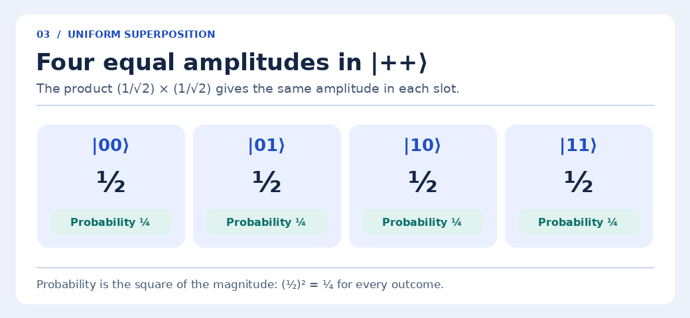

With three copies of $\lvert+\rangle$, there are eight strings from $000$ through $111$, each with amplitude $1/\sqrt8$ and measurement probability $1/8$. In general, if $\{0,1\}^n$ means all $n$-bit strings, then

$$
\lvert+\rangle^{\otimes n}=\frac{1}{\sqrt{2^n}}\sum_{x\in\{0,1\}^n}\lvert x\rangle.
$$

**Mixed example.** $\lvert0\rangle\otimes\lvert-\rangle=(\lvert00\rangle-\lvert01\rangle)/\sqrt2$, with column $(1,-1,0,0)^T/\sqrt2$. The first bit is fixed and the minus sign belongs to the $01$ amplitude.

## 10. Dimensions and exponential growth

Each time you add a qubit, the **joint** state space does not grow by a little — it **doubles** again. That is the heart of “exponential growth” in quantum computing: many qubits means a huge list of amplitudes if you want to write a **general** pure state exactly.

### One qubit, then two

- **One qubit** has computational basis $\lvert0\rangle$, $\lvert1\rangle$ → **2** amplitudes in a column.
- **Two qubits** have basis strings $\lvert00\rangle$, $\lvert01\rangle$, $\lvert10\rangle$, $\lvert11\rangle$ → **4** amplitudes (§1).

Algebraically, $\dim(\mathbb{C}^m\otimes\mathbb{C}^n)=mn$. Each qubit lives in $\mathbb{C}^2$, so $n$ qubits live in

$$
(\mathbb{C}^2)^{\otimes n}=\mathbb{C}^{2^n}.
$$

The exponent is **multiply**, not add: $2\times 2\times\cdots$ ($n$ times) = $2^n$.

### Two ways to count “how many numbers?”

| Question | Formula | Meaning |
| --- | ---: | --- |
| General $n$-qubit pure state | $2^n$ | One amplitude per joint basis string $\lvert x\rangle$, $x\in\{0,1\}^n$ |
| $n$ qubits described **separately** (product states) | $2n$ | $n$ copies of $(\alpha,\beta)$, two amplitudes per qubit |

For $n=2$, $2^n=2n=4$ — the counts match. From **$n=3$ onward**, $2^n$ pulls ahead of $2n$ fast. Entangled states need the big $2^n$ description; product states can get by with $2n$ numbers (plus normalization on each qubit).

**Interactive demo — Dimensions Multiply.** Use the slider or **Animate growth** to see how $2n$ and $2^n$ diverge. [Open in a full browser tab](assets/10_dimensions_multiply.html) if the embed is cramped.

<iframe src="assets/10_dimensions_multiply.html" title="Dimensions Multiply interactive demo" width="100%" height="960" loading="lazy" style="border:1px solid #dce3ef;border-radius:12px;max-width:100%;display:block;"></iframe>

| $n$ qubits | Numbers if each qubit is listed on its own ($2n$) | Amplitudes for a general joint state ($2^n$) |
| --- | ---: | ---: |
| 2 | 4 | 4 |
| 10 | 20 | 1,024 |
| 30 | 60 | $\approx 10^9$ |
| 50 | 100 | $\approx 10^{15}$ |

At **50 qubits**, you can still carry **100** complex numbers if the state factors into fifty separate qubits — but a **generic** entangled state needs on the order of **a quadrillion** amplitudes. That is why simulating arbitrary large quantum systems on a classical computer is so hard in practice.

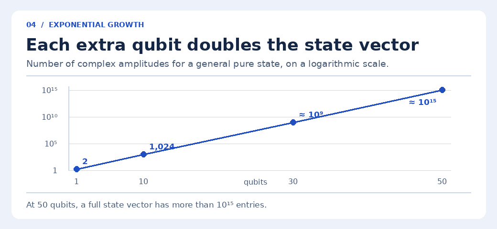

Some states (like $\lvert+\rangle^{\otimes n}$ in §9) have short formulas even though they sit in a $2^n$-dimensional space. A measurement still returns **one** $n$-bit string, not $2^n$ outcomes at once.

### Think about this: 4 qubits

**Interactive quiz.** Each qubit has $\lvert 0\rangle$ and $\lvert 1\rangle$; pick an answer for each question, then **Check answers**. [Open in a full browser tab](assets/10_four_qubit_quiz.html) if the embed is cramped.

<iframe src="assets/10_four_qubit_quiz.html" title="4-Qubit Knowledge Check" width="100%" height="1180" loading="lazy" style="border:1px solid #dce3ef;border-radius:12px;max-width:100%;display:block;"></iframe>

## 11. Product states and entanglement

A **product state** has the form $u\otimes v$. In a pure **entangled state**, the joint state cannot be factored into a single pure state for qubit 1 and a single pure state for qubit 2. The walkthrough below says the same thing in everyday language, then §11 continues with the amplitude-table test.

### What is a product state?

Imagine two people, Person A and Person B.

- Person A independently flips a coin and gets Heads or Tails.
- Person B independently flips another coin and gets Heads or Tails.

Each outcome is independent of the other.

In quantum computing, think of two qubits that each have their own individual quantum state. For example,

$$
\lvert u\rangle=\frac{\lvert 0\rangle+\lvert 1\rangle}{\sqrt2},
\qquad
\lvert v\rangle=\frac{\lvert 0\rangle+\lvert 1\rangle}{\sqrt2}.
$$

Combine them with a tensor product:

$$
\lvert u\rangle\otimes\lvert v\rangle
=\frac12\bigl(\lvert 00\rangle+\lvert 01\rangle+\lvert 10\rangle+\lvert 11\rangle\bigr).
$$

This is a **product state** (here, $\lvert+\rangle\otimes\lvert+\rangle=\lvert{++}\rangle$). We can describe the full two-qubit system by giving the state of qubit 1 and the state of qubit 2 **separately**, then multiplying them with $\otimes$.

In short: if you know each qubit's state on its own, you can build the joint state.

### What is an entangled state?

Now imagine two people who each receive a sealed box. The boxes were prepared **together** so that:

- If the first box reads 0, the second also reads 0.
- If the first reads 1, the second also reads 1.

Neither box has a complete story by itself; what matters is how they were prepared as a pair.

A standard two-qubit example is

$$
\lvert\psi\rangle=\frac{1}{\sqrt2}\bigl(\lvert 00\rangle+\lvert 11\rangle\bigr)
=\lvert\Phi^+\rangle.
$$

This is **entangled**. Measuring both qubits in the computational basis gives

| Outcome | Probability |
| --- | ---: |
| $\lvert 00\rangle$ | $1/2$ |
| $\lvert 11\rangle$ | $1/2$ |
| $\lvert 01\rangle$ or $\lvert 10\rangle$ | $0$ |

The qubits are strongly correlated. You cannot write $\lvert\psi\rangle$ as $\lvert u\rangle\otimes\lvert v\rangle$ for any one-qubit pure states $\lvert u\rangle$ and $\lvert v\rangle$.

### See the difference visually

| | **Product state** | **Entangled state** |
| --- | --- | --- |
| Qubit 1 | Has its own state | — |
| Qubit 2 | Has its own state | — |
| Together | Two independent pieces; combine with $\otimes$ | **Joint** state; the pair matters |
| Description | Can specify qubit 1 and qubit 2 separately | Cannot assign two independent pure one-qubit states that reproduce the joint state |

### The mathematical difference

**Product:**

$$
\lvert\psi\rangle=\lvert u\rangle\otimes\lvert v\rangle
$$

We can split the joint state into two individual states.

**Entangled:**

$$
\lvert\psi\rangle=\frac{1}{\sqrt2}\bigl(\lvert 00\rangle+\lvert 11\rangle\bigr)
$$

There are **no** one-qubit pure states $\lvert u\rangle$ and $\lvert v\rangle$ with $\lvert\psi\rangle=\lvert u\rangle\otimes\lvert v\rangle$.

### Remember this simple analogy

- **Product state:** You can read Book A and Book B on their own. Side by side, you have the whole collection.
- **Entangled state:** The important information lives in how the two books relate. Neither book alone carries the full picture.

The analogy is not exact, but it helps you remember the idea.

> **One sentence:** A **product state** means we can describe each qubit independently and combine them. An **entangled state** means the qubits share a joint quantum state that **cannot** be built from two independent pure one-qubit states.

**Clarification:** Entanglement does **not** mean measuring one qubit instantly sends a signal to the other. It means their outcomes show **quantum correlations** that cannot be explained by giving each qubit its own pure state.

### Amplitude-table test (two qubits)

The lecture packs a two-qubit pure state into a four-entry column, reshapes those entries into a $2\times2$ **amplitude table**, and uses **$\det M$** to decide whether the state factors as $u\otimes v$. The steps below follow that calculation; the picture matches `05_factoring.png` at the end.

#### The four-amplitude column

A general two-qubit pure state can be written as a column of four complex numbers (in the order used throughout these notes—qubit 1 first, qubit 2 second):

$$
\lvert\psi\rangle=
\begin{pmatrix}a\\b\\c\\d\end{pmatrix}
=a\lvert 00\rangle+b\lvert 01\rangle+c\lvert 10\rangle+d\lvert 11\rangle.
$$

| Basis state | Amplitude |
| --- | ---: |
| $\lvert 00\rangle$ | $a$ |
| $\lvert 01\rangle$ | $b$ |
| $\lvert 10\rangle$ | $c$ |
| $\lvert 11\rangle$ | $d$ |

#### Build the amplitude table $M$

**Arrange the entries into a $2\times2$ table.** Rows index the **first** qubit; columns index the **second**:

| | Second bit $=0$ | Second bit $=1$ |
| --- | ---: | ---: |
| First bit $=0$ | $a$ → $\lvert 00\rangle$ | $b$ → $\lvert 01\rangle$ |
| First bit $=1$ | $c$ → $\lvert 10\rangle$ | $d$ → $\lvert 11\rangle$ |

Equivalently,

$$
M=\begin{pmatrix}a&b\\c&d\end{pmatrix}.
$$

You have not changed $\lvert\psi\rangle$—only how you **view** the same four amplitudes.

#### Determinant: what it is and why we use it

For a $2\times2$ matrix, **determinant** means: multiply the diagonal pair $a\cdot d$, multiply the other diagonal pair $b\cdot c$, then subtract:

$$
\det M=ad-bc.
$$

**Why care?** For a **pure** two-qubit state, $\det M=0$ if and only if $\lvert\psi\rangle$ is a **product** $u\otimes v$. If $\det M\neq 0$, the state is **entangled** (no such factorization with one-qubit pure factors).

#### How $\det M$ distinguishes product from entangled

**Product state** $\lvert\psi\rangle=\lvert u\rangle\otimes\lvert v\rangle$ with $\lvert u\rangle=(u_0,u_1)^T$ and $\lvert v\rangle=(v_0,v_1)^T$. Tensor product gives

$$
\lvert\psi\rangle=
\begin{pmatrix}u_0v_0\\u_0v_1\\u_1v_0\\u_1v_1\end{pmatrix},
\qquad
M=
\begin{pmatrix}u_0v_0&u_0v_1\\u_1v_0&u_1v_1\end{pmatrix}.
$$

Each row of $M$ is a scaled copy of $(v_0,v_1)$, so expand $\det M=ad-bc$ and **regroup** the four scalar factors (complex numbers commute, so you may swap factor order without changing each product):

$$
\begin{aligned}
\det M
&=(u_0v_0)(u_1v_1)-(u_0v_1)(u_1v_0)\\
&=u_0u_1v_0v_1-u_0u_1v_1v_0\\
&=u_0u_1(v_0v_1-v_1v_0)=0.
\end{aligned}
$$

The two diagonal products are the **same** number $u_0u_1v_0v_1$, so they cancel. Equivalently, $v_0v_1-v_1v_0=0$, hence $\det M=0$ for every product state.

Summarizing the product direction:

$$
\lvert\psi\rangle=\lvert u\rangle\otimes\lvert v\rangle
\quad\Longrightarrow\quad
\det M=0.
$$

That does **not** yet tell you what $\det M$ is for an entangled state. Next we plug in a Bell state and compute.

#### Entangled state example: Bell state $\lvert\Phi^+\rangle$

We use the same Bell state as in the entangled-state introduction above:

$$
\lvert\Phi^+\rangle=\frac{1}{\sqrt2}\bigl(\lvert 00\rangle+\lvert 11\rangle\bigr).
$$

**Step 1 — what the state means (measurement story).** When we measure both qubits in the computational basis, only two results appear:

- $\lvert 00\rangle$ with probability $50\%$ ($1/2$);
- $\lvert 11\rangle$ with probability $50\%$ ($1/2$).

So the bits always match: either both $0$ or both $1$. Outcomes $\lvert 01\rangle$ and $\lvert 10\rangle$ never occur.

But these are not two **independent** qubits that happen to agree. They share a joint quantum state that cannot be written as $\lvert u\rangle\otimes\lvert v\rangle$ for separate one-qubit pure states $\lvert u\rangle$ and $\lvert v\rangle$. We must describe them **together**. That is **entanglement**.

**Step 2 — column vector.** Use the same order of four basis states used earlier:

$$
\lvert 00\rangle,\quad \lvert 01\rangle,\quad \lvert 10\rangle,\quad \lvert 11\rangle.
$$

A general two-qubit state is

$$
\lvert\psi\rangle=a\lvert 00\rangle+b\lvert 01\rangle+c\lvert 10\rangle+d\lvert 11\rangle.
$$

For the Bell state $\lvert\Phi^+\rangle$, write down all four coefficients. If a basis state is missing from the expression, its coefficient is $0$:

$$
\lvert\Phi^+\rangle=
\frac{1}{\sqrt2}\lvert 00\rangle
+0\cdot\lvert 01\rangle
+0\cdot\lvert 10\rangle
+\frac{1}{\sqrt2}\lvert 11\rangle,
$$

so $a=d=1/\sqrt2$ and $b=c=0$, and

$$
\lvert\Phi^+\rangle=
\begin{pmatrix}
1/\sqrt2\\
0\\
0\\
1/\sqrt2
\end{pmatrix}.
$$

Every two-qubit state occupies four slots in this column, even when some amplitudes are zero.

**Step 3 — amplitude matrix $M$.** With $M=\begin{pmatrix}a&b\\c&d\end{pmatrix}$ (rows = first qubit, columns = second, as above),

$$
M=
\begin{pmatrix}
1/\sqrt2 & 0\\
0 & 1/\sqrt2
\end{pmatrix}
=\frac{1}{\sqrt2}
\begin{pmatrix}
1 & 0\\
0 & 1
\end{pmatrix}.
$$

Only $\lvert 00\rangle$ and $\lvert 11\rangle$ are populated. The two rows are not multiples of one another (unlike every product $u\otimes v$).

**Step 4 — determinant.**

$$
\begin{aligned}
\det M
&=ad-bc\\
&=\frac{1}{\sqrt2}\cdot\frac{1}{\sqrt2}-0\cdot 0\\
&=\frac12\neq 0.
\end{aligned}
$$

A **nonzero** $\det M$ means this state is **not** a product of two one-qubit pure states—it is entangled.

**Step 5 — product vs Bell (same test, two outcomes).** Compare $\lvert{++}\rangle=\lvert+\rangle\otimes\lvert+\rangle$ (product) with $\lvert\Phi^+\rangle$ (entangled):

| | Product: $\lvert{++}\rangle$ | Entangled: $\lvert\Phi^+\rangle$ |
| --- | --- | --- |
| Factored form? | $\lvert+\rangle\otimes\lvert+\rangle$ | No $\lvert u\rangle\otimes\lvert v\rangle$ |
| Amplitude matrix $M$ | $\frac12\begin{pmatrix}1&1\\1&1\end{pmatrix}$ | $\frac{1}{\sqrt2}\begin{pmatrix}1&0\\0&1\end{pmatrix}$ |
| $\det M$ | $0$ | $1/2$ |

For $\lvert{++}\rangle$, $\det M=\frac14+\frac14-\frac14-\frac14=0$. For $\lvert\Phi^+\rangle$, $\det M=\frac12\neq 0$.

> **Takeaway (pure two-qubit states).** We proved **product** $\Rightarrow$ $\det M=0$, then computed $\det M=\frac12$ for $\lvert\Phi^+\rangle$. For this setting, the converse also holds: $\det M=0$ if and only if the state is a product $u\otimes v$; $\det M\neq 0$ if and only if it is entangled. The determinant is a single arithmetic check after you form $M$.

#### From $\det M=0$ back to $u$ and $v$

When $\det M=0$, equivalently $ad=bc$, the two rows of $M$ are **linearly dependent**—the same situation as “both rows are multiples of $(v_0,v_1)$.” Pick a nonzero row for the entries of $\lvert v\rangle$; the row multipliers supply $\lvert u\rangle$ (a zero row is allowed). Rescale the pair so both factors are normalized.

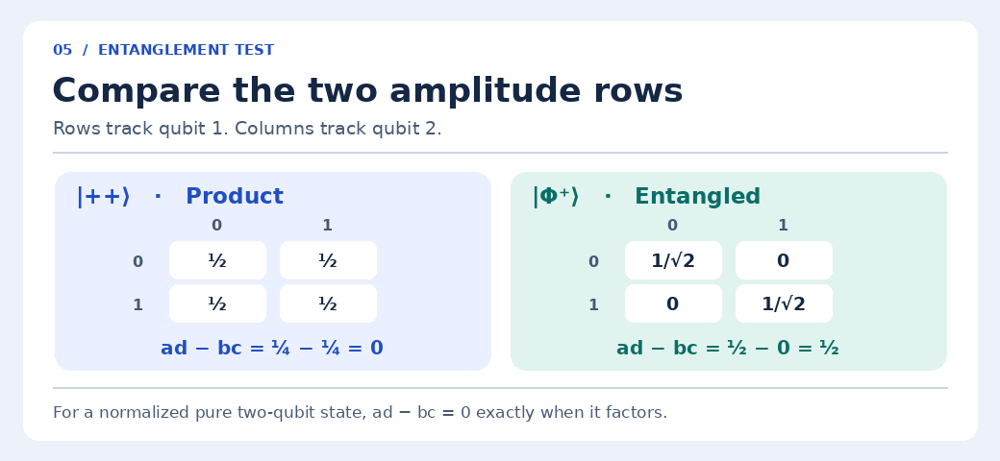

**Edge case:** $(0,0,1/\sqrt2,-1/\sqrt2)^T$ has $\det M=0$; the first row of $M$ is zero, the second supplies $\lvert 1\rangle\otimes\lvert-\rangle$ (see figure).

## 12. Bell states and correlations

### 1. What are the four Bell states?

The four Bell states are:

$$
\lvert\Phi^+\rangle=\frac{\lvert 00\rangle+\lvert 11\rangle}{\sqrt2}
$$

$$
\lvert\Phi^-\rangle=\frac{\lvert 00\rangle-\lvert 11\rangle}{\sqrt2}
$$

$$
\lvert\Psi^+\rangle=\frac{\lvert 01\rangle+\lvert 10\rangle}{\sqrt2}
$$

$$
\lvert\Psi^-\rangle=\frac{\lvert 01\rangle-\lvert 10\rangle}{\sqrt2}
$$

Don't worry about the plus and minus signs yet. First, understand what $\Phi$ (Phi) and $\Psi$ (Psi) mean.

### 2. Understand $\Phi$ and $\Psi$

There are two types of Bell states.

**A. Phi ($\Phi$) states — both bits are the same**

Look at these two states:

$$
\lvert\Phi^+\rangle=\frac{\lvert 00\rangle+\lvert 11\rangle}{\sqrt2}
$$

$$
\lvert\Phi^-\rangle=\frac{\lvert 00\rangle-\lvert 11\rangle}{\sqrt2}
$$

Notice that both contain only:

- $\lvert 00\rangle$
- $\lvert 11\rangle$

This means both qubits always give the **same** result when measured in the computational basis.

**Phi states: bits agree**

| Outcome | Probability |
| --- | ---: |
| $\lvert 00\rangle$ | $50\%$ |
| $\lvert 11\rangle$ | $50\%$ |

*Possible measurement outcomes for either $\Phi$ state.*

**B. Psi ($\Psi$) states — both bits are different**

Look at these two states:

$$
\lvert\Psi^+\rangle=\frac{\lvert 01\rangle+\lvert 10\rangle}{\sqrt2}
$$

$$
\lvert\Psi^-\rangle=\frac{\lvert 01\rangle-\lvert 10\rangle}{\sqrt2}
$$

Notice that both contain only:

- $\lvert 01\rangle$
- $\lvert 10\rangle$

This means the two qubits always give **different** results when measured in the computational basis.

**Psi states: bits differ**

| Outcome | Probability |
| --- | ---: |
| $\lvert 01\rangle$ | $50\%$ |
| $\lvert 10\rangle$ | $50\%$ |

*Possible measurement outcomes for either $\Psi$ state.*

### 3. What do the plus and minus signs mean?

Now let's understand the difference between $+$ and $-$.

Consider:

$$
\lvert\Phi^+\rangle=\frac{\lvert 00\rangle+\lvert 11\rangle}{\sqrt2}
$$

$$
\lvert\Phi^-\rangle=\frac{\lvert 00\rangle-\lvert 11\rangle}{\sqrt2}
$$

The only difference is the sign between the two terms.

| State | Amplitude of $\lvert 00\rangle$ | Amplitude of $\lvert 11\rangle$ |
| --- | ---: | ---: |
| $\lvert\Phi^+\rangle$ | $+1/\sqrt2$ | $+1/\sqrt2$ |
| $\lvert\Phi^-\rangle$ | $+1/\sqrt2$ | $-1/\sqrt2$ |

Notice that the amplitude of $\lvert 11\rangle$ changes from positive to negative.

But what happens to the measurement probabilities?

Remember:

$$
P=\lvert\text{amplitude}\rvert^2
$$

For both states:

$$
P(\lvert 00\rangle)=\frac12,\qquad P(\lvert 11\rangle)=\frac12
$$

So, even though the signs are different, the computational-basis measurement probabilities remain the same.

The same applies to $\lvert\Psi^+\rangle$ and $\lvert\Psi^-\rangle$.

### 4. Then why are the plus and minus signs important?

This is the most interesting part!

In quantum computing, the sign of an amplitude matters because of a phenomenon called **quantum interference**.

The signs may not change the measurement probabilities in the computational basis, but they can change the probabilities when we measure in **another** basis.

For example, apply a Hadamard gate ($H$) to both qubits. The four Bell states transform as follows:

$$
(H\otimes H)\lvert\Phi^+\rangle=\lvert\Phi^+\rangle
$$

$$
(H\otimes H)\lvert\Phi^-\rangle=\lvert\Psi^+\rangle
$$

$$
(H\otimes H)\lvert\Psi^+\rangle=\lvert\Phi^-\rangle
$$

$$
(H\otimes H)\lvert\Psi^-\rangle=-\lvert\Psi^-\rangle
$$

The sections below derive these identities step by step.

When we apply $H\otimes H$, we apply the Hadamard gate to the **first** qubit **and** the **second** qubit.

#### 1. First, remember the Hadamard transformations

The Hadamard gate transforms the two computational-basis states as follows:

$$
H\lvert 0\rangle=\frac{\lvert 0\rangle+\lvert 1\rangle}{\sqrt2}
$$

$$
H\lvert 1\rangle=\frac{\lvert 0\rangle-\lvert 1\rangle}{\sqrt2}
$$

We will use these two transformations repeatedly.

#### 2. Calculate the four basic transformations

Before calculating the Bell states, let's calculate what happens to the four two-qubit basis states.

**Transformation 1: $\lvert 00\rangle$**

$$
\begin{aligned}
(H\otimes H)\lvert 00\rangle
&=H\lvert 0\rangle\otimes H\lvert 0\rangle\\
&=\frac{1}{\sqrt2}(\lvert 0\rangle+\lvert 1\rangle)
\otimes\frac{1}{\sqrt2}(\lvert 0\rangle+\lvert 1\rangle)
\end{aligned}
$$

Multiply the brackets:

$$
\boxed{
=\frac12(\lvert 00\rangle+\lvert 01\rangle+\lvert 10\rangle+\lvert 11\rangle)
}
$$

**Transformation 2: $\lvert 01\rangle$**

$$
\begin{aligned}
(H\otimes H)\lvert 01\rangle
&=H\lvert 0\rangle\otimes H\lvert 1\rangle\\
&=\frac12(\lvert 0\rangle+\lvert 1\rangle)
\otimes(\lvert 0\rangle-\lvert 1\rangle)
\end{aligned}
$$

Expand:

$$
\boxed{
=\frac12(\lvert 00\rangle-\lvert 01\rangle+\lvert 10\rangle-\lvert 11\rangle)
}
$$

**Transformation 3: $\lvert 10\rangle$**

$$
\begin{aligned}
(H\otimes H)\lvert 10\rangle
&=H\lvert 1\rangle\otimes H\lvert 0\rangle\\
&=\frac12(\lvert 0\rangle-\lvert 1\rangle)
\otimes(\lvert 0\rangle+\lvert 1\rangle)
\end{aligned}
$$

Expand:

$$
\boxed{
=\frac12(\lvert 00\rangle+\lvert 01\rangle-\lvert 10\rangle-\lvert 11\rangle)
}
$$

**Transformation 4: $\lvert 11\rangle$**

$$
\begin{aligned}
(H\otimes H)\lvert 11\rangle
&=H\lvert 1\rangle\otimes H\lvert 1\rangle\\
&=\frac12(\lvert 0\rangle-\lvert 1\rangle)
\otimes(\lvert 0\rangle-\lvert 1\rangle)
\end{aligned}
$$

Expand:

$$
\boxed{
=\frac12(\lvert 00\rangle-\lvert 01\rangle-\lvert 10\rangle+\lvert 11\rangle)
}
$$

These four results are all we need to derive the Bell-state transformations.

#### 3. First equation: $\lvert\Phi^+\rangle$ remains $\lvert\Phi^+\rangle$

We want to prove:

$$
(H\otimes H)\lvert\Phi^+\rangle=\lvert\Phi^+\rangle
$$

Recall:

$$
\lvert\Phi^+\rangle=\frac{\lvert 00\rangle+\lvert 11\rangle}{\sqrt2}
$$

Apply Hadamard to both qubits:

$$
\begin{aligned}
(H\otimes H)\lvert\Phi^+\rangle
&=\frac1{\sqrt2}\bigl[
(H\otimes H)\lvert 00\rangle\\
&\qquad+(H\otimes H)\lvert 11\rangle\bigr]
\end{aligned}
$$

Substitute the transformations we calculated earlier:

$$
\begin{aligned}
=\frac1{2\sqrt2}\bigl[&
\lvert 00\rangle+\lvert 01\rangle+\lvert 10\rangle+\lvert 11\rangle\\
&+\lvert 00\rangle-\lvert 01\rangle-\lvert 10\rangle+\lvert 11\rangle\bigr]
\end{aligned}
$$

Now combine the terms.

| Terms | Result |
| --- | --- |
| $\lvert 00\rangle+\lvert 00\rangle$ | $2\lvert 00\rangle$ |
| $\lvert 01\rangle-\lvert 01\rangle$ | $0$ |
| $\lvert 10\rangle-\lvert 10\rangle$ | $0$ |
| $\lvert 11\rangle+\lvert 11\rangle$ | $2\lvert 11\rangle$ |

Therefore:

$$
\begin{aligned}
&=\frac1{2\sqrt2}(2\lvert 00\rangle+2\lvert 11\rangle)\\
&=\frac1{\sqrt2}(\lvert 00\rangle+\lvert 11\rangle)
\end{aligned}
$$

This is exactly $\lvert\Phi^+\rangle$.

**Result**

$$
\boxed{(H\otimes H)\lvert\Phi^+\rangle=\lvert\Phi^+\rangle}
$$

What happened? The $\lvert 01\rangle$ and $\lvert 10\rangle$ terms cancelled each other. The $\lvert 00\rangle$ and $\lvert 11\rangle$ terms remained.

#### 4. Second equation: $\lvert\Phi^-\rangle$ becomes $\lvert\Psi^+\rangle$

We want to prove:

$$
(H\otimes H)\lvert\Phi^-\rangle=\lvert\Psi^+\rangle
$$

Recall:

$$
\lvert\Phi^-\rangle=\frac{\lvert 00\rangle-\lvert 11\rangle}{\sqrt2}
$$

Apply Hadamard:

$$
\begin{aligned}
(H\otimes H)\lvert\Phi^-\rangle
&=\frac1{\sqrt2}\bigl[
(H\otimes H)\lvert 00\rangle\\
&\qquad-(H\otimes H)\lvert 11\rangle\bigr]
\end{aligned}
$$

Notice the minus sign between the two transformations.

Substitute:

$$
\begin{aligned}
=\frac1{2\sqrt2}\bigl[&
\lvert 00\rangle+\lvert 01\rangle+\lvert 10\rangle+\lvert 11\rangle\\
&-\lvert 00\rangle+\lvert 01\rangle+\lvert 10\rangle-\lvert 11\rangle\bigr]
\end{aligned}
$$

Combine the terms:

| Terms | Result |
| --- | --- |
| $\lvert 00\rangle-\lvert 00\rangle$ | $0$ |
| $\lvert 01\rangle+\lvert 01\rangle$ | $2\lvert 01\rangle$ |
| $\lvert 10\rangle+\lvert 10\rangle$ | $2\lvert 10\rangle$ |
| $\lvert 11\rangle-\lvert 11\rangle$ | $0$ |

Therefore:

$$
\begin{aligned}
&=\frac1{2\sqrt2}(2\lvert 01\rangle+2\lvert 10\rangle)\\
&=\frac1{\sqrt2}(\lvert 01\rangle+\lvert 10\rangle)
\end{aligned}
$$

This is exactly $\lvert\Psi^+\rangle$.

**Result**

$$
\boxed{(H\otimes H)\lvert\Phi^-\rangle=\lvert\Psi^+\rangle}
$$

What happened? The $\lvert 00\rangle$ and $\lvert 11\rangle$ terms cancelled. The $\lvert 01\rangle$ and $\lvert 10\rangle$ terms remained.

#### 5. Third equation: $\lvert\Psi^+\rangle$ becomes $\lvert\Phi^-\rangle$

We want to prove:

$$
(H\otimes H)\lvert\Psi^+\rangle=\lvert\Phi^-\rangle
$$

Recall:

$$
\lvert\Psi^+\rangle=\frac{\lvert 01\rangle+\lvert 10\rangle}{\sqrt2}
$$

Apply Hadamard:

$$
\begin{aligned}
(H\otimes H)\lvert\Psi^+\rangle
&=\frac1{\sqrt2}\bigl[
(H\otimes H)\lvert 01\rangle\\
&\qquad+(H\otimes H)\lvert 10\rangle\bigr]
\end{aligned}
$$

Substitute the transformations:

$$
\begin{aligned}
=\frac1{2\sqrt2}\bigl[&
\lvert 00\rangle-\lvert 01\rangle+\lvert 10\rangle-\lvert 11\rangle\\
&+\lvert 00\rangle+\lvert 01\rangle-\lvert 10\rangle-\lvert 11\rangle\bigr]
\end{aligned}
$$

Combine the terms:

| Terms | Result |
| --- | --- |
| $\lvert 00\rangle+\lvert 00\rangle$ | $2\lvert 00\rangle$ |
| $-\lvert 01\rangle+\lvert 01\rangle$ | $0$ |
| $\lvert 10\rangle-\lvert 10\rangle$ | $0$ |
| $-\lvert 11\rangle-\lvert 11\rangle$ | $-2\lvert 11\rangle$ |

Therefore:

$$
\begin{aligned}
&=\frac1{2\sqrt2}(2\lvert 00\rangle-2\lvert 11\rangle)\\
&=\frac1{\sqrt2}(\lvert 00\rangle-\lvert 11\rangle)
\end{aligned}
$$

This is exactly $\lvert\Phi^-\rangle$.

**Result**

$$
\boxed{(H\otimes H)\lvert\Psi^+\rangle=\lvert\Phi^-\rangle}
$$

#### 6. Fourth equation: $\lvert\Psi^-\rangle$ becomes $-\lvert\Psi^-\rangle$

We want to prove:

$$
(H\otimes H)\lvert\Psi^-\rangle=-\lvert\Psi^-\rangle
$$

Recall:

$$
\lvert\Psi^-\rangle=\frac{\lvert 01\rangle-\lvert 10\rangle}{\sqrt2}
$$

Apply Hadamard:

$$
\begin{aligned}
(H\otimes H)\lvert\Psi^-\rangle
&=\frac1{\sqrt2}\bigl[
(H\otimes H)\lvert 01\rangle\\
&\qquad-(H\otimes H)\lvert 10\rangle\bigr]
\end{aligned}
$$

Substitute:

$$
\begin{aligned}
=\frac1{2\sqrt2}\bigl[&
\lvert 00\rangle-\lvert 01\rangle+\lvert 10\rangle-\lvert 11\rangle\\
&-\lvert 00\rangle-\lvert 01\rangle+\lvert 10\rangle+\lvert 11\rangle\bigr]
\end{aligned}
$$

Combine the terms:

| Terms | Result |
| --- | --- |
| $\lvert 00\rangle-\lvert 00\rangle$ | $0$ |
| $-\lvert 01\rangle-\lvert 01\rangle$ | $-2\lvert 01\rangle$ |
| $\lvert 10\rangle+\lvert 10\rangle$ | $2\lvert 10\rangle$ |
| $-\lvert 11\rangle+\lvert 11\rangle$ | $0$ |

Therefore:

$$
\begin{aligned}
&=\frac1{2\sqrt2}(-2\lvert 01\rangle+2\lvert 10\rangle)\\
&=\frac1{\sqrt2}(-\lvert 01\rangle+\lvert 10\rangle)\\
&=-\frac1{\sqrt2}(\lvert 01\rangle-\lvert 10\rangle)
\end{aligned}
$$

We know:

$$
\lvert\Psi^-\rangle=\frac{\lvert 01\rangle-\lvert 10\rangle}{\sqrt2}
$$

**Result**

$$
\boxed{(H\otimes H)\lvert\Psi^-\rangle=-\lvert\Psi^-\rangle}
$$

What does the minus sign outside mean?

It means the entire state has been multiplied by $-1$. This is called a **global phase**. It does not change any measurement probabilities.

#### 7. Final summary

Here are all four transformations together:

| Initial Bell state | After applying $H\otimes H$ |
| --- | --- |
| $\lvert\Phi^+\rangle$ | $\lvert\Phi^+\rangle$ |
| $\lvert\Phi^-\rangle$ | $\lvert\Psi^+\rangle$ |
| $\lvert\Psi^+\rangle$ | $\lvert\Phi^-\rangle$ |
| $\lvert\Psi^-\rangle$ | $-\lvert\Psi^-\rangle$ |

**An easy way to remember**

- $\lvert\Phi^+\rangle$ stays the same: $\lvert\Phi^+\rangle\longrightarrow\lvert\Phi^+\rangle$
- $\lvert\Phi^-\rangle$ and $\lvert\Psi^+\rangle$ exchange places: $\lvert\Phi^-\rangle\longleftrightarrow\lvert\Psi^+\rangle$
- $\lvert\Psi^-\rangle$ stays the same, except for a global minus sign: $\lvert\Psi^-\rangle\longrightarrow-\lvert\Psi^-\rangle$

**The most important concept to understand:** When we apply the Hadamard gate to both qubits, the individual basis states expand into four terms. When we add or subtract those expansions, some terms cancel each other while others reinforce each other. This is why the Bell states transform into one another in these particular ways.

### 5. What does orthonormal basis mean?

Your professor's first sentence says:

> “The four Bell states form an orthonormal basis for the two-qubit space.”

Let's break that into two words.

**Ortho = orthogonal.** It means the four Bell states are mutually perpendicular in the mathematical sense. The inner product between any two **different** Bell states is zero. For example:

$$
\langle\Phi^+\vert\Phi^-\rangle=0
$$

**Normal = normalized.** Each Bell state has a total probability of $1$. For example:

$$
\left\lvert\frac1{\sqrt2}\right\rvert^2+
\left\lvert\frac1{\sqrt2}\right\rvert^2=1
$$

**Basis.** It means these four states are sufficient to represent any possible two-qubit pure state using a combination of them.

Why four? Because a two-qubit system has a **four**-dimensional state space.

### 6. Quick summary for your notes

| Bell state | Possible outcomes | Relationship |
| --- | --- | --- |
| $\lvert\Phi^+\rangle$ | $\lvert 00\rangle$ or $\lvert 11\rangle$ | Bits agree |
| $\lvert\Phi^-\rangle$ | $\lvert 00\rangle$ or $\lvert 11\rangle$ | Bits agree |
| $\lvert\Psi^+\rangle$ | $\lvert 01\rangle$ or $\lvert 10\rangle$ | Bits differ |
| $\lvert\Psi^-\rangle$ | $\lvert 01\rangle$ or $\lvert 10\rangle$ | Bits differ |

For all four states, each of the two possible outcomes has a probability of $50\%$.

Remember these three points:

1. $\Phi$ states: both qubits give the same measurement result.
2. $\Psi$ states: both qubits give different measurement results.
3. $+$ and $-$: the relative sign is different, which affects quantum interference and measurements in other bases.

The most important lesson is that two quantum states can have **exactly the same** measurement probabilities in one basis but still be **different** quantum states.

## 13. Tensor products of matrices

Let's understand this using a simple idea: we are combining two separate $2\times2$ matrices into one larger $4\times4$ matrix.

This operation is called the **Kronecker product** (or **tensor product**) of matrices.

### 1. First, imagine two gates

Suppose we have two single-qubit gates:

$$
A=\begin{pmatrix}
1&2\\
3&4
\end{pmatrix}
\qquad
B=\begin{pmatrix}
5&6\\
7&8
\end{pmatrix}
$$

Each matrix is $2\times2$ because each gate acts on one qubit.

- $A$ acts on the **first** qubit.
- $B$ acts on the **second** qubit.

We want to combine them into one matrix that acts on **both** qubits together.

Since two qubits have four possible basis states ($\lvert 00\rangle$, $\lvert 01\rangle$, $\lvert 10\rangle$, $\lvert 11\rangle$), the combined matrix must be $4\times4$.

### 2. How do we build the $4\times4$ matrix?

Here is the simple rule:

**Take each number in matrix $A$ and replace it with the entire matrix $B$, multiplied by that number.**

Let's do it step by step.

Our first matrix is:

$$
A=\begin{pmatrix}
1&2\\
3&4
\end{pmatrix}
$$

**Step 1:** Replace the number $1$ with $1\times B$

$$
1B=
\begin{pmatrix}
5&6\\
7&8
\end{pmatrix}
$$

**Step 2:** Replace the number $2$ with $2\times B$

$$
2B=
\begin{pmatrix}
10&12\\
14&16
\end{pmatrix}
$$

These two blocks form the **first row of blocks**.

**Step 3:** Replace the number $3$ with $3\times B$

$$
3B=
\begin{pmatrix}
15&18\\
21&24
\end{pmatrix}
$$

**Step 4:** Replace the number $4$ with $4\times B$

$$
4B=
\begin{pmatrix}
20&24\\
28&32
\end{pmatrix}
$$

These two blocks form the **second row of blocks**.

### 3. Put all four blocks together

The final $4\times4$ matrix:

$$
A\otimes B=
\begin{pmatrix}
5&6&10&12\\
7&8&14&16\\
15&18&20&24\\
21&24&28&32
\end{pmatrix}
$$

Each $2\times2$ block comes from one entry of $A$ multiplied by $B$.

In block form (for any $2\times2$ gates $A$, $B$),

$$
A\otimes B=
\begin{pmatrix}
a_{11}B & a_{12}B\\
a_{21}B & a_{22}B
\end{pmatrix}.
$$

Notice that we haven't performed ordinary matrix multiplication. We have simply replaced every entry of $A$ with a scaled copy of $B$.

### 4. What happens when an entry is $0$ or $-1$?

This is even easier:

- If an entry in $A$ is $0$, replace it with a $2\times2$ **zero** matrix.
- If an entry in $A$ is $1$, use $B$ as it is.
- If an entry in $A$ is $-1$, use $B$ with **every sign reversed**.

For example, suppose:

$$
A=\begin{pmatrix}
1&0\\
-1&1
\end{pmatrix}
$$

Then:

$$
A\otimes B=
\begin{pmatrix}
B&0B\\
-1B&B
\end{pmatrix}
$$

This becomes:

$$
=
\begin{pmatrix}
5&6&0&0\\
7&8&0&0\\
-5&-6&5&6\\
-7&-8&7&8
\end{pmatrix}
$$

### 5. Why do we need this in quantum computing?

A single-qubit gate operates on a two-entry state vector. For example:

$$
\lvert\psi\rangle=
\begin{pmatrix}
\alpha\\
\beta
\end{pmatrix}
$$

But when we have two qubits, their combined state has four entries:

$$
\lvert\psi\rangle=
\begin{pmatrix}
\alpha_{00}\\
\alpha_{01}\\
\alpha_{10}\\
\alpha_{11}
\end{pmatrix}
$$

Therefore, if we want to apply a gate to each qubit separately, we need a combined $4\times4$ matrix.

The tensor product gives us that matrix:

$$
\boxed{A\otimes B}
$$

Remember this simple rule:

- One qubit → $2\times2$ gate matrix.
- Two qubits → $4\times4$ combined matrix.
- To construct it, replace every entry of $A$ with that number multiplied by the entire matrix $B$.

## 14. Independent operations with $X$ and $I$

The Pauli-$X$ gate flips a qubit from $0$ to $1$ or from $1$ to $0$. The position of $X$ in $X\otimes I$ vs $I\otimes X$ tells us **which** qubit to flip.

We have two qubits:

- **First (left) qubit**
- **Second (right) qubit**

For example, the state $\lvert 01\rangle$ means:

- First qubit $=0$
- Second qubit $=1$

### 1. What does the $X$ gate do?

The Pauli-$X$ gate works like a NOT gate in classical computing. It flips the bit.

$$
X=\begin{pmatrix}0&1\\1&0\end{pmatrix}
$$

So:

$$
X\lvert 0\rangle=\lvert 1\rangle
$$

$$
X\lvert 1\rangle=\lvert 0\rangle
$$

The identity gate $I$, on the other hand, does nothing:

$$
I=\begin{pmatrix}1&0\\0&1\end{pmatrix}
$$

It leaves the qubit unchanged.

### 2. What does $X\otimes I$ mean?

Read it as:

- Apply $X$ to the **first (left)** qubit.
- Apply $I$ to the **second (right)** qubit.

In other words, **flip the left bit** and leave the right bit unchanged.

Let's see what happens to each two-qubit basis state.

**$X\otimes I$ — flip the left bit**

| Before | After |
| --- | --- |
| $\lvert 00\rangle$ | $\lvert 10\rangle$ |
| $\lvert 01\rangle$ | $\lvert 11\rangle$ |
| $\lvert 10\rangle$ | $\lvert 00\rangle$ |
| $\lvert 11\rangle$ | $\lvert 01\rangle$ |

The left bit changes; the right bit stays the same.

Let's check each transformation:

$$
\lvert 00\rangle\rightarrow\lvert 10\rangle
$$

The first $0$ becomes $1$. The second $0$ stays unchanged.

$$
\lvert 01\rangle\rightarrow\lvert 11\rangle
$$

The first $0$ becomes $1$. The second $1$ stays unchanged.

Similarly:

$$
\lvert 10\rangle\rightarrow\lvert 00\rangle
$$

$$
\lvert 11\rangle\rightarrow\lvert 01\rangle
$$

### 3. What does $I\otimes X$ mean?

Now the order is reversed:

- Apply $I$ to the **first (left)** qubit.
- Apply $X$ to the **second (right)** qubit.

So we **flip the right bit** and leave the left bit unchanged.

**$I\otimes X$ — flip the right bit**

| Before | After |
| --- | --- |
| $\lvert 00\rangle$ | $\lvert 01\rangle$ |
| $\lvert 01\rangle$ | $\lvert 00\rangle$ |
| $\lvert 10\rangle$ | $\lvert 11\rangle$ |
| $\lvert 11\rangle$ | $\lvert 10\rangle$ |

The right bit changes; the left bit stays the same.

The transformations are:

$$
\lvert 00\rangle\rightarrow\lvert 01\rangle
$$

$$
\lvert 01\rangle\rightarrow\lvert 00\rangle
$$

$$
\lvert 10\rangle\rightarrow\lvert 11\rangle
$$

$$
\lvert 11\rangle\rightarrow\lvert 10\rangle
$$

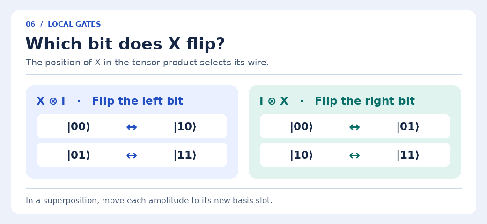

### 4. How do we get the $4\times4$ matrices?

We use the tensor-product rule from the previous lesson: replace every entry of the first matrix with that entry multiplied by the second matrix.

For $X\otimes I$:

$$
X=\begin{pmatrix}0&1\\1&0\end{pmatrix},
\quad
I=\begin{pmatrix}1&0\\0&1\end{pmatrix}
$$

Replace the entries of $X$ with scaled copies of $I$:

$$
X\otimes I=
\begin{pmatrix}
0I&1I\\
1I&0I
\end{pmatrix}
$$

Therefore:

$$
X\otimes I=
\begin{pmatrix}
0&0&1&0\\
0&0&0&1\\
1&0&0&0\\
0&1&0&0
\end{pmatrix}
$$

Similarly, for $I\otimes X$:

$$
I\otimes X=
\begin{pmatrix}
1X&0X\\
0X&1X
\end{pmatrix}
$$

Therefore:

$$
I\otimes X=
\begin{pmatrix}
0&1&0&0\\
1&0&0&0\\
0&0&0&1\\
0&0&1&0
\end{pmatrix}
$$

### 5. What happens to a general two-qubit state?

Now comes the important part.

Suppose our two-qubit state is:

$$
\lvert\psi\rangle=
\begin{pmatrix}
a\\b\\c\\d
\end{pmatrix}
$$

This is just a compact way of writing:

$$
\lvert\psi\rangle=
a\lvert 00\rangle+b\lvert 01\rangle+c\lvert 10\rangle+d\lvert 11\rangle
$$

Each letter represents the amplitude (the coefficient) of one basis state.

| Position | Basis state | Amplitude |
| ---: | --- | ---: |
| 1 | $\lvert 00\rangle$ | $a$ |
| 2 | $\lvert 01\rangle$ | $b$ |
| 3 | $\lvert 10\rangle$ | $c$ |
| 4 | $\lvert 11\rangle$ | $d$ |

**Case A: apply $X\otimes I$**

We flip the left bit. Follow each term:

$$
a\lvert 00\rangle\rightarrow a\lvert 10\rangle
$$

$$
b\lvert 01\rangle\rightarrow b\lvert 11\rangle
$$

$$
c\lvert 10\rangle\rightarrow c\lvert 00\rangle
$$

$$
d\lvert 11\rangle\rightarrow d\lvert 01\rangle
$$

Put them together:

$$
c\lvert 00\rangle+d\lvert 01\rangle+a\lvert 10\rangle+b\lvert 11\rangle
$$

Notice that the amplitudes have moved to different positions. The new amplitude column is:

$$
\boxed{
X\otimes I:
\begin{pmatrix}a\\b\\c\\d\end{pmatrix}
\rightarrow
\begin{pmatrix}c\\d\\a\\b\end{pmatrix}
}
$$

Why does $a$ become the third entry? Because $a$ originally belongs to $\lvert 00\rangle$. After flipping the left bit, $\lvert 00\rangle$ becomes $\lvert 10\rangle$, which is the **third** basis state in our chosen order.

**Case B: apply $I\otimes X$**

Now we flip the right bit.

$$
a\lvert 00\rangle\rightarrow a\lvert 01\rangle
$$

$$
b\lvert 01\rangle\rightarrow b\lvert 00\rangle
$$

$$
c\lvert 10\rangle\rightarrow c\lvert 11\rangle
$$

$$
d\lvert 11\rangle\rightarrow d\lvert 10\rangle
$$

Put them together:

$$
b\lvert 00\rangle+a\lvert 01\rangle+d\lvert 10\rangle+c\lvert 11\rangle
$$

Therefore:

$$
\boxed{
I\otimes X:
\begin{pmatrix}a\\b\\c\\d\end{pmatrix}
\rightarrow
\begin{pmatrix}b\\a\\d\\c\end{pmatrix}
}
$$

### 6. Try it yourself

**Interactive quiz.** [Open in a full browser tab](assets/14_pauli_x_quiz.html) if the embed is cramped.

<iframe src="assets/14_pauli_x_quiz.html" title="Pauli-X Gate Quiz — Two Qubits" width="100%" height="920" loading="lazy" style="border:1px solid #dce3ef;border-radius:12px;max-width:100%;display:block;"></iframe>

**The most important thing to remember**

| Operation | What happens |
| --- | --- |
| $X\otimes I$ | Flip the **left** qubit |
| $I\otimes X$ | Flip the **right** qubit |

Think of the tensor product as telling us which wire gets the gate. The **first** slot refers to the left qubit, and the **second** slot refers to the right qubit.

## 15. Rules for matrix tensor products

### Rule 1: Applying a combined gate to a combined state

$$
\boxed{(A\otimes B)(u\otimes v)=(Au)\otimes(Bv)}
$$

In simple terms: when two gates act on two **separate** qubits, you can apply each gate to **its own** qubit instead of building a large $4\times4$ matrix first.

- $A$ acts on the first qubit (vector $u$).
- $B$ acts on the second qubit (vector $v$).
- Compute $Au$ and $Bv$ separately, then tensor the results.

**Example.** Take $A=X$, $B=I$, $u=\lvert 0\rangle=(1,0)^T$, and $v=\lvert 1\rangle=(0,1)^T$. We want $(X\otimes I)(\lvert 0\rangle\otimes\lvert 1\rangle)$.

First qubit: $X\lvert 0\rangle=\lvert 1\rangle$.

Second qubit: $I\lvert 1\rangle=\lvert 1\rangle$.

Combine:

$$
\boxed{\lvert 1\rangle\otimes\lvert 1\rangle=\lvert 11\rangle}
$$

Same answer as a full $4\times4$ multiply, without doing that multiply.

**Remember:** apply each gate to its own qubit, then combine.

> For an **entangled** input, the identity still holds by **linearity**: apply $A\otimes B$ by acting on each ket term.

### Rule 2: Combining sequences of gates

$$
\boxed{(A\otimes B)(C\otimes D)=(AC)\otimes(BD)}
$$

In simple terms: two stages on two wires fold into one stage per wire.

- First stage: $C$ on qubit 1, $D$ on qubit 2 (operator $C\otimes D$).
- Second stage: $A$ on qubit 1, $B$ on qubit 2 (operator $A\otimes B$).
- **First qubit:** $A$ after $C$ gives $AC$.
- **Second qubit:** $B$ after $D$ gives $BD$.

The product $(A\otimes B)(C\otimes D)$ means: apply $C\otimes D$ first, then $A\otimes B$ (matrix multiplication reads right to left on kets). On **independent** wires you may also write $A\otimes B=(A\otimes I)(I\otimes B)$.

**Example.** First stage $X\otimes I$, second stage $I\otimes X$:

$$
(I\otimes X)(X\otimes I)=(IX)\otimes(XI).
$$

Since $IX=X$ and $XI=X$,

$$
\boxed{(I\otimes X)(X\otimes I)=X\otimes X}
$$

One combined gate: flip **both** qubits.

**Remember:** combine gates **wire by wire**, not by multiplying big tensors blindly when this pattern applies.

### Rule 3: Taking the conjugate transpose

$$
\boxed{(A\otimes B)^\dagger=A^\dagger\otimes B^\dagger}
$$

The symbol $\dagger$ means **conjugate transpose**: complex-conjugate each entry, then transpose (swap rows and columns). The rule says: do that on $A$ and $B$ **separately**, then tensor.

**Example.**

$$
A=\begin{pmatrix}1&i\\0&1\end{pmatrix},
\qquad
B=\begin{pmatrix}1&0\\i&1\end{pmatrix}.
$$

$$
A^\dagger=
\begin{pmatrix}
1&0\\
-i&1
\end{pmatrix},
\qquad
B^\dagger=
\begin{pmatrix}
1&-i\\
0&1
\end{pmatrix}.
$$

So $(A\otimes B)^\dagger=A^\dagger\otimes B^\dagger$ without building $A\otimes B$ first.

If $A$ and $B$ are **unitary** ($U^\dagger U=I$), then $(A\otimes B)^\dagger(A\otimes B)=I_4$: tensor products of unitary gates stay unitary.

**Remember:** conjugate-transpose each smaller matrix, then combine.

### Quick summary

| Rule | What it tells us |
| --- | --- |
| $(A\otimes B)(u\otimes v)=(Au)\otimes(Bv)$ | Apply gates separately to their qubits. |
| $(A\otimes B)(C\otimes D)=(AC)\otimes(BD)$ | Combine gate sequences wire by wire. |
| $(A\otimes B)^\dagger=A^\dagger\otimes B^\dagger$ | Conjugate-transpose each factor separately. |

### Why these rules are useful

State-vector length grows **exponentially** in the number of qubits:

| Qubits | Amplitudes |
| ---: | ---: |
| 1 | 2 |
| 2 | 4 |
| 3 | 8 |
| 10 | 1,024 |

These rules let you work with **$2\times2$** gates and **$2$-entry** vectors whenever operations act independently on separate qubits, instead of defaulting to $4\times4$ (or larger) every time.

## 16. Hadamard on every qubit

**Main idea:** If we apply a Hadamard ($H$) gate to **every** qubit, each qubit has an equal chance of measuring $0$ or $1$. On multiple qubits, we get a **superposition of all possible bit-string combinations** (a **uniform** superposition when all start at $\lvert 0\rangle$).

Let's understand this step by step.

### 1. What does the Hadamard gate do?

$$
H=\frac{1}{\sqrt2}
\begin{pmatrix}
1&1\\
1&-1
\end{pmatrix}
$$

It performs two important transformations:

$$
H\lvert 0\rangle=\frac{\lvert 0\rangle+\lvert 1\rangle}{\sqrt2}=\lvert+\rangle
$$

$$
H\lvert 1\rangle=\frac{\lvert 0\rangle-\lvert 1\rangle}{\sqrt2}=\lvert-\rangle
$$

In simple terms:

- Input $\lvert 0\rangle$: $H$ creates an **equal** superposition of $0$ and $1$.
- Input $\lvert 1\rangle$: same amplitudes, but a **minus** sign on the $\lvert 1\rangle$ term.

For now, remember:

$$
\lvert 0\rangle\xrightarrow{H}\lvert+\rangle
$$

### 2. What happens when we apply $H$ to two qubits?

Start with both qubits in $\lvert 0\rangle$:

$$
\lvert 00\rangle
$$

Apply $H$ on each wire: **$H\otimes H$** (first $H$ on qubit 1, second $H$ on qubit 2).

Each $\lvert 0\rangle$ becomes $\lvert+\rangle$, so Rule 1 from §15 gives:

$$
(H\otimes H)\lvert 00\rangle
=
H\lvert 0\rangle\otimes H\lvert 0\rangle
=
\lvert+\rangle\otimes\lvert+\rangle
=\lvert{++}\rangle.
$$

With $\lvert+\rangle=(\lvert 0\rangle+\lvert 1\rangle)/\sqrt2$,

$$
=\frac{\lvert 0\rangle+\lvert 1\rangle}{\sqrt2}
\otimes
\frac{\lvert 0\rangle+\lvert 1\rangle}{\sqrt2}
=\frac{1}{2}
\bigl(\lvert 0\rangle+\lvert 1\rangle\bigr)\otimes\bigl(\lvert 0\rangle+\lvert 1\rangle\bigr).
$$

Expand:

$$
\boxed{
=\frac{1}{2}\bigl(
\lvert 00\rangle+\lvert 01\rangle+\lvert 10\rangle+\lvert 11\rangle\bigr)
}
$$

**What we achieved**

| Starting state | Apply $H\otimes H$ | Result |
| --- | --- | --- |
| $\lvert 00\rangle$ | $H$ on both qubits | Four outcomes, each amplitude $1/2$ |

| Outcome | Amplitude | Measurement probability |
| --- | ---: | ---: |
| $\lvert 00\rangle$ | $1/2$ | $1/4$ (25%) |
| $\lvert 01\rangle$ | $1/2$ | $1/4$ |
| $\lvert 10\rangle$ | $1/2$ | $1/4$ |
| $\lvert 11\rangle$ | $1/2$ | $1/4$ |

This is a **uniform superposition**: all four basis states share the same amplitude.

### 3. Why show the $4\times4$ matrix $H\otimes H$?

The lecture builds the combined matrix with the **block rule** from §13: replace each entry of the first $H$ by (entry)$\times H$.

$$
H\otimes H=
\frac12
\begin{pmatrix}
1&1&1&1\\
1&-1&1&-1\\
1&1&-1&-1\\
1&-1&-1&1
\end{pmatrix}
$$

**Why $\frac12$ in front?** Each $H$ carries $1/\sqrt2$, and $(1/\sqrt2)(1/\sqrt2)=1/2$.

### 4. Why is the output the first column?

$$
\lvert 00\rangle=
\begin{pmatrix}
1\\0\\0\\0
\end{pmatrix}
$$

Multiply:

$$
(H\otimes H)\lvert 00\rangle
=
\frac12
\begin{pmatrix}
1&1&1&1\\
1&-1&1&-1\\
1&1&-1&-1\\
1&-1&-1&1
\end{pmatrix}
\begin{pmatrix}
1\\0\\0\\0
\end{pmatrix}
=
\frac12
\begin{pmatrix}
1\\1\\1\\1
\end{pmatrix}
=
\frac12\bigl(\lvert 00\rangle+\lvert 01\rangle+\lvert 10\rangle+\lvert 11\rangle\bigr).
$$

The input picks **column 1** of $H\otimes H$; matrix multiply and §2 expansion agree.

### 5. More than two qubits

Initialize all qubits to $\lvert 0\rangle$:

$$
\lvert 0\rangle^{\otimes n}
\quad\text{(\(\lvert 0\rangle\), \(\lvert 00\rangle\), \(\lvert 000\rangle\), …)}.
$$

Apply $H$ on every wire. Since $H\lvert 0\rangle=\lvert+\rangle$,

$$
\boxed{
H^{\otimes n}\lvert 0\rangle^{\otimes n}
=
\lvert+\rangle^{\otimes n}
}
$$

Each qubit is an equal superposition of $0$ and $1$. The joint state lists all $2^n$ bit strings with the same amplitude magnitude:

$$
\boxed{
\frac{1}{\sqrt{2^n}}
\sum_{x\in\{0,1\}^n}\lvert x\rangle
}
$$

| Number of qubits | Possible outcomes | Probability each (computational basis) |
| ---: | ---: | ---: |
| 1 | 2 | $1/2$ (50%) |
| 2 | 4 | $1/4$ (25%) |
| 3 | 8 | $1/8$ (12.5%) |
| 4 | 16 | $1/16$ (6.25%) |

(Same formula as §9; here derived from $H$ on every $\lvert 0\rangle$.)

### 6. Is this state entangled?

**No** — for all-$H$ on $\lvert 0\rangle^{\otimes n}$, the result is a **product** state:

$$
\lvert+\rangle\otimes\lvert+\rangle\otimes\cdots
$$

Each qubit was acted on by its **own** $H$. A uniform superposition over many outcomes is **not** entanglement by itself; entanglement needs a state that cannot factor into single-qubit pure states (§11).

### Final takeaway

The lecture teaches three levels:

1. **One qubit:** $\lvert 0\rangle\xrightarrow{H}\lvert+\rangle$ (equal superposition of $0$ and $1$).
2. **Two qubits:** $\lvert 00\rangle\xrightarrow{H\otimes H}$ equal superposition of $\lvert 00\rangle,\lvert 01\rangle,\lvert 10\rangle,\lvert 11\rangle$.
3. **$n$ qubits:** $\lvert 0\rangle^{\otimes n}\xrightarrow{H^{\otimes n}}$ equal superposition over all $2^n$ strings.

$$
\boxed{
H^{\otimes n}\lvert 0\rangle^{\otimes n}
=
\frac{1}{\sqrt{2^n}}
\sum_{x\in\{0,1\}^n}\lvert x\rangle
}
$$

In everyday language: **Hadamard on every qubit starting at $0$** puts **every** combination of $0$s and $1$s into the state with **equal** measurement probability.

## 17. CNOT, a two-qubit gate

CNOT is a two-qubit gate that looks at the **first** qubit and decides whether to flip the **second**. Unlike Pauli-$X$, which flips every time, CNOT flips the target **only when** the control is $1$.

Let's understand it step by step.

### 1. What is CNOT?

**CNOT** stands for **Controlled-NOT**.

- **First qubit — control:** decides whether anything happens.
- **Second qubit — target:** may be flipped.

Think of the control as a switch:

- Control $=0$ → do nothing to the target.
- Control $=1$ → apply $X$ to the target.

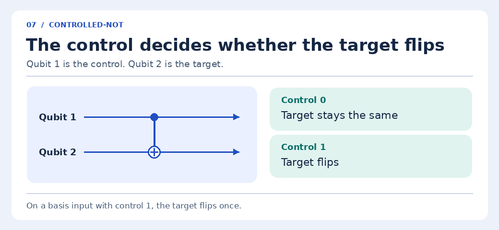

**CNOT: control and target.** The filled dot is the control; the circled plus is the target.

### 2. What does the XOR symbol mean?

$$
\operatorname{CNOT}\lvert ab\rangle=\lvert a,\ b\oplus a\rangle
$$

Here $a$ is the control bit, $b$ is the target bit, and $\oplus$ is **XOR** (exclusive OR):

| First bit | Second bit | XOR $b\oplus a$ |
| ---: | ---: | ---: |
| 0 | 0 | 0 |
| 0 | 1 | 1 |
| 1 | 0 | 1 |
| 1 | 1 | 0 |

CNOT sets the new target to $b\oplus a$; the control bit $a$ is unchanged.

### 3. The four basis inputs

| Input | Output | Rule |
| --- | --- | --- |
| $\lvert 00\rangle$ | $\lvert 00\rangle$ | Control $0$ → do nothing |
| $\lvert 01\rangle$ | $\lvert 01\rangle$ | Control $0$ → do nothing |
| $\lvert 10\rangle$ | $\lvert 11\rangle$ | Control $1$ → flip target |
| $\lvert 11\rangle$ | $\lvert 10\rangle$ | Control $1$ → flip target |

**Example 1:** $\lvert 01\rangle$ — control $0$, target $1$ → no change → $\lvert 01\rangle$.

**Example 2:** $\lvert 10\rangle$ — control $1$, target $0$ → flip → $\lvert 11\rangle$.

The control bit **never** changes; only the target can.

### 4. How do we construct the CNOT matrix?

Basis order: $\lvert 00\rangle$, $\lvert 01\rangle$, $\lvert 10\rangle$, $\lvert 11\rangle$.

$$
\lvert 00\rangle=
\begin{pmatrix}1\\0\\0\\0\end{pmatrix},
\quad
\lvert 01\rangle=
\begin{pmatrix}0\\1\\0\\0\end{pmatrix},
$$

$$
\lvert 10\rangle=
\begin{pmatrix}0\\0\\1\\0\end{pmatrix},
\quad
\lvert 11\rangle=
\begin{pmatrix}0\\0\\0\\1\end{pmatrix}.
$$

**Write the four outputs as columns, in input order:**

| Input | Output | Column |
| --- | --- | --- |
| $\lvert 00\rangle$ | $\lvert 00\rangle$ | $(1,0,0,0)^T$ |
| $\lvert 01\rangle$ | $\lvert 01\rangle$ | $(0,1,0,0)^T$ |
| $\lvert 10\rangle$ | $\lvert 11\rangle$ | $(0,0,0,1)^T$ |
| $\lvert 11\rangle$ | $\lvert 10\rangle$ | $(0,0,1,0)^T$ |

$$
\boxed{
\operatorname{CNOT}=
\begin{pmatrix}
1&0&0&0\\
0&1&0&0\\
0&0&0&1\\
0&0&1&0
\end{pmatrix}
}
$$

### 5. What happens to a general two-qubit state?

$$
\lvert\psi\rangle=
a\lvert 00\rangle+b\lvert 01\rangle+c\lvert 10\rangle+d\lvert 11\rangle,
\qquad
\begin{pmatrix}a\\b\\c\\d\end{pmatrix}.
$$

Apply CNOT to each term (linearity):

$$
a\lvert 00\rangle\rightarrow a\lvert 00\rangle,\quad
b\lvert 01\rangle\rightarrow b\lvert 01\rangle,
$$

$$
c\lvert 10\rangle\rightarrow c\lvert 11\rangle,\quad
d\lvert 11\rangle\rightarrow d\lvert 10\rangle.
$$

Reassemble in standard order:

$$
\lvert\psi'\rangle=
a\lvert 00\rangle+b\lvert 01\rangle+d\lvert 10\rangle+c\lvert 11\rangle.
$$

$$
\boxed{
\begin{pmatrix}a\\b\\c\\d\end{pmatrix}
\rightarrow
\begin{pmatrix}a\\b\\d\\c\end{pmatrix}
}
$$

CNOT **swaps** the third and fourth amplitudes; the first two stay fixed. Each basis ket carries its amplitude along (linear on superpositions).

### 6. Why does $\operatorname{CNOT}^2=I_4$?

$$
\boxed{\operatorname{CNOT}^2=I_4}
$$

($I_4$ is the $4\times4$ identity.) Applying CNOT twice restores the original state.

| Initial | After first CNOT | After second CNOT |
| --- | --- | --- |
| $\lvert 00\rangle$ | $\lvert 00\rangle$ | $\lvert 00\rangle$ |
| $\lvert 01\rangle$ | $\lvert 01\rangle$ | $\lvert 01\rangle$ |
| $\lvert 10\rangle$ | $\lvert 11\rangle$ | $\lvert 10\rangle$ |
| $\lvert 11\rangle$ | $\lvert 10\rangle$ | $\lvert 11\rangle$ |

Control $0$: target never flips. Control $1$: target flips once, then flips back.

### 7. What does $P_0\otimes I+P_1\otimes X$ mean?

$$
\boxed{\operatorname{CNOT}=P_0\otimes I+P_1\otimes X}
$$

$$
P_0=\lvert 0\rangle\langle 0\rvert=
\begin{pmatrix}1&0\\0&0\end{pmatrix}
\quad\text{(control is $0$)},
\qquad
P_1=\lvert 1\rangle\langle 1\rvert=
\begin{pmatrix}0&0\\0&1\end{pmatrix}
\quad\text{(control is $1$)}.
$$

- **$P_0\otimes I$:** control-$0$ part; $I$ leaves target unchanged.
- **$P_1\otimes X$:** control-$1$ part; $X$ flips target.

The **plus** adds both branches on one superposition.

$$
P_0\otimes I=
\begin{pmatrix}
1&0&0&0\\
0&1&0&0\\
0&0&0&0\\
0&0&0&0
\end{pmatrix},
\qquad
P_1\otimes X=
\begin{pmatrix}
0&0&0&0\\
0&0&0&0\\
0&0&0&1\\
0&0&1&0
\end{pmatrix}.
$$

Sum → same $\operatorname{CNOT}$ matrix as §4.

### 8. Test your understanding

**Interactive quiz.** [Open in a full browser tab](assets/17_cnot_quiz.html) if the embed is cramped.

<iframe src="assets/17_cnot_quiz.html" title="CNOT — Test Your Understanding" width="100%" height="920" loading="lazy" style="border:1px solid #dce3ef;border-radius:12px;max-width:100%;display:block;"></iframe>

### Final takeaway

1. CNOT: control + target.
2. First wire = control; second = target.
3. Control $0$ → target unchanged.
4. Control $1$ → target flips ($X$ on target).
5. CNOT twice → back to start.

**Most important:** CNOT is **controlled $X$** — the control decides whether $X$ runs on the target.

## 18. Creating an entangled Bell state

This section shows how two **unentangled** qubits become **entangled** using a CNOT — the standard **Bell state preparation** circuit ($H$ on the control wire, then CNOT).

### 1. Start with $\lvert 00\rangle$

$$
\lvert\psi\rangle=\lvert 00\rangle
$$

First qubit $=0$, second qubit $=0$. Neither is in a superposition yet.

### 2. Apply $H\otimes I$

- $H$ on qubit 1; $I$ on qubit 2.

$$
H\lvert 0\rangle=\frac{\lvert 0\rangle+\lvert 1\rangle}{\sqrt2}=\lvert+\rangle,
\qquad
I\lvert 0\rangle=\lvert 0\rangle.
$$

$$
(H\otimes I)\lvert 00\rangle
=\lvert+\rangle\otimes\lvert 0\rangle
=\frac{\lvert 0\rangle+\lvert 1\rangle}{\sqrt2}\otimes\lvert 0\rangle
$$

Expand (Rule 1, §15):

$$
\boxed{
=\frac{\lvert 00\rangle+\lvert 10\rangle}{\sqrt2}
}
$$

| Step | State |
| --- | --- |
| Start | $\lvert 00\rangle$ |
| After $H\otimes I$ | $\frac{\lvert 00\rangle+\lvert 10\rangle}{\sqrt2}$ |

| Outcome | Amplitude |
| --- | ---: |
| $\lvert 00\rangle$ | $1/\sqrt2$ |
| $\lvert 10\rangle$ | $1/\sqrt2$ |

**Still a product state:** $\lvert+\rangle\otimes\lvert 0\rangle$. Superposition on qubit 1 alone is **not** entanglement (§11).

### 3. Apply CNOT

Apply CNOT to $\frac{\lvert 00\rangle+\lvert 10\rangle}{\sqrt2}$. Control = qubit 1; target = qubit 2.

**Term $\lvert 00\rangle$:** control $0$ → no change → $\lvert 00\rangle$.

**Term $\lvert 10\rangle$:** control $1$ → flip target $0\to 1$ → $\lvert 11\rangle$.

By linearity:

$$
\operatorname{CNOT}\left(\frac{\lvert 00\rangle+\lvert 10\rangle}{\sqrt2}\right)
=\frac{\operatorname{CNOT}\lvert 00\rangle+\operatorname{CNOT}\lvert 10\rangle}{\sqrt2}
=\frac{\lvert 00\rangle+\lvert 11\rangle}{\sqrt2}.
$$

$$
\boxed{
\lvert\Phi^+\rangle=
\frac{\lvert 00\rangle+\lvert 11\rangle}{\sqrt2}
}
$$

One of the four **Bell states** — now **entangled**.

### 4. The circuit visually

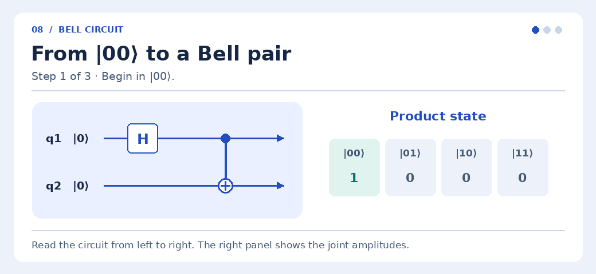

1. **Start:** $\lvert 00\rangle$ (both qubits at $0$).
2. **$H$ on qubit 1:** $\lvert 00\rangle\to\frac{\lvert 00\rangle+\lvert 10\rangle}{\sqrt2}$.
3. **CNOT:** $\frac{\lvert 00\rangle+\lvert 10\rangle}{\sqrt2}\to\frac{\lvert 00\rangle+\lvert 11\rangle}{\sqrt2}$.
4. **Result:** $\lvert\Phi^+\rangle$.

### 5. Why is the final state entangled?

**Before CNOT:** $\frac{\lvert 00\rangle+\lvert 10\rangle}{\sqrt2}=\lvert+\rangle\otimes\lvert 0\rangle$ — product.

**After CNOT:** $\frac{\lvert 00\rangle+\lvert 11\rangle}{\sqrt2}$ — **cannot** factor as $u\otimes v$ (§11).

**Measurement (computational basis):**

| Result | Probability |
| --- | ---: |
| $\lvert 00\rangle$ | 50% |
| $\lvert 11\rangle$ | 50% |
| $\lvert 01\rangle$ | 0% |
| $\lvert 10\rangle$ | 0% |

The bits always **agree**: $0$ with $0$, or $1$ with $1$.

### 6. Determinant check (§11)

For $\lvert\psi\rangle=a\lvert 00\rangle+b\lvert 01\rangle+c\lvert 10\rangle+d\lvert 11\rangle$, $M=\begin{pmatrix}a&b\\c&d\end{pmatrix}$, $\det M=ad-bc$. Product $\Leftrightarrow$ $\det M=0$; entangled $\Leftrightarrow$ $\det M\neq 0$.

For $\lvert\Phi^+\rangle$: $a=d=1/\sqrt2$, $b=c=0$,

$$
M=\begin{pmatrix}1/\sqrt2&0\\0&1/\sqrt2\end{pmatrix},
\quad
\det M=\frac12\neq 0.
$$

Entangled (full walkthrough in §11).

### 7. Why CNOT is not $A\otimes B$

If $\operatorname{CNOT}=A\otimes B$, Rule 1 would force product in $\to$ product out:

$$
(A\otimes B)(\lvert+\rangle\otimes\lvert 0\rangle)=(A\lvert+\rangle)\otimes(B\lvert 0\rangle).
$$

But we showed

$$
\lvert+\rangle\otimes\lvert 0\rangle
\xrightarrow{\operatorname{CNOT}}
\frac{\lvert 00\rangle+\lvert 11\rangle}{\sqrt2},
$$

which is **entangled**. So

$$
\boxed{\operatorname{CNOT}\neq A\otimes B}
$$

CNOT is a **two-qubit** gate, not two independent single-qubit gates — an **entangling** gate when the input is right.

**Note:** CNOT does not entangle every input — e.g. $\operatorname{CNOT}\lvert 10\rangle=\lvert 11\rangle$ (still a product state). Entanglement depends on the superposition **before** CNOT.

### Final takeaway

1. $\lvert 00\rangle$
2. $H\otimes I$ → $\lvert+\rangle\otimes\lvert 0\rangle$ (product)
3. CNOT: $\lvert 00\rangle$ term fixed; $\lvert 10\rangle\to\lvert 11\rangle$
4. $\lvert\Phi^+\rangle$ — entangled

**$H$** builds superposition on the control; **CNOT** ties the target to the control. Together they create entanglement.

## 19. Measuring two qubits or only one

This section compares **measuring both qubits** with **measuring only the first qubit**.

- **Measuring both qubits:** We find the values of both qubits.
- **Measuring only the first qubit:** We find the value of the first qubit, but the second qubit is not directly measured. We update the combined quantum state based on what we learned.

### 1. General two-qubit state

$$
\lvert\psi\rangle=a\lvert 00\rangle+b\lvert 01\rangle+c\lvert 10\rangle+d\lvert 11\rangle
$$

| State | First qubit | Second qubit | Amplitude |
| --- | ---: | ---: | ---: |
| $\lvert 00\rangle$ | 0 | 0 | $a$ |
| $\lvert 01\rangle$ | 0 | 1 | $b$ |
| $\lvert 10\rangle$ | 1 | 0 | $c$ |
| $\lvert 11\rangle$ | 1 | 1 | $d$ |

Four terms = four possible full measurement strings in the computational basis.

### 2. Measuring both qubits

Outcomes: $00$, $01$, $10$, $11$. **Born rule:** $P=\lvert\text{amplitude}\rvert^2$.

$$
\begin{aligned}
P(00)&=\lvert a\rvert^2, &
P(01)&=\lvert b\rvert^2,\\
P(10)&=\lvert c\rvert^2, &
P(11)&=\lvert d\rvert^2.
\end{aligned}
$$

**Example**

$$
\lvert\psi\rangle=
\frac12\lvert 00\rangle+\frac12\lvert 01\rangle+\frac{1}{\sqrt2}\lvert 10\rangle
$$

| Result | Amplitude | Probability |
| --- | ---: | ---: |
| $00$ | $1/2$ | $1/4$ (25%) |
| $01$ | $1/2$ | $1/4$ |
| $10$ | $1/\sqrt2$ | $1/2$ (50%) |
| $11$ | $0$ | $0$ |

If the outcome is $10$, the post-measurement state is $\lvert 10\rangle$ (other terms drop out) — the measurement **selects** that basis ket.

### 3. Measuring only the first qubit

Now comes the interesting part.

Suppose we measure only the first qubit.

We don't directly measure the second qubit.

The possible measurement results are only:

- First qubit $=0$
- First qubit $=1$

Look again at our general state:

$$
\lvert\psi\rangle=a\lvert 00\rangle+b\lvert 01\rangle+c\lvert 10\rangle+d\lvert 11\rangle
$$

Let's group the terms according to the first qubit.

**Group 1: First qubit is 0**

$$
a\lvert 00\rangle+b\lvert 01\rangle
$$

Both terms have $0$ as their first bit.

**Group 2: First qubit is 1**

$$
c\lvert 10\rangle+d\lvert 11\rangle
$$

Both terms have $1$ as their first bit.

So we can rewrite the state as:

$$
\lvert\psi\rangle=
\underbrace{(a\lvert 00\rangle+b\lvert 01\rangle)}_{\text{First bit = 0}}
+
\underbrace{(c\lvert 10\rangle+d\lvert 11\rangle)}_{\text{First bit = 1}}
$$

This grouping is the key to understanding partial measurement.

### 4. Branch probabilities

For the first qubit to be 0, either of these outcomes can occur:

- 00
- 01

Therefore, we add their probabilities:

$$
\boxed{p_0=|a|^2+|b|^2}
$$

Similarly, for the first qubit to be 1, either of these outcomes can occur:

- 10
- 11

Therefore:

$$
\boxed{p_1=|c|^2+|d|^2}
$$

Notice that we are adding probabilities, not amplitudes.

The two groups represent mutually exclusive measurement outcomes.

For a normalized state:

$$
p_0+p_1=1
$$

### 5. State after partial measurement

Suppose we measure the first qubit and get 0.

What should happen to the original state?

We keep only the terms where the first bit is 0:

$$
a|00\rangle+b|01\rangle
$$

We discard the terms where the first bit is 1:

$$
c|10\rangle+d|11\rangle
$$

But there is one more step: we must normalize the remaining state.

Why?

Because after measurement, the remaining state must have total probability 1.

The probability of getting 0 was:

$$
p_0=|a|^2+|b|^2
$$

So we divide the surviving amplitudes by $\sqrt{p_0}$:

$$
\boxed{
|\psi_0\rangle=
\frac{a|00\rangle+b|01\rangle}{\sqrt{p_0}}
}
$$

Similarly, if the measurement result is 1:

$$
\boxed{
|\psi_1\rangle=
\frac{c|10\rangle+d|11\rangle}{\sqrt{p_1}}
}
$$

### 6. Lecture example

#### 1. Understand the initial state

Your lecture gives:

$$
|\psi\rangle=\frac{|00\rangle+|01\rangle+|10\rangle}{3}
$$

There is a small but important correction here: the denominator should be $\sqrt{3}$, not $3$, for this to be a properly normalized quantum state.

So the correct state is:

$$
\boxed{|\psi\rangle=\frac{|00\rangle+|01\rangle+|10\rangle}{\sqrt{3}}}
$$

Let's expand it:

$$
|\psi\rangle=
\frac{1}{\sqrt3}|00\rangle+
\frac{1}{\sqrt3}|01\rangle+
\frac{1}{\sqrt3}|10\rangle+
0|11\rangle
$$

Remember, a two-qubit state has four possible basis states:

| Basis state | Amplitude |
| --- | ---: |
| $\lvert 00\rangle$ | $1/\sqrt3$ |
| $\lvert 01\rangle$ | $1/\sqrt3$ |
| $\lvert 10\rangle$ | $1/\sqrt3$ |
| $\lvert 11\rangle$ | $0$ |

The amplitude tells us the probability when we square its absolute value.

#### 2. If we measure both qubits

The probability of each outcome is the square of its amplitude:

$$
P(00)=\left|\frac1{\sqrt3}\right|^2=\frac13
$$

Similarly:

$$
P(01)=\frac13,\qquad P(10)=\frac13
$$

And:

$$
P(11)=0
$$

**Possible measurement outcomes**

| Outcome | Probability |
| --- | ---: |
| 00 | 33.3% |
| 01 | 33.3% |
| 10 | 33.3% |
| 11 | 0.0% |

So, if we measure both qubits, we can get:

- 00 with probability $1/3$.
- 01 with probability $1/3$.
- 10 with probability $1/3$.
- 11 will never occur.

#### 3. What if we measure only the first qubit?

This is the important part of the lecture.

Our state is:

$$
|\psi\rangle=
\frac{|00\rangle+|01\rangle+|10\rangle}{\sqrt3}
$$

Each two-bit state has:

- First bit = the first qubit.
- Second bit = the second qubit.

When measuring only the first qubit, we don't care about the second bit's value yet.

Therefore, group the states according to their first bit.

**Group 1: First qubit is 0**

$00$, $01$ — both states begin with $0$.

$$
P(\text{first qubit}=0)=\frac13+\frac13=\boxed{\frac23}
$$

Probability = $2/3$

**Group 2: First qubit is 1**

$10$ — only this state begins with $1$.

$$
P(\text{first qubit}=1)=\frac13
$$

Probability = $1/3$

That's exactly what the animation is trying to show:

- Group 00 and 01 together because their first bit is 0.
- Keep 10 separately because its first bit is 1.
- The probability of each group is the sum of the probabilities of the states inside it.

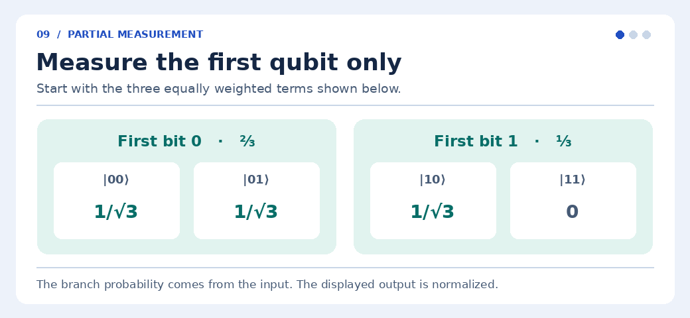

#### 4. What happens after the measurement?

Suppose we actually measure the first qubit.

There are two possible outcomes.

**Case A: Measurement gives 0**

The original state was:

$$
|\psi\rangle=\frac{|00\rangle+|01\rangle+|10\rangle}{\sqrt3}
$$

Since the measured first qubit is 0, we discard the state 10, because its first bit is 1.

The remaining state is:

$$
\frac{|00\rangle+|01\rangle}{\sqrt3}
$$

But this is not normalized. We must divide by $\sqrt{2/3}$:

$$
|\psi_0\rangle
=\frac{|00\rangle+|01\rangle}{\sqrt2}
$$

So the final state becomes:

$$
\boxed{|\psi_0\rangle=|0\rangle\otimes
\frac{|0\rangle+|1\rangle}{\sqrt2}}
$$

In simple words:

- First qubit is definitely 0.
- Second qubit is in an equal superposition of 0 and 1.

**Case B: Measurement gives 1**

We retain only the state 10, because it is the only state whose first bit is 1.

After normalization:

$$
\boxed{|\psi_1\rangle=|10\rangle}
$$

In simple words:

- First qubit is definitely 1.
- Second qubit is definitely 0.

#### 5. Try the measurement yourself

Choose the result of measuring the first qubit:

**Interactive.** [Open in a full browser tab](assets/19_partial_measurement_try.html) if the embed is cramped.

<iframe src="assets/19_partial_measurement_try.html" title="Partial measurement — try it" width="100%" height="480" loading="lazy" style="border:1px solid #dce3ef;border-radius:12px;max-width:100%;display:block;"></iframe>

#### 6. Key takeaway

The lecture is demonstrating the difference between measuring both qubits and measuring only one:

| Measurement | Possible outcomes | Probabilities |
| --- | --- | --- |
| Both qubits | 00, 01, 10 | $1/3$ each |
| First qubit only | 0, 1 | $2/3$, $1/3$ |

The most important concept: When measuring only one qubit, group the basis states according to the value of that qubit. Add the probabilities within each group. After the measurement, keep only the group corresponding to the observed result and normalize the remaining state.

### 7. Projectors $P_0\otimes I$ and $P_1\otimes I$

Projectors are mathematical filters. They keep the part of a quantum state that matches a particular measurement outcome and remove the rest.

Here, we want to measure only the first qubit of a two-qubit system.

#### 1. First, understand $P_0$ and $P_1$

The lecture defines two matrices:

$$
P_0=|0\rangle\langle 0|=
\begin{pmatrix}
1&0\\
0&0
\end{pmatrix}
$$

$$
P_1=|1\rangle\langle 1|=
\begin{pmatrix}
0&0\\
0&1
\end{pmatrix}
$$

What do these matrices do?

Let's apply them to the two possible single-qubit states.

**Applying $P_0$:**

$$
P_0|0\rangle
=
\begin{pmatrix}1&0\\0&0\end{pmatrix}
\begin{pmatrix}1\\0\end{pmatrix}
=
\begin{pmatrix}1\\0\end{pmatrix}
=|0\rangle
$$

It keeps $|0\rangle$.

But:

$$
P_0|1\rangle
=
\begin{pmatrix}1&0\\0&0\end{pmatrix}
\begin{pmatrix}0\\1\end{pmatrix}
=
\begin{pmatrix}0\\0\end{pmatrix}
$$

It removes $|1\rangle$.

Therefore:

- $P_0$ keeps $|0\rangle$.
- $P_0$ removes $|1\rangle$.

Similarly, $P_1$ does the opposite:

$$
P_1|0\rangle=0
$$

$$
P_1|1\rangle=|1\rangle
$$

So:

- $P_1$ keeps $|1\rangle$.
- $P_1$ removes $|0\rangle$.

Think of them as two filters:

| Filter | Keeps | Input | Result |
| --- | --- | --- | --- |
| $P_0$ | 0 | 0 or 1 | **0** kept; **1** removed |
| $P_1$ | 1 | 0 or 1 | **1** kept; **0** removed |

#### 2. What does $I$ mean?

The identity matrix is:

$$
I=\begin{pmatrix}1&0\\0&1\end{pmatrix}
$$

It does nothing to the qubit.

$$
I|0\rangle=|0\rangle
$$

$$
I|1\rangle=|1\rangle
$$

So, when we write:

$$
P_0\otimes I
$$

we mean:

- Apply $P_0$ to the first qubit.
- Apply $I$ to the second qubit.

The first qubit is filtered, while the second qubit is left untouched.

Similarly:

$$
P_1\otimes I
$$

means:

- Apply $P_1$ to the first qubit.
- Leave the second qubit untouched.

This is why the lecture says we are measuring only the first qubit.

#### 3. Let's see what happens to a two-qubit state

Consider the four possible basis states:

$$
|00\rangle,\quad |01\rangle,\quad |10\rangle,\quad |11\rangle
$$

Remember:

- The first digit represents qubit 1.
- The second digit represents qubit 2.

**Let's apply $P_0\otimes I$.**

| Input | First qubit | Result |
| --- | ---: | --- |
| $\lvert 00\rangle$ | 0 | $\lvert 00\rangle$ |
| $\lvert 01\rangle$ | 0 | $\lvert 01\rangle$ |
| $\lvert 10\rangle$ | 1 | Removed |
| $\lvert 11\rangle$ | 1 | Removed |

Therefore:

$$
\begin{aligned}
(P_0\otimes I)|00\rangle&=|00\rangle\\
(P_0\otimes I)|01\rangle&=|01\rangle\\
(P_0\otimes I)|10\rangle&=0\\
(P_0\otimes I)|11\rangle&=0
\end{aligned}
$$

Notice that both 00 and 01 are retained because their first bit is 0. The second bit doesn't matter.

**Now apply $P_1\otimes I$.**

| Input | First qubit | Result |
| --- | ---: | --- |
| $\lvert 00\rangle$ | 0 | Removed |
| $\lvert 01\rangle$ | 0 | Removed |
| $\lvert 10\rangle$ | 1 | $\lvert 10\rangle$ |
| $\lvert 11\rangle$ | 1 | $\lvert 11\rangle$ |

Therefore:

$$
\begin{aligned}
(P_1\otimes I)|00\rangle&=0\\
(P_1\otimes I)|01\rangle&=0\\
(P_1\otimes I)|10\rangle&=|10\rangle\\
(P_1\otimes I)|11\rangle&=|11\rangle
\end{aligned}
$$

#### 4. Apply these projectors to our previous lecture example

Recall the state:

$$
|\psi\rangle=
\frac{|00\rangle+|01\rangle+|10\rangle}{\sqrt3}
$$

**Let's first apply $P_0\otimes I$:**

$$
\begin{aligned}
(P_0\otimes I)|\psi\rangle
&=\frac1{\sqrt3}
\left[
|00\rangle+|01\rangle+0
\right]\\
&=\frac{|00\rangle+|01\rangle}{\sqrt3}
\end{aligned}
$$

It retained 00 and 01, and removed 10.

The probability of obtaining this outcome is the squared norm of the resulting state:

$$
P(0)=\frac13+\frac13=\boxed{\frac23}
$$

To get the normalized state, divide by $\sqrt{2/3}$:

$$
\boxed{
|\psi_0\rangle=\frac{|00\rangle+|01\rangle}{\sqrt2}
}
$$

**Now apply $P_1\otimes I$:**

$$
\begin{aligned}
(P_1\otimes I)|\psi\rangle
&=\frac1{\sqrt3}
\left[
0+0+|10\rangle
\right]\\
&=\frac{|10\rangle}{\sqrt3}
\end{aligned}
$$

It removed 00 and 01, retaining only 10.

The probability is:

$$
P(1)=\boxed{\frac13}
$$

After normalization:

$$
\boxed{|\psi_1\rangle=|10\rangle}
$$

#### 5. Visualize the two projectors

$$
\frac{|00\rangle+|01\rangle+|10\rangle}{\sqrt3}
$$

| | $P_0\otimes I$ | $P_1\otimes I$ |
| --- | --- | --- |
| Role | Keep first bit 0 | Keep first bit 1 |
| Survives | 00 + 01 | 10 |
| Removes | 10 | 00, 01 |
| Probability | $2/3$ | $1/3$ |

**[Open visualization in a full tab](assets/19_projectors_viz.html)** if the embed is cramped.

<iframe src="assets/19_projectors_viz.html" title="Visualize P₀⊗I and P₁⊗I" width="100%" height="320" loading="lazy" style="border:1px solid #dce3ef;border-radius:12px;max-width:100%;display:block;"></iframe>

#### 6. One important distinction

You might wonder: if $P_0\otimes I$ removes some states, why do we say we are measuring only the first qubit?

Because the projector does not distinguish between the second qubit being 0 or 1.

For example, both of these survive:

$$
|00\rangle,\quad |01\rangle
$$

The projector only checks the first qubit. It does not tell us whether the second qubit is 0 or 1.

Also, the projectors themselves represent the two possible measurement outcomes. We don't apply both sequentially to perform the measurement. The actual measurement produces either outcome 0 or outcome 1.

The key takeaway:

- $P_0\otimes I$: Selects all components where the first qubit is 0.
- $P_1\otimes I$: Selects all components where the first qubit is 1.
- $I$: Leaves the second qubit alone.
- The probability of each outcome is the squared norm of its projected state.
- Normalize the projected state after obtaining the measurement result.

### 8. Entanglement and partial measurement

The lecture is showing that when two qubits are entangled, measuring just one qubit tells us something about the other qubit, even though we never directly measured it.

Let's understand this step by step.

#### 1. First, understand the Bell state

The lecture gives:

$$
|\Phi^+\rangle=\frac{|00\rangle+|11\rangle}{2}
$$

There is a small notation correction: the denominator should be $\sqrt{2}$, not $2$, to normalize the state.

Let's expand it:

$$
|\Phi^+\rangle=
\frac1{\sqrt2}|00\rangle+
\frac1{\sqrt2}|11\rangle
$$

This means the two-qubit system has two possible components:

| State | Amplitude | Probability |
| --- | ---: | --- |
| $\lvert 00\rangle$ | $1/\sqrt2$ | 1/2 (50%) |
| $\lvert 01\rangle$ | $0$ | $0$ |
| $\lvert 10\rangle$ | $0$ | $0$ |
| $\lvert 11\rangle$ | $1/\sqrt2$ | 1/2 (50%) |

So, if we measure both qubits, we can get:

- 00 with 50% probability.
- 11 with 50% probability.

We will never get 01 or 10.

Notice something interesting: Whenever the first qubit is 0, the second is also 0. Whenever the first is 1, the second is also 1.

The two qubits are correlated.

#### 2. What happens when we measure only the first qubit?

This is the central idea.

Our initial state is:

$$
|\Phi^+\rangle=\frac{|00\rangle+|11\rangle}{\sqrt2}
$$

We measure only the first qubit.

There are two possible outcomes.

**Case A: First qubit measurement gives 0**

Look at the initial state:

$$
\frac{|00\rangle+|11\rangle}{\sqrt2}
$$

The measurement result is 0 for the first qubit.

Therefore, we keep only the states whose first bit is 0.

- 00 → first bit is 0 → keep it.
- 11 → first bit is 1 → remove it.

The remaining state is:

$$
\frac{|00\rangle}{\sqrt2}
$$

But this state is not normalized. We normalize it by dividing by its norm, which is $1/\sqrt2$.

Therefore:

$$
\boxed{|\psi_0\rangle=|00\rangle}
$$

What does this tell us?

- First qubit = 0 (because we measured it).
- Second qubit = 0 (even though we did not measure it).

Probability of this outcome: 50%

**Case B: First qubit measurement gives 1**

Again, start with:

$$
|\Phi^+\rangle=\frac{|00\rangle+|11\rangle}{\sqrt2}
$$

This time, the first qubit measurement gives 1.

We keep only the states whose first bit is 1.

- 00 → first bit is 0 → remove it.
- 11 → first bit is 1 → keep it.

The remaining state is:

$$
\frac{|11\rangle}{\sqrt2}
$$

After normalization:

$$
\boxed{|\psi_1\rangle=|11\rangle}
$$

What does this tell us?

- First qubit = 1 (because we measured it).
- Second qubit = 1 (even though we did not measure it).

Probability of this outcome: 50%

**Visual: outcomes after partial measurement**

[Open in a full browser tab](assets/19_entanglement_partial.html) if the embed is cramped.

<iframe src="assets/19_entanglement_partial.html" title="Bell state partial measurement outcomes" width="100%" height="520" loading="lazy" style="border:1px solid #dce3ef;border-radius:12px;max-width:100%;display:block;"></iframe>

#### 3. Compare the two possible outcomes

| First qubit measurement | Final two-qubit state | Second qubit |
| --- | --- | ---: |
| 0 | $\lvert 00\rangle$ | 0 |
| 1 | $\lvert 11\rangle$ | 1 |

The important observation is:

We measured only the first qubit, but we know the value of the second qubit too.

This is possible because the two qubits were entangled before measurement.

#### 4. Why does this happen? What is entanglement?

Let's compare two situations.

**Situation A: Two independent qubits**

Suppose we have:

$$
|+\rangle\otimes|+\rangle
$$

Expanding:

$$
=\frac{|00\rangle+|01\rangle+|10\rangle+|11\rangle}{2}
$$

If we measure the first qubit and get 0, the second qubit could still be either 0 or 1, each with 50% probability.

Knowing the first qubit does not tell us the second qubit's value.

**Situation B: Two entangled qubits**

Now consider:

$$
|\Phi^+\rangle=\frac{|00\rangle+|11\rangle}{\sqrt2}
$$

If we measure the first qubit and get 0, the second must be 0.

If we measure the first qubit and get 1, the second must be 1.

Knowing the first qubit tells us the second qubit's value with certainty.

See the **Independent versus entangled** panel in the visualization above.

#### 5. Does measuring one qubit send a signal to the other?

No. This is a very important point.

Imagine two people:

- Alice has the first qubit.
- Bob has the second qubit.
- Their qubits are entangled in the Bell state.

Alice measures her qubit.

If she gets 0, Bob's qubit is now in state $|0\rangle$.

If she gets 1, Bob's qubit is now in state $|1\rangle$.

But Bob cannot tell which result Alice obtained just by measuring his own qubit.

From Bob's perspective, his result is still:

- 0 with 50% probability.
- 1 with 50% probability.

He needs Alice to communicate her result through a normal classical communication channel to compare results.

So, entanglement creates correlations, but it does not allow faster-than-light communication.

#### 6. How does this connect to the projectors we just studied?

Remember these projectors?

$$
P_0\otimes I
$$

$$
P_1\otimes I
$$

We can apply them to the Bell state.

**For outcome 0:**

$$
(P_0\otimes I)|\Phi^+\rangle
=\frac{|00\rangle}{\sqrt2}
$$

Probability = $1/2$. After normalization:

$$
|\psi_0\rangle=|00\rangle
$$

**For outcome 1:**

$$
(P_1\otimes I)|\Phi^+\rangle
=\frac{|11\rangle}{\sqrt2}
$$

Probability = $1/2$. After normalization:

$$
|\psi_1\rangle=|11\rangle
$$

This is exactly the same projector concept from the previous lecture, now applied to an entangled state.

#### 7. Key takeaway

1. The Bell state contains two correlated possibilities: 00 and 11.
2. Measuring the first qubit gives either 0 or 1, each with 50% probability.
3. If the result is 0, the second qubit is also 0.
4. If the result is 1, the second qubit is also 1.
5. This happens because the qubits are already entangled, not because a signal travels between them.

One final point about the lecture's next sentence: **§20 continues in the Hadamard basis** means the lecture will now explore entanglement and measurement using a different measurement basis, rather than the usual computational basis (0 and 1). That is a useful next step because entangled qubits can show correlations in more than one measurement basis.

### 9. Final summary

| Measurement | What you learn | State update |
| --- | --- | --- |
| Both qubits | Both bits | One basis ket remains |
| First qubit $=0$ | Left bit $0$ | Keep $00$, $01$ terms; normalize |
| First qubit $=1$ | Left bit $1$ | Keep $10$, $11$ terms; normalize |

Remember:

1. Full measurement: square each amplitude for its outcome probability.
2. First qubit only: group by left bit; add $\lvert\cdot\rvert^2$ inside each group.
3. Keep terms matching the outcome.
4. Normalize with **$\sqrt{\text{branch probability}}$**.
5. One-qubit measurement can change the **conditional** state of the other — especially if entangled.

$$
\boxed{
p_0=\lvert a\rvert^2+\lvert b\rvert^2,\qquad
p_1=\lvert c\rvert^2+\lvert d\rvert^2
}
$$

That is the core difference between measuring both qubits and measuring only one.

## 20. Bell-state measurement correlations

This slide is explaining something very interesting about entangled qubits: they remain correlated even when we change the measurement basis.

Earlier, we saw that the Bell state gives matching results when measured in the computational basis:

- First qubit = 0 → second qubit = 0.
- First qubit = 1 → second qubit = 1.

Now the lecture shows that the same Bell state also gives matching results when measured in the Hadamard basis:

- First qubit = $+$ → second qubit = $+$.
- First qubit = $-$ → second qubit = $-$.

Let's work through why this happens.

### 1. Start with the Bell state

The Bell state is:

$$
|\Phi^+\rangle=\frac{|00\rangle+|11\rangle}{\sqrt2}
$$

It contains two possible states:

| State | Probability |
| --- | ---: |
| $\lvert 00\rangle$ | 50% |
| $\lvert 11\rangle$ | 50% |

The other two possibilities, 01 and 10, have zero probability.

**Measuring in the computational basis**

The computational basis is:

$$
\{|0\rangle,|1\rangle\}
$$

If we measure both qubits:

- We get 00 with 50% probability.
- We get 11 with 50% probability.

The results always agree.

But the lecture now asks: What happens if we measure both qubits using the Hadamard basis instead?

### 2. What is the Hadamard basis?

You have already studied the Hadamard gate $H$.

It transforms the computational basis states as follows:

$$
H|0\rangle=|+\rangle
=\frac{|0\rangle+|1\rangle}{\sqrt2}
$$

$$
H|1\rangle=|-\rangle
=\frac{|0\rangle-|1\rangle}{\sqrt2}
$$

Therefore, the Hadamard basis consists of:

$$
\boxed{\{|+\rangle,|-\rangle\}}
$$

Think of it as a different way of describing or measuring a qubit.

The two bases are:

| Computational (Z) basis | Hadamard (X) basis |
| --- | --- |
| $\lvert 0\rangle$ | $\lvert +\rangle$ |
| $\lvert 1\rangle$ | $\lvert -\rangle$ |

### 3. Express the Bell state in the Hadamard basis

This is the main mathematical part of the slide.

The lecture claims:

$$
\boxed{
|\Phi^+\rangle=
\frac{|++\rangle+|--\rangle}{\sqrt2}
}
$$

Let's verify this by expanding both states.

**First, expand $|++\rangle$.**

We know:

$$
|+\rangle=\frac{|0\rangle+|1\rangle}{\sqrt2}
$$

Therefore:

$$
\begin{aligned}
|++\rangle
&=|+\rangle\otimes|+\rangle\\
&=\frac{(|0\rangle+|1\rangle)
\otimes(|0\rangle+|1\rangle)}{2}\\
&=\frac{|00\rangle+|01\rangle+|10\rangle+|11\rangle}{2}
\end{aligned}
$$

**Now expand $|--\rangle$.**

We know:

$$
|-\rangle=\frac{|0\rangle-|1\rangle}{\sqrt2}
$$

Therefore:

$$
\begin{aligned}
|--\rangle
&=|-\rangle\otimes|-\rangle\\
&=\frac{(|0\rangle-|1\rangle)
\otimes(|0\rangle-|1\rangle)}{2}\\
&=\frac{|00\rangle-|01\rangle-|10\rangle+|11\rangle}{2}
\end{aligned}
$$

### 4. Add the two expanded expressions

The lecture says that the 01 and 10 terms cancel. Let's see that.

$$
|++\rangle=
\frac{|00\rangle+|01\rangle+|10\rangle+|11\rangle}{2}
$$

$$
|--\rangle=
\frac{|00\rangle-|01\rangle-|10\rangle+|11\rangle}{2}
$$

Adding them:

$$
\begin{aligned}
|++\rangle+|--\rangle
=\frac12[&
|00\rangle+|01\rangle+|10\rangle+|11\rangle\\
&+|00\rangle-|01\rangle-|10\rangle+|11\rangle]
\end{aligned}
$$

Collect the terms:

- $\lvert 00\rangle$: $1+1=2$
- $\lvert 01\rangle$: $1-1=0$
- $\lvert 10\rangle$: $1-1=0$
- $\lvert 11\rangle$: $1+1=2$

So:

$$
|++\rangle+|--\rangle
=\frac12(2|00\rangle+2|11\rangle)
$$

Simplifying:

$$
=|00\rangle+|11\rangle
$$

Divide both sides by $\sqrt2$:

$$
\boxed{
\frac{|++\rangle+|--\rangle}{\sqrt2}
=
\frac{|00\rangle+|11\rangle}{\sqrt2}
}
$$

That's exactly the original Bell state!

This proves that the Bell state can be expressed in either basis.

### 5. What happens when both qubits are measured in the Hadamard basis?

We have just established:

$$
|\Phi^+\rangle=
\frac{|++\rangle+|--\rangle}{\sqrt2}
$$

This tells us that the only possible measurement outcomes in the Hadamard basis are:

| Measurement outcome | Probability |
| --- | ---: |
| $++$ | 50% |
| $+-$ | 0% |
| $-+$ | 0% |
| $--$ | 50% |

So the two qubits still give matching results!

- If the first qubit is measured as $+$, the second is also $+$.
- If the first qubit is measured as $-$, the second is also $-$.

**Compare the measurement bases**

[Open Z vs X comparison](assets/20_bell_z_x_basis.html) in a full tab if the embed is cramped.

<iframe src="assets/20_bell_z_x_basis.html" title="Bell correlations in Z and X basis" width="100%" height="380" loading="lazy" style="border:1px solid #dce3ef;border-radius:12px;max-width:100%;display:block;"></iframe>

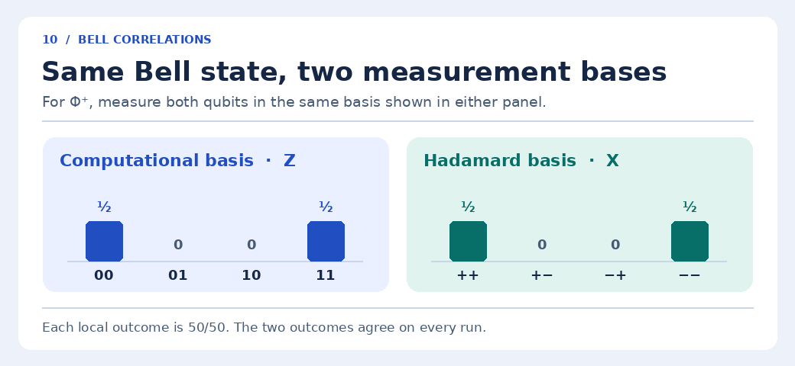

This is the important observation: the Bell state has perfect correlations in both the computational basis and the Hadamard basis.

### 6. Why does the lecture mention a shared classical random bit?

This is where things become particularly interesting.

Imagine two people, Alice and Bob. They want to produce matching answers.

They could use an ordinary classical method:

1. Generate a random bit: either 0 or 1.
2. Give Alice a copy.
3. Give Bob a copy.

For example:

- Random bit = 0 → Alice gets 0, Bob gets 0.
- Random bit = 1 → Alice gets 1, Bob gets 1.

This produces exactly the same measurement statistics as the Bell state in the computational basis:

| Random bit | Alice | Bob |
| --- | ---: | ---: |
| 0 | 0 | 0 |
| 1 | 1 | 1 |

Therefore, simply observing matching 00 and 11 outcomes does not prove that the qubits are entangled!

A shared classical random bit can explain those results.

But what about the Hadamard basis?

The Bell state also gives perfect matching results in that basis. A classical shared random bit can reproduce matching results in both bases if both parties simply output the same stored bit regardless of the basis they choose.

So even matching outcomes in these two bases alone do not establish Bell inequality violation.

### 7. What is a Bell test, then?

A Bell test is an experiment designed to distinguish quantum correlations from correlations that could be explained by a suitable classical local hidden-variable model.

The general idea is:

1. Alice and Bob each receive one qubit from an entangled pair.
2. They independently choose from multiple measurement settings.
3. They measure their respective qubits.
4. They compare their results over many repeated experiments.
5. They calculate a statistical quantity called a Bell inequality (often the CHSH inequality).

For suitable measurement settings, quantum mechanics predicts correlations that violate the CHSH inequality. No model based on local hidden variables can reproduce those correlations under the assumptions of the test.

The important detail is that the measurement settings must be chosen appropriately. Merely measuring both qubits in the Z and X bases and observing agreement is not, by itself, a Bell test.

### 8. Final summary

| Concept | What it means |
| --- | --- |
| Bell state | $(\lvert 00\rangle+\lvert 11\rangle)/\sqrt2$ |
| Z basis | Measurement outcomes are 00 or 11 |
| X basis | Measurement outcomes are ++ or -- |
| Correlation | Both qubits always give matching results in either of these bases |
| Classical random bit | Can reproduce matching outcomes in one basis, and even these two matching-basis statistics |
| Bell test | Uses multiple appropriately chosen measurement settings to test whether correlations violate a Bell inequality |

The biggest lesson from this slide: Entanglement is not simply about getting matching measurement results. It is about the special correlations between qubits across different measurement settings, which can go beyond what classical local hidden-variable theories can explain.

## 21. Lecture summary

| When you want to… | Use… |
| --- | --- |
| Combine two independently prepared qubits | $u\otimes v$ |
| Classify a pure two-qubit state | $ad-bc=0$ for a product state |
| Apply a gate on each wire | $A\otimes B$ |
| Make a uniform superposition from all zeros | One $H$ on every wire |
| Create $\lvert\Phi^+\rangle$ from $\lvert00\rangle$ | $H$ on qubit 1, then CNOT |
| Measure the first qubit | Group by the left bit, compute each branch's probability and normalize the observed branch |

## 22. Introduction to eigenvalues and eigenvectors

The easiest way to understand them is:

- A matrix represents a transformation that changes a vector.
- Usually, the transformation changes both the length and direction of a vector.
- But some special vectors keep pointing along the same line, even after the transformation.
- Those special vectors are called **eigenvectors**.
- The amount by which they are stretched, shrunk, or reversed is called the **eigenvalue**.

Let's build this idea using the professor's reflection example.

### 1. What are eigenvectors and eigenvalues?

The mathematical definition is:

$$
\boxed{A\mathbf v=\lambda\mathbf v}
$$

Let's understand each symbol.

| Symbol | Meaning |
| --- | --- |
| $A$ | A square matrix representing a transformation |
| $\mathbf v$ | A nonzero input vector |
| $\lambda$ | A number called the eigenvalue |
| $A\mathbf v$ | The output after applying the matrix to the vector |

The equation says:

When matrix $A$ transforms vector $\mathbf v$, the result is just a scaled version of the original vector.

The vector does not change its direction line. It might:

- Stay the same.
- Become longer.
- Become shorter.
- Reverse direction.

All these possibilities are allowed.

### 2. Understand it geometrically

Imagine an arrow starting at the origin $(0,0)$.

$$
A\mathbf{v}=\lambda\mathbf{v}
$$

Two real eigendirections for reflection in the $x$-axis: $\lambda_1=1$, $\lambda_2=-1$.

**Interactive:** drag the input point — blue is $\mathbf v$, orange is $A\mathbf v$. [Open in a full tab](assets/22_eigen_geom.html) if the embed is cramped.

<iframe src="assets/22_eigen_geom.html" title="Eigenvectors — reflection demo" width="100%" height="520" loading="lazy" style="border:1px solid #dce3ef;border-radius:12px;max-width:100%;display:block;"></iframe>

The important thing to notice is that an eigenvector must remain on the **same line through the origin**.

It does not have to point in exactly the same direction. It can point in the opposite direction.

### 3. The professor's example: Reflection across the x-axis

Imagine a mirror placed along the horizontal $x$-axis.

When a vector is reflected across the $x$-axis:

- Its $x$-coordinate remains unchanged.
- Its $y$-coordinate changes sign.

So the transformation is:

$$
(x,y)\longrightarrow(x,-y)
$$

We can represent this transformation using a matrix:

$$
A=
\begin{pmatrix}
1&0\\
0&-1
\end{pmatrix}
$$

Let's test three different vectors.

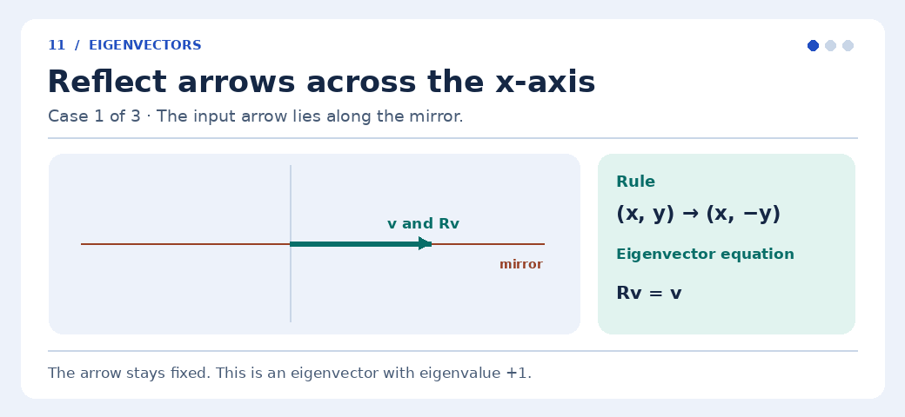

**Example A: Vector along the x-axis**

Take:

$$
\mathbf v=
\begin{pmatrix}1\\0\end{pmatrix}
$$

Apply the reflection matrix:

$$
A\mathbf v=
\begin{pmatrix}1&0\\0&-1\end{pmatrix}
\begin{pmatrix}1\\0\end{pmatrix}
$$

Multiply the matrices:

$$
=
\begin{pmatrix}
1(1)+0(0)\\
0(1)+(-1)(0)
\end{pmatrix}
=
\begin{pmatrix}1\\0\end{pmatrix}
$$

The vector has not changed at all.

Therefore:

$$
A\mathbf v=\mathbf v=1\mathbf v
$$

Comparing this with $A\mathbf v=\lambda\mathbf v$:

$$
\boxed{\lambda=+1}
$$

So:

- Eigenvector: $(1,0)^T$
- Eigenvalue: $+1$

The vector stays exactly the same.

**Example B: Vector along the y-axis**

Now take:

$$
\mathbf v=
\begin{pmatrix}0\\1\end{pmatrix}
$$

Apply the reflection matrix:

$$
A\mathbf v=
\begin{pmatrix}1&0\\0&-1\end{pmatrix}
\begin{pmatrix}0\\1\end{pmatrix}
$$

Multiply:

$$
=
\begin{pmatrix}
1(0)+0(1)\\
0(0)+(-1)(1)
\end{pmatrix}
=
\begin{pmatrix}0\\-1\end{pmatrix}
$$

Notice that:

$$
\begin{pmatrix}0\\-1\end{pmatrix}
=
-1
\begin{pmatrix}0\\1\end{pmatrix}
$$

Therefore:

$$
A\mathbf v=-1\mathbf v
$$

So:

- Eigenvector: $(0,1)^T$
- Eigenvalue: $-1$

The vector reverses direction, but remains on the same line (the $y$-axis).

**Example C: A general vector $(1,1)$**

Now take:

$$
\mathbf v=
\begin{pmatrix}1\\1\end{pmatrix}
$$

Apply the reflection:

$$
A\mathbf v=
\begin{pmatrix}1&0\\0&-1\end{pmatrix}
\begin{pmatrix}1\\1\end{pmatrix}
=
\begin{pmatrix}1\\-1\end{pmatrix}
$$

Can we write the result as a scalar multiplied by the original vector?

We would need:

$$
\begin{pmatrix}1\\-1\end{pmatrix}
=
\lambda
\begin{pmatrix}1\\1\end{pmatrix}
=
\begin{pmatrix}\lambda\\\lambda\end{pmatrix}
$$

The first coordinate requires $\lambda=1$, but the second requires $\lambda=-1$.

There is no single value of $\lambda$ that satisfies both.

Therefore, $(1,1)^T$ is **not** an eigenvector.

The vector changed its line of direction.

### 4. Compare all three examples

| Original vector | Reflected vector | Eigenvector? | Eigenvalue |
| --- | --- | --- | --- |
| $(1,0)$ | $(1,0)$ | Yes | $+1$ |
| $(0,1)$ | $(0,-1)$ | Yes | $-1$ |
| $(1,1)$ | $(1,-1)$ | No | None |

The important distinction:

- Eigenvalue $+1$: vector stays unchanged.
- Eigenvalue $-1$: vector reverses direction.
- No eigenvalue: the transformed vector is not a scalar multiple of the original.

### 5. Why are eigenvectors important in quantum computing?

Now let's connect this to the Pauli gates you have already studied.

In quantum computing, two important gates are:

- Pauli $Z$ gate
- Pauli $X$ gate

Both have eigenvalues $+1$ and $-1$, but their eigenvectors are different.

**A. Pauli Z gate**

The Pauli $Z$ matrix is:

$$
Z=
\begin{pmatrix}
1&0\\
0&-1
\end{pmatrix}
$$

Let's apply it to $|0\rangle$:

$$
Z|0\rangle=
\begin{pmatrix}1&0\\0&-1\end{pmatrix}
\begin{pmatrix}1\\0\end{pmatrix}
=
\begin{pmatrix}1\\0\end{pmatrix}
=|0\rangle
$$

Therefore:

$$
Z|0\rangle=+1|0\rangle
$$

So $|0\rangle$ is an eigenvector with eigenvalue $+1$.

Now apply it to $|1\rangle$:

$$
Z|1\rangle=
\begin{pmatrix}1&0\\0&-1\end{pmatrix}
\begin{pmatrix}0\\1\end{pmatrix}
=
\begin{pmatrix}0\\-1\end{pmatrix}
=-|1\rangle
$$

Therefore:

$$
Z|1\rangle=-1|1\rangle
$$

So $|1\rangle$ is an eigenvector with eigenvalue $-1$.

The computational basis is the eigenvector basis of the $Z$ gate.

**B. Pauli X gate**

The Pauli $X$ matrix is:

$$
X=
\begin{pmatrix}
0&1\\
1&0
\end{pmatrix}
$$

You already know that:

$$
|+\rangle=\frac{|0\rangle+|1\rangle}{\sqrt2}
=\frac1{\sqrt2}\begin{pmatrix}1\\1\end{pmatrix}
$$

Apply $X$:

$$
\begin{aligned}
X|+\rangle
&=\frac1{\sqrt2}
\begin{pmatrix}0&1\\1&0\end{pmatrix}
\begin{pmatrix}1\\1\end{pmatrix}\\
&=\frac1{\sqrt2}
\begin{pmatrix}1\\1\end{pmatrix}\\
&=|+\rangle
\end{aligned}
$$

Therefore:

$$
\boxed{X|+\rangle=+1|+\rangle}
$$

Now consider:

$$
|-\rangle=\frac{|0\rangle-|1\rangle}{\sqrt2}
=\frac1{\sqrt2}\begin{pmatrix}1\\-1\end{pmatrix}
$$

Apply $X$:

$$
\begin{aligned}
X|-\rangle
&=\frac1{\sqrt2}
\begin{pmatrix}0&1\\1&0\end{pmatrix}
\begin{pmatrix}1\\-1\end{pmatrix}\\
&=\frac1{\sqrt2}
\begin{pmatrix}-1\\1\end{pmatrix}\\
&=-\frac1{\sqrt2}
\begin{pmatrix}1\\-1\end{pmatrix}\\
&=-|-\rangle
\end{aligned}
$$

Therefore:

$$
\boxed{X|-\rangle=-1|-\rangle}
$$

The Hadamard basis is the eigenvector basis of the $X$ gate.

<iframe src="assets/22_pauli_eigen.html" title="Pauli Z and X eigenvectors" width="100%" height="340" loading="lazy" style="border:1px solid #dce3ef;border-radius:12px;max-width:100%;display:block;"></iframe>

### 6. How are eigenvectors connected to quantum measurement?

This is why your professor introduces eigenvalues and eigenvectors at this point in the quantum computing course.

Remember the two measurement bases we studied?

**Computational basis (Z basis):**

$$
\{|0\rangle,|1\rangle\}
$$

These are the eigenvectors of the Pauli $Z$ operator.

**Hadamard basis (X basis):**

$$
\{|+\rangle,|-\rangle\}
$$

These are the eigenvectors of the Pauli $X$ operator.

This gives us an important connection:

| Observable | Eigenvectors (measurement basis) | Eigenvalues |
| --- | --- | --- |
| Pauli $Z$ | $\lvert 0\rangle$, $\lvert 1\rangle$ | $+1$, $-1$ |
| Pauli $X$ | $\lvert +\rangle$, $\lvert -\rangle$ | $+1$, $-1$ |

When we measure a qubit using the $Z$ observable, the possible outcomes are its eigenvalues:

- $+1$, corresponding to $\lvert 0\rangle$.
- $-1$, corresponding to $\lvert 1\rangle$.

When we measure using the $X$ observable:

- $+1$, corresponding to $\lvert +\rangle$.
- $-1$, corresponding to $\lvert -\rangle$.

This is another way to understand why we have different measurement bases in quantum computing.

One subtle point: The eigenvalue is the measurement result for the observable, not necessarily the qubit's basis-state label. For example, measuring $Z$ and getting $+1$ means the state is $\lvert 0\rangle$, while measuring $X$ and getting $+1$ means the state is $\lvert +\rangle$.

### 7. Test your understanding

**Interactive quiz.** [Open in a full browser tab](assets/22_eigen_quiz.html) if the embed is cramped.

<iframe src="assets/22_eigen_quiz.html" title="Eigenvalues and eigenvectors quiz" width="100%" height="920" loading="lazy" style="border:1px solid #dce3ef;border-radius:12px;max-width:100%;display:block;"></iframe>

The one thing to remember from this lecture:

An eigenvector is a special vector whose direction line does not change when a matrix acts on it. The eigenvalue tells us how that vector changes in magnitude and sign.

In quantum computing, eigenvectors give us the possible states associated with a measurement basis, and eigenvalues give us the corresponding measurement outcomes.

## 23. Questions and assignment discussion

*Spoken discussion after the eigenvector introduction.*

### Can Bell correlations send a message?

For $\lvert\Phi^+\rangle$ each side's own computational-basis results are 50/50. Learning the first result tells you what to predict for the second, but the first observer cannot choose their random outcome. Comparing the two records requires ordinary communication.

### What happens to the other qubit for a product input?

For $u\otimes v$, if the first measurement returns $0$, the remaining factor is $v$ up to an overall phase. The same is true if the first measurement returns $1$. For example, starting from $\lvert+\rangle\otimes\lvert-\rangle$, either first-qubit outcome leaves the second qubit in $\lvert-\rangle$.

### How is phase kickback related to CNOT?

Since $X\lvert-\rangle=-\lvert-\rangle$, applying CNOT to $\lvert+\rangle\otimes\lvert-\rangle$ gives a minus sign to the control-$1$ term. The result is $\lvert-\rangle\otimes\lvert-\rangle$. Compare that product output with the entangled output in §18. The same gate behaves differently on different inputs.

### Where else do eigenvectors appear?

In principal component analysis (PCA), eigenvectors of a covariance matrix give directions along which to summarize variation in data.

### Why a square matrix in $Av=\lambda v$?

Both sides must be vectors in the same space. The matrix needs to send vectors back into their original space.

### Assignment question 4(b)

The transformation $S$ cycles $e_1\to e_2\to e_3\to e_1$. To form the matrix, put $Se_1$ in column 1, $Se_2$ in column 2 and $Se_3$ in column 3. Apply the cycle twice to get the columns of $S^2$. Three steps return every basis vector to itself.

$$
S=\begin{pmatrix}0&0&1\\1&0&0\\0&1&0\end{pmatrix},
\qquad
S^2=\begin{pmatrix}0&1&0\\0&0&1\\1&0&0\end{pmatrix},
\qquad S^3=I_3.
$$

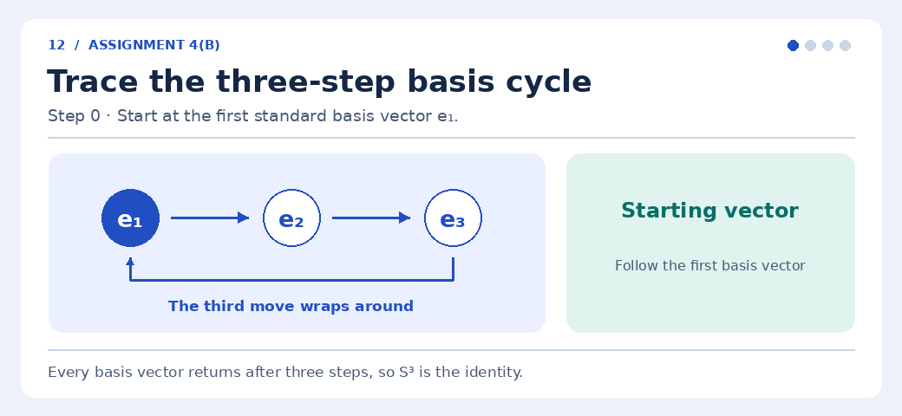

The professor also gives a separate example of the column rule. If $Te_1=e_2+e_3$, $Te_2=e_1+e_2+e_3$ and $Te_3=e_1$, the three columns of $T$ are $(0,1,1)^T$, $(1,1,1)^T$ and $(1,0,0)^T$, in that order.

The closing questions return to the same two ideas. The determinant criterion works in both directions, and the tensor-product basis is built from all pairs of basis vectors.

## 24. Closing remarks

The professor encourages students to try the exercises before the next lecture. The program team closes by congratulating him on his appointment as head of the Department of Computer Science and Engineering at IIT Delhi.

## Practice after the lecture

1. Expand $\lvert-\rangle\otimes\lvert+\rangle$ in the standard four-ket order. Does it factor?
2. Apply $X\otimes I$, $I\otimes X$ and CNOT separately to the same input $\lvert01\rangle$.
3. Is $(\lvert00\rangle-\lvert11\rangle)/\sqrt2$ a product state? What computational-basis strings can it produce?
4. In the state $(\lvert00\rangle+\lvert10\rangle+\lvert11\rangle)/\sqrt3$, measure the first qubit. What is the probability of $1$ and what is the resulting joint state for that outcome?
5. For reflection in the $x$-axis, compute the images of $(3,0)$, $(0,-2)$ and $(3,2)$. Which are eigenvectors?

### Answers

1. The column is $(1,1,-1,-1)^T/2$. It is a product by construction, and $ad-bc=0$.
2. The outputs are $\lvert11\rangle$, $\lvert00\rangle$ and $\lvert01\rangle$, respectively.
3. It is entangled because $ad-bc=-1/2$. It produces $00$ and $11$ with probability $1/2$ each.
4. The probability is $2/3$. The surviving, normalized state is $(\lvert10\rangle+\lvert11\rangle)/\sqrt2=\lvert1\rangle\otimes\lvert+\rangle$.
5. The images are $(3,0)$, $(0,2)$ and $(3,-2)$. The first is an eigenvector with eigenvalue $+1$, the second has eigenvalue $-1$, and the third changes line.

*Sources. The supplied corrected lecture sets the sequence. The original TXT provides a cross-check on the spoken discussion, and the PDF provides slide references, formulas and the worked partial-measurement example. The diagrams, animations and practice questions were redrawn or written for these notes.*
