# QC Foundations Part C

**Formalising the Pictures · QC Foundations [3/4]**

**Open the notes.** Keep the `assets` folder next to this file. Use [Study_Notes.html](Study_Notes.html) in a browser for the navigation sidebar.

**Notation card.**

| Symbol | Meaning in these notes |
| --- | --- |
| $\lvert\psi\rangle$ | A **ket**: a column of amplitudes describing a pure quantum state |
| $\langle\psi\rvert$ | A **bra**: the conjugate-transpose row paired with that ket |
| $\langle\varphi\vert\psi\rangle$ | **Inner product** — one complex number from row × column |
| $i$ | Imaginary unit, $i^2=-1$ |
| $*$ | Complex conjugate: $(a+ib)^*=a-ib$ |
| $\dagger$ | Conjugate transpose (transpose + conjugate each entry) |
| $T$ | Ordinary transpose (flip row/column without conjugating) |
| $\otimes$ | **Tensor product** — combine two vector spaces / two wires |
| $\oplus$ | **XOR** on bits: $0\oplus0=0$, $0\oplus1=1$, $1\oplus0=1$, $1\oplus1=0$ |
| $P_x=\lvert x\rangle\langle x\rvert$ | **Projector** onto basis ket $\lvert x\rangle$ |

In a two-qubit ket $\lvert xy\rangle$, the **left** digit is the **top** wire and the **right** digit is the **bottom** wire throughout.

## 1. Opening and recap of the coin puzzle

### Why this lecture starts with a coin

**Ordinary bits.** On a normal computer, a bit is always definitely $0$ or definitely $1$ before you read it. There is no “maybe” stored in the hardware.

**What this lecture is really about.** Later we will use *amplitudes* — numbers that can add or subtract like waves. When two contributions add, we call that **constructive interference**; when they cancel, **destructive interference**. That pattern is how some quantum algorithms reach the correct answer without trying every classical possibility one by one. You do not need the full machinery yet; the coin puzzle is where the story starts.

**Deutsch’s problem in one sentence.** Someone hides a one-input function $f$. You may only press input $0$ or input $1$. The function is promised to be one of two types:

- **Constant:** $f(0)$ and $f(1)$ are **the same** (both $0$, or both $1$).
- **Balanced:** $f(0)$ and $f(1)$ are **different** (one $0$ and one $1$).

Your job is to decide which type you have. The hidden box is called an **oracle** — one use of the box that evaluates $f$ for a chosen input.

**Classical vs quantum — compared slowly.**

| Question | Classical strategy (only definite $0$/$1$ readings) | Quantum strategy |
| --- | --- | --- |
| How many inputs exist? | Two: $0$ and $1$ | Same two inputs, but the input wire can be prepared in superposition first |
| What does one query tell you? | One **definite** output, e.g. $f(0)=0$ | Information is spread across amplitudes; you process before the final readout |
| Worst case to be **sure** of constant vs balanced | **Two** queries: you need both $f(0)$ and $f(1)$ when one answer still leaves two possibilities | **One** oracle call, then interference picks constant vs balanced |

Example of why classical needs two: if the first query gives $f(0)=0$, both “always 0” and “copy” still fit. You must query again.

The coin picture is not magic. It is a bookkeeping device: each face shows what the box outputs for one input.

### Plain-language idea

Imagine a sealed box with two buttons labelled $0$ and $1$. Pressing button $x$ lights up $f(x)$. You are promised the box is either **always the same output** (constant) or **always different outputs** (balanced for this 1-bit world).

| Box name | $f(0)$ | $f(1)$ | Type |
| --- | ---: | ---: | --- |
| Always 0 | 0 | 0 | Constant |
| Always 1 | 1 | 1 | Constant |
| Copy | 0 | 1 | Balanced |
| Flip | 1 | 0 | Balanced |

### Analogy

Think of a trick coin where **both** faces might show heads (constant 0), **both** tails (constant 1), or **one of each** (balanced). You are allowed to peek at **one** face at a time. After one peek at face $0$, two different trick coins can still match what you saw — you have not ruled out the alternative yet.

### Classical worst case — step by step

1. Query $f(0)$. Suppose the lamp shows $0$.
2. Among the four boxes in the table, both **Always 0** and **Copy** give $f(0)=0$.
3. To distinguish them with certainty you must also learn $f(1)$: for Always 0 it is $0$; for Copy it is $1$.
4. Therefore any classical procedure that is **always** correct needs **both** values in the worst case.

### Quantum idea (preview only)

Roughly: prepare both inputs at once on one wire (superposition), let the oracle stamp a **plus or minus sign** on each branch (phase kickback on a helper in $\lvert-\rangle$), then run a final gate so branches that mean “constant” add up and branches that mean “balanced” add up. Wrong guesses cancel instead of leaving you with two live classical hypotheses. The Deutsch algorithm section below works through each step.

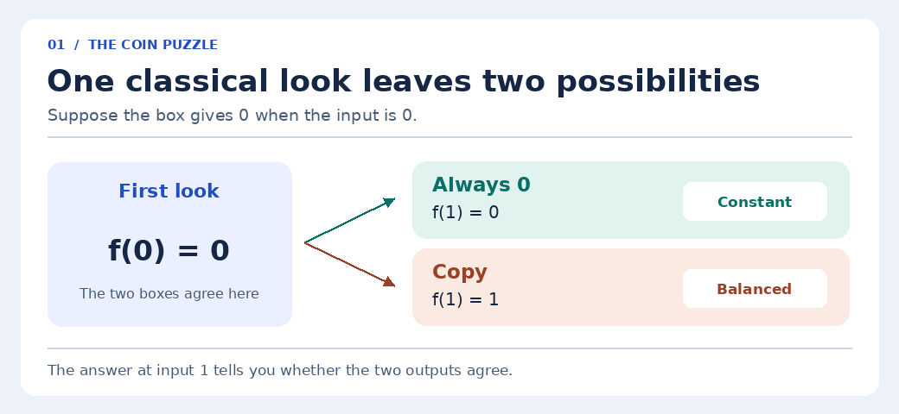

**Common confusion.** Balanced here means $f(0)\neq f(1)$ for this lecture's 1-bit promise — not "half the outputs are 1" (that is Deutsch–Jozsa).

## 2. From pictures to symbols

### Why symbols matter

Pictures help intuition, but circuits are built from **matrices** and **vectors** you can multiply. This lecture completes the dictionary started in earlier foundations: arrows become kets, shadows on a measurement axis become squared inner products, and gates become unitary matrices built from outer products.

### Analogy <!-- markdownlint-disable-line MD024 -->

Pictures are like maps; Dirac notation is like GPS coordinates. You can navigate with either, but coordinates let you **compose** trips (multiply gates) without redrawing the map every time.

## 3. Kets are column vectors

### Why kets

A qubit is not a definite $0$ or $1$ before measurement. It is described by **two complex amplitudes** in a fixed basis. The ket $\lvert\psi\rangle$ is a compact name for that column.

### Plain-language idea <!-- markdownlint-disable-line MD024 -->

**Ket** = "column holding amplitudes". The symbol inside the bracket is just a label ($\psi$, $0$, $+$, etc.).

### Computational basis

$$
\lvert0\rangle=\begin{pmatrix}1\\0\end{pmatrix},\qquad
\lvert1\rangle=\begin{pmatrix}0\\1\end{pmatrix},\qquad
\lvert\psi\rangle=\alpha\lvert0\rangle+\beta\lvert1\rangle
=\begin{pmatrix}\alpha\\\beta\end{pmatrix}.
$$

| Symbol | Role |
| --- | --- |
| $\alpha$ | Amplitude on $\lvert0\rangle$ |
| $\beta$ | Amplitude on $\lvert1\rangle$ |
| $\lvert\alpha\rvert^2+\lvert\beta\rvert^2=1$ | State has total probability 1 |

### Analogy <!-- markdownlint-disable-line MD024 -->

Think of two sliders (amplitudes) controlling how much of $\lvert0\rangle$ and $\lvert1\rangle$ are present. Classical bits would force one slider fully up and the other down; quantum allows both partially on, with the constraint that their **squared magnitudes** sum to 1.

### Other common kets (symbol table)

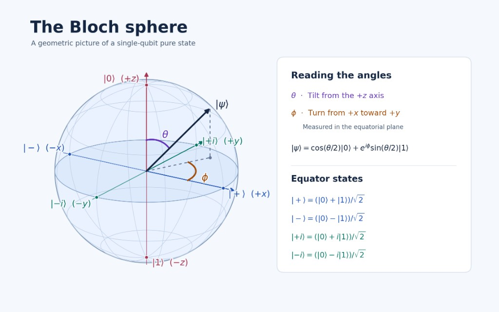

| Name | Ket formula | Column (as a pair) |
| --- | --- | --- |
| $\lvert+\rangle$ | $(\lvert0\rangle+\lvert1\rangle)/\sqrt2$ | $(1,1)^T/\sqrt2$ |
| $\lvert-\rangle$ | $(\lvert0\rangle-\lvert1\rangle)/\sqrt2$ | $(1,-1)^T/\sqrt2$ |
| $\lvert{+i}\rangle$ | $(\lvert0\rangle+i\lvert1\rangle)/\sqrt2$ | $(1,i)^T/\sqrt2$ |
| $\lvert{-i}\rangle$ | $(\lvert0\rangle-i\lvert1\rangle)/\sqrt2$ | $(1,-i)^T/\sqrt2$ |

The superscript $T$ means **transpose**: $(1,i)^T$ is a column with entries $1$ then $i$.

### Worked example — multiply by $i$

Start with $\lvert1\rangle=(0,1)^T$. Multiply the whole ket by $i$:

$$
i\lvert1\rangle=i\begin{pmatrix}0\\1\end{pmatrix}=\begin{pmatrix}0\\i\end{pmatrix}.
$$

Check normalization: $\lvert0\rvert^2+\lvert i\rvert^2=0+1=1$.

### Step-by-step — build $\lvert+\rangle$

1. Write $\lvert0\rangle+\lvert1\rangle$ as columns: $\binom11$.
2. Compute length: $\sqrt{1^2+1^2}=\sqrt2$.
3. Divide: $\lvert+\rangle=\frac1{\sqrt2}\binom11$.

### QC meaning (quantum computing)

Everything above is **bookkeeping for one qubit**. In a circuit, the same column is what software and simulators update when you apply a gate or read out a result.

**Gates — matrix times column.** A one-qubit gate is a $2\times2$ matrix $U$. Acting on a state $\lvert\psi\rangle=\binom{\alpha}{\beta}$ means ordinary multiplication on the right:

$$
\lvert\psi'\rangle = U\lvert\psi\rangle,
$$

so the **output is a new column** of amplitudes. Example: NOT gate $X$ swaps $\lvert0\rangle$ and $\lvert1\rangle$,

$$
X\lvert0\rangle=
\begin{pmatrix}0&1\\1&0\end{pmatrix}\begin{pmatrix}1\\0\end{pmatrix}
=\begin{pmatrix}0\\1\end{pmatrix}=\lvert1\rangle.
$$

The earlier drill $i\lvert1\rangle$ is the same pattern with a **scalar** instead of a full matrix: every entry of the column is multiplied by $i$.

**Measurement — Born rule, not another gate matrix.** A gate **replaces** amplitudes by a linear map. Measurement **asks for probabilities** in a chosen basis: for basis kets $\lvert x\rangle$, compute $a_x=\langle x\vert\psi\rangle$, then

$$
\Pr(x)=\big\lvert a_x\big\rvert^2.
$$

You do not “multiply the column” by a measurement matrix in the same reversible way; you use inner products and squares.

**Common confusion.**

| Question | Answer |
| --- | --- |
| Amplitudes look complex — is that wrong? | No. $\alpha$ and $\beta$ can be complex numbers. |
| What enters probabilities? | **Squared magnitudes** $\big\lvert\alpha\big\rvert^2$, $\big\lvert\beta\big\rvert^2$ — always real and $\ge 0$. |
| Whole state times $e^{i\gamma}$? | **Global phase**: $e^{i\gamma}\lvert\psi\rangle$ has the **same** measurement statistics as $\lvert\psi\rangle$, because $\big\lvert e^{i\gamma}\big\rvert=1$. Only **relative** phase between $\lvert0\rangle$ and $\lvert1\rangle$ terms affects which outcomes are likely in bases other than $Z$. |

## 4. Bras and the conjugate transpose

### Why bras

Inner products need a **row** paired with the column. The bra $\langle\psi\rvert$ is that row, built with conjugation so lengths and probabilities stay real and nonnegative.

### Plain-language idea <!-- markdownlint-disable-line MD024 -->

**Bra** = "row partner to a ket". You create it by (1) transpose the column to a row, (2) conjugate each entry. Together: **conjugate transpose**, written $\dagger$.

### Formula

$$
\langle\psi\rvert=\lvert\psi\rangle^\dagger=(\alpha^*,\beta^*).
$$

For $\lvert{+i}\rangle=\frac1{\sqrt2}\binom1i$,

$$
\langle{+i}\rvert=\frac1{\sqrt2}(1,-i).
$$

Note the $i$ in the ket became $-i$ in the bra.

### Symbol table

| Object | Shape | Example |
| --- | --- | --- |
| $\lvert\psi\rangle$ | $2\times1$ column | $(\alpha,\beta)^T$ |
| $\langle\psi\rvert$ | $1\times2$ row | $(\alpha^*,\beta^*)$ |
| $*$ | conjugate one number | $(3+4i)^*=3-4i$ |
| $\dagger$ | conjugate transpose | reverses order in products |

### Worked example — from ket to bra

Let $\lvert\psi\rangle=\binom{2}{1-i}$.

1. Transpose: row $(2,\ 1-i)$.
2. Conjugate entries: $(2,\ 1+i)$.
3. So $\langle\psi\rvert=(2,\ 1+i)$.

### Analogy <!-- markdownlint-disable-line MD024 -->

If the ket is a question vector, the bra is the matching "answer sheet" row that scores how much of each basis direction is present — with complex conjugation so the score behaves like a length squared.

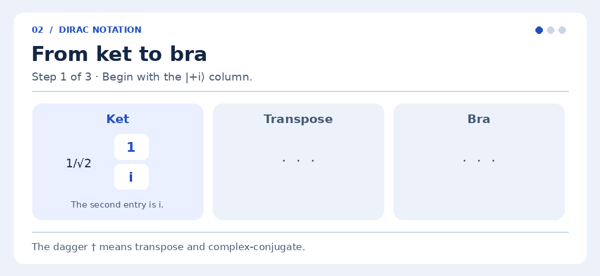

**Common confusion.** For **real** amplitudes, conjugation does nothing — beginners often skip $\dagger$ too early and break orthogonality checks.

## 5. The bracket, inner products and orthonormality

### Why the bracket

The expression $\langle\varphi\vert\psi\rangle$ is a single number measuring **overlap**. Squared magnitude becomes probability. Zero overlap means orthogonal directions.

### Formula <!-- markdownlint-disable-line MD024 -->

$$
\langle\varphi\vert\psi\rangle=\varphi_0^*\psi_0+\varphi_1^*\psi_1.
$$

### Worked example — $\langle0\vert1\rangle$

1. $\langle0\vert=(1,0)$, $\lvert1\rangle=\binom01$.
2. Product: $1\cdot0+0\cdot1=0$.
3. States are **orthogonal**.

### Worked example — $\langle+\vert-\rangle$

1. $\langle+\vert=\frac1{\sqrt2}(1,1)$.
2. $\lvert-\rangle=\frac1{\sqrt2}\binom{1}{-1}$.
3. Sum: $\frac12[1\cdot1+1\cdot(-1)]=\frac12(1-1)=0$.

### $\langle+\vert{+i}\rangle$ (slide discussion)

1. $\lvert{+i}\rangle=\frac1{\sqrt2}\binom1i$.
2. $\langle+\vert=\frac1{\sqrt2}(1,1)$.
3. Inner product: $\frac12(1\cdot1+1\cdot i)=\frac{1+i}2$.
4. Squared magnitude: $\big\lvert\frac{1+i}2\big\rvert^2=\frac{1^2+1^2}{4}=\frac12$.

So measuring $\lvert{+i}\rangle$ in the $+/-$ basis gives $+$ with probability $1/2$.

### Orthonormality vocabulary

| Term | Meaning |
| --- | --- |
| Normalized | $\langle\psi\vert\psi\rangle=1$ |
| Orthogonal | $\langle\varphi\vert\psi\rangle=0$ |
| Orthonormal set | Each normalized, each pair orthogonal |

**QC meaning.** Measurement bases are orthonormal. Gate columns that form an orthonormal set are unitary.

## 6. The Born rule and measurement

### Why do we need the Born rule?

In classical computing, a bit is always definitely $0$ or definitely $1$ before you read it.

A qubit can be in a **superposition** before measurement. That means its description involves more than one classical outcome at once.

A simple superposition is

$$
\lvert\psi\rangle=\frac1{\sqrt2}\lvert0\rangle+\frac1{\sqrt2}\lvert1\rangle.
$$

The numbers that multiply $\lvert0\rangle$ and $\lvert1\rangle$ are called **probability amplitudes**. Here they are both $1/\sqrt2$.

When you measure, you still get only one classical outcome: $0$ or $1$.

Quantum mechanics does not predict which single outcome you will see on one trial. It predicts **probabilities** for each outcome.

The **Born rule** is the formula that turns amplitudes into those probabilities.

| Before measurement | After you apply the Born rule |
| --- | --- |
| Amplitudes (can be complex) | Probabilities (real numbers between $0$ and $1$) |
| Superposition can interfere | One definite readout per measurement |
| State can change with gates | Histogram over many trials matches $P(x)$ |

---

### What the Born rule says

Fix an orthonormal measurement basis, for example $\{\lvert0\rangle,\lvert1\rangle\}$ for $Z$-basis measurement.

The rule has three ideas:

1. **Amplitude** — overlap with the outcome you are asking about.
2. **Probability** — squared magnitude of that amplitude.
3. **Collapse** — after a readout, the state becomes the corresponding basis ket.

#### Amplitudes as projections

For an outcome label $x$, define the **probability amplitude**

$$
a_x=\langle x\vert\psi\rangle.
$$

- $\lvert\psi\rangle$ is the state before measurement.
- $\langle x\vert$ is the bra for outcome $x$.
- $a_x$ is a complex number (unless the state is chosen real).

**Classical analogy.** A plane vector $\vec a=(3,4)$ starts at the origin and ends at $(3,4)$. Drop a perpendicular from the tip of $\vec a$ to the $x$-axis. The signed length along the axis is the **$x$-component** of $\vec a$.

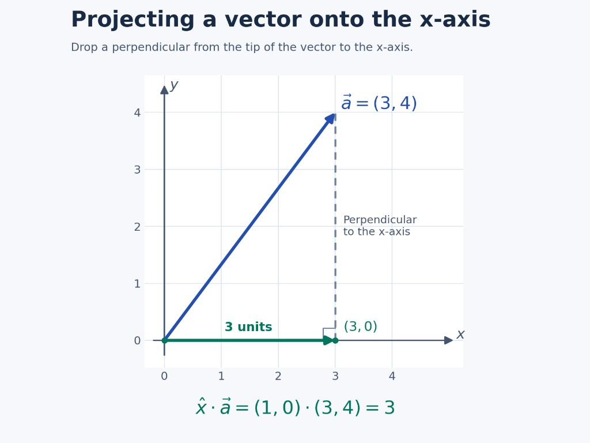

**What $\hat x$ means.** The symbol $\hat x$ (read “$x$-hat”) is the **unit vector** along the positive $x$-axis:

- it points in the $x$ direction only;
- its length is $1$;
- in component form, $\hat x=(1,0)$.

The hat marks a **direction with fixed length**, not an arbitrary vector like $\vec a$.

The $x$-component of $\vec a=(3,4)$ is the dot product with $\hat x$:

$$
\hat x\cdot\vec a=(1,0)\cdot(3,4)=1\cdot3+0\cdot4=3.
$$

That number $3$ is the **projection coefficient** along the $x$ direction—the same idea as “how much of $\vec a$ lies on the $x$-axis.”

**Quantum version.** The inner product $\langle x\vert\psi\rangle$ plays the same role: $a_x$ is the **projection** of $\lvert\psi\rangle$ onto $\lvert x\rangle$. The bra $\langle x\vert$ picks out the component along $\lvert x\rangle$, just as $\hat x$ picks out the component along the classical $x$-axis.

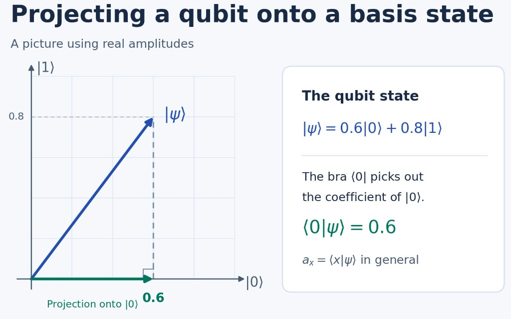

The diagram uses **real** amplitudes so the picture looks like ordinary lengths on the $\lvert0\rangle$ and $\lvert1\rangle$ axes. In general, $a_x=\langle x\vert\psi\rangle$ can still be complex.

**How the bra selects one entry.** The bra $\langle0\vert$ is the row vector $\begin{pmatrix}1&0\end{pmatrix}$. When you multiply it by the qubit’s column vector, the $1$ keeps the first entry and the $0$ removes the second entry.

Take the state from the diagram:

$$
\lvert\psi\rangle=0.6\lvert0\rangle+0.8\lvert1\rangle
=\begin{pmatrix}0.6\\0.8\end{pmatrix}.
$$

The first entry is the coefficient of $\lvert0\rangle$. The second is the coefficient of $\lvert1\rangle$.

Now multiply:

$$
\langle0\vert\psi\rangle
=\begin{pmatrix}1&0\end{pmatrix}
\begin{pmatrix}0.6\\0.8\end{pmatrix}
=(1)(0.6)+(0)(0.8)
=\boxed{0.6}.
$$

So $\langle0\vert\psi\rangle$ is exactly the amplitude $a_0$ on $\lvert0\rangle$—the quantum analogue of projecting onto the $\lvert0\rangle$ direction.

In the computational basis,

$$
a_0=\langle0\vert\psi\rangle,\qquad a_1=\langle1\vert\psi\rangle.
$$

You can expand the state on its measurement directions:

$$
\lvert\psi\rangle=a_0\lvert0\rangle+a_1\lvert1\rangle.
$$

#### Probabilities from amplitudes

The **measurement probability** for outcome $x$ is

$$
P(x)=\big\lvert a_x\big\rvert^2.
$$

Equivalently,

$$
P(x)=\big\lvert\langle x\vert\psi\rangle\big\rvert^2.
$$

If $a_x$ is complex, take the absolute value before squaring.

When you measure a qubit in the $\lvert0\rangle,\lvert1\rangle$ basis, the result is either $0$ or $1$. To find the probability of either outcome: pick out its amplitude, take its magnitude, then square it.

##### Step 1 — pick the outcome you want

Here, $x$ is the outcome you are asking about. For the probability of getting $0$, use $x=0$.

Take the state from the projection diagram:

$$
\lvert\psi\rangle=0.6\lvert0\rangle+0.8\lvert1\rangle.
$$

##### Step 2 — find the amplitude of that outcome

The bra $\langle0\vert$ picks out the number multiplying $\lvert0\rangle$:

$$
a_0=\langle0\vert\psi\rangle=0.6.
$$

So $a_0$ and $\langle0\vert\psi\rangle$ are two names for the same amplitude.

##### Step 3 — turn the amplitude into a probability

Take the magnitude of $0.6$, then square it:

$$
P(0)=\big\lvert a_0\big\rvert^2=\lvert0.6\rvert^2=0.6\times0.6=0.36=36\%.
$$

Do the same for outcome $1$:

$$
P(1)=\big\lvert a_1\big\rvert^2=\lvert0.8\rvert^2=0.8\times0.8=0.64=64\%.
$$

If you prepare and measure this same state many times, you expect about $36\%$ zeros and $64\%$ ones. The probabilities add to $100\%$:

$$
P(0)+P(1)=0.36+0.64=1.
$$

##### What if the amplitude is complex?

Suppose the coefficient of $\lvert1\rangle$ is $0.8i$ instead of $0.8$:

$$
\lvert\psi\rangle=0.6\lvert0\rangle+0.8i\lvert1\rangle.
$$

A complex number’s **magnitude** is its distance from zero in the complex plane. The number $0.8i$ sits $0.8$ units up the imaginary axis, so

$$
a_1=0.8i,\qquad \lvert a_1\rvert=0.8,\qquad P(1)=0.8^2=0.64.
$$

The probability for outcome $1$ is unchanged, because only the magnitude enters the Born rule.

In general, for $a_x=u+iv$,

$$
\lvert a_x\rvert=\sqrt{u^2+v^2},\qquad P(x)=\lvert a_x\rvert^2=u^2+v^2.
$$

That is what the bars in $P(x)=\big\lvert\langle x\vert\psi\rangle\big\rvert^2$ instruct you to compute before squaring.

#### State collapse

One measurement yields one outcome.

If you read $0$, the post-measurement state is $\lvert0\rangle$ (up to an unobservable global phase). If you read $1$, the state is $\lvert1\rangle$.

---

### Worked example — measure in the $Z$ basis

We use one state throughout: closer to $\lvert0\rangle$ than to $\lvert1\rangle$ on the Bloch sphere.

$$
\lvert\psi\rangle=\frac{\sqrt3}{2}\lvert0\rangle+\frac12\lvert1\rangle.
$$

#### Write the state as a column vector

$$
\lvert0\rangle=\begin{pmatrix}1\\0\end{pmatrix},\qquad
\lvert1\rangle=\begin{pmatrix}0\\1\end{pmatrix}.
$$

Substitute and add:

$$
\lvert\psi\rangle=
\frac{\sqrt3}{2}\begin{pmatrix}1\\0\end{pmatrix}
+\frac12\begin{pmatrix}0\\1\end{pmatrix}
=\begin{pmatrix}\sqrt3/2\\[4pt]1/2\end{pmatrix}.
$$

When the state is already written in the $Z$ basis, the column entries **are** the amplitudes:

- **Top entry** $\sqrt3/2$ → amplitude for outcome $0$.
- **Bottom entry** $1/2$ → amplitude for outcome $1$.

The same numbers appear as $a_0$ and $a_1$ below.

#### Visual summary (Bloch sphere and Born rule)

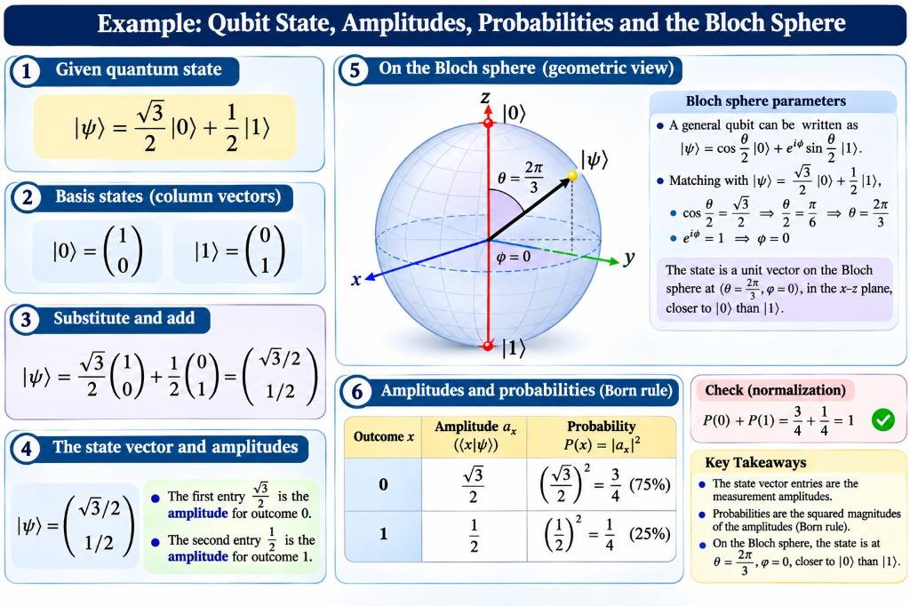

How the pieces connect:

- **Column** — stores amplitudes in the computational basis.
- **Amplitudes** — $\sqrt3/2$ and $1/2$ (not probabilities).
- **Probabilities** — $\lvert\sqrt3/2\rvert^2=3/4$ and $\lvert1/2\rvert^2=1/4$.
- **Bloch point** — tilt $\theta=2\pi/3$ from $\lvert0\rangle$ with $\phi=0$: the state lies in the $x$–$z$ plane, nearer the north pole.

#### Step 1: Calculate the amplitudes

Using inner products (bra on the left, ket on the right):

$$
a_0=\langle0\vert\psi\rangle=\frac{\sqrt3}{2}.
$$

$$
a_1=\langle1\vert\psi\rangle=\frac12.
$$

These are **amplitudes**. They are not probabilities.

For outcome $0$, the amplitude is $\sqrt3/2$, which is about $0.866$. It is **not** $3/2$ and it is **not** $3/4$.

#### Step 2: Calculate the probabilities

Apply the Born rule to each amplitude separately.

$$
P(0)=\big\lvert a_0\big\rvert^2
=\left\lvert\frac{\sqrt3}{2}\right\rvert^2
=\frac34.
$$

$$
P(1)=\big\lvert a_1\big\rvert^2
=\left\lvert\frac12\right\rvert^2
=\frac14.
$$

In percentages: $75\%$ for outcome $0$, $25\%$ for outcome $1$.

#### Step 3: Verify normalization

Possible outcomes must add to total probability $1$:

$$
P(0)+P(1)=\frac34+\frac14=1.
$$

| Outcome | Amplitude $a_x$ | Probability $P(x)=\lvert a_x\rvert^2$ |
| --- | ---: | ---: |
| $0$ | $\sqrt3/2$ | $3/4$ |
| $1$ | $1/2$ | $1/4$ |

---

### Many measurements vs one shot

Prepare many qubits, each in $\lvert\psi\rangle=\frac{\sqrt3}{2}\lvert0\rangle+\frac12\lvert1\rangle$. Measure each once in the $Z$ basis.

- Expect about $75\%$ of readouts to be $0$.
- Expect about $25\%$ of readouts to be $1$.

Those are **statistical** predictions. Any single qubit still returns only $0$ or $1$.

---

### Second example — $\lvert{+i}\rangle$

This state has equal $Z$-basis probabilities but a complex amplitude on $\lvert1\rangle$.

$$
\lvert{+i}\rangle=\frac1{\sqrt2}\lvert0\rangle+\frac{i}{\sqrt2}\lvert1\rangle.
$$

Amplitudes:

$$
a_0=\frac1{\sqrt2},\qquad a_1=\frac{i}{\sqrt2}.
$$

Probabilities:

$$
P(0)=\left\lvert\frac1{\sqrt2}\right\rvert^2=\frac12,
$$

$$
P(1)=\left\lvert\frac{i}{\sqrt2}\right\rvert^2=\frac12,
$$

because $\lvert i\rvert=1$.

---

### Measuring twice in the same basis

Suppose $\lvert\psi\rangle=\frac{\sqrt3}{2}\lvert0\rangle+\frac12\lvert1\rangle$ and the first $Z$ measurement gives $0$.

The state collapses to $\lvert0\rangle$.

A second immediate $Z$ measurement gives

$$
P(0)=\big\lvert\langle0\vert0\rangle\big\rvert^2=1.
$$

The repeat readout is $0$ with certainty. The same logic applies if the first outcome was $1$.

---

### Quick reference

| Term | Meaning |
| --- | --- |
| Amplitude $a_x$ | Complex overlap $\langle x\vert\psi\rangle$ |
| Probability $P(x)$ | $\lvert a_x\rvert^2$ |
| Measurement | One classical outcome; state collapses to $\lvert x\rangle$ |
| Born rule | $P(x)=\lvert\langle x\vert\psi\rangle\rvert^2$ |

**Interactive check.** [Open quiz in a tab](assets/born_rule_quiz.html).

<!-- markdownlint-disable MD033 -->

<iframe src="assets/born_rule_quiz.html" title="Born rule quiz" width="100%" height="380" loading="lazy" style="border:1px solid #dce3ef;border-radius:12px;max-width:100%;display:block;"></iframe>

<!-- markdownlint-enable MD033 -->

## 7. Measurement in any orthonormal basis

You take the **same** starting qubit state and ask what happens when you measure it in **different ways**.

A **$Z$** measurement reports how large the $\lvert0\rangle$ and $\lvert1\rangle$ amplitudes are. You square each amplitude separately to get a probability.

An **$X$** measurement **combines** those amplitudes first—they can **add or cancel**—before you square. That interference can reveal a **sign** difference that a $Z$ readout alone does not show.

The Born rule is the same in every basis: choose a bra, compute an amplitude, square its magnitude.

### What are we doing?

Imagine preparing many qubits in the lecture state, **one at a time**:

$$
\lvert\psi\rangle=\frac{\sqrt3}{2}\lvert0\rangle+\frac12\lvert1\rangle.
$$

Measure one batch in **$Z$** and another batch in **$X$**. Each qubit gives **one** outcome. Over many runs you compare the histograms:

| Measurement you choose | What you do with the amplitudes | Expected results |
| --- | --- | --- |
| $Z$ | Take each amplitude separately; square its magnitude | $0$ about $75\%$, $1$ about $25\%$ |
| $X$ | For $+$: add amplitudes; for $-$: subtract; divide by $\sqrt2$; square the magnitude | $+$ about $93.3\%$, $-$ about $6.7\%$ |

Same prepared state. Different measurement apparatus. Different outcome statistics.

### Why are we doing it?

**$Z$ is the computational (“bit”) basis.** It answers: “How much $\lvert0\rangle$ vs $\lvert1\rangle$ is in the state?” For $\lvert\psi\rangle$ above, the $\lvert0\rangle$ amplitude is larger, so outcome $0$ is more likely.

**$X$ is the “equal mix, opposite sign” basis.** It answers a different question: do the $\lvert0\rangle$ and $\lvert1\rangle$ amplitudes **add** or **subtract** before you form a probability? For our lecture state both $Z$ amplitudes are positive, so they reinforce for $+$ and partially cancel for $-$.

Later you will see states that look **identical** in $Z$ (always $50$–$50$) but differ in $X$. Changing basis does not change the qubit’s state—it changes **which property** you choose to read out.

| Measurement | Possible outcomes | Amplitudes you calculate |
| --- | --- | --- |
| $Z$ basis | $0$ or $1$ | $\langle0\vert\psi\rangle$, $\langle1\vert\psi\rangle$ |
| $X$ basis | $+$ or $-$ | $\langle+\vert\psi\rangle$, $\langle-\vert\psi\rangle$ |
| $Y$ basis | $+i$ or $-i$ | $\langle{+i}\vert\psi\rangle$, $\langle{-i}\vert\psi\rangle$ |

On the Bloch sphere, $Z$, $X$, and $Y$ are three perpendicular measurement axes. All use $P(x)=\lvert a_x\rvert^2$.

---

### Same rule, new direction to project onto

Think of the classical projection picture from the Born-rule section.

If you change the axis you project onto, you get a **different coefficient** for the same arrow.

Here, the bra tells you which direction to project onto. The Born rule turns that projection coefficient into a probability by squaring its magnitude.

---

### What the $X$ basis is asking

The two $X$-basis kets are

$$
\lvert+\rangle=\frac{\lvert0\rangle+\lvert1\rangle}{\sqrt2},
\qquad
\lvert-\rangle=\frac{\lvert0\rangle-\lvert1\rangle}{\sqrt2}.
$$

Both contain equal weight on $\lvert0\rangle$ and $\lvert1\rangle$. The **sign** between them is what differs.

- $\lvert+\rangle$ **adds** the two amplitudes.
- $\lvert-\rangle$ **subtracts** them.

---

### Lecture state — $Z$ numbers first

Our running example is

$$
\lvert\psi\rangle=
\underbrace{\frac{\sqrt3}{2}}_{\approx 0.866}\lvert0\rangle
+\underbrace{\frac12}_{0.500}\lvert1\rangle.
$$

In the **$Z$ basis**, $\langle0\vert$ picks out $\sqrt3/2$ and $\langle1\vert$ picks out $1/2$.

Squaring gives $P(0)=3/4$ and $P(1)=1/4$.

---

### Lecture state — $X$ amplitudes

In the **$X$ basis**, $\langle+\vert$ is the row $(1/\sqrt2,\,1/\sqrt2)$: both entries positive.

$$
\langle+\vert\psi\rangle
=
\begin{pmatrix}\frac1{\sqrt2}&\frac1{\sqrt2}\end{pmatrix}
\begin{pmatrix}\frac{\sqrt3}{2}\\[4pt]\frac12\end{pmatrix}
=\frac{\frac{\sqrt3}{2}+\frac12}{\sqrt2}
=\frac{\sqrt3+1}{2\sqrt2}\approx 0.966.
$$

For $\langle-\vert$, the second entry is negative:

$$
\langle-\vert\psi\rangle
=
\begin{pmatrix}\frac1{\sqrt2}&-\frac1{\sqrt2}\end{pmatrix}
\begin{pmatrix}\frac{\sqrt3}{2}\\[4pt]\frac12\end{pmatrix}
=\frac{\frac{\sqrt3}{2}-\frac12}{\sqrt2}
=\frac{\sqrt3-1}{2\sqrt2}\approx 0.259.
$$

#### Square the $X$ amplitudes

$$
P(+) = \lvert a_+\rvert^2
=\left(\frac{\sqrt3+1}{2\sqrt2}\right)^2
=\frac{2+\sqrt3}{4}\approx 93.3\%.
$$

$$
P(-) = \lvert a_-\rvert^2
=\left(\frac{\sqrt3-1}{2\sqrt2}\right)^2
=\frac{2-\sqrt3}{4}\approx 6.7\%.
$$

| $X$-basis outcome | What happens to the amplitudes | Probability |
| --- | --- | ---: |
| $+$ | $0.866$ and $0.500$ **add** before dividing by $\sqrt2$ | $\approx 93.3\%$ |
| $-$ | $0.500$ partly **cancels** $0.866$ before dividing by $\sqrt2$ | $\approx 6.7\%$ |

That addition and cancellation is **interference**. Both $Z$ amplitudes are positive, so they reinforce for $+$ and partly cancel for $-$.

---

### Why bother with another basis?

Look at $\lvert+\rangle$ and $\lvert-\rangle$.

In a **$Z$** measurement, both give $50\%$ for $0$ and $50\%$ for $1$. Squaring the $Z$ amplitudes alone cannot tell the states apart—the sign between $\lvert0\rangle$ and $\lvert1\rangle$ is invisible in $Z$.

An **$X$** measurement makes that sign difference visible:

- $\lvert+\rangle$ gives outcome $+$ with probability $1$.
- $\lvert-\rangle$ gives outcome $-$ with probability $1$.

| Prepared state | $P(0)$ ($Z$) | $P(+)$ ($X$) |
| --- | ---: | ---: |
| $\lvert+\rangle$ | $1/2$ | $1$ |
| $\lvert-\rangle$ | $1/2$ | $0$ |
| $\lvert{+i}\rangle$ | $1/2$ | $1/2$ |

The row for $\lvert{+i}\rangle$ is the **$Y$** story in compact form. The state $(\lvert0\rangle+i\lvert1\rangle)/\sqrt2$ is $50$–$50$ in both $Z$ and $X$, but in the $Y$ basis it **is** one of the basis kets, so a $Y$ measurement gives outcome $+i$ with certainty.

**Fresh preparation vs collapse.** The table assumes you prepare the original state again for each run.

If you measure $Z$ first and get $0$, then measure $X$ on **the same** qubit, you start from $\lvert0\rangle$. Then $P(+)=P(-)=1/2$.

---

### Circuit trick — measure $X$ using $H$ and $Z$

Apply $H$, then measure in $Z$.

$H$ sends $\lvert+\rangle\to\lvert0\rangle$ and $\lvert-\rangle\to\lvert1\rangle$, so the bit readout tells which $X$ outcome would have occurred.

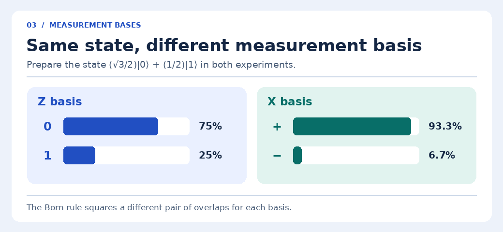

## 8. Global phase versus relative phase

### Why distinguish them

Complex amplitudes can carry **overall** factors that never change readout statistics, versus **differences** between amplitudes that change which outcomes are likely or certain.

### Plain-language definitions

| Kind | What changes | See in probabilities? |
| --- | --- | --- |
| Global phase | Multiply **every** amplitude by the same $e^{i\gamma}$ | No |
| Relative phase | Change **one** amplitude's phase compared to another | Yes |

### Global phase — full proof

For any outcome ket $\lvert x\rangle$,

$$
\big\lvert\langle x\vert(e^{i\gamma}\lvert\psi\rangle)\big\rvert^2
=\lvert e^{i\gamma}\rvert^2\cdot\big\lvert\langle x\vert\psi\rangle\big\rvert^2
=1\cdot\big\lvert\langle x\vert\psi\rangle\big\rvert^2.
$$

Because $\lvert e^{i\gamma}\rvert=1$.

### Relative phase example

$\lvert+\rangle=(\lvert0\rangle+\lvert1\rangle)/\sqrt2$ and $\lvert-\rangle=(\lvert0\rangle-\lvert1\rangle)/\sqrt2$ share $Z$-basis probabilities $1/2,1/2$, but an $X$-basis measurement gives $+$ with certainty for the first and $-$ with certainty for the second.

Similarly $-\lvert+\rangle$ is the same physical state as $\lvert+\rangle$ (global sign $-1=e^{i\pi}$).

### Analogy <!-- markdownlint-disable-line MD024 -->

Global phase is like turning the entire room's lights from red to orange filter — shadows on the wall do not move. Relative phase is like changing **one** lamp's timing so two waves meet in or out of step — interference moves.

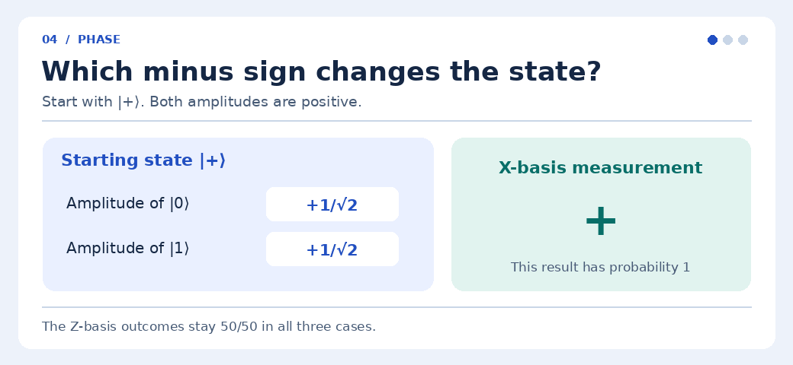

---

## 9. Bloch parametrisation and class questions

### Why the Bloch sphere

Two complex amplitudes have four real numbers, but normalization and global phase remove two — leaving two angles for a **pure** qubit on a sphere.

### Step-by-step reduction

1. Write $\alpha=r_0e^{i\gamma_0}$, $\beta=r_1e^{i\gamma_1}$.
2. Normalization: $r_0^2+r_1^2=1$.
3. Multiply the whole state by $e^{-i\gamma_0}$ so $\alpha$ is real nonnegative when $r_0>0$. The leftover phase on $\beta$ is $\phi=\gamma_1-\gamma_0$ **relative** phase.
4. Set $r_0=\cos(\theta/2)$, $r_1=\sin(\theta/2)$ for polar angle $\theta\in[0,\pi]$.

$$
\lvert\psi\rangle=\cos(\theta/2)\lvert0\rangle+e^{i\phi}\sin(\theta/2)\lvert1\rangle.
$$

### Why $\theta/2$

Moving from north pole $\lvert0\rangle$ to south $\lvert1\rangle$ is $180^\circ$ on the sphere, but the sine/cosine arguments run $0$ to $\pi/2$ — hence half-angle.

Bloch height (population difference): $z=\cos^2(\theta/2)-\sin^2(\theta/2)=\cos\theta$.

### Pole and equator kets

| Location | Ket | $(\theta,\phi)$ |
| --- | --- | --- |
| North / south ($Z$) | $\lvert0\rangle$, $\lvert1\rangle$ | $0$, $\pi$ |
| $X$ axis ends | $\lvert+\rangle$, $\lvert-\rangle$ | $\pi/2$; $\phi=0,\pi$ |
| $Y$ axis ends | $\lvert{+i}\rangle$, $\lvert{-i}\rangle$ | $\pi/2$; $\phi=\pi/2,3\pi/2$ |

### Polarization analogy (class)

Horizontal / vertical amplitudes correspond to linear polarization; equal magnitude with $\pm i$ relative phase models opposite circular polarizations under a fixed convention.

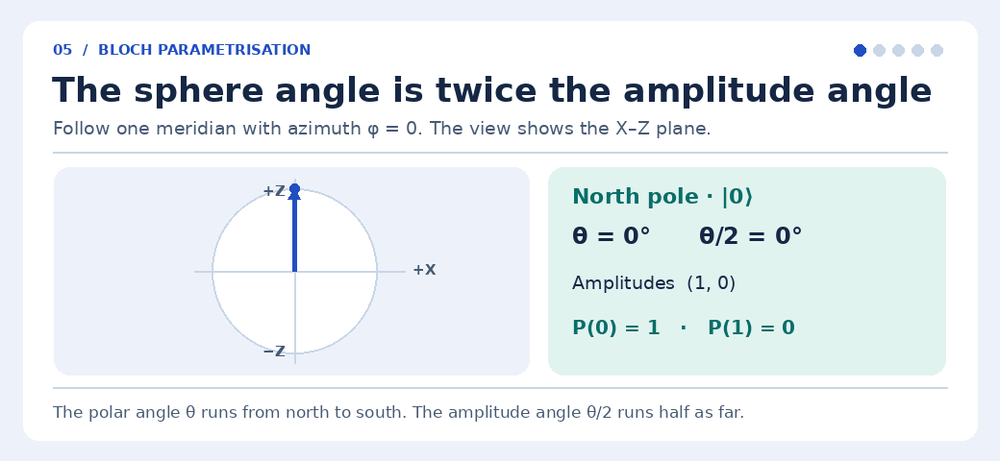

**Common confusion.** At the north pole, changing $\phi$ multiplies by a global phase — the point on the sphere is unchanged.

---

## 10. Poll on whether the $\pm i$ states are orthogonal

### Question

Are $\lvert{+i}\rangle$ and $\lvert{-i}\rangle$ orthogonal?

### Step-by-step inner product

$\lvert{+i}\rangle=\frac1{\sqrt2}\binom1i$, $\lvert{-i}\rangle=\frac1{\sqrt2}\binom1{-i}$.

1. $\langle{+i}\vert=\frac1{\sqrt2}(1,-i)$.
2. $\langle{+i}\vert{-i}\rangle=\frac12[1\cdot1+(-i)(-i)]$.
3. Compute $(-i)(-i)=i^2=-1$.
4. Sum: $\frac12(1-1)=0$.

### Wrong path (no conjugation)

Plain transpose gives $(-i)$ unchanged in the bra slot, product $i\cdot(-i)=1$, inner product $1$ — **incorrect**.

---

## 11. Outer products are operators

### Why outer products

Gates are matrices. The outer product $\lvert u\rangle\langle v\rvert$ is the simplest $2\times2$ building block: "read amplitude along $\lvert v\rangle$, write it along $\lvert u\rangle$."

### Dimensions

| Product | Shapes | Result |
| --- | --- | --- |
| $\langle\psi\vert\varphi\rangle$ | $(1\times2)(2\times1)$ | $1\times1$ scalar |
| $\lvert u\rangle\langle v\rvert$ | $(2\times1)(1\times2)$ | $2\times2$ matrix |

### Worked construction — $\lvert1\rangle\langle0\rvert$

$$
\lvert1\rangle\langle0\rvert
=\begin{pmatrix}0\\1\end{pmatrix}\begin{pmatrix}1&0\end{pmatrix}
=\begin{pmatrix}0\cdot1&0\cdot0\\1\cdot1&1\cdot0\end{pmatrix}
=\begin{pmatrix}0&0\\1&0\end{pmatrix}.
$$

### Action rule

$$
(\lvert u\rangle\langle v\rvert)\lvert w\rangle
=\lvert u\rangle\,\langle v\vert w\rangle.
$$

On $\lvert\psi\rangle=\alpha\lvert0\rangle+\beta\lvert1\rangle$, $\lvert1\rangle\langle0\rvert$ gives $\alpha\lvert1\rangle$ — an $X$-like move of amplitude.

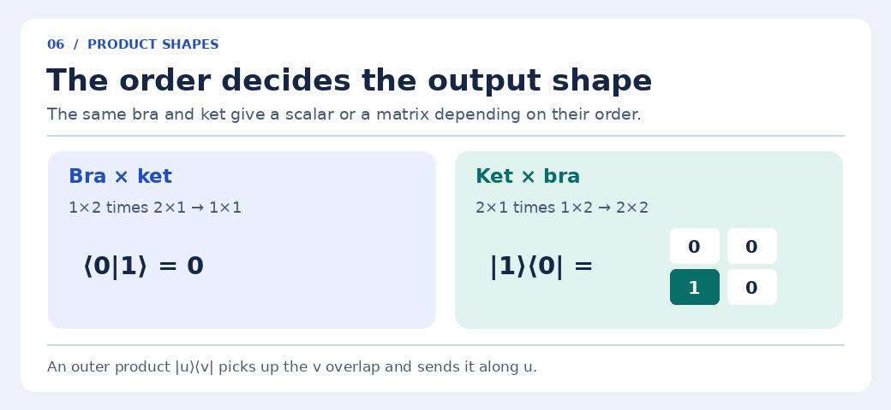

---

## 12. Completeness and projectors

### Projector $P_x=\lvert x\rangle\langle x\rvert$

Keeps the $\lvert x\rangle$ component:

$P_0\lvert\psi\rangle=\alpha\lvert0\rangle$, $P_1\lvert\psi\rangle=\beta\lvert1\rangle$ for $\lvert\psi\rangle=\alpha\lvert0\rangle+\beta\lvert1\rangle$.

### Idempotence

Applying twice does not change again: $P_x^2=P_x$.

### Resolution of the identity

$$
P_0+P_1=I=\lvert+\rangle\langle+\rvert+\lvert-\rangle\langle-\rvert.
$$

Geometrically: decompose a vector into two orthogonal directions and add the pieces.

### Probability from projector

$$
P(x)=\langle\psi\rvert P_x\lvert\psi\rangle=\lVert P_x\lvert\psi\rangle\rVert^2.
$$

After outcome $x$, renormalize $P_x\lvert\psi\rangle/\lVert P_x\lvert\psi\rangle\rVert$.

---

## 13. Gates as outer products

### Column picture → sum of outer products

If $U\lvert j\rangle=\lvert v_j\rangle$, then $U=\sum_j\lvert v_j\rangle\langle j\rvert$.

| Gate | On $\lvert0\rangle,\lvert1\rangle$ | Dirac form |
| --- | --- | --- |
| $X$ | swap | $\lvert1\rangle\langle0\rvert+\lvert0\rangle\langle1\rvert$ |
| $Z$ | $\lvert0\rangle$ fixed, $\lvert1\rangle\mapsto-\lvert1\rangle$ | $\lvert0\rangle\langle0\rvert-\lvert1\rangle\langle1\rvert$ |
| $H$ | $\lvert0\rangle\to\lvert+\rangle$, $\lvert1\rangle\to\lvert-\rangle$ | $\lvert+\rangle\langle0\rvert+\lvert-\rangle\langle1\rvert$ |

$$
X=\begin{pmatrix}0&1\\1&0\end{pmatrix},\quad
Z=\begin{pmatrix}1&0\\0&-1\end{pmatrix},\quad
H=\tfrac1{\sqrt2}\begin{pmatrix}1&1\\1&-1\end{pmatrix}.
$$

---

## 14. Checking $X$, $Z$ and $H$ with Dirac algebra

### $X\lvert0\rangle$

$\lvert1\rangle\langle0\vert0\rangle=\lvert1\rangle\cdot1$; $\lvert0\rangle\langle1\vert0\rangle=0$ → output $\lvert1\rangle$.

### $Z\lvert+\rangle$

$Z$ fixes $\lvert0\rangle$ amplitude, negates $\lvert1\rangle$ amplitude in $\lvert+\rangle=(\lvert0\rangle+\lvert1\rangle)/\sqrt2$ → $(\lvert0\rangle-\lvert1\rangle)/\sqrt2=\lvert-\rangle$.

### $H\lvert+\rangle$ (interference preview)

$H\lvert+\rangle=\frac1{\sqrt2}H(\lvert0\rangle+\lvert1\rangle)=\frac1{\sqrt2}(\lvert0\rangle+\lvert0\rangle- \lvert1\rangle+\lvert1\rangle)$ after using $H\lvert0\rangle=(\lvert0\rangle+\lvert1\rangle)/\sqrt2$, $H\lvert1\rangle=(\lvert0\rangle-\lvert1\rangle)/\sqrt2$.

Collect $\lvert1\rangle$ terms: $(1-1)/\sqrt2=0$. Collect $\lvert0\rangle$ terms: $2/\sqrt2=\sqrt2$ times unit — net $\lvert0\rangle$.

Similarly $H\lvert-\rangle=\lvert1\rangle$.

**QC meaning.** This is the same algebra pattern as Deutsch's final Hadamard.

---

## 15. Unitarity and reversible gates

### Definition

$U$ is **unitary** when $U^\dagger U=UU^\dagger=I$. Inverse is $U^\dagger$.

### Inner products preserved

For states $\lvert\varphi\rangle,\lvert\psi\rangle$,

$$
\langle U\varphi\vert U\psi\rangle=\langle\varphi\vert U^\dagger U\psi\rangle=\langle\varphi\vert\psi\rangle.
$$

### $H$ quick check

Columns $\lvert+\rangle,\lvert-\rangle$ are orthonormal ⇒ $H^\dagger H=I$. Also $H^\dagger=H$, so $H^2=I$.

**Contrast.** Projectors are not invertible; measurement is not a unitary gate.

---

## 16. Eigenvectors and eigenvalues of gates

### Definition <!-- markdownlint-disable-line MD024 -->

$U\lvert v\rangle=\lambda\lvert v\rangle$, $\lambda$ scalar **eigenvalue**.

| Gate | $+1$ eigenket | $-1$ eigenket |
| --- | --- | --- |
| $Z$ | $\lvert0\rangle$ | $\lvert1\rangle$ |
| $X$ | $\lvert+\rangle$ | $\lvert-\rangle$ |

Example: $X\lvert-\rangle=\frac1{\sqrt2}(\lvert1\rangle-\lvert0\rangle)=-\lvert-\rangle$.

On Bloch sphere, eigenkets sit on the rotation axis endpoints.

**QC meaning.** Phase kickback applies $-1$ eigenaction of $X$ to the helper when $f(x)=1$.

---

## 17. Proving $HZH=X$

### Strategy

Conjugate $Z$ by $H$: change basis from $Z$ eigenkets to $X$ eigenkets.

$$
\begin{aligned}
HZH
&=H(\lvert0\rangle\langle0\rvert-\lvert1\rangle\langle1\rvert)H\\
&=\lvert+\rangle\langle+\rvert-\lvert-\rangle\langle-\rvert\\
&=X.
\end{aligned}
$$

### Why $\langle0\rvert H=\langle+\rvert$

$\langle0\rvert H=(H\lvert0\rangle)^\dagger=\langle+\rvert$ using $H^\dagger=H$.

### Numeric spot-check

$H\lvert0\rangle=\lvert+\rangle$, apply $Z$: $\lvert+\rangle\mapsto\lvert-\rangle$, apply $H$: $\lvert-\rangle\mapsto\lvert1\rangle=X\lvert0\rangle$.

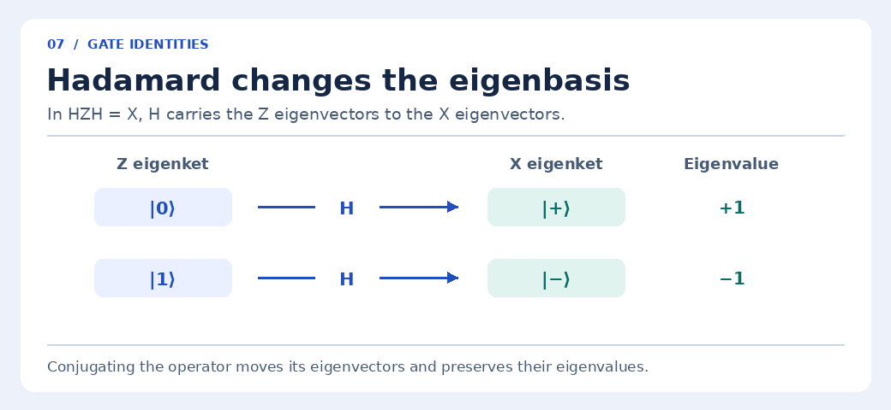

---

## 18. Poll, break and the identity $HXH=Z$

### Poll answer $Z$

Same algebra with $X=\lvert+\rangle\langle+\rvert-\lvert-\rangle\langle-\rvert$:

$HXH=\lvert0\rangle\langle0\rvert-\lvert1\rangle\langle1\rvert=Z$.

### Ket chain on $\lvert1\rangle$

$\lvert1\rangle\xrightarrow H\lvert-\rangle\xrightarrow X-\lvert-\rangle\xrightarrow H-\lvert1\rangle=Z\lvert1\rangle$.

## 19. Tensor products describe two qubits

### Why $\otimes$

One Bloch sphere = one qubit. Two qubits need $2\times2=4$ basis directions. The tensor product **multiplies dimensions** and pairs every basis ket on wire A with every basis ket on wire B.

### Notation

$\lvert00\rangle$ means $\lvert0\rangle\otimes\lvert0\rangle$ — left digit = top wire, right digit = bottom wire.

### Recipe for columns

For $u=(a,b)^T$, $v=(c,d)^T$,

$$
u\otimes v=\begin{pmatrix}ac\\ad\\bc\\bd\end{pmatrix}.
$$

Each entry of $u$ scales the **entire** column $v$; stack blocks top to bottom.

### Derive $\lvert0\rangle\otimes\lvert0\rangle=\lvert00\rangle$ — every multiplication

$\lvert0\rangle=\binom10$, $\lvert0\rangle=\binom10$.

$$
\begin{pmatrix}1\\0\end{pmatrix}\otimes\begin{pmatrix}1\\0\end{pmatrix}
=\begin{pmatrix}
1\cdot1\\1\cdot0\\0\cdot1\\0\cdot0
\end{pmatrix}
=\begin{pmatrix}1\\0\\0\\0\end{pmatrix}=\lvert00\rangle.
$$

### Derive $\lvert0\rangle\otimes\lvert1\rangle=\lvert01\rangle$

$\lvert1\rangle=\binom01$.

$$
\begin{pmatrix}1\\0\end{pmatrix}\otimes\begin{pmatrix}0\\1\end{pmatrix}
=\begin{pmatrix}
1\cdot0\\1\cdot1\\0\cdot0\\0\cdot1
\end{pmatrix}
=\begin{pmatrix}0\\1\\0\\0\end{pmatrix}=\lvert01\rangle.
$$

### Symbol table <!-- markdownlint-disable-line MD024 -->

| Object | Size | Example |
| --- | ---: | --- |
| One-qubit column | 2 | $(\alpha,\beta)^T$ |
| Two-qubit column | 4 | $(a_{00},a_{01},a_{10},a_{11})^T$ |
| $n$ qubits | $2^n$ | exponential growth |

Some joint states **cannot** factor into one ket per wire — entanglement.

**Interactive demos.**

<!-- markdownlint-disable MD033 -->

<iframe src="assets/tensor_product_steps.html" title="Tensor product step by step" width="100%" height="420" loading="lazy" style="border:1px solid #dce3ef;border-radius:12px;max-width:100%;display:block;"></iframe>

<!-- markdownlint-enable MD033 -->

<!-- markdownlint-disable MD033 -->

<iframe src="assets/four_basis_kets.html" title="Four basis kets" width="100%" height="380" loading="lazy" style="border:1px solid #dce3ef;border-radius:12px;max-width:100%;display:block;"></iframe>

<!-- markdownlint-enable MD033 -->

### Analogy <!-- markdownlint-disable-line MD024 -->

Tensor product = **pair every setting** on device A with every setting on device B, not "list A's settings then B's settings" (that would be stacking, dimension $2+2=4$ wrongly for independent systems).

---

## 20. Gates on wires and the Kronecker rule

### Which wire?

In $A\otimes B$, $A$ acts on the **top** (left ket digit), $B$ on the **bottom** (right digit). Identity $I$ means "no gate on this wire."

### On product kets

$$
(A\otimes B)(\lvert a\rangle\otimes\lvert b\rangle)
=(A\lvert a\rangle)\otimes(B\lvert b\rangle).
$$

### Block matrix form

$$
A\otimes B=\begin{pmatrix}a_{00}B&a_{01}B\\a_{10}B&a_{11}B\end{pmatrix}.
$$

Example: $X\otimes I$ swaps top bit only:

$X\otimes I=\begin{pmatrix}0&I\\I&0\end{pmatrix}$ with $2\times2$ blocks.

### Superposition example — $(H\otimes I)\lvert00\rangle$

1. $\lvert00\rangle=\lvert0\rangle\otimes\lvert0\rangle$.
2. $H\lvert0\rangle=(\lvert0\rangle+\lvert1\rangle)/\sqrt2$.
3. Product: $\frac1{\sqrt2}(\lvert0\rangle+\lvert1\rangle)\otimes\lvert0\rangle=\frac{\lvert00\rangle+\lvert10\rangle}{\sqrt2}$.

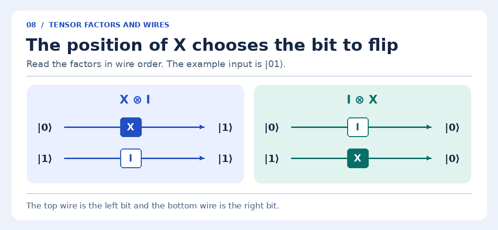

**Common confusion.** $X\otimes I$ and $I\otimes X$ are different $4\times4$ matrices — never swap wire order silently.

---

## 21. CNOT built from tensor products

### Classical rule

CNOT: control $x$, target $y$, output $(x,\ y\oplus x)$ with top wire controlling bottom in the default diagram.

$$
\operatorname{CNOT}\lvert xy\rangle=\lvert x,\ y\oplus x\rangle.
$$

### Projector sum

$$
\operatorname{CNOT}_{\text{top}\to\text{bottom}}
=P_0\otimes I+P_1\otimes X
$$

- If control $0$: $P_0$ survives, target untouched.
- If control $1$: $P_1$ survives, apply $X$ on target.

### Matrix (basis order $\lvert00\rangle,\lvert01\rangle,\lvert10\rangle,\lvert11\rangle$)

$$
\begin{pmatrix}
1&0&0&0\\0&1&0&0\\0&0&0&1\\0&0&1&0
\end{pmatrix}.
$$

### Walkthrough $\lvert10\rangle\to\lvert11\rangle$

Only $P_1\otimes X$ acts: $\lvert1\rangle$ on control, $X$ flips target $0\to1$.

### Bottom control variant

$CNOT_{\text{bottom}\to\text{top}}=I\otimes P_0+X\otimes P_1$ — swaps $\lvert01\rangle$ with $\lvert11\rangle$.

| Input | Top controls | Bottom controls |
| --- | --- | --- |
| $\lvert00\rangle$ | $\lvert00\rangle$ | $\lvert00\rangle$ |
| $\lvert01\rangle$ | $\lvert01\rangle$ | $\lvert11\rangle$ |
| $\lvert10\rangle$ | $\lvert11\rangle$ | $\lvert10\rangle$ |
| $\lvert11\rangle$ | $\lvert10\rangle$ | $\lvert01\rangle$ |

---

## 22. The tensor-product recipe for $n$ qubits

### Recipe

One factor per wire in top-to-bottom order. On control wires use $P_0$ or $P_1$; on targets $I$ or $X$; idle wires $I$. Add control-0 and control-1 terms.

### Four-wire example ($q_3,q_2,q_1,q_0$ top to bottom)

Control $q_0$ (bottom), target $q_3$ (top):

$$
\operatorname{CNOT}(q_0,q_3)
=I\otimes I\otimes I\otimes P_0
+X\otimes I\otimes I\otimes P_1.
$$

Effect: when rightmost bit is $1$, flip leftmost bit — e.g. $\lvert0001\rangle\leftrightarrow\lvert1001\rangle$.

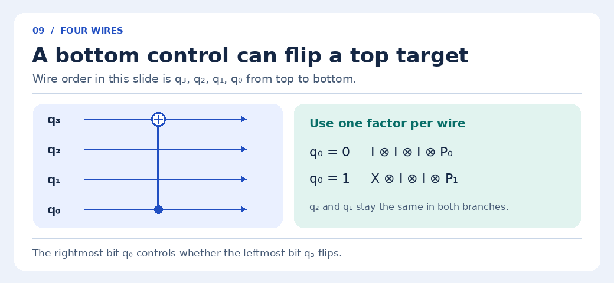

**Sparsity.** $16\times16$ matrix but only $16$ nonzero entries (one per input) — permutations are cheap to store.

---

## 23. Deriving the Bell state

### Circuit

$\lvert00\rangle\xrightarrow{H\otimes I}\frac{\lvert00\rangle+\lvert10\rangle}{\sqrt2}\xrightarrow{\mathrm{CNOT}}\frac{\lvert00\rangle+\lvert11\rangle}{\sqrt2}=\lvert\Phi^+\rangle$.

### Line-by-line CNOT on superposition

Input $\frac1{\sqrt2}(\lvert00\rangle+\lvert10\rangle)$.

- Branch $\lvert00\rangle$: control $0$ → unchanged $\lvert00\rangle$.
- Branch $\lvert10\rangle$: control $1$ → target flips → $\lvert11\rangle$.

Output $\frac1{\sqrt2}(\lvert00\rangle+\lvert11\rangle)$.

### Table of outputs from computational inputs

| Input | After $H\otimes I$ then CNOT |
| --- | --- |
| $\lvert00\rangle$ | $\lvert\Phi^+\rangle$ |
| $\lvert01\rangle$ | $\lvert\Psi^+\rangle$ |
| $\lvert10\rangle$ | $\lvert\Phi^-\rangle$ |
| $\lvert11\rangle$ | $\lvert\Psi^-\rangle$ |

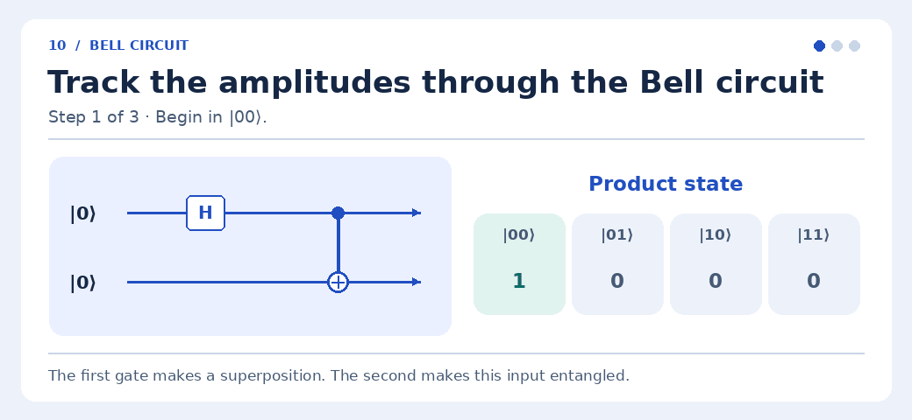

---

## 24. Product states and entanglement

### Definitions

- **Product:** $\lvert\psi\rangle=u\otimes v$ for single-qubit kets $u,v$.
- **Entangled:** pure joint state that is **not** a product.

### Amplitude table

$$
M=\begin{pmatrix}c_{00}&c_{01}\\c_{10}&c_{11}\end{pmatrix}.
$$

Product $(a,b)^T\otimes(c,d)^T$ has rows $a(c,d)$ and $b(c,d)$ → determinant $ac\cdot bd-ad\cdot bc=0$.

### $\lvert\Phi^+\rangle$

Amplitudes $1/\sqrt2$ on $\lvert00\rangle,\lvert11\rangle$ only. Determinant $-(1/\sqrt2)^2=-1/2\neq0$ → not product.

### Equal superposition counterexample

$(\lvert00\rangle+\lvert01\rangle+\lvert10\rangle+\lvert11\rangle)/2$ has determinant $0$ → $\lvert+\rangle\otimes\lvert+\rangle$.

---

## 25. Measuring one qubit of a Bell pair

### Partial measurement on $\lvert\Phi^+\rangle$

$P_0\otimes I$ picks branch $\lvert00\rangle/\sqrt2$, probability $1/2$; $P_1\otimes I$ picks $\lvert11\rangle/\sqrt2$, probability $1/2$.

After outcome $0$ on first qubit, joint state $\lvert00\rangle$ — second qubit certainly $0$.

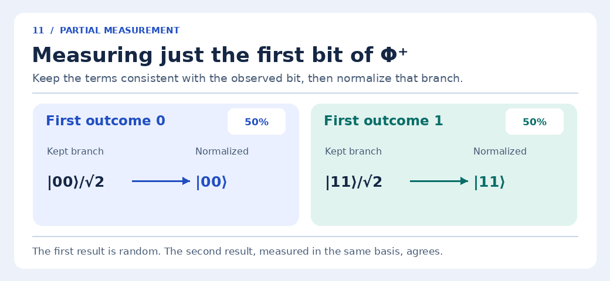

### Story

Each party sees random bits alone; correlations appear only comparing records.

---

## 26. Quantum oracles $U_f$

### Definition <!-- markdownlint-disable-line MD024 -->

$$
U_f\lvert x\rangle\lvert y\rangle=\lvert x\rangle\lvert y\oplus f(x)\rangle.
$$

### Reversibility

Apply $U_f$ twice → XOR with $f(x)$ twice → original $y$. So $U_f^2=I$.

### Four boxes (1-bit)

| Box | Oracle structure |
| --- | --- |
| Always 0 | $I\otimes I$ |
| Always 1 | $I\otimes X$ |
| Copy | $P_0\otimes I+P_1\otimes X$ (= CNOT) |
| Flip | $P_0\otimes X+P_1\otimes I$ |

### Try flip on $\lvert00\rangle$, $\lvert10\rangle$

$f(0)=1$, $f(1)=0$.

- $U_f\lvert00\rangle=\lvert01\rangle$ (helper flips).
- $U_f\lvert10\rangle=\lvert10\rangle$ (helper unchanged).

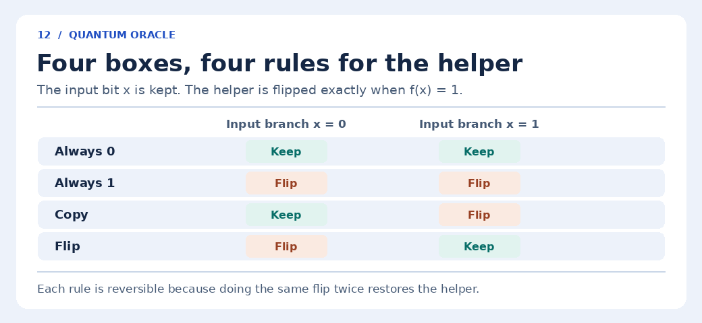

---

## 27. The phase-kickback lemma

### Why $\lvert-\rangle$ on the helper

$\lvert-\rangle$ is the $-1$ eigenstate of $X$:

$X\lvert-\rangle=-\lvert-\rangle$, while $X\lvert+\rangle=\lvert+\rangle$.

### Statement

With helper in $\lvert-\rangle$,

$$
U_f\big(\lvert x\rangle\lvert-\rangle\big)
=(-1)^{f(x)}\lvert x\rangle\lvert-\rangle.
$$

### Proof sketch (fixed $x$)

- If $f(x)=0$, helper unchanged → factor $+1$.
- If $f(x)=1$, helper gets $X$ → sign $-1$.

Helper ket factors out unchanged.

### Superposition on input

$$
U_f\big(\lvert+\rangle\lvert-\rangle\big)
=\frac{(-1)^{f(0)}\lvert0\rangle+(-1)^{f(1)}\lvert1\rangle}{\sqrt2}\otimes\lvert-\rangle.
$$

Copy function: signs $(+1,-1)$ → input becomes $\lvert-\rangle$ while helper still $\lvert-\rangle$.

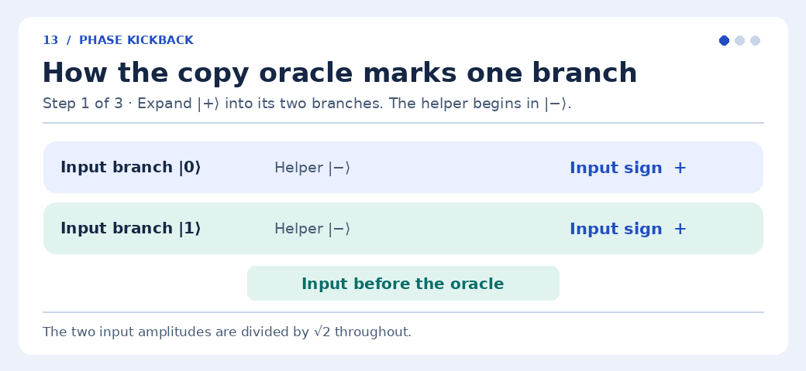

### Common confusion

Minus on **one branch** = relative phase (observable after interference). Same minus on **both** branches = global phase (drops out).

---

## 28. Deutsch's algorithm, line by line

### Goal

One query to learn constant vs balanced.

### Preparation

Top: input $0$. Bottom: helper $1$, or apply $X$ to $\lvert00\rangle$.

| Step | Gate | State |
| --- | --- | --- |
| Start | — | $\lvert0\rangle\lvert1\rangle$ |
| Spread | $H\otimes H$ | $\lvert+\rangle\lvert-\rangle$ |
| Oracle | $U_f$ once | $(s_0\lvert0\rangle+s_1\lvert1\rangle)\lvert-\rangle/\sqrt2$ |
| Interfere | $H\otimes I$ | $[(s_0+s_1)\lvert0\rangle+(s_0-s_1)\lvert1\rangle]\lvert-\rangle/2$ |
| Read | measure top in $Z$ | $0$ constant, $1$ balanced |

$s_k=(-1)^{f(k)}$.

### Derive row 4 from row 3 — no skipped algebra

Let $\lvert\psi_3\rangle=(s_0\lvert0\rangle+s_1\lvert1\rangle)\lvert-\rangle/\sqrt2$.

Apply $H$ to top qubit using linearity:

$$
\frac{\lvert-\rangle}{\sqrt2}\Big[s_0 H\lvert0\rangle+s_1 H\lvert1\rangle\Big].
$$

Substitute $H\lvert0\rangle=\frac{\lvert0\rangle+\lvert1\rangle}{\sqrt2}$, $H\lvert1\rangle=\frac{\lvert0\rangle-\lvert1\rangle}{\sqrt2}$:

$$
\frac{\lvert-\rangle}{2}\Big[s_0(\lvert0\rangle+\lvert1\rangle)+s_1(\lvert0\rangle-\lvert1\rangle)\Big]
=\frac{\lvert-\rangle}{2}\Big[(s_0+s_1)\lvert0\rangle+(s_0-s_1)\lvert1\rangle\Big].
$$

Helper unchanged as $\lvert-\rangle$ factor.

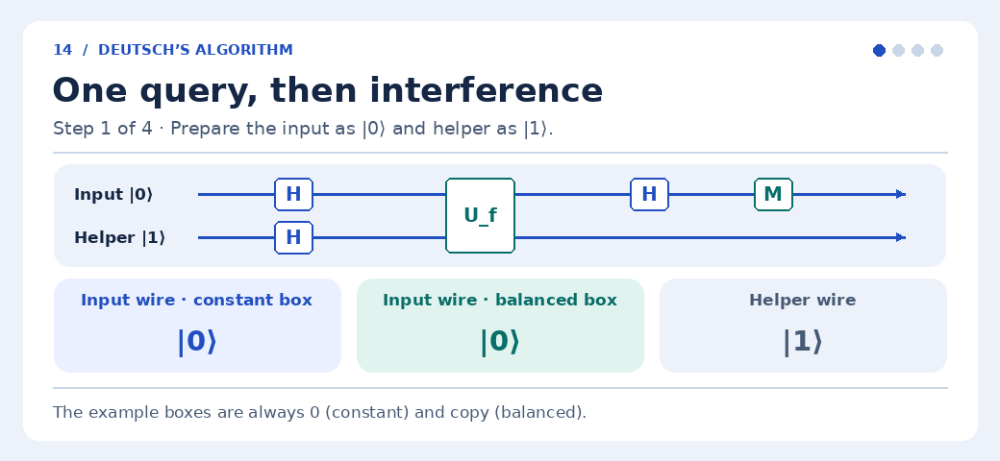

---

## 29. Constant versus balanced and interference

### Sign cases

| Type | $(s_0,s_1)$ | $s_0+s_1$ | $s_0-s_1$ | Top ket after $H$ | Bit |
| --- | --- | --- | --- | --- | ---: |
| Always 0 | $(+1,+1)$ | $2$ | $0$ | $\lvert0\rangle$ | 0 |
| Always 1 | $(-1,-1)$ | $-2$ | $0$ | $-\lvert0\rangle$ | 0 |
| Copy | $(+1,-1)$ | $0$ | $2$ | $\lvert1\rangle$ | 1 |
| Flip | $(-1,+1)$ | $0$ | $-2$ | $-\lvert1\rangle$ | 1 |

Global minus on overall state does not flip measured bit.

### Interference vocabulary

- **Constructive:** same-sign amplitudes meet at an output.
- **Destructive:** opposite contributions cancel.

Always square **total amplitude** at an outcome, not amplitudes individually.

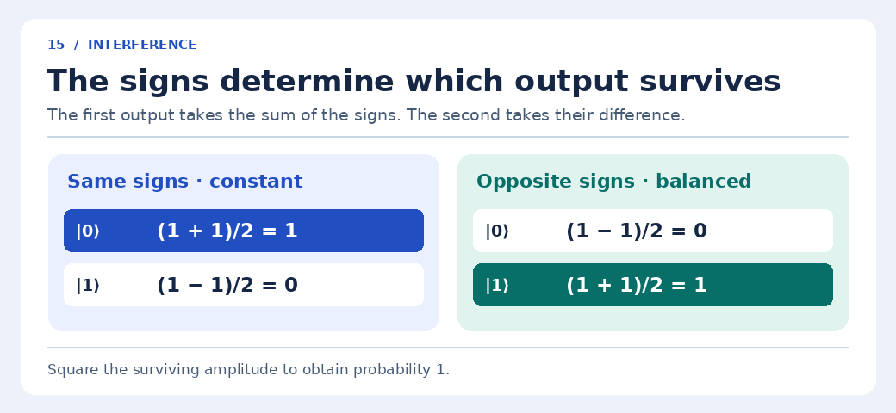

---

## 30. The Deutsch–Jozsa generalisation

### Promise

$f:\{0,1\}^n\to\{0,1\}$ is either **constant** or **balanced** (exactly half outputs $1$).

### Algorithm skeleton

1. $H^{\otimes n}$ on inputs → uniform superposition of all $x$.
2. Helper in $\lvert-\rangle$.
3. One $U_f$ → each branch picks sign $(-1)^{f(x)}$.
4. $H^{\otimes n}$ again.
5. Measure: all-zero string ⇔ constant.

### Amplitude on $\lvert0\rangle^{\otimes n}$

$$
\operatorname{amp}(0^n)=\frac{1}{2^n}\sum_{x}(-1)^{f(x)}.
$$

- Constant $f$: all signs equal → magnitude $1$.
- Balanced: half $+1$, half $-1$ → exact cancellation → amplitude $0$.

### Small example $n=2$, $f(x_1x_2)=x_1$

Signs on $00,01,10,11$: $+,-,-,+$ → state $\lvert-\rangle\otimes\lvert+\rangle$ on input after kickback; final Hadamards give $\lvert10\rangle$.

---

## 31. The completed picture-to-symbol dictionary

| Picture | Symbol / calculation |
| --- | --- |
| Arrow on Bloch sphere | $\alpha\lvert0\rangle+\beta\lvert1\rangle$ |
| Shadow on measurement axis | $\big\lvert\langle x\vert\psi\rangle\big\rvert^2$ |
| Reversible gate | $U^\dagger U=I$ |
| Ends of $X$ axis | $X\lvert\pm\rangle=\pm\lvert\pm\rangle$ |
| Two wires | $\otimes$ |
| Entangled pair | Joint state not a product |
| Helper sign | $(-1)^{f(x)}$ |
| Arrows add / cancel | $s_0\pm s_1$ |

---

## 32. Next lecture, class questions and closing remarks

### Closing themes

- Determinant test for product vs entangled states.
- Minus sign in kickback: branch-selective (relative) vs shared (global).
- Degree of entanglement can vary among non-product states — factoring test is only **yes/no product**.

---

## Practice with worked answers

Attempt each with kets before matrices.

### 1. Pauli $Y$ in Dirac form

Columns $(0,i)^T$ and $(-i,0)^T$ ⇒ $Y=i\lvert1\rangle\langle0\rvert-i\lvert0\rangle\langle1\rvert$.

Check $Y\lvert{+i}\rangle$: eigenvalue $+1$. $Y\lvert{-i}\rangle$: eigenvalue $-1$. Those sit on $\pm Y$ Bloch axis.

### 2. Prove $HXH=Z$

**Matrix route:** compute $HX$, multiply on right by $H$, obtain $\operatorname{diag}(1,-1)$.

**Dirac route:** $H$ sends $X$ eigenkets $\lvert\pm\rangle$ to $\lvert0\rangle,\lvert1\rangle$ with same eigenvalues → $P_0-P_1=Z$.

Second route is shorter once eigenkets are known.

### 3. Bell circuit on other inputs

$\lvert01\rangle\to\lvert\Psi^+\rangle$, $\lvert10\rangle\to\lvert\Phi^-\rangle$, $\lvert11\rangle\to\lvert\Psi^-\rangle$ — first $H$ sets signs, CNOT relabels when control is $1$.

### 4. Entanglement tests

$\lvert\Psi^-\rangle$: determinant $1/2$ → entangled. Equal $1/2$ on all four kets: determinant $0$ → $\lvert+\rangle\otimes\lvert+\rangle$.

### 5. Copy oracle matrix

Matches CNOT columns: $00\to00$, $01\to01$, $10\to11$, $11\to10$.

### 6. Deutsch–Jozsa $f(x_1x_2)=x_1$

Kickback → $\lvert-\rangle\lvert+\rangle$; final $H^{\otimes2}$ → certain $\lvert10\rangle$.

### 7. Helper $\lvert+\rangle$ breaks Deutsch

$X$ and $I$ both fix $\lvert+\rangle$. Oracle never changes product $\lvert+\rangle\lvert+\rangle$; final $H$ gives $\lvert0\rangle$ always — **need** $-1$ eigenhelper $\lvert-\rangle$.

### 8. Three-qubit CNOT direction matrices

Control $q_2$: $P_0\otimes I\otimes I+P_1\otimes I\otimes X$ swaps $100\leftrightarrow101$, $110\leftrightarrow111$.

Control $q_0$: $I\otimes I\otimes P_0+X\otimes I\otimes P_1$ swaps $001\leftrightarrow101$, $011\leftrightarrow111$.

Build $8\times8$ by swapping column pairs in identity ordering $000,\ldots,111$:

$$
C_{2\to0}=\begin{pmatrix}
1&0&0&0&0&0&0&0\\
0&1&0&0&0&0&0&0\\
0&0&1&0&0&0&0&0\\
0&0&0&1&0&0&0&0\\
0&0&0&0&0&1&0&0\\
0&0&0&0&1&0&0&0\\
0&0&0&0&0&0&0&1\\
0&0&0&0&0&0&1&0
\end{pmatrix},\quad
C_{0\to2}=\begin{pmatrix}
1&0&0&0&0&0&0&0\\
0&0&0&0&0&1&0&0\\
0&0&1&0&0&0&0&0\\
0&0&0&0&0&0&0&1\\
0&0&0&0&1&0&0&0\\
0&1&0&0&0&0&0&0\\
0&0&0&0&0&0&1&0\\
0&0&0&1&0&0&0&0
\end{pmatrix}.
$$
