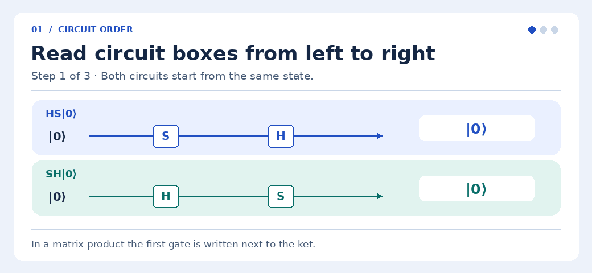
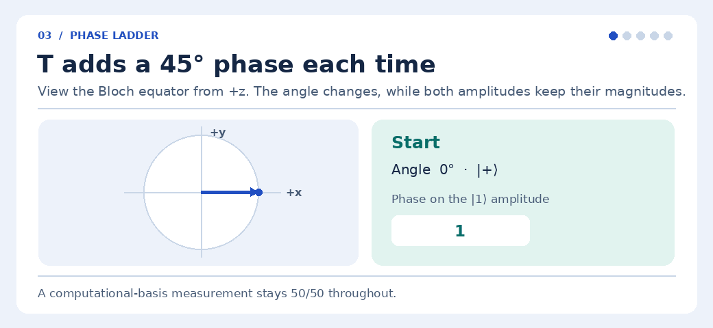
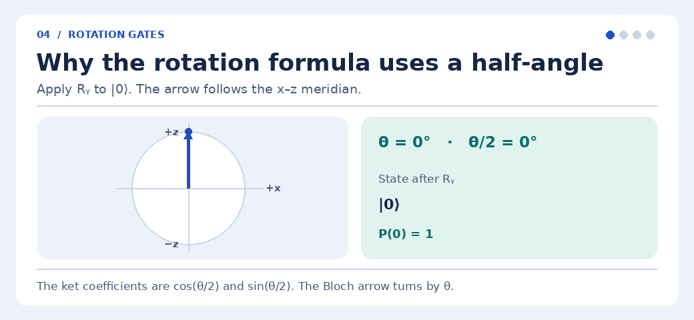
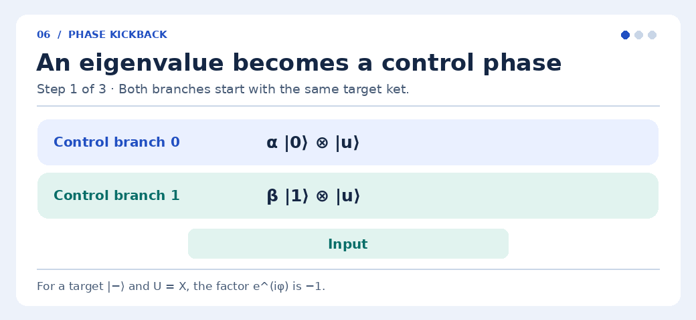
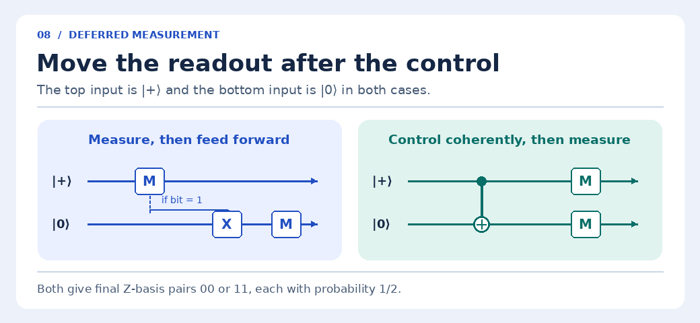
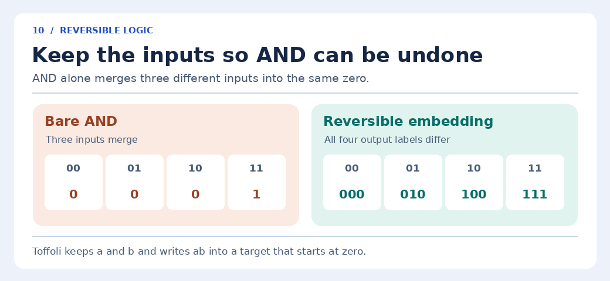
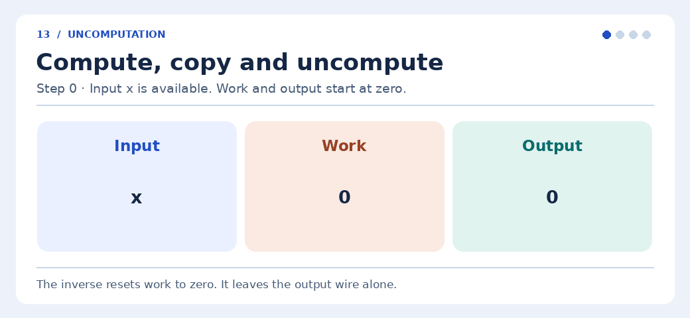
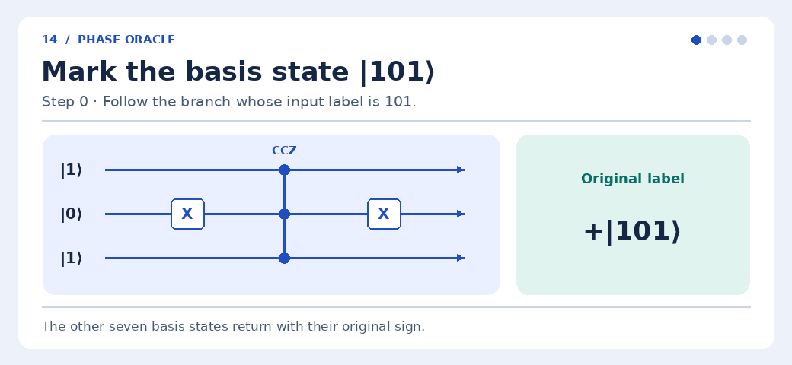
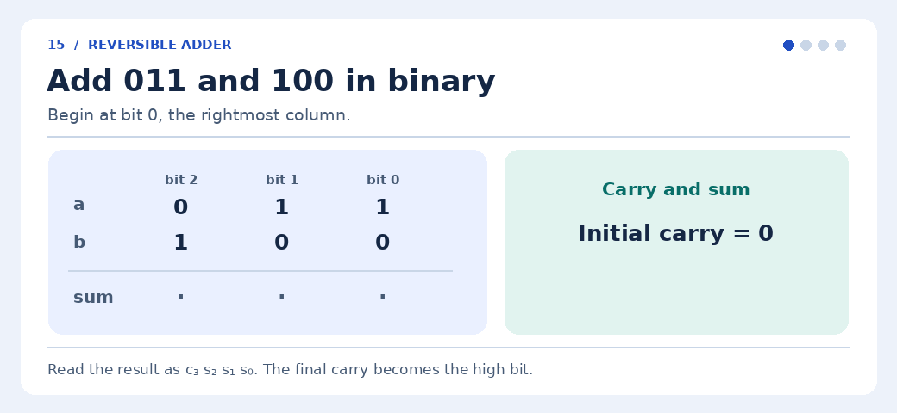

# Gates & Circuit Design

**Beginner study notes · Gates, Circuits and Reversible Logic**  
Kolin Paul · IIT Delhi · Quantum Computing CEP · 1 November 2026

These notes follow all 27 sections of the corrected transcript in order. Slide references use the numbers printed on the slides. The PDF groups several slide frames onto each page. Where a topic was skipped or covered briefly in class, the extra explanation is identified as a slide walkthrough.

**Open the notes.** Extract the entire ZIP. Open [Study_Notes.html](Study_Notes.html) for the offline browser copy or preview this Markdown in a math-enabled viewer. Keep the `assets` folder next to both files so the diagrams and looping GIFs render.

| If you’re revising… | Read… |
| --- | --- |
| Circuit order and the difference between amplitudes and counts | §§3–4 |
| Pauli gates, Hadamard, phase and rotation | §§5–10 |
| Controlled gates, measurement and circuit rewrites | §§11–17 |
| Reversible logic, ancillas and uncomputation | §§18–24 |
| The adder, lab work and practice problems | §§25–27 and the practice section |

## 1. From yesterday to today

*Slides 1–2.*

The previous lecture gave you a way to write states and gates. A **ket** such as $\lvert0\rangle$ is a column vector. A **gate** acts on that vector. In a closed quantum circuit, gates are unitary and can be undone. For a two-qubit state, $\otimes$ joins the two slots and $I$ is the identity on an idle wire. These notes use the left bit for the top wire in mathematical diagrams unless another order is stated.

This lecture turns that algebra into circuits. First you learn to read and rewrite gates. Then you use the same gate toolbox to compute a classical Boolean function reversibly. The final example builds an adder for $3+4$.

## 2. Three ways to program a quantum computer

*Slides 3–5.*

| Model | What you specify | What the lecture counts |
| --- | --- | --- |
| Query | Access to a hidden function through an oracle $U_f$ | How often you call the oracle |
| Circuit | An ordered sequence of gates on qubit wires | Gates, qubits and depth, meaning the number of sequential layers |
| Annealing | An energy function whose low-energy configurations represent candidate answers | Annealing time and the quality of the solutions found |

Deutsch’s algorithm answers a question about a one-bit function with one oracle call. The query model treats that call as one step. If you build the oracle as a circuit, the call can contain several gates. This is why **query count and gate count measure different things**.

An annealing problem asks for a low-energy configuration. The lecture distinguishes the ideal adiabatic computation model, which can simulate and be simulated by circuits with polynomial overhead, from the more restricted annealing hardware discussed in class. A qubit count from one model cannot by itself tell you how many gates, qubits or time the other model would need.

## 3. The circuit model and time-ordered gates

*Slide 6.*

Read the diagram **left to right**. A wire carries a qubit. A box applies a gate. A meter produces a classical measurement bit. Gates drawn in sequence on the same wire act one after the other.

If the boxes are $A$, then $B$, then $C$, the output is $CBA\lvert\psi\rangle$. The rightmost matrix is closest to the ket, so it acts first. This reconciles the diagram convention with the matrix multiplication order.

| Circuit order | Matrix product | Output on $\lvert0\rangle$ |
| --- | --- | --- |
| $S$ then $H$ | $HS\lvert0\rangle$ | $\lvert+\rangle$ |
| $H$ then $S$ | $SH\lvert0\rangle$ | $\lvert+i\rangle$ |

Why? The $S$ gate leaves $\lvert0\rangle$ alone, but it adds a factor of $i$ to the $\lvert1\rangle$ amplitude in $\lvert+\rangle=(\lvert0\rangle+\lvert1\rangle)/\sqrt2$.

## 4. Qiskit notebook demonstration

*Slide 6 and the spoken notebook walkthrough.*

The demo separates **what the state is** from **what a measurement reports**. A state vector lists complex amplitudes. A histogram counts classical outcomes across repeated preparations. One repeat of a circuit followed by measurement is called a **shot**.

A compact version of the gate-order experiment is below. Inspect the state before adding measurement.

~~~python
from qiskit import QuantumCircuit
from qiskit.quantum_info import Statevector

s_then_h = QuantumCircuit(1)
s_then_h.s(0)
s_then_h.h(0)

h_then_s = QuantumCircuit(1)
h_then_s.h(0)
h_then_s.s(0)

print(Statevector.from_instruction(s_then_h).data)  # [1, 1] / sqrt(2)
print(Statevector.from_instruction(h_then_s).data)  # [1, 1j] / sqrt(2)
~~~

The lecture uses `AerSimulator` and runs an example with 2,000 shots. If you add a $Z$-basis measurement to either circuit above, both ideal distributions are 50/50 because the amplitudes have the same magnitudes. Sampled counts fluctuate. A different basis can reveal the phase difference, as §14 shows. The code illustrates the lecture’s workflow. The course notebook supplies its environment setup.

## 5. The Pauli gates

*Slide 7.*

The Pauli matrices are three basic one-qubit gates.

$$
X=\begin{pmatrix}0&1\\1&0\end{pmatrix},\qquad
Y=\begin{pmatrix}0&-i\\i&0\end{pmatrix},\qquad
Z=\begin{pmatrix}1&0\\0&-1\end{pmatrix}.
$$

| Gate | On $\lvert0\rangle$ | On $\lvert1\rangle$ | Bloch sphere action |
| --- | --- | --- | --- |
| $X$ | $\lvert1\rangle$ | $\lvert0\rangle$ | Half-turn about $x$ |
| $Y$ | $i\lvert1\rangle$ | $-i\lvert0\rangle$ | Half-turn about $y$ |
| $Z$ | $\lvert0\rangle$ | $-\lvert1\rangle$ | Half-turn about $z$ |

$X$ swaps the two amplitudes. $Y$ swaps them with factors of $i$ and $-i$. $Z$ changes the sign of the second amplitude, so a $Z$-basis measurement has the same probabilities immediately before and after it. On $\lvert+\rangle$, the sign changes the state to $\lvert-\rangle$ and an $X$-basis measurement can distinguish them.

All three square to $I$. In the indicated matrix order, $XY=iZ$, $YZ=iX$ and $ZX=iY$. Reversing the order of two different Paulis gives a minus sign. For instance, $ZX=iY$ whereas $XZ=-iY$. Read $ZX$ as $X$ first, then $Z$.

## 6. The Hadamard gate

*Slide 8.*

$$
H=\frac1{\sqrt2}\begin{pmatrix}1&1\\1&-1\end{pmatrix}
=\frac{X+Z}{\sqrt2}.
$$

The first column shows $H\lvert0\rangle=\lvert+\rangle$. The second shows $H\lvert1\rangle=\lvert-\rangle$. Applying $H$ again returns the original basis ket because $H^2=I$. For example,

$$
H\lvert+\rangle=\frac{\lvert+\rangle+\lvert-\rangle}{\sqrt2}
=\lvert0\rangle.
$$

The $\lvert1\rangle$ terms cancel. This is why $H$ can turn an $X$-basis question into an ordinary $Z$-basis readout. On the Bloch sphere, $H$ exchanges the $x$ and $z$ axes and reverses $y$. That is a half-turn about the diagonal direction halfway between $x$ and $z$.

## 7. The phase ladder from $T$ to $S$ to $Z$

*Slide 9.*

A phase gate $P(\phi)=\operatorname{diag}(1,e^{i\phi})$ multiplies the $\lvert1\rangle$ amplitude by $e^{i\phi}$. The two magnitudes stay the same, so the $Z$-basis probabilities stay the same. On the Bloch sphere, the arrow turns about $z$ by angle $\phi$.

| Gate | Phase added to the $\lvert1\rangle$ component | Effect on $\lvert+\rangle$ |
| --- | --- | --- |
| $T=P(\pi/4)$ | $45^\circ$ | $(\lvert0\rangle+e^{i\pi/4}\lvert1\rangle)/\sqrt2$ |
| $S=P(\pi/2)$ | $90^\circ$ | $\lvert+i\rangle$ |
| $Z=P(\pi)$ | $180^\circ$ | $\lvert-\rangle$ |

Angles add when these gates are applied in sequence. Thus $T^2=S$, $S^2=Z$, and $Z^2=I$. Eight $45^\circ$ turns give $T^8=I$. For the notebook’s $T\lvert+\rangle$ example, the second amplitude is $e^{i\pi/4}/\sqrt2=(1+i)/2$. The first is $1/\sqrt2$.

## 8. Rotation gates and the half-angle

*Slide 10.*

A rotation about a Pauli axis uses an angle $\theta$ in the sphere picture and $\theta/2$ inside the formula. Here $R_x(\theta)$ means a turn by $\theta$ about $x$.

$$
R_x(\theta)=\cos(\theta/2)I-i\sin(\theta/2)X,\quad
R_y(\theta)=\begin{pmatrix}
\cos(\theta/2)&-\sin(\theta/2)\\
\sin(\theta/2)&\cos(\theta/2)
\end{pmatrix},\quad
R_z(\theta)=\begin{pmatrix}e^{-i\theta/2}&0\\0&e^{i\theta/2}\end{pmatrix}.
$$

Follow the first column of $R_y(\theta)$. Starting from the north pole $\lvert0\rangle$, a $90^\circ$ turn gives $(\lvert0\rangle+\lvert1\rangle)/\sqrt2$ because the sine and cosine are evaluated at $45^\circ$. A $180^\circ$ turn gives $\lvert1\rangle$. The Bloch height is
$\cos^2(\theta/2)-\sin^2(\theta/2)=\cos\theta$.

Factoring $e^{-i\theta/2}$ out of $R_z(\theta)$ leaves $P(\theta)$. For a single gate on its own, this common factor is a global phase. Section 12 explains what changes if that rotation is controlled.

## 9. Poll on equivalent gates up to global phase

*Slide 11.*

Two gates are equivalent up to global phase when the **same** unit-magnitude factor relates their whole matrices. Comparing only what they do to $\lvert0\rangle$ can hide a sign difference in the second column.

| Pair from the poll | Equivalent? | Check |
| --- | --- | --- |
| $S$ and $R_z(\pi/2)$ | Yes | $R_z(\pi/2)=e^{-i\pi/4}S$ |
| $Z$ and $R_z(\pi)$ | Yes | $R_z(\pi)=-iZ$ |
| $X$ and $R_x(\pi)$ | Yes | $R_x(\pi)=-iX$ |
| $H$ and $R_y(\pi/2)$ | No | Both send $\lvert0\rangle$ to $\lvert+\rangle$, but the outputs on $\lvert1\rangle$ have opposite signs |

In fact $H=XR_y(\pi/2)$, meaning $R_y(\pi/2)$ followed by $X$. Checking that two gates give the same measurement probabilities on one state is weaker than checking their matrices. The slide’s `Operator.equiv` examples check the whole operators up to global phase.

## 10. Every single-qubit unitary is a rotation up to phase

*Slide 12.*

A one-qubit unitary can be written as a common phase times a rotation about some axis $\hat n$. On the Bloch sphere, the common phase is invisible. Some axes are easy to recognize. $X,Y,Z$ turn $180^\circ$ about their namesake axes. $H$ turns $180^\circ$ about the axis halfway between $x$ and $z$. $S$ and $T$ turn about $z$ by $90^\circ$ and $45^\circ$.

The lecture previews a way to build an arbitrary single-qubit turn using rotations about $z$, $y$ and $z$. A circuit compiler can use such decompositions to express a desired operation in the gates it has available.

## 11. CNOT and CZ

*Slide 13.*

With a top control and bottom target, CNOT sends $\lvert a,b\rangle$ to $\lvert a,a\oplus b\rangle$, where $\oplus$ means XOR. It swaps the $10$ and $11$ basis states. CZ keeps all four basis labels and multiplies the amplitude of $\lvert11\rangle$ by $-1$.

$$
\operatorname{CZ}=\operatorname{diag}(1,1,1,-1)
=P_0\otimes I+P_1\otimes Z,\qquad
P_j=\lvert j\rangle\langle j\rvert.
$$

CZ is symmetric under swapping its wires because “both bits are $1$” is a symmetric condition. To obtain CNOT, put $H$ on the target before and after CZ. If the control is $0$, the target sees $HIH=I$. If it is $1$, the target sees $HZH=X$.

$$
\operatorname{CNOT}=(I\otimes H)\operatorname{CZ}(I\otimes H).
$$

## 12. Controlled-$U$ and phase kickback

*Slide 14.*

A controlled-$U$ applies $I$ to the target in the control-$0$ branch and $U$ in the control-$1$ branch. The control value is preserved. Both branches evolve coherently if the control is in a superposition.

$$
C(U)=P_0\otimes I+P_1\otimes U.
$$

Suppose the target is an eigenstate $\lvert u\rangle$ with $U\lvert u\rangle=e^{i\phi}\lvert u\rangle$. Only the control-$1$ branch picks up that phase.

$$
C(U)(\alpha\lvert0\rangle+\beta\lvert1\rangle)\lvert u\rangle
=(\alpha\lvert0\rangle+\beta e^{i\phi}\lvert1\rangle)\lvert u\rangle.
$$

The shared target ket factors out. The phase now appears on the control’s second amplitude. In the earlier Deutsch example, $U=X$ and $\lvert u\rangle=\lvert-\rangle$, so $X\lvert-\rangle=-\lvert-\rangle$ and the phase is a minus sign.

A useful distinction from the poll is that $U$ and $e^{i\gamma}U$ are globally equivalent **as standalone gates**. Once controlled, the phase applies to one branch only. For example, controlled-$I$ is the identity, while controlled-$(-I)$ is $Z$ on the control.

## 13. Toffoli and multi-controlled gates

*Slide 15.*

Toffoli, also written CCX or CCNOT, has two controls and one target. It flips the target if both controls are $1$.

$$
\lvert a,b,c\rangle\longmapsto\lvert a,b,c\oplus ab\rangle.
$$

Among the eight basis strings, only $110$ and $111$ are swapped. A solid control dot means “fires on $1$”. An open dot means “fires on $0$”. An open control can be implemented by placing $X$ on its wire before and after the usual solid control. With more controls, the target flips only when all specified conditions hold.

## 14. Measuring in another basis

*Slides 16–17.*

The circuit examples end with a computational-basis readout. To measure in the basis $\{U\lvert0\rangle,U\lvert1\rangle\}$, first apply $U^\dagger$. This sends each basis vector to its corresponding computational ket. The resulting bit tells you which outcome of the desired basis you measured.

| Desired basis | States reported as $0$ and $1$ | Gates before readout, in time order |
| --- | --- | --- |
| $Z$ | $\lvert0\rangle,\lvert1\rangle$ | None |
| $X$ | $\lvert+\rangle,\lvert-\rangle$ | $H$ |
| $Y$ | $\lvert+i\rangle,\lvert-i\rangle$ | $S^\dagger$, then $H$ |

For the $Y$ basis, $H$ then $S$ prepares the basis vectors from $\lvert0\rangle$ and $\lvert1\rangle$. Undo those gates in reverse order. On the slide’s $\lvert+i\rangle$ example, $S^\dagger$ first gives $\lvert+\rangle$, then $H$ gives $\lvert0\rangle$. Thus the readout is $0$ with certainty on an ideal circuit.

| Prepared state | $Z$-basis readout | $X$-basis readout | $Y$-basis readout |
| --- | --- | --- | --- |
| $\lvert+\rangle$ | 50/50 | Always $0$ | 50/50 |
| $\lvert+i\rangle$ | 50/50 | 50/50 | Always $0$ |

## 15. Classically controlled gates

*Slide 18.*

A **classical control** uses a bit already obtained from a measurement. In the example, prepare the top wire in $\lvert+\rangle$ and the bottom wire in $\lvert0\rangle$. Measure the top wire in the $Z$ basis. If that bit is $1$, apply $X$ to the bottom wire. If it is $0$, leave the bottom wire alone.

The two recorded bits are $00$ or $11$, each with probability $1/2$. The decision is made during the circuit run. In the lecture this is called **feedforward**. The same pattern appears in teleportation corrections and in reset by measurement followed by a conditional flip.

## 16. Deferred measurement and one-wire identities

*Slides 19–20.*

For the feedforward example, replace the early measurement and conditional $X$ with a coherent CNOT. Measure the control at the end instead. The final computational-basis statistics are the same. Before that final measurement, the coherent version is still in the Bell superposition $(\lvert00\rangle+\lvert11\rangle)/\sqrt2$. This equivalence concerns the final outcomes and conditional branches in the stated circuit. A different joint measurement that probes coherence can distinguish a Bell state from the mixture created by an early measurement.

The lecture then collects identities a compiler can use to rewrite gates.

| Identity | How to read it |
| --- | --- |
| $X^2=Y^2=Z^2=H^2=I$ | Two consecutive copies cancel. |
| $HXH=Z$ and $HZH=X$ | Hadamard exchanges $X$ and $Z$. |
| $HYH=-Y$ | Equal to $Y$ up to global phase. |
| $T^2=S$, $S^2=Z$, $SS^\dagger=I$ | Combine or cancel the phase rotations. |
| $SXS^\dagger=Y$ | Apply $S^\dagger$, then $X$, then $S$. |

## 17. Circuit identities on two wires

*Slides 21–22, followed by the break on slide 23.*

**Reverse a CNOT.** Put $H$ on both wires before and after CNOT. This switches which wire is the control. To see it, first write CNOT as CZ with $H$ on its target on both sides. The added target Hadamards cancel in pairs, and the added Hadamards on the other wire make that wire the new target. This works because CZ is symmetric.

**Make a SWAP.** Apply CNOT top to bottom, then bottom to top, then top to bottom. Track the two bits.

$$
(a,b)\to(a,a\oplus b)\to(b,a\oplus b)\to(b,a).
$$

For example, $01\to01\to11\to10$. Because the identity holds on each basis string, linearity makes it hold for superpositions too.

**Move a Pauli past CNOT.** Let $C$ denote top-control CNOT. Since $C^2=I$, the following identities tell you which Pauli goes on the output side when you move it through $C$.

| Pauli on the input side | $C(\text{Pauli})C$ on the output side |
| --- | --- |
| $X\otimes I$ | $X\otimes X$ |
| $I\otimes X$ | $I\otimes X$ |
| $Z\otimes I$ | $Z\otimes I$ |
| $I\otimes Z$ | $Z\otimes Z$ |

The control bit determines the target flip, so an input $X$ on the control spreads to the target. An input $Z$ on the target picks up a phase depending on both bits because CNOT changes the target bit to $a\oplus b$. The worked practice shows how to check each identity on a basis ket. The lecture uses `Operator.equiv` to check the two-wire rewrites numerically.

## 18. Reversible logic and why bare AND loses information

*Slide 24.*

The classical AND function outputs $1$ only for input $11$. The inputs $00,01,10$ all produce $0$. If all you have is that one output bit, you cannot recover which of those three inputs produced it.

A unitary has an inverse. It also preserves inner products, so it must send distinct, orthogonal computational inputs to distinct, orthogonal outputs. The bare two-input, one-output AND function cannot be used as a unitary gate in that form.

## 19. Making classical logic reversible

*Slide 24.*

Keep both inputs and use a third bit $c$ as a target. XOR the answer into that target.

$$
(a,b,c)\longmapsto(a,b,c\oplus ab).
$$

With $c=0$, the last bit becomes the AND result $ab$. With $c=1$, it becomes $1\oplus ab$, which is NAND. Running the same operation again gives $c\oplus ab\oplus ab=c$. The embedding preserves enough information to go backwards. This is exactly Toffoli.

The slide connects reversible logic to Landauer’s principle. Ideally erasing an unknown, equally likely bit at temperature $T$ releases at least $k_BT\ln2$ of heat. Logical reversibility avoids the erasure step in this model. An actual device still has costs for controlling, operating and reading its gates.

## 20. The reversible gate zoo and ancillas

*Slides 25–26.*

An **ancilla** is an extra qubit used as a helper. A clean one is prepared in a known state such as $\lvert0\rangle$. It can be used for output or for temporary storage, depending on its role.

| Want | Reversible construction |
| --- | --- |
| NOT | Apply $X$ to the bit. |
| XOR | Apply CNOT. The target gets $a\oplus b$. |
| AND or NAND | Use Toffoli with inputs $a,b$ and a target initially $0$ or $1$, respectively. |
| OR | Flip both inputs, apply Toffoli to a target initially $1$, then restore the inputs. The target is $1\oplus(\bar a\bar b)=a\lor b$. |
| Controlled swap | Use Fredkin. Swap the two targets only when the control is $1$. |
| Copy a computational-basis bit | Use CNOT onto a target initially $0$. |

NOT, CNOT, Toffoli and Fredkin are their own inverses. Toffoli with fixed input bits can build general reversible Boolean computations. For example, fixing both controls to $1$ yields a NOT on the target, and fixing one control to $1$ yields a CNOT on the other control and the target.

**Copying a basis label versus cloning a state.** CNOT sends $\lvert a,0\rangle$ to $\lvert a,a\rangle$ for $a=0$ or $1$. On $\lvert+\rangle\lvert0\rangle$ it yields $(\lvert00\rangle+\lvert11\rangle)/\sqrt2$. Two independent copies $\lvert+\rangle\lvert+\rangle$ would also contain $01$ and $10$. This difference matters when you copy a function output coherently in §23.

## 21. Reversible synthesis of a majority function

*Slide 27.*

The synthesis recipe starts by writing the function as an XOR of AND terms. Apply one multi-controlled $X$ to the **same** target for each term. Each gate toggles the target when its term evaluates to $1$. Together they XOR the function value into the target.

For three bits, majority returns $1$ if at least two inputs are $1$.

$$
\operatorname{MAJ}(x_1,x_2,x_3)=x_1x_2\oplus x_1x_3\oplus x_2x_3.
$$

| Input type | Number of AND terms that are $1$ | Majority bit |
| --- | --- | --- |
| No ones or just one one | 0 | 0 |
| Exactly two ones | 1 | 1 |
| Three ones | 3 | 1 |

For $111$, all three gates toggle, so the final effect is one net flip. For $110$, only the first pair controls a flip. Three Toffolis implement this formula with no scratch qubit beyond the output target. The input wires are preserved.

## 22. The garbage problem

*Slide 28. The professor postponed the full explanation. This walkthrough follows the slide.*

A circuit may leave intermediate data in its work register. This leftover information is called **garbage**. When the input is a superposition, garbage can record which branch the computation came from. This can weaken or remove interference on the input register.

For a two-branch example, a clean sign-marked input could look like $(\lvert0\rangle-\lvert1\rangle)\lvert g\rangle/\sqrt2$. The same $\lvert g\rangle$ accompanies both branches, so the top wire is simply $\lvert-\rangle$ and $H$ sends it to $\lvert1\rangle$. If the work labels are instead $\lvert0\rangle$ and $\lvert1\rangle$, the joint state is $(\lvert00\rangle-\lvert11\rangle)/\sqrt2$. Applying $H$ to the top wire gives each top outcome with probability $1/2$. The work labels are orthogonal, so their contributions to the same top outcome cannot cancel.

## 23. Compute, copy and uncompute

*Slide 29.*

Think of the circuit as having three registers: input, work, and output. First compute $f(x)$ into the work register, along with any temporary values. Next use CNOT to XOR the answer into an output initialized to $0$. Finally apply the inverse of the compute block to the input and work registers. The output wire stays outside that inverse block.

| Step | Input | Work | Output |
| --- | --- | --- | --- |
| Start | $x$ | $0$ | $0$ |
| Compute | $x$ | Contains $f(x)$ and scratch values | $0$ |
| Copy | $x$ | Same contents | $f(x)$ |
| Uncompute | $x$ | $0$ | $f(x)$ |

To invert a block, reverse the gate order and replace each gate with its inverse. For Toffoli and CNOT, the inverse is the same gate. For $S$, the inverse is $S^\dagger$. The cost is one compute block, its inverse, and the copy operation. This returns the work register to its starting state even on a superposition, by linearity. The output can still be entangled with the input if $f(x)$ varies across the superposition. A bit oracle deliberately keeps that answer. A phase oracle keeps a sign on each input branch while leaving work clean.

## 24. Worked AND and phase-oracle examples

*Slides 30–32. The transcript introduces these examples briefly. The gate-by-gate details come from the slides.*

**Three-input AND with one scratch qubit.** Use a clean work bit $w=0$ and a separate target $y$.

1. Toffoli with controls $x_1,x_2$ puts $x_1x_2$ into $w$.
2. Toffoli with controls $w,x_3$ toggles $y$ by $wx_3=x_1x_2x_3$.
3. Repeat the first Toffoli to restore $w=0$. The change to $y$ is preserved.

For $x_1x_2x_3=111$ and $y=0$, the $(w,y)$ pair goes $(0,0)\to(1,0)\to(1,1)\to(0,1)$. With $110$, the second gate sees $x_3=0$, so $y$ stays $0$ throughout. This is a three-controlled $X$ built from three Toffolis with one clean ancilla.

**Mark just the string $101$.** Apply $X$ on the middle wire, apply CCZ, then undo the middle-wire $X$. CCZ changes the sign of $\lvert111\rangle$ only. The first $X$ converts $101$ into $111$ and the final $X$ restores the original label. The net effect is $\lvert101\rangle\mapsto-\lvert101\rangle$ with all other basis kets fixed. In an equal superposition only that one amplitude changes sign, leaving all immediate computational-basis probabilities unchanged. The sign can affect later interference, as in Grover search.

**Clean, dirty and garbage.** A clean ancilla in slide 32 starts in $\lvert0\rangle$ and must return to $\lvert0\rangle$. A dirty or borrowed ancilla starts in an unknown state and must be restored to that state. Garbage is information left behind when temporary registers are left correlated with the input. In the slide’s clean-ancilla chain, an $n$-controlled $X$ uses $n-2$ clean helpers and $2n-3$ Toffolis for $n\ge2$. For four controls that means two helpers and five Toffolis. This is one particular trade-off between qubits and gates.

## 25. Can a quantum computer add $3+4$?

*Slides 33–34.*

Yes. The example uses reversible versions of familiar binary adder blocks. Keep register $a$, overwrite register $b$ with the three low sum bits, and write the final carry into a separate wire. The circuit also keeps two intermediate carry bits.

Start with $a=011_2=3$ and $b=100_2=4$. Begin at bit $0$, the rightmost column.

| Bit $i$ | $a_i$ | $b_i$ | Carry in $c_i$ | Sum $s_i$ | Carry out $c_{i+1}$ |
| --- | ---: | ---: | ---: | ---: | ---: |
| 0 | 1 | 0 | 0 | 1 | 0 |
| 1 | 1 | 0 | 0 | 1 | 0 |
| 2 | 0 | 1 | 0 | 1 | 0 |

The result is $c_3s_2s_1s_0=0111_2=7$. The first column is a **half adder** with sum $a_0\oplus b_0$ and carry $a_0b_0$. The other columns are **full adders** because they also accept a carry in. One way to see the two Toffolis and two CNOTs in each full adder is to form the carry contributions $a_ib_i$ and $c_i(a_i\oplus b_i)$, with a CNOT turning $b_i$ into $a_i\oplus b_i$ between those steps. A second CNOT adds $c_i$ into that same sum wire.

**Counting the circuit.** The example uses nine qubits, including six input bits and three carry wires. The half adder takes one Toffoli and one CNOT. The two full adders take two Toffolis and two CNOTs each. That is **five Toffolis and five CNOTs** before decomposition. The slide’s example decomposes one Toffoli into six CNOTs, four $T$ gates, three $T^\dagger$ gates and two $H$ gates. Using that decomposition for all five gives **35 CNOTs in total** ($5\times6+5$), **35 $T$-type gates** and **10 Hadamards** before routing or optimization. The two intermediate carries are left as garbage in this circuit. This count is for the slide’s construction.

## 26. Qiskit laboratories and practical instructions

*Spoken lab walkthrough, alongside slides 35–37.*

The lecture describes downloading the course notebook from the professor’s labs page, opening it in Colab or a local Jupyter environment, then running the setup and example cells in order. For a local run, use the course’s supplied `requirements.txt` to reproduce the notebook’s environment. The demo mentions Qiskit, Qiskit Aer, NumPy and Matplotlib.

The gate card on slide 35 is the lookup table for the notebook. These are the method names shown in the lecture.

| Idea | Lecture’s notebook names |
| --- | --- |
| One-wire gates | `x`, `y`, `z`, `h`, `s`, `sdg`, `t`, `tdg` |
| Phase and rotations | `p`, `rx`, `ry`, `rz` |
| Two-wire gates | `cx`, `cz`, `swap` |
| Multi-controlled gates | `ccx`, `mcx` |
| Measurement and feedforward | `measure`, then `if_test` for a classical condition |

One example from the lab is the $Y$-basis measurement. Prepare $\lvert+i\rangle$ with $H$ then $S$, then undo with $S^\dagger$ then $H$. The expected ideal readout is $0$. Another example uses `Operator.equiv` to compare reversed-CNOT circuits up to global phase. When reading a displayed two-bit string in the notebook, check which qubit is assigned to each character. The algebra here uses the top-wire-first convention from the diagrams.

## 27. Closing advice and final questions

*Slide 37 and the spoken closing remarks.*

The professor suggests changing one gate, predicting the result with algebra or a Bloch-sphere sketch, then checking it in the notebook. For example, in §4 swap $H$ and $S$. Predict both the state vector and the $Z$-basis histogram. The state vector changes, while the ideal histogram is still 50/50. Try an $X$- or $Y$-basis readout to reveal the difference.

Slide 37 points to Nielsen and Chuang for single-qubit operations, controlled operations, deferred measurement and energy in reversible computation.

## Practice with worked answers

These are the eight exercises from slide 36, in the slide’s order.

1. **Why do $T^2=S$ and $S^2=Z$? When does $T^k=I$?** The second diagonal entry of $T^k$ is $e^{ik\pi/4}$. The powers $k=2,4$ give $i,-1$, respectively, so $T^2=S$ and $S^2=Z$. The first positive $k$ that gives $1$ is $8$.
2. **What does $H$, then $S$, then $H$ do to $\lvert0\rangle$?** The first two gates give $\lvert+i\rangle$. The last gives $\big[(1+i)\lvert0\rangle+(1-i)\lvert1\rangle\big]/2=e^{i\pi/4}\lvert-i\rangle$. The named state is $\lvert-i\rangle$ up to global phase.
3. **Why is CZ symmetric, and how does it give CNOT?** Its only change is a sign on $11$, which is unchanged by swapping the two labels. In the control-$0$ branch, the target sees $HIH=I$. In the control-$1$ branch, it sees $HZH=X$. That is CNOT.
4. **Measure in the rotated basis on the slide.** Its two vectors are the columns of $R_y(\pi/4)$ because their coefficients use $\pi/8$. Apply the inverse $R_y(-\pi/4)$ and then measure in the computational basis.
5. **Prove the two-wire identities.** For reversing CNOT, expand it as $(I\otimes H)\operatorname{CZ}(I\otimes H)$. The extra $H\otimes H$ on each side reduces the target Hadamards and leaves $H\otimes I$ on both sides. For SWAP, the three CNOTs map $\lvert a,b\rangle$ through $\lvert a,a\oplus b\rangle$, $\lvert b,a\oplus b\rangle$ and $\lvert b,a\rangle$. For the four Pauli identities, apply $C$ to $\lvert a,b\rangle$, then the Pauli, then $C$ again. A control $X$ returns $\lvert a\oplus1,b\oplus1\rangle$, while a target $X$ returns $\lvert a,b\oplus1\rangle$. Control $Z$ returns the original ket with phase $(-1)^a$, while target $Z$ returns it with phase $(-1)^{a\oplus b}=(-1)^a(-1)^b$. Linearity extends each result to any input.
6. **Build bit and phase oracles for $f(x_1,x_2,x_3)=x_1x_3\oplus x_2$.** For the bit oracle, apply Toffoli with controls $x_1,x_3$ and CNOT with control $x_2$, both onto $y$. For the phase oracle, use CZ on $x_1,x_3$ and $Z$ on $x_2$. The signs multiply to $(-1)^{x_1x_3+x_2}=(-1)^{f(x)}$.
7. **Compute OR into a clean target using one Toffoli.** Flip the target from $0$ to $1$. Flip $a,b$, apply Toffoli, then flip $a,b$ back. The target contains $1\oplus(\bar a\bar b)=a\lor b$ and the two inputs are restored.
8. **Trace $3+5$.** Add $011_2$ and $101_2$ from the right. The sums per column are $1+1+0=2$, $1+0+1=2$, and $0+1+1=2$. Each column writes sum bit $0$ and passes carry $1$. Thus $c_1=c_2=c_3=1$ and the result is $1000_2=8$. The low three bits are $000$ and the high bit $c_3$ carries the overflow.

*Sources. The supplied corrected transcript determines the order and scope. The original TXT was used to cross-check spoken passages. The supplied PDF provides the numbered frames, worked examples and problem set. All diagrams and animations were drawn for these notes.*
