# Gates & Circuit Design

| If you’re revising… | Read… |
| --- | --- |
| Three programming models and how they relate | §§2–3 |
| Circuit order and the difference between amplitudes and counts | §§4–5 |
| Pauli gates, Hadamard, phase and rotation | §§6–11 |
| Controlled gates, measurement and circuit rewrites | §§12–18 |
| Reversible logic, ancillas and uncomputation | §§19–25 |
| The adder, lab work and practice problems | §§26–28 and the practice section |

## 1. From yesterday to today

The previous lecture gave you a way to write states and gates. A **ket** such as $\lvert0\rangle$ is a column vector. A **gate** acts on that vector. In a closed quantum circuit, gates are unitary and can be undone. For a two-qubit state, $\otimes$ joins the two slots and $I$ is the identity on an idle wire. These notes use the left bit for the top wire in mathematical diagrams unless another order is stated.

This lecture turns that algebra into circuits. First you learn to read and rewrite gates. Then you use the same gate toolbox to compute a classical Boolean function reversibly. The final example builds an adder for $3+4$.

## 2. Three ways to program a quantum computer

### What does "model of computation" mean?

A **model of computation** simply means a **method of telling a computer how to solve a problem**.

Consider an ordinary computer.

Suppose you want to add two numbers:

$$
5+3=8
$$

You can write a program:

~~~python
a = 5
b = 3
print(a + b)
~~~

The computer follows your instructions and produces $8$.

But computers do not all have to be programmed in the same way.

A quantum computer can also be programmed using different approaches. The lecture introduces three of them:

1. Query model
2. Circuit model
3. Annealing model

Think of it this way. Suppose you want to find the answer to a puzzle. You can approach the puzzle in three different ways:

1. Ask questions to a mysterious black box.
2. Give the computer a sequence of instructions.
3. Describe the puzzle as an energy problem and let the machine search for a low-energy solution.

These are the three models: **Query**, **Circuit** and **Annealing**.

### 2.1 Comparison of the three models

| Model | What you specify | What the machine does | What we measure |
| --- | --- | --- | --- |
| Query | A hidden function through an oracle `Uf` | Calls the oracle | Number of oracle calls |
| Circuit | An ordered sequence of gates on qubit wires | Applies gates and performs measurements | Number of gates, qubits and circuit depth |
| Annealing | An energy function representing the problem | Evolves toward a low-energy configuration | Annealing time and solution quality |

### 2.2 Query model – Asking questions to a black box

Imagine that you have a mysterious machine. You do not know how it works internally, but you can give it an input and receive an output.

For example, imagine a machine that calculates

$$
f(x)=x+1
$$

You give it $5$, and it returns $6$.

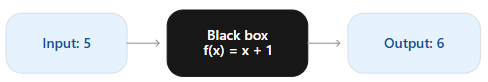

You do not need to know how the machine calculates the answer. You only need to know how to use it.

This is called a **black box**. In quantum computing, this black box is called an **oracle**, represented by $U_f$.

**Why is this useful?**

Because sometimes quantum computers can solve a problem using **fewer queries** than classical computers.

**One important thing to remember:**

The query model does not care how the oracle is internally constructed. It only counts how many times you use it. That is why it is an **abstraction** or **theoretical model**.

**Example: Deutsch's algorithm**

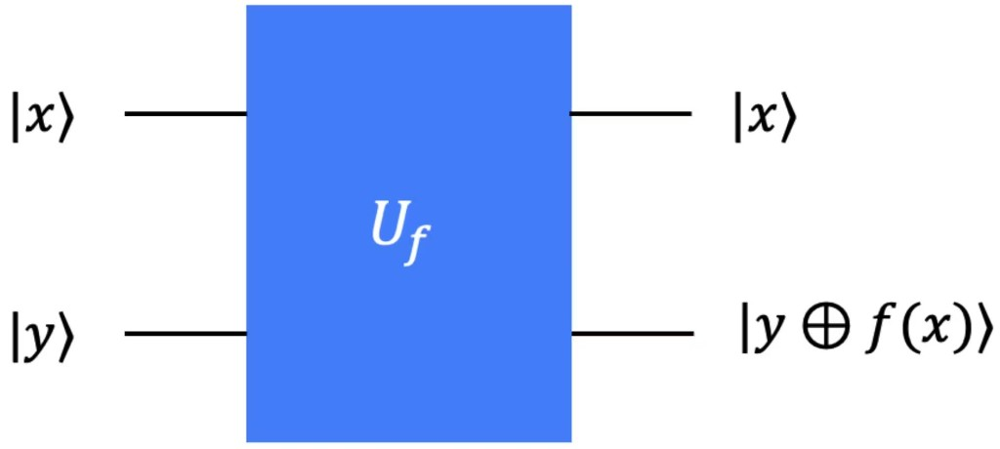

The blue box $U_f$ is the **quantum oracle**, the black box used inside Deutsch's algorithm.

Suppose we have a one-bit function `f(x)` and want to determine whether it is:

- Constant: Both possible inputs produce the same output.
- Balanced: The two possible inputs produce different outputs.

A classical deterministic computer needs two queries in the worst case to distinguish these possibilities.

Deutsch's quantum algorithm can determine the answer using just **one oracle call**.

The Deutsch-Jozsa algorithm generalizes this idea to functions with multiple input bits. Under its promise that the function is constant or balanced, it can distinguish the two using one quantum oracle call.

### 2.3 Circuit model – Giving the computer a sequence of instructions

This is the model most commonly associated with gate-based quantum computers.

Instead of asking a mysterious machine questions, you give the quantum computer a **sequence of instructions**.

This is similar to writing a normal computer program.

For example, suppose you want to perform the following operations:

1. Start with two qubits.
2. Apply a Hadamard gate to the first qubit.
3. Apply a CNOT gate.
4. Measure both qubits.

You represent these instructions using a **quantum circuit**.

#### What is a quantum circuit?

A quantum circuit is simply a **sequence of quantum gates** applied to qubits.

For example:

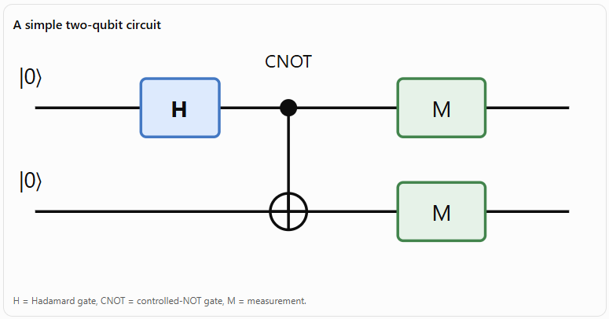

Each gate performs a particular operation on the qubits.

For example:

- **Hadamard gate ($H$):** Creates a superposition from a computational basis state such as $\lvert0\rangle$.
- **CNOT gate:** Changes the target qubit depending on the control qubit.
- **Measurement:** Reads the qubit and produces a classical result.

You have already studied these gates in the earlier lectures.

A quantum circuit also lists the **qubits** (wires), the **gates** in order, and where **measurements** occur.

**How do we measure the cost of a circuit?**

#### 1. Number of gates

How many operations does the circuit perform?

For example:

- 2 Hadamard gates
- 1 CNOT gate
- 2 measurement operations

We generally count **computational gates** separately from **measurements**.

#### 2. Number of qubits

How many qubits does the circuit require?

For example, the circuit above uses two qubits.

#### 4. Circuit depth

This is slightly different from the number of gates.

**Depth** means the number of **sequential layers** of operations.

Imagine you have four gates:

- Gate A
- Gate B
- Gate C
- Gate D

If A and B operate on different qubits, they may execute **simultaneously**. C and D may execute in the **next** layer.

Then:

- Total gates = 4
- Circuit depth = 2

**Universal computation**

Universal computation means you can build **any** quantum circuit using combinations of gates from one fixed **toolkit**, to whatever accuracy you need.

Think of how you write numbers using just ten digits. You do not need a new symbol for 527. You put 5, 2, and 7 together. A universal gate set works in a similar way. Each gate does one basic operation, and you combine gates in different orders to build more complex operations.

#### What does “to the desired accuracy” mean?

Suppose you want to rotate a qubit by exactly $17^\circ$. Your toolkit may have no single gate that performs that rotation. You can combine gates to get an operation that behaves **almost exactly** like the $17^\circ$ rotation. If you need a closer match, you can choose a sequence that gets closer.

For example, Hadamard ($H$), $T$, and CNOT form a **universal gate set**. $H$ and $T$ act on one qubit at a time, while CNOT acts on two. You can reuse these same types of gates on different qubits throughout a circuit.

<!-- markdownlint-disable MD033 -->

<iframe src="assets/t_gate_explainer.html" title="T gate explained" width="100%" height="420" loading="lazy" style="border:1px solid #dce3ef;border-radius:12px;max-width:100%;display:block;background:#f0f4fc;"></iframe>

<!-- markdownlint-enable MD033 -->

This is why the circuit model supports **general-purpose** quantum computation.

Examples of gate-based quantum computing companies include IBM, Google, Quantinuum and IonQ.

### 2.4 Annealing model – Finding a low-energy solution

Imagine you are standing on top of a mountain, and you want to reach the lowest point in a valley.

You do not know the terrain.

You want to find the **lowest possible point**.

This is an **optimization problem**.

**Examples:**

- Finding the shortest delivery route.
- Finding the cheapest combination of resources.
- Scheduling employees while minimizing conflicts.
- Finding the best arrangement of components.

Instead of telling the computer exactly which operations to perform, in quantum annealing you describe the problem using an **energy function**.

#### What is an energy function?

An energy function is a mathematical expression that assigns an **energy value** to every possible solution.

For example, suppose you have three possible solutions:

| Possible solution | Energy |
| --- | ---: |
| A | 20 |
| B | 8 |
| C | 3 |

If your objective is to **minimize** energy, solution C is the best solution because it has the lowest energy.

In quantum annealing, the hardware is designed to **evolve toward low-energy configurations**.

#### What does "annealing" mean?

Imagine placing a metal object at a very high temperature and slowly cooling it.

As it cools, the material can settle into a more stable arrangement.

Quantum annealing uses a related physical idea, but through **controlled evolution** of a quantum system.

The goal is to find a low-energy state representing a **good solution** to the problem.

#### Why does the professor call it a heuristic optimizer?

This is an important distinction.

A **heuristic** means a method that tries to find a good solution but does **not** necessarily guarantee the best possible solution.

For example, suppose you ask the machine to find the shortest delivery route. The machine might return:

- Route A: 100 km
- Route B: 85 km
- Route C: 92 km

It may find Route B, but that does not automatically prove that a route of 80 km or 75 km does not exist.

So, quantum annealing hardware can produce **good solutions**, but it does not generally guarantee that it has found the **global minimum**.

#### What does the professor mean by "annealing time"?

Annealing time is the time taken for the annealing process to evolve from its initial state toward the final state.

The professor mentions that the process depends on the **energy landscape**, particularly the **energy gaps** between states.

For now, remember:

Annealing time is a **resource** used to measure how long the machine takes to perform the annealing process.

#### What is D-Wave?

D-Wave, mentioned by the professor, develops **quantum annealing computers**.

These machines are primarily designed for **optimization problems**.

They are different from gate-based quantum computers developed by IBM, Google and IonQ.

The professor mentions approximately **5,000 qubits**.

But here is something important:

Having 5,000 annealing qubits does **not** mean that the machine can perform the same computation as a gate-based quantum computer with 5,000 qubits.

**Why?**

Because their **architecture**, **connectivity**, **operations** and **computational capabilities** are different.

The number of qubits alone does **not** tell us how powerful a quantum computer is.

### 2.5 Why are these three models different?

Imagine you want to solve the **same problem** using three different approaches.

#### 1. Query model

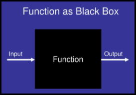

You interact with a **black box** and count how many questions you ask.

#### 2. Circuit model

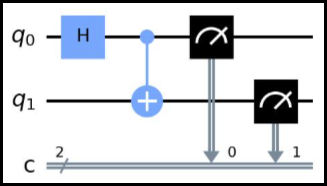

You specify the **exact sequence of operations** and count the computational resources.

#### 4. Annealing model

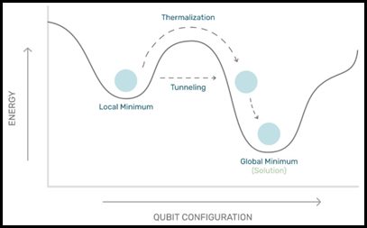

You describe the problem as an **energy function** and let the hardware search for a **low-energy state**.

**Notice something interesting?**

All three approaches are about solving computational problems, but the **way you describe the problem to the machine** is different.

That is why their **computational costs** are also measured differently.

**An important distinction:**

An oracle used in the query model can itself be implemented as a quantum circuit.

However, the query model counts one oracle call as one operation, regardless of how many gates are required internally to implement it.

The circuit model examines the actual gate-level implementation.

Therefore, **one oracle call does not necessarily mean one quantum gate**.

### 2.6 Can we compare the number of qubits between these models?

Not directly.

For example, a quantum annealing machine with approximately 5,000 physical qubits cannot automatically be considered more powerful than a gate-based quantum computer with 128 qubits.

The machines have different architectures, connectivity, operations and computational capabilities.

The number of qubits alone does not determine the computational power of a quantum computer.

### 2.7 Important takeaway

The three models represent different ways of programming quantum computers:

- **Query:** Interact with a black box and count oracle calls.
- **Circuit:** Specify quantum gates and measure gates, qubits and depth.
- **Annealing:** Describe an optimization problem using an energy function and search for a low-energy solution.

The circuit model supports universal quantum computation, whereas the quantum annealing hardware discussed in the lecture is primarily intended for optimization problems.

Theoretical adiabatic quantum computation is a broader model and can be computationally equivalent to the circuit model under suitable conditions, with polynomial overhead. This should not be confused with the capabilities of a particular quantum annealing device.

### Comparison table

This is the **most important part** of the lecture.

The professor is comparing **what you give to each machine** and **what you measure** to determine its computational cost.

| Question | Query model | Circuit model | Annealing model |
| --- | --- | --- | --- |
| What do you provide? | A black-box function | A sequence of quantum gates | An energy function |
| What does the machine do? | Calls the oracle | Applies gates and measures | Searches for low-energy states |
| What do you measure? | Number of oracle calls | Gates, qubits and depth | Annealing time and solution quality |
| What can it solve? | Problems expressed using oracle queries | General quantum computations | Optimization problems |
| Main characteristic | Theoretical model | Universal computation | Heuristic optimization |

Let's understand the table in one sentence each:

- **Query:** How many times must I ask the black box to get my answer?
- **Circuit:** How many gates and qubits do I need, and how many sequential operations must I perform?
- **Annealing:** How long does the machine take to find a good low-energy solution?

### Final summary — What should you remember?

#### Three ways to program a quantum computer

**Query model** — Ask questions to a black box.

- Uses an oracle $U_f$.
- Measures the number of oracle calls.
- Useful for studying theoretical quantum speedups.

**Circuit model** — Give the computer a sequence of instructions.

- Uses quantum gates such as $H$, $X$ and CNOT.
- Measures gates, qubits and circuit depth.
- Supports universal quantum computation.

**Annealing model** — Describe the problem as an energy function.

- Uses an energy function such as Ising or QUBO.
- Measures annealing time and solution quality.
- Primarily designed for optimization problems.

### Test your understanding

<!-- markdownlint-disable MD033 -->

<iframe src="assets/three_models_knowledge_check.html" title="Three models knowledge check" width="100%" height="720" loading="lazy" style="border:1px solid #dce3ef;border-radius:12px;max-width:100%;display:block;"></iframe>

<!-- markdownlint-enable MD033 -->

## 3. How the three models relate

The three models introduced earlier are not completely independent. They have important relationships.

### 3.1 Query model is part of the Circuit model

In the Query model, we treat the oracle `Uf` as a black box. We provide inputs and count how many times we call it.

But how is the oracle implemented internally?

An oracle is implemented using quantum gates and is therefore a **sub-circuit within a larger quantum circuit**.

For example:

- **Query model:** Treats `Uf` as a black box and counts oracle calls.
- **Circuit model:** Describes how `Uf` is implemented using actual quantum gates.

This explains why the professor says:

**"Query lives inside circuit. An oracle is just a sub-circuit."**

**Why is the Query model useful?**

It allows us to prove theoretical quantum speedups by counting how many oracle calls an algorithm requires, without considering the internal gate-level implementation of the oracle.

One oracle call can internally contain several quantum gates.

Therefore, **one oracle call does not mean one quantum gate**.

### 3.2 Ideal adiabatic computation is equivalent to the Circuit model

Adiabatic quantum computation is based on the idea of gradually changing the energy function of a quantum system.

The process is:

1. Start with an easily prepared ground state (lowest-energy state).
2. Gradually change the system's Hamiltonian (energy operator).
3. Under suitable conditions, the system remains close to its ground state.
4. The final ground state represents the solution to the problem.

**What is the relationship with the Circuit model?**

A theoretical result shows that ideal adiabatic quantum computation and gate-based circuit quantum computation can simulate each other with **polynomial overhead**.

This means:

- A circuit computation can be implemented using ideal adiabatic computation.
- An ideal adiabatic computation can be implemented using quantum circuits.

Polynomial overhead means that the additional computational resources grow polynomially with the problem size, rather than exponentially.

**Important:** Computational equivalence does not mean identical hardware or identical execution time.

### 3.3 Why is D-Wave different from ideal adiabatic computation?

D-Wave develops practical quantum annealing hardware.

Although quantum annealing is related to adiabatic computation, the practical D-Wave machine is a **restricted implementation**.

It is primarily designed for **optimization problems** rather than universal gate-based quantum computation.

| Ideal adiabatic computation | Practical D-Wave annealer |
| --- | --- |
| Theoretical universal model | Restricted physical implementation |
| Computationally equivalent to circuits | Primarily designed for optimization |
| Can simulate general quantum circuits in principle | Does not provide general-purpose circuit computation |
| Idealized assumptions | Subject to hardware limitations, noise and temperature |

The professor also points out that there is **no established general quantum speedup** for D-Wave's annealing hardware.

Using quantum mechanics does not automatically guarantee that a machine will solve problems faster than classical computers.

### 3.4 Qubit counts cannot be directly compared

The professor mentions approximately 5,000 annealing qubits and 100+ gate-based qubits.

We cannot conclude that the D-Wave machine is more powerful just because it has more qubits.

The reason is that the two types of machines have different architectures and computational capabilities.

**Physical qubit:** An actual quantum hardware element used to represent quantum information.

**Logical qubit:** A more reliable qubit encoded using multiple physical qubits, typically with quantum error correction.

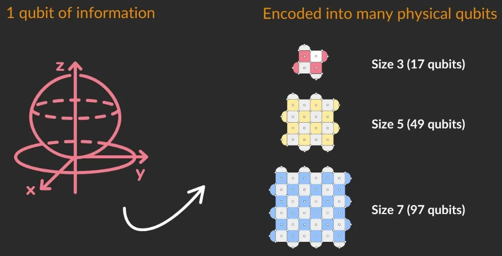

One logical qubit may require many physical qubits.

Therefore, qubit count must always be understood in the context of the hardware and the type of computation.

### 3.5 Other models of quantum computing

The professor briefly mentions two other approaches:

**Measurement-based quantum computing (MBQC)**

- Starts with a specially prepared entangled quantum state.
- Computation is performed through a sequence of measurements.
- Measurement choices determine how the computation progresses.

**Topological quantum computing**

- Uses topological properties of quantum systems to encode and process information.
- Can use the braiding of quasiparticles called anyons to perform quantum operations.
- Aims to provide more robust ways of processing quantum information.

These approaches are also theoretically equivalent to the Circuit model when implemented as universal quantum computers.

### 3.6 Important takeaway

The key relationships are:

1. **Query model → Circuit model:** An oracle is a sub-circuit implemented using quantum gates.
2. **Ideal adiabatic model ≡ Circuit model:** Both can simulate each other with polynomial overhead.
3. **D-Wave ≠ Ideal universal adiabatic computer:** Practical D-Wave hardware is a restricted annealing implementation primarily designed for optimization.
4. **Qubit counts are not directly comparable:** Annealing and gate-based qubits represent different hardware implementations and computational capabilities.
5. **Other universal models:** Measurement-based and topological quantum computing are alternative approaches that are theoretically equivalent to circuits.

The main lesson is that different quantum computing approaches may use different physical mechanisms, but several of them are computationally equivalent in theory. Their practical hardware capabilities, resource requirements and performance can still be very different.

## 4. The circuit model and time-ordered gates

This part of the lecture is about **how a gate-based quantum computer works in practice**: how to read a circuit diagram, how information behaves on the wires, and why gate order matters. Three ideas tie it together:

1. Classical versus quantum computation — data flow versus in-memory manipulation.
2. How to read a quantum circuit diagram.
3. Why the order of quantum gates matters.

### 4.1 Classical computing versus quantum computing

The professor contrasts a common classical **data-flow** picture with the **in-memory** picture used in gate-based quantum circuits.

#### 4.1.1 Classical computing — data flows through gates

Imagine two AND gates wired in series:

- Gate 1 takes inputs $A$ and $B$, outputs $D$.
- Gate 2 takes $D$ and $C$, outputs $E$.

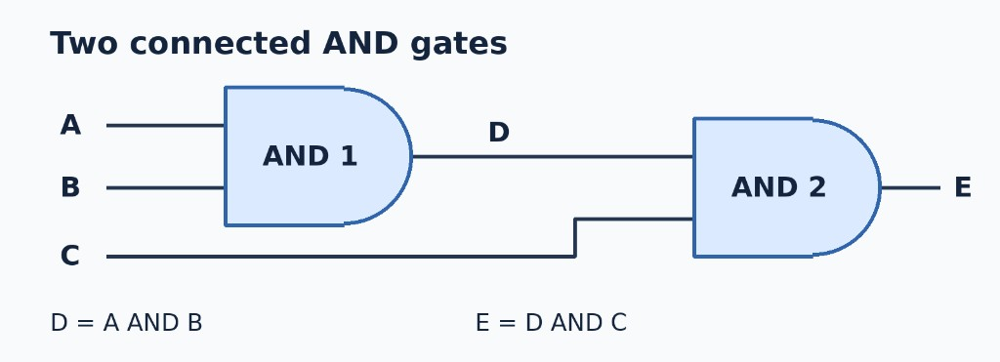

$$
D = A \text{ AND } B, \qquad E = D \text{ AND } C
$$

Example: $A=1$, $B=1$, $C=0$ gives $D=1$ and $E=0$.

The pattern is:

1. Data enters a gate.
2. The gate computes.
3. The result moves to the next gate.
4. The chain continues until the final output appears.

The **gates are fixed hardware**; new data keeps flowing through them. The professor sums this up as:

**"Instructions remain constant, while data flows."**

Think of an assembly line: each machine has a fixed job, and the product moves from station to station.

#### 4.1.2 Quantum computing — in-memory computation

In the **circuit model**, the qubit **is** the memory. Applying a gate **updates the state in place**; the state does not “leave” the qubit and travel to another wire the way classical bits flow between gates.

Start from $\lvert0\rangle$, apply $H$:

$$
H\lvert0\rangle = \lvert+\rangle
$$

The same qubit now holds $\lvert+\rangle$. Apply $X$:

$$
X\lvert+\rangle = \lvert-\rangle
$$

Again, **one physical qubit**, repeatedly transformed.

On real hardware (for example superconducting machines), these gates are implemented by **control pulses** — microwaves that steer the qubit — applied one after another while the quantum information stays on that qubit.

<!-- markdownlint-disable MD033 -->

<iframe src="assets/04_one_qubit_animation.html" title="One qubit: in-memory state updates" width="100%" height="520" loading="lazy" style="border:1px solid #dce3ef;border-radius:12px;max-width:100%;display:block;"></iframe>

<!-- markdownlint-enable MD033 -->

| | Classical (data-flow) | Quantum (in-memory, circuit model) |
| --- | --- | --- |
| What moves? | Data through fixed gates | Gates act over time on fixed qubit memory |
| Gates | Fixed function in hardware | Different unitaries applied in sequence |
| Chaining | Output of one gate feeds the next | Each gate transforms the current state |
| Memory | External to the “pipe” | The qubit wire **is** the memory |

**Clarification:** Classical machines can also use in-memory computation. The comparison here is between **typical classical data-flow architectures** and **how we draw and execute gate-based quantum circuits**.

### 4.2 How to read a quantum circuit diagram

#### Rule 1 — one wire, one qubit

Each horizontal line is one qubit.

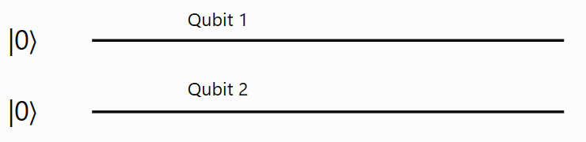

- Top wire → qubit 1; bottom wire → qubit 2 (in this example).
- Both start in $\lvert0\rangle$ unless you prepare something else (for example $X\lvert0\rangle=\lvert1\rangle$).

Initial state example:

$$
\lvert\psi_{\text{initial}}\rangle = \lvert0\rangle
$$

#### Rule 2 — time runs left to right

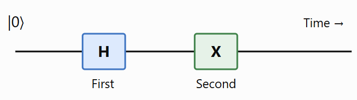

Read the diagram **left to right**. On one wire: start in $\lvert0\rangle$, apply $H$, then apply $X$. The qubit sees $H$ before $X$.

$$
\lvert\psi_{\text{final}}\rangle = XH\lvert0\rangle
$$

The diagram order is left-to-right, but the **ket stands on the right** in the algebraic expression — so the rightmost gate symbol sits next to the ket and acts first. Section 4.3 explains why.

#### Rule 3 — a box is a gate

A labelled box on a wire is a **unitary gate** (a reversible quantum operation that preserves total probability):

$$
U^\dagger U = I
$$

Common single-qubit symbols in this course:

| Symbol | Name | Example on $\lvert0\rangle$ |
| --- | --- | --- |
| $H$ | Hadamard | $H\lvert0\rangle=\lvert+\rangle$ |
| $X$ | Pauli-$X$ | $X\lvert0\rangle=\lvert1\rangle$ |
| $S$ | Phase ($S$) | $S\lvert0\rangle=\lvert0\rangle$ |

You will study unitarity in more depth later; for now, “unitary gate” means “legal quantum operation on the state vector.”

#### Rule 4 — a meter is measurement

A **meter** at the end of a wire means **measurement**, often in the **computational ($Z$) basis**. For $\lvert+\rangle=(\lvert0\rangle+\lvert1\rangle)/\sqrt2$, a $Z$ measurement yields $0$ or $1$ with 50% probability each. That turns a quantum outcome into a **classical bit**.

Notation reminder:

- **Single wire** — qubit (quantum information).
- **Double wire** — classical register bit after measurement.

### 4.3 Read left to right, multiply right to left

On the slide, a chain of gates is drawn as:

$$
\lvert\psi\rangle \xrightarrow{A} \xrightarrow{B} \xrightarrow{C}
$$

meaning: apply $A$, then $B$, then $C$ in time order.

The same evolution as matrix multiplication is:

$$
\lvert\psi_{\text{final}}\rangle = CBA\lvert\psi\rangle
$$

Matrices act on the vector **immediately to their right**, so the gate drawn **leftmost** is written **leftmost** in the product, while the gate drawn **closest to the initial ket** is written **next to the ket** and therefore acts **first**.

Walkthrough with $H$ then $X$ on $\lvert0\rangle$:

$$
H\lvert0\rangle = \lvert+\rangle, \qquad X\lvert+\rangle = \lvert-\rangle
\quad\Rightarrow\quad
\lvert\psi_{\text{final}}\rangle = XH\lvert0\rangle
$$

You applied $H$ first and $X$ second, but the expression reads $XH\lvert0\rangle$ from the ket outward.

The professor’s mnemonic:

**"Read left to right, multiply right to left."**

### 4.4 Order matters — $S$ then $H$ is not $H$ then $S$

Swapping the order of two gates can change the final state. The lecture compares **$S$ then $H$** with **$H$ then $S$** on $\lvert0\rangle$. First fix what each gate does on its own.

#### Hadamard gate ($H$)

$H$ **mixes** $\lvert0\rangle$ and $\lvert1\rangle$ with equal magnitude:

$$
H\lvert0\rangle = \lvert+\rangle = \frac{\lvert0\rangle+\lvert1\rangle}{\sqrt2},
\qquad
H\lvert1\rangle = \lvert-\rangle = \frac{\lvert0\rangle-\lvert1\rangle}{\sqrt2}.
$$

So after $H$, outcomes $\lvert0\rangle$ and $\lvert1\rangle$ still have **50/50 probability** in the $Z$ basis, but the amplitudes can have **relative phase** (sign or complex factor) between the two branches. Section 6 develops the matrix; section 7 discusses $H$ on the Bloch sphere.

#### Phase gate ($S$)

The **$S$ gate** is a **phase** gate. It does **not** flip $\lvert0\rangle$ into $\lvert1\rangle$; it only rotates phase in the $\lvert1\rangle$ direction of the Bloch sphere by $90^\circ$ ($\pi/2$ radians).

On the computational basis:

$$
S\lvert0\rangle = \lvert0\rangle,
\qquad
S\lvert1\rangle = i\lvert1\rangle.
$$

In words:

- $\lvert0\rangle$ is unchanged — the amplitude stays $1$, with phase $1$.
- $\lvert1\rangle$ picks up a factor of **$i$** — same probability ($\lvert i\rvert^2=1$), but the amplitude is rotated in the complex plane.

Here $i=\sqrt{-1}$. You do not need a full picture of “what $i$ means physically” yet; for now, read $i$ as **a $90^\circ$ phase shift** on the $\lvert1\rangle$ component only.

Equivalently, $S=P(\pi/2)=\operatorname{diag}(1,e^{i\pi/2})$: multiply the $\lvert1\rangle$ amplitude by $e^{i\pi/2}=i$ and leave $\lvert0\rangle$ alone. The **$T$ → $S$ → $Z$** family is developed in §8.

**Why $S$ matters in the order demo:** If the state is **only** $\lvert0\rangle$, $S$ does nothing visible — you stay at $\lvert0\rangle$. If the state is a **superposition** such as $\lvert+\rangle$, $S$ acts on **each** branch: $\lvert0\rangle$ unchanged, $\lvert1\rangle$ times $i$. That is what separates **$S$ then $H$** from **$H$ then $S$**.

#### Comparing the two orders

**Case 1: $S$ then $H$ (diagram left to right: $S$ box, then $H$ box)**

$$
S\lvert0\rangle=\lvert0\rangle, \quad H\lvert0\rangle=\lvert+\rangle
\quad\Rightarrow\quad
\boxed{HS\lvert0\rangle = \lvert+\rangle}
$$

| Step | State |
| --- | --- |
| Initial | $\lvert0\rangle$ |
| After $S$ | $\lvert0\rangle$ (unchanged) |
| After $H$ | $\lvert+\rangle$ |

**Case 2: $H$ then $S$**

$$
H\lvert0\rangle=\lvert+\rangle,
\quad
S\lvert+\rangle = \frac{\lvert0\rangle + i\lvert1\rangle}{\sqrt2} = \lvert{+i}\rangle
\quad\Rightarrow\quad
\boxed{SH\lvert0\rangle = \lvert{+i}\rangle}
$$

| Step | State |
| --- | --- |
| Initial | $\lvert0\rangle$ |
| After $H$ | $\lvert+\rangle$ |
| After $S$ | $\lvert{+i}\rangle$ |

| Gate order (time) | Matrix product on $\lvert0\rangle$ | Final state |
| --- | --- | --- |
| $S$ then $H$ | $HS\lvert0\rangle$ | $\lvert+\rangle$ |
| $H$ then $S$ | $SH\lvert0\rangle$ | $\lvert{+i}\rangle$ |

The outcomes differ, so **$HS \neq SH$** as operators — gate application is **non-commutative** in general.

Why case 1 differs from case 2: $S$ leaves $\lvert0\rangle$ alone, but it multiplies the $\lvert1\rangle$ amplitude in $\lvert+\rangle$ by $i$, which $H$ does not undo.

### 4.5 What to remember from this section

In a quantum circuit:

1. Initialize qubits (often $\lvert0\rangle$).
2. Each horizontal wire is one qubit; time flows **left → right**.
3. Gates transform the **current** state **in place** (in-memory picture).
4. Measurement turns quantum results into classical bits ($Z$ basis unless stated otherwise).
5. **Read the diagram left to right; write products right to left** next to the ket.
6. **Gate order matters** when gates do not commute ($HS \neq SH$).

Section 5 runs the $S$/$H$ order experiment in Qiskit and separates exact state vectors from sampled measurement histograms.

## 5. Qiskit notebook demonstration

*Slide 6 and the spoken notebook walkthrough.*

The demo separates **what the state is** from **what a measurement reports**. A state vector lists complex amplitudes. A histogram counts classical outcomes across repeated preparations. One repeat of a circuit followed by measurement is called a **shot**.

A compact version of the gate-order experiment is below. Inspect the state before adding measurement.

~~~python
from qiskit import QuantumCircuit
from qiskit.quantum_info import Statevector

s_then_h = QuantumCircuit(1)
s_then_h.s(0)
s_then_h.h(0)

h_then_s = QuantumCircuit(1)
h_then_s.h(0)
h_then_s.s(0)

print(Statevector.from_instruction(s_then_h).data)  # [1, 1] / sqrt(2)
print(Statevector.from_instruction(h_then_s).data)  # [1, 1j] / sqrt(2)
~~~

The lecture uses `AerSimulator` and runs an example with 2,000 shots. If you add a $Z$-basis measurement to either circuit above, both ideal distributions are 50/50 because the amplitudes have the same magnitudes. Sampled counts fluctuate. A different basis can reveal the phase difference, as §15 shows. The code illustrates the lecture’s workflow. The course notebook supplies its environment setup.

## 6. The Pauli gates

$X$, $Y$ and $Z$ are among the most fundamental single-qubit gates. The lecture covers four themes:

1. What each gate does to a qubit in the computational basis and in superposition.
2. How they correspond to half-turns on the Bloch sphere about the $x$, $y$ and $z$ axes.
3. Algebraic rules when Pauli gates are multiplied or composed.
4. Why those rules help **simplify circuits** and shorten noisy hardware runs.

### 6.1 What are Pauli gates?

A qubit in the computational basis is written

$$
\lvert0\rangle=\begin{pmatrix}1\\0\end{pmatrix},
\qquad
\lvert1\rangle=\begin{pmatrix}0\\1\end{pmatrix}.
$$

A **quantum gate** replaces one state vector with another (for example $H\lvert0\rangle=\lvert+\rangle$ in §4 and §7). Alongside $H$, the lecture introduces three building blocks — **$X$**, **$Y$** and **$Z$** — together with the **identity** $I$. These are the **Pauli operators** (Pauli gates): three standard ways to update a single qubit.

| Gate | Nickname (lecture) | Main effect |
| --- | --- | --- |
| $X$ | Bit flip | Swaps $\lvert0\rangle \leftrightarrow \lvert1\rangle$ |
| $Y$ | Bit + phase | Like a bit flip plus extra phase factors |
| $Z$ | Phase flip | Flips relative phase; leaves $Z$-basis bit labels alone |

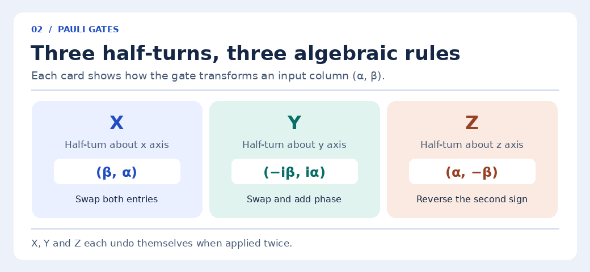

### 6.2 $X$ gate — the quantum NOT

Classical **NOT** sends $0\to1$ and $1\to0$. **$X$ does the same on $\lvert0\rangle$ and $\lvert1\rangle$:**

$$
X\lvert0\rangle=\lvert1\rangle,
\qquad
X\lvert1\rangle=\lvert0\rangle.
$$

That is why the professor calls **$X$ the classical NOT gate** in the $Z$ basis.

**Matrix.**

$$
X=\begin{pmatrix}0&1\\1&0\end{pmatrix}.
$$

Check on $\lvert0\rangle$:

$$
X\lvert0\rangle=
\begin{pmatrix}0&1\\1&0\end{pmatrix}
\begin{pmatrix}1\\0\end{pmatrix}
=
\begin{pmatrix}0\\1\end{pmatrix}
=\lvert1\rangle.
$$

**Superposition.** On $\lvert+\rangle=(\lvert0\rangle+\lvert1\rangle)/\sqrt2$,

$$
X\lvert+\rangle
=\frac{X\lvert0\rangle+X\lvert1\rangle}{\sqrt2}
=\frac{\lvert1\rangle+\lvert0\rangle}{\sqrt2}
=\lvert+\rangle.
$$

Equal weights on $\lvert0\rangle$ and $\lvert1\rangle$ are unchanged — only their **order in the sum** swaps, which does not change the state.

### 6.3 $Y$ gate — bit flip with phase

$Y$ is not a plain NOT. It flips the bit **and** introduces complex phases:

$$
Y=\begin{pmatrix}0&-i\\ i&0\end{pmatrix},
\qquad i=\sqrt{-1}.
$$

$$
Y\lvert0\rangle=i\lvert1\rangle,
\qquad
Y\lvert1\rangle=-i\lvert0\rangle.
$$

| Input | $X$ | $Y$ |
| --- | --- | --- |
| $\lvert0\rangle$ | $\lvert1\rangle$ | $i\lvert1\rangle$ |
| $\lvert1\rangle$ | $\lvert0\rangle$ | $-i\lvert0\rangle$ |

For now: **$X$ flips the bit; $Y$ flips the bit and attaches phase factors** $\pm i$.

### 6.4 $Z$ gate — phase, not bit

$Z$ is central for understanding **phase** in circuits (and links to §8 as $P(\pi)$):

$$
Z=\begin{pmatrix}1&0\\0&-1\end{pmatrix}.
$$

$$
Z\lvert0\rangle=\lvert0\rangle,
\qquad
Z\lvert1\rangle=-\lvert1\rangle.
$$

On $\lvert0\rangle$ or $\lvert1\rangle$ alone, an immediate **$Z$ measurement** gives the same 0/1 statistics as before — the minus sign is **relative phase** on the $\lvert1\rangle$ amplitude.

On a superposition,

$$
Z\lvert+\rangle
=\frac{Z\lvert0\rangle+Z\lvert1\rangle}{\sqrt2}
=\frac{\lvert0\rangle-\lvert1\rangle}{\sqrt2}
=\lvert-\rangle.
$$

So **$Z$ turns $\lvert+\rangle$ into $\lvert-\rangle$** — a **phase flip** between the two branches.

**“No classical meaning”.** $Z\lvert0\rangle=\lvert0\rangle$ and $Z\lvert1\rangle=-\lvert1\rangle$ look like “nothing changed” if you only ask for a $Z$ readout right away (probabilities unchanged). But when the qubit is in superposition, $Z$ changes **relative phase**, which later gates and measurements in other bases can detect. Example from the slide:

- $H\lvert+\rangle=\lvert0\rangle$.
- $H\lvert-\rangle=\lvert1\rangle$.

So $Z$ can change a **future** measurement even when it does not flip the computational bit label.

### 6.5 $X$, $Y$, $Z$ on the Bloch sphere

From earlier lectures, the **Bloch sphere** pictures a single-qubit state with axes **$x$**, **$y$** and **$z$**. The professor describes $X$, $Y$ and $Z$ as **half-turns** ($180^\circ$) about those axes:

| Gate | Bloch picture (lecture) |
| --- | --- |
| $X$ | $180^\circ$ about the $x$-axis |
| $Y$ | $180^\circ$ about the $y$-axis |
| $Z$ | $180^\circ$ about the $z$-axis |

**Detail.** The Pauli **matrices** are related to the full rotation operators $R_x(\pi)$, $R_y(\pi)$, $R_z(\pi)$ in §9 by possible **global phases**. Global phase does not change $Z$-basis probabilities, so the half-turn story is the right intuition on the sphere.

### 6.6 Algebra of Pauli gates

The slide collects rules used to **rewrite** sequences of Paulis.

**Same gate twice → identity.**

$$
X^2=Y^2=Z^2=I.
$$

Example: $X\lvert0\rangle=\lvert1\rangle$, then $X\lvert1\rangle=\lvert0\rangle$, so $XX\lvert0\rangle=\lvert0\rangle$ and **$XX=I$** (similarly $YY=I$, $ZZ=I$).

| Before | After |
| --- | --- |
| $X$ then $X$ | $I$ (remove both) |
| $Y$ then $Y$ | $I$ |
| $Z$ then $Z$ | $I$ |

That is the simplest form of **circuit simplification**.

**Products of two different Paulis** (matrix multiply, same order as applying the **rightmost** gate first on the ket — consistent with §4.3):

$$
XY=iZ,\qquad YZ=iX,\qquad ZX=iY.
$$

So a string such as $X$ then $Y$ can be replaced by a single $Z$ up to the factor $i$. Also

$$
YX=-iZ
$$

because order matters.

**Anticommutation.** Swapping two **different** Paulis introduces a minus sign:

$$
XZ=-ZX,\qquad XY=-YX,\qquad YZ=-ZY.
$$

Check: $XY=iZ$ and $YX=-iZ$ give $XY=-YX$.

| Same Pauli twice | Different Paulis |
| --- | --- |
| $XX=YY=ZZ=I$ | $XY=-YX$, $YZ=-ZY$, $ZX=-XZ$ |
| Pairs cancel | Order flips the sign (and may change the Pauli label) |

Read products like $ZX$ as **$X$ first, then $Z$** on the state (or use §4.3’s diagram order when translating to a circuit).

### 6.7 Why these rules matter on real hardware

Gate-based machines execute a **timeline** of operations — for superconducting qubits, often **microwave pulses** (§4.1). Each extra gate is another chance for **noise** and **decoherence** (loss of quantum behaviour from the environment, temperature and control imperfections). Cryogenic systems run near **10–20 mK** because qubits are fragile.

Compare two circuits that end in the same state:

| Circuit A (unsimplified) | Circuit B (using $XX=YY=ZZ=I$) |
| --- | --- |
| $X,X,Y,Y,Z,Z$ — six native Pauli pulses | $I$ — Pauli pairs cancel |

Same final state, but **B** avoids six operations: fewer pulses, often shorter depth, fewer error opportunities. Simplifying with Pauli algebra does not fix every error proportionally, but **removing redundant gates is usually worth doing**.

### 6.8 The Pauli gates and “group” language

The professor notes that **$I$, $X$, $Y$, $Z$** behave like a small **algebra** under multiplication: identities inverses ($X^{-1}=X$ because $X^2=I$), products produce Paulis times phases, and multiplication associates.

Strictly, $\{I,X,Y,Z\}$ alone is **not closed** under matrix multiply — products can pick up **$i$** or **$-1$**. The full **Pauli group** (16 elements) includes $\{\pm1,\pm i\}$ times each Pauli. For this course, the practical goal is the **multiplication and cancellation rules** in §6.6, not memorising all 16 elements.

**Matrices for reference.**

$$
X=\begin{pmatrix}0&1\\1&0\end{pmatrix},\quad
Y=\begin{pmatrix}0&-i\\i&0\end{pmatrix},\quad
Z=\begin{pmatrix}1&0\\0&-1\end{pmatrix}.
$$

### 6.9 Summary

For an input state $\alpha\lvert0\rangle+\beta\lvert1\rangle$:

| Gate | What it does | Output state |
| --- | --- | --- |
| **$X$** | Swaps the two amplitudes. This is the quantum **NOT** gate. | $\beta\lvert0\rangle+\alpha\lvert1\rangle$ |
| **$Z$** | Changes the sign of the $\lvert1\rangle$ amplitude. | $\alpha\lvert0\rangle-\beta\lvert1\rangle$ |
| **$Y$** | Swaps the amplitudes, then multiplies the new $\lvert0\rangle$ amplitude by $-i$ and the new $\lvert1\rangle$ amplitude by $i$. | $-i\beta\lvert0\rangle+i\alpha\lvert1\rangle$ |

<!-- markdownlint-disable MD033 -->

<iframe src="assets/06_bloch_sphere_xyz.html" title="Bloch sphere: Pauli gates on x, y, z axes" width="100%" height="720" loading="lazy" style="border:1px solid #dce3ef;border-radius:12px;max-width:100%;display:block;"></iframe>

<!-- markdownlint-enable MD033 -->

## 7. The Hadamard gate

Three ideas anchor this slide (the Bloch geometry is often the stumbling block, so build them in order):

1. **$H$ creates superposition** from computational basis kets.
2. **$H$ exchanges the $X$-basis and $Z$-basis.**
3. **On the Bloch sphere**, $H$ is a **$180^\circ$ rotation** about the axis halfway between the **$x$** and **$z$** axes.

### 7.1 What does the Hadamard gate do?

The computational basis is

$$
\lvert0\rangle=\begin{pmatrix}1\\0\end{pmatrix},
\qquad
\lvert1\rangle=\begin{pmatrix}0\\1\end{pmatrix}.
$$

The Hadamard matrix is

$$
H=\frac{1}{\sqrt2}
\begin{pmatrix}
1&1\\
1&-1
\end{pmatrix}.
$$

Memorising the entries can wait; the **actions on $\lvert0\rangle$ and $\lvert1\rangle$** are the priority:

$$
\boxed{H\lvert0\rangle=\lvert+\rangle},
\qquad
\boxed{H\lvert1\rangle=\lvert-\rangle},
$$

with

$$
\lvert+\rangle=\frac{\lvert0\rangle+\lvert1\rangle}{\sqrt2},
\qquad
\lvert-\rangle=\frac{\lvert0\rangle-\lvert1\rangle}{\sqrt2}.
$$

In words:

- $\lvert0\rangle \xrightarrow{H} \lvert+\rangle$ — equal superposition.
- $\lvert1\rangle \xrightarrow{H} \lvert-\rangle$ — equal superposition with a **relative minus** on the $\lvert1\rangle$ branch.

| Input | After $H$ | Role |
| --- | --- | --- |
| $\lvert0\rangle$ | $\lvert+\rangle$ | Equal superposition |
| $\lvert1\rangle$ | $\lvert-\rangle$ | Equal superposition with opposite relative phase |

Both outputs are superpositions, but they are **not** the same state. The minus sign is **relative phase** — invisible to an immediate $Z$ measurement (50/50 either way) but essential in interference and later gates.

### 7.2 “$H$ swaps the $X$ and $Z$ bases”

A **basis** is a set of states used to describe or distinguish qubits.

**$Z$ basis (computational):** $\{\lvert0\rangle,\lvert1\rangle\}$.

**$X$ basis (Hadamard):** $\{\lvert+\rangle,\lvert-\rangle\}$.

Forward:

$$
H\lvert0\rangle=\lvert+\rangle,
\qquad
H\lvert1\rangle=\lvert-\rangle.
$$

Reverse (because $H^2=I$, previewed in §7.3):

$$
H\lvert+\rangle=\lvert0\rangle,
\qquad
H\lvert-\rangle=\lvert1\rangle.
$$

So **$H$ maps $Z$ basis ↔ $X$ basis**. Applying $H$ again returns to the $Z$ basis picture. The professor’s phrase:

**“It swaps the $Z$ and $X$ bases.”**

| Direction | Effect |
| --- | --- |
| $Z \to X$ | $H\lvert0\rangle=\lvert+\rangle$, $H\lvert1\rangle=\lvert-\rangle$ |
| $X \to Z$ | $H\lvert+\rangle=\lvert0\rangle$, $H\lvert-\rangle=\lvert1\rangle$ |

### 7.3 Why $H^2=I$

$$
H^2 = HH = I.
$$

Applying **Hadamard twice** restores the original state.

Example on $\lvert0\rangle$:

$$
H\lvert0\rangle=\lvert+\rangle,
\qquad
H\lvert+\rangle=\lvert0\rangle
\quad\Rightarrow\quad
HH\lvert0\rangle=\lvert0\rangle.
$$

On $\lvert1\rangle$:

$$
H\lvert1\rangle=\lvert-\rangle,
\qquad
H\lvert-\rangle=\lvert1\rangle.
$$

So $\boxed{H^2=I}$. Think of $H$ as a **reversible change of basis** between $Z$ and $X$.

### 7.4 The Hadamard gate on the Bloch sphere

A single qubit is pictured as a **Bloch vector** with axes **$x$**, **$y$**, **$z$**. Familiar pole and equator states:

| Bloch position | State |
| --- | --- |
| $+Z$ | $\lvert0\rangle$ |
| $-Z$ | $\lvert1\rangle$ |
| $+X$ | $\lvert+\rangle$ |
| $-X$ | $\lvert-\rangle$ |
| $+Y$ | $\lvert+i\rangle$ |
| $-Y$ | $\lvert-i\rangle$ |

<!-- markdownlint-disable MD033 -->

<iframe src="assets/07_hadamard_bloch_sphere_3d.html" title="Hadamard rotation on the Bloch sphere — six states in 3D" width="100%" height="780" loading="lazy" style="border:1px solid #dce3ef;border-radius:12px;max-width:100%;display:block;"></iframe>

<!-- markdownlint-enable MD033 -->

Use the **Bloch explorer** at the end of §6 to see Pauli turns on these axes.

The slide’s geometric claim: **$H$ is a $180^\circ$ rotation** about the axis **halfway between $+x$ and $+z$** (often drawn in red on the diagram). Under that turn:

$$
Z \longleftrightarrow X,
\qquad
Y \longrightarrow -Y.
$$

So the **$x$** and **$z$** directions trade roles on the sphere, while **$y$** is reversed — another picture of **$X$ ↔ $Z$ basis exchange**. You do not need the full rotation matrix yet; keep the **half-turn about the $x$–$z$ diagonal** as the geometric summary (also §11).

### 7.5 $X$-basis questions and $Z$-basis measurements (Deutsch–Jozsa)

Suppose you must tell whether a qubit is $\lvert+\rangle$ or $\lvert-\rangle$. Both are superpositions; you cannot “see” them directly.

A **$Z$-basis measurement** on either state gives 50% $\lvert0\rangle$ and 50% $\lvert1\rangle$ — useless for distinguishing them.

| State | $P(0)$ | $P(1)$ |
| --- | --- | --- |
| $\lvert+\rangle$ | 50% | 50% |
| $\lvert-\rangle$ | 50% | 50% |

**Idea:** convert $X$-basis information into **$Z$-basis** form, then measure in $Z$.

**$H$ does that:**

$$
H\lvert+\rangle=\lvert0\rangle,
\qquad
H\lvert-\rangle=\lvert1\rangle.
$$

| Case | Pipeline | $Z$ measurement |
| --- | --- | --- |
| Input $\lvert+\rangle$ | $H$ → $\lvert0\rangle$ | Outcome **0** (deterministic) |
| Input $\lvert-\rangle$ | $H$ → $\lvert1\rangle$ | Outcome **1** (deterministic) |

Professor’s summary:

**“It turns an $X$-basis question into a $Z$-basis measurement.”**

Practical rule: to **measure in the $X$ basis**, apply **$H$**, then measure in the **$Z$** basis (§15 develops basis change more generally).

**Deutsch–Jozsa (§2.2).** The algorithm uses **$H$** to prepare superpositions on the input register, runs the oracle, then applies **$H$ again** before measurement so information that lived in the **$X$** picture is read out in the **$Z$** picture. Under the algorithm’s promise (constant vs balanced), that final readout distinguishes the cases — you cannot read **relative phase** directly with a bare $Z$ meter, so **$H$ before measurement** is the standard trick.

### 7.6 What $H=(X+Z)/\sqrt2$ means

From §6:

$$
X=\begin{pmatrix}0&1\\1&0\end{pmatrix},
\qquad
Z=\begin{pmatrix}1&0\\0&-1\end{pmatrix}.
$$

Add and scale:

$$
X+Z=\begin{pmatrix}1&1\\1&-1\end{pmatrix},
\qquad
\boxed{H=\frac{X+Z}{\sqrt2}}
=\frac{1}{\sqrt2}\begin{pmatrix}1&1\\1&-1\end{pmatrix}.
$$

This **ties $H$ to Pauli $X$ and $Z$** and matches the **rotation axis halfway between $x$ and $z$**.

**Important:** $H=(X+Z)/\sqrt2$ is an **operator identity**, not a recipe “apply $X$, then apply $Z$” on hardware to build $H$.

### 7.7 Pauli algebra and circuit simplification (recap)

§6 gave anticommutation and products, for example:

$$
XZ=-ZX,
\qquad
ZX=iY.
$$

Those rules let you **replace gate sequences** instead of stacking redundant Paulis — fewer pulses and less exposure to decoherence (§6.7).

Example: a diagram order **$X$ then $Z$** corresponds to the matrix product **$ZX=iY$** (§4.3). The factor $i$ is a **global phase** when $Y$ acts alone on the ket, so for measurement statistics the composite step is often treated like **$Y$** up to phase.

The slide revisits Pauli relations because **$H$ itself is built from $X$ and $Z$** — the same algebra you will use to simplify circuits around Hadamards (for example $HXH=Z$ in §18).

**Reference (full §7 story in one place):**

$$
H=\frac{1}{\sqrt2}\begin{pmatrix}1&1\\1&-1\end{pmatrix}
=\frac{X+Z}{\sqrt2},
\quad
H^2=I.
$$

### 7.9 Check your understanding

<!-- markdownlint-disable MD033 -->

<iframe src="assets/07_hadamard_gate_quiz.html" title="Hadamard gate quiz" width="100%" height="820" loading="lazy" style="border:1px solid #dce3ef;border-radius:12px;max-width:100%;display:block;"></iframe>

<!-- markdownlint-enable MD033 -->

## 8. The phase ladder from $T$ to $S$ to $Z$

**Main idea.** **$X$** can change which computational bit you are likelier to measure. **$Z$**, **$S$** and **$T$** are **phase** gates: they rotate **relative phase** around the Bloch **$z$** axis while **$Z$-basis measurement probabilities** stay the same (immediately after the gate). The professor calls **$T \to S \to Z$** a **phase ladder** because each step adds a larger phase increment:

- **$T$** — $45^\circ$
- **$S$** — $90^\circ$
- **$Z$** — $180^\circ$

### 8.1 What phase means

From §7 and §4.4 you already know:

$$
\lvert+\rangle=\frac{\lvert0\rangle+\lvert1\rangle}{\sqrt2},
\qquad
\lvert-\rangle=\frac{\lvert0\rangle-\lvert1\rangle}{\sqrt2}.
$$

The only difference is the **sign** between the $\lvert0\rangle$ and $\lvert1\rangle$ terms — **relative phase**. Phase matters because later gates **interfere** amplitudes differently (§4.4: order of $S$ and $H$ changes the outcome even when immediate $Z$ odds look identical).

Example: for $\lvert\psi\rangle=(\lvert0\rangle+\lvert1\rangle)/\sqrt2$ or $(\lvert0\rangle-\lvert1\rangle)/\sqrt2$, **$P(0)=P(1)=50\%$** in both cases, but the states are not the same. Phase gates exploit that distinction in algorithms.

### 8.2 What is a phase gate?

The general **phase gate** on the slide is

$$
P(\phi)=\begin{pmatrix}1&0\\0&e^{i\phi}\end{pmatrix}
=\operatorname{diag}(1,e^{i\phi}).
$$

Write a qubit as $\lvert\psi\rangle=a\lvert0\rangle+b\lvert1\rangle$. Then

$$
P(\phi)\lvert\psi\rangle=a\lvert0\rangle+be^{i\phi}\lvert1\rangle.
$$

- The $\lvert0\rangle$ amplitude is unchanged.
- The $\lvert1\rangle$ amplitude is multiplied by $e^{i\phi}$.

**Magnitudes** $\lvert a\rvert$ and $\lvert b\rvert$ are unchanged, so **$Z$-basis probabilities** do not change. Only **relative phase** changes.

| Stage | State |
| --- | --- |
| Before $P(\phi)$ | $a\lvert0\rangle+b\lvert1\rangle$ |
| After $P(\phi)$ | $a\lvert0\rangle+be^{i\phi}\lvert1\rangle$ |

On the Bloch sphere, the state vector **rotates about $+z$** by angle $\phi$. **$Z$**, **$S$** and **$T$** are the special cases $\phi=\pi$, $\pi/2$, and $\pi/4$.

### 8.3 The phase ladder: $T$, $S$ and $Z$

$$
P(\phi)=\begin{pmatrix}1&0\\0&e^{i\phi}\end{pmatrix}.
$$

Pick $\phi$ to name the gate:

| Gate | Definition | Phase on $\lvert1\rangle$ |
| --- | --- | --- |
| **$T$** | $P(\pi/4)$ | $45^\circ$ |
| **$S$** | $P(\pi/2)$ | $90^\circ$ |
| **$Z$** | $P(\pi)$ | $180^\circ$ ($\pi=180^\circ$) |

#### 8.3.1 $Z$ — $180^\circ$

From §6: $Z=\begin{pmatrix}1&0\\0&-1\end{pmatrix}=P(\pi)$ because $e^{i\pi}=-1$.

$$
Z\lvert+\rangle=\frac{\lvert0\rangle-\lvert1\rangle}{\sqrt2}=\lvert-\rangle.
$$

**$\boxed{Z\lvert+\rangle=\lvert-\rangle}$** — a half-turn in phase on the equator.

#### 8.3.2 $S$ — $90^\circ$

$$
S=P(\pi/2)=\begin{pmatrix}1&0\\0&i\end{pmatrix},
\qquad e^{i\pi/2}=i.
$$

$$
S\lvert+\rangle=\frac{\lvert0\rangle+i\lvert1\rangle}{\sqrt2}=\lvert{+i}\rangle.
$$

**$\boxed{S\lvert+\rangle=\lvert{+i}\rangle}$** — $90^\circ$ about $z$ (slide’s green-arrow picture).

#### 8.3.3 $T$ — $45^\circ$

$$
T=P(\pi/4)=\begin{pmatrix}1&0\\0&e^{i\pi/4}\end{pmatrix}.
$$

Euler’s formula: $e^{i\theta}=\cos\theta+i\sin\theta$, so $e^{i\pi/4}=(1+i)/\sqrt2$.

$$
T\lvert+\rangle=\frac{\lvert0\rangle+e^{i\pi/4}\lvert1\rangle}{\sqrt2}.
$$

The $\lvert0\rangle$ branch is unchanged; the $\lvert1\rangle$ branch picks up **$45^\circ$** phase (slide’s blue arrow). Deeper intuition for $T$ in the circuit-model overview: §2.3 (`t_gate_explainer.html`).

**Summary on $\lvert+\rangle$:**

| Gate | Effect on $\lvert+\rangle$ |
| --- | --- |
| $T$ | $(\lvert0\rangle+e^{i\pi/4}\lvert1\rangle)/\sqrt2$ |
| $S$ | $\lvert{+i}\rangle$ |
| $Z$ | $\lvert-\rangle$ |

All three rotate about **$+z$**; only the angle differs.

### 8.4 “Looking down from $+Z$” on the equator

Picture the Bloch sphere **from above** (+$Z$, “north pole” view). The **equator** is a circle in the $xy$ plane. Standard reference kets on that circle:

| Direction | State |
| --- | --- |
| $+X$ | $\lvert+\rangle$ |
| $-X$ | $\lvert-\rangle$ |
| $+Y$ | $\lvert{+i}\rangle$ |
| $-Y$ | $\lvert{-i}\rangle$ |

Starting at **$\lvert+\rangle$** (0° on the equator in this picture):

| Gate | Rotation | Result (from $\lvert+\rangle$) |
| --- | --- | --- |
| $T$ | $45^\circ$ along equator | $(\lvert0\rangle+e^{i\pi/4}\lvert1\rangle)/\sqrt2$ |
| $S$ | $90^\circ$ | $\lvert{+i}\rangle$ (+$Y$) |
| $Z$ | $180^\circ$ | $\lvert-\rangle$ (opposite side, $-X$) |

The state **stays on the equator** for these phase gates on $\lvert+\rangle$ — it **slides around the circle**, not up/down the $z$ axis.

### 8.5 Why $Z$-basis probabilities do not change

For $\lvert+\rangle$, $P(0)=P(1)=1/2$. After **$T$**:

$$
T\lvert+\rangle=\frac{\lvert0\rangle+e^{i\pi/4}\lvert1\rangle}{\sqrt2}.
$$

$$
P(0)=\left|\frac{1}{\sqrt2}\right|^2=\frac12,
\qquad
P(1)=\left|\frac{e^{i\pi/4}}{\sqrt2}\right|^2=\frac12,
$$

because **$\lvert e^{i\phi}\rvert=1$**. The same logic holds for **$S$** and **$Z$** immediately after the gate.

| Stage | $P(0)$ | $P(1)$ |
| --- | --- | --- |
| $\lvert+\rangle$ (before) | 50% | 50% |
| After $T$, $S$, or $Z$ alone | 50% | 50% |

**But:** phase still matters **later** — e.g. $T$ then $H$ vs $H$ then $T$ (§4.4) gives different states. Algorithms use that stored phase information.

### 8.6 Why $T^2=S$, $S^2=Z$, $Z^2=I$ and $T^8=I$

Rotations about the **same** axis **add** when gates are composed (same convention as on the slide):

| Identity | Angle picture |
| --- | --- |
| $\boxed{T^2=S}$ | $45^\circ+45^\circ=90^\circ$ |
| $\boxed{S^2=Z}$ | $90^\circ+90^\circ=180^\circ$ |
| $\boxed{Z^2=I}$ | $180^\circ+180^\circ=360^\circ$ (full turn) |
| $\boxed{T^8=I}$ | $8\times 45^\circ=360^\circ$ |

**Phase ladder (conceptual):**

$$
T \xrightarrow{\times 2} S \xrightarrow{\times 2} Z \xrightarrow{\times 2} I.
$$

Like §6 Pauli cancellations, these identities **simplify circuits** (replace eight $T$’s by $I$, two $T$’s by one $S$, and so on).

### 8.7 Why $T$ is also called the $\pi/8$ gate

**$T$** applies **$45^\circ=\pi/4$** phase to the $\lvert1\rangle$ branch via $e^{i\pi/4}$.

In the **$R_z$** convention (§9), one often writes

$$
T=e^{i\pi/8}R_z(\pi/4),
$$

where **$e^{i\pi/8}$** is a **global phase** (invisible to $Z$ probabilities). The **$\pi/8$** name comes from that factor and the **half-angle** bookkeeping inside $R_z$, not from forgetting that the **Bloch** turn is $\pi/4$. For now: **$T$ = $45^\circ$ phase gate**, nicknamed **$\pi/8$ gate**.

### 8.8 Phase ladder on the Bloch sphere (interactive)

Explore **$T$**, **$S$**, and **$Z$** as rotations about **$+z$** starting from $\lvert+\rangle$. The view matches §8.4 (“looking down from $+Z$”): each gate steps the state around the **equator** by $45^\circ$, $90^\circ$, or $180^\circ$ without leaving the circle. Use this before the **$H$ then $T$** notebook walkthrough in §8.9 to connect the slide algebra to the sphere picture.

<!-- markdownlint-disable MD033 -->

<iframe src="assets/08_phase_ladder_bloch_sphere_3d.html" title="Phase ladder T, S, Z on the Bloch sphere in 3D" width="100%" height="780" loading="lazy" style="border:1px solid #dce3ef;border-radius:12px;max-width:100%;display:block;"></iframe>

<!-- markdownlint-enable MD033 -->

### 8.9 Notebook example: $H$ then $T$

The slide runs a one-qubit circuit:

~~~python
from qiskit import QuantumCircuit
from qiskit.quantum_info import Statevector

qc = QuantumCircuit(1)
qc.h(0)
qc.t(0)
Statevector(qc)
~~~

Steps:

$$
\lvert0\rangle \xrightarrow{H} \lvert+\rangle
\xrightarrow{T}
\frac{\lvert0\rangle+e^{i\pi/4}\lvert1\rangle}{\sqrt2}.
$$

Column vector:

$$
\begin{pmatrix}1/\sqrt2\\ e^{i\pi/4}/\sqrt2\end{pmatrix},
\qquad
e^{i\pi/4}=\frac{1+i}{\sqrt2}.
$$

Numerically:

$$
\boxed{\begin{pmatrix}1/\sqrt2 \\ (1+i)/2\end{pmatrix}
\approx \begin{pmatrix}0.707 \\ 0.5+0.5i\end{pmatrix}}.
$$

The second amplitude is **complex** because **$T$** inserted phase; magnitudes still give 50/50 in $Z$.

## 9. Rotation gates and the half-angle

*Slide 10.*

A rotation about a Pauli axis uses an angle $\theta$ in the sphere picture and $\theta/2$ inside the formula. Here $R_x(\theta)$ means a turn by $\theta$ about $x$.

$$
R_x(\theta)=\cos(\theta/2)I-i\sin(\theta/2)X,\quad
R_y(\theta)=\begin{pmatrix}
\cos(\theta/2)&-\sin(\theta/2)\\
\sin(\theta/2)&\cos(\theta/2)
\end{pmatrix},\quad
R_z(\theta)=\begin{pmatrix}e^{-i\theta/2}&0\\0&e^{i\theta/2}\end{pmatrix}.
$$

Follow the first column of $R_y(\theta)$. Starting from the north pole $\lvert0\rangle$, a $90^\circ$ turn gives $(\lvert0\rangle+\lvert1\rangle)/\sqrt2$ because the sine and cosine are evaluated at $45^\circ$. A $180^\circ$ turn gives $\lvert1\rangle$. The Bloch height is
$\cos^2(\theta/2)-\sin^2(\theta/2)=\cos\theta$.

Factoring $e^{-i\theta/2}$ out of $R_z(\theta)$ leaves $P(\theta)$. For a single gate on its own, this common factor is a global phase. Section 13 explains what changes if that rotation is controlled.

## 10. Poll on equivalent gates up to global phase

*Slide 11.*

Two gates are equivalent up to global phase when the **same** unit-magnitude factor relates their whole matrices. Comparing only what they do to $\lvert0\rangle$ can hide a sign difference in the second column.

| Pair from the poll | Equivalent? | Check |
| --- | --- | --- |
| $S$ and $R_z(\pi/2)$ | Yes | $R_z(\pi/2)=e^{-i\pi/4}S$ |
| $Z$ and $R_z(\pi)$ | Yes | $R_z(\pi)=-iZ$ |
| $X$ and $R_x(\pi)$ | Yes | $R_x(\pi)=-iX$ |
| $H$ and $R_y(\pi/2)$ | No | Both send $\lvert0\rangle$ to $\lvert+\rangle$, but the outputs on $\lvert1\rangle$ have opposite signs |

In fact $H=XR_y(\pi/2)$, meaning $R_y(\pi/2)$ followed by $X$. Checking that two gates give the same measurement probabilities on one state is weaker than checking their matrices. The slide’s `Operator.equiv` examples check the whole operators up to global phase.

## 11. Every single-qubit unitary is a rotation up to phase

*Slide 12.*

A one-qubit unitary can be written as a common phase times a rotation about some axis $\hat n$. On the Bloch sphere, the common phase is invisible. Some axes are easy to recognize. $X,Y,Z$ turn $180^\circ$ about their namesake axes. $H$ turns $180^\circ$ about the axis halfway between $x$ and $z$. $S$ and $T$ turn about $z$ by $90^\circ$ and $45^\circ$.

The lecture previews a way to build an arbitrary single-qubit turn using rotations about $z$, $y$ and $z$. A circuit compiler can use such decompositions to express a desired operation in the gates it has available.

## 12. CNOT and CZ

*Slide 13.*

With a top control and bottom target, CNOT sends $\lvert a,b\rangle$ to $\lvert a,a\oplus b\rangle$, where $\oplus$ means XOR. It swaps the $10$ and $11$ basis states. CZ keeps all four basis labels and multiplies the amplitude of $\lvert11\rangle$ by $-1$.

$$
\operatorname{CZ}=\operatorname{diag}(1,1,1,-1)
=P_0\otimes I+P_1\otimes Z,\qquad
P_j=\lvert j\rangle\langle j\rvert.
$$

CZ is symmetric under swapping its wires because “both bits are $1$” is a symmetric condition. To obtain CNOT, put $H$ on the target before and after CZ. If the control is $0$, the target sees $HIH=I$. If it is $1$, the target sees $HZH=X$.

$$
\operatorname{CNOT}=(I\otimes H)\operatorname{CZ}(I\otimes H).
$$

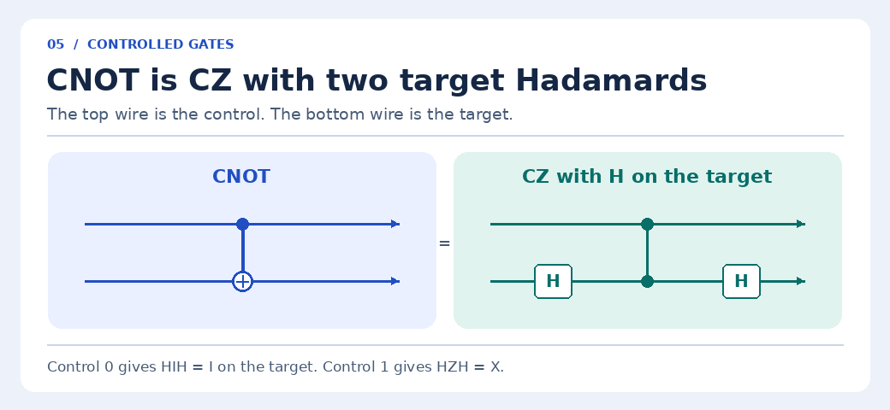

## 13. Controlled-$U$ and phase kickback

*Slide 14.*

A controlled-$U$ applies $I$ to the target in the control-$0$ branch and $U$ in the control-$1$ branch. The control value is preserved. Both branches evolve coherently if the control is in a superposition.

$$
C(U)=P_0\otimes I+P_1\otimes U.
$$

Suppose the target is an eigenstate $\lvert u\rangle$ with $U\lvert u\rangle=e^{i\phi}\lvert u\rangle$. Only the control-$1$ branch picks up that phase.

$$
C(U)(\alpha\lvert0\rangle+\beta\lvert1\rangle)\lvert u\rangle
=(\alpha\lvert0\rangle+\beta e^{i\phi}\lvert1\rangle)\lvert u\rangle.
$$

The shared target ket factors out. The phase now appears on the control’s second amplitude. In the earlier Deutsch example, $U=X$ and $\lvert u\rangle=\lvert-\rangle$, so $X\lvert-\rangle=-\lvert-\rangle$ and the phase is a minus sign.

A useful distinction from the poll is that $U$ and $e^{i\gamma}U$ are globally equivalent **as standalone gates**. Once controlled, the phase applies to one branch only. For example, controlled-$I$ is the identity, while controlled-$(-I)$ is $Z$ on the control.

## 14. Toffoli and multi-controlled gates

*Slide 15.*

Toffoli, also written CCX or CCNOT, has two controls and one target. It flips the target if both controls are $1$.

$$
\lvert a,b,c\rangle\longmapsto\lvert a,b,c\oplus ab\rangle.
$$

Among the eight basis strings, only $110$ and $111$ are swapped. A solid control dot means “fires on $1$”. An open dot means “fires on $0$”. An open control can be implemented by placing $X$ on its wire before and after the usual solid control. With more controls, the target flips only when all specified conditions hold.

## 15. Measuring in another basis

*Slides 16–17.*

The circuit examples end with a computational-basis readout. To measure in the basis $\{U\lvert0\rangle,U\lvert1\rangle\}$, first apply $U^\dagger$. This sends each basis vector to its corresponding computational ket. The resulting bit tells you which outcome of the desired basis you measured.

| Desired basis | States reported as $0$ and $1$ | Gates before readout, in time order |
| --- | --- | --- |
| $Z$ | $\lvert0\rangle,\lvert1\rangle$ | None |
| $X$ | $\lvert+\rangle,\lvert-\rangle$ | $H$ |
| $Y$ | $\lvert+i\rangle,\lvert-i\rangle$ | $S^\dagger$, then $H$ |

For the $Y$ basis, $H$ then $S$ prepares the basis vectors from $\lvert0\rangle$ and $\lvert1\rangle$. Undo those gates in reverse order. On the slide’s $\lvert+i\rangle$ example, $S^\dagger$ first gives $\lvert+\rangle$, then $H$ gives $\lvert0\rangle$. Thus the readout is $0$ with certainty on an ideal circuit.

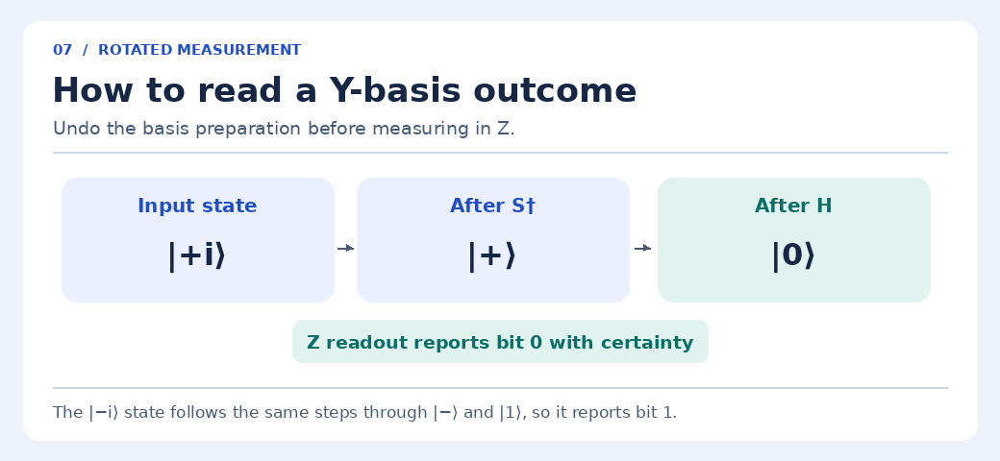

| Prepared state | $Z$-basis readout | $X$-basis readout | $Y$-basis readout |
| --- | --- | --- | --- |
| $\lvert+\rangle$ | 50/50 | Always $0$ | 50/50 |
| $\lvert+i\rangle$ | 50/50 | 50/50 | Always $0$ |

## 16. Classically controlled gates

*Slide 18.*

A **classical control** uses a bit already obtained from a measurement. In the example, prepare the top wire in $\lvert+\rangle$ and the bottom wire in $\lvert0\rangle$. Measure the top wire in the $Z$ basis. If that bit is $1$, apply $X$ to the bottom wire. If it is $0$, leave the bottom wire alone.

The two recorded bits are $00$ or $11$, each with probability $1/2$. The decision is made during the circuit run. In the lecture this is called **feedforward**. The same pattern appears in teleportation corrections and in reset by measurement followed by a conditional flip.

## 17. Deferred measurement and one-wire identities

*Slides 19–20.*

For the feedforward example, replace the early measurement and conditional $X$ with a coherent CNOT. Measure the control at the end instead. The final computational-basis statistics are the same. Before that final measurement, the coherent version is still in the Bell superposition $(\lvert00\rangle+\lvert11\rangle)/\sqrt2$. This equivalence concerns the final outcomes and conditional branches in the stated circuit. A different joint measurement that probes coherence can distinguish a Bell state from the mixture created by an early measurement.

The lecture then collects identities a compiler can use to rewrite gates.

| Identity | How to read it |
| --- | --- |
| $X^2=Y^2=Z^2=H^2=I$ | Two consecutive copies cancel. |
| $HXH=Z$ and $HZH=X$ | Hadamard exchanges $X$ and $Z$. |
| $HYH=-Y$ | Equal to $Y$ up to global phase. |
| $T^2=S$, $S^2=Z$, $SS^\dagger=I$ | Combine or cancel the phase rotations. |
| $SXS^\dagger=Y$ | Apply $S^\dagger$, then $X$, then $S$. |

## 18. Circuit identities on two wires

*Slides 21–22, followed by the break on slide 23.*

**Reverse a CNOT.** Put $H$ on both wires before and after CNOT. This switches which wire is the control. To see it, first write CNOT as CZ with $H$ on its target on both sides. The added target Hadamards cancel in pairs, and the added Hadamards on the other wire make that wire the new target. This works because CZ is symmetric.

**Make a SWAP.** Apply CNOT top to bottom, then bottom to top, then top to bottom. Track the two bits.

$$
(a,b)\to(a,a\oplus b)\to(b,a\oplus b)\to(b,a).
$$

For example, $01\to01\to11\to10$. Because the identity holds on each basis string, linearity makes it hold for superpositions too.

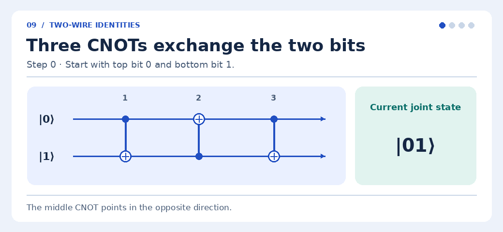

**Move a Pauli past CNOT.** Let $C$ denote top-control CNOT. Since $C^2=I$, the following identities tell you which Pauli goes on the output side when you move it through $C$.

| Pauli on the input side | $C(\text{Pauli})C$ on the output side |
| --- | --- |
| $X\otimes I$ | $X\otimes X$ |
| $I\otimes X$ | $I\otimes X$ |
| $Z\otimes I$ | $Z\otimes I$ |
| $I\otimes Z$ | $Z\otimes Z$ |

The control bit determines the target flip, so an input $X$ on the control spreads to the target. An input $Z$ on the target picks up a phase depending on both bits because CNOT changes the target bit to $a\oplus b$. The worked practice shows how to check each identity on a basis ket. The lecture uses `Operator.equiv` to check the two-wire rewrites numerically.

## 19. Reversible logic and why bare AND loses information

*Slide 24.*

The classical AND function outputs $1$ only for input $11$. The inputs $00,01,10$ all produce $0$. If all you have is that one output bit, you cannot recover which of those three inputs produced it.

A unitary has an inverse. It also preserves inner products, so it must send distinct, orthogonal computational inputs to distinct, orthogonal outputs. The bare two-input, one-output AND function cannot be used as a unitary gate in that form.

## 20. Making classical logic reversible

*Slide 24.*

Keep both inputs and use a third bit $c$ as a target. XOR the answer into that target.

$$
(a,b,c)\longmapsto(a,b,c\oplus ab).
$$

With $c=0$, the last bit becomes the AND result $ab$. With $c=1$, it becomes $1\oplus ab$, which is NAND. Running the same operation again gives $c\oplus ab\oplus ab=c$. The embedding preserves enough information to go backwards. This is exactly Toffoli.

The slide connects reversible logic to Landauer’s principle. Ideally erasing an unknown, equally likely bit at temperature $T$ releases at least $k_BT\ln2$ of heat. Logical reversibility avoids the erasure step in this model. An actual device still has costs for controlling, operating and reading its gates.

## 21. The reversible gate zoo and ancillas

*Slides 25–26.*

An **ancilla** is an extra qubit used as a helper. A clean one is prepared in a known state such as $\lvert0\rangle$. It can be used for output or for temporary storage, depending on its role.

| Want | Reversible construction |
| --- | --- |
| NOT | Apply $X$ to the bit. |
| XOR | Apply CNOT. The target gets $a\oplus b$. |
| AND or NAND | Use Toffoli with inputs $a,b$ and a target initially $0$ or $1$, respectively. |
| OR | Flip both inputs, apply Toffoli to a target initially $1$, then restore the inputs. The target is $1\oplus(\bar a\bar b)=a\lor b$. |
| Controlled swap | Use Fredkin. Swap the two targets only when the control is $1$. |
| Copy a computational-basis bit | Use CNOT onto a target initially $0$. |

NOT, CNOT, Toffoli and Fredkin are their own inverses. Toffoli with fixed input bits can build general reversible Boolean computations. For example, fixing both controls to $1$ yields a NOT on the target, and fixing one control to $1$ yields a CNOT on the other control and the target.

**Copying a basis label versus cloning a state.** CNOT sends $\lvert a,0\rangle$ to $\lvert a,a\rangle$ for $a=0$ or $1$. On $\lvert+\rangle\lvert0\rangle$ it yields $(\lvert00\rangle+\lvert11\rangle)/\sqrt2$. Two independent copies $\lvert+\rangle\lvert+\rangle$ would also contain $01$ and $10$. This difference matters when you copy a function output coherently in §24.

## 22. Reversible synthesis of a majority function

*Slide 27.*

The synthesis recipe starts by writing the function as an XOR of AND terms. Apply one multi-controlled $X$ to the **same** target for each term. Each gate toggles the target when its term evaluates to $1$. Together they XOR the function value into the target.

For three bits, majority returns $1$ if at least two inputs are $1$.

$$
\operatorname{MAJ}(x_1,x_2,x_3)=x_1x_2\oplus x_1x_3\oplus x_2x_3.
$$

| Input type | Number of AND terms that are $1$ | Majority bit |
| --- | --- | --- |
| No ones or just one one | 0 | 0 |
| Exactly two ones | 1 | 1 |
| Three ones | 3 | 1 |

For $111$, all three gates toggle, so the final effect is one net flip. For $110$, only the first pair controls a flip. Three Toffolis implement this formula with no scratch qubit beyond the output target. The input wires are preserved.

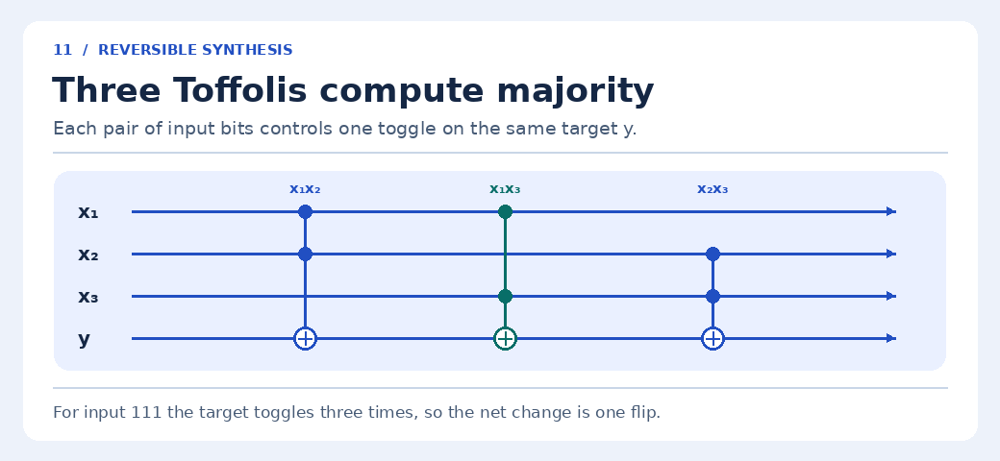

## 23. The garbage problem

*Slide 28. The professor postponed the full explanation. This walkthrough follows the slide.*

A circuit may leave intermediate data in its work register. This leftover information is called **garbage**. When the input is a superposition, garbage can record which branch the computation came from. This can weaken or remove interference on the input register.

For a two-branch example, a clean sign-marked input could look like $(\lvert0\rangle-\lvert1\rangle)\lvert g\rangle/\sqrt2$. The same $\lvert g\rangle$ accompanies both branches, so the top wire is simply $\lvert-\rangle$ and $H$ sends it to $\lvert1\rangle$. If the work labels are instead $\lvert0\rangle$ and $\lvert1\rangle$, the joint state is $(\lvert00\rangle-\lvert11\rangle)/\sqrt2$. Applying $H$ to the top wire gives each top outcome with probability $1/2$. The work labels are orthogonal, so their contributions to the same top outcome cannot cancel.

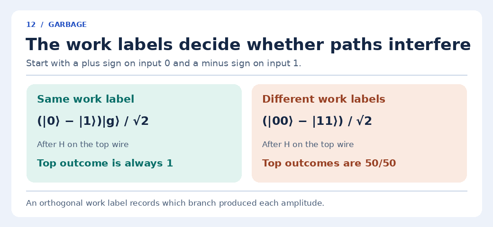

## 24. Compute, copy and uncompute

*Slide 29.*

Think of the circuit as having three registers: input, work, and output. First compute $f(x)$ into the work register, along with any temporary values. Next use CNOT to XOR the answer into an output initialized to $0$. Finally apply the inverse of the compute block to the input and work registers. The output wire stays outside that inverse block.

| Step | Input | Work | Output |
| --- | --- | --- | --- |
| Start | $x$ | $0$ | $0$ |
| Compute | $x$ | Contains $f(x)$ and scratch values | $0$ |
| Copy | $x$ | Same contents | $f(x)$ |
| Uncompute | $x$ | $0$ | $f(x)$ |

To invert a block, reverse the gate order and replace each gate with its inverse. For Toffoli and CNOT, the inverse is the same gate. For $S$, the inverse is $S^\dagger$. The cost is one compute block, its inverse, and the copy operation. This returns the work register to its starting state even on a superposition, by linearity. The output can still be entangled with the input if $f(x)$ varies across the superposition. A bit oracle deliberately keeps that answer. A phase oracle keeps a sign on each input branch while leaving work clean.

## 25. Worked AND and phase-oracle examples

*Slides 30–32. The transcript introduces these examples briefly. The gate-by-gate details come from the slides.*

**Three-input AND with one scratch qubit.** Use a clean work bit $w=0$ and a separate target $y$.

1. Toffoli with controls $x_1,x_2$ puts $x_1x_2$ into $w$.
2. Toffoli with controls $w,x_3$ toggles $y$ by $wx_3=x_1x_2x_3$.
3. Repeat the first Toffoli to restore $w=0$. The change to $y$ is preserved.

For $x_1x_2x_3=111$ and $y=0$, the $(w,y)$ pair goes $(0,0)\to(1,0)\to(1,1)\to(0,1)$. With $110$, the second gate sees $x_3=0$, so $y$ stays $0$ throughout. This is a three-controlled $X$ built from three Toffolis with one clean ancilla.

**Mark just the string $101$.** Apply $X$ on the middle wire, apply CCZ, then undo the middle-wire $X$. CCZ changes the sign of $\lvert111\rangle$ only. The first $X$ converts $101$ into $111$ and the final $X$ restores the original label. The net effect is $\lvert101\rangle\mapsto-\lvert101\rangle$ with all other basis kets fixed. In an equal superposition only that one amplitude changes sign, leaving all immediate computational-basis probabilities unchanged. The sign can affect later interference, as in Grover search.

**Clean, dirty and garbage.** A clean ancilla in slide 32 starts in $\lvert0\rangle$ and must return to $\lvert0\rangle$. A dirty or borrowed ancilla starts in an unknown state and must be restored to that state. Garbage is information left behind when temporary registers are left correlated with the input. In the slide’s clean-ancilla chain, an $n$-controlled $X$ uses $n-2$ clean helpers and $2n-3$ Toffolis for $n\ge2$. For four controls that means two helpers and five Toffolis. This is one particular trade-off between qubits and gates.

## 26. Can a quantum computer add $3+4$?

*Slides 33–34.*

Yes. The example uses reversible versions of familiar binary adder blocks. Keep register $a$, overwrite register $b$ with the three low sum bits, and write the final carry into a separate wire. The circuit also keeps two intermediate carry bits.

Start with $a=011_2=3$ and $b=100_2=4$. Begin at bit $0$, the rightmost column.

| Bit $i$ | $a_i$ | $b_i$ | Carry in $c_i$ | Sum $s_i$ | Carry out $c_{i+1}$ |
| --- | ---: | ---: | ---: | ---: | ---: |
| 0 | 1 | 0 | 0 | 1 | 0 |
| 1 | 1 | 0 | 0 | 1 | 0 |
| 2 | 0 | 1 | 0 | 1 | 0 |

The result is $c_3s_2s_1s_0=0111_2=7$. The first column is a **half adder** with sum $a_0\oplus b_0$ and carry $a_0b_0$. The other columns are **full adders** because they also accept a carry in. One way to see the two Toffolis and two CNOTs in each full adder is to form the carry contributions $a_ib_i$ and $c_i(a_i\oplus b_i)$, with a CNOT turning $b_i$ into $a_i\oplus b_i$ between those steps. A second CNOT adds $c_i$ into that same sum wire.

**Counting the circuit.** The example uses nine qubits, including six input bits and three carry wires. The half adder takes one Toffoli and one CNOT. The two full adders take two Toffolis and two CNOTs each. That is **five Toffolis and five CNOTs** before decomposition. The slide’s example decomposes one Toffoli into six CNOTs, four $T$ gates, three $T^\dagger$ gates and two $H$ gates. Using that decomposition for all five gives **35 CNOTs in total** ($5\times6+5$), **35 $T$-type gates** and **10 Hadamards** before routing or optimization. The two intermediate carries are left as garbage in this circuit. This count is for the slide’s construction.

## 27. Qiskit laboratories and practical instructions

*Spoken lab walkthrough, alongside slides 35–37.*

The lecture describes downloading the course notebook from the professor’s labs page, opening it in Colab or a local Jupyter environment, then running the setup and example cells in order. For a local run, use the course’s supplied `requirements.txt` to reproduce the notebook’s environment. The demo mentions Qiskit, Qiskit Aer, NumPy and Matplotlib.

The gate card on slide 35 is the lookup table for the notebook. These are the method names shown in the lecture.

| Idea | Lecture’s notebook names |
| --- | --- |
| One-wire gates | `x`, `y`, `z`, `h`, `s`, `sdg`, `t`, `tdg` |
| Phase and rotations | `p`, `rx`, `ry`, `rz` |
| Two-wire gates | `cx`, `cz`, `swap` |
| Multi-controlled gates | `ccx`, `mcx` |
| Measurement and feedforward | `measure`, then `if_test` for a classical condition |

One example from the lab is the $Y$-basis measurement. Prepare $\lvert+i\rangle$ with $H$ then $S$, then undo with $S^\dagger$ then $H$. The expected ideal readout is $0$. Another example uses `Operator.equiv` to compare reversed-CNOT circuits up to global phase. When reading a displayed two-bit string in the notebook, check which qubit is assigned to each character. The algebra here uses the top-wire-first convention from the diagrams.

## 28. Closing advice and final questions

*Slide 37 and the spoken closing remarks.*

The professor suggests changing one gate, predicting the result with algebra or a Bloch-sphere sketch, then checking it in the notebook. For example, in §4 swap $H$ and $S$. Predict both the state vector and the $Z$-basis histogram. The state vector changes, while the ideal histogram is still 50/50. Try an $X$- or $Y$-basis readout to reveal the difference.

Slide 37 points to Nielsen and Chuang for single-qubit operations, controlled operations, deferred measurement and energy in reversible computation.

## Practice with worked answers

These are the eight exercises from slide 36, in the slide’s order.

1. **Why do $T^2=S$ and $S^2=Z$? When does $T^k=I$?** The second diagonal entry of $T^k$ is $e^{ik\pi/4}$. The powers $k=2,4$ give $i,-1$, respectively, so $T^2=S$ and $S^2=Z$. The first positive $k$ that gives $1$ is $8$.
2. **What does $H$, then $S$, then $H$ do to $\lvert0\rangle$?** The first two gates give $\lvert+i\rangle$. The last gives $\big[(1+i)\lvert0\rangle+(1-i)\lvert1\rangle\big]/2=e^{i\pi/4}\lvert-i\rangle$. The named state is $\lvert-i\rangle$ up to global phase.
3. **Why is CZ symmetric, and how does it give CNOT?** Its only change is a sign on $11$, which is unchanged by swapping the two labels. In the control-$0$ branch, the target sees $HIH=I$. In the control-$1$ branch, it sees $HZH=X$. That is CNOT.
4. **Measure in the rotated basis on the slide.** Its two vectors are the columns of $R_y(\pi/4)$ because their coefficients use $\pi/8$. Apply the inverse $R_y(-\pi/4)$ and then measure in the computational basis.
5. **Prove the two-wire identities.** For reversing CNOT, expand it as $(I\otimes H)\operatorname{CZ}(I\otimes H)$. The extra $H\otimes H$ on each side reduces the target Hadamards and leaves $H\otimes I$ on both sides. For SWAP, the three CNOTs map $\lvert a,b\rangle$ through $\lvert a,a\oplus b\rangle$, $\lvert b,a\oplus b\rangle$ and $\lvert b,a\rangle$. For the four Pauli identities, apply $C$ to $\lvert a,b\rangle$, then the Pauli, then $C$ again. A control $X$ returns $\lvert a\oplus1,b\oplus1\rangle$, while a target $X$ returns $\lvert a,b\oplus1\rangle$. Control $Z$ returns the original ket with phase $(-1)^a$, while target $Z$ returns it with phase $(-1)^{a\oplus b}=(-1)^a(-1)^b$. Linearity extends each result to any input.
6. **Build bit and phase oracles for $f(x_1,x_2,x_3)=x_1x_3\oplus x_2$.** For the bit oracle, apply Toffoli with controls $x_1,x_3$ and CNOT with control $x_2$, both onto $y$. For the phase oracle, use CZ on $x_1,x_3$ and $Z$ on $x_2$. The signs multiply to $(-1)^{x_1x_3+x_2}=(-1)^{f(x)}$.
7. **Compute OR into a clean target using one Toffoli.** Flip the target from $0$ to $1$. Flip $a,b$, apply Toffoli, then flip $a,b$ back. The target contains $1\oplus(\bar a\bar b)=a\lor b$ and the two inputs are restored.
8. **Trace $3+5$.** Add $011_2$ and $101_2$ from the right. The sums per column are $1+1+0=2$, $1+0+1=2$, and $0+1+1=2$. Each column writes sum bit $0$ and passes carry $1$. Thus $c_1=c_2=c_3=1$ and the result is $1000_2=8$. The low three bits are $000$ and the high bit $c_3$ carries the overflow.

*Sources. The supplied corrected transcript determines the order and scope. The original TXT was used to cross-check spoken passages. The supplied PDF provides the numbered frames, worked examples and problem set. All diagrams and animations were drawn for these notes.*
