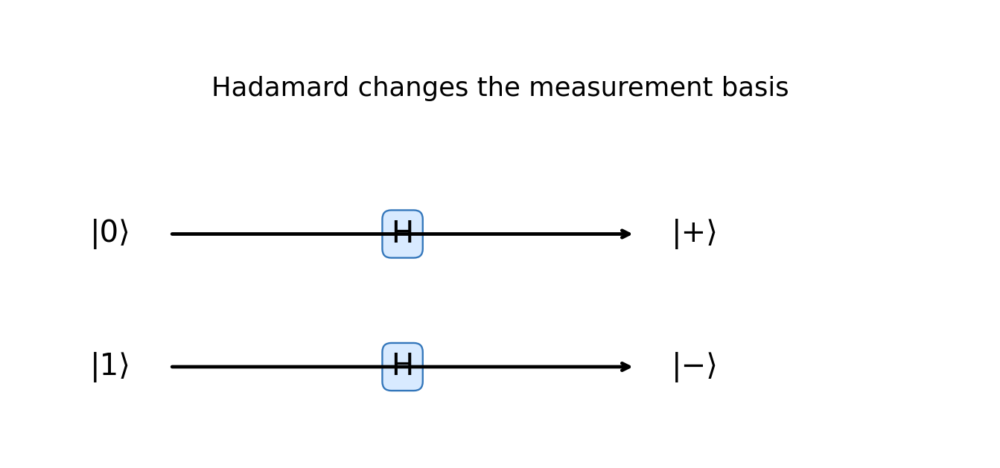
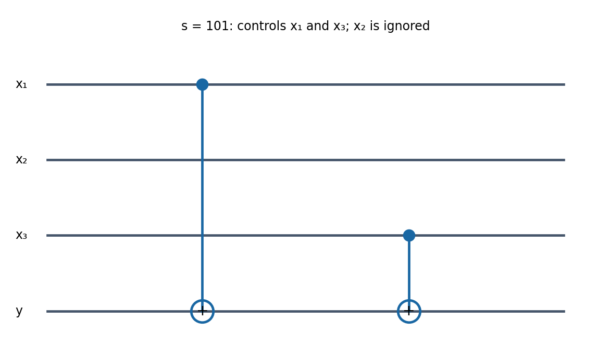
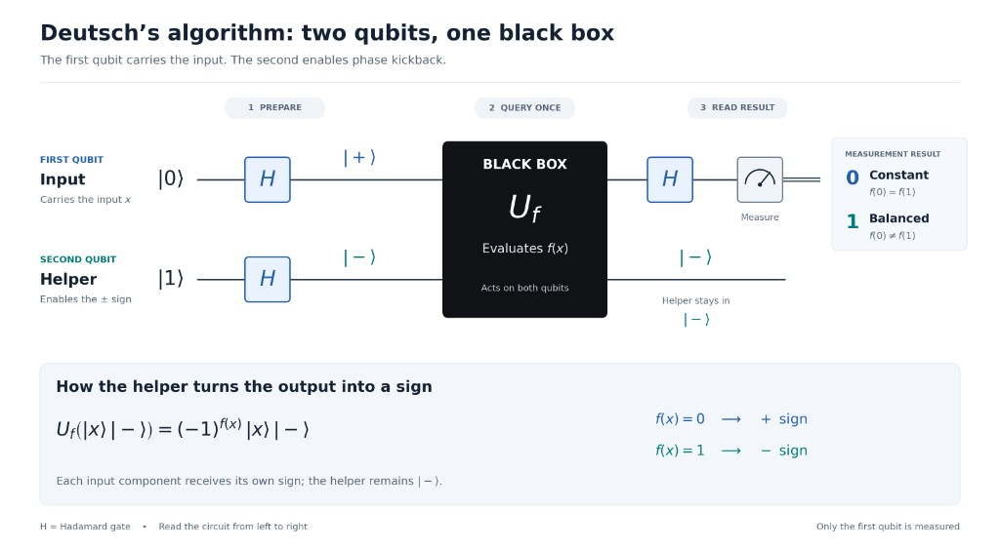

# Core Algorithms — Part A: Beginner-Friendly Lecture Notes

<!-- markdownlint-disable MD033 -->

<!-- markdownlint-enable MD033 -->

## 1. Where we are in the course

This lecture connects earlier mathematical foundations to the quantum algorithms that follow. We have already studied **qubits**, **superposition**, **measurement**, **tensor products**, and **quantum gates**. We now need to combine those tools into actual algorithms. Before doing so, the session finishes the discussion of **eigenvalues and eigenvectors**.

**Everyday picture:** learning vectors and gates is like learning letters and words; algorithms are the complete sentences. We will first revisit the alphabet, then build a small but surprising program.

## 2. Quick review: basis, orthonormal basis, transformations and unitaries

### 2.1 Basis means a coordinate system

A vector is an arrow with a length and direction. A **basis** is a set of reference arrows we use to describe other arrows. In the ordinary 2D plane, the standard basis is

$$
e_1=\begin{pmatrix}1\\\\0\end{pmatrix},\qquad e_2=\begin{pmatrix}0\\\\1\end{pmatrix}.
$$

For example,

$$
v=\begin{pmatrix}3\\\\2\end{pmatrix}=3e_1+2e_2.
$$

This says: move three units along the first reference direction and two along the second. Change the basis and the *coordinates* can change even if the physical arrow does not.

An **orthonormal basis** has mutually perpendicular reference vectors, each of length one. Its special advantage is that the coordinate along a basis vector $b_i$ is simply $\langle b_i,v\rangle$. For complex vectors, the inner product conjugates the first argument: $\langle b_i,v\rangle=b_i^\dagger v$. This is why orthonormal bases make calculations convenient.

### 2.2 Matrices act on vectors

A linear transformation is a rule that respects addition and scaling:

$$
A(u+v)=Au+Av,\qquad A(cv)=cAv.
$$

A matrix is a way to write such a rule. If $A$ is an $m\times n$ matrix and $x$ has $n$ entries, $Ax$ has **$m$ entries**. The transcript says $n$ at one point; that is a dimensional slip, not the general rule.

### 2.3 Why quantum gates must be unitary

**What does “unitary” mean?** Start with the idea, then the equation. In closed quantum circuits, gates are **unitary** so the state stays physically valid and can be run forward and backward in principle.

#### 2.3.1 A gate as a “machine” on one qubit

Picture a single-qubit **quantum gate** $U$ as a box that updates the state **in place** on the qubit wire:

| Stage | What it is |
| --- | --- |
| **Input** | $\lvert\psi\rangle$ — some normalized qubit state |
| **Gate** | $U$ — a unitary operation |
| **Output** | $\lvert\psi'\rangle = U\lvert\psi\rangle$ — a new state on the same qubit |

$U$ **may change** the state, but it must **not destroy or leak** quantum information: amplitudes stay normalized, and the map is reversible (there is an inverse $U^\dagger$).

#### 2.3.2 Everyday analogy: rotate a photograph

Rotate a photo by $90^\circ$: the picture **looks different**, but **nothing is cropped or thrown away**. Rotate by $-90^\circ$ and you recover the original.

A unitary gate is similar:

- It **can** change the quantum state.
- It **must** preserve total probability (all amplitude “weight” stays in the system).
- It **can be undone** by applying the inverse operation $U^\dagger$.

#### 2.3.3 What the mathematics says

A single-qubit gate is a matrix $U$. It is **unitary** when

$$
U^\dagger U = I,
$$

where $U^\dagger$ is the **conjugate transpose** and $I$ is the **identity** (do nothing).

| Symbol | Meaning |
| --- | --- |
| $U$ | The gate as a matrix |
| $U^\dagger$ | Conjugate transpose of $U$ |
| $I$ | Identity matrix |

In words: apply $U$, then $U^\dagger$, and you return to the same state:

$$
U^\dagger U\,|\psi\rangle = |\psi\rangle.
$$

Equivalently, unitary maps **preserve lengths** (normalization):

$$
\|U\psi\| = \|\psi\|,\qquad U^\dagger U = I.
$$

Here $U^\dagger$ conjugates the first factor in inner products, as in §2.1. The columns of $U$ are **orthonormal** — perpendicular and length one — not merely perpendicular.

A normalized computational state satisfies

$$
|\psi\rangle = \alpha|0\rangle + \beta|1\rangle,\qquad |\alpha|^2 + |\beta|^2 = 1.
$$

Those squared magnitudes are measurement probabilities, so they must sum to $1$. A unitary gate cannot turn that into $0.25$ or $4$ total weight.

**Remember this:** valid gates keep total probability at $100\%$; invalid operations are not allowed as reversible quantum gates.

#### 2.3.4 Why this matters for quantum computing

1. **No loss of quantum information** — $Z$-basis probabilities stay normalized. For example,

   $$
   P(0) + P(1) = 1.
   $$

   If $P(0)=0.7$, then $P(1)=0.3$. A unitary gate preserves that total.

2. **Operations are reversible** — every unitary $U$ has inverse $U^\dagger$ on the same Hilbert space, so evolution can be undone in the mathematical model (hardware noise is a separate story).

3. **Interference is preserved** — algorithms combine amplitudes with **+** and **−** signs. Unitary evolution changes phases and mixes branches while keeping overall normalization so interference remains meaningful.

#### 2.3.5 Example: the Pauli-$X$ gate

The **Pauli-$X$** gate is the quantum **NOT**: it swaps basis kets,

$$
|0\rangle \longrightarrow |1\rangle,\qquad |1\rangle \longrightarrow |0\rangle.
$$

Its matrix is

$$
X = \begin{pmatrix}0&1\\\\1&0\end{pmatrix}.
$$

Apply $X$ twice:

$$
X^2 = X X = I.
$$

First $X$ flips $|0\rangle$ to $|1\rangle$; second $X$ flips back to $|0\rangle$. That is unitary “rotate and undo” on a discrete state swap.

## 3. Eigenvectors: directions that a matrix does not turn

### 3.1 Intuition before the equation

Imagine applying a matrix to many arrows. Most arrows may rotate to a different line. A few special arrows only become longer, shorter, reverse, or collapse to zero. These special nonzero arrows are **eigenvectors**.

$$
\boxed{Av=\lambda v,\qquad v\ne0}
$$

- $A$: the square matrix/transformation.
- $v$: a **nonzero eigenvector**.
- $\lambda$: its **eigenvalue**, the scale factor.

If $\lambda=3$, the arrow becomes three times as long; if $\lambda=-1$, it reverses; if $\lambda=0$, it collapses to zero. The zero *vector* is not an eigenvector, although zero can be an eigenvalue.

**Interactive:** drag the slider or pick a matrix to see how a linear map moves the grid. Eigenvector directions stay on their own line (only scale or flip).

<!-- markdownlint-disable MD033 -->

<iframe src="../animations/eigenvectors-grid-transform.html" title="Eigenvectors — animated grid transformation" width="100%" height="965" loading="eager" style="border:1px solid #dce3ef;border-radius:12px;max-width:100%;display:block;"></iframe>

<!-- markdownlint-enable MD033 -->

### 3.2 First matrix example

$$
A=\begin{pmatrix}2&1\\\\1&2\end{pmatrix}.
$$

Try $v=(1,1)^T$:

$$
Av=\begin{pmatrix}2\cdot1+1\cdot1\\\\1\cdot1+2\cdot1\end{pmatrix}
=\begin{pmatrix}3\\\\3\end{pmatrix}=3\begin{pmatrix}1\\\\1\end{pmatrix}.
$$

So $(1,1)^T$ is an eigenvector with eigenvalue 3. The transcript briefly says $(3,1)$ for the result; the multiplication establishes that the correct result is **$(3,3)$**.

Try $w=(1,0)^T$: $Aw=(2,1)^T$. It is no longer on the original horizontal line, so **not** an eigenvector.

Try $q=(1,-1)^T$:

$$
Aq=(2-1,\,1-2)^T=(1,-1)^T=1q.
$$

So this is an eigenvector with eigenvalue 1. The vector $(2,2)^T$ is also an eigenvector with eigenvalue 3: $A(2,2)^T=(6,6)^T=3(2,2)^T$. Every **nonzero** multiple of an eigenvector works.

**Interactive:** try $(1,1)^T$, $(1,0)^T$, and $(1,-1)^T$ under the same $A$ — watch which arrows stay on their line.

<!-- markdownlint-disable MD033 -->

<iframe src="../animations/first-matrix-eigenvectors.html" title="First matrix example — eigenvectors under A = [[2,1],[1,2]]" width="100%" height="695" loading="eager" style="border:1px solid #dce3ef;border-radius:12px;max-width:100%;display:block;"></iframe>

<!-- markdownlint-enable MD033 -->

### 3.3 Quantum X gate: swapping coordinates

The next example is the **Pauli-$X$** (quantum NOT) gate — a $2\times2$ flip matrix.

**Interactive:** coordinate swap, reflection across $y=x$, and eigen-directions on the same diagram as §3.3.1–3.3.3 below.

<!-- markdownlint-disable MD033 -->

<iframe src="../animations/quantum-x-gate.html" title="Quantum X gate — coordinate swap and reflection" width="100%" height="770" loading="lazy" style="border:1px solid #dce3ef;border-radius:12px;max-width:100%;display:block;"></iframe>

<!-- markdownlint-enable MD033 -->

#### 3.3.1 How the $X$ gate swaps coordinates

As a matrix,

$$
X=\begin{pmatrix}0&1\\\\1&0\end{pmatrix}.
$$

The superscript $T$ in $(a,b)^T$ means **column vector** (stack $a$ above $b$). Matrix multiply step by step:

$$
X\begin{pmatrix}a\\\\b\end{pmatrix}
=
\begin{pmatrix}0&1\\\\1&0\end{pmatrix}
\begin{pmatrix}a\\\\b\end{pmatrix}
=
\begin{pmatrix}0a+1b\\\\1a+0b\end{pmatrix}
=
\begin{pmatrix}b\\\\a\end{pmatrix}.
$$

Each **row** is one output entry: the top row outputs $b$, the bottom row outputs $a$. So $(3,1)^T$ becomes $(1,3)^T$.

#### 3.3.2 Why swapping is a reflection across $y=x$

Start at the tip $(3,1)$: 3 right, 1 up. After $X$, the tip is $(1,3)$: 1 right, 3 up.

The midpoint of $(3,1)$ and $(1,3)$ is $(2,2)$, on the line $y=x$. The segment between the tips meets that line at a **right angle**, so the two tips are **mirror images** across $y=x$. The tail stays at the origin (also on $y=x$), so the whole arrow **reflects** across $y=x$.

#### 3.3.3 Why $(1,1)^T$ and $(1,-1)^T$ are eigenvectors

A nonzero $v$ is an **eigenvector** when $Xv=\lambda v$: one number $\lambda$ scales **both** coordinates at once.

| Input $v$ | Output $Xv$ | Arrow picture | $\lambda$ |
| --- | --- | --- | --- |
| $(1,1)^T$ | $(1,1)^T=1\cdot(1,1)^T$ | On the mirror line $y=x$; unchanged | $+1$ |
| $(1,-1)^T$ | $(-1,1)^T=-1\cdot(1,-1)^T$ | On $y=-x$, **perpendicular** to the mirror; **reverses** along that line | $-1$ |

An eigenvector may **flip direction** ($\lambda=-1$) and still lie on the same line through the origin. That is not a failure of the definition — the tip moves to the opposite side of the origin **along the same ray**.

Check:

$$
X(1,1)^T=(1,1)^T,\qquad
X(1,-1)^T=(-1,1)^T=-(1,-1)^T.
$$

#### 3.3.4 Why it is called the quantum flip gate

In the **computational basis**, $\lvert0\rangle$ is the column $\begin{pmatrix}1\\\\0\end{pmatrix}$ and $\lvert1\rangle$ is $\begin{pmatrix}0\\\\1\end{pmatrix}$. The same swap gives

$$
X\lvert0\rangle
= X\begin{pmatrix}1\\\\0\end{pmatrix}
= \begin{pmatrix}0\\\\1\end{pmatrix}
= \lvert1\rangle,
\qquad
X\lvert1\rangle
= X\begin{pmatrix}0\\\\1\end{pmatrix}
= \begin{pmatrix}1\\\\0\end{pmatrix}
= \lvert0\rangle.
$$

The normalized states $\lvert+\rangle=\frac{1}{\sqrt2}(1,1)^T$ and $\lvert-\rangle=\frac{1}{\sqrt2}(1,-1)^T$ are still eigenvectors of $X$ with eigenvalues $+1$ and $-1$ (scaling $(1,1)^T$ and $(1,-1)^T$ does not change the eigenvalues).

### 3.4 Identity and the Hadamard exercise

**Identity $I$.** The identity matrix **copies** each coordinate to the same place. For every nonzero column $v$,

$$
Iv = v = 1\cdot v.
$$

So **every nonzero vector** is an eigenvector of $I$ with eigenvalue $\lambda=1$. That is expected: $I$ is the “do nothing” map — no direction is singled out, so **every** direction is an eigen-direction with the same eigenvalue.

**Hadamard $H$ — not every matrix is that generous.** The lecture suggests testing $(1,1)^T$ with the Hadamard matrix

$$
H=\frac{1}{\sqrt2}\begin{pmatrix}1&1\\\\1&-1\end{pmatrix}.
$$

Apply $H$ to $(1,1)^T$:

$$
H\begin{pmatrix}1\\\\1\end{pmatrix}
=
\frac{1}{\sqrt2}
\begin{pmatrix}1&1\\\\1&-1\end{pmatrix}
\begin{pmatrix}1\\\\1\end{pmatrix}
=
\begin{pmatrix}\sqrt2\\\\0\end{pmatrix}.
$$

The input lies on $y=x$. The output is $(\sqrt2,0)^T$ — along the **$x$-axis** only. For an eigenvector we need a single $\lambda$ with

$$
H\begin{pmatrix}1\\\\1\end{pmatrix}
\stackrel{?}{=}
\lambda\begin{pmatrix}1\\\\1\end{pmatrix}
=
\begin{pmatrix}\lambda\\\\\lambda\end{pmatrix}.
$$

But $\sqrt2\neq\lambda$ and $0\neq\lambda$ at the same time, so **no** $\lambda$ works. **$(1,1)^T$ is not an eigenvector of $H$.**

**How to read that:** $H$ **mixes** $x$ and $y$ components (it is not a simple swap or scale). Any eigenvector of $H$ would have to be a direction that $H$ only **stretches** or **flips**, not one that it **redirects** to a different line. You can find $H$’s true eigenvectors by solving $\det(H-\lambda I)=0$; they are not $(1,1)^T$ or $(1,-1)^T$.

**Exercise:** repeat the same test for $H(1,-1)^T$, or compute eigenvalues of $H$ and compare with $X$.

### 3.5 Why there are infinitely many eigenvectors

If $Av=\lambda v$, then for any nonzero scalar $c$,

$$
A(cv)=cAv=c\lambda v=\lambda(cv).
$$

Similarly, if $Av=\lambda v$ and $Aw=\lambda w$,

$$
A(v+w)=Av+Aw=\lambda(v+w).
$$

The set $\{v:Av=\lambda v\}$, **including zero**, is a vector subspace called an **eigenspace**. A sum that happens to be zero is in the eigenspace but is not itself an eigenvector. A basis describes this whole subspace without listing infinitely many vectors. Choosing length-one eigenvectors helps normalize the description, but does not always leave only two possibilities: in a higher-dimensional eigenspace there can still be infinitely many unit vectors.

## 4. Given a matrix $A$, how do we discover these special vectors and their corresponding eigenvalues?

### 4.1 What are we trying to find?

In the previous section, we learned about **eigenvectors** and **eigenvalues**.

Remember that when a matrix transforms a vector, normally the vector changes its direction and length.

However, some special vectors behave differently:

- Their direction stays along the same line.
- Their length may increase or decrease.
- They may even reverse direction.

These special vectors are called **eigenvectors**.

The number that tells us how the eigenvector is scaled is called its **eigenvalue**, represented by $\lambda$ (lambda).

Mathematically, this relationship is written as

$$
Av=\lambda v,
$$

where

- $A$ = the matrix representing the transformation,
- $v$ = an eigenvector (the special vector),
- $\lambda$ = an eigenvalue (the scaling factor).

**The question we want to answer is:** given a matrix $A$, how can we discover its eigenvalues and eigenvectors?

We cannot simply guess them. We need a systematic mathematical method.

That is what this section teaches us.

---

### 4.2 First understand a simpler problem: $Bx=0$

Before finding eigenvalues, the lecture introduces a simpler mathematical problem.

Consider

$$
Bx=0,
$$

where $B$ is a matrix and $x$ is an unknown vector.

Suppose

$$
B=\begin{pmatrix}a&b\\\\c&d\end{pmatrix},
\qquad
x=\begin{pmatrix}x_1\\\\x_2\end{pmatrix}.
$$

Multiplying $B$ by $x$ gives

$$
\begin{pmatrix}a&b\\\\c&d\end{pmatrix}
\begin{pmatrix}x_1\\\\x_2\end{pmatrix}
=
\begin{pmatrix}0\\\\0\end{pmatrix},
$$

which produces two equations:

$$
ax_1+bx_2=0,
$$

$$
cx_1+dx_2=0.
$$

**What are we looking for?** Values of $x_1$ and $x_2$ that satisfy both equations.

There is always one obvious solution:

$$
x=\begin{pmatrix}0\\\\0\end{pmatrix}.
$$

This is called the **trivial solution**.

But we are interested in something more useful: can we find a solution where at least one coordinate is nonzero? For example,

$$
x=\begin{pmatrix}1\\\\-1\end{pmatrix}
$$

is a **nontrivial solution**.

**Why is this important?** We will soon convert our eigenvector equation into exactly this type of problem.

But first, we need to understand when a nontrivial solution exists.

---

### 4.3 When does $Bx=0$ have a nonzero solution?

Use the two equations

$$
ax_1+bx_2=0,
$$

$$
cx_1+dx_2=0.
$$

Multiply the first equation by $d$:

$$
adx_1+bdx_2=0.
$$

Multiply the second equation by $b$:

$$
bcx_1+bdx_2=0.
$$

Subtract the second equation from the first:

$$
(ad-bc)x_1=0.
$$

For a nonzero solution, we need the matrix to be **singular**.

A matrix is called singular when its determinant is zero.

For a $2\times2$ matrix,

$$
B=\begin{pmatrix}a&b\\\\c&d\end{pmatrix},
$$

the determinant is

$$
\det(B)=ad-bc.
$$

Therefore, the condition for a nonzero solution is

$$
\boxed{ad-bc=0}
$$

or simply

$$
\boxed{\det(B)=0}.
$$

**What does this mean intuitively?** Think of a matrix as a machine that transforms vectors.

Usually, a nonsingular matrix cannot turn a nonzero vector into a zero vector.

But a singular matrix can.

For example,

$$
B=\begin{pmatrix}1&1\\\\1&1\end{pmatrix},
$$

with

$$
\det(B)=(1\times1)-(1\times1)=0.
$$

Now try

$$
x=\begin{pmatrix}1\\\\-1\end{pmatrix}.
$$

Then

$$
Bx=
\begin{pmatrix}1&1\\\\1&1\end{pmatrix}
\begin{pmatrix}1\\\\-1\end{pmatrix}
=
\begin{pmatrix}0\\\\0\end{pmatrix}.
$$

We found a nonzero vector that becomes zero after multiplication — because the matrix is singular.

**Remember:**

$$
Bx=0,\quad x\neq0
$$

has a nonzero solution **if and only if** $\det(B)=0$.

For a square matrix of any size, this same rule applies.

---

### 4.4 The important connection: turning the eigenvector equation into $Bx=0$

We want eigenvectors and eigenvalues. We know

$$
Av=\lambda v.
$$

The goal is to rewrite this into the simpler form $Bx=0$, because we already know how to solve that problem.

**Step 1 — start with the eigenvector equation**

$$
Av=\lambda v.
$$

Move everything to the left:

$$
Av-\lambda v=0.
$$

**Step 2 — introduce the identity matrix**

Remember that $Iv=v$. For example,

$$
\begin{pmatrix}1&0\\\\0&1\end{pmatrix}
\begin{pmatrix}3\\\\5\end{pmatrix}
=
\begin{pmatrix}3\\\\5\end{pmatrix}.
$$

So we can write

$$
Av-\lambda Iv=0.
$$

**Step 3 — factor out $v$**

$$
\boxed{(A-\lambda I)v=0}.
$$

This has exactly the same structure as $Bx=0$:

| Simpler equation | Eigenvector equation |
| --- | --- |
| $B$ | $A-\lambda I$ |
| $x$ | $v$ |
| $0$ | $0$ |

**Step 4 — apply what we learned about determinants**

We want an eigenvector, and an eigenvector cannot be the zero vector: $v\neq0$.

From §4.3, a nonzero solution exists only when the matrix is singular. Our matrix is $A-\lambda I$, so

$$
\boxed{\det(A-\lambda I)=0}.
$$

This is the **characteristic equation**.

**Main discovery of this section:** instead of guessing eigenvectors directly, first use the determinant to find the eigenvalues.

---

### 4.5 Let's calculate eigenvalues and eigenvectors using an example

Consider

$$
A=\begin{pmatrix}2&0\\\\0&3\end{pmatrix}.
$$

**Step 1 — write the characteristic equation**

$$
\det(A-\lambda I)=0.
$$

**Step 2 — subtract $\lambda I$ from $A$**

$$
A-\lambda I=
\begin{pmatrix}2-\lambda&0\\\\0&3-\lambda\end{pmatrix}.
$$

**Step 3 — calculate the determinant**

For a $2\times2$ matrix, $\det(B)=ad-bc$, so

$$
(2-\lambda)(3-\lambda)-0=0.
$$

Expand:

$$
\lambda^2-5\lambda+6=0.
$$

Factor:

$$
(\lambda-2)(\lambda-3)=0.
$$

So

$$
\boxed{\lambda=2\quad\text{or}\quad\lambda=3}.
$$

**Step 4 — find the eigenvectors**

For each eigenvalue, substitute it into $(A-\lambda I)v=0$.

**Eigenvector for $\lambda=2$**

$$
A-2I=
\begin{pmatrix}0&0\\\\0&1\end{pmatrix}.
$$

Let $v=\begin{pmatrix}v_1\\\\v_2\end{pmatrix}$. Then

$$
\begin{pmatrix}0&0\\\\0&1\end{pmatrix}
\begin{pmatrix}v_1\\\\v_2\end{pmatrix}
=
\begin{pmatrix}0\\\\0\end{pmatrix},
$$

which gives $v_2=0$. We can choose $v_1=1$, so

$$
\boxed{v=\begin{pmatrix}1\\\\0\end{pmatrix}}.
$$

**Eigenvector for $\lambda=3$**

$$
A-3I=
\begin{pmatrix}-1&0\\\\0&0\end{pmatrix},
$$

so $-v_1=0$ and we can choose $v_2=1$:

$$
\boxed{v=\begin{pmatrix}0\\\\1\end{pmatrix}}.
$$

| Eigenvalue | Corresponding eigenvector |
| --- | --- |
| $\lambda=2$ | $\begin{pmatrix}1\\\\0\end{pmatrix}$ |
| $\lambda=3$ | $\begin{pmatrix}0\\\\1\end{pmatrix}$ |

Verify:

$$
A\begin{pmatrix}1\\\\0\end{pmatrix}
=
\begin{pmatrix}2\\\\0\end{pmatrix}
=
2\begin{pmatrix}1\\\\0\end{pmatrix},
\qquad
A\begin{pmatrix}0\\\\1\end{pmatrix}
=
\begin{pmatrix}0\\\\3\end{pmatrix}
=
3\begin{pmatrix}0\\\\1\end{pmatrix}.
$$

---

### 4.6 The Y gate: eigenvalues and eigenvectors

So far we used ordinary real numbers. Quantum computing also uses complex numbers. This subsection works through the **Pauli-$Y$ gate** from start to finish.

#### 4.6.1 First, what are we trying to find?

We have a quantum gate called the **Y gate**:

$$
Y=\begin{pmatrix}0&-i\\\\i&0\end{pmatrix}.
$$

It takes an input quantum state and transforms it into another quantum state.

We want to find two things:

1. **Eigenvalues** — how does the gate affect its special states?
2. **Eigenvectors** — which special states behave this way?

Remember the eigenvector equation:

$$
Yv=\lambda v.
$$

In plain language: when we apply the Y gate to an eigenvector, the result is the same vector multiplied by a number called the eigenvalue.

For example, $Yv=2v$ scales the vector by $2$, and $Yv=-v$ scales it by $-1$ (direction reversed along the same line).

Our job is to discover these special values and vectors.

#### 4.6.2 Before proceeding, understand the imaginary number $i$

You might wonder what $i$ means. We already know

$$
i^2=-1,
$$

so $i\times i=-1$ and therefore $(-i)^2=1$ (equivalently $-i^2=1$ when read as $-(i^2)$).

Useful products:

| Calculation | Answer |
| --- | --- |
| $i\times i$ | $-1$ |
| $(-i)\times i$ | $+1$ |
| $i\times(-i)$ | $+1$ |
| $(-i)\times(-i)$ | $-1$ |

**Why do we need $i$?** Quantum states use complex amplitudes, so gates can contain imaginary entries. For this example, you only need the algebra above — not a full physical interpretation of $i$ yet.

#### 4.6.3 Finding the eigenvalues

We know $Yv=\lambda v$. From §4.4 this becomes $(Y-\lambda I)v=0$. For a nonzero eigenvector, the matrix must be singular:

$$
\boxed{\det(Y-\lambda I)=0}.
$$

That is our starting point.

**Step 1 — write $Y$ and $\lambda I$**

$$
Y=\begin{pmatrix}0&-i\\\\i&0\end{pmatrix},
\qquad
I=\begin{pmatrix}1&0\\\\0&1\end{pmatrix},
\qquad
\lambda I=
\begin{pmatrix}\lambda&0\\\\0&\lambda\end{pmatrix}.
$$

**Step 2 — subtract $\lambda I$ from $Y$**

Subtract entry by entry:

$$
Y-\lambda I
=
\begin{pmatrix}0&-i\\\\i&0\end{pmatrix}
-
\begin{pmatrix}\lambda&0\\\\0&\lambda\end{pmatrix}
=
\begin{pmatrix}-\lambda&-i\\\\i&-\lambda\end{pmatrix}.
$$

**Step 3 — calculate the determinant**

For $B=\begin{pmatrix}a&b\\\\c&d\end{pmatrix}$, $\det(B)=ad-bc$. Here $a=-\lambda$, $b=-i$, $c=i$, $d=-\lambda$, so

$$
\det(Y-\lambda I)=(-\lambda)(-\lambda)-(-i)(i).
$$

Compute each factor:

$$
(-\lambda)(-\lambda)=\lambda^2,
\qquad
(-i)(i)=-i^2=1.
$$

So

$$
\det(Y-\lambda I)=\lambda^2-1.
$$

Set the determinant to zero:

$$
\lambda^2-1=0
\quad\Rightarrow\quad
(\lambda-1)(\lambda+1)=0.
$$

**Result:** the Y gate has two eigenvalues:

$$
\boxed{\lambda=+1}
\qquad\text{and}\qquad
\boxed{\lambda=-1}.
$$

Next we find the eigenvectors that go with each eigenvalue.

#### 4.6.4 Finding the eigenvector for $\lambda=+1$

Substitute $\lambda=+1$ into $Yv=\lambda v$:

$$
Yv=v.
$$

We are looking for a vector that is **unchanged** when the Y gate is applied.

**Step 1 — matrix equation**

Let $v=\begin{pmatrix}v_1\\\\v_2\end{pmatrix}$. Then

$$
\begin{pmatrix}0&-i\\\\i&0\end{pmatrix}
\begin{pmatrix}v_1\\\\v_2\end{pmatrix}
=
\begin{pmatrix}v_1\\\\v_2\end{pmatrix}.
$$

**Step 2 — multiply**

First row: $0\cdot v_1+(-i)v_2=-iv_2$. Second row: $iv_1+0\cdot v_2=iv_1$. So

$$
\begin{pmatrix}-iv_2\\\\iv_1\end{pmatrix}
=
\begin{pmatrix}v_1\\\\v_2\end{pmatrix},
$$

which gives

$$
-iv_2=v_1 \qquad (1),
\qquad
iv_1=v_2 \qquad (2).
$$

**Step 3 — solve**

From (2), choose $v_1=1$ (any nonzero scale of an eigenvector is still an eigenvector). Then $v_2=i$:

$$
\boxed{v=\begin{pmatrix}1\\\\i\end{pmatrix}}.
$$

**Step 4 — verify**

$$
Y\begin{pmatrix}1\\\\i\end{pmatrix}
=
\begin{pmatrix}
0(1)+(-i)(i)\\\\
i(1)+0(i)
\end{pmatrix}
=
\begin{pmatrix}1\\\\i\end{pmatrix}.
$$

**Verified:** eigenvalue $+1$ with eigenvector $\begin{pmatrix}1\\\\i\end{pmatrix}$.

#### 4.6.5 Finding the eigenvector for $\lambda=-1$

Substitute $\lambda=-1$:

$$
Yv=-v.
$$

The vector should become its **negative** under $Y$.

**Step 1 — equation**

$$
\begin{pmatrix}0&-i\\\\i&0\end{pmatrix}
\begin{pmatrix}v_1\\\\v_2\end{pmatrix}
=
-\begin{pmatrix}v_1\\\\v_2\end{pmatrix}.
$$

**Step 2 — multiply**

$$
\begin{pmatrix}-iv_2\\\\iv_1\end{pmatrix}
=
\begin{pmatrix}-v_1\\\\-v_2\end{pmatrix},
$$

so $-iv_2=-v_1$ and $iv_1=-v_2$. From $iv_1=-v_2$, take $v_1=1$, then $v_2=-i$:

$$
\boxed{v=\begin{pmatrix}1\\\\-i\end{pmatrix}}.
$$

**Step 3 — verify**

$$
Y\begin{pmatrix}1\\\\-i\end{pmatrix}
=
\begin{pmatrix}(-i)(-i)\\\\i\end{pmatrix}
=
\begin{pmatrix}-1\\\\i\end{pmatrix},
$$

and

$$
-\begin{pmatrix}1\\\\-i\end{pmatrix}
=
\begin{pmatrix}-1\\\\i\end{pmatrix}.
$$

**Verified:** eigenvalue $-1$ with eigenvector $\begin{pmatrix}1\\\\-i\end{pmatrix}$.

#### 4.6.6 Why divide by $\sqrt{2}$?

The lecture often writes normalized eigenvectors as

$$
\frac{1}{\sqrt{2}}\begin{pmatrix}1\\\\i\end{pmatrix}
$$

instead of $\begin{pmatrix}1\\\\i\end{pmatrix}$.

In quantum computing, states are **normalized**: for $v=\begin{pmatrix}a\\\\b\end{pmatrix}$,

$$
|a|^2+|b|^2=1.
$$

For $\begin{pmatrix}1\\\\i\end{pmatrix}$, $|1|^2+|i|^2=1+1=2$. Divide both components by $\sqrt{2}$:

$$
\boxed{
v_+=\frac{1}{\sqrt{2}}
\begin{pmatrix}1\\\\i\end{pmatrix}
}.
$$

Then $\frac{1}{2}+\frac{1}{2}=1$. The same scaling applies to the $\lambda=-1$ eigenvector:

$$
\boxed{
v_-=\frac{1}{\sqrt{2}}
\begin{pmatrix}1\\\\-i\end{pmatrix}
}.
$$

#### 4.6.7 Final results: what did we discover?

| Eigenvalue | Normalized eigenvector | Effect of applying $Y$ |
| --- | --- | --- |
| $\lambda=+1$ | $v_+=\dfrac{1}{\sqrt{2}}\begin{pmatrix}1\\\\i\end{pmatrix}$ | Leaves this state unchanged |
| $\lambda=-1$ | $v_-=\dfrac{1}{\sqrt{2}}\begin{pmatrix}1\\\\-i\end{pmatrix}$ | Maps the state to its negative |

The recipe is the same as in §4.5: characteristic equation from $\det(Y-\lambda I)=0$, then $(Y-\lambda I)v=0$ for each $\lambda$. Only the arithmetic involves complex numbers.

**Check your understanding:** short quiz on the Y gate eigenvalues, eigenvectors, and $i$ arithmetic.

<!-- markdownlint-disable MD033 -->

<iframe src="../animations/y-gate-quiz.html" title="Y gate — test your understanding" width="100%" height="1225" loading="eager" style="border:1px solid #dce3ef;border-radius:12px;max-width:100%;display:block;"></iframe>

<!-- markdownlint-enable MD033 -->

---

### 4.7 Rotation example: why do we need complex eigenvectors?

#### 4.7.1 First, what is the problem we are trying to solve?

Remember what an eigenvector means. For a transformation matrix $A$,

$$
Av=\lambda v.
$$

An eigenvector is a special vector whose direction stays along the **same line** through the origin after the transformation:

- The original arrow points in one direction.
- The transformed arrow stays on that line.
- Its length may change.
- It may reverse direction along the line.

**Question for this section:** what if the transformation is a **rotation**? Can we find eigenvectors for rotation?

We investigate that next — first with a concrete $90^\circ$ example, then with complex numbers.

#### 4.7.2 Imagine an arrow pointing to the right

Take a real arrow

$$
v=\begin{pmatrix}1\\\\0\end{pmatrix}
$$

(horizontal position $1$, vertical position $0$).

Rotate it **$90^\circ$ counterclockwise**. It points upward:

$$
\begin{pmatrix}1\\\\0\end{pmatrix}
\longrightarrow
\begin{pmatrix}0\\\\1\end{pmatrix}.
$$

The original arrow pointed right; the new arrow points up. They are **not** on the same line.

So this vector is **not** an eigenvector of a $90^\circ$ rotation.

#### 4.7.3 How does the rotation matrix do this?

A rotation by angle $\theta$ is represented by

$$
R_\theta=
\begin{pmatrix}
\cos\theta&-\sin\theta\\\\
\sin\theta&\cos\theta
\end{pmatrix}.
$$

For $90^\circ$: $\cos90^\circ=0$, $\sin90^\circ=1$, so

$$
R_{90^\circ}=
\begin{pmatrix}0&-1\\\\1&0\end{pmatrix}.
$$

Multiply by our arrow:

$$
R_{90^\circ}
\begin{pmatrix}1\\\\0\end{pmatrix}
=
\begin{pmatrix}
0(1)+(-1)(0)\\\\
1(1)+0(0)
\end{pmatrix}
=
\begin{pmatrix}0\\\\1\end{pmatrix}.
$$

**Could some other real arrow stay on its original line after a $90^\circ$ rotation?**

No. Every nonzero arrow in the plane turns by $90^\circ$ and ends up **perpendicular** to where it started.

So a $90^\circ$ rotation has **no nonzero real eigenvector**.

That is where we extend the story to **complex** vectors.

#### 4.7.4 What if we allow complex numbers?

So far we used real column vectors such as $\begin{pmatrix}1\\\\0\end{pmatrix}$.

In quantum computing, amplitudes can be complex, e.g.

$$
v=\begin{pmatrix}1\\\\i\end{pmatrix},
\qquad i^2=-1.
$$

Even though $90^\circ$ rotation has no real eigenvector, it **does** have complex eigenpairs. We find them with the same determinant recipe as in §4.4–§4.6.

#### 4.7.5 Find the eigenvalues of $R_{90^\circ}$

We already have

$$
R_{90^\circ}=
\begin{pmatrix}0&-1\\\\1&0\end{pmatrix}.
$$

Require

$$
\det(R_{90^\circ}-\lambda I)=0.
$$

Subtract $\lambda I$:

$$
R_{90^\circ}-\lambda I=
\begin{pmatrix}-\lambda&-1\\\\1&-\lambda\end{pmatrix}.
$$

Determinant:

$$
(-\lambda)(-\lambda)-(-1)(1)=\lambda^2+1=0,
$$

so $\lambda^2=-1$. Since $i^2=-1$,

$$
\boxed{\lambda=+i\quad\text{or}\quad\lambda=-i}.
$$

We could not get **real** eigenvalues here; allowing complex numbers gives two solutions.

#### 4.7.6 Find the eigenvectors

**Case A: $\lambda=+i$**

Start from $Rv=\lambda v$ with $R=R_{90^\circ}$:

$$
Rv=iv.
$$

Let $v=\begin{pmatrix}v_1\\\\v_2\end{pmatrix}$. Then

$$
\begin{pmatrix}0&-1\\\\1&0\end{pmatrix}
\begin{pmatrix}v_1\\\\v_2\end{pmatrix}
=
i\begin{pmatrix}v_1\\\\v_2\end{pmatrix},
$$

so

$$
\begin{pmatrix}-v_2\\\\v_1\end{pmatrix}
=
\begin{pmatrix}iv_1\\\\iv_2\end{pmatrix},
$$

giving $-v_2=iv_1$ and $v_1=iv_2$. Choose $v_1=1$: then $v_2=-i$,

$$
\boxed{v=\begin{pmatrix}1\\\\-i\end{pmatrix}}.
$$

**Verify:**

$$
R_{90^\circ}\begin{pmatrix}1\\\\-i\end{pmatrix}
=
\begin{pmatrix}i\\\\1\end{pmatrix},
\qquad
i\begin{pmatrix}1\\\\-i\end{pmatrix}
=
\begin{pmatrix}i\\\\-i^2\end{pmatrix}
=
\begin{pmatrix}i\\\\1\end{pmatrix}.
$$

So $R_{90^\circ}\begin{pmatrix}1\\\\-i\end{pmatrix}=i\begin{pmatrix}1\\\\-i\end{pmatrix}$.

**Case B: $\lambda=-i$**

Now $Rv=-iv$. The same multiplication gives $-v_2=-iv_1$. With $v_1=1$, $v_2=i$:

$$
\boxed{v=\begin{pmatrix}1\\\\i\end{pmatrix}}.
$$

**Check:**

$$
R_{90^\circ}\begin{pmatrix}1\\\\i\end{pmatrix}
=
\begin{pmatrix}-i\\\\1\end{pmatrix},
\qquad
-i\begin{pmatrix}1\\\\i\end{pmatrix}
=
\begin{pmatrix}-i\\\\-i^2\end{pmatrix}
=
\begin{pmatrix}-i\\\\1\end{pmatrix}.
$$

#### 4.7.7 How can a complex eigenvector “stay in the same direction”?

If you picture rotation on paper, every real arrow turns — so “same direction” sounds impossible.

A complex eigenvector is not just an arrow in the **real** $xy$-plane. The eigenvector condition is

$$
Rv=\lambda v:
$$

the output must be a **scalar multiple** of the input, and that scalar $\lambda$ may be **complex**.

For $v=\begin{pmatrix}1\\\\-i\end{pmatrix}$,

$$
R_{90^\circ}v=\begin{pmatrix}i\\\\1\end{pmatrix}=i\begin{pmatrix}1\\\\-i\end{pmatrix}.
$$

The two columns look different as real pictures, but they differ only by the factor $i$. That is exactly the definition of an eigenvector in $\mathbb{C}^2$.

We are not claiming an ordinary real arrow stays fixed on the page; we are claiming a **complex** linear relationship $Rv=\lambda v$.

#### 4.7.8 What does $e^{i\theta}$ mean?

**Euler's formula** (no derivation needed here):

$$
e^{i\theta}=\cos\theta+i\sin\theta.
$$

For $\theta=90^\circ$, $\cos90^\circ=0$, $\sin90^\circ=1$, so

$$
e^{i90^\circ}=i,
\qquad
e^{-i90^\circ}=-i.
$$

Our $90^\circ$ eigenvalues are $+i$ and $-i$ — the same numbers written in exponential form would be $e^{i\pi/2}$ and $e^{-i\pi/2}$.

For a **general** rotation $R_\theta$, the characteristic equation gives

$$
\det(R_\theta-\lambda I)=\lambda^2-2\lambda\cos\theta+1=0,
$$

$$
\boxed{\lambda=\cos\theta\pm i\sin\theta=e^{\pm i\theta}}.
$$

Eigenpairs for this convention (including $90^\circ$):

| Eigenvalue | Eigenvector (example) |
| --- | --- |
| $e^{i\theta}$ | $\begin{pmatrix}1\\\\-i\end{pmatrix}$ |
| $e^{-i\theta}$ | $\begin{pmatrix}1\\\\i\end{pmatrix}$ |

#### 4.7.9 What is the lesson?

**Real vectors in the plane**

- A $90^\circ$ rotation changes the direction of every nonzero **real** vector.
- There is no nonzero **real** eigenvector.

**Complex vectors**

$$
R_{90^\circ}\begin{pmatrix}1\\\\-i\end{pmatrix}=i\begin{pmatrix}1\\\\-i\end{pmatrix},
\qquad
R_{90^\circ}\begin{pmatrix}1\\\\i\end{pmatrix}=-i\begin{pmatrix}1\\\\i\end{pmatrix}.
$$

Two complex eigenpairs exist.

**Takeaways**

1. Not every real matrix has a **real** eigenvector.
2. Working over the complex numbers can produce eigenvalues and eigenvectors that do not exist using real numbers alone.
3. Quantum states use complex amplitudes, so this extension is standard — not optional decoration.

**Fact:** every $n\times n$ matrix with $n\ge1$ has at least one **complex** eigenvalue (and a corresponding nonzero complex eigenvector), counting multiplicities in the usual algebraic sense.

---

### 4.8 Eigenvalues of unitary matrices always have magnitude one

Quantum gates are **unitary** matrices: they preserve vector length, $\|Uv\|=\|v\|$.

Suppose $Uv=\lambda v$, where $v$ is an eigenvector and $\lambda$ its eigenvalue.

Because $U$ preserves length,

$$
\|Uv\|=\|v\|,
$$

but $Uv=\lambda v$, so

$$
\|\lambda v\|=\|v\|.
$$

Multiplying by $\lambda$ scales length by $|\lambda|$, hence

$$
|\lambda|\|v\|=\|v\|.
$$

Since $v\neq0$,

$$
\boxed{|\lambda|=1}.
$$

For real numbers, $| \lambda |=1$ means $\lambda=\pm1$ only.

For complex numbers, $|\lambda|^2=1$ is **not** the same as $\lambda^2=1$: $i$, $-i$, and $e^{i\theta}$ also lie on the unit circle.

**Key takeaway:** eigenvectors are special directions; eigenvalues describe scaling or phase along them. A unitary matrix cannot stretch or shrink eigenvector length — only rotate phase. That is why unitary quantum gates preserve normalized states.

---

### 4.9 Final summary: what have we learned?

**The process**

1. Start with $Av=\lambda v$.
2. Rearrange to $(A-\lambda I)v=0$.
3. Need $v\neq0$, so the matrix must be singular: $\det(A-\lambda I)=0$.
4. Solve for the eigenvalues $\lambda$.
5. For each $\lambda$, solve $(A-\lambda I)v=0$ for the eigenvectors $v$.

**Important concepts**

| Concept | Meaning |
| --- | --- |
| Eigenvector | A vector whose direction stays along the same line after transformation |
| Eigenvalue | The scaling factor $\lambda$ associated with that eigenvector |
| Singular matrix | A square matrix whose determinant is zero |
| Characteristic equation | $\det(A-\lambda I)=0$ |
| Complex eigenvalue | An eigenvalue that may involve $i$ |
| Unitary matrix | A matrix that preserves vector length |
| Unit magnitude | An eigenvalue with $\lvert\lambda\rvert=1$ |

**Big picture:** we started with $Bx=0$ and learned that a nonzero solution exists only when $\det(B)=0$. The eigenvector equation $Av=\lambda v$ becomes $(A-\lambda I)v=0$, so determinants discover eigenvalues first; then each eigenvalue gives its eigenvectors. That is the foundation for understanding how quantum gates transform quantum states.

---

## 5. Moving to quantum algorithms

The lecture now begins the central part of the course. The coming algorithms exploit behavior unavailable in the same form to ordinary classical queries. It previews **Deutsch**, **Deutsch–Jozsa**, and **Simon**, but this session works through Deutsch and only introduces the Deutsch–Jozsa problem. It also contrasts a small two-versus-one query improvement for Deutsch with a much larger classical-versus-quantum query separation for Deutsch–Jozsa.

**Extra explanation:** a *query* means one use of a provided black-box function. Query count is not the same thing as the total number of physical gates or total running time.

## 6. Review: many qubits, tensor products, gates and measurement

### 6.1 Why $n$ qubits need $2^n$ basis states

This review assumes you are seeing the multi-qubit picture for the first time.

**Main idea:** every time we add **one more qubit**, the number of possible **basis states** **doubles**. Below: what those states are, why $2^n$, and how the formulas describe amplitudes — without claiming one measurement reads them all.

#### 6.1.1 One qubit: two basis states

A classical bit is only $0$ or $1$.

A qubit has two basic states:

- $\lvert0\rangle$
- $\lvert1\rangle$

These are **basis states** — building blocks for richer quantum states.

| One qubit | |
| --- | --- |
| First basis state | $\lvert0\rangle$ |
| Second basis state | $\lvert1\rangle$ |
| **Total** | **2** basis states |

#### 6.1.2 Two qubits: four combinations

Each qubit is $0$ or $1$. List all pairs:

| First qubit | Second qubit | Combined state |
| --- | --- | --- |
| 0 | 0 | $\lvert00\rangle$ |
| 0 | 1 | $\lvert01\rangle$ |
| 1 | 0 | $\lvert10\rangle$ |
| 1 | 1 | $\lvert11\rangle$ |

Two choices for qubit 1, two for qubit 2:

$$
2\times 2=4.
$$

**Total = 4** basis states: $\lvert00\rangle,\lvert01\rangle,\lvert10\rangle,\lvert11\rangle$.

#### 6.1.3 Three qubits: double again

Take each two-qubit string and append $0$ or $1$:

| Previous | +0 | +1 |
| --- | --- | --- |
| 00 | 000 | 001 |
| 01 | 010 | 011 |
| 10 | 100 | 101 |
| 11 | 110 | 111 |

So

$$
2\times 2\times 2=8
$$

— eight basis strings from $\lvert000\rangle$ through $\lvert111\rangle$.

#### 6.1.4 General rule for $n$ qubits

| Number of qubits | Number of basis states |
| --- | --- |
| 1 | 2 |
| 2 | 4 |
| 3 | 8 |
| 4 | 16 |
| 5 | 32 |
| 6 | 64 |
| $n$ | $2^n$ |

Each extra qubit **doubles** the count. The general formula is

$$
\boxed{\text{Number of basis states}=2^n}.
$$

**Notation trap:** $2^n$ means “2 to the power $n$,” not $2n$ (twice $n$). Examples: $2^2=4$ for two qubits; $2^3=8$ for three; $2^{10}=1024$ for ten.

#### 6.1.5 The quantum state formula

An arbitrary $n$-qubit pure state is written

$$
\boxed{|\psi\rangle=\sum_{x\in\{0,1\}^n}\alpha_x|x\rangle}.
$$

**Meaning:** $|\psi\rangle$ can be a **superposition** of every $n$-bit basis string $\lvert x\rangle$, each with its own **amplitude** $\alpha_x$ (real or complex).

**Two-qubit example.** Basis states $\lvert00\rangle,\lvert01\rangle,\lvert10\rangle,\lvert11\rangle$:

$$
\begin{aligned}
|\psi\rangle={}&
\alpha_{00}|00\rangle\\
&+\alpha_{01}|01\rangle\\
&+\alpha_{10}|10\rangle\\
&+\alpha_{11}|11\rangle.
\end{aligned}
$$

| Basis state | Amplitude |
| --- | --- |
| $\lvert00\rangle$ | $\alpha_{00}$ |
| $\lvert01\rangle$ | $\alpha_{01}$ |
| $\lvert10\rangle$ | $\alpha_{10}$ |
| $\lvert11\rangle$ | $\alpha_{11}$ |

Equal superposition example:

$$
|\psi\rangle=
\frac{1}{2}|00\rangle+
\frac{1}{2}|01\rangle+
\frac{1}{2}|10\rangle+
\frac{1}{2}|11\rangle.
$$

All four amplitudes are equal. That is allowed only if probabilities still sum to 1 (next subsection).

#### 6.1.6 Normalization

Amplitudes must satisfy

$$
\boxed{\sum_x|\alpha_x|^2=1}.
$$

$|\alpha_x|^2$ is the **probability** of measuring basis label $x$.

For the equal example, each amplitude is $1/2$:

| Basis state | Amplitude | Probability |
| --- | --- | --- |
| $\lvert00\rangle$ | $1/2$ | $1/4$ (25%) |
| $\lvert01\rangle$ | $1/2$ | $1/4$ (25%) |
| $\lvert10\rangle$ | $1/2$ | $1/4$ (25%) |
| $\lvert11\rangle$ | $1/2$ | $1/4$ (25%) |

$$
\frac{1}{4}+\frac{1}{4}+\frac{1}{4}+\frac{1}{4}=1.
$$

Total probability must always be 100% for a valid state.

#### 6.1.7 One measurement does not reveal all amplitudes

Take the same two-qubit state:

$$
|\psi\rangle=
\frac12|00\rangle+
\frac12|01\rangle+
\frac12|10\rangle+
\frac12|11\rangle.
$$

**Before measurement:** four amplitudes are specified mathematically.

**After one measurement** in the computational basis you get **one** outcome — $\lvert00\rangle$, $\lvert01\rangle$, $\lvert10\rangle$, or $\lvert11\rangle$ — each with probability 25%. You do **not** see all four labels at once, and you do not “read out” the other amplitudes directly from that single shot.

That is why quantum algorithms apply **gates** to reshape amplitudes **before** measuring, so useful outcomes are more likely.

#### 6.1.8 Summary

1. **One qubit:** basis states $\lvert0\rangle,\lvert1\rangle$ (2 states).
2. **More qubits:** each added qubit **doubles** the basis count.
3. **State:** sum over all $\lvert x\rangle$ with amplitudes $\alpha_x$.
4. **Measurement:** one classical outcome per run, not a dump of all $2^n$ amplitudes.

Key formulas:

$$
\boxed{\text{Number of basis states}=2^n},
\qquad
\boxed{|\psi\rangle=\sum_{x\in\{0,1\}^n}\alpha_x|x\rangle},
\qquad
\boxed{\sum_x|\alpha_x|^2=1}.
$$

Ten qubits means $2^{10}=1024$ amplitudes in the **description** of $|\psi\rangle$ — not 1024 answers from **one** measurement. Keeping that distinction straight is central to quantum computing.

### 6.2 Separate gates on separate qubits

$$
(A\otimes B)(|u\rangle\otimes|v\rangle)=A|u\rangle\otimes B|v\rangle.
$$

The tensor-product symbol $\otimes$ means “combine systems or operators”; it is **not** ordinary addition. It says apply $A$ to the first qubit and $B$ to the second.

### 6.3 Hadamard, X and CNOT

$$
H|0\rangle=|+\rangle=\frac{|0\rangle+|1\rangle}{\sqrt2},\qquad H|1\rangle=|-\rangle=\frac{|0\rangle-|1\rangle}{\sqrt2}.
$$

Applying Hadamard twice returns the original state: $H^2=I$. The X gate flips $0\leftrightarrow1$. In bit notation, $X|b\rangle=|b\oplus1\rangle$, where $\oplus$ is **XOR** (addition modulo 2).

CNOT uses a **control** bit $a$ and **target** bit $b$:

$$
\mathrm{CNOT}|a,b\rangle=|a,b\oplus a\rangle.
$$

| Control $a$ | Target before $b$ | Target after $b\oplus a$ |
|---|---|---|
| 0 | 0 | 0 |
| 0 | 1 | 1 |
| 1 | 0 | 1 |
| 1 | 1 | 0 |

CNOT **can** create entanglement, for example when its control is in superposition, but not for every input.

### 6.4 Measurement and measurement basis

Two ideas tie together here:

1. **Measurement** — one shot gives **one** classical outcome ($0$ or $1$ for a single qubit), not both.
2. **Measurement basis** — applying a **Hadamard** gate $H$ before measurement is one way to measure in the **Hadamard** ($\lvert+\rangle$, $\lvert-\rangle$) basis instead of the usual computational ($\lvert0\rangle$, $\lvert1\rangle$) basis.

#### 6.4.1 What does measurement mean?

A general one-qubit state is

$$
|\psi\rangle=\alpha|0\rangle+\beta|1\rangle.
$$

Think of $\alpha$ and $\beta$ as **amplitudes**: how much of $\lvert0\rangle$ and $\lvert1\rangle$ are present (they can be complex).

**Equal superposition example:**

$$
|\psi\rangle=
\frac{1}{\sqrt{2}}|0\rangle+
\frac{1}{\sqrt{2}}|1\rangle.
$$

| Stage | Meaning |
| --- | --- |
| Before measurement | $\lvert\psi\rangle$ is a **superposition** of 0 and 1 |
| Outcome 0 | 50% — $\lvert\alpha\rvert^2=\frac{1}{2}$ |
| Outcome 1 | 50% — $\lvert\beta\rvert^2=\frac{1}{2}$ |

Possible outcomes when measured in the **computational basis**.

When you measure once, you get **either** 0 **or** 1 — never both from a single measurement.

| Measurement attempt | Result (example run) |
| --- | --- |
| 1 | 0 |
| 2 | 1 |
| 3 | 0 |
| 4 | 0 |
| 5 | 1 |
| 6 | 1 |
| 7 | 0 |
| 8 | 1 |

Each row is a **new** preparation of the same $\lvert\psi\rangle$ followed by one measurement. Over many runs, roughly half may be 0 and half 1.

#### 6.4.2 Why $\lvert\alpha\rvert^2$ and $\lvert\beta\rvert^2$? (Born rule)

If

$$
|\psi\rangle=\alpha|0\rangle+\beta|1\rangle,
$$

then

$$
P(0)=\lvert\alpha\rvert^2,
\qquad
P(1)=\lvert\beta\rvert^2.
$$

**Skewed example:**

$$
|\psi\rangle=
\frac{\sqrt{3}}{2}|0\rangle+
\frac{1}{2}|1\rangle,
$$

with $\alpha=\sqrt{3}/2$, $\beta=1/2$.

**Probability of 0:**

$$
P(0)=\lvert\alpha\rvert^2=
\left(\frac{\sqrt{3}}{2}\right)^2=\frac{3}{4}=75\%.
$$

**Probability of 1:**

$$
P(1)=\lvert\beta\rvert^2=
\left(\frac{1}{2}\right)^2=\frac{1}{4}=25\%.
$$

| Result | Probability |
| --- | --- |
| 0 | 75% |
| 1 | 25% |

And $P(0)+P(1)=1$ — one of the two outcomes must occur.

This matches §6.1.6: amplitudes are not read directly; **squared magnitudes** are measurement probabilities.

#### 6.4.3 Hadamard gate and two bases

§6.3 already defines

$$
H|0\rangle=|+\rangle=\frac{|0\rangle+|1\rangle}{\sqrt2},
\qquad
H|1\rangle=|-\rangle=\frac{|0\rangle-|1\rangle}{\sqrt2}.
$$

$H$ **re-expresses** the qubit in the Hadamard basis.

**Computational basis** (standard):

$$
|0\rangle=\begin{pmatrix}1\\\\0\end{pmatrix},
\qquad
|1\rangle=\begin{pmatrix}0\\\\1\end{pmatrix}.
$$

**Hadamard basis:**

$$
|+\rangle=\frac{1}{\sqrt{2}}(|0\rangle+|1\rangle),
\qquad
|-\rangle=\frac{1}{\sqrt{2}}(|0\rangle-|1\rangle),
$$

or in column form

$$
|+\rangle=\frac{1}{\sqrt{2}}\begin{pmatrix}1\\\\1\end{pmatrix},
\qquad
|-\rangle=\frac{1}{\sqrt{2}}\begin{pmatrix}1\\\\-1\end{pmatrix}.
$$

| Input | After $H$ |
| --- | --- |
| $\lvert0\rangle$ | $\lvert+\rangle$ |
| $\lvert1\rangle$ | $\lvert-\rangle$ |

Measurement probabilities depend on **which basis** you use.

#### 6.4.4 Changing the measurement basis

Take $\lvert\psi\rangle=\lvert+\rangle$.

**Case A — measure in the computational basis**

Since $|+\rangle=\frac{1}{\sqrt{2}}(|0\rangle+|1\rangle)$,

$$
P(0)=\frac{1}{2},\qquad P(1)=\frac{1}{2}.
$$

**Case B — measure in the Hadamard basis**

The state **is** $\lvert+\rangle$. Outcomes are $\lvert+\rangle$ or $\lvert-\rangle$:

- $P(+) = 100\%$
- $P(-) = 0\%$

| Measurement basis | Typical outcomes |
| --- | --- |
| Computational ($0$, $1$) | 50% 0, 50% 1 |
| Hadamard ($+$, $-$) | 100% $+$, 0% $-$ |

**Recipe:** measuring in the Hadamard basis is equivalent to applying $H$, then measuring in the computational basis (and interpreting the bit as $+$ or $-$).

**One line to remember:** for $|\psi\rangle=\alpha|0\rangle+\beta|1\rangle$, a **single** computational-basis measurement yields **one** bit — $0$ with probability $\lvert\alpha\rvert^2$ or $1$ with probability $\lvert\beta\rvert^2$. You do not observe both amplitudes at once; you only sample one outcome per measurement.

## 7. Bit-string dot product and parity

The lecture is building a tool: **pick certain bits** from a binary string and ask whether the number of selected **1**s is **even** or **odd**.

That idea is called the **bit-string dot product (mod 2)**. It shows up constantly in the algorithms ahead.

### 7.1 Imagine three light bulbs

Suppose three bulbs; each is **ON** ($1$) or **OFF** ($0$).

Current state $x=111$:

| Bulb | State ($x$) |
| --- | --- |
| Bulb 1 | 1 (ON) |
| Bulb 2 | 1 (ON) |
| Bulb 3 | 1 (ON) |

Now a second string — a **selection mask**:

$$
s=101.
$$

- **1** in the mask → **select** that bulb.
- **0** in the mask → **ignore** that bulb.

### 7.2 What the mask does (example $s=101$, $x=111$)

| Position | Mask $s$ | Action | Bulb $x$ |
| --- | --- | --- | --- |
| 1 | 1 | **Select** | 1 |
| 2 | 0 | **Ignore** | 1 |
| 3 | 1 | **Select** | 1 |

We selected bulbs 1 and 3. Bulb 2 is ignored.

Among **selected** positions, the ON bits are $1$ and $1$. Count them:

$$
1+1=2.
$$

The lecture cares about **even vs odd**:

- even count → parity **0**
- odd count → parity **1**

Since $2$ is even,

$$
2\bmod 2=0.
$$

So for this pair,

$$
\boxed{s\cdot x=101\cdot111=0}.
$$

That boxed value is the whole definition in action.

### 7.3 Why multiply the bits?

For equal-length strings $s=s_1\dots s_n$ and $x=x_1\dots x_n$,

$$
\boxed{s\cdot x=(s_1x_1+s_2x_2+\cdots+s_nx_n)\bmod 2}.
$$

Multiplication is how the mask **selects**: $s_ix_i=0$ whenever $s_i=0$, so that position contributes nothing.

| Mask $s_i$ | Bulb $x_i$ | Product $s_ix_i$ | Meaning |
| --- | --- | --- | --- |
| 1 | 1 | $1$ | Selected and ON |
| 1 | 0 | $0$ | Selected but OFF |
| 0 | 1 | $0$ | Ignored |
| 0 | 0 | $0$ | Ignored |

**Other checks:** $s=111$, $x=111$ gives $(1+1+1)\bmod 2=1$ (odd). Communication systems use the same “count 1s mod 2” idea for simple parity.

### 7.4 Try it step by step (default example)

Walk through the logic you would get from toggling bits:

**Step 1 — choose mask $s$** (tap each bit to flip $0\leftrightarrow 1$). Start with $s=101$.

**Step 2 — choose input $x$**. Start with $x=111$.

**Step 3 — read the outcome**

| Quantity | Value |
| --- | --- |
| Mask $s$ | $101$ |
| Input $x$ | $111$ |
| Selected products $s_ix_i$ | $1,0,1$ → selected ON count from positions 1 and 3 → two 1s |
| Number of selected 1s | $2$ |
| **Parity** | **0 — EVEN** ($2\bmod 2=0$) |

Change $s$ or $x$ and repeat: only positions with $s_i=1$ matter; parity is the sum of those $x_i$ taken mod 2.

### 7.5 Two identities used later

**Identity 1 — parity distributes over XOR**

$$
s\cdot(x\oplus y)=(s\cdot x)\oplus(s\cdot y).
$$

Here $\oplus$ is **XOR** ($0\oplus0=0$, $0\oplus1=1$, $1\oplus0=1$, $1\oplus1=0$).

You can either XOR $x$ and $y$ first and then take masked parity, or take masked parity of each and XOR the two answers. **Same result** — handy for rearranging algorithm steps.

**Identity 2 — XOR as a product of signs**

$$
(-1)^{a\oplus b}=(-1)^a(-1)^b,
\qquad a,b\in\{0,1\}.
$$

| $a$ | $b$ | $a\oplus b$ | $(-1)^{a\oplus b}$ | $(-1)^a(-1)^b$ |
| --- | --- | --- | --- | --- |
| 0 | 0 | 0 | $+1$ | $+1$ |
| 0 | 1 | 1 | $-1$ | $-1$ |
| 1 | 0 | 1 | $-1$ | $-1$ |
| 1 | 1 | 0 | $+1$ | $+1$ |

Quantum formulas often use $(-1)^{s\cdot x}$:

- parity $0$ → $(-1)^0=+1$
- parity $1$ → $(-1)^1=-1$

**Why identity 2 helps:** if both bits are 1, XOR is 0 so the left side is $+1$, and $(-1)(-1)=+1$ on the right. If exactly one bit is 1, both sides are $-1$. For exponents of $-1$, adding or removing an **even** integer to the exponent does not change the sign.

### 7.6 Why this matters for quantum algorithms

This is not “just” even/odd counting. The mask-and-parity picture below is the same idea as §7.2–§7.4, but walked through as a story you can picture before seeing it inside an algorithm.

#### 7.6.1 A row of switches and a mask

Imagine a row of four switches. Each switch is **OFF** (`0`) or **ON** (`1`). Call that row the input **$x$**:

So $x=1101$. **How many switches are ON?** Three.

Now suppose a second row **$s$** is a **mask** that says which positions we care about. In this section we use $s=1011$:

- **$s_i=1$** → look at this switch (**SELECT**).
- **$s_i=0$** → ignore this switch (**IGNORE**).

#### 7.6.2 Why we need the mask

Put the input and mask together. **Step 1** is the original switches; **Step 2** is the mask; **Step 3** keeps only the selected positions and lists the values that enter the parity count:

**Selected values:** $1$, $0$, $1$. We selected three positions.

The second switch is ON in $x$, but the mask says **ignore** — so it does not enter the parity count. The mask is how we **focus** on the bits that matter for a given algorithm step.

#### 7.6.3 Even or odd among selected ON switches

Among the selected values $1$, $0$, $1$, count how many are ON:

- Two selected switches are ON.
- Two is **even** → **parity $=0$**.

If there were three selected ON switches, three is **odd** → **parity $=1$**.

| Selected ON count | Parity $s\cdot x$ |
| --- | ---: |
| Even | $0$ |
| Odd | $1$ |

We throw away the actual count and keep only **even vs. odd** because many quantum oracles need that **single bit**, not the full integer count.

#### 7.6.4 Quantum connection: parity becomes a sign

In Deutsch–Jozsa, Bernstein–Vazirani, Simon, and related algorithms, the computer prepares superpositions over many possible inputs $x$ (e.g. $0000$, $0001$, $\ldots$).

For each $x$, the same mask $s$ defines the bit-string dot product:

$$
s\cdot x \pmod 2.
$$

That is exactly the parity above: **0** or **1**.

Quantum circuits often turn that bit into a **phase** using

$$
(-1)^{s\cdot x}.
$$

| Parity | Calculation | Sign on the amplitude |
| --- | --- | ---: |
| $0$ (even) | $(-1)^0$ | $+1$ |
| $1$ (odd) | $(-1)^1$ | $-1$ |

Think of **PLUS** and **MINUS** labels on each possible input $x$ in the superposition:

<!-- markdownlint-disable MD033 -->

<iframe src="../animations/parity-phase-signs.html" title="Parity phases become +1 and −1 amplitude signs" width="100%" height="220" loading="eager" style="border:1px solid #dce3ef;border-radius:12px;max-width:100%;display:block;margin:10px 0 8px;"></iframe>

#### 7.6.5 Example: Bernstein–Vazirani

Suppose a hidden secret is

$$
s=1011.
$$

You do not know $s$. A black box implements

$$
f(x)=s\cdot x \pmod 2,
$$

using the secret as its mask.

Use **Next input** to step through the four classical queries (one bit of $s$ per standard basis input):

<iframe src="../animations/bernstein-vazirani-secret-box.html" title="Bernstein–Vazirani secret function box — s = 1011" width="100%" height="860" loading="lazy" style="border:1px solid #dce3ef;border-radius:12px;max-width:100%;display:block;margin:12px 0 10px;"></iframe>

<!-- markdownlint-enable MD033 -->

Those outputs line up with the secret bits in the standard Bernstein–Vazirani setup. A classical machine needs **one query per bit** in the worst case ($n$ queries for $n$ bits). The quantum version, under the algorithm’s promise, can recover $s$ with **one** oracle call — which is why the mask, parity, and $(-1)^{s\cdot x}$ phase story is worth keeping straight.

**Remember in one sentence:** the bit-string dot product **selects** bits with the mask, **counts** how many selected bits are $1$, and reports whether that count is **even ($0$)** or **odd ($1$)**; quantum oracles package that bit as a **$\pm1$ phase**.

**Check yourself:** $s=1011$, $x=1101$. Selected positions are $1$, $3$, and $4$ with values $(1,0,1)$, so the sum of selected $1$s is $2$ and **parity is $0$**.

---

## 8. A Reversible Black-Box Function — The Quantum Oracle $U_f$

**The main idea:** we have a mysterious machine that calculates a function $f$. We do not need to know how it works inside. We only need to know how to give it an input and read an output.

Quantum computers add one extra rule: **every step must be reversible** so the full quantum state can, in principle, be undone.

| Question | What this section answers |
| --- | --- |
| **Why?** | Classical $x\to f(x)$ is not enough on a quantum computer — we need a **reversible** way to **query** $f$ on states that can be **superposed**. |
| **How?** | Two registers and the oracle map $U_f$; then XOR, CNOT circuits, and $U_f^2=I$. |
| **Where next?** | **§9 — Phase kickback**, then **§10–§13** (Deutsch / Hadamard machinery). All of those assume you can call $U_f$ on superpositions. |

The rest of §8 fills in that picture in order: **intention → registers → black box → implementation → reversibility → superposition**.

### 8.1 The main intention of this section

We are learning how to represent an ordinary mathematical function as a **valid quantum operation**. That is the central objective.

Classically:

$$
x\longrightarrow f(x).
$$

But in quantum computing, we cannot simply **overwrite** the input with the output, because quantum operations must be **reversible**.

So we need a special mechanism called a **quantum oracle** $U_f$. It lets us calculate $f$ while **preserving** the original input.

$$
\boxed{
|x\rangle|y\rangle
\longrightarrow
|x\rangle|y\oplus f(x)\rangle
}.
$$

This boxed map is the **main equation** of the entire section.

Everything else in this lesson helps us understand **why** this equation is forced, **what** the symbols mean, **how** to build $U_f$ from gates, and **why** it still works on **superpositions**.

### 8.2 Why do we need a quantum oracle?

Imagine somebody gives you a **mysterious machine**:

<!-- markdownlint-disable MD033 -->
<iframe src="../animations/black-box-function-flow.html" title="Black-box function — input x, mystery f(x), output f(x)" width="100%" height="300" loading="lazy" style="border:1px solid #dce3ef;border-radius:12px;max-width:100%;display:block;margin:10px 0;"></iframe>
<!-- markdownlint-enable MD033 -->

In classical computing, querying such a box is straightforward.

Quantum algorithms also want to use $f$ on **quantum** states, including **superpositions**. For example:

$$
|\psi\rangle=
\frac{1}{\sqrt{2}}|000\rangle+
\frac{1}{\sqrt{2}}|110\rangle.
$$

We want **one** quantum operation to process both branches consistently. The oracle $U_f$ is the standard, reversible packaging of “evaluate $f$” on such states (linearity in §8.12).

### 8.3 Why do we need two registers?

This is where **reversibility** becomes important.

Suppose we only had one register and tried:

$$
|x\rangle\rightarrow|f(x)\rangle.
$$

Different inputs can share the same output. The original $x$ may be **lost**. That is an **irreversible** map — and valid quantum evolution must be **unitary** (reversible).

So we use **two** registers:

| Register | Role after $U_f$ |
| --- | --- |
| $\lvert x\rangle$ | **Input** — **unchanged** |
| $\lvert y\rangle$ | **Target** — becomes $\lvert y\oplus f(x)\rangle$ |

**Big picture — data flow through the oracle:**

<!-- markdownlint-disable MD033 -->
<iframe src="../animations/oracle-uf-two-register-flow.html" title="U_f before and after — input x unchanged, target y XOR f(x)" width="100%" height="440" loading="lazy" style="border:1px solid #dce3ef;border-radius:12px;max-width:100%;display:block;margin:10px 0;"></iframe>
<!-- markdownlint-enable MD033 -->

$$
U_f|x\rangle|y\rangle=|x\rangle|y\oplus f(x)\rangle.
$$

The input is **preserved**; $f(x)$ is XORed into $y$. In plain words: $x$ is the original input, and we must **keep it safe**. $y$ is a separate **target** register — the place where the function result is XORed. We use two registers because simply replacing $x$ with $f(x)$ can lose the original input when different inputs produce the same output (§8.5). The quantum oracle preserves $x$ and updates $y$.

**Keep $x$ safe; use $y$ to store the function's effect.**

That pattern makes the black-box step **reversible** (§8.11) and safe to use inside larger circuits (§9 and beyond).

### 8.4 What is a black box?

Picture a machine: input $x$ goes in, output $f(x)$ comes out, and the **internals stay hidden**.

<!-- markdownlint-disable MD033 -->
<iframe src="../animations/black-box-vertical-flow.html" title="Black box — input x, hidden f(x), output f(x)" width="100%" height="450" loading="lazy" style="border:1px solid #dce3ef;border-radius:12px;max-width:100%;display:block;margin:10px 0;"></iframe>
<!-- markdownlint-enable MD033 -->

**Classical warm-up:** $f(x)=x+5$.

| Input $x$ | Output $f(x)$ |
| --- | ---: |
| 1 | 6 |
| 2 | 7 |
| 3 | 8 |
| 4 | 9 |

We need not know *how* addition is implemented — only the input–output map.

In algorithm analysis we **query** the box. In quantum circuits the same role is played by the **quantum oracle** $U_f$. For the algorithms in this course, $f(x)$ is usually a **single bit** (often a **parity** bit from §7).

In mathematics we write $f(x)=x+5$. In quantum computing we call this kind of hidden function a **quantum oracle**.

### 8.5 Why can’t we simply replace $x$ with $f(x)$?

Let’s first understand a normal “overwrite” picture.

Suppose $x=1$ and $f(x)=x+5$. A classical machine might suggest:

$$
1\longrightarrow 6.
$$

But imagine **two different inputs** with the **same output**:

$$
f(1)=6,\qquad f(2)=6.
$$

If we only see the output $6$, can we tell whether the original input was $1$ or $2$?

**No.** We have **lost** the original information. That is an **irreversible** operation.

#### Worked example — squaring collides inputs

The same issue appears with $f(x)=x^2$ on ordinary numbers:

| Input $x$ | $f(x)=x^2$ |
| --- | ---: |
| $2$ | $4$ |
| $-2$ | $4$ |

Output $4$ alone does not tell you whether the input was $2$ or $-2$. **Information was erased.**

Quantum evolution must stay **reversible** (so the state can be recovered). So we **do not** replace $\lvert x\rangle$ by $\lvert f(x)\rangle$. Instead we keep **two registers**:

- **First register:** input $x$ (unchanged).
- **Second register:** target bit $y$ (updated).

The oracle acts as

$$
\boxed{U_f|x\rangle|y\rangle=|x\rangle|y\oplus f(x)\rangle}.
$$

Here $x$ can be $n$ bits, $y$ is **one** bit, and $f(x)\in\{0,1\}$. On basis states this is the rule; on superpositions it applies **linearly** (§8.12).

### 8.6 Understanding the oracle equation

$$
U_f|x\rangle|y\rangle=|x\rangle|y\oplus f(x)\rangle
$$

| Symbol | Meaning |
| --- | --- |
| $U_f$ | Quantum oracle (black-box machine) |
| $x$ | Input register — **preserved** |
| $y$ | Target bit — **modified** |
| $\oplus$ | XOR on one bit |

Think of the oracle as a machine with **two input slots**:

<!-- markdownlint-disable MD033 -->
<iframe src="../animations/oracle-uf-before-after-rows.html" title="Before U_f, oracle action, and after U_f on x and y" width="100%" height="270" loading="lazy" style="border:1px solid #dce3ef;border-radius:12px;max-width:100%;display:block;margin:10px 0;"></iframe>
<!-- markdownlint-enable MD033 -->

**Before** $U_f$: registers $\lvert x\rangle$, $\lvert y\rangle$.

**After** $U_f$: still $\lvert x\rangle$; the target becomes $\lvert y\oplus f(x)\rangle$.

The box evaluates $f(x)$ and XORs that bit into $y$. **Why XOR?** — next subsection.

### 8.7 What is XOR ($\oplus$)?

XOR compares two bits:

- same bits $\to 0$
- different bits $\to 1$

| $A$ | $B$ | $A\oplus B$ |
| --- | --- | ---: |
| 0 | 0 | 0 |
| 0 | 1 | 1 |
| 1 | 0 | 1 |
| 1 | 1 | 0 |

**Mnemonic:**

- XOR with **0** leaves a bit alone.
- XOR with **1** **flips** the bit.

Examples:

$$
0\oplus 0=0,\quad 0\oplus 1=1,\quad 1\oplus 0=1,\quad 1\oplus 1=0.
$$

Key identity for reversibility:

$$
\boxed{b\oplus b=0}.
$$

For example $1\oplus 1=0$ and $0\oplus 0=0$. We use this in §8.11.

**Why the oracle uses XOR.** Call the updated target

$$
y'=y\oplus f(x).
$$

The mnemonic above is this rule on $f(x)$: XOR with $0$ leaves the target unchanged; XOR with $1$ flips it. XOR with the **same** bit a second time restores the original bit:

$$
y'\oplus f(x)=(y\oplus f(x))\oplus f(x)=y.
$$

| $y$ | $f(x)$ | $y'=y\oplus f(x)$ | $y'\oplus f(x)$ |
| --- | ---: | ---: | ---: |
| 0 | 0 | 0 | 0 |
| 0 | 1 | 1 | 0 |
| 1 | 0 | 1 | 1 |
| 1 | 1 | 0 | 1 |

The last column matches $y$. One oracle call writes $y'$; a **second** call of the same oracle XORs $f(x)$ again and returns the original target. That is why this update is reversible (§8.11).

### 8.8 Example: $f(x)=s\cdot x$ with $s=101$

Mask $s=101$, input $x=x_1x_2x_3$. The dot is the **bit-string dot product (mod 2)** from §7 — **not** ordinary multiplication.

#### Step 1 — expand

$$
f(x)=(1\cdot x_1)\oplus(0\cdot x_2)\oplus(1\cdot x_3)=x_1\oplus x_3.
$$

Read positions 1 and 3; **ignore** position 2.

#### Step 2 — truth table

| Input $x$ | $x_1$ | $x_2$ | $x_3$ | $f(x)=x_1\oplus x_3$ |
| --- | ---: | ---: | ---: | ---: |
| 000 | 0 | 0 | 0 | 0 |
| 001 | 0 | 0 | 1 | 1 |
| 010 | 0 | 1 | 0 | 0 |
| 011 | 0 | 1 | 1 | 1 |
| 100 | 1 | 0 | 0 | 1 |
| 101 | 1 | 0 | 1 | 0 |
| 110 | 1 | 1 | 0 | 1 |
| 111 | 1 | 1 | 1 | 0 |

Notice: the **second bit $x_2$ never affects** the answer.

#### Step 3 — CNOT circuit

A **CNOT** has one **control** and one **target**:

- control $=0$ $\Rightarrow$ target unchanged
- control $=1$ $\Rightarrow$ target flips

In other words:

$$
\text{target after}=\text{target before}\oplus\text{control}.
$$

We need $y\to y\oplus x_1\oplus x_3$: **CNOT** with control $x_1$, then **CNOT** with control $x_3$. Wire $x_2$ is untouched.

**Circuit for $f(x)=x_1\oplus x_3$:** two CNOT gates — $x_1$ and $x_3$ control the same target $y$; $x_2$ is not connected.

Starting from $\lvert x_1,x_2,x_3\rangle\lvert y\rangle$:

$$
\boxed{|x_1x_2x_3\rangle|y\oplus x_1\oplus x_3\rangle}.
$$

That is the whole parity oracle for $s=101$: **two CNOT gates**.

**Interactive:** step through the two CNOTs with $x=110$, $y=0$. The embed below is the main demo. Optionally open `../animations/animation-02.html` in a browser for the same circuit in a step-by-step slide style.

<!-- markdownlint-disable MD033 -->
<iframe src="../animations/oracle-s101-cnot-interactive.html" title="Parity oracle — interactive two CNOTs (s = 101)" width="100%" height="640" loading="lazy" style="border:1px solid #dce3ef;border-radius:12px;max-width:100%;display:block;margin:10px 0;"></iframe>
<!-- markdownlint-enable MD033 -->

### 8.9 Execute $x=110$, $y=0$

Given:

$$
x=110,\qquad y=0,\qquad f(x)=x_1\oplus x_3.
$$

Therefore

$$
f(110)=1\oplus 0=1.
$$

**Steps**

1. Target $y=0$. **First CNOT** (control $x_1=1$): $0\to 1$.
2. **Second CNOT** (control $x_3=0$): target stays $1$.

$$
\boxed{|110\rangle|1\rangle}.
$$

Input $\lvert110\rangle$ is **preserved**; only the target bit changed.

### 8.10 Four simple one-bit function examples

Each function is a map $f:\{0,1\}\to\{0,1\}$. The oracle always does $y\to y\oplus f(x)$.

**Exam method.** The professor may give a function $f(x)$ and ask for its quantum oracle circuit. Use three steps:

1. Start with the oracle rule $y'=y\oplus f(x)$.
2. Substitute the given function into that equation.
3. Convert the resulting XOR expression into quantum gates.

The four examples below are that method in action. **Function → XOR expression → quantum gates.**

#### Example A — $f(x)=0$

The function always returns $0$.

| Input $x$ | $f(x)$ |
| --- | ---: |
| 0 | 0 |
| 1 | 0 |

Oracle: $y\to y\oplus 0=y$. **Circuit:** none (identity).

<!-- markdownlint-disable MD033 -->
<iframe src="../animations/oracle-one-bit-fx-0.html" title="Oracle circuit for f(x)=0" width="100%" height="335" loading="lazy" style="border:1px solid #dce3ef;border-radius:12px;max-width:100%;display:block;margin:10px 0;"></iframe>
<!-- markdownlint-enable MD033 -->

#### Example B — $f(x)=1$

Always returns $1$.

| Input $x$ | $f(x)$ |
| --- | ---: |
| 0 | 1 |
| 1 | 1 |

Oracle: $y\to y\oplus 1$ (flip the target). **Circuit:** $X$ on the target.

Remember: the $X$ gate is the quantum NOT on computational basis states ($0\to 1$, $1\to 0$).

<!-- markdownlint-disable MD033 -->
<iframe src="../animations/oracle-one-bit-fx-1.html" title="Oracle circuit for f(x)=1 — X on target" width="100%" height="335" loading="lazy" style="border:1px solid #dce3ef;border-radius:12px;max-width:100%;display:block;margin:10px 0;"></iframe>
<!-- markdownlint-enable MD033 -->

#### Example C — $f(x)=x$

Returns the input bit.

| Input $x$ | $f(x)$ |
| --- | ---: |
| 0 | 0 |
| 1 | 1 |

Oracle: $y\to y\oplus x$. **Circuit:** one **CNOT** (control $x$, target $y$).

<!-- markdownlint-disable MD033 -->
<iframe src="../animations/oracle-one-bit-fx-x.html" title="Oracle circuit for f(x)=x — CNOT" width="100%" height="335" loading="lazy" style="border:1px solid #dce3ef;border-radius:12px;max-width:100%;display:block;margin:10px 0;"></iframe>
<!-- markdownlint-enable MD033 -->

#### Example D — $f(x)=1\oplus x$

Returns the **opposite** of the input.

| Input $x$ | $f(x)$ |
| --- | ---: |
| 0 | 1 |
| 1 | 0 |

Oracle: $y\to y\oplus x\oplus 1$. **Circuit:** CNOT, then $X$ on the target (CNOT adds $x$; $X$ adds the extra $1$).

<!-- markdownlint-disable MD033 -->
<iframe src="../animations/oracle-one-bit-fx-notx.html" title="Oracle circuit for f(x)=1⊕x — CNOT then X" width="100%" height="335" loading="lazy" style="border:1px solid #dce3ef;border-radius:12px;max-width:100%;display:block;margin:10px 0;"></iframe>
<!-- markdownlint-enable MD033 -->

**Summary table** (quick compare):

<!-- markdownlint-disable MD033 -->
<iframe src="../animations/oracle-one-bit-four-compare.html" title="Compare four one-bit oracle functions" width="100%" height="220" loading="lazy" style="border:1px solid #dce3ef;border-radius:12px;max-width:100%;display:block;margin:10px 0 14px;"></iframe>
<!-- markdownlint-enable MD033 -->

| Function | Effect on target | Circuit |
| --- | --- | --- |
| $f(x)=0$ | $y\to y$ | No gate |
| $f(x)=1$ | $y\to y\oplus 1$ | $X$ on target |
| $f(x)=x$ | $y\to y\oplus x$ | CNOT |
| $f(x)=1\oplus x$ | $y\to y\oplus x\oplus 1$ | CNOT then $X$ on target |

**Why each circuit implements that function**

- **$f(x)=0$.** Substitute: $y'=y\oplus 0=y$. The target never changes, so the circuit has **no gate**.
- **$f(x)=1$.** Substitute: $y'=y\oplus 1$. XOR with $1$ flips the bit, which is an **$X$** gate on $y$.
- **$f(x)=x$.** Substitute: $y'=y\oplus x$. A **CNOT** with control $x$ and target $y$ does exactly $\text{target}\oplus\text{control}$.
- **$f(x)=1\oplus x$.** Substitute: $y'=y\oplus(1\oplus x)=y\oplus x\oplus 1$. The **CNOT** XORs in $x$; the following **$X$** XORs in the extra $1$.

| Input $x$ | $f(x)=0$ | $f(x)=1$ | $f(x)=x$ | $f(x)=1\oplus x$ |
| --- | ---: | ---: | ---: | ---: |
| 0 | 0 | 1 | 0 | 1 |
| 1 | 0 | 1 | 1 | 0 |

### 8.11 Why is the oracle reversible?

The oracle performs, on basis labels $\lvert x,y\rangle$:

$$
|x,y\rangle\to|x,y\oplus f(x)\rangle.
$$

**First** application:

$$
|x,y\rangle\to|x,y\oplus f(x)\rangle.
$$

**Second** application XORs $f(x)$ **again**:

$$
|x,y\oplus f(x)\oplus f(x)\rangle.
$$

Since $f(x)\oplus f(x)=0$ (because $b\oplus b=0$):

$$
|x,y\oplus 0\rangle=|x,y\rangle.
$$

So

$$
\boxed{U_f^2=I}.
$$

| Symbol | Meaning in plain English |
| --- | --- |
| $U_f$ | One oracle call |
| $U_f^2$ | The **same** oracle called twice |
| $I$ | Identity — “do nothing” on the registers |

If you run the **same** oracle twice, the second run **undoes** the target change. $U_f$ is its **own inverse** (on computational basis states; see §8.13 for unitary language).

### 8.12 Quantum superposition

So far we used definite inputs such as $\lvert110\rangle$. Quantum computers can also use **superpositions**.

Suppose

$$
|\psi\rangle=
\frac{1}{\sqrt{2}}|000\rangle+
\frac{1}{\sqrt{2}}|110\rangle,
$$

with target $|0\rangle$. For $f(x)=x_1\oplus x_3$:

$$
f(000)=0,\qquad f(110)=1.
$$

The oracle must act **linearly** — on **each** term in the superposition:

$$
U_f|\psi\rangle|0\rangle
=U_f\left(\frac{1}{\sqrt{2}}|000\rangle+\frac{1}{\sqrt{2}}|110\rangle\right)|0\rangle.
$$

Apply the rule $|x\rangle|y\rangle\to|x\rangle|y\oplus f(x)\rangle$ to each branch:

$$
=\frac{1}{\sqrt{2}}|000\rangle|0\oplus 0\rangle
+\frac{1}{\sqrt{2}}|110\rangle|0\oplus 1\rangle.
$$

Simplify:

$$
\boxed{
\frac{1}{\sqrt{2}}|000\rangle|0\rangle+
\frac{1}{\sqrt{2}}|110\rangle|1\rangle
}.
$$

Both possibilities are processed in **one** oracle call. The branches stay **separate** but **coherent**. This **linearity** of quantum operations is a foundation of quantum algorithms.

### 8.13 What does unitary mean?

Your lecture ends with: **a reversible oracle is unitary.**

In quantum computing, a valid gate must preserve **total probability** and admit an **inverse**.

Since our oracle is reversible:

$$
U_f^{-1}=U_f.
$$

Therefore also

$$
U_f^\dagger U_f=I,
$$

where $U_f^\dagger$ is the **conjugate transpose** (Hermitian adjoint). For this particular construction, $U_f^\dagger=U_f$: the oracle is **unitary** and **self-inverse**.

You do not need full matrix algebra yet. Remember: **reversible oracle $\Rightarrow$ unitary operator**.

### 8.14 Final revision

| Concept | Simple explanation |
| --- | --- |
| Black box | Input–output behaviour without internal details |
| Quantum oracle | $U_f$ evaluates $f$ into the target |
| Reversible | Original registers can be recovered |
| XOR | Same $\to 0$; different $\to 1$ |
| CNOT | XORs control into target |
| $X$ gate | Bit flip on target |
| $U_f$ | $\lvert x\rangle\lvert y\rangle\to\lvert x\rangle\lvert y\oplus f(x)\rangle$ |
| $U_f^2=I$ | Two oracle calls cancel on the target |
| Unitary | Valid reversible map preserving normalization |

**Quick memory — from function to gates**

- XOR with $0$ → do nothing.
- XOR with $1$ → flip using $X$.
- XOR with $x$ → use CNOT (control $x$, target $y$).
- XOR with $x$ and $1$ → CNOT, then $X$ on $y$.

**Function → XOR expression → quantum gates.**

**Big picture — classical vs quantum packaging:**

<!-- markdownlint-disable MD033 -->
<iframe src="../animations/classical-vs-quantum-oracle.html" title="Classical function x→f(x) vs reversible quantum oracle U_f" width="100%" height="620" loading="eager" style="border:1px solid #dce3ef;border-radius:12px;max-width:100%;display:block;margin:10px 0;"></iframe>
<!-- markdownlint-enable MD033 -->

#### What comes next — §9 Phase kickback

In §8 we prepared the target as $\lvert y\rangle=\lvert 0\rangle$ and **read** $f(x)$ in the target bit.

In **§9 — Phase kickback**, the target starts in $\lvert-\rangle$ instead of $\lvert 0\rangle$. The **same** $U_f$ then kicks a **sign** $(-1)^{f(x)}$ back into the $\lvert x\rangle$ amplitudes. That trick powers **Deutsch’s algorithm** and beyond.

**Check your understanding:** oracle, XOR, reversibility, and superposition.

<!-- markdownlint-disable MD033 -->
<iframe src="../animations/oracle-quiz.html" title="Lesson 8 — quantum oracle quiz" width="100%" height="1260" loading="eager" style="border:1px solid #dce3ef;border-radius:12px;max-width:100%;display:block;"></iframe>
<!-- markdownlint-enable MD033 -->

---

## 9. Phase kickback: turning function values into signs

**Phase kickback — from absolute basics.** The steps in lecture can look intimidating, but the core idea is small: keep the **same** oracle $U_f$ from §8, feed the target a special state $\lvert-\rangle$, and let $f(x)$ change a **sign** on the input instead of only storing an answer in the target bit. Deutsch’s algorithm and others build on that sign.

**How this section is organised**

1. What are we trying to achieve?
2. Why prepare the target in $\lvert-\rangle$?
3. What does $U_f$ do on $\lvert-\rangle$?
4. Where does the minus sign come from?
5. Why is that useful in a **superposition**?
6. What does “eigenvector of $X$” mean here?
7. Test yourself.

---

### 9.1 What we learned in §8 — and the new goal

The oracle uses **two registers**:

- $\lvert x\rangle$ — input (preserved).
- $\lvert y\rangle$ — target (updated).

$$
\boxed{
U_f|x\rangle|y\rangle=|x\rangle|y\oplus f(x)\rangle
}.
$$

- Input $\lvert x\rangle$ is **unchanged**.
- The function value $f(x)$ is **XORed** into the target $y$.

**Example.** Take $x=1$, $y=0$, $f(x)=1$:

$$
|1\rangle|0\rangle
\longrightarrow
|1\rangle|0\oplus 1\rangle
=
|1\rangle|1\rangle.
$$

So far, $f(x)$ lives in the **target bit**.

**New goal.** Encode $f(x)$ as a **phase** (sign) on the **input** amplitudes:

$$
|x\rangle
\longrightarrow
(-1)^{f(x)}|x\rangle.
$$

We are not erasing the target register — we still use it — but we choose its **starting state** so the oracle’s XOR shows up as a sign multiplying $\lvert x\rangle$. That trick is **phase kickback**.

---

### 9.2 The trick: prepare the target in $\lvert-\rangle$

Feed the target

$$
\boxed{
|-\rangle=\frac{|0\rangle-|1\rangle}{\sqrt{2}}
}.
$$

(Hadamard basis; see also §6.3 and $|+\rangle$.)

| Piece in the formula | Meaning |
| --- | --- |
| $\lvert0\rangle$ | positive amplitude $+1/\sqrt{2}$ |
| $-\lvert1\rangle$ | same size, but **relative minus** |

**What does the target contain?**

<!-- markdownlint-disable MD033 -->
<iframe src="../animations/phase-kickback-target-minus-contents.html" title="What the target |−⟩ contains — |0⟩ and −|1⟩ parts" width="100%" height="155" loading="lazy" style="border:1px solid #dce3ef;border-radius:12px;max-width:100%;display:block;margin:10px 0;"></iframe>
<!-- markdownlint-enable MD033 -->

The target is **not** simply $0$ or $1$. It is a **superposition** of both, with opposite signs between the branches.

**Why this state?** When $f(x)=1$, the oracle applies **$X$** to the target (XOR with $1$). The state $\lvert-\rangle$ is special under $X$: it comes back as **minus itself** (§9.3, §9.9). That is the seed of kickback.

---

### 9.3 What happens when the oracle acts on $\lvert-\rangle$?

Start from

$$
|x\rangle|-\rangle
=
|x\rangle\frac{|0\rangle-|1\rangle}{\sqrt{2}}.
$$

**Linearity.** A quantum gate acts on **each branch** of a superposition. So split, apply $U_f$ to each part, then recombine:

$$
U_f|x\rangle|-\rangle
=\frac{1}{\sqrt{2}}
\Big(
U_f|x\rangle|0\rangle
-
U_f|x\rangle|1\rangle
\Big).
$$

Oracle rule on each term:

$$
U_f|x\rangle|0\rangle=|x\rangle|0\oplus f(x)\rangle,
\qquad
U_f|x\rangle|1\rangle=|x\rangle|1\oplus f(x)\rangle.
$$

Therefore

$$
\boxed{
U_f|x\rangle|-\rangle
=
\frac{
|x\rangle|0\oplus f(x)\rangle
-
|x\rangle|1\oplus f(x)\rangle
}{\sqrt{2}}
}.
$$

(Same as $\frac{1}{\sqrt{2}}|x\rangle\big(|f(x)\rangle-|1\oplus f(x)\rangle\big)$ in the slides.)

Because $f(x)\in\{0,1\}$, only **two** cases remain.

---

### 9.4 Case A and Case B — the only values of $f(x)$

#### Case A — $f(x)=0$

Substitute $f(x)=0$:

$$
U_f|x\rangle|-\rangle
=
\frac{|x\rangle|0\rangle-|x\rangle|1\rangle}{\sqrt{2}}
=
|x\rangle\frac{|0\rangle-|1\rangle}{\sqrt{2}}
=
\boxed{|x\rangle|-\rangle}.
$$

**No sign change.** XOR with $0$ leaves each target branch unchanged; we recover $\lvert-\rangle$.

#### Case B — $f(x)=1$

Substitute $f(x)=1$:

$$
U_f|x\rangle|-\rangle
=
\frac{|x\rangle|1\rangle-|x\rangle|0\rangle}{\sqrt{2}}
=
|x\rangle\frac{|1\rangle-|0\rangle}{\sqrt{2}}.
$$

Compare with

$$
|-\rangle=\frac{|0\rangle-|1\rangle}{\sqrt{2}}.
$$

But $\frac{|1\rangle-|0\rangle}{\sqrt{2}}=-\frac{|0\rangle-|1\rangle}{\sqrt{2}}$, so

$$
\boxed{
U_f|x\rangle|-\rangle=-|x\rangle|-\rangle}.
$$

**Sign change.** XOR with $1$ flips each branch; the target superposition returns with a **reversed order** of branches, which is $-\lvert-\rangle$.

| $f(x)$ | After $U_f$ on $\lvert x\rangle\lvert-\rangle$ | Target still |
| --- | --- | --- |
| 0 | $+\lvert x\rangle\lvert-\rangle$ | $\lvert-\rangle$ |
| 1 | $-\lvert x\rangle\lvert-\rangle$ | $\lvert-\rangle$ |

The target register is still $\lvert-\rangle$; the **effect of $f(x)$** appears as a sign on the **joint** state (tracked on the input factor).

---

### 9.5 One equation for both cases

$$
U_f(|x\rangle|-\rangle)=+|x\rangle|-\rangle\quad(f=0),
\qquad
U_f(|x\rangle|-\rangle)=-|x\rangle|-\rangle\quad(f=1).
$$

Combined:

$$
\boxed{
U_f(|x\rangle|-\rangle)=(-1)^{f(x)}|x\rangle|-\rangle
}.
$$

| $f(x)$ | $(-1)^{f(x)}$ | Effect on sign |
| --- | --- | --- |
| 0 | $+1$ | unchanged |
| 1 | $-1$ | overall minus |

**Phase kickback in one line:** $f(x)$ is stored in **phase**, not as a different target bit.

---

### 9.6 Why does the minus sign matter?

#### Global phase alone is invisible

For a **single** branch $\lvert x\rangle$, multiplying the whole state by $-1$ is a **global phase**. It does **not** change measurement statistics ($\lvert\psi\rangle$ and $-\lvert\psi\rangle$ behave the same when measured). So kickback on **one** definite input does not, by itself, give a readable answer.

#### Relative phase between branches **does** matter

**Watch how the superposition changes** (before and after kickback; $f(0)=0$, $f(1)=1$):

<!-- markdownlint-disable MD033 -->
<iframe src="../animations/phase-kickback-superposition-before.html" title="Superposition before and after phase kickback" width="100%" height="605" loading="lazy" style="border:1px solid #dce3ef;border-radius:12px;max-width:100%;display:block;margin:10px 0;"></iframe>
<!-- markdownlint-enable MD033 -->

Take a **superposition** of two inputs. Example:

$$
|\psi\rangle=\frac{|0\rangle+|1\rangle}{\sqrt{2}},
\qquad
f(0)=0,\quad f(1)=1.
$$

Apply kickback **branch by branch**:

- $\lvert0\rangle\lvert-\rangle\to+\lvert0\rangle\lvert-\rangle$
- $\lvert1\rangle\lvert-\rangle\to-\lvert1\rangle\lvert-\rangle$

$$
|\psi\rangle|-\rangle
\longrightarrow
\frac{|0\rangle-|1\rangle}{\sqrt{2}}|-\rangle.
$$

**Before:** $+$ between $\lvert0\rangle$ and $\lvert1\rangle$. **After:** **relative minus**. Only one branch flipped sign — that is **relative phase**, not a single global minus.

**Watch how the superposition changes** (interactive):

<!-- markdownlint-disable MD033 -->
<iframe src="../animations/phase-kickback-superposition-change.html" title="Relative sign flip after phase kickback on |0⟩+|1⟩" width="100%" height="565" loading="lazy" style="border:1px solid #dce3ef;border-radius:12px;max-width:100%;display:block;margin:10px 0;"></iframe>
<!-- markdownlint-enable MD033 -->

Compare $\lvert+\rangle$ and $\lvert-\rangle$: both give 50/50 if you measure $Z$ directly, but

$$
H|+\rangle=|0\rangle,
\qquad
H|-\rangle=|1\rangle.
$$

| State | Form | After $H$, measure $Z$ |
| --- | --- | --- |
| $\lvert+\rangle$ | $(\lvert0\rangle+\lvert1\rangle)/\sqrt{2}$ | 100% $\lvert0\rangle$ |
| $\lvert-\rangle$ | $(\lvert0\rangle-\lvert1\rangle)/\sqrt{2}$ | 100% $\lvert1\rangle$ |

Later gates turn **phase** into **interference** and into observable outcomes. Think of two waves: in-phase amplitudes can add; opposite signs can cancel.

**Interactive:** explore relative signs.

<!-- markdownlint-disable MD033 -->

<iframe src="../animations/animation-03.html" title="Phase kickback — explore relative signs (f(0), f(1))" width="100%" height="575" loading="lazy" style="border:1px solid #dce3ef;border-radius:12px;max-width:100%;display:block;"></iframe>

<!-- markdownlint-enable MD033 -->

For a general superposition $\sum_x \alpha_x\lvert x\rangle$ (see §7 on amplitudes):

$$
U_f\!\left(\sum_x\alpha_x|x\rangle\right)\!|-\rangle
=
\left(\sum_x(-1)^{f(x)}\alpha_x|x\rangle\right)|-\rangle.
$$

**Example — four inputs** (illustration only):

| Input | $f(x)$ | Sign factor |
| --- | ---: | --- |
| $\lvert00\rangle$ | 0 | $+$ |
| $\lvert01\rangle$ | 1 | $-$ |
| $\lvert10\rangle$ | 0 | $+$ |
| $\lvert11\rangle$ | 1 | $-$ |

One possible post-kickback form (equal weights):

$$
\frac{|00\rangle-|01\rangle+|10\rangle-|11\rangle}{2}\,|-\rangle.
$$

**Important:** the oracle does **not** let you **read every** $f(x)$ in one shot measurement. Kickback **marks** branches with different signs; later interference (Deutsch, §13) uses that pattern.

---

### 9.7 Phase kickback on a superposition — course example

Two branches from §8:

$$
|\psi\rangle=\frac{|000\rangle+|110\rangle}{\sqrt{2}},
\qquad
f(x)=x_1\oplus x_3.
$$

$f(000)=0$, $f(110)=1$. Target: $|-\rangle$. Initial joint state:

$$
\frac{|000\rangle+|110\rangle}{\sqrt{2}}|-\rangle.
$$

Oracle:

- $f(000)=0$ → $+\lvert000\rangle\lvert-\rangle$
- $f(110)=1$ → $-\lvert110\rangle\lvert-\rangle$

$$
\boxed{
\frac{|000\rangle-|110\rangle}{\sqrt{2}}|-\rangle
}.
$$

Target still $\lvert-\rangle$ on both branches; $f$ is encoded in the **relative sign** between input strings. Later Hadamard steps (§10+) read that interference pattern.

---

### 9.8 Secret: $X$ on $\lvert-\rangle$ (eigenvector view)

$X$ flips bits: $X|0\rangle=|1\rangle$, $X|1\rangle=|0\rangle$.

$$
X|-\rangle
=\frac{X|0\rangle-X|1\rangle}{\sqrt{2}}
=\frac{|1\rangle-|0\rangle}{\sqrt{2}}
=-\frac{|0\rangle-|1\rangle}{\sqrt{2}}
=\boxed{-|-\rangle}.
$$

| Operation | Result |
| --- | --- |
| $X$ on $\lvert0\rangle$ | $\lvert1\rangle$ |
| $X$ on $\lvert1\rangle$ | $\lvert0\rangle$ |
| $X$ on $\lvert-\rangle$ | $-\lvert-\rangle$ |

So $\lvert-\rangle$ is an **eigenvector** of $X$ with eigenvalue $-1$:

$$
X|-\rangle=(-1)|-\rangle
\quad\text{same as}\quad
Av=\lambda v.
$$

When $f(x)=1$, the oracle applies $X$ on the target; the $-1$ eigenvalue becomes the phase kick on the joint state.

**CNOT with target $\lvert-\rangle$** (one control wire). CNOT applies $X$ on the target only when control is $\lvert1\rangle$:

<!-- markdownlint-disable MD033 -->
<iframe src="../animations/phase-kickback-cnot-minus-target.html" title="CNOT with target |−⟩ — control 0 vs 1" width="100%" height="250" loading="lazy" style="border:1px solid #dce3ef;border-radius:12px;max-width:100%;display:block;margin:10px 0;"></iframe>
<!-- markdownlint-enable MD033 -->

| Control | Before | After CNOT (target $\lvert-\rangle$) |
| --- | --- | --- |
| $\lvert0\rangle$ | $\lvert0\rangle\lvert-\rangle$ | unchanged |
| $\lvert1\rangle$ | $\lvert1\rangle\lvert-\rangle$ | $-\lvert1\rangle\lvert-\rangle$ |

Deeper controlled-unitary kickback is postponed; for this course, the $X$ on $\lvert-\rangle$ case is enough.

---

### 9.9 §8 vs §9 — same $U_f$, different target

| | §8 (bit output) | §9 (phase kickback) |
| --- | --- | --- |
| Target starts as | $\lvert0\rangle$ | $\lvert-\rangle$ |
| $f(x)$ shows up as | $y\to y\oplus f(x)$ | $(-1)^{f(x)}$ on amplitudes |
| Where result lives | target bit | relative phase on input |
| Same oracle $U_f$? | Yes | Yes |

**Big idea:** identical $U_f$; preparing $\lvert y\rangle=\lvert0\rangle$ vs $\lvert-\rangle$ switches between **reading the target** and **kicking phase back** into $\lvert x\rangle$.

---

### 9.10 What to remember

1. **§8 oracle** — $U_f\lvert x\rangle\lvert y\rangle=\lvert x\rangle\lvert y\oplus f(x)\rangle$.
2. **§9 target** — prepare $\lvert-\rangle=\frac{|0\rangle-|1\rangle}{\sqrt{2}}$.
3. **Same gate** — still XOR into the target; superposition makes the outcome different.
4. **Kickback rule** — $U_f\lvert x\rangle\lvert-\rangle=(-1)^{f(x)}\lvert x\rangle\lvert-\rangle$.
5. **Superposition** — different $x$ branches can get **different** signs; that **relative** phase matters for interference later.

**Focus for now**

1. Prepare the target in $\lvert-\rangle$.
2. XOR with $f(x)$ produces $+$ or $-$ on the joint state.
3. On a superposition, branches can pick up **different** signs — that is why kickback is useful.

You do not need every algebraic line memorised. Once the two cases $f(x)=0$ and $f(x)=1$ are clear, the boxed formulas follow.

### 9.11 Test yourself

<!-- markdownlint-disable MD033 -->
<iframe src="../animations/phase-kickback-quiz.html" title="Lesson 9 — phase kickback quiz" width="100%" height="548" scrolling="no" loading="eager" style="border:1px solid #dce3ef;border-radius:12px;max-width:100%;display:block;margin:10px 0;"></iframe>
<!-- markdownlint-enable MD033 -->

---

## 10. Compact Hadamard notation for one bit

The lecture now introduces a formula that will recur in the algorithms.

$$
H|0\rangle=\frac{|0\rangle+|1\rangle}{\sqrt2},\qquad H|1\rangle=\frac{|0\rangle-|1\rangle}{\sqrt2}.
$$

Both can be written as

$$
\boxed{H|b\rangle=\frac1{\sqrt2}\sum_{z\in\{0,1\}}(-1)^{bz}|z\rangle}.
$$

Read the notation slowly: $b$ is the input bit; $z$ is the output-basis label, taking values 0 and 1; $\sum$ means “add both terms”; $(-1)^{bz}$ determines the sign.

| Input $b$ | Output term $z$ | $bz$ | Sign $(-1)^{bz}$ |
|---|---|---|---|
| 0 | 0 | 0 | + |
| 0 | 1 | 0 | + |
| 1 | 0 | 0 | + |
| 1 | 1 | 1 | − |

Only the $b=z=1$ combination produces a minus sign. The transcript has a couple of spoken slips (“both terms zero”); the table and equations above show the intended rule.

### 10.1 Yes — this formula is for **one** qubit

$$
\boxed{H|b\rangle=\frac{1}{\sqrt{2}}\sum_{z\in\{0,1\}}(-1)^{bz}|z\rangle}
$$

is the **single-qubit** Hadamard rule.

| Symbol | Meaning (1 qubit) |
| --- | --- |
| $b$ | Input bit: $0$ or $1$ |
| $z$ | Output label: $\lvert0\rangle$ or $\lvert1\rangle$ |
| $\sum_{z\in\{0,1\}}$ | Add **both** output terms |

The same idea extends to $n$ qubits in §11:

$$
H^{\otimes n}|x\rangle=\frac{1}{\sqrt{2^n}}\sum_{z\in\{0,1\}^n}(-1)^{x\cdot z}|z\rangle,
$$

where $x$ and $z$ are **bit strings** and $x\cdot z$ is the mod-2 dot product from §7.

### 10.2 Simple picture: you do not need the compact form yet

For intuition, two lines are enough:

$$
H|0\rangle=\frac{|0\rangle+|1\rangle}{\sqrt{2}},
\qquad
H|1\rangle=\frac{|0\rangle-|1\rangle}{\sqrt{2}}.
$$

- Input $\lvert0\rangle$ → **both** output amplitudes **positive**.
- Input $\lvert1\rangle$ → one **positive**, one **negative** term.

You do not need to derive or memorize the summation form to see that.

### 10.3 Why the lecture still introduces the compact notation

Three practical reasons:

1. **One equation** instead of separate rules for $b=0$ and $b=1$.
2. **Many qubits** — for $n=3$ there are eight inputs and eight outputs; summation notation scales.
3. **Algorithms** — $(-1)^{x\cdot z}$ (and relatives) control interference in Deutsch, Deutsch–Jozsa, and beyond.

**What to focus on now**

| Topic | Depth |
| --- | --- |
| $H\lvert0\rangle$, $H\lvert1\rangle$ | Understand well |
| Meaning of $\sum$ and $(-1)^{bz}$ | Basic idea — how signs come from the table |
| Memorizing the boxed formula | Optional |
| Proving it from scratch | Not required yet |

**Practical advice:** prioritize **superposition and signs**, not notation drill. The compact rule is a **shortcut** that pays off once multiple qubits appear in §11.

---

## 11. Hadamard on two, three, then $n$ qubits

§10 was the **one-qubit** template. Here $H^{\otimes n}$ means an independent $H$ on each wire.

| Qubits $n$ | Input basis states | Output basis states |
| --- | --- | --- |
| 1 | 2 | 2 |
| 2 | 4 | 4 |
| 3 | 8 | 8 |
| 4 | 16 | 16 |

**Difference:** for one qubit, $b$ and $z$ are bits. For $n$ qubits, $x$ and $z$ are length-$n$ strings and $(-1)^{x\cdot z}$ picks signs from **parity of selected bits** (§7).

### 11.1 Two qubits: expand the tensor product

$$
H^{\otimes2}|x_1x_2\rangle=(H|x_1\rangle)\otimes(H|x_2\rangle).
$$

Using the one-bit rule:

$$
=\frac12\left(|00\rangle+(-1)^{x_2}|01\rangle+(-1)^{x_1}|10\rangle+(-1)^{x_1+x_2}|11\rangle\right).
$$

The 1/2 comes from $(1/\sqrt2)(1/\sqrt2)$. There are four terms because each of two qubits has two choices. The sign for $|01\rangle$ checks $x_2$, for $|10\rangle$ checks $x_1$, and for $|11\rangle$ checks the parity of both.

### 11.2 Three qubits: predict signs without multiplying everything

For output label $z=101$, the sign depends on $x_1\oplus x_3$. For $z=011$, it depends on $x_2\oplus x_3$. This is exactly the bit-string dot product introduced earlier:

$$
x\cdot z=(x_1z_1+x_2z_2+x_3z_3)\bmod2.
$$

There are eight output terms and the common factor is $1/\sqrt8$.

### 11.3 The general Hadamard identity

$$
\boxed{H^{\otimes n}|x\rangle=\frac1{\sqrt{2^n}}\sum_{z\in\{0,1\}^n}(-1)^{x\cdot z}|z\rangle}.
$$

**Decode every part:** $H^{\otimes n}$ means apply H independently to each of $n$ qubits; $x$ is the input bit string; $z$ runs through all $2^n$ output strings; $x\cdot z$ computes selected-bit parity; the sign is + for even parity and − for odd; every basis state has amplitude magnitude $1/\sqrt{2^n}$.

**Why the formula works:** multiply the $n$ individual expansions $H|x_j\rangle=2^{-1/2}\sum_{z_j}(-1)^{x_jz_j}|z_j\rangle$. The $n$ normalization factors multiply to $2^{-n/2}$. The signs multiply to $(-1)^{\sum_jx_jz_j}$, which is the same as $(-1)^{x\cdot z}$. The tensor products of the $|z_j\rangle$ form $|z\rangle$.

The lecture notes that this identity can later be read as a basis change related to the Fourier transform; that connection is deferred.

### 11.4 Worked example: $H^{\otimes2}|10\rangle$

Take $x=10$ and enumerate output strings:

| $z$ | $x\cdot z$ | Sign |
|---|---|---|
| 00 | 0 | + |
| 01 | 0 | + |
| 10 | 1 | − |
| 11 | 1 | − |

Therefore

$$
\boxed{H^{\otimes2}|10\rangle=\tfrac12(|00\rangle+|01\rangle-|10\rangle-|11\rangle)}.
$$

Cross-check: $H|1\rangle\otimes H|0\rangle=|-\rangle\otimes|+\rangle$, which expands to the same answer.

### 11.5 Worked example: $H^{\otimes3}|110\rangle$

Here $x\cdot z=z_1\oplus z_2$. The third input bit is zero, so $z_3$ does not affect the sign.

| $z$ | Parity $z_1\oplus z_2$ | Sign |
|---|---|---|
| 000 | 0 | + |
| 001 | 0 | + |
| 010 | 1 | − |
| 011 | 1 | − |
| 100 | 1 | − |
| 101 | 1 | − |
| 110 | 0 | + |
| 111 | 0 | + |

$$
H^{\otimes3}|110\rangle=\frac1{\sqrt8}(|000\rangle+|001\rangle-|010\rangle-|011\rangle-|100\rangle-|101\rangle+|110\rangle+|111\rangle).
$$

**Interactive:** [Hadamard sign explorer for 1–3 qubits](../animations/animation-04.html). Change the input bits and inspect each output's parity and sign.

## 12. A useful parity-sum identity — why signs cancel

**The big idea:** We use a binary dot product to decide whether each input contributes $+1$ or $-1$. When we add the signs from **all** possible inputs, a non-zero mask produces equal positive and negative contributions, so they cancel. That cancellation is foundation for Hadamard-style **quantum interference**.

If we add all signs from a **non-zero** mask $a$, positive and negative terms **cancel** → sum **0**.

If the mask is **all zeros**, every sign is $+1$ → the sum is the **number of inputs** ($2^n$).

### 12.1 Why are we learning this?

We have already studied bit strings, binary dot products, Hadamard gates, and quantum states. This section connects them.

**Question:** If every possible input contributes either $+1$ or $-1$, what happens when we add **all** those signs?

- Mask $a$ all zeros → every input contributes $+1$ → total $2^n$.
- Mask $a$ has at least one $1$ → contributions pair into $+1$ and $-1$ → total **0**.

In algorithms, amplitudes carry **relative phases**. When branches combine, some reinforce and some cancel (**quantum interference**). The parity-sum identity is a precise **counting** version of one important cancellation pattern.

### 12.2 First: what is a binary dot product?

Let $a=a_1a_2$ and $x=x_1x_2$. Their **binary dot product** is

$$
\boxed{a\cdot x=(a_1x_1)\oplus(a_2x_2)}.
$$

That is the XOR of the **bit-products** ($a_j x_j$ using ordinary multiplication on bits, then $\oplus$).

**Example.** $a=11$, $x=10$:

$$
a\cdot x=(1\cdot1)\oplus(1\cdot0)=1\oplus0=\boxed{1}.
$$

**Example.** $a=10$, $x=01$:

$$
a\cdot x=(1\cdot0)\oplus(0\cdot1)=0\oplus0=\boxed{0}.
$$

**What the mask selects** (two bits):

| Mask $a$ | Selected bits | Result $a\cdot x$ |
| --- | --- | --- |
| $10$ | first | $x_1$ |
| $01$ | second | $x_2$ |
| $11$ | both | $x_1\oplus x_2$ |
| $00$ | none | $0$ for every $x$ |

For $n$ bits:

$$
\boxed{a\cdot x=a_1x_1\oplus a_2x_2\oplus\cdots\oplus a_nx_n}.
$$

**Important:** Because of XOR mod 2, $a\cdot x\in\{0,1\}$ — not an ordinary integer dot product.

### 12.3 What does $(-1)^{a\cdot x}$ mean?

A **sign rule:** convert $a\cdot x$ to $+1$ or $-1$.

| $a\cdot x$ | $(-1)^{a\cdot x}$ |
| --- | ---: |
| 0 | $+1$ |
| 1 | $-1$ |

**Worked example.** $a=10$, $x=11$: $a\cdot x=(1\cdot1)\oplus(0\cdot1)=1$, so $(-1)^{a\cdot x}=\boxed{-1}$.

**Another.** $a=10$, $x=01$: $a\cdot x=0$, so $(-1)^{a\cdot x}=\boxed{+1}$.

In quantum discussions these signs are **relative phases** on amplitudes ($-1$ is a $180°$ phase flip from $+1$).

### 12.4 What is a sign pattern?

Fix mask $a$. List $(-1)^{a\cdot x}$ for every $n$-bit input $x$ (same input order each time). For $n=2$:

| Fixed mask $a$ | $x=00$ | $x=01$ | $x=10$ | $x=11$ | Pattern |
| --- | ---: | ---: | ---: | ---: | --- |
| $00$ | $+$ | $+$ | $+$ | $+$ | $+\ +\ +\ +$ |
| $01$ | $+$ | $-$ | $+$ | $-$ | $+\ -\ +\ -$ |
| $10$ | $+$ | $+$ | $-$ | $-$ | $+\ +\ -\ -$ |
| $11$ | $+$ | $-$ | $-$ | $+$ | $+\ -\ -\ +$ |

These rows are **Hadamard sign patterns** for two qubits.

**Detail for $a=11$:** $a\cdot x=x_1\oplus x_2$ gives signs $+,-,-,+$ for $00,01,10,11$.

### 12.5 The parity-sum identity: what are we adding?

$$
\boxed{S(a)=\sum_{x\in\{0,1\}^n}(-1)^{a\cdot x}}.
$$

**In words:** fix mask $a$; let $x$ run over **every** $n$-bit string; add each sign $(-1)^{a\cdot x}$. The total is $S(a)$.

| Symbol | Meaning |
| --- | --- |
| $S(a)$ | Total of all signs |
| $a$ | Fixed mask |
| $x$ | Input running through all strings |
| $n$ | Number of bits |
| $\{0,1\}^n$ | All $2^n$ bit strings |
| $a\cdot x$ | Binary dot product (§7, §12.2) |
| $(-1)^{a\cdot x}$ | $+1$ or $-1$ |
| $\sum$ | Add all contributions |

There are **$2^n$ terms** — one per $x$.

- $n=2$: $00,01,10,11$.
- $n=3$: eight strings $\lvert000\rangle$ … $\lvert111\rangle$ labels.
- $n=4$: sixteen strings $0000$ … $1111$.

**Remember:** $2^n$ means $2$ **to the power** $n$, not $2\times n$.

### 12.6 Case 1 — mask all zeros

Take $n=2$, $a=00$. For every $x$, $a\cdot x=0$, so every sign is $+1$:

| $x$ | $a\cdot x$ | Sign |
| --- | ---: | ---: |
| 00 | 0 | $+1$ |
| 01 | 0 | $+1$ |
| 10 | 0 | $+1$ |
| 11 | 0 | $+1$ |

$$
S(00)=1+1+1+1=\boxed{4}=2^2.
$$

For $n=4$, $a=0000$: sixteen terms, each $+1$ → $\boxed{S(0000)=16=2^4}$.

**Layman's summary:** nothing selected → every sign positive → total = number of inputs.

### 12.7 Case 2 — non-zero mask

**$a=10$:** $a\cdot x=x_1$.

| $x$ | $x_1$ | $a\cdot x$ | Sign |
| --- | ---: | ---: | ---: |
| 00 | 0 | 0 | $+1$ |
| 01 | 0 | 0 | $+1$ |
| 10 | 1 | 1 | $-1$ |
| 11 | 1 | 1 | $-1$ |

$$
S(10)=1+1-1-1=\boxed{0}.
$$

**$a=11$:** $a\cdot x=x_1\oplus x_2$.

| $x$ | $a\cdot x$ | Sign |
| --- | ---: | ---: |
| 00 | 0 | $+1$ |
| 01 | 1 | $-1$ |
| 10 | 1 | $-1$ |
| 11 | 0 | $+1$ |

$$
S(11)=1-1-1+1=\boxed{0}.
$$

### 12.8 Why every non-zero mask gives zero — pairing

If $a\ne0\cdots0$, pick a position $j$ with $a_j=1$. For each $x$, form partner $x'$ by **flipping only bit $j$**.

Because $a_j=1$, flipping $x_j$ toggles $a\cdot x$ mod 2, so

$$
(-1)^{a\cdot x'}=-(-1)^{a\cdot x}.
$$

Each pair gives $(+1)+(-1)=0$. All $2^n$ inputs split into $2^{n-1}$ pairs → $\boxed{S(a)=0}$.

**$a=10$:** pairs $(00,10)$ and $(01,11)$.

**Four-bit example** $a=0010$ (third bit selected): pair each string with the one obtained by flipping bit 3 — e.g. $0000\leftrightarrow0010$. Eight pairs → $S(0010)=0$ without listing all sixteen signs.

### 12.9 The final identity

$$
\boxed{
S(a)=
\begin{cases}
2^n & \text{if }a=00\cdots0,\\
0 & \text{if }a\ne00\cdots0.
\end{cases}
}
$$

| Mask $a$ | Mechanism | $S(a)$ |
| --- | --- | ---: |
| All zeros | every term $+1$ | $2^n$ |
| At least one 1 | opposite-sign pairs cancel | $0$ |

### 12.10 Constructive and destructive interference

**Classical counting:** $+1+1-1-1=0$.

In quantum circuits, $(-1)^{a\cdot x}$ appears as **phase** on amplitudes. When alternatives are combined:

- **Constructive:** same signs reinforce $(+1)+(+1)=+2$ (up to normalisation).
- **Destructive:** opposite signs cancel $(+1)+(-1)=0$.

The identity sums signs over **all** $x$ for a fixed $a$. It does **not** claim that an arbitrary small subset of strings automatically cancels — only the full $2^n$ count.

### 12.11 Connection to Hadamard gates

Single qubit:

$$
H|0\rangle=\frac{|0\rangle+|1\rangle}{\sqrt2},\qquad
H|1\rangle=\frac{|0\rangle-|1\rangle}{\sqrt2}.
$$

Two Hadamards give the four sign patterns in §12.4. More generally (see also §11),

$$
H^{\otimes n}|a\rangle=\frac{1}{\sqrt{2^n}}\sum_{x\in\{0,1\}^n}(-1)^{a\cdot x}|x\rangle.
$$

Read it as: every output label $x$ appears with amplitude sign $(-1)^{a\cdot x}$ and overall scale $1/\sqrt{2^n}$.

**Deutsch–Jozsa link:** algorithms use these sign patterns so interference **reinforces** or **cancels** the right branches. $S(a)$ is the arithmetic behind that bookkeeping.

### 12.12 Interactive: explore a two-bit mask

Pick mask $a\in\{00,01,10,11\}$ and see each input’s sign and $S(a)$.

<!-- markdownlint-disable MD033 -->
<iframe src="../animations/parity-sign-pattern-explorer.html" title="Parity sign pattern explorer — choose mask a" width="100%" height="295" loading="lazy" style="border:1px solid #dce3ef;border-radius:12px;max-width:100%;display:block;margin:10px 0;"></iframe>
<!-- markdownlint-enable MD033 -->

### 12.13 Check your understanding

<!-- markdownlint-disable MD033 -->
<iframe src="../animations/parity-sum-quiz.html" title="Parity sum S(a) quiz" width="100%" height="800" scrolling="no" loading="eager" style="border:1px solid #dce3ef;border-radius:12px;max-width:100%;display:block;margin:10px 0;"></iframe>
<!-- markdownlint-enable MD033 -->

### 12.14 What to remember

1. $a\cdot x=a_1x_1\oplus\cdots\oplus a_nx_n$ (binary dot product).
2. $(-1)^{a\cdot x}$: dot 0 → $+1$, dot 1 → $-1$.
3. **Sign pattern** = all signs for fixed $a$ as $x$ varies.
4. $a=0\cdots0$ → all $+1$ → $S(a)=2^n$.
5. $a\ne0$ → flip a selected bit to pair opposite signs → $S(a)=0$.
6. Same math underlies **constructive/destructive interference** in Hadamard steps.

**Big picture:** predictable sign patterns explain how unwanted contributions **cancel** — groundwork for Deutsch and beyond.

---

## 13. Deutsch's problem: one query instead of two

**The big idea:** You get a mystery box that takes one bit and returns one bit. You are promised the box is either **constant** (same answer every time) or **balanced** (different answers for $0$ and $1$). Classically, you may need **two** questions to be sure. Deutsch's quantum circuit answers with **one** oracle call $U_f$, using superposition (§8–§9) and interference (§12).

**How this section is organised**

1. What the box is allowed to do (four functions, two types).
2. What we actually need to learn (same or different — not both outputs).
3. Why a classical computer may need two queries.
4. The quantum recipe: prepare, **one** $U_f$, Hadamard, measure.
5. Why interference makes the answer certain.

---

### 13.1 The puzzle in plain language

Imagine a light panel with two buttons, **0** and **1**. Press a button; the panel flashes **0** or **1**. You cannot open the panel. You are **promised**:

- **Constant:** flashing **0** for both buttons, **or** flashing **1** for both buttons.
- **Balanced:** different flashes — $(0,1)$ or $(1,0)$.

**Your job:** decide which promise you were given — **not** to memorize both flash codes separately.

Formally:

$$
f:\{0,1\}\to\{0,1\}.
$$

This is the same “black box” idea as §8: you may **query** $f$, not study its wiring.

---

### 13.2 Constant vs balanced — the only four functions

Each of $f(0)$ and $f(1)$ is $0$ or $1$, so there are **four** functions:

**Constant** — outputs match:

- $f(0)=0$, $f(1)=0$ (always 0).
- $f(0)=1$, $f(1)=1$ (always 1).

**Balanced** — outputs differ:

- $f(0)=0$, $f(1)=1$.
- $f(0)=1$, $f(1)=0$.

| $f(0)$ | $f(1)$ | Type | In plain words |
| --- | --- | --- | --- |
| 0 | 0 | Constant | Same answer |
| 1 | 1 | Constant | Same answer |
| 0 | 1 | Balanced | Different answers |
| 1 | 0 | Balanced | Different answers |

---

### 13.3 The one bit of information we need

We do **not** need a full table of $f(0)$ and $f(1)$. We need:

> Did the box behave **the same** on $0$ and $1$, or **differently**?

XOR (§8) packages that as one bit:

$$
\boxed{
f(0)\oplus f(1)=
\begin{cases}
0 & \text{constant — outputs match},\\
1 & \text{balanced — outputs differ}.
\end{cases}
}
$$

| $f(0)$ | $f(1)$ | $f(0)\oplus f(1)$ | Type |
| --- | --- | ---: | --- |
| 0 | 0 | 0 | Constant |
| 1 | 1 | 0 | Constant |
| 0 | 1 | 1 | Balanced |
| 1 | 0 | 1 | Balanced |

**Layman's XOR:** same bits → $0$; different bits → $1$.

---

### 13.4 Why a classical computer may need two queries

**Try $x=0$ first.** Suppose the answer is $0$. Two stories still fit:

- Constant: $f(0)=0$, $f(1)=0$.
- Balanced: $f(0)=0$, $f(1)=1$.

One classical query does **not** force a decision.

**Try $x=1$ second.** If you see $1$, then $f(0)=0$ and $f(1)=1$ → **balanced**. You used **two** queries.

The same split happens if the first answer was $1$: constant vs balanced still depends on $f(1)$.

**Worst case:** a **deterministic** classical strategy that must **always** be correct has to query **both** inputs. Deutsch's quantum circuit (below) classifies the box with **one** $U_f$ call.

---

### 13.5 Quantum plan — one oracle, then interference

The circuit does **not** print $f(0)$ and $f(1)$ on separate lines. In **one** superposition query it arranges signs so a final Hadamard **interferes** them into a single measured bit: $0$ = constant, $1$ = balanced.

| Step | Operation | Purpose |
| --- | --- | --- |
| Start | $\lvert0\rangle\lvert1\rangle$ | Input qubit + helper (target) |
| 1 | $H\otimes H$ | Superposition on input; $\lvert-\rangle$ on target (§9) |
| 2 | $U_f$ | **One** black-box query |
| 3 | $H\otimes I$ | Turn $\lvert+\rangle$ vs $\lvert-\rangle$ into 0 vs 1 |
| 4 | Measure input qubit | Constant vs balanced |

Read the diagram **left to right**. Only the **first** qubit is measured; the helper stays $\lvert-\rangle$ through the oracle (up to global phase).

---

### 13.6 Start: $\lvert0\rangle\lvert1\rangle$

$$
|0\rangle|1\rangle.
$$

- **First qubit:** will hold **both** inputs $0$ and $1$ at once (after step 1).
- **Second qubit:** starts at $\lvert1\rangle$ so $H|1\rangle=|-\rangle$ (§9) — the target state needed for **phase kickback**.

---

### 13.7 Step 1 — $H\otimes H$

$$
(H\otimes H)|0,1\rangle
=
|+\rangle|-\rangle
=
\frac{|0\rangle+|1\rangle}{\sqrt{2}}
\otimes
\frac{|0\rangle-|1\rangle}{\sqrt{2}}.
$$

**In plain words:** the input is “$0$ and $1$ at the same time”; the target is ready to bounce function signs back onto the input branches.

---

### 13.8 Step 2 — one oracle $U_f$ (phase kickback)

Using §9:

$$
\boxed{U_f(|x\rangle|-\rangle)=(-1)^{f(x)}|x\rangle|-\rangle}.
$$

Apply to $|+\rangle|-\rangle$:

$$
U_f(|+\rangle|-\rangle)
=
\frac{(-1)^{f(0)}|0\rangle+(-1)^{f(1)}|1\rangle}{\sqrt{2}}\otimes|-\rangle.
$$

Each branch gets its own sign from $f(0)$ or $f(1)$; the target direction stays $\lvert-\rangle$.

---

### 13.9 After $U_f$ — constant functions

**$f(0)=0$, $f(1)=0$:** both signs $+1$ → $|+\rangle|-\rangle$.

**$f(0)=1$, $f(1)=1$:** both signs $-1$ → $-|+\rangle|-\rangle$ (global phase only).

**Layman's point:** for constants, the **relative** sign between $|0\rangle$ and $|1\rangle$ branches is **the same** — like $|+\rangle$.

---

### 13.10 After $U_f$ — balanced functions

**$f(0)=0$, $f(1)=1$:** $+|0\rangle - |1\rangle$ → $|-\rangle|-\rangle$.

**$f(0)=1$, $f(1)=0$:** global minus on the same pattern.

| After $U_f$ | First qubit (up to global phase) | Branch signs |
| --- | --- | --- |
| Constant | $\lvert+\rangle$ | Both **same** |
| Balanced | $\lvert-\rangle$ | **Opposite** |

The oracle hid “same vs different” in **relative phase** on the input qubit.

---

### 13.11 Step 3 — $H\otimes I$ on the input

$$
H|+\rangle=|0\rangle,\qquad H|-\rangle=|1\rangle.
$$

**Constant:** $(H\otimes I)|+\rangle|-\rangle = |0\rangle|-\rangle$.

**Balanced:** $(H\otimes I)|-\rangle|-\rangle = |1\rangle|-\rangle$.

The second Hadamard **reads** the $+$ vs $-$ pattern as a definite 0 or 1 (§9.6, §12).

---

### 13.12 Step 4 — measure the input qubit

| Measurement | Meaning |
| --- | --- |
| **0** | Constant ($f(0)=f(1)$) |
| **1** | Balanced ($f(0)\ne f(1)$) |

For this promise, the outcome is **certain**, not a random guess — because amplitudes were arranged to interfere fully on one branch.

$$
\boxed{\text{Measure }0\iff f(0)=f(1),\qquad\text{Measure }1\iff f(0)\ne f(1).}
$$

Equivalently, the bit is $f(0)\oplus f(1)$ (§13.3).

---

### 13.13 Why interference works (short)

For $a_0|0\rangle+a_1|1\rangle$,

$$
H(a_0|0\rangle+a_1|1\rangle)
=
\frac{1}{\sqrt{2}}\left[(a_0+a_1)|0\rangle+(a_0-a_1)|1\rangle\right].
$$

- $a_0=a_1$ → no $|1\rangle$ piece (destructive on one side).
- $a_0=-a_1$ → no $|0\rangle$ piece.

After $U_f$, $a_0\propto(-1)^{f(0)}$ and $a_1\propto(-1)^{f(1)}$. **Constant** gives $a_0=a_1$; **balanced** gives $a_0=-a_1$. The final $H$ is the interference step.

| Type | $\lvert0\rangle$ amplitude | $\lvert1\rangle$ amplitude |
| --- | --- | --- |
| Constant | nonzero | **0** |
| Balanced | **0** | nonzero |

(Details: §12 on sign cancellation; here we use only two branches, not all $2^n$ inputs.)

---

### 13.14 All four functions at a glance

| $f(0)$ | $f(1)$ | Type | First qubit after $U_f$ | Measure |
| --- | --- | --- | --- | --- |
| 0 | 0 | Constant | $\lvert+\rangle$ | 0 |
| 1 | 1 | Constant | $-\lvert+\rangle$ | 0 |
| 0 | 1 | Balanced | $\lvert-\rangle$ | 1 |
| 1 | 0 | Balanced | $-\lvert-\rangle$ | 1 |

You learn **match vs differ**, not which constant or which balanced pair.

**Interactive:** step through all four (one oracle per run).

<!-- markdownlint-disable MD033 -->
<iframe src="../animations/deutsch-algorithm-interactive.html" title="Deutsch algorithm — run all four functions" width="100%" height="1360" scrolling="no" loading="lazy" style="border:1px solid #dce3ef;border-radius:12px;max-width:100%;display:block;margin:10px 0;overflow:hidden;"></iframe>
<!-- markdownlint-enable MD033 -->

---

### 13.15 Amplitudes vs probabilities

Quantum algorithms add **amplitudes** first: $+1+(-1)=0$ cancels. **Probabilities** ($|a|^2$) are always nonnegative — $0.5+0.5\ne0$ as amplitudes.

The circuit does **not** output both $f(0)$ and $f(1)$; it outputs one classification bit linked to $f(0)\oplus f(1)$.

### 13.16 What to remember

1. **Promise:** constant = same outputs; balanced = different outputs.
2. **Goal:** $f(0)\oplus f(1)$ — not both values separately.
3. **Classical worst case:** two queries to be sure.
4. **Quantum:** $|+\rangle|-\rangle$ → **one** $U_f$ → relative signs → $H$ → measure 0 or 1.
5. **Constant** → signs match → $|+\rangle$ → measure **0**; **balanced** → signs oppose → $|-\rangle$ → measure **1**.

**One sentence:** superposition asks both inputs at once; phase kickback marks same vs different; the last Hadamard turns that mark into a reliable 0 or 1.

---

## 14. Deutsch–Jozsa: the next problem

Let's understand Deutsch–Jozsa **step by step**. This is an extension of Deutsch's problem (§13).

This session ends by motivating the next algorithm. What follows is the **problem statement and classical query argument only**. The quantum circuit and proof are left for the **next session**.

**Main difference:**

| | Deutsch | Deutsch–Jozsa |
| --- | --- | --- |
| Input size | 1 bit | $n$ bits |
| Possible inputs | $2$ | $2^n$ |

The question is still similar: does the black box **always return the same output** (constant), or does it return **0 for half** the inputs and **1 for the other half** (balanced)?

### 14.1 What does $n$ bits mean?

The lecture gives:

$$
f:\{0,1\}^n\to\{0,1\}.
$$

Don't worry about the notation. In plain language:

- $n$ is the **number of input bits**.
- Each input bit is $0$ or $1$.
- The function accepts an **$n$-bit string** and returns **one output bit** ($0$ or $1$).

**Example $n=2$.** Possible inputs:

$$
00,\quad 01,\quad 10,\quad 11
$$

Four inputs total.

**Example $n=3$.** Eight inputs:

$$
000,\ 001,\ 010,\ 011,\ 100,\ 101,\ 110,\ 111
$$

Each bit has two choices, so for three bits $2\times2\times2=8$. In general:

$$
\boxed{\text{Number of possible inputs}=2^n.}
$$

| Input bits ($n$) | Possible inputs ($2^n$) |
| --- | --- |
| 1 | 2 |
| 2 | 4 |
| 3 | 8 |
| 4 | 16 |
| 5 | 32 |
| 10 | 1,024 |
| 20 | 1,048,576 |

The input count grows **exponentially** in $n$.

### 14.2 What does the black box do?

Take $n=2$. There are four possible inputs; each query returns one bit. For example:

$$
f(00)=0,\quad f(01)=1,\quad f(10)=0,\quad f(11)=1.
$$

Our job is to decide whether this unknown $f$ is **constant** or **balanced** (under the promise in §14.5).

Conceptually, four two-bit strings can be sent into the same oracle; each query returns **one** bit. The animation uses the example $f(00)=0$, $f(01)=1$, $f(10)=0$, $f(11)=1$ from above.

<!-- markdownlint-disable MD033 -->
<iframe src="../animations/deutsch-jozsa-black-box-animation.html" title="Deutsch–Jozsa black box — four inputs through oracle f" width="100%" height="640" scrolling="no" loading="lazy" style="border:1px solid #dce3ef;border-radius:12px;max-width:100%;display:block;margin:10px 0;overflow:hidden;"></iframe>
<!-- markdownlint-enable MD033 -->

Until you query it, you do **not** know which hidden rule is inside the box — the embed is one **sample** function, not the only possibility.

### 14.3 Constant functions

A **constant** function returns the **same** output for every input.

**All zeros ($n=2$):**

| Input | Output |
| --- | --- |
| 00 | 0 |
| 01 | 0 |
| 10 | 0 |
| 11 | 0 |

**All ones ($n=2$):**

| Input | Output |
| --- | --- |
| 00 | 1 |
| 01 | 1 |
| 10 | 1 |
| 11 | 1 |

$$
\boxed{\text{Constant means ALL outputs are identical.}}
$$

### 14.4 Balanced functions

For Deutsch–Jozsa, **balanced** means: exactly **half** of all $2^n$ inputs yield $0$ and half yield $1$.

For $n=2$ there are four inputs; **two** must be $0$ and **two** must be $1$. Example:

| Input | Output |
| --- | --- |
| 00 | 0 |
| 01 | 0 |
| 10 | 1 |
| 11 | 1 |

Another balanced example:

| Input | Output |
| --- | --- |
| 00 | 1 |
| 01 | 0 |
| 10 | 1 |
| 11 | 0 |

**$n=2$ at a glance:**

| Type | Pattern (one example) | Count of 0s / 1s |
| --- | --- | --- |
| Constant | $0,0,0,0$ | four 0s, no 1s |
| Balanced | $0,0,1,1$ | two 0s, two 1s |

For general $n$, with $2^n$ inputs:

$$
\boxed{\text{Number of zeros}=2^{n-1},\quad \text{Number of ones}=2^{n-1}.}
$$

### 14.5 What the promise means

The problem **promises** that $f$ is **only** one of:

1. **Constant**, or
2. **Balanced**.

Arbitrary labelings are excluded.

**Example $n=5$:** $2^5=32$ inputs. Under the promise:

- Balanced → **16** zeros and **16** ones.
- Constant → **32** zeros and **0** ones, **or** **0** zeros and **32** ones.

A function with **30** zeros and **2** ones is **not allowed** — it is neither constant nor balanced.

Why include the promise? The algorithm only needs to distinguish **two known** categories; we do not handle every possible histogram of outputs.

### 14.6 Why classical computers need many queries

We walk through **$n=3$** first (eight inputs). A classical machine queries **one input at a time** and cannot assume outputs on inputs it has not tried.

**Step 1 — four queries, all outputs 0:**

| Input | Output |
| --- | --- |
| 000 | 0 |
| 001 | 0 |
| 010 | 0 |
| 011 | 0 |
| 100 | ? |
| 101 | ? |
| 110 | ? |
| 111 | ? |

Can we conclude **constant**? **No.** Two completions still match the data:

**Possibility A — constant zero:**

| Input | Output |
| --- | --- |
| all eight | 0 |

**Possibility B — balanced** (zeros exactly on the four inputs already queried):

| Input | Output |
| --- | --- |
| 000–011 | 0 |
| 100–111 | 1 |

Four queries are **not** enough to decide with certainty.

**Step 2 — fifth query** (e.g. $x=100$):

- If the output is **0**, we have **five** zeros. A balanced function on eight inputs can have only **four** zeros → must be **constant-zero**.
- If the output is **1**, we have seen both $0$ and $1$ → cannot be constant → under the promise, must be **balanced**.

For $n=3$:

$$
\boxed{4+1=5\text{ queries in the worst case.}}
$$

The lecture may say $2^{n-1}$ informally first, then clarifies the extra **$+1$** with an example like this.

### 14.7 Generalize to $n$ bits

There are $2^n$ inputs. If $f$ is balanced, exactly $2^{n-1}$ inputs return $0$.

Suppose we have queried **$2^{n-1}$ distinct** inputs and **every** output was $0$. We still cannot decide:

- **Constant-zero:** all $2^n$ outputs are $0$.
- **Balanced:** the $2^{n-1}$ inputs we tried are exactly the zero-producing half; the rest are all $1$.

We need **one more** query:

| Next output | Conclusion |
| --- | --- |
| $0$ (now $2^{n-1}+1$ zeros) | Balanced impossible → **constant** |
| $1$ (both values seen) | Constant impossible → **balanced** |

$$
\boxed{\text{Worst-case classical queries}=2^{n-1}+1.}
$$

### 14.8 How the query count grows

| $n$ | Total inputs $2^n$ | Balanced zeros $2^{n-1}$ | Classical worst-case queries |
| --- | --- | --- | --- |
| 1 | 2 | 1 | 2 |
| 2 | 4 | 2 | 3 |
| 3 | 8 | 4 | 5 |
| 4 | 16 | 8 | 9 |
| 5 | 32 | 16 | 17 |
| 10 | 1,024 | 512 | 513 |
| 20 | 1,048,576 | 524,288 | 524,289 |

For $n=20$, a **deterministic** classical strategy may need **524,289** queries in the worst case.

The Deutsch–Jozsa **quantum** algorithm (next session) decides constant vs balanced with **one oracle query**, independent of $n$.

### 14.9 Check your understanding

**Scenario:** $n=4$ → $16$ inputs. A balanced $f$ has **8** zeros and **8** ones. You have queried **8** distinct inputs; **all** outputs were $0$.

**Question:** Can you conclude the function is constant?

<!-- markdownlint-disable MD033 -->

<strong>Check answer</strong>

**No.** It could still be **balanced**: those eight inputs might be exactly the eight that produce $0$; the other eight could all be $1$.

One more query settles the worst case:

- Next output $0$ → $9$ zeros → balanced impossible → **constant**.
- Next output $1$ → both values seen → **balanced**.

$$
8+1=\boxed{9\text{ queries}}.
$$

<!-- markdownlint-enable MD033 -->

### 14.10 Big picture

| | Deutsch | Deutsch–Jozsa |
| --- | --- | --- |
| Input bits | 1 | $n$ |
| Possible inputs | 2 | $2^n$ |
| Categories | Constant or balanced | Constant or balanced |
| Classical deterministic worst case | 2 | $2^{n-1}+1$ |
| Quantum oracle queries (next session) | 1 | 1 |

**Progression:**

1. Deutsch (§13): phase kickback and interference distinguish constant vs balanced for one input bit.
2. Deutsch–Jozsa: same classification for **$n$** input bits.
3. Classical worst-case queries grow **exponentially** in $n$.
4. The quantum algorithm (later) uses superposition and interference with **one** oracle call.

When $n=1$, balanced means one $0$ and one $1$ — that **is** Deutsch's problem. Deutsch–Jozsa is the natural generalization.

**Clarification:** one quantum query does **not** mean the computer separately reads all $2^n$ truth-table entries. It means the algorithm invokes the oracle **once** in superposition to learn **which category** applies (constant vs balanced), not every output value.

That is the motivation for the next lecture.

## 15. End-of-lecture review

| Concept | What you should now be able to explain |
|---|---|
| Eigenvectors | Why $Av=\lambda v$ means a special nonzero direction |
| Determinant test | Why $\det(A-\lambda I)=0$ finds eigenvalues |
| Unitary matrices | Why their eigenvalues have $\lvert\lambda\rvert=1$ |
| Bit parity | How $s\cdot x$ selects bits and checks even/odd parity |
| Oracle $U_f$ | Why it uses $y\oplus f(x)$ and is reversible |
| Phase kickback | Why $\lvert-\rangle$ turns $f(x)$ into $(-1)^{f(x)}$ |
| Hadamard identity | Why output signs depend on $x\cdot z$ |
| Parity sum | Why nonzero masks produce cancellation |
| Deutsch | Why one oracle call distinguishes constant vs balanced for one-bit inputs |
| Deutsch–Jozsa | What its promise is and why classical worst case is $2^{n-1}+1$ |

### Short practice questions (with answers)

1. **Is $v=0$ an eigenvector?** No, by definition an eigenvector must be nonzero.
2. **What does $\lambda=-1$ mean?** The vector reverses direction without changing length.
3. **For $s=101$, which bits matter?** First and third.
4. **What does $U_f$ do to $|x,0\rangle$?** It gives $|x,f(x)\rangle$.
5. **What does $U_f$ do twice?** Returns the original input.
6. **What is the amplitude sign for $x=10,z=11$ in the Hadamard formula?** Minus, since $x\cdot z=1$.
7. **Why is $|-\rangle$ useful?** It is an X eigenstate with eigenvalue −1, allowing phase kickback.
8. **What does Deutsch output for $f(0)=1,f(1)=0$?** Measurement 1.
9. **For $n=5$, how many deterministic classical oracle queries can be needed for Deutsch–Jozsa?** 17.
