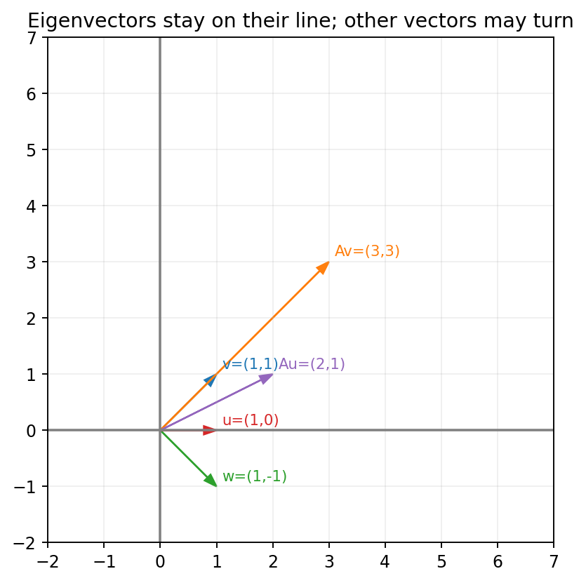
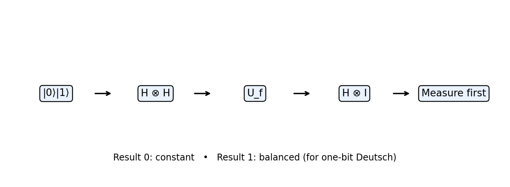

# Core Algorithms — Part A: Beginner-Friendly Lecture Notes

> **Source:** *01 Core Algorithms Part A* lecture transcript. The order below follows the lecturer's progression. **Extra explanation** labels indicate teaching additions, not claims that the lecturer said those exact words. The lecture ends at the break after introducing Deutsch–Jozsa; its quantum solution is **not** in this recording.

## 1. Where we are in the course

The professor opens by connecting previous mathematical foundations to the quantum algorithms that follow. We have already studied **qubits**, **superposition**, **measurement**, **tensor products**, and **quantum gates**. We now need to combine those tools into actual algorithms. Before doing so, the lecturer finishes the discussion of **eigenvalues and eigenvectors**.

**Everyday picture:** learning vectors and gates is like learning letters and words; algorithms are the complete sentences. We will first revisit the alphabet, then build a small but surprising program.

## 2. Quick review: basis, orthonormal basis, transformations and unitaries

### 2.1 Basis means a coordinate system

A vector is an arrow with a length and direction. A **basis** is a set of reference arrows we use to describe other arrows. In the ordinary 2D plane, the standard basis is

\[
 e_1=\begin{pmatrix}1\\0\end{pmatrix},\qquad e_2=\begin{pmatrix}0\\1\end{pmatrix}.
\]

For example, \(v=(3,2)^T=3e_1+2e_2\). This says: move three units along the first reference direction and two along the second. Change the basis and the *coordinates* can change even if the physical arrow does not.

An **orthonormal basis** has mutually perpendicular reference vectors, each of length one. Its special advantage is that the coordinate along a basis vector \(b_i\) is simply \(\langle b_i,v\rangle\). For complex vectors, the inner product conjugates the first argument: \(\langle b_i,v\rangle=b_i^\dagger v\). This is why orthonormal bases make calculations convenient.

### 2.2 Matrices act on vectors

A linear transformation is a rule that respects addition and scaling:

\[A(u+v)=Au+Av,\qquad A(cv)=cAv.\]

A matrix is a way to write such a rule. If \(A\) is an \(m\times n\) matrix and \(x\) has \(n\) entries, \(Ax\) has **\(m\) entries**. The transcript says \(n\) at one point; that is a dimensional slip, not the general rule.

### 2.3 Why quantum gates must be unitary

A quantum state \(|\psi\rangle=\alpha|0\rangle+\beta|1\rangle\) must obey

\[|\alpha|^2+|\beta|^2=1.\]

These squared magnitudes are probabilities, so they must add to 100%. A **unitary** matrix \(U\) preserves lengths:

\[\|U\psi\|=\|\psi\|,\qquad U^\dagger U=I.\]

Here \(U^\dagger\) means conjugate transpose and \(I\) means identity. The columns of a unitary matrix are **orthonormal**, not merely perpendicular: each column also has length one.

**Remember this:** unitary gates cannot accidentally turn a valid total probability of 1 into 4 or 0.25.

## 3. Eigenvectors: directions that a matrix does not turn

### 3.1 Intuition before the equation

Imagine applying a matrix to many arrows. Most arrows may rotate to a different line. A few special arrows only become longer, shorter, reverse, or collapse to zero. These special nonzero arrows are **eigenvectors**.

\[\boxed{Av=\lambda v,\qquad v\ne0}\]

- \(A\): the square matrix/transformation.
- \(v\): a **nonzero eigenvector**.
- \(\lambda\): its **eigenvalue**, the scale factor.

If \(\lambda=3\), the arrow becomes three times as long; if \(\lambda=-1\), it reverses; if \(\lambda=0\), it collapses to zero. The zero *vector* is not an eigenvector, although zero can be an eigenvalue.

### 3.2 The professor's first matrix example

\[A=\begin{pmatrix}2&1\\1&2\end{pmatrix}.\]

Try \(v=(1,1)^T\):

\[
Av=\begin{pmatrix}2\cdot1+1\cdot1\\1\cdot1+2\cdot1\end{pmatrix}
=\begin{pmatrix}3\\3\end{pmatrix}=3\begin{pmatrix}1\\1\end{pmatrix}.
\]

So \((1,1)^T\) is an eigenvector with eigenvalue 3. The transcript briefly says \((3,1)\) for the result; the multiplication establishes that the correct result is **\((3,3)\)**.

Try \(w=(1,0)^T\): \(Aw=(2,1)^T\). It is no longer on the original horizontal line, so **not** an eigenvector.

Try \(q=(1,-1)^T\):

\[Aq=(2-1,\,1-2)^T=(1,-1)^T=1q.\]

So this is an eigenvector with eigenvalue 1. The vector \((2,2)^T\) is also an eigenvector with eigenvalue 3: \(A(2,2)^T=(6,6)^T=3(2,2)^T\). Every **nonzero** multiple of an eigenvector works.

**Try it interactively:** [Matrix and eigenvector animation](../animations/animation-01.html).

### 3.3 Quantum X gate: swapping coordinates

The lecturer next considers the flip gate:

\[X=\begin{pmatrix}0&1\\1&0\end{pmatrix},\qquad X(a,b)^T=(b,a)^T.\]

Geometrically on real coordinates, it reflects across the line \(y=x\). Two special directions are

\[X(1,1)^T=(1,1)^T\quad(\lambda=+1),\]
\[X(1,-1)^T=(-1,1)^T=-(1,-1)^T\quad(\lambda=-1).\]

This same \(X\) later flips \(|0\rangle\) and \(|1\rangle\). The identity matrix \(I\) leaves **every nonzero vector** unchanged, so every nonzero vector is an eigenvector with eigenvalue 1. The lecturer suggests trying the Hadamard matrix as an exercise.

### 3.4 Why there are infinitely many eigenvectors

If \(Av=\lambda v\), then for any nonzero scalar \(c\),

\[A(cv)=cAv=c\lambda v=\lambda(cv).\]

Similarly, if \(Av=\lambda v\) and \(Aw=\lambda w\),

\[A(v+w)=Av+Aw=\lambda(v+w).\]

The set \(\{v:Av=\lambda v\}\), **including zero**, is a vector subspace called an **eigenspace**. A sum that happens to be zero is in the eigenspace but is not itself an eigenvector. A basis describes this whole subspace without listing infinitely many vectors. Choosing length-one eigenvectors helps normalize the description, but does not always leave only two possibilities: in a higher-dimensional eigenspace there can still be infinitely many unit vectors.

## 4. Finding eigenvalues using determinants

The professor now asks a practical question: *How do we calculate these special directions?*

### 4.1 First solve a simpler problem: \(Bx=0\)

Let

\[B=\begin{pmatrix}a&b\\c&d\end{pmatrix},\qquad x=\begin{pmatrix}x_1\\x_2\end{pmatrix}.\]

The equation \(Bx=0\) means

\[ax_1+bx_2=0,\qquad cx_1+dx_2=0.\]

Multiply the first equation by \(d\), the second by \(b\), and subtract:

\[d(ax_1+bx_2)-b(cx_1+dx_2)=0,\]
\[(ad-bc)x_1=0.\]

To have a **nonzero vector** solution, the matrix must be singular. For a 2×2 matrix, the test is

\[\boxed{\det(B)=ad-bc=0}.\]

This condition is both necessary and sufficient for a nonzero solution (even if the nonzero coordinate is \(x_2\), not \(x_1\)). For example, \(I x=0\) forces \(x=0\); \(B=\begin{pmatrix}1&1\\1&1\end{pmatrix}\) has determinant zero and \(B(1,-1)^T=0\).

### 4.2 Turn an eigenvector equation into this simpler problem

Start with \(Av=\lambda v\). Since \(Iv=v\),

\[Av-\lambda Iv=0,\qquad (A-\lambda I)v=0.\]

We want \(v\ne0\), so

\[\boxed{\det(A-\lambda I)=0}.\]

This is the **characteristic equation**. Solve it for \(\lambda\); then substitute each eigenvalue into \((A-\lambda I)v=0\) to find the eigenvectors.

### 4.3 The lecturer's Y-gate example

\[Y=\begin{pmatrix}0&-i\\i&0\end{pmatrix},\qquad i^2=-1.\]

Subtract \(\lambda I\):

\[Y-\lambda I=\begin{pmatrix}-\lambda&-i\\i&-\lambda\end{pmatrix}.\]

Compute the determinant carefully:

\[(-\lambda)(-\lambda)-(-i)(i)=\lambda^2-1.\]

Set it equal to zero: \(\lambda^2-1=0\), so \(\boxed{\lambda=+1\text{ or }-1}\).

For \(\lambda=+1\), solve \(Y(v_1,v_2)^T=(v_1,v_2)^T\). The equations are \(-iv_2=v_1\) and \(iv_1=v_2\). Choose \(v_1=1\), giving \(v_2=i\):

\[Y(1,i)^T=(1,i)^T.\]

The normalized state is \(\tfrac1{\sqrt2}(1,i)^T\). **Extra explanation:** for \(\lambda=-1\), \((1,-i)^T\) works; check by multiplying.

### 4.4 Rotation and why complex numbers change the picture

A planar rotation can be written

\[R_\theta=\begin{pmatrix}\cos\theta&-\sin\theta\\\sin\theta&\cos\theta\end{pmatrix}.\]

For an angle that is **not an integer multiple of 180°**, no nonzero **real** arrow stays on the same line after rotating. But if we allow complex coordinates, there are eigenvalues:

\[\det(R_\theta-\lambda I)=\lambda^2-2\lambda\cos\theta+1=0,\]
\[\lambda=\cos\theta\pm i\sin\theta=e^{\pm i\theta}.\]

For the displayed rotation convention, \((1,-i)^T\) has eigenvalue \(e^{i\theta}\); \((1,i)^T\) has eigenvalue \(e^{-i\theta}\). The lecturer's point: **real-plane pictures are useful, but complex eigenvectors require more abstract thinking**.

**Important correction:** not every real square matrix has a real eigenvector. Every square matrix of positive size has at least one complex eigenvalue and eigenvector (counting complex numbers). That is the sense relevant here.

### 4.5 Eigenvalues of unitary matrices have magnitude one

If \(Uv=\lambda v\) and \(U\) preserves length,

\[\|v\|^2=\|Uv\|^2=\|\lambda v\|^2=|\lambda|^2\|v\|^2.\]

Because \(v\ne0\), divide by \(\|v\|^2\):

\[\boxed{|\lambda|^2=1\quad\Rightarrow\quad |\lambda|=1}.\]

For complex numbers this is **not** the same as \(\lambda^2=1\). Besides \(1\) and \(-1\), numbers such as \(i\) and \(e^{i\theta}\) also have magnitude one. They sit on the **unit circle** in the complex plane.

**Key takeaway:** eigenvectors are special directions; eigenvalues describe the scaling or phase along them. A unitary matrix cannot stretch or shrink their length.

## 5. Moving to quantum algorithms

The professor now begins the central part of the course. The coming algorithms exploit behavior unavailable in the same form to ordinary classical queries. He previews **Deutsch**, **Deutsch–Jozsa**, and **Simon**, but this recording works through Deutsch and only introduces the Deutsch–Jozsa problem. The professor describes a small two-versus-one query improvement for Deutsch and a much larger classical-versus-quantum query separation for Deutsch–Jozsa.

**Extra explanation:** a *query* means one use of a provided black-box function. Query count is not the same thing as the total number of physical gates or total running time.

## 6. Review: many qubits, tensor products, gates and measurement

### 6.1 Why \(n\) qubits need \(2^n\) basis states

One qubit uses \(|0\rangle,|1\rangle\). Two qubits use \(|00\rangle,|01\rangle,|10\rangle,|11\rangle\). Three qubits use eight basis strings from \(|000\rangle\) through \(|111\rangle\). Each added qubit doubles the possibilities, so there are \(2^n\) basis states.

An arbitrary \(n\)-qubit pure state is

\[|\psi\rangle=\sum_{x\in\{0,1\}^n}\alpha_x|x\rangle,\qquad\sum_x|\alpha_x|^2=1.\]

Here \(x\) is an entire \(n\)-bit string and \(\alpha_x\) its complex amplitude. This is a mathematical description of a quantum state, **not** a claim that one measurement reveals all \(2^n\) amplitudes.

### 6.2 Separate gates on separate qubits

\[(A\otimes B)(|u\rangle\otimes|v\rangle)=A|u\rangle\otimes B|v\rangle.\]

The tensor-product symbol \(\otimes\) means “combine systems or operators”; it is **not** ordinary addition. It says apply \(A\) to the first qubit and \(B\) to the second.

### 6.3 Hadamard, X and CNOT

\[H|0\rangle=|+\rangle=\frac{|0\rangle+|1\rangle}{\sqrt2},\qquad H|1\rangle=|-\rangle=\frac{|0\rangle-|1\rangle}{\sqrt2}.\]

Applying Hadamard twice returns the original state: \(H^2=I\). The X gate flips \(0\leftrightarrow1\). In bit notation, \(X|b\rangle=|b\oplus1\rangle\), where \(\oplus\) is **XOR** (addition modulo 2).

CNOT uses a **control** bit \(a\) and **target** bit \(b\):

\[\mathrm{CNOT}|a,b\rangle=|a,b\oplus a\rangle.\]

| Control \(a\) | Target before \(b\) | Target after \(b\oplus a\) |
|---|---|---|
| 0 | 0 | 0 |
| 0 | 1 | 1 |
| 1 | 0 | 1 |
| 1 | 1 | 0 |

CNOT **can** create entanglement, for example when its control is in superposition, but not for every input.

### 6.4 Measurement

If \(|\psi\rangle=\alpha|0\rangle+\beta|1\rangle\), measuring in the computational basis yields **one** result: \(0\) with probability \(|\alpha|^2\), or \(1\) with probability \(|\beta|^2\). We do not read out both amplitudes from a single measurement.

## 7. Bit-string dot product and parity

The professor introduces a notation that is essential for the algorithms. Take equal-length bit strings \(s=s_1\dots s_n\) and \(x=x_1\dots x_n\). Define

\[\boxed{s\cdot x=(s_1x_1+s_2x_2+\cdots+s_nx_n)\bmod2}.\]

**What this means:** multiply matching bits, add the results, then keep only the remainder when divided by 2. An even sum gives 0; an odd sum gives 1. This is called **parity**.

**Worked example:** \(s=101\), \(x=111\):

\[s\cdot x=(1\cdot1+0\cdot1+1\cdot1)\bmod2=(1+0+1)\bmod2=0.\]

The string \(s\) is a **selector mask**: its 1s select positions 1 and 3, and its 0 ignores position 2. For \(s=111\), \(x=111\), the parity is \((1+1+1)\bmod2=1\). This is analogous to simple parity checks used in communication systems.

Two identities used later are

\[s\cdot(x\oplus y)=(s\cdot x)\oplus(s\cdot y),\]
\[(-1)^{a\oplus b}=(-1)^a(-1)^b,\qquad a,b\in\{0,1\}.\]

**Why the second works:** if both bits are 1, XOR gives 0, so the left side is +1; the right side is \((-1)(-1)=+1\). If exactly one is 1, both sides are −1. For exponents of \(-1\), adding or removing any even integer makes no difference.

**Check yourself:** for \(s=1011\) and \(x=1101\), selected bits are \(x_1,x_3,x_4=(1,0,1)\), so the parity is 0.

## 8. A reversible black-box function \(U_f\)

### 8.1 What is a black box?

Imagine a machine with an input slot and an output display. You know that entering \(x\) gives \(f(x)\), but you do not know or need to inspect the machine's internal implementation. In algorithm analysis we assume we can **query** this function.

A quantum operation cannot generally erase the input and replace it with \(f(x)\) because it must be reversible. Instead, the lecturer uses

\[\boxed{U_f|x\rangle|y\rangle=|x\rangle|y\oplus f(x)\rangle}.\]

Here \(x\) can contain \(n\) bits, \(y\) is **one** bit, and \(f(x)\) is **one** bit. The first register is unchanged; the second is XORed with the function result. This defines the oracle's action on basis states and extends linearly to superpositions.

### 8.2 Example: \(f(x)=s\cdot x\) with \(s=101\)

Let \(x=x_1x_2x_3\). Since \(s=101\),

\[f(x)=x_1\oplus x_3.\]

We want the target to become \(y\oplus x_1\oplus x_3\). Use **two CNOTs**: one controlled by \(x_1\), then one controlled by \(x_3\). We do nothing with \(x_2\).

Example input \(x=110\), \(y=0\): first CNOT toggles \(y:0\to1\); third-bit control is 0, so the second CNOT does nothing. Output is \(|110\rangle|1\rangle\), since \(f(110)=1\).

**Interactive:** [Oracle circuit step-by-step](../animations/animation-02.html).

### 8.3 Four one-bit function examples

| Function \(f(x)\) | Required change to target | Simple circuit |
|---|---|---|
| Always 0 | \(y\to y\) | Identity / no gate |
| Always 1 | \(y\to y\oplus1\) | X on target |
| \(f(x)=x\) | \(y\to y\oplus x\) | CNOT |
| \(f(x)=1\oplus x\) | \(y\to y\oplus x\oplus1\) | CNOT then X on target |

The professor revisits the last example in response to a question: **CNOT** adds the input bit to the target modulo 2, and **X** adds the extra 1 by flipping the target.

### 8.4 Why the oracle can be reversed

Apply it twice:

\[|x,y\rangle\xrightarrow{U_f}|x,y\oplus f(x)\rangle\xrightarrow{U_f}|x,y\oplus f(x)\oplus f(x)\rangle=|x,y\rangle.\]

A bit XORed with itself is zero: \(b\oplus b=0\). Therefore \(\boxed{U_f^2=I}\), so the oracle is its own inverse. As a permutation of computational-basis states, it is unitary.

## 9. Phase kickback: turning function values into signs

This is the lecturer's next central idea. So far the function changed the **target bit**. Now we want \(f(x)\) to change the **sign of the amplitude of \(|x\rangle\)**.

### 9.1 Prepare the minus state

\[|-\rangle=\frac{|0\rangle-|1\rangle}{\sqrt2}.\]

Apply the oracle to \(|x\rangle|-\rangle\). Expand the second register first:

\[U_f(|x\rangle|-\rangle)=\frac1{\sqrt2}\big(U_f|x,0\rangle-U_f|x,1\rangle\big).\]

Now use the definition of \(U_f\):

\[=\frac1{\sqrt2}\left(|x,f(x)\rangle-|x,1\oplus f(x)\rangle\right).\]

There are only two cases:

- If \(f(x)=0\): output is \(|x\rangle(|0\rangle-|1\rangle)/\sqrt2=|x\rangle|-\rangle\).
- If \(f(x)=1\): output is \(|x\rangle(|1\rangle-|0\rangle)/\sqrt2=-|x\rangle|-\rangle\).

Both cases fit one equation:

\[\boxed{U_f(|x\rangle|-\rangle)=(-1)^{f(x)}|x\rangle|-\rangle}.\]

The minus-state register ends up **unchanged**; the input register gains a sign determined by \(f(x)\). This is called **phase kickback**.

### 9.2 Why a sign can matter

A minus sign multiplying an entire isolated quantum state is an unobservable **global phase**. But if the input is a superposition,

\[\sum_x\alpha_x|x\rangle\quad\longrightarrow\quad\sum_x(-1)^{f(x)}\alpha_x|x\rangle,\]

then *different components* can receive different signs. These **relative phases** can affect later interference and measurements. That is the algorithmic advantage. It is not that a single sign is directly measurable.

**Interactive:** [Phase kickback and relative sign explorer](../animations/animation-03.html).

### 9.3 The eigenvector connection

The professor notes that \(X|-\rangle=-|-\rangle\): the minus state is an eigenvector of the X gate with eigenvalue \(-1\). In the oracle, \(f(x)=1\) means “apply X to the target,” so the eigenvalue \(-1\) is kicked back as a phase. Later, more general controlled unitaries can kick back other eigenvalue phases. The professor explicitly postpones that deeper theory.

## 10. Compact Hadamard notation for one bit

The professor now introduces a formula that will recur in the algorithms.

\[H|0\rangle=\frac{|0\rangle+|1\rangle}{\sqrt2},\qquad H|1\rangle=\frac{|0\rangle-|1\rangle}{\sqrt2}.\]

Both can be written as

\[\boxed{H|b\rangle=\frac1{\sqrt2}\sum_{z\in\{0,1\}}(-1)^{bz}|z\rangle}.\]

Read the notation slowly: \(b\) is the input bit; \(z\) is the output-basis label, taking values 0 and 1; \(\sum\) means “add both terms”; \((-1)^{bz}\) determines the sign.

| Input \(b\) | Output term \(z\) | \(bz\) | Sign \((-1)^{bz}\) |
|---|---|---|---|
| 0 | 0 | 0 | + |
| 0 | 1 | 0 | + |
| 1 | 0 | 0 | + |
| 1 | 1 | 1 | − |

Only the \(b=z=1\) combination produces a minus sign. The transcript has a couple of spoken slips (“both terms zero”); the table and equations above show the intended rule.

## 11. Hadamard on two, three, then \(n\) qubits

### 11.1 Two qubits: expand the tensor product

\[H^{\otimes2}|x_1x_2\rangle=(H|x_1\rangle)\otimes(H|x_2\rangle).\]

Using the one-bit rule:

\[=\frac12\left(|00\rangle+(-1)^{x_2}|01\rangle+(-1)^{x_1}|10\rangle+(-1)^{x_1+x_2}|11\rangle\right).\]

The 1/2 comes from \((1/\sqrt2)(1/\sqrt2)\). There are four terms because each of two qubits has two choices. The sign for \(|01\rangle\) checks \(x_2\), for \(|10\rangle\) checks \(x_1\), and for \(|11\rangle\) checks the parity of both.

### 11.2 Three qubits: predict signs without multiplying everything

For output label \(z=101\), the sign depends on \(x_1\oplus x_3\). For \(z=011\), it depends on \(x_2\oplus x_3\). This is exactly the bit-string dot product introduced earlier:

\[x\cdot z=(x_1z_1+x_2z_2+x_3z_3)\bmod2.\]

There are eight output terms and the common factor is \(1/\sqrt8\).

### 11.3 The general Hadamard identity

\[\boxed{H^{\otimes n}|x\rangle=\frac1{\sqrt{2^n}}\sum_{z\in\{0,1\}^n}(-1)^{x\cdot z}|z\rangle}.\]

**Decode every part:** \(H^{\otimes n}\) means apply H independently to each of \(n\) qubits; \(x\) is the input bit string; \(z\) runs through all \(2^n\) output strings; \(x\cdot z\) computes selected-bit parity; the sign is + for even parity and − for odd; every basis state has amplitude magnitude \(1/\sqrt{2^n}\).

**Why the formula works:** multiply the \(n\) individual expansions \(H|x_j\rangle=2^{-1/2}\sum_{z_j}(-1)^{x_jz_j}|z_j\rangle\). The \(n\) normalization factors multiply to \(2^{-n/2}\). The signs multiply to \((-1)^{\sum_jx_jz_j}\), which is the same as \((-1)^{x\cdot z}\). The tensor products of the \(|z_j\rangle\) form \(|z\rangle\).

The lecturer says this can later be understood as a change between orthonormal bases and connected to the Fourier transform; those interpretations are deferred.

### 11.4 Worked example: \(H^{\otimes2}|10\rangle\)

Take \(x=10\) and enumerate output strings:

| \(z\) | \(x\cdot z\) | Sign |
|---|---|---|
| 00 | 0 | + |
| 01 | 0 | + |
| 10 | 1 | − |
| 11 | 1 | − |

Therefore

\[\boxed{H^{\otimes2}|10\rangle=\tfrac12(|00\rangle+|01\rangle-|10\rangle-|11\rangle)}.\]

Cross-check: \(H|1\rangle\otimes H|0\rangle=|-\rangle\otimes|+\rangle\), which expands to the same answer.

### 11.5 Worked example: \(H^{\otimes3}|110\rangle\)

Here \(x\cdot z=z_1\oplus z_2\). The third input bit is zero, so \(z_3\) does not affect the sign.

| \(z\) | Parity \(z_1\oplus z_2\) | Sign |
|---|---|---|
| 000 | 0 | + |
| 001 | 0 | + |
| 010 | 1 | − |
| 011 | 1 | − |
| 100 | 1 | − |
| 101 | 1 | − |
| 110 | 0 | + |
| 111 | 0 | + |

\[H^{\otimes3}|110\rangle=\frac1{\sqrt8}(|000\rangle+|001\rangle-|010\rangle-|011\rangle-|100\rangle-|101\rangle+|110\rangle+|111\rangle).\]

**Interactive:** [Hadamard sign explorer for 1–3 qubits](../animations/animation-04.html). Change the input bits and inspect each output's parity and sign.

## 12. A useful parity-sum identity

The professor next considers the sum

\[S(a)=\sum_{x\in\{0,1\}^n}(-1)^{a\cdot x}.\]

The mask \(a\) is **fixed**, while \(x\) runs through **all** \(2^n\) bit strings. There are two cases:

\[\boxed{S(a)=\begin{cases}2^n,&a=00\cdots0,\\0,&a\ne00\cdots0.\end{cases}}\]

### 12.1 Why the zero mask gives \(2^n\)

If \(a=0\cdots0\), then \(a\cdot x=0\) for every \(x\). Each term is \((-1)^0=+1\). Add \(2^n\) ones and get \(2^n\).

### 12.2 Why every nonzero mask gives zero

Take \(a=10\) for two bits. The strings \(x=00,01,10,11\) give signs \(+,+,-,-\), whose sum is zero. For \(a=11\), signs are \(+,-,-,+\), also zero.

**General argument:** if any bit of \(a\), say \(a_j\), equals 1, pair each input \(x\) with the input obtained by flipping \(x_j\). Their parities differ by one, so one contributes +1 and the other −1. Every pair cancels. Thus exactly half the strings give even parity and half odd parity, **provided \(a\ne0\)**.

This identity is a mathematical version of **destructive interference**: equal numbers of + and − amplitudes cancel when added. The lecturer revisits it after a student asks why the sum is zero, emphasizing that the mask selects positions and the balance applies over all possible inputs, not necessarily to any arbitrary small sample.

**Check your understanding:** with \(n=4\), \(a=0000\), the sum is 16; with \(a=0010\), it is 0.

## 13. Deutsch's problem: one query instead of two

### 13.1 State the problem first

We are given a black-box function \(f:\{0,1\}\to\{0,1\}\). There are four possible functions:

| \(f(0)\) | \(f(1)\) | Type | XOR \(f(0)\oplus f(1)\) |
|---|---|---|---|
| 0 | 0 | Constant | 0 |
| 1 | 1 | Constant | 0 |
| 0 | 1 | Different outputs / balanced | 1 |
| 1 | 0 | Different outputs / balanced | 1 |

We only want to know **whether the outputs match**, not their individual values. A deterministic classical algorithm must check both \(f(0)\) and \(f(1)\): **two queries** in the worst case. Deutsch's quantum circuit uses **one query to \(U_f\)**.

### 13.2 The circuit in lecture order

Start with two qubits \(|0\rangle|1\rangle\). Apply H to both; call \(U_f\) once; apply H to the **first** qubit only; measure the first qubit.

### 13.3 Step 1: prepare superposition and the minus state

\[(H\otimes H)|0,1\rangle=|+\rangle|-\rangle=\frac{|0\rangle+|1\rangle}{\sqrt2}\otimes\frac{|0\rangle-|1\rangle}{\sqrt2}.\]

The first qubit contains both basis components. The second is prepared in \(|-\rangle\) specifically to enable phase kickback.

### 13.4 Step 2: query the oracle once

Use the phase-kickback identity separately on the \(|0\rangle\) and \(|1\rangle\) terms:

\[U_f(|+\rangle|-\rangle)=\frac{(-1)^{f(0)}|0\rangle+(-1)^{f(1)}|1\rangle}{\sqrt2}\otimes|-\rangle.\]

If \(f(0)=f(1)\), both signs match: the first register is \(|+\rangle\), possibly multiplied by a global minus. If they differ, the signs oppose: it is \(|-\rangle\), possibly multiplied by a global minus. The second register remains \(|-\rangle\).

### 13.5 Step 3: convert the sign difference into a measurable bit

Because \(H|+\rangle=|0\rangle\) and \(H|-\rangle=|1\rangle\), applying H to the first qubit yields:

\[\boxed{\text{Measure }0\iff f(0)=f(1),\qquad\text{Measure }1\iff f(0)\ne f(1).}\]

Equivalently, the measured bit is \(f(0)\oplus f(1)\). For this promised problem, the outcome is **certain**, not merely more likely.

**Interactive:** [Run Deutsch's algorithm for all four functions](../animations/animation-05.html).

### 13.6 Why it works: interference, not reading both values

For any \(a_0|0\rangle+a_1|1\rangle\),

\[H(a_0|0\rangle+a_1|1\rangle)=\frac{(a_0+a_1)|0\rangle+(a_0-a_1)|1\rangle}{\sqrt2}.\]

In Deutsch's algorithm, \(a_0=(-1)^{f(0)}/\sqrt2\) and \(a_1=(-1)^{f(1)}/\sqrt2\). If their signs match, \(a_0-a_1=0\), so the \(|1\rangle\) amplitude cancels. If their signs differ, \(a_0+a_1=0\), so the \(|0\rangle\) amplitude cancels.

**Important misconception:** quantum interference cancels **amplitudes**, which may be negative or complex. Classical probabilities themselves are nonnegative and cannot cancel this way. The algorithm does **not** reveal both \(f(0)\) and \(f(1)\); it reveals the property we asked for.

**Key takeaway:** superposition lets the oracle attach different phases to components; the final Hadamard makes those relative phases interfere into a definite answer.

## 14. Deutsch–Jozsa: the next problem, introduced before the break

The professor ends this recording by motivating the next algorithm. This is the **problem statement and classical query argument only**. The quantum circuit and proof are left for the next session.

### 14.1 A function of \(n\) bits

Now \(f:\{0,1\}^n\to\{0,1\}\). There are \(2^n\) possible inputs. We are **promised** that \(f\) belongs to one of two categories:

- **Constant:** every input returns the same output (all 0 or all 1).
- **Balanced:** exactly half the inputs return 0 and half return 1.

We need only identify which category applies. The promise matters: functions with, for example, 30 zeros and 2 ones when \(n=5\) are excluded.

### 14.2 Why the deterministic classical worst case needs many queries

Suppose we have already queried \(2^{n-1}\) different inputs and every output was 0. It might be a constant-zero function, **or** a balanced function whose zero outputs happen to be precisely the inputs checked so far. We cannot yet decide. One more query resolves the worst-case ambiguity: if it is 1, the function is balanced; if it is 0, a balanced function is no longer possible.

\[\boxed{\text{Worst-case deterministic classical queries}=2^{n-1}+1.}\]

The lecturer initially says \(2^{n-1}\) informally, then clarifies the exact **plus one** using an example.

### 14.3 The professor's five-bit example

If \(n=5\), there are \(2^5=32\) inputs. Under the promise, the outputs are either all identical or split into **16 zeros and 16 ones**. After 16 identical outputs, both cases are still possible. On the **17th** distinct query, we can finally decide in the worst case. The upcoming Deutsch–Jozsa quantum algorithm will use **one oracle query**, but its implementation and proof are **not covered in this transcript**.

### 14.4 How this connects back to Deutsch

When \(n=1\), “balanced” means one zero and one one. That is precisely Deutsch's problem. The professor describes Deutsch–Jozsa as a natural extension and stops for the break.

## 15. End-of-lecture review

| Concept | What you should now be able to explain |
|---|---|
| Eigenvectors | Why \(Av=\lambda v\) means a special nonzero direction |
| Determinant test | Why \(\det(A-\lambda I)=0\) finds eigenvalues |
| Unitary matrices | Why their eigenvalues have \(|\lambda|=1\) |
| Bit parity | How \(s\cdot x\) selects bits and checks even/odd parity |
| Oracle \(U_f\) | Why it uses \(y\oplus f(x)\) and is reversible |
| Phase kickback | Why \(|-\rangle\) turns \(f(x)\) into \((-1)^{f(x)}\) |
| Hadamard identity | Why output signs depend on \(x\cdot z\) |
| Parity sum | Why nonzero masks produce cancellation |
| Deutsch | Why one oracle call distinguishes constant vs balanced for one-bit inputs |
| Deutsch–Jozsa | What its promise is and why classical worst case is \(2^{n-1}+1\) |

### Short practice questions (with answers)

1. **Is \(v=0\) an eigenvector?** No, by definition an eigenvector must be nonzero.
2. **What does \(\lambda=-1\) mean?** The vector reverses direction without changing length.
3. **For \(s=101\), which bits matter?** First and third.
4. **What does \(U_f\) do to \(|x,0\rangle\)?** It gives \(|x,f(x)\rangle\).
5. **What does \(U_f\) do twice?** Returns the original input.
6. **What is the amplitude sign for \(x=10,z=11\) in the Hadamard formula?** Minus, since \(x\cdot z=1\).
7. **Why is \(|-\rangle\) useful?** It is an X eigenstate with eigenvalue −1, allowing phase kickback.
8. **What does Deutsch output for \(f(0)=1,f(1)=0\)?** Measurement 1.
9. **For \(n=5\), how many deterministic classical oracle queries can be needed for Deutsch–Jozsa?** 17.

## 16. Transcript verification and editorial notes

These are **identified transcription slips or statements requiring qualification**, not silent alterations:

- A general \(m\times n\) matrix maps an \(n\)-vector to an **\(m\)-vector**, not necessarily an \(n\)-vector.
- For \(A=\bigl(\begin{smallmatrix}2&1\\1&2\end{smallmatrix}\bigr)\), \(A(1,1)^T=(3,3)^T\), not \((3,1)^T\).
- The eigenvector is \(v\); \(\lambda\) is the eigenvalue. The transcript occasionally interchanges the words.
- A set of **all eigenvectors plus zero** is a subspace; zero itself is not an eigenvector.
- For a unitary eigenvalue the correct condition is \(|\lambda|^2=1\), not \(\lambda^2=1\) in general.
- Every square matrix has a **complex** eigenvalue; a real matrix need not have a **real** eigenvalue.
- The parity-balance identity has the explicit exception \(a=0\).
- The Deutsch measurement yields 0 for **equal** function values and 1 for **different** values; some spoken sentences near the end reverse or truncate that distinction.
- The exact deterministic classical worst-case Deutsch–Jozsa bound is \(2^{n-1}+1\), not merely \(2^{n-1}\).
- Names such as “Doish Joshua” and “phase feedback” in the speech recognition have been rendered as **Deutsch–Jozsa** and **phase kickback** where the context is clear.

**Source boundary:** no slides were supplied with this request. Diagram choices, clarifying examples, and any corrections are based on the transcript plus explicitly marked mathematical explanation; unclear slide-only details have not been invented.
