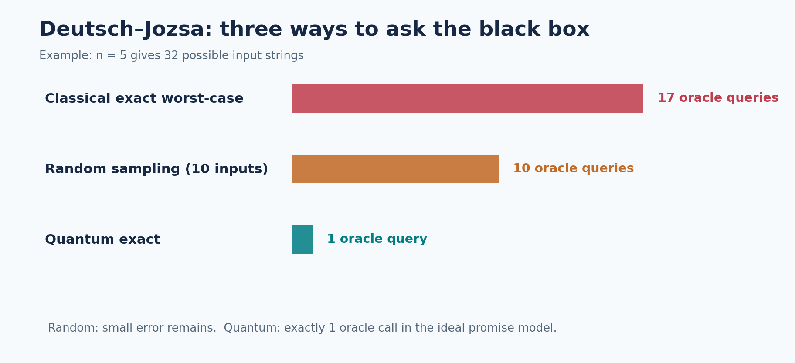
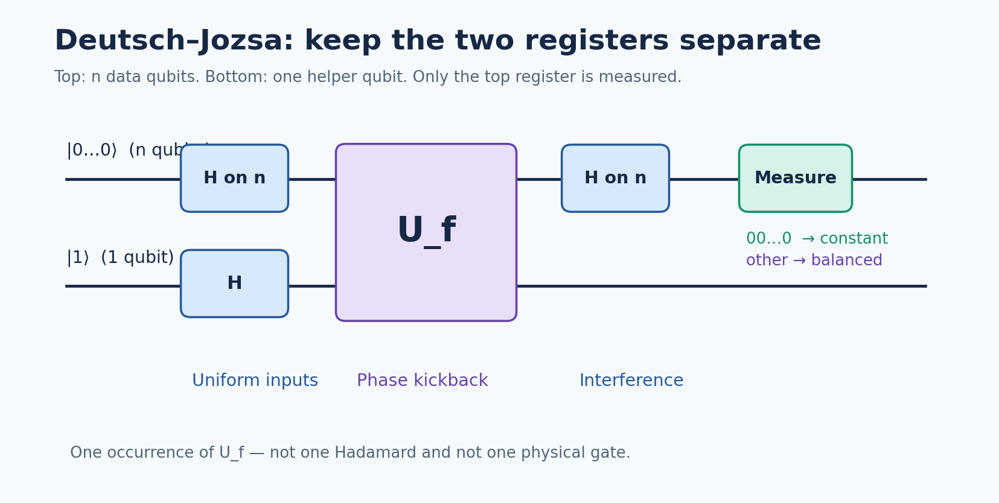
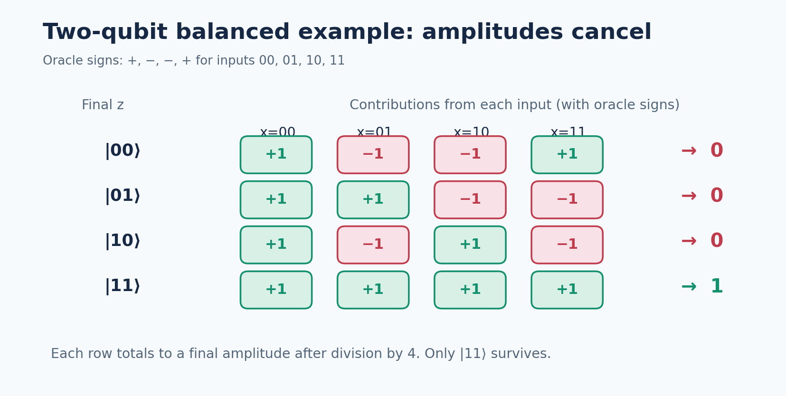
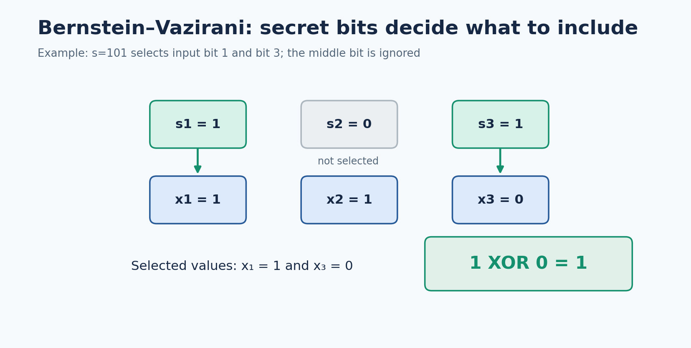
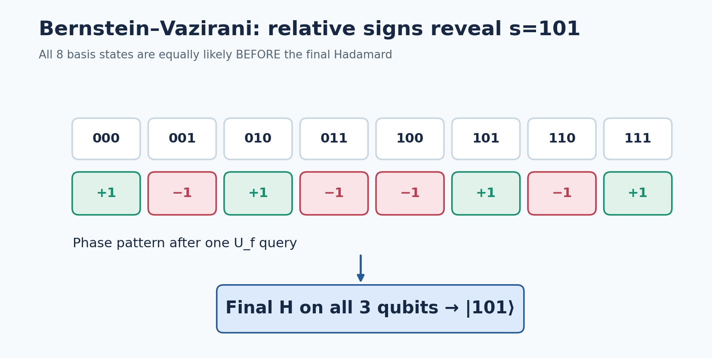
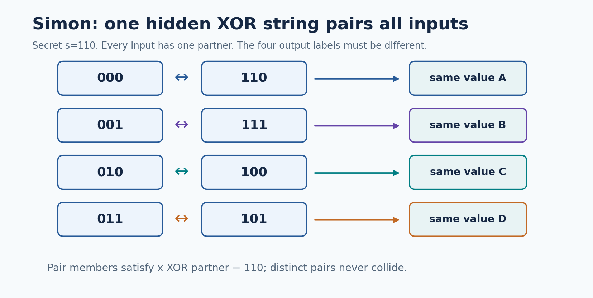
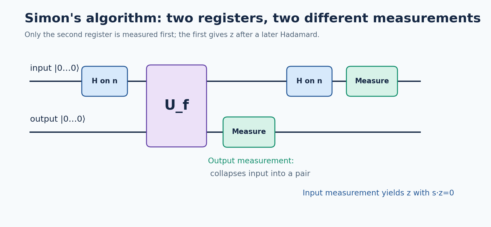
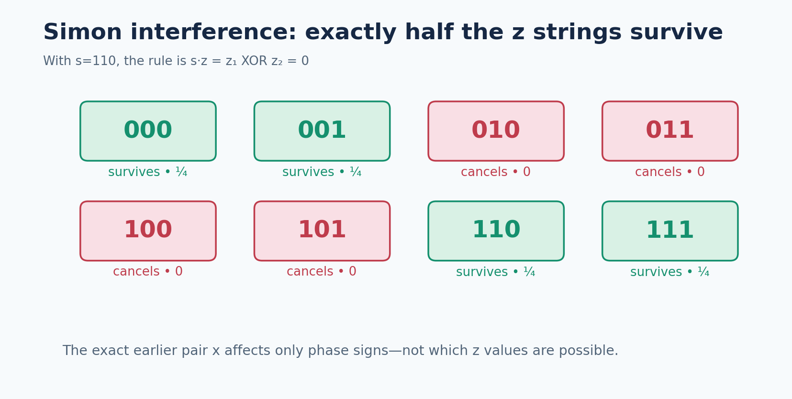
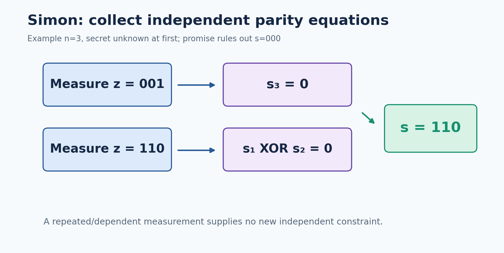
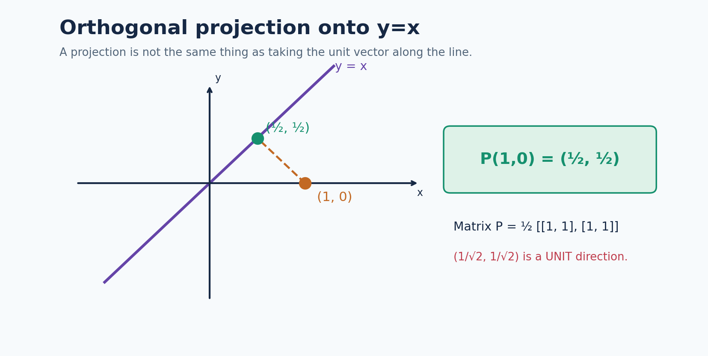

# Core Algorithms — Part B
## Complete beginner-friendly notes, following the lecture in order

> **Source:** `02 Core Algorithms Part B.txt` (the class after the break in Part A). **How to read these notes:** The main explanations follow the lecture in order, including repeated ideas and the end-of-class questions. Paragraphs labeled **Extra explanation** add scaffolding for a beginner. Notes labeled **Transcript clarification / correction** identify a mathematical or transcription issue surfaced in the transcript. The lecture *starts* by returning to Deutsch–Jozsa and *ends* with the beginning—not the full later theory—of Simon's algorithm and some linear algebra questions.

**Before starting:** If `|ψ⟩`, `⊕`, or `H` look unfamiliar, see the [tiny notation refresher](#a-tiny-notation-refresher). You can read the notes normally, then return to it as needed.

**Jump to the browser demonstrations:** [Classical querying](../animations/animation-01.html) · [Deutsch–Jozsa](../animations/animation-02.html) · [Bernstein–Vazirani](../animations/animation-03.html) · [Simon's paired inputs](../animations/animation-04.html) · [Simon's equations](../animations/animation-05.html) · [Orthogonal projection](../animations/animation-06.html).

---

## 1. Welcome back: recalling Deutsch's algorithm

The lecturer returns after the break to the question discussed in **Part A**. We were given a black-box function

\[
f:\{0,1\}\longrightarrow\{0,1\}.
\]

This notation means that the input is **one bit** (either `0` or `1`), and the output is also **one bit**. The black box lets us *ask* for `f(0)` or `f(1)`, without necessarily revealing how the function was built.

**The question in Deutsch's problem was not “What are both outputs?”** It was simply:

\[
\boxed{\text{Are }f(0)\text{ and }f(1)\text{ the same, or different?}}
\]

A classical computer can ask for `f(0)` and `f(1)` and compare them: **two function queries**. Deutsch's quantum circuit calls the reversible quantum oracle **once** and returns the answer exactly.

The key was **phase kickback**. Using a helper qubit in the state

\[
|-\rangle=\frac{|0\rangle-|1\rangle}{\sqrt2},
\]

we can arrange for a black-box operation to introduce signs into the amplitudes of the input register:

\[
U_f\bigl(|x\rangle|-\rangle\bigr)
=(-1)^{f(x)}|x\rangle|-\rangle.
\]

So `f(x)=0` gives a `+` sign and `f(x)=1` gives a `−` sign. For a **single** basis state, this overall sign is unobservable. For a **superposition** of inputs, different signs become *relative phases*, which another Hadamard gate can convert into a measurable difference.

Recall the two special states:

\[
|+\rangle=\frac{|0\rangle+|1\rangle}{\sqrt2},\qquad
|-\rangle=\frac{|0\rangle-|1\rangle}{\sqrt2}.
\]

They are orthogonal: their inner product is zero. One final Hadamard distinguishes them because

\[
H|+\rangle=|0\rangle,\qquad H|-\rangle=|1\rangle.
\]

Therefore, after the oracle and Hadamard, measuring `0` means the two function values match; measuring `1` means they differ. This is the foundation the lecturer now generalizes.

> **Remember this:** A quantum speedup is not necessarily about reading many separate function values. It is about arranging their **amplitudes** so a global property becomes measurable.

## 2. Generalizing Deutsch: the Deutsch–Jozsa promise

The lecture now increases the input length from one bit to **n bits**:

\[
f:\{0,1\}^n\longrightarrow\{0,1\}.
\]

An input such as `10110` is one of the possible n-bit strings. There are `2^n` different inputs because each of the `n` positions has two choices.

We are **promised** that the hidden function belongs to exactly one of the following types:

| Type | What the function does | Example for two input bits |
|---|---|---|
| **Constant** | Returns the *same* bit for every input | `f(00)=f(01)=f(10)=f(11)=0` |
| **Balanced** | Returns `0` on exactly half the inputs and `1` on the other half | `f(00)=0, f(01)=1, f(10)=1, f(11)=0` |

This guarantee is called a **promise**. Without it, an arbitrary function could output `0` on three of four inputs and `1` on just one. The algorithm is designed for the promised cases, not for every possible function.

**Our job:** decide whether `f` is constant or balanced. We are *not* asked to list all of its outputs.

### 2.1 Why exact classical checking can be expensive

Suppose `n=5`. Then there are

\[
2^5=2\times2\times2\times2\times2=32
\]

possible inputs. Imagine that the first 16 distinct inputs you try all return `0`. Can you conclude “constant”? **No.** Both of these hidden functions are still possible:

- A constant function returning `0` on all 32 inputs.
- A balanced function returning `0` on the 16 already tested inputs and `1` on all 16 remaining inputs.

It takes a **17th distinct query** to force a conclusion in the worst case. More generally:

\[
\boxed{Q_{\text{classical, exact worst-case}}=2^{n-1}+1.}
\]

**Where does this formula come from?** There are `2^n` inputs; half is `2^{n-1}`. After examining only that many equal outputs, a balanced function may still hide all opposite outputs in the untested half. One additional test resolves the ambiguity under the promise.

For `n=1`, the formula gives `2`: exactly Deutsch's original classical cost.



**Extra explanation — why “exponential” matters:** At `n=10` the bound is `513`; at `n=20` it is `524,289`. Each new input bit roughly doubles the hardest-case number of black-box questions.

### 2.2 The lecturer's practical alternative: randomized classical checking

The lecture makes an important distinction: **having a mathematical guarantee of zero error** is not the same as **getting the correct answer with overwhelmingly high probability**.

A classical computer can use randomness:

1. Choose a random input `x`, calculate `f(x)`.
2. Choose another random input `y`, calculate `f(y)`.
3. If the two outputs differ, the function is **definitely balanced**.
4. If the two outputs match, we cannot yet tell. Try more random inputs.

If the function is balanced, each uniformly random input independently returns `0` or `1` with probability `1/2` (when sampling with replacement). If we take `k` random inputs, what is the probability that **all their function values match**, causing us to mistake a balanced function for a constant one?

We might see all zeroes **or** all ones:

\[
\begin{aligned}
P(\text{all }k\text{ outcomes equal})
&=P(\text{all 0})+P(\text{all 1})\\
&=\left(\frac12\right)^k+\left(\frac12\right)^k\\
&=\boxed{2^{1-k}}.
\end{aligned}
\]

For ten independently sampled inputs, this is `2^(1−10)=1/512≈0.195%`. If instead we **repeat a two-query trial ten times using independent random choices**, the chance of failing all ten trials is `(1/2)^10=1/1024≈0.098%` and costs 20 queries. The transcript shifts between these two experiments; both illustrate very low—but nonzero—error.

| Strategy | Worst-case oracle queries | Can it ever be wrong? |
|---|---:|---|
| Deterministic, exact classical | `2^(n−1)+1` | No |
| Randomized classical, e.g. ten independent sampled inputs | 10 | Yes, with probability at most `1/512` for balanced functions |
| Deutsch–Jozsa quantum | **1** | **No** (ideal noiseless oracle/circuit under the promise) |

**Why might people still use the classical randomized method?** Ten inexpensive queries can be more practical than building a real quantum device. The surprising result is the **exact query separation**: one quantum oracle call versus exponentially many deterministic classical oracle calls.

**Transcript clarification:** The lecturer sometimes says “exponential time” while deriving an exponential **query bound**. Query complexity counts calls to the black box; actual running time also depends on how expensive the oracle and other gates are.

**Try it:** [Interactive classical query experiment](../animations/animation-01.html) lets you see the worst-case ambiguity and how random sampling changes the tradeoff.

### 2.3 A natural stopping point

At this point the lecturer previews **Bernstein–Vazirani** and **Simon**, saying the later problems better demonstrate an advantage that persists even if a classical algorithm is allowed randomness. Keep this distinction in mind as we progress.

**Check your understanding**

1. With `n=4`, how many possible inputs can `f` receive? (Answer: `16`.)
2. How many inputs have output `1` if `f` is balanced and `n=4`? (Answer: `8`.)
3. After seeing eight zeroes, must the function be constant? (Answer: no.)
4. If two queried outputs differ, why can you immediately say “balanced”? (The promise excludes all other nonconstant functions.)

---

## 3. The Deutsch–Jozsa quantum circuit: exactly the same pattern

The lecture now returns to the same circuit pattern seen in Deutsch's algorithm, except the top register has **n qubits** rather than one.



The circuit has two registers:

- The **data register** has `n` qubits, initially `|0^n⟩ = |00…0⟩`.
- The **helper/ancilla** register has **one** qubit, initially `|1⟩`.

A *register* is just a group of qubits used together, like a group of bits in a normal computer.

The quantum oracle is defined by

\[
U_f|x\rangle|y\rangle
=|x\rangle|y\oplus f(x)\rangle.
\]

Here `⊕` is XOR (addition modulo 2): `0⊕0=0`, `0⊕1=1`, `1⊕0=1`, `1⊕1=0`. The oracle preserves `x` and toggles `y` when `f(x)=1`.

### Step 1 — Prepare a uniform superposition of all inputs

We apply a Hadamard to **every one of the n top qubits**:

\[
H^{\otimes n}|0^n\rangle
=\frac1{\sqrt{2^n}}\sum_{x\in\{0,1\}^n}|x\rangle.
\]

**Unpack the symbols:**

- `H` is the Hadamard gate.
- `⊗ n` means “one Hadamard on each of n separate qubits.”
- `Σ` means add together all the indicated terms.
- `x ∈ {0,1}^n` means every possible n-bit string.
- `1/√(2^n)` is the normalization needed to make total measurement probability equal 1.

For `n=2` this is exactly:

\[
H^{\otimes2}|00\rangle
=\frac{|00\rangle+|01\rangle+|10\rangle+|11\rangle}{2}.
\]

There are four amplitudes, each `1/2`. The sum of their squared magnitudes is `4×(1/2)^2=1`.

### Step 2 — Prepare the helper in the minus state

On the bottom wire:

\[
H|1\rangle=|-\rangle
=\frac{|0\rangle-|1\rangle}{\sqrt2}.
\]

The reason is **not** that we want to measure this helper. Its purpose is to turn the function's `0/1` output into **plus/minus signs** on the data register.

### Step 3 — Apply the oracle once (phase kickback)

Combine the two prepared registers and apply `U_f`:

\[
\begin{aligned}
&U_f\left[
\frac1{\sqrt{2^n}}\sum_x|x\rangle|-\rangle
\right]\\
&\qquad=\frac1{\sqrt{2^n}}
\sum_x(-1)^{f(x)}|x\rangle|-\rangle.
\end{aligned}
\]

**Why?** Linear transformations act term by term. For any one input `x`, the helper `|−⟩` is unchanged, while the data state acquires a sign `(-1)^{f(x)}`. Applying the same circuit to a *superposition* produces one single output state—not multiple separately readable answers.

Discarding the unchanged helper from our written calculations, the relevant state is

\[
\boxed{|\phi_f\rangle
=\frac1{\sqrt{2^n}}\sum_x(-1)^{f(x)}|x\rangle.}
\]

Now there is a real distinction between the two promised cases:

- If `f` is always `0`, **every** sign is `+`.
- If `f` is always `1`, **every** sign is `−` (one unobservable overall/global minus sign).
- If `f` is balanced, **half** the signs are `+` and half `−`.

### Step 4 — Apply Hadamard again to the data register

The circuit next applies `H⊗n` again, *only* to the data register. Remember:

\[
H^2=I,\qquad (H^{\otimes n})^2=I^{\otimes n}.
\]

This means two consecutive Hadamards return every state to its original state.

Suppose `f(x)=0` for all `x`. After the oracle, the data register is precisely `H⊗n|0^n⟩`. The second Hadamard undoes the first one:

\[
H^{\otimes n}|\phi_f\rangle=|0^n\rangle.
\]

If `f(x)=1` everywhere, every amplitude has an overall minus sign, and we instead get `−|0^n⟩`. This is the **same measurement outcome** because an overall phase does not change probabilities.

Therefore:

\[
\boxed{f\text{ constant}\ \Rightarrow\ \text{data register measured as }00\ldots0\text{ with probability }1.}
\]

### Step 5 — What if `f` is balanced? This is the important calculation

This is the portion the lecture slows down to explain. We need to show that **the all-zero result cannot happen** for a balanced function.

The Hadamard identity from Part A says

\[
\boxed{
H^{\otimes n}|x\rangle
=\frac1{\sqrt{2^n}}\sum_{z\in\{0,1\}^n}(-1)^{x\cdot z}|z\rangle.}
\]

Here `x·z` is not an ordinary real-valued dot product: it is a **bit-string parity dot product**,

\[
x\cdot z=(x_1z_1\oplus x_2z_2\oplus\cdots\oplus x_nz_n).
\]

Each product `xᵢzᵢ` is a normal multiplication of zeroes/ones, followed by XOR across the terms. The result is always a single bit.

Apply Hadamard to the phase-kickback state, *keeping the normalizing factors*:

\[
\begin{aligned}
H^{\otimes n}|\phi_f\rangle
&=\frac1{\sqrt{2^n}}\sum_x(-1)^{f(x)}H^{\otimes n}|x\rangle\\
&=\frac1{2^n}\sum_x\sum_z(-1)^{f(x)}(-1)^{x\cdot z}|z\rangle\\
&=\sum_z\underbrace{\left[\frac1{2^n}\sum_x(-1)^{f(x)+x\cdot z}\right]}_{\text{amplitude of }|z\rangle}|z\rangle.
\end{aligned}
\]

**What happened to the constants?** Each Hadamard contributes `1/√(2^n)`, so multiplying two factors gives `1/2^n`. **What are the two sums?** The outer operation originally includes every input `x`, and each Hadamard creates contributions to every possible output `z`.

We don't need to calculate every output. Instead, the notes focus on just **one particular result**:

\[
z=0^n=00\ldots0.
\]

When `z` is all zero, `x·z=0` for every `x` because each multiplication includes a zero. Therefore `(-1)^(x·z)=+1` everywhere. The amplitude simplifies to

\[
\boxed{
a_{0^n}=\frac1{2^n}\sum_x(-1)^{f(x)}.}
\]

This is exactly the **average of the `+1/−1` signs** that the oracle wrote into the amplitudes!

Now evaluate it:

- **Balanced:** `2^(n−1)` signs are positive and `2^(n−1)` negative, so their sum is `0`; hence `a_(0^n)=0`.
- **Constant zero:** every sign is `+1`, so their sum is `2^n`; hence `a_(0^n)=+1`.
- **Constant one:** every sign is `−1`, so their sum is `−2^n`; hence `a_(0^n)=−1`.

Born's rule says the measurement probability is the square of the amplitude's magnitude:

\[
P(0^n)=|a_{0^n}|^2=
\begin{cases}
1,&f\text{ constant},\\
0,&f\text{ balanced}.
\end{cases}
\]

Notice the powerful feature: we did **not** need to know which other output `z` will be observed in the balanced case. We only need to know it **cannot** be the all-zero string.

**The complete decision rule:**

\[
\boxed{\text{Measure data register: all zero}\Rightarrow\text{constant; anything else}\Rightarrow\text{balanced}.}
\]

[Run the Deutsch–Jozsa circuit in your browser](../animations/animation-02.html): choose constant or balanced functions, then step through the uniform amplitudes, oracle signs, interference, and final measurement.

## 4. Working through the two-bit balanced example

To make the abstract sums visible, the lecturer uses two qubits and a particular balanced function. Let

| `x` | `f(x)` | `(-1)^f(x)` |
|---|---:|---:|
| `00` | `0` | `+1` |
| `01` | `1` | `−1` |
| `10` | `1` | `−1` |
| `11` | `0` | `+1` |

After the oracle, the **top two qubits** are

\[
|\phi_f\rangle
=\frac12\left(|00\rangle-|01\rangle-|10\rangle+|11\rangle\right).
\]

Observe that two terms have positive signs and two have negative signs. **These signs do not mean negative probabilities**; the probabilities are all `(1/2)^2=1/4` at this stage.

### 4.1 Expand the Hadamard of each term

These are the four separate expansions from the Hadamard identity:

\[
\begin{aligned}
H^{\otimes2}|00\rangle &=\tfrac12(|00\rangle+|01\rangle+|10\rangle+|11\rangle),\\
H^{\otimes2}|01\rangle &=\tfrac12(|00\rangle-|01\rangle+|10\rangle-|11\rangle),\\
H^{\otimes2}|10\rangle &=\tfrac12(|00\rangle+|01\rangle-|10\rangle-|11\rangle),\\
H^{\otimes2}|11\rangle &=\tfrac12(|00\rangle-|01\rangle-|10\rangle+|11\rangle).
\end{aligned}
\]

Now remember that our oracle-state coefficients are `+ − − +`. The final amplitude at any output `z` is obtained by adding the corresponding row contributions with those signs, and then dividing by 4.

| Final output `z` | Contribution from `00` | from `01` (negative oracle sign) | from `10` (negative oracle sign) | from `11` | Sum / 4 |
|---|---:|---:|---:|---:|---:|
| `00` | `+1` | `−1` | `−1` | `+1` | `0` |
| `01` | `+1` | `+1` | `−1` | `−1` | `0` |
| `10` | `+1` | `−1` | `+1` | `−1` | `0` |
| `11` | `+1` | `+1` | `+1` | `+1` | `1` |

All the contributions cancel except the `|11⟩` term, so for this particular balanced function:

\[
\boxed{H^{\otimes2}|\phi_f\rangle=|11\rangle.}
\]

That is **more specific** than the general theorem. The theorem only promises a result *other than* `00`; for this example it happens to be `11`.



**Extra explanation — adding waves, not chances:** Two water waves can cancel when one crest meets one trough. Likewise quantum **amplitudes** can have opposite signs and cancel. Ordinary probabilities cannot be negative, so you cannot cancel a classical probability by subtracting another one.

### 4.2 A general statement about “adding amplitudes”

The argument is rewritten using arbitrary coefficients. Suppose an n-qubit state is

\[
|\psi\rangle=\sum_x \alpha_x|x\rangle.
\]

After Hadamard on each qubit, the amplitude of the all-zero basis state is

\[
\boxed{\langle0^n|H^{\otimes n}|\psi\rangle
=\frac1{\sqrt{2^n}}\sum_x\alpha_x.}
\]

**Take care with normalization:** If `α_x = (-1)^f(x)/√(2^n)` as in Deutsch–Jozsa, the coefficient becomes `(1/2^n) Σ_x (-1)^f(x)`. If you omit normalization while doing scratch algebra, you can work out a sign pattern, but you cannot directly turn unnormalized coefficients into probabilities.

This is a surprisingly reusable trick: **Hadamard converts a global sum of input amplitudes into the amplitude of a particular output.** The lecturer foreshadows Fourier transforms, which will give a deeper interpretation later.

### Key takeaways at this natural pause

- Deutsch–Jozsa solves the promised constant-vs-balanced problem with **one** oracle call.
- The helper `|−⟩` causes **phase kickback**; the second Hadamard makes the relative signs interfere.
- All-zero output has probability `1` for constant and `0` for balanced functions, assuming an ideal implementation.
- A classical randomized strategy can also succeed with very high probability using a small number of queries, so do not confuse *exact* with *practical* advantage.

**Common misconception:** “The quantum computer evaluates the function for all possible inputs, then reads every answer.” **Correction:** It creates a superposition and interferes contributions, but a measurement does not disclose the entire list of individual function values.

---

## 5. Next problem: Bernstein–Vazirani — find a hidden bit string

After finishing Deutsch–Jozsa, the lecture introduces a closely related problem, usually called the **Bernstein–Vazirani algorithm**.

Again, a black-box function accepts `n` input bits and returns **one** output bit:

\[
f:\{0,1\}^n\longrightarrow\{0,1\}.
\]

Now we know **the form of the function**, but a hidden parameter is unknown:

\[
\boxed{f(x)=s\cdot x\pmod 2.}
\]

Here `s=s₁s₂…sₙ` is a *secret bit string*. We want to **recover every bit of `s`**, not merely decide if the function is constant or balanced.

### 5.1 What does the secret string actually do?

Think of `s` as a row of switches. A `1` means “include this position”; a `0` means “ignore this position.” The function takes the XOR (parity) of the chosen input bits.

For example, let

\[
s=101,\qquad x=x_1x_2x_3.
\]

Because the first and third bits of `s` are one,

\[
f(x)=1\cdot x_1\oplus0\cdot x_2\oplus1\cdot x_3=x_1\oplus x_3.
\]

Try `x=110`:

\[
f(110)=1\oplus0=1.
\]

Try `x=111`:

\[
f(111)=1\oplus1=0.
\]

The output is not telling you the secret directly—it tells you **whether the selected input bits contain an even or odd number of ones**.



### 5.2 Why this function is balanced, except for one special case

If `s` contains at least one `1`, then exactly half of the input strings have selected-bit parity `0`, and half have selected-bit parity `1`. This is the parity fact established in Part A. So `f(x)=s·x` is **balanced when `s≠0^n`**.

If `s=0^n`, no bit is selected and `f(x)=0` for every input: a **constant** function. The lecture mentions this exception while describing why the new problem is closely connected to Deutsch–Jozsa.

But the task has changed! Even if we already know `f` is balanced, we still don't know *which input positions* are being checked. That is what we must discover.

### 5.3 Classical method: reveal one secret bit at a time

A normal computer can recover `s₁` by asking the oracle about the input `100…0` (a one in the first position, zero elsewhere):

\[
\begin{aligned}
f(100\ldots0)
&=s_1\cdot1\oplus s_2\cdot0\oplus\cdots\\
&=s_1.
\end{aligned}
\]

Similarly,

\[
f(010\ldots0)=s_2,\qquad f(001\ldots0)=s_3,
\]

and so on. The `n` *standard basis strings* each isolate one bit. So the exact classical algorithm uses **n queries**:

\[
\boxed{Q_{\text{classical}}=n.}
\]

For `s=101`, the three questions are:

| Question | Answer | What we learn |
|---|---:|---|
| `f(100)` | `1` | `s₁=1` |
| `f(010)` | `0` | `s₂=0` |
| `f(001)` | `1` | `s₃=1` |

This is also an optimal worst-case query bound for a classical exact black-box algorithm: there are `2^n` possible secrets, and each ordinary query gives only one bit of output. Fewer than `n` binary answers cannot distinguish all `2^n` secrets.

> **Important distinction:** The comparison here is the **number of oracle queries**, not a claim that a quantum circuit uses only one physical gate. We still need Hadamards and other operations.

## 6. Bernstein–Vazirani with one quantum oracle call

The lecturer now reuses the **same circuit template** as Deutsch–Jozsa:

1. Initialize `n` data qubits to `|0^n⟩` and one helper to `|1⟩`.
2. Apply Hadamard to all the data qubits and the helper.
3. Apply `U_f` **once**, using phase kickback.
4. Apply Hadamard to all the data qubits a second time.
5. Measure the data qubits. Their bit string is **the hidden `s`**.

At step 3 the input register becomes

\[
|\phi_s\rangle
=\frac1{\sqrt{2^n}}\sum_{x\in\{0,1\}^n}(-1)^{s\cdot x}|x\rangle.
\]

Compare this with the formula from Part A:

\[
\boxed{H^{\otimes n}|s\rangle
=\frac1{\sqrt{2^n}}\sum_x(-1)^{s\cdot x}|x\rangle.}
\]

**They're identical expressions!** The oracle-generated phase state is *exactly what you would get by applying Hadamard to the secret state `|s⟩`.* So apply Hadamard once more:

\[
\begin{aligned}
H^{\otimes n}|\phi_s\rangle
&=H^{\otimes n}\bigl(H^{\otimes n}|s\rangle\bigr)\\
&=\bigl(H^{\otimes n}\bigr)^2|s\rangle\\
&=I^{\otimes n}|s\rangle\\
&=\boxed{|s\rangle}.
\end{aligned}
\]

This is the lecturer's elegant main proof: **the second Hadamard simply undoes the first Hadamard representation of the secret**. Measuring `|s⟩` reveals that string with probability one in the ideal circuit.

### 6.1 An expanded numerical example: hidden `s=101`

Let's do more arithmetic than the lecturer has time to show on the slide. Use `n=3`, so there are `2³=8` possible input strings.

The oracle computes `f(x)=x₁⊕x₃`. The phases are:

| `x` | `x₁` | `x₃` | `f(x)=x₁⊕x₃` | Oracle sign |
|---|---:|---:|---:|---|
| `000` | 0 | 0 | 0 | `+` |
| `001` | 0 | 1 | 1 | `−` |
| `010` | 0 | 0 | 0 | `+` |
| `011` | 0 | 1 | 1 | `−` |
| `100` | 1 | 0 | 1 | `−` |
| `101` | 1 | 1 | 0 | `+` |
| `110` | 1 | 0 | 1 | `−` |
| `111` | 1 | 1 | 0 | `+` |

The phase-kickback state is therefore

\[
\begin{aligned}
|\phi_{101}\rangle=\tfrac1{\sqrt8}(&|000\rangle-|001\rangle+|010\rangle-|011\rangle\\
&-|100\rangle+|101\rangle-|110\rangle+|111\rangle).
\end{aligned}
\]

Notice that **nothing in the magnitudes tells us which secret we have**: every basis state still has probability `1/8` if measured now. The information is hidden in the **relative plus/minus signs**.

Now apply `H⊗3` once more. Because this state is `H⊗3|101⟩`, the whole expression collapses algebraically to

\[
H^{\otimes3}|\phi_{101}\rangle=|101\rangle.
\]

Finally measure the three data qubits: the outcome is `101` with certainty in the ideal model.



[Open the interactive secret-string finder](../animations/animation-03.html). Change each bit of `s`, optionally introduce a common offset `b`, and watch which amplitudes survive the last Hadamard.

### 6.2 A question from class: why is it **one query** if there are n qubits?

The lecture explicitly clarifies that the entire superposition enters the **single** oracle block in the circuit. A superposition is a *single quantum state*, not `2^n` independent classical oracle calls.

At the same time, it is misleading to say the quantum computer “reads every computation in parallel”: **measurement returns one result**, and measuring prematurely destroys the interference that encodes the secret. Quantum advantage here comes from the whole transformation, not separately accessing all branches.

Gate count and query count are not the same thing. The algorithm has `2n` data-register Hadamard gates, plus preparation of the helper and the implementation cost of `U_f`, but **one occurrence of the oracle**.

### 6.3 The lecturer's deeper question: where do the other outputs go?

Rather than merely invoke `H²=I`, the lecture asks us to see **how the amplitudes cancel**. Let the amplitude of output `|z⟩` after the final Hadamard be `a_z`.

Using the Hadamard identity twice,

\[
\begin{aligned}
a_z
&=\frac1{2^n}\sum_x(-1)^{s\cdot x}(-1)^{x\cdot z}\\
&=\frac1{2^n}\sum_x(-1)^{(s\oplus z)\cdot x}.
\end{aligned}
\]

Why does the exponent combine like that? XOR parity is linear:

\[
(s\cdot x)\oplus(z\cdot x)=(s\oplus z)\cdot x.
\]

Now recall the crucial parity-sum identity proved in Part A:

\[
\sum_{x\in\{0,1\}^n}(-1)^{a\cdot x}
=\begin{cases}2^n,&a=0^n,\\0,&a\neq0^n.\end{cases}
\]

So either:

- `z=s`: then `s⊕z=0^n`, **all** `2^n` contributions have sign `+` and `a_s=2^n/2^n=1`.
- `z≠s`: then `s⊕z` has at least one `1`, half the contributions are `+`, half `−`, and `a_z=0`.

Therefore

\[
\boxed{a_z=\begin{cases}1,&z=s,\\0,&z\ne s.\end{cases}}
\]

Every **incorrect** output cancels; only `|s⟩` survives. This is why quantum **interference** is the correct mental model—not magically retrieving `n` separate classical answers.

### 6.4 A variant of the function: adding a hidden constant `b`

Next, the lecturer considers a uniform bit flip of all the function answers:

\[
\boxed{f(x)=(s\cdot x)\oplus b,\quad b\in\{0,1\}.}
\]

You know nothing about `b`: it could be zero (no flip) or one (flip every function value). Will the algorithm still find `s`?

Yes. The phase becomes

\[
\begin{aligned}
(-1)^{f(x)}
&=(-1)^{(s\cdot x)\oplus b}\\
&=(-1)^{s\cdot x}(-1)^b.
\end{aligned}
\]

The factor `(-1)^b` is the **same for every x**, so it can be pulled in front of the entire quantum state:

\[
|\phi_{s,b}\rangle=(-1)^b|\phi_s\rangle.
\]

The final result is thus

\[
H^{\otimes n}|\phi_{s,b}\rangle=(-1)^b|s\rangle.
\]

For `b=0` we have `|s⟩`; for `b=1` we have `−|s⟩`. Either way the measurement gives `s`. Why? **Global phase** does not affect measurement:

\[
|(-1)^b|^2=1.
\]

**Extra explanation:** This does *not* mean `b` has been discovered. It means the algorithm finds `s` despite being unable to distinguish these two global-phase cases using this final measurement.

### 6.5 What if we measure too early?

The lecture asks what happens if we measure the data register *after phase kickback but before the last Hadamard*. We have the state

\[
\frac1{\sqrt{2^n}}\sum_x(-1)^{s\cdot x}|x\rangle.
\]

For each basis state `x`, its amplitude is plus or minus the same magnitude:

\[
\left|\frac{(-1)^{s\cdot x}}{\sqrt{2^n}}\right|^2
=\frac1{2^n}.
\]

So measuring at this stage produces a **uniformly random n-bit string**, independent of `s`! We don't even learn the parity signs, because measurement in the computational basis ignores a coefficient's sign.

**Transcript clarification:** The transcript briefly describes prematurely measuring “plus one or minus one.” The meaningful measurement here is **a bit string `x`**, not a directly observable positive or negative amplitude. The signs are only made useful by the final interference step.

### Check your understanding — Bernstein–Vazirani

1. For `s=0101`, write `f(x)` in terms of its four input bits. **Answer:** `x₂⊕x₄`.
2. How many classical queries find a four-bit secret with certainty? **Answer:** `4`.
3. For `s=0000`, what is `f(x)=s·x`? **Answer:** constant zero.
4. If `b=1` flips every oracle output, which string does the circuit measure? **Answer:** still `s`.
5. Why not just measure the data register immediately after the oracle? **Answer:** all strings then have equal probability; the secret lives in their relative phases.

---

## 7. A more substantial problem: Simon's hidden symmetry

The lecturer now introduces a problem that is more complicated and, in terms of **classical randomized query complexity**, more striking than the previous two. He explains that Simon's algorithm is a conceptual stepping stone toward the ideas used later in quantum period-finding and factoring. He also says the course will return to these ideas through **Fourier analysis** in a later lecture. This session concentrates on building intuition for the algorithm.

### 7.1 First important change: the function now returns n bits

Previously the black box had type

\[
f:\{0,1\}^n\to\{0,1\}.
\]

Now Simon's function has a different type:

\[
\boxed{f:\{0,1\}^n\longrightarrow\{0,1\}^n.}
\]

This means an n-bit input such as `101` gives an **n-bit output** such as `011`. The actual output is not particularly important; the pattern of *which inputs give equal outputs* is the important thing.

There is a hidden nonzero bit string `s` of length `n`. Simon's promise is:

\[
\boxed{f(x)=f(y)\ \Longleftrightarrow\ y=x\ \text{or}\ y=x\oplus s.}
\]

Unpack it in two directions:

- If `y` equals `x` or the string obtained from `x` by flipping exactly those bit positions where `s` has a `1`, then they give **the same output**.
- If two inputs give the same function output, they **must** be one of those two cases. Different input *pairs* cannot accidentally share a value.

This makes the function **two-to-one**: every distinct output corresponds to **exactly two different inputs**. We assume `s≠0^n` so `x` and `x⊕s` really are different.

The symbol `⟺` means “if and only if.” Both directions of the promise matter. Without the converse direction, unexpected additional collisions could make the problem ambiguous.

### 7.2 What does it mean to “toggle by s”?

Think of XOR as a collection of switches:

| `sᵢ` | What happens to input bit `xᵢ` in `x⊕s`? |
|---|---|
| `0` | Keep it as it is |
| `1` | Flip `0↔1` |

For the lecturer's three-bit example, let `s=110`. Then the first two bits flip, while the third stays unchanged:

\[
000\oplus110=110,
\]

\[
001\oplus110=111.
\]

Similarly,

\[
010\oplus110=100,\qquad011\oplus110=101.
\]

There are eight possible inputs. Simon's promise divides them into four **non-overlapping pairs**:

| Pair | Input `x` | Its partner `x⊕110` | Required relationship |
|---|---|---|---|
| A | `000` | `110` | `f(000)=f(110)` |
| B | `001` | `111` | `f(001)=f(111)` |
| C | `010` | `100` | `f(010)=f(100)` |
| D | `011` | `101` | `f(011)=f(101)` |

For example, we could assign four arbitrary distinct output labels, such as `010`, `101`, `000`, and `111`, to pairs A, B, C, and D respectively. The two inputs inside each pair receive the same label, and no two different pairs share a label.



There are `2^n` total inputs, but only `2^(n−1)` different output values actually used. In this sense the function is 2-to-1. The lecturer also uses the mathematical word **cardinality**, which just means “number of elements in a set.”

**Transcript clarification:** One early spoken pairing in the three-bit example is garbled: for `s=110`, the partner of `001` is **`111`**, not `110` or `101`. The XOR calculations above supply the unambiguous pairing.

### 7.3 Larger five-bit example

Suppose the hidden string is

\[
s=11001.
\]

Only positions 1, 2, and 5 are toggled. Choose, as the lecturer does, an input:

\[
x=11010.
\]

Find its partner one bit at a time:

```text
       bit positions: 1 2 3 4 5
               x    : 1 1 0 1 0
               s    : 1 1 0 0 1
             x XOR s: 0 0 0 1 1
```

So `x⊕s=00011`, and the promise guarantees

\[
\boxed{f(11010)=f(00011).}
\]

Toggle twice and every flipped bit goes back:

\[
(x\oplus s)\oplus s=x\oplus(s\oplus s)=x\oplus0^n=x.
\]

This explains **why the inputs form pairs** instead of longer chains.

### 7.4 What exactly is Simon's problem asking?

You are *not* asked to list the whole function table. You are given only access to the black box and its special collision promise. Your task is to discover the hidden string:

\[
\boxed{\text{Find }s.}
\]

The hidden string tells you **which input bit positions must be flipped to move to the matching partner**.

**Interactive experiment:** [Simon's input-pair explorer](../animations/animation-04.html) shows the pairings, the result of toggling, and the hidden relationship that a quantum measurement later reveals.

## 8. Why Simon's problem is hard classically

Imagine you try a few different inputs and record their function outputs. If you happen to find a collision,

\[
f(x)=f(y),\qquad x\ne y,
\]

then the promise immediately gives

\[
y=x\oplus s.
\]

XOR both sides with `x`:

\[
\begin{aligned}
x\oplus y&=x\oplus x\oplus s\\
&=0^n\oplus s\\
&=s.
\end{aligned}
\]

Thus **one collision reveals the entire secret**:

\[
\boxed{s=x\oplus y.}
\]

For example, `x=010` and `y=100` give `010⊕100=110`, so the secret is `110`.

The difficulty is **finding a collision in the first place**. The lecture compares it with the famous *birthday paradox*: finding two people with the same birthday may take many samples, even though some matches are guaranteed in a sufficiently large group. Here the oracle outputs are paired in a hidden way.

### 8.1 How many classical queries are needed?

There are `2^(n−1)` distinct input pairs. Randomly querying inputs until two happen to be partners follows a birthday-type process. The characteristic number of random queries is approximately

\[
\boxed{\Theta(2^{n/2})}
\]

up to constant factors, for fixed success probability. This is **exponential in n**, because each increase in `n` adds to the exponent.

**Why a square root?** For `q` queried inputs there are about `q(q−1)/2` possible pairs among your observations, and each pair has roughly a `1/(2^n−1)` chance of being the hidden partners under a random hidden matching. The collision chance becomes appreciable when roughly

\[
\frac{q^2}{2^n}\approx1\quad\Rightarrow\quad q\approx2^{n/2}.
\]

This intuition is not the full lower-bound proof, but it explains why the square root appears. Unlike Deutsch–Jozsa, even a **randomized** classical approach requires exponentially many black-box queries to solve Simon's promise problem with substantial success probability.

> **Transcript correction:** The transcript has an unclear phrase resembling “`2^n` queries.” The standard classical randomized query complexity of Simon's problem is exponential but scales as **`2^(n/2)`** (up to asymptotic factors), rather than `2^n`. The numerical example for `n=100`—approximately `10^15`—is consistent with `2^50≈1.13×10^15`, i.e. `2^(n/2)`.

For `n=100`, the contrast is therefore roughly **a quadrillion** random classical oracle calls at birthday scale, versus **on the order of a hundred** quantum oracle calls (plus polynomial-time processing). This is a statement about an *ideal black-box problem*; it is not automatically a benchmark of real hardware speed.

### 8.2 Previewing the quantum strategy

The quantum algorithm will not try to explicitly find a matching pair by repeatedly guessing inputs. Instead it will prepare a quantum superposition of **a pair**, apply Hadamard so some terms interfere, and gather equations that constrain the secret `s`.

This is a new strategy compared with Bernstein–Vazirani:

- Bernstein–Vazirani: a **single query** gives enough phase structure to recover all of `s`.
- Simon: each run usually gives **one useful linear equation** about `s`; repeat the circuit roughly `O(n)` times and solve a system of equations.

This session stops once those equations are set up. Their efficient solution and the Fourier perspective are discussed more deeply later.

---

## 9. Simon's oracle uses two n-qubit registers

A crucial technical difference appears now. For the previous phase-kickback algorithms, `f(x)` was **one bit**. In Simon's problem the output is an **entire n-bit string**, so we use an oracle with two n-qubit registers:

\[
\boxed{U_f|x\rangle|y\rangle
=|x\rangle|y\oplus f(x)\rangle.}
\]

Here `x`, `y`, and `f(x)` each have `n` bits. XOR is done *position by position* between the second register and `f(x)`.

If the second register starts at all zeroes, then

\[
U_f|x\rangle|0^n\rangle
=|x\rangle|0^n\oplus f(x)\rangle
=\boxed{|x\rangle|f(x)\rangle}.
\]

This is like a blank notebook: the input stays intact and the helper register receives the function output. The lecturer deliberately leaves the internal gate-level construction of this oracle for later practical exercises (for example, building circuits in Qiskit).

**Why not write `(-1)^f(x)` as before?** In the phase-kickback trick, `f(x)` was a single `0` or `1`, suitable as an exponent producing a `±` sign. Here `f(x)` is an n-bit label such as `10110`, so that *same simple one-bit trick* does not directly fit. We therefore use a register that stores the output. This does not mean *all possible* forms of phase kickback are impossible for larger outputs; it means the lecturer chooses a different, more natural construction here.



## 10. Preparing a superposition of input–output pairs

The lecture next shows exactly how to prepare the required state. Start with `2n` qubits:

\[
|0^n\rangle|0^n\rangle.
\]

### Step 1 — Hadamard on only the first register

The first n qubits become an equal superposition of all possible inputs, and the second n qubits remain all zero:

\[
(H^{\otimes n}\otimes I^{\otimes n})|0^n\rangle|0^n\rangle
=\frac1{\sqrt{2^n}}\sum_x|x\rangle|0^n\rangle.
\]

### Step 2 — Apply the oracle once

Apply `U_f` to the whole state:

\[
\begin{aligned}
U_f\left[\frac1{\sqrt{2^n}}\sum_x|x\rangle|0^n\rangle\right]
&=\frac1{\sqrt{2^n}}\sum_x U_f|x\rangle|0^n\rangle\\
&=\boxed{\frac1{\sqrt{2^n}}\sum_x|x\rangle|f(x)\rangle}.
\end{aligned}
\]

Each `|x⟩` is paired with the quantum state containing its function output `|f(x)⟩`. Because the same output occurs twice, this joint state generally entangles the input and output registers.

**Extra explanation — one concrete two-bit toy example:** Take `n=2`, hidden `s=01`, and choose a valid oracle such that

\[
\begin{array}{c|cccc}
x & 00 & 01 & 10 & 11\\\hline
f(x) & 00 & 00 & 01 & 01
\end{array}
\]

The equal-output partners are `(00,01)` and `(10,11)` because these differ by XOR `01`. The joint state after one oracle call is

\[
\boxed{\frac12\left(|00\rangle|00\rangle+|01\rangle|00\rangle+|10\rangle|01\rangle+|11\rangle|01\rangle\right).}
\]

The vertical division between the first and second registers is made explicit with two adjacent kets. Nothing has yet been measured.

## 11. Measuring the second register makes a *pair state*

The lecturer asks: **What if we measure only the last n qubits?** This measurement tells us one function-output label (call it `y`), but because of Simon's promise, exactly **two inputs** correspond to that output.

In the two-bit example above:

- If the measured second-register label is `00`, the first register collapses to
  \[
  \frac{|00\rangle+|01\rangle}{\sqrt2}.
  \]
- If the measured second-register label is `01`, the first register collapses to
  \[
  \frac{|10\rangle+|11\rangle}{\sqrt2}.
  \]

Why the `1/√2`? Each outcome leaves **two equal-amplitude, orthogonal input basis states**. To make their total probability 1, their amplitudes must each have magnitude `1/√2`, because `1/2+1/2=1`.

For an arbitrary valid Simon function, measuring the second register always prepares the **first** register in the form

\[
\boxed{|\psi_x\rangle
=\frac{|x\rangle+|x\oplus s\rangle}{\sqrt2}}
\]

for some `x` whose output was measured.

This is the fundamental bridge to the next step. We no longer have a list of all inputs, but a coherent quantum **superposition of the two matching partners**.

### 11.1 An explicit question from the lecture: why not measure the first register now?

If we measured the first n qubits **at this moment**, we would get either `x` or `x⊕s`, each with probability `1/2`. We would not be given both outcomes simultaneously, so we could not immediately XOR them to obtain `s`.

That is exactly the kind of limitation we ran into classically: observing one partner alone is insufficient. The lecturer instead applies another Hadamard to make information about **their relationship** appear as interference.

**Try it:** [Simon's pair-state animation](../animations/animation-04.html). Switch the hidden string `s`, examine the possible input pairs, and see how measuring an output label leaves two coherent input possibilities.

---

## 12. Applying Hadamard to a two-string superposition

We have reached the main mathematical step of Simon's algorithm as taught in this session. Begin with

\[
|\psi_x\rangle=\frac{|x\rangle+|x\oplus s\rangle}{\sqrt2}.
\]

Apply `H⊗n` to the **first** register:

\[
H^{\otimes n}|\psi_x\rangle
=\frac1{\sqrt2}\left(H^{\otimes n}|x\rangle+H^{\otimes n}|x\oplus s\rangle\right).
\]

This step follows from linearity: the same transformation acts on each term and the results are added.

### 12.1 Write out the Hadamard identity twice

We have already learned

\[
H^{\otimes n}|x\rangle=\frac1{\sqrt{2^n}}\sum_z(-1)^{x\cdot z}|z\rangle.
\]

Replacing `x` by `x⊕s` gives

\[
H^{\otimes n}|x\oplus s\rangle
=\frac1{\sqrt{2^n}}\sum_z(-1)^{(x\oplus s)\cdot z}|z\rangle.
\]

Add the two formulas:

\[
H^{\otimes n}|\psi_x\rangle
=\frac1{\sqrt{2^{n+1}}}\sum_z
\underbrace{\left[(-1)^{x\cdot z}+(-1)^{(x\oplus s)\cdot z}\right]}_{\text{two contributions to }|z\rangle}
|z\rangle.
\]

Each possible output `z` receives **two contributions**: one from `|x⟩`, another from its partner `|x⊕s⟩`. Sometimes they agree, sometimes they cancel.

### 12.2 Factor out the first sign

The parity dot product obeys

\[
(x\oplus s)\cdot z=(x\cdot z)\oplus(s\cdot z).
\]

So

\[
(-1)^{(x\oplus s)\cdot z}
=(-1)^{x\cdot z}(-1)^{s\cdot z}.
\]

Substitute it into the amplitude formula and factor out the common part:

\[
\boxed{a_z
=\frac{(-1)^{x\cdot z}}{\sqrt{2^{n+1}}}\left[1+(-1)^{s\cdot z}\right].}
\]

Pause here: **everything important is inside the square brackets**. The unknown `x` affects only an overall `+` or `−` sign of each surviving amplitude, not whether the amplitude vanishes.

### 12.3 There are precisely two cases

**Case A: `s·z=1` (odd parity).**

\[
(-1)^{s\cdot z}=(-1)^1=-1,
\]

so

\[
1+(-1)=0,\qquad a_z=0.
\]

These outputs **disappear**: measurement can never return them in an ideal run.

**Case B: `s·z=0` (even parity).**

\[
(-1)^{s\cdot z}=(-1)^0=+1,
\]

so

\[
1+(+1)=2,\qquad a_z=\frac{2(-1)^{x\cdot z}}{\sqrt{2^{n+1}}}.
\]

These outputs **survive**. Their squared probability is

\[
P(z)=|a_z|^2=\frac{4}{2^{n+1}}=\frac1{2^{n-1}}
\]

for `s·z=0`. There are exactly `2^(n−1)` such `z`, so the probabilities add up to 1.

Hence the main result:

\[
\boxed{\text{Every measured string }z\text{ satisfies }s\cdot z=0\pmod2.}
\]

This is an **equation about the unknown secret**! Unlike Bernstein–Vazirani, the outcome `z` is usually not the secret itself; it is information **constraining** the secret.



### 12.4 Work it out for the lecturer's `s=110`

Write the secret as `s=(1,1,0)`. A possible measured `z=(z₁,z₂,z₃)` must satisfy

\[
\begin{aligned}
s\cdot z&=1z_1\oplus1z_2\oplus0z_3\\
&=z_1\oplus z_2\\
&=0.
\end{aligned}
\]

So the first two bits of `z` must match. The complete table is:

| Candidate `z` | `s·z = z₁⊕z₂` | Survives? | Probability |
|---|---:|---|---:|
| `000` | 0 | Yes | `1/4` |
| `001` | 0 | Yes | `1/4` |
| `010` | 1 | No | 0 |
| `011` | 1 | No | 0 |
| `100` | 1 | No | 0 |
| `101` | 1 | No | 0 |
| `110` | 0 | Yes | `1/4` |
| `111` | 0 | Yes | `1/4` |

The outputs `001` and `110` would each teach us something different about the unknown `s`:

- If the experiment gives `z=001`, then `s·z=s₃=0`.
- If it gives `z=110`, then `s·z=s₁⊕s₂=0`, i.e. `s₁=s₂`.

Since Simon's promise says `s≠000`, these two independent constraints force `s=110`.

### 12.5 A small two-bit check

Return to `n=2`, `s=01`, and the state `(|00⟩+|01⟩)/√2`. Applying `H⊗2` yields

\[
\begin{aligned}
&H^{\otimes2}\frac{|00\rangle+|01\rangle}{\sqrt2}\\
&\quad=\frac1{\sqrt2}\left[
\tfrac12(|00\rangle+|01\rangle+|10\rangle+|11\rangle)
+\tfrac12(|00\rangle-|01\rangle+|10\rangle-|11\rangle)
\right]\\
&\quad=\frac{|00\rangle+|10\rangle}{\sqrt2}.
\end{aligned}
\]

The terms `|01⟩` and `|11⟩` cancel. The surviving `z` strings are `00` and `10`—exactly the strings with `s·z=z₂=0`.

**Extra explanation — plain language:** We arranged for each input to have an unknown twin. When we transform their superposition, some candidate outcomes get equal-and-opposite wave contributions and vanish. The surviving outcomes all obey a rule involving the secret. Measuring a survivor reveals one instance of that rule.

---

## 13. Repeat the circuit, collect equations, and solve

The lecture now assembles the overall algorithm conceptually:

1. Start with **two n-qubit registers**, all zero.
2. Apply Hadamard to the first register to create a superposition of all `x`.
3. Apply `U_f` once: the joint register becomes a sum of `|x⟩|f(x)⟩`.
4. Measure the **second/output** register. The first register becomes `(|x⟩+|x⊕s⟩)/√2`.
5. Apply Hadamard to the **first/input** register.
6. Measure the **first/input** register and record the string `z`.
7. Write down the equation `s·z=0 (mod 2)`.
8. Start again with fresh registers and gather more such equations.
9. Once enough equations are **linearly independent**, solve them for the secret `s`.

**Transcript correction:** The lecturer briefly says “measure the last n bits, it gives a string z” near the end. The `z` in the parity constraint comes from measuring the **first register after its final Hadamard**, not from the earlier output-register measurement. The two measurements play completely different roles.

### 13.1 Solving an example by hand

Let `n=3`. The secret is `s=s₁s₂s₃`, unknown to us. We run the circuit repeatedly and obtain, for example:

**First measured constraint:** `z=001`:

\[
s_1\cdot0\oplus s_2\cdot0\oplus s_3\cdot1=0
\quad\Longrightarrow\quad s_3=0.
\]

**Second measured constraint:** `z=110`:

\[
s_1\cdot1\oplus s_2\cdot1\oplus s_3\cdot0=0
\quad\Longrightarrow\quad s_1\oplus s_2=0.
\]

Now `s₁=s₂` and `s₃=0`. The possible bit strings are `000` and `110`. Simon's promise excludes `000`, leaving

\[
\boxed{s=110.}
\]

**Why did two constraints suffice for three unknown bits?** The homogeneous system `s·z=0` always admits `s=000`. Once you have `n−1` *independent* constraints, there are typically only two solutions: zero and the hidden nonzero string. The promise tells us to take the nonzero one. More repeated samples may be needed to obtain enough *independent* equations because sometimes measurements repeat or produce `000` (which adds no information).

The arithmetic here is **modulo 2**. For example, `s₁⊕s₂=0` means those two bits are equal; it does **not** mean their ordinary integer sum must literally be zero (both one also works because `1⊕1=0`).



[Open the interactive equation collector](../animations/animation-05.html): measure eligible `z` strings, see which candidate secrets remain, and watch repeated or dependent equations provide no new information.

### 13.2 About the number of runs

The lecturer describes repeating the procedure “about n times.” The precise idea is **on the order of n samples**: collect independent equations until the hidden string is determined, then carry out ordinary classical linear algebra over `GF(2)` (just zero/one arithmetic with XOR). An *arbitrarily fixed* number of `n` samples is not guaranteed to be independent on every execution, but more samples can be taken; the sample complexity is `O(n)` in the standard model with high success probability. A candidate may also be checked using oracle queries.

The resulting contrast is exponential versus linear **query complexity**:

\[
\text{randomized classical: }\Theta(2^{n/2})
\qquad\text{versus}\qquad
\text{quantum: }O(n).
\]

**This is the point where the lecturer stops developing Simon's algorithm.** The fuller solution method, Fourier-sampling interpretation, and deeper connections with group symmetries are announced for the subsequent lecture. We have followed the algorithm only as far as this session covers it.

### Key takeaways — Simon's algorithm

- A hidden nonzero `s` divides all inputs into pairs `x` and `x⊕s`.
- The oracle writes **n-bit** function values into a separate **n-qubit** output register.
- Measuring that output register produces a coherent **two-input superposition** in the first register.
- Applying Hadamard to the first register cancels outputs where `s·z=1`.
- Each surviving measurement yields the useful equation `s·z=0`.
- Repeating and solving independent XOR equations recovers `s`, giving an exponential oracle-query separation from classical randomized approaches.

**Common misconceptions**

- “Measuring the output register immediately gives `s`.” No: it gives a value of `f(x)` and prepares a two-input state.
- “One measured `z` equals `s`.” No: typically `z` is a *constraint* on `s`.
- “After measuring one member of a pair, we know its partner.” No: measuring the data register at the wrong time reveals only one member.
- “Any `n` equations guarantee recovery.” No: duplicates and dependent equations don't add independent information.

---

## 14. After the main lecture: questions about linear algebra matrices

The lecture then switches from Simon's algorithm to short audience questions about earlier exercises. We preserve these here because they occur **after** the algorithm discussion rather than relocating them to the beginning.

### 14.1 Rotating a vector by 90° counterclockwise

The lecturer briefly mentions finding a `2×2` matrix that rotates the plane by 90° counterclockwise. To construct it, see where the standard basis vectors go:

\[
e_1=\begin{pmatrix}1\\0\end{pmatrix}
\mapsto\begin{pmatrix}0\\1\end{pmatrix},\qquad
e_2=\begin{pmatrix}0\\1\end{pmatrix}
\mapsto\begin{pmatrix}-1\\0\end{pmatrix}.
\]

Put the two output vectors in the **columns** of a matrix:

\[
\boxed{R_{90^\circ}=\begin{pmatrix}0&-1\\1&0\end{pmatrix}.}
\]

For example,

\[
R_{90^\circ}\begin{pmatrix}2\\1\end{pmatrix}
=\begin{pmatrix}-1\\2\end{pmatrix}.
\]

This is an **extra worked explanation** of the question the lecture alludes to; the lecture does not develop it completely.

### 14.2 Orthogonal projection onto the line `y=x`

The lecture next addresses an assignment question: **If a point is projected perpendicularly onto the line `y=x`, where does it land?**

Think of shining a light straight toward the diagonal line: every point casts a shadow onto that line along a perpendicular direction. The projected point must lie on the diagonal.

For any point `(a,b)`, the orthogonal projection onto `y=x` is

\[
\boxed{P(a,b)=\left(\frac{a+b}2,\frac{a+b}2\right).}
\]

Why the average? The diagonal direction is represented by the **unit** vector

\[
u=\frac1{\sqrt2}\begin{pmatrix}1\\1\end{pmatrix}.
\]

Its inner product with `(a,b)` is `(a+b)/√2`, which is a **scalar coordinate** along `u`. The actual projected **vector** is that scalar multiplied by `u` again:

\[
\begin{aligned}
P(a,b)&=(u^Tv)u\\
&=\left(\frac{a+b}{\sqrt2}\right)\frac1{\sqrt2}\begin{pmatrix}1\\1\end{pmatrix}\\
&=\frac{a+b}2\begin{pmatrix}1\\1\end{pmatrix}.
\end{aligned}
\]

In particular,

\[
P(1,0)=\left(\tfrac12,\tfrac12\right),\qquad
P(0,1)=\left(\tfrac12,\tfrac12\right).
\]

Put these two projected basis vectors into the columns:

\[
\boxed{P=\begin{pmatrix}1/2&1/2\\1/2&1/2\end{pmatrix}.}
\]

This matrix leaves every point **on** `y=x` unchanged and sends every point **perpendicular to it** to the origin. Its eigenvalues are `1` along `(1,1)` and `0` along `(1,−1)`:

\[
P\begin{pmatrix}1\\1\end{pmatrix}=\begin{pmatrix}1\\1\end{pmatrix},\quad
P\begin{pmatrix}1\\-1\end{pmatrix}=\begin{pmatrix}0\\0\end{pmatrix}.
\]



[Try the interactive orthogonal projection](../animations/animation-06.html). Drag an input point or change its coordinates and watch the perpendicular shadow fall onto the diagonal.

> **Important transcript error:** The transcript seems to give `(1/√2,1/√2)` for the projection of `(1,0)`. That is the *unit vector pointing along the diagonal*, **not** the orthogonal projection of `(1,0)`. The projection is `(1/2,1/2)`. The distinction is between a **unit direction** and the **correct length along that direction**.

### 14.3 The Z gate in the `|+⟩,|−⟩` basis

Another student asks how to write a known linear transformation in a **different basis**. Here the operator is the Pauli Z gate:

\[
Z=\begin{pmatrix}1&0\\0&-1\end{pmatrix},
\]

in the standard computational basis `(|0⟩,|1⟩)`. But the exercise asks for its matrix in the basis `(|+⟩,|−⟩)`.

**Core rule:** To build a matrix in a chosen basis, apply the operator to each basis vector in order. Express each output in the **new basis**, and write those coordinates as successive **columns**.

Use

\[
|+\rangle=\frac{|0\rangle+|1\rangle}{\sqrt2},\qquad
|-\rangle=\frac{|0\rangle-|1\rangle}{\sqrt2}.
\]

Apply Z to the first one:

\[
\begin{aligned}
Z|+\rangle
&=\frac{Z|0\rangle+Z|1\rangle}{\sqrt2}\\
&=\frac{|0\rangle-|1\rangle}{\sqrt2}=|-\rangle.
\end{aligned}
\]

So the coordinates of `Z|+⟩` in the ordered `(+,−)` basis are `(0,1)^T`. This is the **first column**.

Apply Z to the second:

\[
\begin{aligned}
Z|-\rangle
&=\frac{Z|0\rangle-Z|1\rangle}{\sqrt2}\\
&=\frac{|0\rangle+|1\rangle}{\sqrt2}=|+\rangle.
\end{aligned}
\]

The coordinates are `(1,0)^T`. This is the **second column**.

Therefore the same operator, represented in the `|+⟩,|−⟩` basis, has matrix

\[
\boxed{[Z]_{(+,-)}=\begin{pmatrix}0&1\\1&0\end{pmatrix}=X.}
\]

**Why this is not contradictory:** The physical operation hasn't changed; only the coordinates we use to describe it have changed. The matrix *looks like* X because Z swaps `|+⟩` and `|−⟩`.

### 14.4 A question about `X`, `Y`, `Z` and `X^(1/2)` in a circuit tool

The lecturer's final exchange mentions **Pauli gates** used in quantum circuit exercises:

\[
X=\begin{pmatrix}0&1\\1&0\end{pmatrix},\quad
Y=\begin{pmatrix}0&-i\\i&0\end{pmatrix},\quad
Z=\begin{pmatrix}1&0\\0&-1\end{pmatrix}.
\]

- `X` flips the computational bit: `|0⟩↔|1⟩`.
- `Z` changes the sign of the `|1⟩` amplitude.
- `Y` combines a bit flip with relative complex phases.

The student seems to be asking about the graphical circuit tool **Quirk** and its `X^(1/2)` label. **Extra clarification:** `X^(1/2)` is normally the *square-root-of-X* gate, **not** the ordinary X gate. Applying it **twice** gives X, up to any global-phase convention used by a particular tool. A label with a superscript `1/2` should therefore not be silently treated as just `X`.

The session ends by encouraging hands-on circuit exercises, including Qiskit, because writing and running gates makes the mathematics more concrete. It also previews the next lecture's **Fourier transform/Fourier sampling** viewpoint and notes that questions are welcome when the notation becomes difficult.

---

## 15. Lecture-end review and self-test

This section comes **after** the lecture's final questions so that it does not interrupt the original sequence.

### Summary comparison, now that all three problems have been introduced

| Problem | What is hidden? | Classical oracle queries | Quantum oracle queries | Main mechanism |
|---|---|---|---|---|
| **Deutsch–Jozsa** | Whether `f` is constant or balanced | Exact deterministic worst case `2^(n−1)+1`; randomized sampling much cheaper with possible error | `1` (exact) | All-zero output amplitude sums oracle signs |
| **Bernstein–Vazirani** | `n`-bit string `s` with `f(x)=s·x` | `n` (exact) | `1` (exact) | Hadamard reveals secret encoded as parity phases |
| **Simon** | Nonzero `n`-bit pairing mask `s` | `Θ(2^(n/2))` randomized, constant-success-probability scale | `O(n)` (sample and solve) | Interference yields constraints `s·z=0` |

**Practice problems**

1. **Promise counting:** If `n=6`, how many inputs does a balanced function map to zero? How many exact deterministic worst-case classical queries are needed for Deutsch–Jozsa?
2. **Phase arithmetic:** For `f(00)=0`, `f(01)=1`, `f(10)=0`, `f(11)=1`, write the four signs after phase kickback. Is the function balanced?
3. **BV parity:** For `s=1101`, find `f(1011)`. Which input should you query classically to learn `s₃`?
4. **BV offset:** If `s=010`, `b=1`, and `f(x)=s·x⊕b`, what does the ideal Bernstein–Vazirani circuit output?
5. **Simon pairing:** For `s=101`, find the partner of `x=011`. If those inputs have identical oracle output, what does `x⊕y` give?
6. **Simon equation:** If a measured `z=101` comes from Simon's algorithm, what XOR equation must `s=(s₁,s₂,s₃)` satisfy?
7. **Solve Simon's secret:** If `s≠000` and observed constraints are `z=100` and `z=011`, which secret remains?
8. **Projection:** Apply the projection matrix onto `y=x` to vector `(3,1)`. Why is the result on the diagonal?

<details>
<summary><strong>Answers — check only after trying</strong></summary>

1. There are `2⁶=64` inputs; balanced means `32` zero outputs. Exact deterministic worst-case bound: `2⁵+1=33`.
2. Signs `(+,-,+,-)` in `00,01,10,11` order. Yes, balanced.
3. `s·x = (1·1)⊕(1·0)⊕(0·1)⊕(1·1)=1⊕1=0`. Query `f(0010)` to obtain `s₃`.
4. `010` — the offset adds only global phase.
5. `011⊕101=110`. The XOR of paired inputs returns `101`.
6. `s₁⊕s₃=0`.
7. `z=100` implies `s₁=0`; `z=011` implies `s₂=s₃`; nonzero secret is `011`.
8. `P(3,1)=((3+1)/2,(3+1)/2)=(2,2)`, which satisfies `y=x`.

</details>

### Accuracy notes and uncertainties, explicitly tracked

- **The course's claim about Simon's classical complexity:** Correct asymptotic randomized collision-query scale is `Θ(2^(n/2))`, rather than `2^n`. The lecturer's `n=100` numerical analogy fits `2^(n/2)`.
- **Deutsch–Jozsa sampling:** Ten sampled inputs fail with probability `2^(1−10)` if chosen independently with replacement; ten independently repeated *two-sample trials* fail with probability `2^(−10)`. The transcript moves between those methods.
- **The word “query” is not “gate” and not necessarily “seconds.”** These examples establish query complexity results in a black-box model.
- **Simon register ordering:** Output-register measurement makes a paired state; *later* input-register measurement yields `z`.
- **Simon's `O(n)` quantum sampling:** Some samples repeat or are dependent; collecting independent constraints may take extra attempts, and classical XOR linear algebra finishes the task.
- **Projection onto `y=x`:** `(1,0)` projects to `(1/2,1/2)`, *not* `(1/√2,1/√2)`.
- **Oral spelling/transcription:** Standard names are *Deutsch*, *Deutsch–Jozsa*, *Bernstein–Vazirani*, *Simon*, *Hadamard*, *phase kickback*, and *Quirk*. The labels in these notes follow standard spelling.
- **Part B coverage limit:** The transcript develops Simon up to the constraint equations, then moves to questions. Details beyond that are labeled supplementary; this document does not silently invent a complete later Fourier-theory lecture.

---

## A tiny notation refresher

These are *reference notes*, placed at the end to preserve the lecturer's teaching order.

| Symbol | Meaning in beginner language |
|---|---|
| `|0⟩`, `|1⟩` | Basic one-qubit quantum states |
| `|101⟩` | Three qubits in the computational basis state 1, 0, 1 |
| `|0^n⟩` | n zero bits: `00…0` |
| `|ψ⟩` | A general quantum state (ket notation) |
| `|x⟩|y⟩` | Two quantum registers written side by side (tensor product) |
| `H` | Hadamard gate: mixes `0` and `1` amplitudes |
| `H⊗n` or `H^{\otimes n}` | Hadamard applied separately to each of n qubits |
| `U_f` | Reversible quantum oracle for function `f` |
| `⊕` | XOR, or addition modulo two |
| `s·x` | Parity (XOR sum) of positions selected by `s` |
| `Σ_x` | Add contributions from every allowed string `x` |
| `(-1)^b` for bit `b` | `+1` if `b=0`, `−1` if `b=1` |
| **Amplitude** | Signed/complex coefficient; its squared magnitude gives a measurement probability |
| **Global phase** | One identical phase multiplying the entire state; no effect on measurement probabilities |
| **Relative phase** | Phase differences between terms; can change interference |
| **Oracle query** | One use of the given black-box function circuit |
| **Linear independence** | A new equation provides information that cannot already be obtained from previous equations |

**How to study:** Run the interactive animations at the exact point they are linked, use Step instead of Play when the algebra becomes confusing, and only then attempt the self-test. The Markdown is self-contained except for the adjacent generated images and locally runnable HTML demonstrations.
