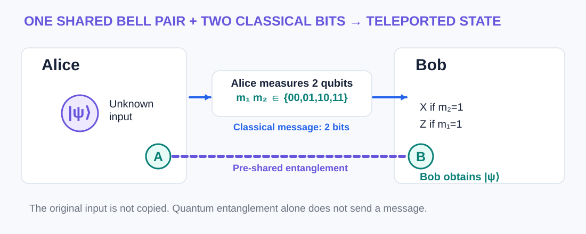
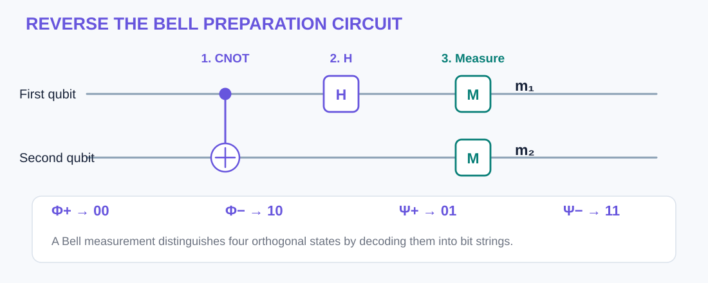
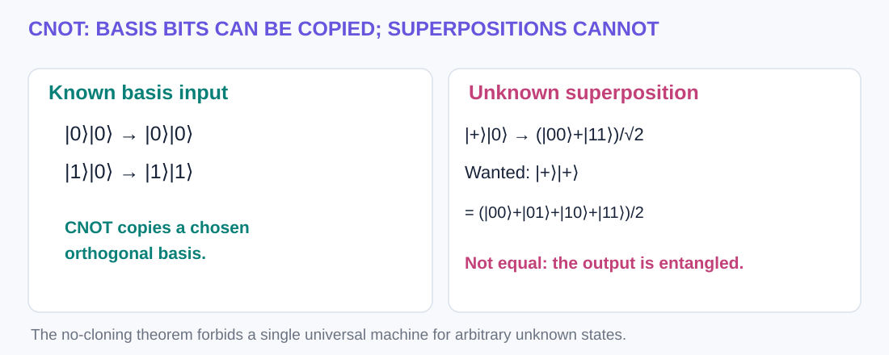
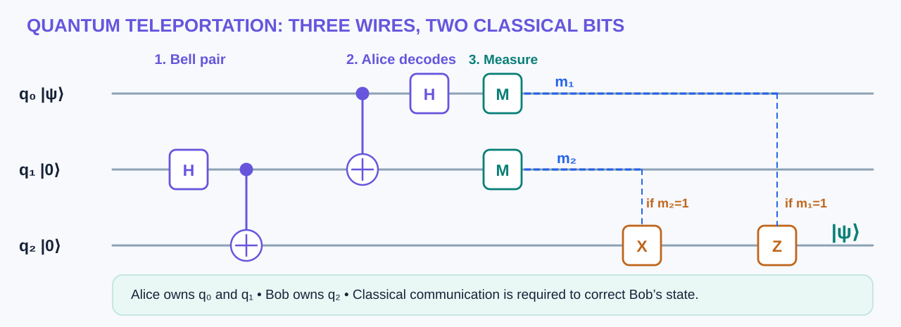
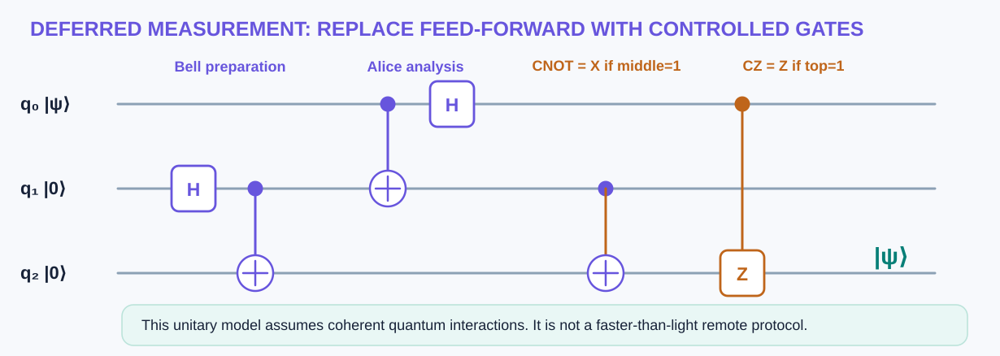
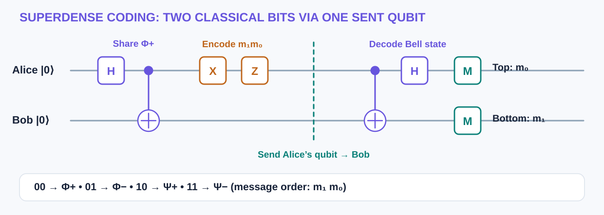
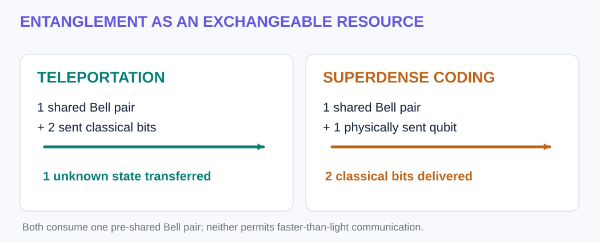
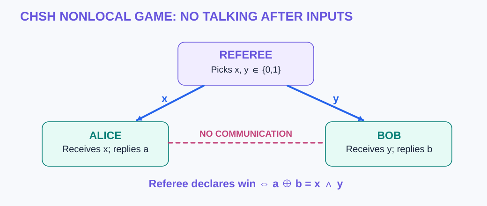
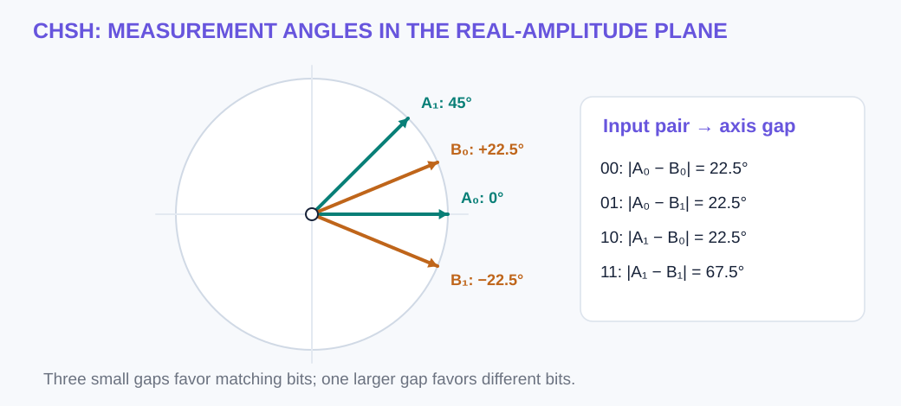

# QC Foundations [4/4]: Entanglement as a Resource

**Beginner-friendly study notes — Gates & Circuit Design, Part B** 
**Lecture:** Prof. Kolin Paul, Department of Computer Science and Engineering, IIT Delhi 
**Date shown on slides:** 15 November 2026 
**Sources:** Lecture recording and all 31 numbered lecture slides (presented across 19 PDF pages). 
**How to use these notes:** Read in order. When an animation is linked, open that file in any modern browser; it works offline. Do the small questions before reading the answer. The longer exercises and fully worked answers are in [Practice Questions](practice/practice_questions.md).

> **Notation used consistently:** A qubit is written `|ψ⟩` (pronounced *ket psi*). Alice has an **unknown input qubit** `q₀` and her **half of a Bell pair** `q₁`; Bob has the other half `q₂`. In teleportation, Alice's measured bits are `m₁` (from `q₀`) and `m₂` (from `q₁`). The four Bell states are `|Φ⁺⟩`, `|Φ⁻⟩`, `|Ψ⁺⟩`, `|Ψ⁻⟩`. Some misheard words such as “bill pair,” “C zero,” “face flip,” and “unit tree” are speech-to-text errors for **Bell pair**, **CNOT**, **phase flip**, and **unitary**.

---

## 1. Introduction

### 1.1 The question that starts the class: “Beam me up, Scotty”

The professor opens with the *Star Trek* transporter. On television, a person disappears from one location and reappears elsewhere. It is a memorable way to ask a more manageable physics question:

**Can we move the *quantum state* of one qubit from Alice to Bob, without physically carrying that particular qubit to Bob?**

We will learn the surprising answer: **yes**, provided Alice and Bob already share a special quantum resource called an **entangled Bell pair** and Alice can send Bob **two ordinary, classical bits**. The process is **quantum teleportation**. It does **not** move a person, send matter instantaneously, or let anyone communicate faster than light.

The movie contains a useful idea: the original vanishes. Quantum mechanics likewise does **not** permit a universal machine to leave Alice with a copy while giving Bob another perfect copy of an *unknown* state. This is the **no-cloning theorem**.

| Question | Star Trek transporter | Quantum teleportation in this lecture |
|---|---|---|
| What is transferred? | A person's matter | The state of a qubit |
| Does the original survive as a second copy? | No, in the usual transporter story | No: Alice's input is consumed by measurement |
| Is it instantaneous communication? | Presented that way | **No**. Bob needs two classical bits, limited by light speed |
| What must be available in advance? | Fictional transporter | One shared entangled Bell pair |



*Figure 1.* The purple resource is a Bell pair established **before** teleportation; the blue channel sends ordinary measurement results afterward. Bob uses those bits to choose a correction.

**What this lecture covers, in the professor's order:** (1) reverse a Bell circuit; (2) show why arbitrary quantum states cannot be copied; (3) teleport an unknown qubit; (4) verify teleportation with circuits and Qiskit; (5) send two classical bits using superdense coding; and (6) beat a classical team's winning probability in the CHSH game. The common idea is **entanglement as a useful resource**.

### 1.2 Why this is useful outside science fiction

Imagine a quantum computation distributed across two chips. An ordinary classical circuit can duplicate a voltage signal and route it to several places. But an unknown quantum state cannot be *fanned out* into two exact copies. Teleportation is a way to **move** the logical state between systems using pre-shared entanglement and a classical message. Quantum networking and modular quantum computing motivate this task.

### 1.3 What you should know before starting

Nothing advanced is assumed. We will rebuild these ideas from the beginning: classical bits, qubit notation, two-qubit notation, probability, complex conjugation, inner products, the X, Z, H, CNOT gates, and measurements. You do **not** need calculus to understand most of this lecture; simple trigonometry appears in the final CHSH section.

---

## 2. Prerequisite Concepts

### 2.1 Classical bits versus qubits

A **classical bit** is a physical representation of either `0` or `1`. A **qubit** is a quantum system whose state can be a superposition of two basic states, `|0⟩` and `|1⟩`:

$$
|\psi\rangle=\alpha|0\rangle+\beta|1\rangle.
$$

- `|0⟩` and `|1⟩` are the **computational basis states**.
- `α` and `β` are **amplitudes**, which may be complex numbers (numbers involving `i`, with `i² = −1`).
- `|α|²` is the probability of obtaining `0` **when measuring in this basis**; `|β|²` is the probability of obtaining `1`.
- These probabilities add to one: `|α|² + |β|² = 1`.

**Analogy:** A classical bit is like a switch that is on or off. A qubit is *not* a switch secretly sitting at an unknown position; its amplitudes can produce effects, including interference, that no ordinary switch reproduces.

The notation is shorthand for a column vector:

$$
|0\rangle=\begin{bmatrix}1\\\\0\end{bmatrix},\quad
|1\rangle=\begin{bmatrix}0\\\\1\end{bmatrix},\quad
|\psi\rangle=\begin{bmatrix}\alpha\\\\\beta\end{bmatrix}.
$$

#### Worked normalization example

Suppose `α = 3/5` and `β = 4/5`.

1. Probability of zero is `|3/5|² = 9/25`.
2. Probability of one is `|4/5|² = 16/25`.
3. Their sum is `(9 + 16)/25 = 25/25 = 1`.
4. A measurement produces one outcome, **0 or 1**, not a printout of `3/5` and `4/5`.

**Common mistake:** “The qubit stores a classical 0 *and* 1 that I can read together.” No. Measurement yields one basis outcome per shot, and the amplitudes are not directly displayed.

### 2.2 Bras, kets, normalization, and complex conjugation

For a ket column, its **bra** is the conjugate transpose (turn column into row, and replace `i` with `−i`):

$$
|\psi\rangle=\begin{bmatrix}\alpha\\\\\beta\end{bmatrix}
\quad\Longrightarrow\quad
\langle\psi|=\begin{bmatrix}\alpha^*&\beta^*\end{bmatrix}.
$$

Here the star `*` means *complex conjugate*. For example `(2+3i)* = 2−3i`. We use the conjugate because it makes a state's squared length real and nonnegative.

Multiply row by column, one entry at a time:

$$
\begin{aligned}
\langle\psi|\psi\rangle
&=\begin{bmatrix}\alpha^*&\beta^*\end{bmatrix}
\begin{bmatrix}\alpha\\\\\beta\end{bmatrix}\\
&=\alpha^*\alpha+\beta^*\beta\\
&=|\alpha|^2+|\beta|^2\\
&=1\quad\text{for a normalized state.}
\end{aligned}
$$

Why is `α*α = |α|²`? For `α = a + bi`, `(a−bi)(a+bi) = a² − (bi)² = a²+b²` because `i² = −1`. **Example:** for `α = (1+i)/2`, `|α|² = ((1−i)/2)((1+i)/2) = (1−i²)/4 = 2/4 = 1/2`.

For two states `|ψ⟩` and `|φ⟩`, the **inner product** `⟨ψ|φ⟩` measures their overlap. An overlap of zero means *orthogonal* (perfectly distinguishable when you know the right basis). An overlap of magnitude one means the states represent the same physical state up to a global phase.

### 2.3 Superposition: the plus and minus states

The **Hadamard gate**, `H`, converts the computational states into the plus/minus states:

$$
|+\rangle=\frac{|0\rangle+|1\rangle}{\sqrt2},\quad
|-\rangle=\frac{|0\rangle-|1\rangle}{\sqrt2}.
$$

These are called the **X basis**. `1/√2` is approximately 0.7071; squaring gives `1/2`, so either state gives equal 0/1 outcomes in a Z-basis measurement. Their relative *sign*, however, is different.

$$
H=\frac1{\sqrt2}\begin{bmatrix}1&1\\\\1&-1\end{bmatrix}.
$$

Multiply the matrix by `|0⟩ = [1,0]ᵀ`:

$$
H|0\rangle=\frac1{\sqrt2}\begin{bmatrix}1\\\\1\end{bmatrix}=|+\rangle.
$$

For `|1⟩ = [0,1]ᵀ`:

$$
H|1\rangle=\frac1{\sqrt2}\begin{bmatrix}1\\\\-1\end{bmatrix}=|-\rangle.
$$

Now apply `H` again. Multiplying out `H²` gives identity:

$$
H^2=\frac12\begin{bmatrix}1&1\\\\1&-1\end{bmatrix}
\begin{bmatrix}1&1\\\\1&-1\end{bmatrix}
=\frac12\begin{bmatrix}2&0\\\\0&2\end{bmatrix}=I.
$$

Therefore `H|+⟩ = |0⟩` and `H|−⟩ = |1⟩`. This **undoing** will be the key to reading Bell states.

### 2.4 Two qubits, tensor products, and ordering

Two qubits have four computational possibilities:

$$
|00\rangle,\ |01\rangle,\ |10\rangle,\ |11\rangle.
$$

This is written as a **tensor product**: `|a⟩ ⊗ |b⟩ = |ab⟩`. In these notes the **leftmost symbol is the upper/first wire**. The symbol `⊗` means combine separate systems. A two-qubit column has four entries in order `00, 01, 10, 11`.

$$
\begin{aligned}
(\alpha|0\rangle+\beta|1\rangle)\otimes |0\rangle
&=\alpha(|0\rangle\otimes|0\rangle)+\beta(|1\rangle\otimes|0\rangle)\\
&=\alpha|00\rangle+\beta|10\rangle.
\end{aligned}
$$

That step is **distributivity**, exactly like `a(b+c)=ab+ac`. When multiplying two general qubits, every first-qubit term multiplies every second-qubit term:

$$
(\alpha|0\rangle+\beta|1\rangle)(\gamma|0\rangle+\delta|1\rangle)
=\alpha\gamma|00\rangle+\alpha\delta|01\rangle+\beta\gamma|10\rangle+\beta\delta|11\rangle.
$$

**Example:** `|+⟩|+⟩ = (|00⟩+|01⟩+|10⟩+|11⟩)/2`. The `1/2` comes from multiplying `1/√2` by `1/√2`.

### 2.5 Four gates, one measurement, and why gate order matters

| Symbol | Name | Simple action | On basis states |
|---|---|---|---|
| `X` | bit-flip or Pauli X | Exchanges `|0⟩` and `|1⟩` | `X|0⟩=|1⟩`,`X|1⟩=|0⟩` |
| `Z` | phase-flip or Pauli Z | Changes sign of `|1⟩` amplitude | `Z|0⟩=|0⟩`,`Z|1⟩=−|1⟩` |
| `H` | Hadamard | Changes between Z and X bases | `H|0⟩=|+⟩`,`H|1⟩=|−⟩` |
| `CNOT` or `CX` | controlled NOT | Flips target **only if** control is `1` | `00→00`, `01→01`, `10→11`, `11→10` |

**What is a phase?** The minus sign in `(|0⟩−|1⟩)/√2` is a *relative phase* between the two components. Measuring immediately in the Z basis gives 50–50 for both `|+⟩` and `|−⟩`, but a later `H` distinguishes them. A minus sign multiplying the **whole** state, `−|ψ⟩`, is instead a *global phase* and cannot change outcome probabilities.

The order of operations matters: when `X` and `Z` both act, generally `XZ = −ZX`. A global `−1` does not affect physical predictions, but we keep the algebraic order explicit.

**Measurement in the Z basis** reports `0` with probability `|α|²` or `1` with probability `|β|²`, leaving the measured qubit in the corresponding basis state. Quantum gates are **unitary** (length-preserving and reversible); measurement, when we keep just one observed outcome, is not a reversible unitary gate.

### 2.6 Three useful quick checks

1. `⟨0|+⟩ = 1/√2`, not zero, so `|0⟩` and `|+⟩` are not orthogonal.
2. `⟨+|−⟩ = (1−1)/2 = 0`, so `|+⟩` and `|−⟩` are orthogonal.
3. `X(α|0⟩+β|1⟩) = α|1⟩+β|0⟩ = β|0⟩+α|1⟩`.

**Check Your Understanding**

- Why do we square **magnitudes** of amplitudes rather than simply adding the amplitudes?
- Why is `|+⟩|+⟩` a sum of **four** terms rather than two?
- What would `CNOT` do to `|10⟩`? What if the control were `0`?

---

## 3. Main Lecture Content — in the Professor's Sequence

### 3.1 Entanglement as a shared resource: Bell pairs (slides 3–4)

**Simple Explanation.** Alice and Bob each hold one qubit from a specially prepared **pair**. Their joint state contains correlations that cannot be described as two independent qubit states. That shared resource is **entanglement**. The professor repeatedly emphasizes that we will *spend* it to accomplish useful tasks.

**Why Do We Need This?** Classical communication alone cannot transfer an arbitrary *unknown* quantum state; a Bell pair plus ordinary communication makes teleportation possible. The same pair supports superdense coding and better CHSH-game performance.

**Analogy, with a warning.** Sharing a Bell pair resembles distributing halves of a special resource before a task. But **not** like two envelopes containing prewritten matching answers: a Bell pair cannot generally be explained by local hidden answer sheets (the CHSH experiment will make that precise).

A standard Bell pair is:

$$
|\Phi^+\rangle=\frac{|00\rangle+|11\rangle}{\sqrt2}.
$$

The plus sign means **coherent superposition**, not “there is definitely 00 or definitely 11 and we merely do not know which.” If both qubits are measured in the computational basis, only `00` and `11` occur, each with probability `1/2`.

**How to make it, step by step:**

$$
\begin{aligned}
|00\rangle
&\xrightarrow{H\text{ on first}} |+\rangle|0\rangle\\
&=\frac{|00\rangle+|10\rangle}{\sqrt2}\\
&\xrightarrow{\mathrm{CNOT}(\text{first}\to\text{second})}
\frac{|00\rangle+|11\rangle}{\sqrt2}=|\Phi^+\rangle.
\end{aligned}
$$

CNOT leaves `|00⟩` unchanged and turns `|10⟩` into `|11⟩`. That is **where the entanglement comes from** in this example: H prepares a superposition; CNOT couples the two qubits.

The four Bell states are:

$$
\begin{aligned}
|\Phi^+\rangle&=(|00\rangle+|11\rangle)/\sqrt2,\\
|\Phi^-\rangle&=(|00\rangle-|11\rangle)/\sqrt2,\\
|\Psi^+\rangle&=(|01\rangle+|10\rangle)/\sqrt2,\\
|\Psi^-\rangle&=(|01\rangle-|10\rangle)/\sqrt2.
\end{aligned}
$$

`Φ` states connect `00` with `11`; `Ψ` states connect `01` with `10`. `+` and `−` distinguish relative phase. **Do not confuse** `|ψ⟩` (an arbitrary qubit, lowercase psi) with `|Ψ±⟩` (two-qubit Bell states, uppercase Psi).

**Common Mistakes.** Thinking that Alice's qubit is individually `|0⟩` and Bob's is individually `|0⟩`; thinking Alice can choose the result by measuring; and thinking entanglement is a telephone line. Each local Bell-half measurement remains random.

**Check Your Understanding:** Why do we need both H **and** CNOT to make `|Φ+⟩` from `|00⟩`? What results appear if both Bell halves are measured in Z? Can Alice force Bob to see `1`?

### 3.2 Warm-up: run the Bell circuit backwards (slide 5)

**Simple Explanation.** A reversible operation is like a route you can retrace. Bell-state preparation is **H then CNOT**; to undo it, reverse the order: **CNOT then H**, with H on the *first* qubit.

**Why It Matters.** Each Bell state maps to a different ordinary two-bit string. A measurement **after the undo circuit**, when the input is known to be one of the four Bell states, identifies which Bell state it was. This is used for **teleportation's Bell measurement** and **superdense coding's decoder**.



*Figure 2.* First the two-qubit CNOT, then H on the top wire, then measure **both** wires. The rightmost measurement boxes give two classical bits.

**Full first-row calculation (`|Φ+⟩`):**

$$
\begin{aligned}
|\Phi^+\rangle&=\frac{|00\rangle+|11\rangle}{\sqrt2},\\
\mathrm{CNOT}|\Phi^+\rangle&=\frac{|00\rangle+|10\rangle}{\sqrt2},\\
&=\left(\frac{|0\rangle+|1\rangle}{\sqrt2}\right)|0\rangle\\
&=|+\rangle|0\rangle,\\
(H\otimes I)|+\rangle|0\rangle&=|0\rangle|0\rangle=|00\rangle.
\end{aligned}
$$

**Full second-row calculation (`|Φ−⟩`):**

$$
\begin{aligned}
|\Phi^-\rangle&=(|00\rangle-|11\rangle)/\sqrt2\\
&\xrightarrow{\mathrm{CNOT}}(|00\rangle-|10\rangle)/\sqrt2\\
&=|-\rangle|0\rangle\\
&\xrightarrow{H\text{ on first}}|10\rangle.
\end{aligned}
$$

**Full third-row calculation (`|Ψ+⟩`):**

$$
\begin{aligned}
|\Psi^+\rangle&=(|01\rangle+|10\rangle)/\sqrt2\\
&\xrightarrow{\mathrm{CNOT}}(|01\rangle+|11\rangle)/\sqrt2\\
&=|+\rangle|1\rangle\\
&\xrightarrow{H\text{ on first}}|01\rangle.
\end{aligned}
$$

**Full fourth-row calculation (`|Ψ−⟩`):**

$$
\begin{aligned}
|\Psi^-\rangle&=(|01\rangle-|10\rangle)/\sqrt2\\
&\xrightarrow{\mathrm{CNOT}}(|01\rangle-|11\rangle)/\sqrt2\\
&=|-\rangle|1\rangle\\
&\xrightarrow{H\text{ on first}}|11\rangle.
\end{aligned}
$$

| Input Bell state | After CNOT | After H on first qubit | Classical outcome |
|---|---|---|---|
| `|Φ⁺⟩` | `|+⟩|0⟩` | `|00⟩` | `00` |
| `|Φ⁻⟩` | `|−⟩|0⟩` | `|10⟩` | `10` |
| `|Ψ⁺⟩` | `|+⟩|1⟩` | `|01⟩` | `01` |
| `|Ψ⁻⟩` | `|−⟩|1⟩` | `|11⟩` | `11` |

Notice that `10` belongs to `Φ−`, **not** `Ψ+`. This ordering matters for all the correction tables later.

**Visual Explanation:** [▶ Interactive Bell-State Decoder — try all four Bell states](animations/animation_01.html)

**Common Mistakes.** Applying H before CNOT when trying to undo; applying H on the target wire; confusing the four Bell states; and reading measurement bits in the wrong wire order.

**Check Your Understanding:** Why does `|Ψ−⟩` become `|−⟩|1⟩` after CNOT? What is the final output of `|Φ−⟩`? Why are the four output strings distinguishable?

### 3.3 Can we copy a qubit? CNOT seems to copy bits (slide 6)

**Simple Explanation.** In an ordinary digital circuit, a wire can branch to two devices. That is **fan-out**. You may wonder: if CNOT copies a known bit onto a blank target, why not do the same for an unknown qubit?

For classical basis inputs, CNOT really behaves like copying into a blank `|0⟩`:

$$
\mathrm{CNOT}|0\rangle|0\rangle=|00\rangle,\qquad
\mathrm{CNOT}|1\rangle|0\rangle=|11\rangle.
$$

**The surprise: it fails on `|+⟩`.** Start with `|+⟩|0⟩`:

$$
\begin{aligned}
|+\rangle|0\rangle
&=\frac{|0\rangle+|1\rangle}{\sqrt2}|0\rangle\\
&=\frac{|00\rangle+|10\rangle}{\sqrt2}\\
&\xrightarrow{\mathrm{CNOT}}\frac{|00\rangle+|11\rangle}{\sqrt2}\\
&=|\Phi^+\rangle.
\end{aligned}
$$

But a **real copy of the full plus state** would be:

$$
\begin{aligned}
|+\rangle|+\rangle
&=\left(\frac{|0\rangle+|1\rangle}{\sqrt2}\right)
\left(\frac{|0\rangle+|1\rangle}{\sqrt2}\right)\\
&=\frac{(|0\rangle+|1\rangle)(|0\rangle+|1\rangle)}{2}\\
&=\frac{|00\rangle+|01\rangle+|10\rangle+|11\rangle}{2}.
\end{aligned}
$$

Compare: the **actual** result has only `00` and `11`; the desired product has all four terms. They are different physical states.



*Figure 3.* CNOT can copy `0` or `1` into a known blank, but CNOT acting on an unknown superposition generally produces an **entangled pair**, not two independent copies.

**Visual Explanation:** [▶ Interactive CNOT: basis copying versus entanglement](animations/animation_02.html)

**Common Mistake:** “The CNOT output contains the same 0/1 correlations, so it must be two copies.” Equal measurement results in one basis do not mean the complete quantum states are identical.

**Check Your Understanding:** Calculate `CNOT(|−⟩|0⟩)`. Why is it not `|−⟩|−⟩`? What if you measured both outputs of `|Φ+⟩` in the Z basis?

### 3.4 The no-cloning theorem — and the full proof (slides 7–8)

**Statement.** There is **no universal physical operation** that takes *every* unknown state `|ψ⟩` and a fixed blank qubit `|0⟩`, and produces two perfect copies. The lecture proves it for a supposed universal **unitary** copying operation:

$$
U\bigl(|\psi\rangle|0\rangle\bigr)=|\psi\rangle|\psi\rangle
\quad\text{for every }|\psi\rangle.
$$

**Why This Matters.** If arbitrary copying were possible, Alice could preserve her qubit and forward a perfect duplicate. Unknown quantum information cannot work like a classical document that can be duplicated indefinitely. This fact helps explain why many quantum-cryptographic protocols can reveal eavesdropping (though **no-cloning alone does not guarantee unconditional security**; the protocol and its assumptions also matter).

**Proof with every intermediate step.** Suppose a single unitary `U` could copy **both** `|ψ⟩` and `|φ⟩`:

$$
U|\psi\rangle|0\rangle=|\psi\rangle|\psi\rangle,
\qquad U|\phi\rangle|0\rangle=|\phi\rangle|\phi\rangle.
$$

1. **Take the overlap of the two inputs.** For product states, overlaps multiply:

 $$
 \bigl(\langle\psi|\langle0|\bigr)\bigl(|\phi\rangle|0\rangle\bigr)
 =\langle\psi|\phi\rangle\langle0|0\rangle.
 $$

2. **Simplify the blank part.** Since `|0⟩` is normalized, `⟨0|0⟩=1`. Thus the input overlap is `⟨ψ|φ⟩`.

3. **Unitary gates preserve overlap.** Since `U†U=I`, applying the same `U` to both inputs cannot change their inner product:

 $$
 \langle\psi|\phi\rangle
 =\bigl(U|\psi0\rangle\bigr)^\dagger\bigl(U|\phi0\rangle\bigr).
 $$

4. **Replace the outputs with the supposed copies:**

 $$
 \begin{aligned}
 \langle\psi|\phi\rangle
 &=\bigl(\langle\psi|\langle\psi|\bigr)
 \bigl(|\phi\rangle|\phi\rangle\bigr)\\
 &=\langle\psi|\phi\rangle\,\langle\psi|\phi\rangle\\
 &=\bigl(\langle\psi|\phi\rangle\bigr)^2.
 \end{aligned}
 $$

5. Write `z=⟨ψ|φ⟩`. We have `z=z²`; move everything to one side: `z²−z=0`; factor: `z(z−1)=0`. Therefore **`z=0` or `z=1`**.

6. Interpret the answer: `0` means the states are orthogonal; `1` means they are the same *vector in the chosen phase convention*. More generally, overlap **magnitude** one means the **same physical state up to global phase**. Any two distinct, nonorthogonal physical states have overlap magnitude **strictly between 0 and 1**, so a deterministic perfect cloner cannot copy both.

**Concrete counterexample:** Try to copy `|0⟩` and `|+⟩` using the same unitary.

$$
\langle0|+\rangle=\frac1{\sqrt2}\approx0.7071.
$$

The hypothetical-copy rule would require this overlap to equal its square:

$$
0.7071\stackrel{?}=0.7071^2=0.5,
$$

which is false. Thus **no single perfect unitary cloner can handle this pair**.

#### The professor's four-option poll

| Pair | Can one suitably chosen machine copy both? | Why? |
|---|---|---|
| (A) `|0⟩`,`|1⟩` | **Yes** | Orthogonal; use CNOT with blank `|0⟩` |
| (B) `|+⟩`,`|−⟩` | **Yes** | Orthogonal; change basis with H, copy, change both outputs back |
| (C) `|0⟩`,`|+⟩` | **No** | Nonorthogonal: `⟨0|+⟩=1/√2` |
| (D) `|ψ⟩`,`−|ψ⟩` | **Physically yes** | They represent the **same physical state** (global phase only); global phase is unobservable |

For option **B**, the complete circuit is **H on the input → CNOT into a blank → H on both outputs**:

$$
\begin{aligned}
|+\rangle|0\rangle&\xrightarrow{H\otimes I}|00\rangle
\xrightarrow{\mathrm{CNOT}}|00\rangle
\xrightarrow{H\otimes H}|++\rangle,\\
|-\rangle|0\rangle&\xrightarrow{H\otimes I}|10\rangle
\xrightarrow{\mathrm{CNOT}}|11\rangle
\xrightarrow{H\otimes H}|--\rangle.
\end{aligned}
$$

This resolves the professor's poll remark that we must “rotate into the appropriate basis.” **We do not measure** during this copying unitary; a measurement would destroy unknown phase information.

> **Scientific clarification:** No-cloning is a **theorem**, not a separate postulate. Also, copying a known state (or a specified orthogonal set) is possible and does not contradict the theorem. The claim about `|ψ⟩` and `−|ψ⟩` concerns their equivalence as *physical rays*, not a literal vector equality including global phase on every side of a circuit equation.

**Visual Explanation:** [▶ No-cloning overlap proof: vary the angle between two states](animations/animation_03.html)

**Common Mistakes.** Thinking no *state* can ever be copied; assuming overlap means ordinary probability without squaring its magnitude; or confusing `|+⟩` and `|−⟩` (orthogonal) with `|0⟩` and `|+⟩` (nonorthogonal).

**Check Your Understanding:** Calculate `⟨+|−⟩`. Why does a known basis avoid the contradiction? What is the difference between an unknown state and a known basis state?

### 3.5 Why teleportation is needed (slide 9; professor's distributed-chip example)

**Simple Explanation.** Copying is forbidden for an arbitrary unknown qubit, but we still want the *state* to end up in a new place. Teleportation moves that state instead of duplicating it.

Imagine a circuit design with ten logical qubits, many X and Z gates, and CNOT connections. If your hardware is split into smaller chips, you may want the state of a qubit from chip A to be available on chip B. In classical electronics you might connect a wire and copy signals. With quantum data, a universal **copy-and-send** operation is unavailable; the algorithm must *transfer* the logical state, using an allowed quantum channel or a shared entangled pair plus classical communication.

In this lecture, Alice and Bob are far apart (the professor uses India and Mars as a dramatic example). For the theoretical circuit we **assume** the Bell pair has already been prepared and its halves delivered. Creating and preserving remote entanglement is an important practical hardware problem, not something the lecture's idealized algebra proves effortless.

**Teleportation's rules:**

- Alice's input `|ψ⟩ = α|0⟩ + β|1⟩` may be completely **unknown**, even to Alice.
- She cannot measure once and learn both `α` and `β`. A single Z-basis measurement reveals **one random bit**, not the full amplitudes.
- She cannot create a second perfect unknown copy (no-cloning).
- Alice and Bob share one `|Φ+⟩` Bell pair in advance.
- Alice may send Bob **two classical bits** (`00`, `01`, `10`, or `11`).

**Question:** Are that one Bell pair and those two ordinary bits enough? **Yes.** The remaining sections establish it rather than merely asserting it.

### 3.6 Quantum teleportation: understand the three-wire circuit (slide 10)

**Simple Explanation.** The protocol has three distinct operations: **share entanglement → Alice performs a Bell measurement → Bob corrects his qubit**. Remember that Alice holds **two** qubits and Bob holds **one**.



*Figure 4.* Read left to right. Wire `q₀` is the unknown input. Wire `q₁` is Alice's Bell half. Wire `q₂` is Bob's Bell half. Double classical lines carry measurement results, not quantum states.

#### Stage 1 — Prepare and share the Bell pair

Start with `q₀=|ψ⟩`, `q₁=|0⟩`, `q₂=|0⟩`. Apply `H` on `q₁`, then CNOT from `q₁` to `q₂`:

$$
|\psi\rangle_0|0\rangle_1|0\rangle_2
\longrightarrow
|\psi\rangle_0\,\frac{|00\rangle_{12}+|11\rangle_{12}}{\sqrt2}.
$$

Alice holds qubits `0` and `1`. Bob takes qubit `2`. **“Take one half” does not mean each half has a definite value.** It means each owns one subsystem of a shared, entangled two-qubit state.

#### Stage 2 — Alice couples her unknown input to her Bell half

Alice applies:

1. `CNOT(q₀ → q₁)`: her input is the control; her Bell half is the target.
2. `H(q₀)`: only on the **top/input** wire.
3. Measure `q₀` and `q₁` in the computational basis, giving **two ordinary bits**. Name the top result `m₁`, and the middle result `m₂`.

Notice the familiar shape: Alice's **CNOT then H** is the *inverse Bell circuit* from §3.2. The measurements identify a Bell-basis outcome for her two qubits. The other half of the pre-existing entangled pair, Bob's qubit, is left in one of four related states.

#### Stage 3 — Bob receives the ordinary message and corrects

Alice sends `(m₁,m₂)` by phone, network packet, or other ordinary classical channel. Bob performs:

$$
\boxed{Z^{m_1}X^{m_2}}\quad\text{on his qubit.}
$$

Exponents of 0 or 1 in this context mean *whether the gate is present*, not ordinary exponentiation of numbers:

- `X⁰ = I` (do nothing), `X¹ = X`.
- `Z⁰ = I` (do nothing), `Z¹ = Z`.
- Operations act **right to left** in the matrix product `Z^{m₁}X^{m₂}`: **X first if `m₂=1`, then Z if `m₁=1`**.

| Alice reads `m₁m₂` | Bob applies | Plain-language instruction |
|---|---|---|
| `00` | `I` | No correction |
| `01` | `X` | Swap the two amplitudes |
| `10` | `Z` | Flip the relative phase |
| `11` | `X` followed by `Z` | Swap amplitudes, then flip relative phase |

**Visual Explanation:** [▶ Teleportation Explorer — all four outcomes and corrections](animations/animation_04.html)

**Common Mistakes:** applying X based on `m₁` instead of `m₂`; measuring Bob's qubit before corrections; thinking the message contains `α` and `β`; or assuming Alice still retains her original unknown state after measurement.

**Check Your Understanding:** Which qubit gets H in Alice's step? If Alice sends `10`, what does Bob apply? How many *quantum wires* are in the circuit, and how many **classical bits** are sent?

### 3.7 Prove teleportation works — complete three-qubit algebra (slides 11–12)

This is the central derivation in the lecture. We will go slowly. Keep the wire ordering **`q₀ q₁ q₂` = input, Alice's Bell half, Bob's Bell half** throughout. We use `α` and `β` without assuming they are real, so the result works for **every** normalized qubit.

#### Step A — Write the initial three-qubit state

The unknown input is:

$$
|\psi\rangle_0=\alpha|0\rangle_0+\beta|1\rangle_0.
$$

The shared pair on qubits `1` and `2` is:

$$
|\Phi^+\rangle_{12}=\frac{|00\rangle_{12}+|11\rangle_{12}}{\sqrt2}.
$$

Combine them:

$$
|\text{start}\rangle
=(\alpha|0\rangle+\beta|1\rangle)
\otimes\frac{|00\rangle+|11\rangle}{\sqrt2}.
$$

Distribute `α|0⟩` across both terms and then `β|1⟩` across both terms:

$$
\begin{aligned}
|\text{start}\rangle
&=\frac{1}{\sqrt2}\Big[\alpha|0\rangle|00\rangle
+\alpha|0\rangle|11\rangle
+\beta|1\rangle|00\rangle
+\beta|1\rangle|11\rangle\Big]\\
&=\boxed{\frac{\alpha|000\rangle+\alpha|011\rangle+
\beta|100\rangle+\beta|111\rangle}{\sqrt2}}.
\end{aligned}
$$

**Check the labels:** `|011⟩` means `q₀=0`, `q₁=1`, `q₂=1`. This expansion is the baseline that the more elegant Bell-basis formula must reproduce.

#### Step B — Apply Alice's CNOT from q₀ to q₁

Rule: when the **first** bit is 1, flip the **second** bit; otherwise do not change it. Treat each term separately:

| Before | Control (`q₀`) | Change target (`q₁`)? | After |
|---|---|---|---|
| `α|000⟩` | 0 | No | `α|000⟩` |
| `α|011⟩` | 0 | No | `α|011⟩` |
| `β|100⟩` | 1 | Yes: `0→1` | `β|110⟩` |
| `β|111⟩` | 1 | Yes: `1→0` | `β|101⟩` |

So:

$$
|\text{after CNOT}\rangle
=\frac{\alpha|000\rangle+\alpha|011\rangle+
\beta|110\rangle+\beta|101\rangle}{\sqrt2}.
$$

#### Step C — Apply H to q₀ only

Recall:

$$
H|0\rangle=(|0\rangle+|1\rangle)/\sqrt2,\qquad
H|1\rangle=(|0\rangle-|1\rangle)/\sqrt2.
$$

Apply to every term. To avoid silently skipping steps, we show all **four** terms:

$$
\begin{aligned}
\alpha|000\rangle&\longrightarrow \frac\alpha{\sqrt2}(|000\rangle+|100\rangle),\\
\alpha|011\rangle&\longrightarrow \frac\alpha{\sqrt2}(|011\rangle+|111\rangle),\\
\beta|110\rangle&\longrightarrow \frac\beta{\sqrt2}(|010\rangle-|110\rangle),\\
\beta|101\rangle&\longrightarrow \frac\beta{\sqrt2}(|001\rangle-|101\rangle).
\end{aligned}
$$

The initial state already had a factor `1/√2`. Each Hadamard term introduces **another** `1/√2`, giving `1/2` overall:

$$
\begin{aligned}
|\text{after }H\rangle=\frac12[&\alpha|000\rangle+\alpha|100\rangle
+\alpha|011\rangle+\alpha|111\rangle\\
&+\beta|010\rangle-\beta|110\rangle
+\beta|001\rangle-\beta|101\rangle].
\end{aligned}
$$

#### Step D — Regroup by the two bits that Alice will measure

Separate each three-bit ket into `|q₀ q₁⟩ ⊗ |q₂⟩`. For example, `|011⟩ = |01⟩|1⟩` and `|110⟩ = |11⟩|0⟩`. Collect terms that start with the same two Alice bits:

- For `00`: `α|000⟩ + β|001⟩ = |00⟩(α|0⟩+β|1⟩)`.
- For `01`: `β|010⟩ + α|011⟩ = |01⟩(β|0⟩+α|1⟩)`.
- For `10`: `α|100⟩ − β|101⟩ = |10⟩(α|0⟩−β|1⟩)`.
- For `11`: `−β|110⟩ + α|111⟩ = |11⟩(−β|0⟩+α|1⟩)`.

Therefore:

$$
\boxed{\begin{aligned}
|\text{after Alice's gates}\rangle=\frac12\big[&
|00\rangle(\alpha|0\rangle+\beta|1\rangle)\\
+&|01\rangle(\beta|0\rangle+\alpha|1\rangle)\\
+&|10\rangle(\alpha|0\rangle-\beta|1\rangle)\\
+&|11\rangle(-\beta|0\rangle+\alpha|1\rangle)\big].
\end{aligned}}
$$

**Interpretation:** This is not four separate experiments. It is **one three-qubit superposition** written as four branches. When Alice measures, exactly **one** branch is observed for that run.

#### Step E — Express those four branches using the gates X and Z

Start from `|ψ⟩ = α|0⟩ + β|1⟩`:

$$
\begin{aligned}
I|\psi\rangle&=\alpha|0\rangle+\beta|1\rangle,\\
X|\psi\rangle&=\beta|0\rangle+\alpha|1\rangle,\\
Z|\psi\rangle&=\alpha|0\rangle-\beta|1\rangle,\\
XZ|\psi\rangle&=X(\alpha|0\rangle-\beta|1\rangle)\\
&=-\beta|0\rangle+\alpha|1\rangle.
\end{aligned}
$$

So the entire three-qubit state is conveniently written:

$$
\boxed{\frac12\left(
|00\rangle|\psi\rangle+
|01\rangle X|\psi\rangle+
|10\rangle Z|\psi\rangle+
|11\rangle XZ|\psi\rangle
\right).}
$$

The **first two bits** label Alice's possible classical results; the **single-qubit state** after each label is what Bob will have *conditional on that result*.

#### Step F — Why the professor uses “the Bell circuit backwards”

Before Alice's gates, the same initial state can be regrouped **algebraically** in the Bell basis of her two qubits. This is simply another way of writing the same vector, not an extra physical operation:

$$
\boxed{\begin{aligned}
|\psi\rangle_0|\Phi^+\rangle_{12}=\frac12\big[&
|\Phi^+\rangle_{01}|\psi\rangle_2+
|\Phi^-\rangle_{01}Z|\psi\rangle_2\\
&+|\Psi^+\rangle_{01}X|\psi\rangle_2+
|\Psi^-\rangle_{01}XZ|\psi\rangle_2\big].
\end{aligned}}
$$

To **verify rather than memorize** this identity, expand every Bell state:

$$
\begin{aligned}
|\Phi^+\rangle|\psi\rangle
&=\tfrac1{\sqrt2}[\alpha|000\rangle+\beta|001\rangle+\alpha|110\rangle+\beta|111\rangle],\\
|\Phi^-\rangle Z|\psi\rangle
&=\tfrac1{\sqrt2}[\alpha|000\rangle-\beta|001\rangle-\alpha|110\rangle+\beta|111\rangle],\\
|\Psi^+\rangle X|\psi\rangle
&=\tfrac1{\sqrt2}[\beta|010\rangle+\alpha|011\rangle+\beta|100\rangle+\alpha|101\rangle],\\
|\Psi^-\rangle XZ|\psi\rangle
&=\tfrac1{\sqrt2}[-\beta|010\rangle+\alpha|011\rangle+\beta|100\rangle-\alpha|101\rangle].
\end{aligned}
$$

Now add these **four lines**. Terms in `001`, `110`, `010`, and `101` cancel in pairs. Terms in `000`, `011`, `100`, `111` each occur **twice**. The leading `1/2` turns those doubled coefficients back into `1/√2`, giving **exactly** the initial state from Step A.

Apply the inverse Bell circuit on Alice's first two qubits and use the mapping from §3.2:

$$
|\Phi^+\rangle\mapsto|00\rangle,\quad
|\Psi^+\rangle\mapsto|01\rangle,\quad
|\Phi^-\rangle\mapsto|10\rangle,\quad
|\Psi^-\rangle\mapsto|11\rangle.
$$

This produces the branch formula from Step E. **Both ways of working are equivalent**: the explicit gate-by-gate derivation and the elegant Bell-basis expansion.

#### Step G — Calculate the probability of Alice's outcome

Each single-qubit Bob state, such as `X|ψ⟩`, still has norm one because X and Z are unitary. But **every branch** carries a factor `1/2`, so its probability is:

$$
P(m_1m_2=00)=\left|\tfrac12\right|^2\langle\psi|\psi\rangle
=\tfrac14\cdot1=\tfrac14.
$$

Exactly the same reasoning gives:

$$
P(00)=P(01)=P(10)=P(11)=\frac14.
$$

This is true for **every** `α` and `β`, even when they contain complex phases. Alice's two random bits do **not** reveal the unknown state.

#### Step H — Apply Bob's correction; verify all four outcomes

| Alice measures | Bob holds before correction | Correction | Bob holds after correction |
|---|---|---|---|
| `00` | `α|0⟩+β|1⟩ = |ψ⟩` | I | `|ψ⟩` |
| `01` | `β|0⟩+α|1⟩ = X|ψ⟩` | X | `X(X|ψ⟩)=X²|ψ⟩=|ψ⟩` |
| `10` | `α|0⟩−β|1⟩ = Z|ψ⟩` | Z | `Z(Z|ψ⟩)=Z²|ψ⟩=|ψ⟩` |
| `11` | `−β|0⟩+α|1⟩ = XZ|ψ⟩` | X, then Z | `ZX(XZ|ψ⟩)=|ψ⟩` |

Let's check the **hardest** row `11` in components rather than relying on symbols:

$$
\begin{aligned}
\text{Before: }&-\beta|0\rangle+\alpha|1\rangle.\\
\text{Apply X: }&-\beta|1\rangle+\alpha|0\rangle=\alpha|0\rangle-\beta|1\rangle.\\
\text{Apply Z: }&\alpha|0\rangle-\beta(-|1\rangle)
=\alpha|0\rangle+\beta|1\rangle.
\end{aligned}
$$

**Result:** Bob gets the exact original `|ψ⟩` no matter which classical pair Alice sends. **Alice's original state does not continue to exist as a separate copy.**

**Check Your Understanding:** For `|ψ⟩=(3|0⟩+4|1⟩)/5`, write Bob's state before and after correction when Alice reports `11`. How do the two factors `1/√2` become `1/2` in Step C? Why do the four outcomes not tell Alice the value of `α`?

### 3.8 What teleportation does **not** do (slide 13)

**1. Not faster-than-light communication.** Before Bob receives Alice's message, he cannot tell what state she is teleporting. Without knowing the measurement result, Bob's local state is a **50–50 mixture**, represented by the density matrix `I/2`. This predicts Z-basis probabilities of `1/2` each, whatever the original `|ψ⟩` was.

We can see this from the four equally likely conditional states. Even for `|ψ⟩=|0⟩`, Bob has:

| Alice's unseen result | Bob's conditional state | Chance Bob sees `0` |
|---|---|---|
| `00` | `|0⟩` | 1 |
| `01` | `|1⟩` | 0 |
| `10` | `|0⟩` | 1 |
| `11` | `|1⟩` up to phase | 0 |

Averaging, `(1 + 0 + 1 + 0)/4 = 1/2`. For an arbitrary input, cancellation of the X/Z branches gives the same `I/2`; this is true for measurements in **any** basis, not only Z. Bob **cannot** choose the branch or learn Alice's choice before the ordinary message arrives.

**2. Not cloning.** Alice's two qubits have been measured; she has ordinary bits, not a second surviving copy of the unknown state. After Bob corrects, his qubit is the one carrying that logical state.

**3. No input particle travels from Alice to Bob as part of the classical message.** The state is reconstructed on Bob's already-present qubit. Of course, **physical systems must previously have carried the Bell pair halves**, and ordinary communication is still required.

**4. A resource is spent.** The shared Bell pair is consumed by the protocol; the same pair cannot be reused as an intact entangled resource for another full teleportation.

**Real-world note from the slides:** Teleportation has been demonstrated over long distances, including a 2012 Canary Islands experiment over approximately 143 km and a 2017 ground-to-satellite experiment. These demonstrations concern quantum information, **not** moving objects as in *Star Trek*.

### 3.9 Short aside before the break: correction of errors

The professor connects Bob's **X/Z corrections** to the broader subject of **quantum error correction**. Suppose an unwanted disturbance applies X to a state:

$$
|\psi\rangle=\alpha|0\rangle+\beta|1\rangle
\xrightarrow{X}\beta|0\rangle+\alpha|1\rangle.
$$

If we **know** the error was X, applying X again reverses it because `X²=I`. Similarly, if a known Z error changes relative phase, a second Z cancels it because `Z²=I`.

But this creates a genuine difficulty: **How do we identify the error without measuring and destroying the unknown quantum information?** Real quantum error-correcting codes encode one logical state into correlations among **several physical qubits**, and measure carefully chosen **error syndromes**, not the logical amplitudes directly. This does **not** mean cloning an unknown state. The professor postpones full error-correction codes, including their analogy with classical repetition codes, to a later class.

He also previews **gate universality**: a suitable small collection of elementary quantum gates can approximate a wide variety of unitary operations. It is tempting to think all possible continuous rotations can be produced **exactly** from a finite set; generally the intended statement is **approximation to arbitrary desired accuracy** using a universal gate set. The formal construction belongs to the next lecture.

**Check Your Understanding:** Why does a second X fix a known X error? Why would measuring the logical qubit immediately be dangerous? What does it mean to learn an **error syndrome** instead of the state?

### 3.10 Teleportation without measuring in the middle: deferred measurement (slide 15)

The professor asks: **If our main objective is simply to get the state onto Bob's wire, can we postpone Alice's measurements?** Yes, in a circuit model where all three qubits are available for coherent two-qubit gates. This is an example of the **principle of deferred measurement**.

**Intuition.** Consider the classical instruction “measure Alice's middle qubit; if the result is 1, do X to Bob.” Replace it with the *quantum-controlled* operation **CNOT from that middle qubit to Bob**, before measuring. Likewise, “measure Alice's top qubit; if the result is 1, do Z to Bob” becomes **controlled-Z (CZ)** from the top qubit to Bob.



*Figure 5.* For the all-unitary version, Alice's two bits are *still quantum wires* at the time they control Bob's gates; the two conditional corrections become CNOT and CZ.

The sequence (after preparing `|ψ⟩` and the Bell pair) is:

$$
\underbrace{\mathrm{CNOT}_{0\to1},\ H_0}_{\text{Bell-basis decoding}}
\quad\longrightarrow\quad
\underbrace{\mathrm{CNOT}_{1\to2},\ \mathrm{CZ}_{0,2}}_{\text{coherent corrections}}.
$$

Why does it work? Take the branch decomposition from §3.7:

$$
\frac12\Big(|00\rangle|\psi\rangle+|01\rangle X|\psi\rangle
+|10\rangle Z|\psi\rangle+|11\rangle XZ|\psi\rangle\Big).
$$

Now use Alice's two quantum controls to apply the required corrections, *within each branch*:

$$
\begin{aligned}
&\frac12\Big(|00\rangle|\psi\rangle+|01\rangle|\psi\rangle
+|10\rangle|\psi\rangle+|11\rangle|\psi\rangle\Big)\\
&=\left(\frac{|00\rangle+|01\rangle+|10\rangle+|11\rangle}{2}\right)|\psi\rangle\\
&=|+\rangle_0|+\rangle_1|\psi\rangle_2.
\end{aligned}
$$

This factorization shows **Bob has `|ψ⟩`**, and Alice's qubits have become independent `|+⟩` states. If Alice were now to measure those wires, the results would be random and would not change Bob's state.

**Practical caveat:** A coherent CNOT or CZ acting *between Alice's distant system and Bob's system* requires an actual two-qubit quantum interaction or an additional distributed protocol. It is **not** a shortcut for faster-than-light teleportation. The measured-and-feed-forward version is appropriate when the qubits are truly remote; the all-unitary circuit is especially convenient for simulation.

**Visual Explanation:** [▶ Measured vs coherent teleportation — compare their circuits](animations/animation_05.html)

**Common Mistake:** believing deferring measurements removes the need for any physical communication or makes long-distance coherent gates free.

**Check Your Understanding:** What replaces “if m₂=1, do X”? What replaces “if m₁=1, do Z”? Why is the all-unitary circuit convenient to simulate yet not automatically cheaper for distant devices?

### 3.11 How do we know teleportation worked? Qiskit verification (slides 16–17)

**The problem with a naïve test.** Suppose the input is `|+⟩`. A correct teleportation yields `|+⟩` for Bob, which gives 0 and 1 with equal probability in the Z basis. But a *broken* circuit might also yield 50–50. Seeing 50–50 by itself is **not** proof.

**Better idea: “teleport, then undo.”** Prepare a state using a known rotation by `θ`, teleport it, then use the *inverse* rotation `−θ` on Bob. If teleportation is correct, Bob must return to `|0⟩`.

The **Y-axis rotation gate** is:

$$
R_y(\theta)=\begin{bmatrix}
\cos(\theta/2)&-\sin(\theta/2)\\\\
\sin(\theta/2)&\cos(\theta/2)
\end{bmatrix}.
$$

Apply this matrix to `|0⟩ = [1,0]ᵀ`:

$$
\begin{aligned}
R_y(\theta)|0\rangle
&=\begin{bmatrix}
\cos(\theta/2)&-\sin(\theta/2)\\\\
\sin(\theta/2)&\cos(\theta/2)
\end{bmatrix}\begin{bmatrix}1\\\\0\end{bmatrix}\\
&=\begin{bmatrix}\cos(\theta/2)\\\\\sin(\theta/2)\end{bmatrix}\\
&=\cos(\theta/2)|0\rangle+\sin(\theta/2)|1\rangle.
\end{aligned}
$$

Therefore set `α=cos(θ/2)` and `β=sin(θ/2)`. Rotation backward means `R_y(−θ)`. Since `R_y(−θ)R_y(θ)=I`, the final state is:

$$
R_y(-\theta)\underbrace{\bigl(\text{teleport}(R_y(\theta)|0\rangle)\bigr)}_{R_y(\theta)|0\rangle}=|0\rangle.
$$

**Numerical example — `θ = π/3` (60 degrees):**

$$
\begin{aligned}
|\psi\rangle&=\cos(\pi/6)|0\rangle+\sin(\pi/6)|1\rangle\\
&=\frac{\sqrt3}{2}|0\rangle+\frac12|1\rangle\\
&\approx0.8660|0\rangle+0.5000|1\rangle.
\end{aligned}
$$

An ordinary Z measurement of this state yields `0` with probability `3/4` and `1` with probability `1/4`. If the protocol is correct and Bob first applies `R_y(−π/3)`, his final probabilities become **`P(0)=1`, `P(1)=0`**.

#### Qiskit: coherent all-unitary verification (shown on slide 16)

This is an **illustrative code listing**, not required for the standalone HTML files. You would need a local Python environment with the appropriate Qiskit version installed to execute it.

```python
import numpy as np
from qiskit import QuantumCircuit
from qiskit.quantum_info import Statevector

def teleport_check(theta):
 qc = QuantumCircuit(3)

 # q0: unknown test state, q1: Alice's Bell half, q2: Bob
 qc.ry(theta, 0)

 # Create one Bell pair
 qc.h(1)
 qc.cx(1, 2)

 # Alice's Bell decoding
 qc.cx(0, 1)
 qc.h(0)

 # Deferred conditional corrections
 qc.cx(1, 2)
 qc.cz(0, 2)

 # Verification only: reverse the preparation on Bob
 qc.ry(-theta, 2)
 return qc

for theta in [0.0, np.pi / 3, 2.0]:
 sv = Statevector(teleport_check(theta))
 print(theta, sv.probabilities([2])[0])
 # Expected probability: 1.0 for all three examples
```

**Read the commands like an instruction sheet:** `qc.ry(theta,0)` rotates `q₀`; `qc.h(1)` is Hadamard on `q₁`; `qc.cx(1,2)` is a CNOT from `q₁` to `q₂`; `qc.cx(0,1)` and `qc.h(0)` implement Alice's analysis; `qc.cx(1,2)` and `qc.cz(0,2)` implement corrections; `qc.ry(-theta,2)` is the *check*, not a required step of teleportation.

`Statevector(...).probabilities([2])[0]` requests the probability that qubit `q₂` is measured as `0`. The professor's sample is exactly 1 for each tested angle.

#### Measured version: using classical feed-forward (shown on slide 17)

```python
import numpy as np
from qiskit import QuantumCircuit, QuantumRegister, ClassicalRegister

q = QuantumRegister(3, 'q')
m = ClassicalRegister(2, 'm') # measurement results from Alice
b = ClassicalRegister(1, 'b') # Bob's verification bit
qc = QuantumCircuit(q, m, b)

theta = np.pi / 3
qc.ry(theta, q[0])
qc.h(q[1]); qc.cx(q[1], q[2])
qc.cx(q[0], q[1]); qc.h(q[0])
qc.measure(q[0], m[0]) # top wire, m1 in these notes
qc.measure(q[1], m[1]) # middle wire, m2 in these notes

with qc.if_test((m[1], 1)):
 qc.x(q[2])
with qc.if_test((m[0], 1)):
 qc.z(q[2])

qc.ry(-theta, q[2])
qc.measure(q[2], b[0])
```

**Important naming detail:** In the **mathematical explanation**, `m₁` means result from `q₀` and `m₂` means result from `q₁`. The **Qiskit classical array** is indexed from zero: `m[0]` stores mathematical `m₁` and `m[1]` stores mathematical `m₂`. So the code uses **X controlled by `m[1]`** and **Z controlled by `m[0]`**. Qiskit also often *displays* output bit strings with the higher-indexed bit on the left. Do not infer wire order from the printed string alone.

For a perfect simulator, checking Bob's bit over **4,000 shots** should give `0` all 4,000 times for the tested angles. On actual noisy hardware, imperfections may reduce the success rate.

**Visual Explanation:** [▶ Teleport–then–Undo Lab: vary θ and see the final probabilities](animations/animation_06.html)

**Check Your Understanding:** Why does a 50–50 measurement of `|+⟩` fail to prove teleportation? If `θ=0`, what does `R_y(−θ)` do? Which Qiskit wire is Bob's?

### 3.12 Superdense coding: send two classical bits with one traveling qubit (slides 18–20)

**Simple Explanation.** Teleportation moves one unknown qubit by sending two ordinary bits after sharing entanglement. **Superdense coding** reverses the story: Alice wants to send **two ordinary bits** (`00`, `01`, `10`, `11`). Alice and Bob already share a Bell pair. Alice performs an operation **only on her own half**, then physically **sends that qubit to Bob**. Bob now holds both qubits and decodes a **two-bit message**.

**Why do we need this?** It is a striking communication advantage from previously shared entanglement. One qubit sent *during the message phase*, together with the pre-shared Bell pair, can convey one of four classical messages.

**Important distinction:** The traveling qubit is *physically sent* in superdense coding. In quantum teleportation the input qubit is *not* physically sent; only two classical bits travel after entanglement is shared.



*Figure 6.* The left side creates the Bell pair. Alice encodes with X/Z gates. **She then sends her half to Bob** (the vertical handoff point). Bob applies the inverse Bell circuit and measures both qubits.

#### Step 1 — Pre-share the resource

$$
|00\rangle\xrightarrow{H\otimes I}
\frac{|00\rangle+|10\rangle}{\sqrt2}
\xrightarrow{\mathrm{CNOT}}
|\Phi^+\rangle=\frac{|00\rangle+|11\rangle}{\sqrt2}.
$$

Alice has the first qubit; Bob has the second.

#### Step 2 — Choose the message and encode it

Let the two message bits be **`m₁m₀`**. The professor's convention is:

$$
\boxed{\text{Alice applies X if }m_1=1,\ \text{then Z if }m_0=1.}
$$

Equivalently, the operator on Alice's half is `Z^{m₀} X^{m₁}`. There are four possible messages:

| Message `m₁m₀` | Alice's gate(s) | Joint Bell state after encoding |
|---|---|---|
| `00` | None | `|Φ⁺⟩` |
| `01` | Z | `|Φ⁻⟩` |
| `10` | X | `|Ψ⁺⟩` |
| `11` | X then Z | `|Ψ⁻⟩` (up to a global phase) |

**Work every row instead of memorizing:**

$$
\begin{aligned}
00:&\quad I|\Phi^+\rangle=(|00\rangle+|11\rangle)/\sqrt2,\\
01:&\quad (Z\otimes I)|\Phi^+\rangle=(|00\rangle-|11\rangle)/\sqrt2=|\Phi^-\rangle,\\
10:&\quad (X\otimes I)|\Phi^+\rangle=(|10\rangle+|01\rangle)/\sqrt2=|\Psi^+\rangle,\\
11:&\quad (ZX\otimes I)|\Phi^+\rangle=(|01\rangle-|10\rangle)/\sqrt2=|\Psi^-\rangle.
\end{aligned}
$$

For the last line, applying X first swaps `00→10` and `11→01`; applying Z then puts a minus sign on the term whose **first** bit is 1 (`10`). We obtain the correct Bell state.

#### Step 3 — Send Alice's qubit to Bob

Now Bob physically receives the encoded first qubit, so he possesses **both halves** and can perform a joint Bell-basis decoding circuit. **Alice does not send two ordinary message bits through a separate channel.** The information is encoded in the joint quantum state.

#### Step 4 — Bob undoes Bell preparation and measures both wires

As in §3.2, apply CNOT (first qubit controls second), then H on the first, then measure. The four decoding calculations were already worked out:

$$
\begin{array}{rcl}
|\Phi^+\rangle&\mapsto&|00\rangle,\\
|\Phi^-\rangle&\mapsto&|10\rangle,\\
|\Psi^+\rangle&\mapsto&|01\rangle,\\
|\Psi^-\rangle&\mapsto&|11\rangle.
\end{array}
$$

**Subtle but important ordering:** This table is **top wire, bottom wire**. The *message* has bit order `m₁m₀`, while the decoded **top wire** carries `m₀` (the phase bit) and the **bottom wire** carries `m₁` (the flip bit). For example, message `10` creates `|Ψ+⟩` and decodes to top/bottom `01`; reading the decoded **bottom/top** gives message `10`. Code can remap classical-register order accordingly.

This resolves a common confusion between the slide's “Bob reads message 10” and the Bell-decoding table's `|Ψ+⟩→|01⟩`. Both statements are correct **under their explicitly different bit-order conventions**.

#### Step 5 — Why this doesn't violate the Holevo bound

A **single unassisted qubit** cannot be used to reliably extract more than one classical bit per transmitted qubit in this simple communication setting (a special case of the Holevo information bound). Superdense coding uses a **resource beyond the one traveling qubit**: Bob already holds the other half of a shared Bell pair. The combination provides four perfectly distinguishable *two-qubit* states. It does **not** imply we can inspect one isolated qubit and read two independent classical bits from it.

**Visual Explanation:** [▶ Superdense Coding: send all four messages](animations/animation_07.html)

**Common Mistakes:** claiming Bob can decode before receiving Alice's half; applying X/Z to Bob's half in this convention; mixing top/bottom wire order with message order; or forgetting that the Bell pair was created and distributed beforehand.

**Check Your Understanding:** Which gate encodes message `01`? Which Bell state encodes `11`? Why is sending Alice's half essential even though Bob already held a qubit?

#### Compare the two protocols (slide 20)



| Protocol | Entanglement available beforehand | Communication **during** task | Outcome |
|---|---|---|---|
| **Teleportation** | One Bell pair | **Two classical bits** Alice → Bob | An unknown qubit state moved to Bob |
| **Superdense coding** | One Bell pair | **One qubit** Alice → Bob | Two classical bits decoded by Bob |

Both consume their shared Bell pair. The professor calls this an **exchange rate** for entanglement as a resource. A quantum network may distribute Bell pairs ahead of time, then spend them on communication protocols such as these or, later in the course, quantum key distribution (QKD).

### 3.13 The CHSH game: can entanglement beat a classical team? (slides 21–26)

This is the professor's final main story: **a game where two players win more often with an entangled pair than any classical strategy allows**, even though they **cannot communicate once the game starts**.

#### Part A — Learn the rules with no quantum physics

**Who plays?** Alice and Bob are separated. A **referee** independently chooses two random bits, `x` for Alice and `y` for Bob. Each player must reply with one bit: Alice returns `a`, Bob returns `b`. They can coordinate their plan **before** the game but must not talk afterward.



*Figure 7.* Only the referee compares the answers. Alice learns `x` but **not** `y`; Bob learns `y` but **not** `x`. Each player's answer must depend only on their own input (and any allowed pre-shared resource).

**The winning rule** is:

$$
\boxed{a\oplus b=x\land y.}
$$

Every symbol is important:

- `a` is Alice's answer, `b` is Bob's answer.
- `⊕` is **exclusive OR (XOR)**: it returns 1 when the two answer bits are **different**, and 0 when they are **the same**.
- `∧` is **AND**: it returns 1 only when **both** input bits are 1.
- `=` means the team wins the round if the left and right sides match.

Truth table for the right-hand side:

| Referee gives `(x,y)` | `x ∧ y` | What answers win? | Example winning answers |
|---|---:|---|---|
| `00` | 0 | **Same** answers | `a=0,b=0` |
| `01` | 0 | **Same** answers | `a=1,b=1` |
| `10` | 0 | **Same** answers | `a=0,b=0` |
| `11` | 1 | **Different** answers | `a=0,b=1` |

**Plain-language rule:** *Agree for three input pairs, disagree if both questions are 1.* The referee samples all four input pairs with equal probability `1/4` in the lecture's ideal game.

**Why does the professor discuss Boolean functions?** A deterministic strategy tells each player what to answer for input 0 and input 1. Alice has `a₀` and `a₁`; Bob has `b₀` and `b₁`. Each player has **four possible one-bit-to-one-bit functions**: always 0, always 1, echo input, or invert input. Combining Alice's four possibilities with Bob's four gives `4×4 = 16` deterministic joint strategies. Separately, there are `2^{2^2}=16` Boolean functions of **two input bits**; this counting fact appears in the lecturer's setup, but it is conceptually distinct from counting the two players' local strategy pairs.

#### Part B — A classical plan that wins 75%

**The simplest plan:** Both players always reply `0`, no matter what input they get.

| `(x,y)` | Required `x∧y` | Actual `a⊕b = 0⊕0` | Win? |
|---|---:|---:|---|
| `00` | 0 | 0 | Yes |
| `01` | 0 | 0 | Yes |
| `10` | 0 | 0 | Yes |
| `11` | 1 | 0 | No |

Three wins out of four equiprobable possibilities:

$$
P(\text{win})=\frac34=0.75=75\%.
$$

**Could a cleverer classical strategy win all four?** The professor gives a beautiful little algebra proof. Let Alice's pre-agreed outputs be `a₀` for `x=0`, `a₁` for `x=1`; Bob's outputs similarly `b₀,b₁`. Perfect success would require **all four** equations:

$$
\begin{aligned}
a_0\oplus b_0&=0 &&(x,y=00),\\
a_0\oplus b_1&=0 &&(x,y=01),\\
a_1\oplus b_0&=0 &&(x,y=10),\\
a_1\oplus b_1&=1 &&(x,y=11).
\end{aligned}
$$

Now XOR **all the left sides together**:

$$
(a_0\oplus b_0)\oplus(a_0\oplus b_1)
\oplus(a_1\oplus b_0)\oplus(a_1\oplus b_1).
$$

Reorder terms (XOR order does not matter):

$$
(a_0\oplus a_0)\oplus(a_1\oplus a_1)
\oplus(b_0\oplus b_0)\oplus(b_1\oplus b_1).
$$

Since any bit XOR itself is 0 (`0⊕0=0`, `1⊕1=0`), the **whole left side is 0**. But XOR the required **right sides**:

$$
0\oplus0\oplus0\oplus1=1.
$$

That would require **`0=1`**, impossible. So **at least one** of the four inputs must fail for any deterministic classical plan. The best success rate is therefore at most `3/4`; the “always 0” strategy reaches it, so **75% is the exact classical optimum**.

**What about shared random numbers?** Randomly choosing from several deterministic plans makes a *weighted average* of their success probabilities. If every plan wins at most 75%, their average cannot exceed 75%. Pre-shared classical randomness does not break the limit.

**Visual Explanation:** [▶ Classical CHSH Strategy Tester — all 16 plans, four questions](animations/animation_08.html)

**Check Your Understanding:** What does XOR mean? Why do players need **different** outputs for `x=y=1`? Why can't shared randomness turn 75% into 85%?

#### Part C — The quantum plan: a pre-shared Bell pair

Now Alice and Bob are allowed to agree beforehand to share the entangled state:

$$
|\Phi^+\rangle=\frac{|00\rangle+|11\rangle}{\sqrt2}.
$$

**They still cannot communicate during the game.** Each person measures only their own qubit, then replies with the measurement outcome (0 or 1). The subtle choice is **which measurement basis** to use depending on their local referee bit.

To understand the diagram, think of a direction in a flat two-dimensional picture:

$$
|v(\varphi)\rangle=\cos\varphi\,|0\rangle+\sin\varphi\,|1\rangle.
$$

Here `φ` is an angle measured in **radians**. A measurement “along angle `φ`” distinguishes `|v(φ)⟩` from the perpendicular state `|v_⊥(φ)⟩ = −sinφ|0⟩+cosφ|1⟩`. Report 0 for the first outcome and 1 for the perpendicular outcome. **One degree is `π/180` radians;** `π/4=45°`, `π/8=22.5°`, and `−π/8=−22.5°`.

The professor's quantum strategy:

| Player | Received referee bit | Measurement axis in the real-amplitude plane |
|---|---|---|
| Alice | `x=0` | `A₀ = 0` (0°) |
| Alice | `x=1` | `A₁ = π/4` (45°) |
| Bob | `y=0` | `B₀ = π/8` (22.5°) |
| Bob | `y=1` | `B₁ = −π/8` (−22.5°) |



*Figure 8.* Alice's axes are at 0° and 45°; Bob's at +22.5° and −22.5°. **Three** combinations are only 22.5° apart; the fourth is 67.5° apart. These are real-amplitude state-vector angles; the corresponding Bloch-sphere polar rotation is **twice** the angle shown.

#### Part D — Why the measurement-angle difference predicts agreement

For this specific Bell state and these real-plane measurement directions, the probability that Alice and Bob obtain the **same** bit is:

$$
\boxed{P(a=b)=\cos^2(\varphi_A-\varphi_B).}
$$

And since either answers agree or disagree:

$$
P(a\neq b)=1-P(a=b)=\sin^2(\varphi_A-\varphi_B).
$$

Don't memorize it without understanding where it comes from; here is the derivation in everyday algebra.

**Step 1: Construct the measurement basis at angle `φ`.**

$$
|v_0(\varphi)\rangle=\cos\varphi|0\rangle+\sin\varphi|1\rangle,
\quad |v_1(\varphi)\rangle=-\sin\varphi|0\rangle+\cos\varphi|1\rangle.
$$

The two directions are perpendicular because their inner product is:

$$
(\cos\varphi)(-\sin\varphi)+(\sin\varphi)(\cos\varphi)=0.
$$

Both are unit length because `cos²φ+sin²φ=1`.

**Step 2: Find the probability amplitude for both answering 0.** The amplitude rule is “take the overlap with the joint outcome state”:

$$
\begin{aligned}
A_{00}&=\langle v_0(\varphi_A)|\langle v_0(\varphi_B)|\Phi^+\rangle\\
&=\frac1{\sqrt2}\Big[
\langle v_0(\varphi_A)|0\rangle\langle v_0(\varphi_B)|0\rangle
+\langle v_0(\varphi_A)|1\rangle\langle v_0(\varphi_B)|1\rangle\Big]\\
&=\frac1{\sqrt2}[\cos\varphi_A\cos\varphi_B+
\sin\varphi_A\sin\varphi_B]\\
&=\frac1{\sqrt2}\cos(\varphi_A-\varphi_B).
\end{aligned}
$$

The last line uses the elementary trigonometry identity **`cos(A−B)=cosA cosB+sinA sinB`**.

**Step 3: Square the amplitude to obtain probability.**

$$
P(00)=|A_{00}|^2=\frac12\cos^2(\varphi_A-\varphi_B).
$$

**Step 4: Calculate the other “same” result, 11.**

$$
\begin{aligned}
A_{11}&=\frac1{\sqrt2}\Big[
(-\sin\varphi_A)(-\sin\varphi_B)+
(\cos\varphi_A)(\cos\varphi_B)\Big]\\
&=\frac1{\sqrt2}\cos(\varphi_A-\varphi_B),\\
P(11)&=\frac12\cos^2(\varphi_A-\varphi_B).
\end{aligned}
$$

**Step 5: Add the two ways to agree.** “Same” means **00 or 11**; these are mutually exclusive, so add their probabilities:

$$
\begin{aligned}
P(a=b)&=P(00)+P(11)\\
&=\frac12\cos^2(\varphi_A-\varphi_B)
+\frac12\cos^2(\varphi_A-\varphi_B)\\
&=\boxed{\cos^2(\varphi_A-\varphi_B)}.
\end{aligned}
$$

For completeness, the two **different** outcomes each have probability `½sin²(φA−φB)`. So `P(a≠b)=sin²(φA−φB)`, and all four probabilities add to one.

**Equivalent gate-circuit interpretation:** A measurement along angle `φ` may be implemented by applying `R_y(−2φ)` to that qubit and then measuring the usual computational basis. This is why the slide's CHSH Qiskit code contains `qc.ry(-2 * angle, qubit)`.

#### Part E — Calculate the exact quantum success probability

Now consider the referee's four equally likely input pairs.

**Case `x=0,y=0`:** Alice chooses `0`; Bob chooses `π/8`; the angle difference is `|0−π/8|=π/8`. They need the **same** answer:

$$
P(\text{win}|00)=\cos^2(\pi/8).
$$

**Case `x=0,y=1`:** Difference is `|0−(−π/8)|=π/8`. Again they need **same**:

$$
P(\text{win}|01)=\cos^2(\pi/8).
$$

**Case `x=1,y=0`:** Difference is `|π/4−π/8|=π/8`. Again they need **same**:

$$
P(\text{win}|10)=\cos^2(\pi/8).
$$

**Case `x=1,y=1`:** Difference is `|π/4−(−π/8)|=|2π/8+π/8|=3π/8`. This time they need **different**:

$$
\begin{aligned}
P(\text{win}|11)&=\sin^2(3\pi/8)\\
&=\cos^2(\pi/8),
\end{aligned}
$$

since `sin(3π/8)=cos(π/2−3π/8)=cos(π/8)`.

The full table:

| `x,y` | Angle gap | Needed answers | Probability of winning |
|---|---|---|---|
| `0,0` | `π/8` = 22.5° | Same | `cos²(π/8)` |
| `0,1` | `π/8` = 22.5° | Same | `cos²(π/8)` |
| `1,0` | `π/8` = 22.5° | Same | `cos²(π/8)` |
| `1,1` | `3π/8` = 67.5° | Different | `sin²(3π/8)=cos²(π/8)` |

**Average over all four input pairs:**

$$
\begin{aligned}
P_{\rm win}&=\frac14\Big[3\cos^2(\pi/8)+\sin^2(3\pi/8)\Big]\\
&=\frac14\Big[4\cos^2(\pi/8)\Big]\\
&=\cos^2(\pi/8).
\end{aligned}
$$

For readers who want to see the exact number: the half-angle identity is `cos²(t) = (1+cos(2t))/2`. Set `t=π/8`:

$$
\begin{aligned}
\cos^2(\pi/8)
&=\frac{1+\cos(\pi/4)}2\\
&=\frac{1+1/\sqrt2}2\\
&=\frac12+\frac1{2\sqrt2}\\
&\approx\boxed{0.853553=85.36\%}.
\end{aligned}
$$

This is **better than the 75% classical limit**, and it is the maximum achievable quantum success probability for the standard CHSH game using the rules above (often called the **Tsirelson bound** in an equivalent formulation).

**Visual Explanation:** [▶ Quantum CHSH Angle Explorer — select all four inputs](animations/animation_09.html)

**Numerical example:** In 4,000 rounds at the theoretical rate, we expect approximately `4000×0.853553 ≈ 3414` wins, compared with at most `4000×0.75 = 3000` expected wins for an optimal classical plan. Actual random simulations fluctuate around these averages; the lecture slides show example quantum win rates near **0.851** because of finite sampling.

**Common Mistakes:** using 45° when the intended angle is `π/8 = 22.5°`; confusing `P(same)` with `P(win)` in the **11** case (the game wants different answers there); thinking Alice and Bob receive the same referee bit; or interpreting quantum correlations as a way to transmit a message without communicating.

**Check Your Understanding:** What is the angle difference for inputs `1,1`? Why do we use `sin²` rather than `cos²` for that row? How many wins in expectation would the quantum strategy give in 1,000 rounds?

### 3.14 The CHSH circuit, meaning, and history (slides 25–26)

**Circuit.** Start with two qubits in `|00⟩`. Prepare the Bell state using `H(q₀)` and `CNOT(q₀→q₁)`. According to the referee's bits, Alice applies `R_y(−2φ_x)` to `q₀`, Bob applies `R_y(−2φ_y)` to `q₁`, and both measure in Z:

```python
import numpy as np
from qiskit import QuantumCircuit

ALICE_ANGLE = {0: 0.0, 1: np.pi / 4}
BOB_ANGLE = {0: np.pi / 8, 1: -np.pi / 8}

def chsh_circuit(x, y):
 qc = QuantumCircuit(2, 2)
 qc.h(0)
 qc.cx(0, 1)
 qc.ry(-2 * ALICE_ANGLE[x], 0)
 qc.ry(-2 * BOB_ANGLE[y], 1)
 qc.measure(0, 0) # Alice gives a
 qc.measure(1, 1) # Bob gives b
 return qc
```

**Why does it test quantum mechanics?** Any strictly **local pre-existing instruction sheet** can do no better than a classical pre-agreed plan. But a Bell pair enables correlations that exceed the 75% limit while each player's *individual result* remains random. Only when the referee later compares the two answer lists does the unusual correlation become visible. **No signalling** occurs through the Bell pair itself.

**Historical milestones mentioned in the slides:**

- **1964:** John Bell's theorem identified a fundamental difference between local hidden-variable explanations and quantum predictions.
- **1969:** Clauser, Horne, Shimony, and Holt developed the CHSH form of a Bell inequality.
- **1982:** Alain Aspect and collaborators performed influential Bell experiments.
- **2015:** Important loophole-free Bell-test demonstrations were reported by several groups.
- **2022:** The Nobel Prize in Physics went to Alain Aspect, John Clauser, and Anton Zeilinger for work on entangled photons and Bell inequalities.

The professor notes that observed CHSH violations are useful in **device-independent quantum information** and certifying nonclassical correlations, subject to the assumptions of the experimental test. He briefly previews **other nonlocal games** (such as the Magic Square game) for later study once eigenvalues, eigenvectors, and expectation values feel more familiar.

### 3.15 Lecture close: problem set, Qiskit labs, capstone, and next class (slides 27–31)

The professor ends by putting the three major protocols side by side. They all use **entanglement**, but for different purposes: teleportation **moves** an unknown state; superdense coding **delivers** two classical bits with one qubit physically sent after pre-sharing; and CHSH **demonstrates** correlations that classical local strategies cannot match.

The lecture's assigned problem set asks you to (1) test no-cloning on `|−⟩`, (2) build a copier for the `|±⟩` basis, (3) check the four-term teleportation algebra, (4) reverse the Bell circuit on `|+⟩|+⟩`, (5) teleport with a different initial Bell pair, (6) encode/decode superdense message `11`, (7) change Bob's CHSH angles and calculate the win rate, and (8) prove the CHSH cosine-squared probability. **All eight are included, with solutions, in the separate [practice workbook](practice/practice_questions.md).**

He asks learners to practice Qiskit circuits in notebooks (Jupyter, Colab, or their laptop), rather than only watch simulations. The upcoming *Mini-Capstone 1* uses a **teleport–then–undo** check and includes a saved, executed notebook and short written answers. The lecture discusses an *anticipated* December submission window, but the lecture's spoken date is inconsistent and the precise deadline must be confirmed from the actual course announcement; these notes do not treat it as an official current deadline.

**Reading references shown on the slides:** Nielsen & Chuang, *Quantum Computation and Quantum Information* — quantum teleportation (§1.3.7), superdense coding (§2.3), EPR/Bell inequalities (§2.6), and the no-cloning discussion (Box 12.1); plus Qiskit documentation on `if_test` and `quantum_info.Statevector`. These are **recommended further readings**, not prerequisites for understanding this guide.

---

## 4. Important Formulas — with meaning and use

| Formula | Meaning | When to use it |
|---|---|---|
| $\lvert\psi\rangle=\alpha\lvert0\rangle+\beta\lvert1\rangle$ | A general qubit; `α,β` are complex amplitudes | Represent unknown input states |
| $\lvert\alpha\rvert^2+\lvert\beta\rvert^2=1$ | Total measurement probability equals one | Check valid state normalization |
| $\langle\psi\mid\phi\rangle=\alpha^*\gamma+\beta^*\delta$ | Inner product for column vectors with amplitudes `(α,β)` and `(γ,δ)` | No-cloning and orthogonality |
| $\lvert\pm\rangle=(\lvert0\rangle\pm\lvert1\rangle)/\sqrt2$ | X-basis states | Understand H and Bell decoding |
| $\lvert\Phi^\pm\rangle=(\lvert00\rangle\pm\lvert11\rangle)/\sqrt2$ | First Bell-state pair | Entanglement, encoding |
| $\lvert\Psi^\pm\rangle=(\lvert01\rangle\pm\lvert10\rangle)/\sqrt2$ | Second Bell-state pair | Entanglement, decoding |
| $H^2=X^2=Z^2=I$ | Applying one of these gates twice undoes it | Inverse gates and corrections |
| $z=\langle\psi\mid\phi\rangle,\quad z=z^2$ | Hypothetical copier would force the overlap to 0 or 1 | Prove no universal cloning |
| $Z^{m_1}X^{m_2}$ | Bob's correction for bits `m₁m₂` (X first, then Z) | Quantum teleportation |
| $P(m_1m_2)=1/4$ | All Alice Bell-measurement results equally likely | Show two bits reveal no state |
| $R_y(\theta)\lvert0\rangle=\cos(\theta/2)\lvert0\rangle+\sin(\theta/2)\lvert1\rangle$ | Y-axis rotation prepares a test state | Teleport–then–undo verification |
| $R_y(-\theta)R_y(\theta)=I$ | Undo a known preparation | Check simulation returns to `|0⟩` |
| $Z^{m_0}X^{m_1}$ | Alice encodes dense-code message `m₁m₀` | Superdense coding |
| $a\oplus b=x\land y$ | CHSH winning condition | Determine if a round is won |
| $P_{\mathrm{classical}}^{\max}=3/4$ | Classical optimal CHSH success, uniform inputs | Compare methods |
| $P(a=b)=\cos^2(\varphi_A-\varphi_B)$ | Bell-pair correlation for the lecture's real-plane measurements | CHSH quantum probability |
| $P_{\mathrm{quantum}}^{\max}=\cos^2(\pi/8)=\tfrac12+\tfrac1{2\sqrt2}$ | Optimal CHSH success ≈0.853553 | Show quantum advantage |

**Notation reminders:** `I` is identity (nothing changes); `†` is conjugate transpose; `⊗` combines systems; `⊕` is XOR, not quantum superposition; `∧` is logical AND; `π≈3.14159`; a probability is the **square of an amplitude's magnitude**.

---

## 5. Key Concepts Summary

| Idea | One-sentence explanation | What you should now be able to do |
|---|---|---|
| **Bell pair** | Two qubits can be prepared in a joint entangled state | Derive `|Φ+⟩` from H and CNOT |
| **Reverse Bell circuit** | CNOT then H converts Bell states to basis bit strings | Decode all four Bell states |
| **No-cloning** | A single universal machine cannot perfectly duplicate an arbitrary unknown state | Explain the `|0⟩` vs `|+⟩` contradiction |
| **Teleportation** | Shared entanglement plus two classical bits moves one unknown state | Derive each conditional state and correction |
| **No-signalling** | Entanglement alone does not transmit controllable messages | Explain why Bob sees a fair coin without Alice's bits |
| **Deferred measurement** | Conditional classical corrections can sometimes be represented as coherent controlled gates | Map “if bit then X/Z” to CNOT/CZ |
| **Teleport–undo test** | After correct teleportation, inverse preparation returns Bob to `|0⟩` | Explain Qiskit statevector checks |
| **Superdense coding** | A shared Bell pair lets one physically transmitted qubit carry a two-bit message | Encode/decode messages `00`, `01`, `10`, `11` |
| **CHSH** | Measurements on entangled qubits beat all local classical plans in a game | Derive 75% and 85.36% |

---

## 6. Glossary (technical term → simple meaning → why it matters)

| Term | Simple meaning | Why it matters |
|---|---|---|
| **Amplitude** | A number whose squared magnitude determines probability | Encodes quantum measurement statistics |
| **Basis** | A selected set of states used to describe or measure a qubit | Outcomes depend on measurement basis |
| **Bell pair** | Two qubits in one of four maximally entangled Bell states | Shared resource throughout the lecture |
| **Bell measurement** | Joint measurement that distinguishes the four Bell states | Used in teleportation and dense decoding |
| **Bit flip** | Swapping `|0⟩` and `|1⟩`, done by X | One teleportation correction |
| **Bra / ket** | Row / column notation for quantum states | Makes calculations compact and precise |
| **CHSH game** | No-communication two-player game with an XOR winning rule | Shows measurable quantum advantage |
| **CNOT/CX** | Conditional X on a target, controlled by another qubit | Creates and decodes Bell states |
| **Coherent control** | Quantum operation controlled by another unmeasured qubit | Replaces mid-circuit classical feed-forward |
| **Density matrix** | A way to represent a state or a statistical mixture of states | Bob locally has `I/2` without correction bits |
| **Entanglement** | Joint state not separable into independent state descriptions | Enables all three applications |
| **Fan-out** | Copying a classical signal to multiple destinations | Illustrates contrast with no-cloning |
| **Feed-forward** | Using measured classical bits to choose later gates | Bob's conditional corrections |
| **Global phase** | Overall `e^{iθ}` multiplying a full state | Does not affect physical predictions |
| **Hadamard (H)** | Changes between computational and plus/minus bases | Bell creation and inverse decoding |
| **Holevo bound** | Constraint on classical information extractable from quantum states | Explains why dense coding needs entanglement |
| **Inner product** | Overlap between two quantum states | No-cloning proof and orthogonality |
| **No-cloning theorem** | Unknown quantum states cannot universally be copied perfectly | Motivates teleportation and quantum security |
| **No-signalling** | Measurement choices cannot carry instant controllable messages through entanglement | Protects causality |
| **Orthogonal** | States with zero inner product | Can be perfectly distinguished in a suitable basis |
| **Pauli X, Z** | Gates for bit flip and relative-phase flip | Teleportation corrections |
| **Phase** | Relative complex angle/sign between amplitudes | Explains interference and Z corrections |
| **Qiskit** | Python tools for constructing and simulating quantum circuits | Used in the lecture's labs |
| **Relative phase** | Phase difference between terms in a superposition | Physically observable through interference |
| **Superdense coding** | Send two classical bits by transmitting one qubit after sharing entanglement | Second communication protocol |
| **Teleportation** | Transfer a quantum state to another qubit using entanglement and classical bits | First major application |
| **Tensor product** | Mathematical operation combining subsystem states | Needed for two- and three-qubit algebra |
| **Unitary** | Reversible operation that preserves inner products | Gates, no-cloning proof |
| **XOR (`⊕`)** | Outputs 1 if two bits differ, else 0 | CHSH win condition |
| **Y rotation (`Rᵧ`)** | Gate rotating a qubit's state around the Bloch-sphere Y axis | Preparing tests and angled measurement bases |

---

## 7. Practice Questions

The separate [**Practice Questions with Detailed Solutions**](practice/practice_questions.md) contains the professor's **all eight slide problems**, extra conceptual exercises, worked numerical problems, application questions, and multiple-choice questions, followed by a separate, complete answer key.

**Try these three right now without looking:**

1. If CNOT maps `|1⟩|0⟩` to `|11⟩`, why does it not produce `|+⟩|+⟩` from `|+⟩|0⟩`?
2. Alice measures `m₁m₂=01`. What must Bob do, and what was his state immediately before that correction?
3. In CHSH, why is the best classical probability `75%`, while a Bell pair reaches approximately `85.36%`?

---

## 8. Final Revision Notes (quick review before the exam)

1. **Bell creation:** `|00⟩ → H(first) → CNOT(first→second) → |Φ+⟩`.
2. **Bell decoding:** **CNOT first, H on first qubit second, then measure**. Mapping: `Φ+→00`, `Φ−→10`, `Ψ+→01`, `Ψ−→11` (top/bottom wire order).
3. **Copying:** CNOT copies basis bits `0` and `1` into blank `|0⟩`, but `CNOT(|+⟩|0⟩)=|Φ+⟩≠|+⟩|+⟩`.
4. **No-cloning:** For a hypothetical copier, `z=⟨ψ|φ⟩` requires `z=z²`. Distinct nonorthogonal unknown states cannot both be copied by one universal machine.
5. **Teleportation resource:** **one shared Bell pair + two classical bits → one qubit state transferred**; not a second copy.
6. **Teleportation gates:** Make Bell pair on `(q₁,q₂)`; Alice `CX(q₀,q₁)`, `H(q₀)`, measure `(q₀,q₁)`; Bob corrects with **`Z^{m₁}X^{m₂}`** (X for middle bit, Z for top bit).
7. **Four teleportation branches:** `00→ψ`, `01→Xψ`, `10→Zψ`, `11→XZψ`, each probability **`1/4`** before Bob corrects.
8. **No faster-than-light message:** Bob's local state is `I/2` until the classical bits are available; the Bell pair by itself cannot signal.
9. **Deferred measurement:** replace measurement-controlled X/Z with coherent **CNOT/CZ** when quantum interactions are available.
10. **Test a circuit:** prepare with `Rᵧ(θ)`, teleport, undo with `Rᵧ(−θ)`; Bob must read **0 with probability 1** ideally.
11. **Superdense coding:** **one shared Bell pair + one physically sent qubit → two classical bits**. Alice encodes `m₁m₀` with X if `m₁=1`, then Z if `m₀=1`.
12. **CHSH rule:** `a⊕b=x∧y`; agree unless both questions are 1.
13. **CHSH classical limit:** `3/4=75%`, because four desired XOR constraints are inconsistent.
14. **CHSH quantum win rate:** Use axes `A₀=0`, `A₁=π/4`, `B₀=π/8`, `B₁=−π/8`; `P(same)=cos²(angle difference)`; final `P(win)=cos²(π/8)≈85.36%`.
15. **Big message:** Entanglement is not just mysterious correlation; it is a **resource** you can prepare, distribute, use, and consume.

---

## 9. Interactive Learning — offline animations

Each file is standalone HTML with **Play, Pause, Step, Reset** controls, labeled visual stages, and mathematical interpretation. No internet, JavaScript packages, or external CDN is required.

| # | Interactive file | What to try |
|---:|---|---|
| 01 | [Bell Circuit Backwards](animations/animation_01.html) | Select each of the four Bell states and watch CNOT → H → bits |
| 02 | [CNOT and the Copying Trap](animations/animation_02.html) | Compare input `|0⟩`,`|1⟩`,`|+⟩`, and`|−⟩` |
| 03 | [No-Cloning Overlap Explorer](animations/animation_03.html) | Change the angle between two states, compare `z` and `z²` |
| 04 | [Quantum Teleportation — All Four Corrections](animations/animation_04.html) | Change the prepared state, choose Alice's outcome, apply correction |
| 05 | [Deferred Measurement](animations/animation_05.html) | Compare measured classical feed-forward with coherent CNOT/CZ |
| 06 | [Teleport–Then–Undo Lab](animations/animation_06.html) | Move `θ`; predict `P(0)` before and after the inverse rotation |
| 07 | [Superdense Coding](animations/animation_07.html) | Send `00`, `01`, `10`, `11`; watch Bob decode |
| 08 | [Classical CHSH Strategy Tester](animations/animation_08.html) | Try a local plan, test all four input pairs, see why 75% is optimal |
| 09 | [Quantum CHSH Angle Explorer](animations/animation_09.html) | Compare four angle pairs and their predicted win rates |

### A note about source fidelity and scientific clarifications

These notes follow the lecture's teaching sequence and preserve the professor's major applications, numerical comparisons, the full problem set, programming discussion, and capstone context. Several spoken terms were corrected using the slides (e.g. *CNOT*, *Bell pair*, *Pauli*, *Hadamard*, *phase flip*). The recording occasionally uses informal shortcuts such as “information changes instantaneously” or “quantum cryptography cannot be broken.” These notes distinguish **nonclassical correlations** from **controllable signalling**, and explain the assumptions needed for cryptographic security. The source's display-order conventions for superdense-code output are also made explicit rather than silently reversing bits.

**Slides:** Relevant numbered lecture slides are identified throughout. The original PDF has 19 **physical pages** because most pages contain several incremental versions of slide images; its slide footer enumerates **31 lecture slides**. The slide numbering in these notes refers to the professor's slide-footer numbers, **not** the PDF page numbers.
