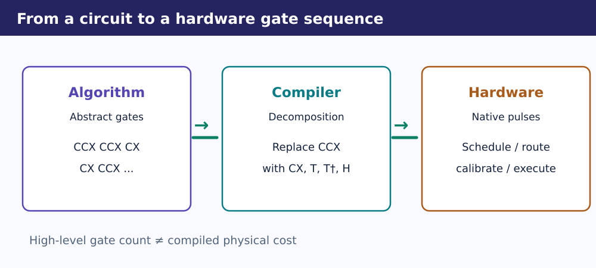
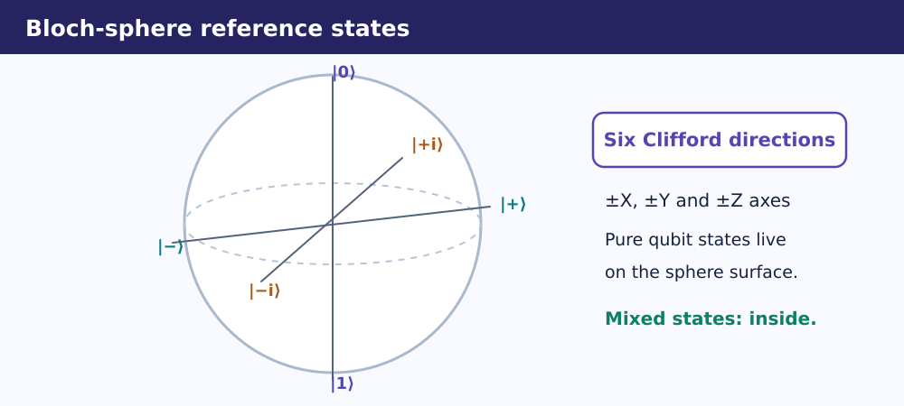
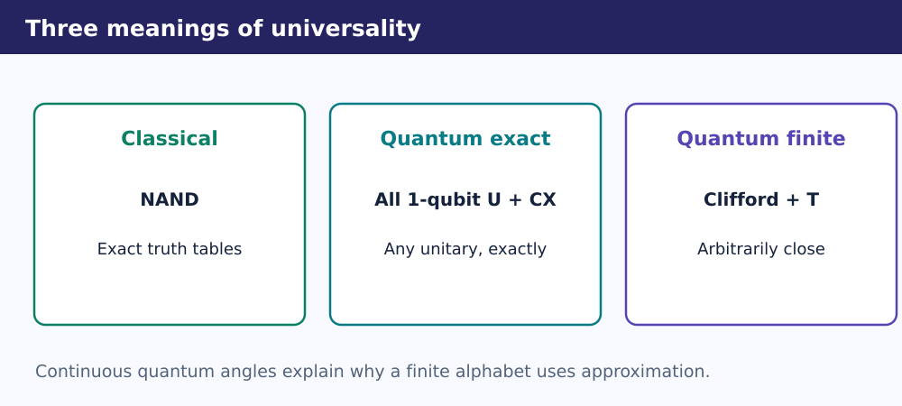
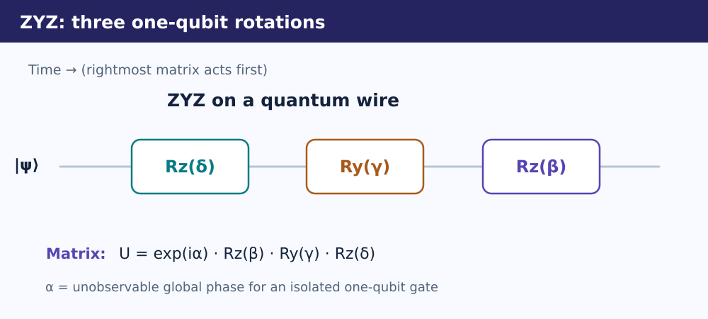
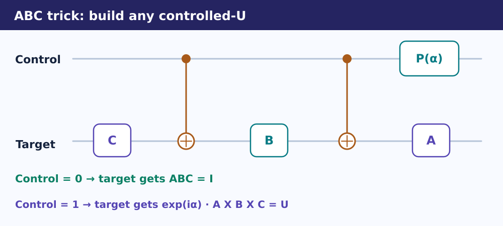
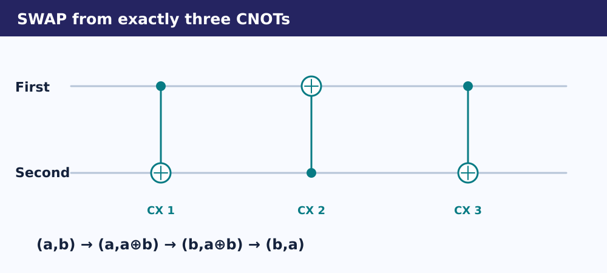
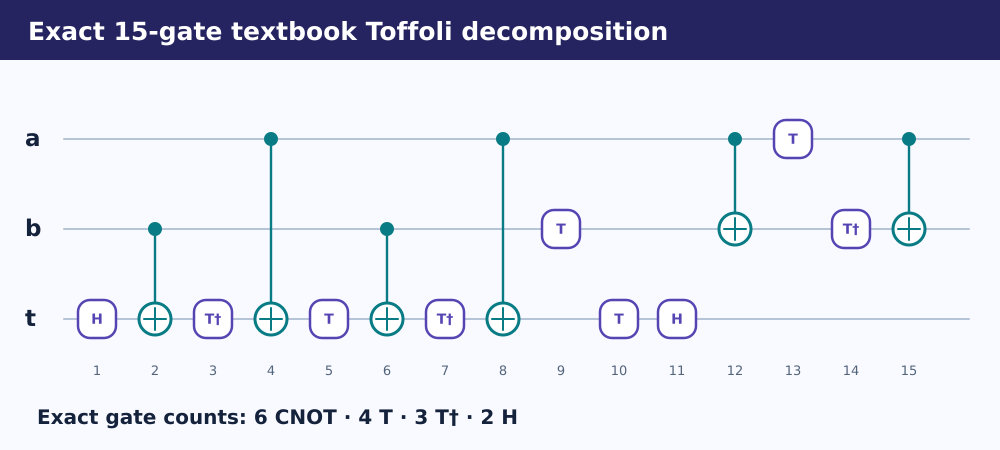
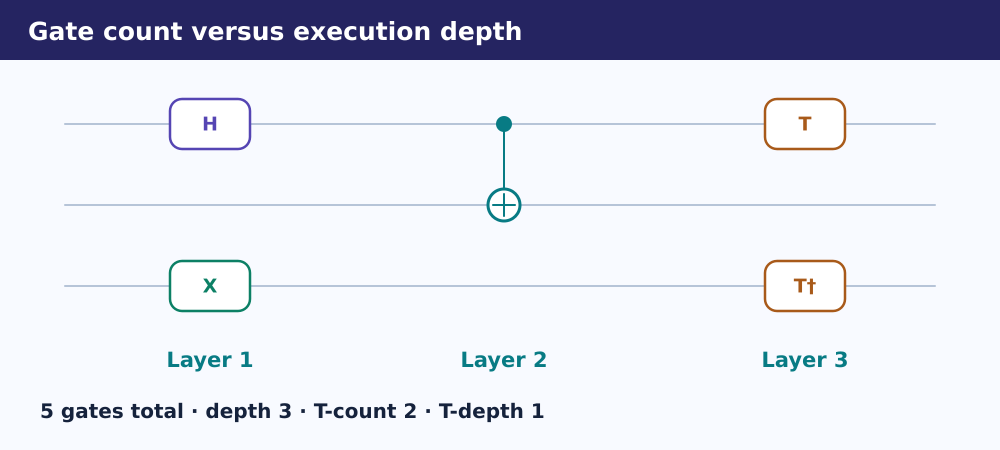
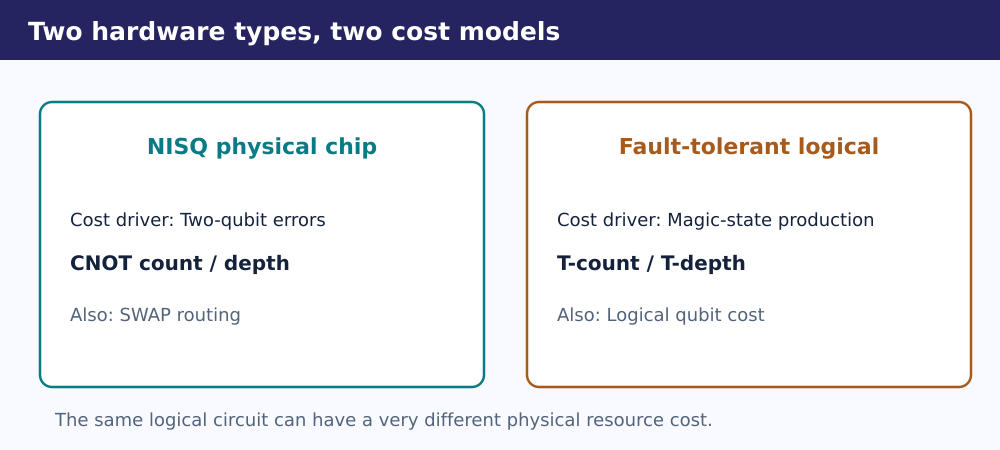
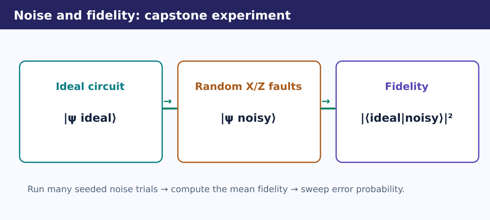

# Gates & Circuit Design [2/3] — Universality and Cost

**Course:** Quantum Computing — CEP, IIT Delhi 
**Professor:** Kolin Paul, Department of Computer Science and Engineering 
**Source materials:** *01 Gates & Circuit Design (Part C)*, full lecture lecture and 12-page slide PDF (20 distinct lecture-slide numbers, with progressively revealed slides). 
**Learning level:** First-time learner of quantum computing. The explanations below follow the professor's teaching order, including the discussion after the break about physical noise and Mini-Capstone 1.

> **Start here:** You do **not** need to understand quantum hardware or advanced linear algebra before reading. Begin with the prerequisites in Section 2. The animations require only a browser and run entirely offline.
>
> **How to use this document:** Read the intuition, work through every line of the mathematics with pencil and paper, then open the linked HTML visualization. Pause after each “Check Your Understanding.” Solutions for the large end-of-lecture practice set are in [`practice/practice_questions.md`](practice/practice_questions.md).
>
> **Notation and accuracy:** We use `CX` and `CNOT` for the *same* two-qubit gate, `CCX` for the three-qubit Toffoli, `T†` for inverse T, and `I` for the identity. Matrices act **right to left** on column vectors. Statements that were simplified or garbled in the recording are clarified in **Source/precision notes** without changing the lecture's teaching sequence.

---

## 1. Introduction

### 1.1 What are we going to learn?

In earlier classes you used quantum gates such as **H**, **X**, **Z**, **CNOT**, and **Toffoli** to build quantum circuits. Now a different question arises: *How does a real machine implement a circuit that contains gates it does not natively support?*

Imagine that you have written a program containing `print("hello")`. Your computer's processor does not contain a special “print hello” circuit. Software breaks the instruction into simpler operations. **Quantum compilation** does something similar: it replaces an abstract quantum circuit with a sequence of gates that the selected quantum processor can actually perform.

This lecture answers four connected questions:

1. **Universality:** Can a small collection of building blocks make every quantum gate?
2. **Decomposition:** How do we break a complicated gate into one-qubit gates and CNOTs?
3. **Accuracy:** If only a fixed menu of gates is allowed, can we get close enough to any desired rotation?
4. **Cost:** How many gates, how many sequential time steps, and how much noise must the device tolerate?

The professor connects these ideas to a familiar example: a three-bit quantum adder written using **five Toffoli gates and five CNOTs**. Once Toffolis are decomposed, that apparently compact circuit contains **35 CNOTs and 35 T-type gates** (plus some H gates). We will derive those numbers instead of memorizing them.



**Visual lesson:** [Animation 01 — Three meanings of universality](animations/animation_01.html).

### 1.2 Why is this important?

A mathematical circuit that works perfectly on paper may be too slow, too deep, or too noisy on a quantum chip. For example, one processor might perform Z rotations very cheaply but find CNOTs error-prone. A future error-corrected quantum computer may have almost the opposite priority: CNOTs can be relatively cheap, while a T gate consumes an expensive prepared resource called a *magic state*.

The same algorithm might therefore be compiled differently on different machines. This is why **gate universality and gate cost belong together**.

### 1.3 What should you know before starting?

It helps to have heard of bits, qubits, column vectors, matrix multiplication, H, X, Z, and CNOT. Nothing in those topics is taken for granted: the next section gives a concise refresher.

### 1.4 Lecture roadmap, preserving the professor's order

The lecture begins with hardware and the previous three-bit adder; develops three meanings of universality; introduces exact synthesis using **ZYZ rotations** and the **ABC controlled-unitary trick**; discusses the three-CNOT limit for two-qubit gates; moves to **Clifford+T** and approximation; decomposes **Toffoli**; counts **CNOT, T, depth and T-depth**; compares noisy and error-corrected hardware; and finally explains **noise simulation, fidelity, Jupyter notebooks, and the Mini-Capstone 1 submission workflow**. The lecture also contains a controlled-`R_y` example after the break; it is placed with ABC below and revisited in the capstone discussion.

---

## 2. Prerequisite Concepts — Learn These Before the Main Lecture

### 2.1 Ordinary bits and Boolean gates

A classical bit is a switch with two values: 0 or 1. A Boolean function takes bits as input and returns bits as output. For example, **AND** outputs 1 only when both inputs are 1; **NOT** reverses a bit.

**NAND** is “NOT AND”:

| Input `a` | Input `b` | AND (`a ∧ b`) | NAND (`¬(a ∧ b)`) |
|---:|---:|---:|---:|
| 0 | 0 | 0 | 1 |
| 0 | 1 | 0 | 1 |
| 1 | 0 | 0 | 1 |
| 1 | 1 | 1 | 0 |

A **universal classical gate** can be combined with copies of itself to implement any Boolean truth table. NAND is universal. For example, a NOT gate needs only one NAND with its two inputs tied together:

$$
\operatorname{NOT}(a)=\operatorname{NAND}(a,a).
$$

A circuit implementing XOR with four NANDs is given later. This is our comparison point for quantum universality.

### 2.2 A qubit is a two-component vector

An ordinary bit is 0 **or** 1. A qubit can be in a *superposition* described by two complex numbers:

$$
|\psi\rangle=\alpha|0\rangle+\beta|1\rangle
=\begin{bmatrix}\alpha\\\\\beta\end{bmatrix},\qquad
|0\rangle=\begin{bmatrix}1\\\\0\end{bmatrix},\quad
|1\rangle=\begin{bmatrix}0\\\\1\end{bmatrix}.
$$

Read `|ψ⟩` as “ket psi.” A **ket** is a column vector used to describe a quantum state. The values `α` and `β` are **amplitudes**; they are not probabilities themselves. Their **squared magnitudes** give the probabilities of measuring 0 or 1:

$$
P(0)=|\alpha|^2,\qquad P(1)=|\beta|^2,
\qquad |\alpha|^2+|\beta|^2=1.
$$

**Step-by-step example:** Let

$$
|\psi\rangle=\frac{\sqrt3}{2}|0\rangle+\frac12|1\rangle.
$$

First, the amplitude for 0 is `√3/2`. Square its magnitude: `(√3/2)²=3/4`. Next, the amplitude for 1 is `1/2`; square: `(1/2)²=1/4`. Check they sum to 1. So repeated measurements give about **75% zeros and 25% ones**. A single measurement gives one outcome, not both amplitudes.

### 2.3 Complex numbers, bras and the inner product

A complex number looks like `z=a+bi`, where `i²=−1`. Its **complex conjugate** is `z*=a−bi`. Thus

$$
|z|^2=z^*z=(a-bi)(a+bi)=a^2+b^2.
$$

For a state `|ψ⟩=[α,β]ᵀ`, the **bra** is the complex-conjugate transpose:

$$
\langle\psi|=\begin{bmatrix}\alpha^*&\beta^*\end{bmatrix}.
$$

Multiplying the bra by the ket means multiplying matching components and adding:

$$
\begin{aligned}
\langle\psi|\psi\rangle
&=\begin{bmatrix}\alpha^*&\beta^*\end{bmatrix}
 \begin{bmatrix}\alpha\\\\\beta\end{bmatrix}\\
&=\alpha^*\alpha+\beta^*\beta\\
&=|\alpha|^2+|\beta|^2\\
&=1.
\end{aligned}
$$

Why conjugate? Because otherwise a perfectly valid complex amplitude such as `i/√2` would contribute `i²/2=−1/2` instead of a positive probability. Conjugation ensures squared lengths are nonnegative. The final `1` means the qubit is normalized: the total probability of all possible outcomes is 100%.

### 2.4 Matrices are instructions that change vectors

A matrix describes a transformation. A quantum **gate** is represented by a square matrix `U`; it changes a state by

$$
|\psi_{\mathrm{out}}\rangle=U|\psi_{\mathrm{in}}\rangle.
$$

For example, the X gate (bit flip) and Z gate (phase flip) are

$$
X=\begin{bmatrix}0&1\\\\1&0\end{bmatrix},\qquad
Z=\begin{bmatrix}1&0\\\\0&-1\end{bmatrix}.
$$

Multiply X by `|0⟩`:

$$
\begin{bmatrix}0&1\\\\1&0\end{bmatrix}
\begin{bmatrix}1\\\\0\end{bmatrix}
=\begin{bmatrix}0\cdot1+1\cdot0\\\\1\cdot1+0\cdot0\end{bmatrix}
=\begin{bmatrix}0\\\\1\end{bmatrix}=|1\rangle.
$$

X changes `|0⟩` into `|1⟩`. In contrast, Z leaves `|0⟩` unchanged and changes `|1⟩` to `−|1⟩`.

### 2.5 The Hadamard gate and the plus/minus states

$$
H=\frac1{\sqrt2}\begin{bmatrix}1&1\\\\1&-1\end{bmatrix}.
$$

Apply it to the two computational basis vectors:

$$
H|0\rangle=\frac{|0\rangle+|1\rangle}{\sqrt2}=|+\rangle,
\quad
H|1\rangle=\frac{|0\rangle-|1\rangle}{\sqrt2}=|-\rangle.
$$

A plus state is a balanced superposition with a **plus** sign. A minus state is balanced with a **minus** sign. Do not confuse `|−⟩` with a negative probability: both states yield 0 or 1 with 50% probability if measured in the computational basis. Their different **relative phase** matters when other gates are applied.

### 2.6 Unitary = a reversible, length-preserving operation

A quantum gate must preserve the length of the state vector. The defining equation is

$$
U^{\dagger}U=I.
$$

Here `†` means conjugate-transpose, and `I` is the identity matrix (doing nothing). This equation tells us that `U†` undoes `U`:

$$
U^{\dagger}(U|\psi\rangle)=(U^{\dagger}U)|\psi\rangle=I|\psi\rangle=|\psi\rangle.
$$

**Caution:** Having determinant 1 is **not** the full definition of unitary. In general, a unitary matrix has determinant of magnitude 1, but the important property is `U†U=I`. The lecture briefly treats the determinant as the only condition; the equation above is the precise rule.

### 2.7 The Bloch sphere — a map of single-qubit states

A pure qubit state (ignoring an unobservable global phase) can be written as

$$
|\psi\rangle=\cos\frac\theta2|0\rangle+e^{i\varphi}\sin\frac\theta2|1\rangle.
$$

The angles `θ` and `φ` identify a point on a sphere, much as latitude and longitude identify a point on Earth. **Z rotation** turns the direction around the north-south axis; **Y rotation** tilts it north/south. We will use this picture to understand three-turn decompositions.

The six important axis directions are `|0⟩` (north), `|1⟩` (south), `|+⟩`, `|−⟩`, `|+i⟩` and `|−i⟩`.



**Nuance:** A *pure* qubit lies on the **surface**. A noisy **mixed state** can be represented **inside** the sphere. Noise does not mean probabilities become greater than 1 or that a point flies outside the sphere.

### 2.8 Tensor products, two qubits and CNOT

Two qubits have four basis states:

$$
|00\rangle,\ |01\rangle,\ |10\rangle,\ |11\rangle.
$$

Their combined state uses a **tensor product**, written `⊗`:

$$
|0\rangle\otimes|1\rangle=|01\rangle
=\begin{bmatrix}0\\\\1\\\\0\\\\0\end{bmatrix}.
$$

The **controlled-NOT** (`CNOT` or `CX`) has a control qubit and a target qubit. If the control is `0`, nothing happens. If the control is `1`, the target flips:

$$
|a,b\rangle\mapsto|a,b\oplus a\rangle.
$$

The symbol `⊕` is XOR: it is 1 when its inputs are different. For example `|10⟩→|11⟩`, `|11⟩→|10⟩`, and `|00⟩→|00⟩`.

### 2.9 Three kinds of phase: relative, global and controlled

A **relative phase** is the phase difference between the `|0⟩` and `|1⟩` amplitudes; it can affect interference. A **global phase** multiplies the whole state by the same factor `e^{iα}`:

$$
|\psi\rangle \quad\text{and}\quad e^{i\alpha}|\psi\rangle
$$

predict the same outcomes in all measurements. Such states are physically indistinguishable when considered on their own. However, a phase attached to only the `|1⟩` *control branch* of a larger system is a **relative phase between branches**, and can matter. This distinction will be crucial for controlled-U.

### Prerequisite check

1. If `|ψ⟩=(√3/2)|0⟩+(1/2)|1⟩`, what is `P(1)`? (**Answer:** `1/4`.)
2. Is `H|1⟩` a plus or minus state? (**Answer:** `|−⟩`.)
3. If `U†U=I`, what gate undoes `U`? (**Answer:** `U†`.)

---

## 3. Main Lecture Content

### 3.1 Where the professor left off: the three-bit adder and compiler motivation

**Simple explanation.** An adder adds binary numbers. The professor previously built a reversible three-bit adder with five Toffoli (`CCX`) gates and five CNOTs. This is analogous to writing a short program in a high-level language. The challenge is that a physical chip may not have a native Toffoli instruction.

**Why do we need compilation?** We must translate unfamiliar instructions into a gate vocabulary the hardware understands. That translation can expand the circuit considerably:

$$
\begin{aligned}
\text{Original CNOTs}&=5,\\
\text{CNOTs per Toffoli}&=6,\\
\text{New CNOTs}&=5+5(6)=35,\\
\text{T/T}^{\dagger}\text{ per Toffoli}&=7,\\
\text{New T-count}&=5(7)=35.
\end{aligned}
$$

The compiler in the slides reported **20 T**, **15 T†**, **35 CX** and **6 H** after rewriting the particular adder. Notice `20+15=35` T-type gates. We will explain the Toffoli numbers later; for now the important lesson is: **the gates you write are not necessarily the gates the machine executes**.

**Real-life analogy.** A recipe might say “prepare dough.” A beginner cooks from sub-steps: measure flour, add water, knead, rest. The single recipe instruction can hide many actions and their associated cost.

**Important takeaway:** A circuit with few high-level gates may be more expensive than a circuit with more easily implemented low-level gates.

**Common mistake:** Counting each high-level Toffoli as one physical gate. On the target gate set in this lecture, one Toffoli expands to 15 gates.

**Check Your Understanding:** If a circuit has two Toffolis and three separate CNOTs, and each Toffoli uses six CNOTs, how many CNOTs are needed after decomposition? What additional type of gate becomes important?

**Visual lesson:** [Animation 07 — Toffoli from 15 elementary gates](animations/animation_07.html).

### 3.2 Three meanings of the word “universal”

**Simple explanation.** A toolbox is *universal* if you can build everything you need using its tools. But “everything” and “build” mean different things in classical versus quantum computing.

**Why do we need this idea?** We would rather manufacture, calibrate and maintain a small menu of reliable gates than invent one physical gate for every possible mathematical operation.

| Setting | What can be built? | Exact or approximate? | Building blocks |
|---|---|---|---|
| Classical Boolean computing | Every Boolean truth table | **Exactly** | NAND alone |
| Quantum exact universality | Every finite-dimensional unitary | **Exactly**, for each requested unitary | **All** one-qubit unitaries plus CNOT |
| Quantum approximate universality | Any unitary as closely as desired | **Approximately** | A fixed finite gate set such as H, S, T, CNOT |

**Classical example: make XOR from NAND.** Introduce intermediate results:

$$
\begin{aligned}
p&=\operatorname{NAND}(a,b),\\
q&=\operatorname{NAND}(a,p),\\
r&=\operatorname{NAND}(b,p),\\
a\oplus b&=\operatorname{NAND}(q,r).
\end{aligned}
$$

For `a=0`, `b=1`, calculate `p=1`, `q=1`, `r=0` and the final NAND is `1`. For `a=1`, `b=1`, calculate `p=0`, `q=1`, `r=1` and the final NAND is `0`. The same circuit works **exactly** for all four inputs.

**Why is the quantum case different?** Think of the dial of a volume control: it can turn through infinitely many angles. Quantum gates similarly depend on continuous parameters. A Z rotation might require `π/4` or a peculiar angle `0.1` radians; there are uncountably many such angles. Circuits made from a **finite gate alphabet** form only a countable collection of finite strings. They cannot represent *every* continuously varying unitary **exactly**. But they can approximate them to a chosen precision.

**Mathematical distinction.** Let `U` be a desired operation and `V` be the circuit we implement. Exact universality wants `V=e^{iα}U` for some unobservable global phase `α`. Approximate universality wants a suitable global-phase-insensitive distance to be small:

$$
d(U,V)<\varepsilon.
$$

Here `ε` (epsilon) is the maximum error we are willing to tolerate. For example, `ε=0.001` asks for a closer match than `ε=0.1`.

**Important clarification from the recording:** CNOT **by itself** is **not** a universal quantum gate set. The correct slide theorem requires *arbitrary one-qubit gates together with CNOT*. We need arbitrary single-qubit rotations to generate nontrivial angles.



**Common mistakes:** (1) Assuming approximate means “poor quality”—accuracy can be made arbitrarily good. (2) Assuming a finite list of gates can reproduce all continuous angles exactly. (3) Believing CNOT alone is quantum-universal.

**Check Your Understanding:** Why does NAND give an exact XOR? Why is a set containing `H`, `T` and `CNOT` only *approximately* universal? What extra ingredient does CNOT need for exact quantum universality?

**Visual lesson:** [Animation 01 — Universal gate toolboxes](animations/animation_01.html).

### 3.3 Exact universality: any multi-qubit unitary from one-qubit gates and CNOT

**Simple explanation.** A large orchestra can produce an enormous range of music using a small family of instruments. Similarly, we can build any multi-qubit unitary if we can perform *any desired one-qubit gate* and can couple qubits with CNOT.

**Theorem as stated in the slides:** Every `n`-qubit unitary can be decomposed into a circuit containing **one-qubit gates and CNOTs**.

**What it does not mean:** The required circuit is always short. A completely arbitrary unitary on `n` qubits has an exponentially large number of parameters, so generic decompositions require a number of elementary gates that grows on the scale of `4^n` (up to polynomial factors). Useful quantum algorithms are special because their operations possess structure that gives much shorter circuits.

**Why these two gate types?** One-qubit gates rotate or change phases on a single wire. CNOT introduces **interactions/correlations** between wires and can create entanglement. Combining local changes with interactions gives much richer behavior than either alone.

**Step-by-step example: create a Bell state.** Start with two qubits in `|00⟩`:

$$
|00\rangle\xrightarrow{H\text{ on first qubit}}
\frac{|00\rangle+|10\rangle}{\sqrt2}.
$$

Now apply CNOT with the first wire controlling the second:

$$
\begin{aligned}
\operatorname{CNOT}\frac{|00\rangle+|10\rangle}{\sqrt2}
&=\frac{\operatorname{CNOT}|00\rangle+\operatorname{CNOT}|10\rangle}{\sqrt2}\\
&=\frac{|00\rangle+|11\rangle}{\sqrt2}=|\Phi^+\rangle.
\end{aligned}
$$

H alone did not entangle the two wires. The CNOT created a state that cannot be separated into an individual state for each qubit. This small example shows why the two sorts of gates complement each other.

**Check Your Understanding:** Why are CNOTs important if you already have every one-qubit rotation? Is the theorem a promise that every algorithm needs only a few gates? Why might most arbitrary multi-qubit transformations be costly?

### 3.4 Every one-qubit gate as three turns: the ZYZ theorem

**Simple explanation.** Imagine aiming a camera with a three-axis mount. You can turn it around the vertical axis, tilt it, and turn it around the vertical axis again. Three carefully chosen turns can achieve any required single-qubit rotation of the Bloch sphere.

**Why do we need this?** Rather than treating H, S, T, X and countless other gates as unrelated objects, we want a common recipe for all one-qubit gates.

**The ZYZ decomposition:**

$$
\boxed{U=e^{i\alpha}R_z(\beta)R_y(\gamma)R_z(\delta)}.
$$

The symbols mean:

- `U` is the one-qubit unitary we want to implement.
- `R_z(δ)` rotates the Bloch sphere around the Z axis by angle `δ` (first operation in time).
- `R_y(γ)` rotates around the Y axis by `γ` (second in time).
- `R_z(β)` is the last rotation around Z.
- `e^{iα}` is an overall **global phase**; it does not alter measurement probabilities for an isolated gate.
- `α, β, γ, δ` are real-number parameters measured in radians.

**Why is the rightmost term first?** In matrix algebra, `(AB)|ψ⟩=A(B|ψ⟩)`. The parentheses show that `B` acts first, then `A`. A circuit therefore reads, from left to right in **time**, `Rz(δ) → Ry(γ) → Rz(β)`. Do not read the displayed matrix product from left to right as the execution order.

**The actual rotation matrices:**

$$
R_z(\theta)=\begin{bmatrix}e^{-i\theta/2}&0\\\\0&e^{i\theta/2}\end{bmatrix},
$$

$$
R_y(\theta)=\begin{bmatrix}
\cos(\theta/2)&-\sin(\theta/2)\\\\
\sin(\theta/2)&\cos(\theta/2)
\end{bmatrix}.
$$

The exponentials in `Rz` add phases to `|0⟩` and `|1⟩`. The sine/cosine entries in `Ry` mix the amounts of `|0⟩` and `|1⟩`.

**A very small numerical example: rotate `|0⟩` by 90° around Y.** Set `θ=π/2` (90 degrees). Since `cos(π/4)=sin(π/4)=1/√2`:

$$
\begin{aligned}
R_y(\pi/2)|0\rangle
&=\begin{bmatrix}\tfrac1{\sqrt2}&-\tfrac1{\sqrt2}\\\\\tfrac1{\sqrt2}&\tfrac1{\sqrt2}\end{bmatrix}
\begin{bmatrix}1\\\\0\end{bmatrix}\\
&=\begin{bmatrix}\tfrac1{\sqrt2}\\\\\tfrac1{\sqrt2}\end{bmatrix}\\
&=|+\rangle.
\end{aligned}
$$

The vector moved from the north pole to the positive X direction. Its measurement probabilities changed from `(1,0)` to `(1/2,1/2)`.

**Source/precision note:** The professor describes a three-dimensional “solid angle.” For this lesson the accurate geometric picture is a **rotation of the Bloch vector**. The three Euler angles in the decomposition specify a rotation; the global phase is a fourth matrix parameter.



**Common mistakes:** Mixing up degrees and radians; confusing global phase with relative phase; applying matrix factors in the wrong order; thinking `Rz` changes the immediate computational-basis measurement probabilities (it changes phase, not their magnitudes).

**Check Your Understanding:** What is done first in `Rz(β)Ry(γ)Rz(δ)`? Which of the four parameters represents global phase? What is `Ry(π/2)|0⟩`?

**Visual lesson:** [Animation 02 — Interactive ZYZ turns on the Bloch sphere](animations/animation_02.html).

### 3.5 Worked examples: rebuild H, T and S from rotations

**Why do this?** It is not enough to hear “every gate is three rotations.” We should verify the claim on actual gates you have already studied.

#### 3.5.1 Hadamard from two nonzero rotations

The slides give this exact identity:

$$
\boxed{H=e^{i\pi/2}R_y(\pi/2)R_z(\pi).}
$$

Here the first ZYZ rotation has angle `β=0`, so its matrix is just `I`. In time, the circuit uses `Rz(π)`, then `Ry(π/2)`.

**Let's calculate the effect on `|0⟩` without skipping steps.**

First operation:

$$
R_z(\pi)=\begin{bmatrix}e^{-i\pi/2}&0\\\\0&e^{i\pi/2}\end{bmatrix}
=\begin{bmatrix}-i&0\\\\0&i\end{bmatrix}.
$$

Therefore

$$
R_z(\pi)|0\rangle=\begin{bmatrix}-i\\\\0\end{bmatrix}=-i|0\rangle.
$$

Apply `Ry(π/2)`:

$$
\begin{aligned}
R_y(\pi/2)(-i|0\rangle)
&=-i\frac{|0\rangle+|1\rangle}{\sqrt2}.
\end{aligned}
$$

Multiply by the front global phase `e^{iπ/2}=i`:

$$
i\cdot(-i)\frac{|0\rangle+|1\rangle}{\sqrt2}
=\frac{|0\rangle+|1\rangle}{\sqrt2}=|+\rangle.
$$

This is exactly `H|0⟩`. To check the **whole gate**, not just one input, apply the same sequence to `|1⟩`:

$$
\begin{aligned}
R_z(\pi)|1\rangle&=i|1\rangle,\\
R_y(\pi/2)(i|1\rangle)&=i\frac{-|0\rangle+|1\rangle}{\sqrt2},\\
i\cdot\left(i\frac{-|0\rangle+|1\rangle}{\sqrt2}\right)
&=\frac{|0\rangle-|1\rangle}{\sqrt2}=|-\rangle.
\end{aligned}
$$

Because `|0⟩` and `|1⟩` form a basis, matching both outputs proves the two matrices represent the same gate.

#### 3.5.2 The T gate as one Z rotation

$$
T=\begin{bmatrix}1&0\\\\0&e^{i\pi/4}\end{bmatrix}.
$$

The slides express it as

$$
\boxed{T=e^{i\pi/8}R_z(\pi/4).}
$$

Prove it by multiplying the scalar into both diagonal elements:

$$
\begin{aligned}
e^{i\pi/8}R_z(\pi/4)
&=e^{i\pi/8}\begin{bmatrix}e^{-i\pi/8}&0\\\\0&e^{i\pi/8}\end{bmatrix}\\
&=\begin{bmatrix}e^{i\pi/8-i\pi/8}&0\\\\0&e^{i\pi/8+i\pi/8}\end{bmatrix}\\
&=\begin{bmatrix}1&0\\\\0&e^{i\pi/4}\end{bmatrix}=T.
\end{aligned}
$$

What does it do to `|+⟩`?

$$
T|+\rangle=\frac{|0\rangle+e^{i\pi/4}|1\rangle}{\sqrt2}.
$$

The probabilities stay 50%–50%, but the relative phase is now `π/4` (45 degrees); the Bloch vector rotates around Z.

#### 3.5.3 The S gate as a 90° phase rotation

$$
S=\begin{bmatrix}1&0\\\\0&i\end{bmatrix}
=e^{i\pi/4}R_z(\pi/2).
$$

Check its effect on `|+⟩`:

$$
S|+\rangle=\frac{|0\rangle+i|1\rangle}{\sqrt2}=|+i\rangle.
$$

**Comparison:**

| Gate | Useful representation (up to phase) | Bloch-sphere effect |
|---|---|---|
| `H` | `Ry(π/2)Rz(π)` | Changes Z and X basis directions |
| `T` | `Rz(π/4)` | 45° Z rotation |
| `S` | `Rz(π/2)` | 90° Z rotation |

**Important takeaway:** All one-qubit gates can be expressed as Z-Y-Z rotations, and many familiar gates need fewer than three nonzero rotations.

**Common mistake:** “T is a π/8 rotation.” T is also called the **π/8 phase gate** in some conventions, but its Bloch-sphere Z rotation is `π/4`; the exponent in `Rz(θ)` contains `θ/2`. These are consistent ways of describing the same gate.

**Check Your Understanding:** What is the relative phase of `T|+⟩`? What is `S|+⟩`? Why was the global phase necessary to write the matrix equality for H exactly?

**Visual lesson:** [Animation 03 — H, S and T as rotations](animations/animation_03.html).

### 3.6 Adding a control to *any* one-qubit gate: the ABC trick

**Simple explanation.** An ordinary switch turns a lamp on. A *controlled* switch says, “Turn the lamp on only when the other switch is 1.” In quantum computing a controlled gate behaves similarly on computational-basis control inputs: the target receives gate `U` if the control is `1`, otherwise the target is unchanged.

**Why is this useful?** The exact-universality theorem uses CNOTs, but algorithms also contain controlled rotations, controlled phase gates, and other controlled operations. We want a systematic way to make these using **only two CNOTs and one-qubit gates**.

For a general one-qubit matrix `U`, the ideal controlled operation is

$$
C(U)=|0\rangle\langle0|\otimes I+|1\rangle\langle1|\otimes U.
$$

Do not worry about the notation yet. Read it as: **the control-0 branch gets `I`; the control-1 branch gets `U`.** The terms `|0⟩⟨0|` and `|1⟩⟨1|` select those two branches.

The professor's circuit has three one-qubit gates named `C`, `B`, `A` **in time order**, with a CNOT between C and B, and another between B and A. A phase gate `P(α)` is put on the control. The gates must be chosen so that

$$
\boxed{ABC=I,\qquad e^{i\alpha}AXBXC=U.}
$$

Remember that `A B C` in matrix notation means the action **C first**, then B, then A.



**Case 1: the control is `|0⟩`.** Both CNOTs leave the target alone, and the phase gate acts as `P(α)|0⟩=|0⟩`. The target experiences

$$
C\quad\text{then}\quad B\quad\text{then}\quad A
\quad\Longrightarrow\quad ABC=I.
$$

This means the target ends exactly where it started. That is what a controlled gate is supposed to do for control=0.

**Case 2: the control is `|1⟩`.** Both CNOTs now apply X on the target. The target experiences, in time order, C, X, B, X, A. Therefore its total matrix is

$$
AXBXC.
$$

The control's phase gate multiplies this branch by `e^{iα}`. So the total desired action is

$$
e^{i\alpha}AXBXC=U.
$$

This completes the two-case explanation of why the gadget is a controlled-U. In a quantum superposition of control=0 and control=1, both branch actions apply coherently by linearity. This is why the phase on the control is **not** safely discardable as an overall global phase.

**How does ZYZ give A, B, C?** If

$$
U=e^{i\alpha}R_z(\beta)R_y(\gamma)R_z(\delta),
$$

we can choose

$$
\begin{aligned}
A&=R_z(\beta)R_y(\gamma/2),\\
B&=R_y(-\gamma/2)R_z(-[\delta+\beta]/2),\\
C&=R_z([\delta-\beta]/2).
\end{aligned}
$$

Let's check the first condition carefully:

$$
\begin{aligned}
ABC
&=R_z(\beta)R_y(\gamma/2)R_y(-\gamma/2)
 R_z(-[\delta+\beta]/2)R_z([\delta-\beta]/2)\\
&=R_z(\beta)\underbrace{R_y(0)}_{I}
 R_z\!\left(\frac{-\delta-\beta+\delta-\beta}{2}\right)\\
&=R_z(\beta)R_z(-\beta)\\
&=R_z(0)=I.
\end{aligned}
$$

To check the second, use the identities

$$
XR_y(\theta)X=R_y(-\theta),\qquad
XR_z(\theta)X=R_z(-\theta).
$$

Then

$$
\begin{aligned}
AXBXC
&=R_z(\beta)R_y(\gamma/2)
 X R_y(-\gamma/2)R_z(-[\delta+\beta]/2) X R_z([\delta-\beta]/2)\\
&=R_z(\beta)R_y(\gamma)
 R_z([\delta+\beta]/2)R_z([\delta-\beta]/2)\\
&=R_z(\beta)R_y(\gamma)R_z(\delta).
\end{aligned}
$$

The extra factor `e^{iα}` gives the original U. **Result:** the same ZYZ angles that describe a one-qubit gate also supply a blueprint for a controlled version of it.

**Nuance:** Two CNOTs is a **general construction**, not a minimum for every controlled gate. Ordinary CNOT already uses only one CNOT; certain controlled phase operations also have special decompositions.

**Common mistakes:** Assuming `ABC=U` instead of `ABC=I`; forgetting the two X operations on the control=1 branch; treating `P(α)` on the control as an irrelevant global phase; drawing gates left-to-right but multiplying matrices left-to-right.

**Check Your Understanding:** What happens if the control is 0? Why are there *two* X actions when the control is 1? What role does `P(α)` play?

**Visual lesson:** [Animation 04 — ABC controlled-unitary decoder](animations/animation_04.html).

### 3.7 Every two-qubit gate needs at most three CNOTs (KAK)

**Simple explanation.** In a two-person dance, each person can turn independently, but certain moves require the dancers to interact. KAK decomposition states that for any desired interaction between **two qubits**, at most **three CNOTs**, surrounded by suitable one-qubit gates, are enough.

**Lecture theorem:** A general two-qubit unitary can be synthesized using **at most three CNOTs and arbitrary single-qubit gates** (up to a global phase).

The proof of the full KAK/Cartan decomposition is beyond this introductory lecture. The professor asks learners to remember the synthesis bound and its importance for compilers, rather than derive the general theorem.

**Concrete example: SWAP.** The SWAP gate exchanges two qubits:

$$
|a,b\rangle\xrightarrow{\mathrm{SWAP}}|b,a\rangle.
$$

It can be implemented by three CNOTs:

$$
\boxed{CX_{1\to2}\;\longrightarrow\;CX_{2\to1}\;\longrightarrow\;CX_{1\to2}}.
$$

Let the starting bits be `(a,b)`. Work through every step:

$$
\begin{aligned}
(a,b)&\xrightarrow{CX_{1\to2}}(a,b\oplus a),\\
&\xrightarrow{CX_{2\to1}}(a\oplus(b\oplus a),b\oplus a)=(b,b\oplus a),\\
&\xrightarrow{CX_{1\to2}}(b,(b\oplus a)\oplus b)=(b,a).
\end{aligned}
$$

We used `(a⊕a)=0`, `(b⊕b)=0`, and `(b⊕0)=b`. Therefore the three CNOTs really do swap the bits. By linearity, the same circuit swaps *arbitrary quantum states*, not just classical 0s and 1s. In the usual CNOT-plus-local-gate cost model, SWAP genuinely requires three CNOTs.



**What to memorize:** `CNOT=1`; arbitrary controlled-U can be built with `≤2` CNOTs; `SWAP=3` CNOTs; arbitrary two-qubit U needs `≤3` CNOTs. All upper bounds assume free access to arbitrary one-qubit unitaries. Different native two-qubit gates can change physical costs.

**Common mistake:** Thinking “at most three” means “every two-qubit gate must use exactly three.” CNOT itself uses one, and two independent rotations use zero.

**Check Your Understanding:** Swap `|01⟩` using the three steps. Could two independent one-qubit gates be implemented without CNOTs? Why does a compiler care about this bound?

**Visual lesson:** [Animation 05 — SWAP with three CNOTs](animations/animation_05.html).

### 3.8 Hardware does not support an infinite menu: enter Clifford+T

**Simple explanation.** A real musical keyboard has a particular set of keys. It may be possible to describe every imaginable pitch mathematically, but the instrument physically produces only its available notes unless we approximate or synthesize the sound. Quantum hardware similarly has native or preferred operations.

The professor stresses that the “cheapest” gate differs among implementations. Some platforms make particular rotations relatively inexpensive; on several superconducting platforms a Z rotation can be implemented by adjusting the drive reference frame (*virtual Z*), while two-qubit gates can be slower and more error-prone.

For theoretical **fault-tolerant** quantum computation, a standard fixed set is

$$
\boxed{\{H,S,T,\operatorname{CNOT}\}}.
$$

The subgroup generated by `H`, `S`, and `CNOT` (along with related Pauli gates) is called the **Clifford gate set**. Adding T gives **Clifford+T**, an approximately universal gate library.

**What is a Clifford gate?** It maps Pauli operators (such as X, Y, Z, and their multi-qubit tensor products) into other Pauli operators under conjugation. That sounds abstract, so look at examples:

$$
\boxed{HXH=Z},\qquad
\boxed{SXS^{\dagger}=Y},
$$

$$
\boxed{\operatorname{CNOT}(X\otimes I)\operatorname{CNOT}=X\otimes X}.
$$

**Example 1: `HXH=Z` on `|0⟩`.** First, the rightmost H produces `|+⟩`. X leaves `|+⟩` unchanged because it merely swaps the equal `|0⟩` and `|1⟩` coefficients. The leftmost H takes `|+⟩` back to `|0⟩`. That matches `Z|0⟩=|0⟩`.

**Check the same identity on `|1⟩`.** Rightmost H gives `|−⟩`. X flips the sign of this ket: `X|−⟩=−|−⟩`. Leftmost H gives `−|1⟩`. This matches `Z|1⟩=−|1⟩`. Therefore the gates act identically on both basis vectors.

**Example 2: `SXS†=Y`.** Recall

$$
Y=\begin{bmatrix}0&-i\\\\i&0\end{bmatrix}.
$$

And

$$
SXS^\dagger=
\begin{bmatrix}1&0\\\\0&i\end{bmatrix}
\begin{bmatrix}0&1\\\\1&0\end{bmatrix}
\begin{bmatrix}1&0\\\\0&-i\end{bmatrix}
=\begin{bmatrix}0&-i\\\\i&0\end{bmatrix}=Y.
$$

This multiplication illustrates *conjugation*: surround X by S and its inverse to change the axis of the operation.

**Example 3: CNOT conjugates a Pauli on the control.** Track input `|00⟩` through rightmost CNOT, then `(X⊗I)`, then leftmost CNOT:

$$
|00\rangle\to|00\rangle\to|10\rangle\to|11\rangle.
$$

The net result equals `(X⊗X)|00⟩=|11⟩`. The identity holds for all two-qubit inputs, not only this test input; the example gives intuition.

**What is surprising?** Clifford circuits can create Bell pairs, GHZ states, teleportation and superdense coding; they do genuinely quantum-looking things. Yet, by the **Gottesman–Knill theorem**, ideal Clifford computations with appropriate stabilizer-state preparation and Pauli measurements can be simulated efficiently on a classical computer by tracking how Pauli operators transform. This does **not** imply that entanglement is classical; it tells us this important circuit family has special structure that makes classical simulation tractable.

**Common mistake:** Concluding that “Clifford gates cannot entangle” because Clifford circuits can be simulated. They certainly *can* entangle. The limitation is that Clifford gates alone are not approximately universal.

**Check Your Understanding:** Name three Clifford gates. Why can a Clifford circuit be entangled yet efficiently classically simulable? Which extra gate takes us beyond Clifford-only computing?

### 3.9 Six points with Clifford; increasingly dense points with T

**Intuition first.** Imagine placing dots on a globe. If you can visit only the north pole, south pole, and four equatorial directions, you have a severely limited range of destinations. If you can make a wider selection of turns, you can reach many more points. Increasing the number of allowed turns lets you get very close to any destination.

**Six single-qubit states reachable from `|0⟩` with H and S** (up to global phase):

$$
\begin{aligned}
|0\rangle,\quad |1\rangle,\quad
|+\rangle&=\frac{|0\rangle+|1\rangle}{\sqrt2},\\
|-\rangle&=\frac{|0\rangle-|1\rangle}{\sqrt2},\\
|+i\rangle&=\frac{|0\rangle+i|1\rangle}{\sqrt2},\\
|-i\rangle&=\frac{|0\rangle-i|1\rangle}{\sqrt2}.
\end{aligned}
$$

All six lie on the ±X, ±Y, ±Z axes of the Bloch sphere. Repeated Clifford gates can permute these positions, but cannot reach an arbitrary point between them from the original `|0⟩`.

**Why does T change this?** T rotates by `π/4` around Z (up to global phase). It can move a non-axis state to directions the single-qubit Clifford group alone cannot reach. Alternating noncommuting gates, such as H and T, creates increasingly fine rotation possibilities.

**Small worked example:**

$$
|0\rangle\xrightarrow{H}|+\rangle
=\frac{|0\rangle+|1\rangle}{\sqrt2}.
$$

Then

$$
|+\rangle\xrightarrow{T}
\frac{|0\rangle+e^{i\pi/4}|1\rangle}{\sqrt2}.
$$

This new state has an equatorial direction halfway between the X and Y axes; it is not one of the six Clifford-axis states.

In the professor's Bloch-sphere plot (slides around 10/20), gate strings up to a chosen length were enumerated and the **distinct resulting states** were plotted. The dots get denser as longer strings are allowed. Even many dots do not mean a finite number of words reaches every point exactly.

**Important:** The number of different gate **words** is not the same as the number of different quantum **states**. Many sequences have the same effect: `HH=I`, for example. Similarly, several T gates in succession may return to an already counted direction.

**Check Your Understanding:** Why do H and S alone give six states from `|0⟩`? Does appending T make every rotation *exact*? What does a larger circuit depth buy us?

**Visual lesson:** [Animation 06 — Clifford orbit versus Clifford+T](animations/animation_06.html).

### 3.10 Approximation: how close can a fixed gate set get?

**The problem.** Suppose the desired gate is a small Z rotation:

$$
U_{\text{target}}=R_z(0.1),
$$

where `0.1` is measured in **radians**, approximately 5.73 degrees. The angle is not a multiple of `π/4`. Therefore, a single T, S, Z, or short simple combination will not produce this exact rotation.

**Why not exact?** Every finite Clifford+T circuit has matrix entries with a restricted algebraic form. A generic angle, including `0.1`, cannot be reproduced exactly. The goal is to find a circuit `V` whose action is almost indistinguishable from U.

**Choose an error tolerance:**

$$
d_{\mathrm{phase}}(U,V)=\min_{\alpha\in\mathbb R}
\left\|U-e^{i\alpha}V\right\|.
$$

This formula chooses the global phase `α` that makes the matrices closest, then measures the remaining difference with a chosen norm (`|| ||` means distance or size). We minimize over phase because global phase cannot be measured.

**Intuitive numerical example:** If your allowed error is `ε=0.01`, a candidate whose distance is `0.058` fails because `0.058>0.01`. A candidate at `0.0013` passes because `0.0013<0.01`.

**Slide search results** (the professor's notebook, target `Rz(0.1)`):

| Maximum word length `L` | Reported best distance |
|---:|---:|
| 2 | 0.26 |
| 4 | 0.13 |
| 8 | 0.077 |
| 12 | 0.058 |
| 16 | 0.0013 |

Read the table this way: allowing more gates gives the search more candidate circuits. The best distance cannot get worse when the candidate set grows. The values are **results from the professor's notebook**, not universal constants. They depend on the precise gate alphabet, word-length rule, distance metric, global-phase treatment, and search algorithm; those full search details were not included in the lecture/slides, so we do not fabricate the exact gate strings.

**Solovay–Kitaev theorem, in the lecture's words:** With an appropriate finite universal gate set, any desired unitary can be approximated to any required accuracy, and the needed sequence length grows polylogarithmically as the requested error becomes smaller. In beginner's language: **we can ask for more accuracy without the required circuit length exploding as badly as repeatedly doubling digits might suggest**. The theorem is an existence/construction result, not a claim that a specific naive search is always optimal.

For exact numbers it helps to remember:

$$
\pi/4\approx0.7854\text{ radians}=45^\circ,
\qquad 0.1\text{ rad}\approx5.73^\circ.
$$

T rotates by `π/4`, but cleverly alternating H and T (and their inverses) can produce much smaller effective rotations through noncommutative composition and interference.

**Why a compiler cares.** You may program with `Ry(0.3795)` without manually designing a 100-gate approximation. A compiler or synthesizer can express the desired mathematical gate in the target basis, subject to an error target and hardware cost.

**Common mistake:** Treating `Rz(0.1)` as impossible. It is not generally **exactly** synthesizable in finite Clifford+T, but it can be **approximated as closely as required**.

**Check Your Understanding:** Does `Rz(π/4)` require approximation when T is available? How does decreasing `ε` affect the synthesis goal? What does it mean to ignore global phase in a distance measure?

### 3.11 Lecture poll: which gates are exact in Clifford+T?

The professor asks: Which of these are exactly implementable (up to global phase)?

| Choice | Gate | Result | Why? |
|---|---|---|---|
| A | `Rz(π/4)` | **Exact** | Equals T up to global phase |
| B | `Rz(π/2)` | **Exact** | Equals S up to global phase |
| C | `Rz(0.1)` | **Not exact** | Generic angle needs approximation |
| D | Toffoli / `CCX` | **Exact** | Has an exact Clifford+T decomposition |

**Correct poll answer: A, B and D.**

The slide also says angles that are multiples of `π/4` are “free.” This is shorthand meaning **no approximation search is necessary**—they are exactly reachable with T powers. It does **not** mean physically zero-cost. In an error-corrected machine, even one T can be expensive.

**Check Your Understanding:** Why is the Toffoli exact though it has three qubits? Why might a small arbitrary angle be harder to synthesize than a large angle that is a multiple of `π/4`?

### 3.12 Toffoli: a three-qubit gate built from one- and two-qubit gates

**Simple explanation.** A Toffoli is like a door that opens only if **two separate people each turn their own key**. The target qubit flips only when both control qubits are 1.

Its input is `(a,b,c)` and its output is

$$
\boxed{(a,b,c)\mapsto(a,b,c\oplus ab)},
$$

where `ab` means ordinary multiplication of 0/1 bits; it is 1 only if both `a=1` and `b=1`.

**Why do we need it?** Toffoli implements reversible classical logic within quantum circuits. When `c=0`, the final target equals `a AND b`. That makes it important for **adders, arithmetic circuits, oracles, and reversible subroutines**.

**Truth table:**

| `a` | `b` | `c` | `ab` | Final target `c ⊕ ab` | Full output |
|---:|---:|---:|---:|---:|---|
| 0 | 0 | 0 | 0 | 0 | 000 |
| 0 | 0 | 1 | 0 | 1 | 001 |
| 0 | 1 | 0 | 0 | 0 | 010 |
| 0 | 1 | 1 | 0 | 1 | 011 |
| 1 | 0 | 0 | 0 | 0 | 100 |
| 1 | 0 | 1 | 0 | 1 | 101 |
| 1 | 1 | 0 | 1 | 1 | 111 |
| 1 | 1 | 1 | 1 | 0 | 110 |

**Work one row:** With `(a,b,c)=(1,1,0)`, compute `ab=1·1=1`; then `c⊕ab=0⊕1=1`. So `110→111`. If `(a,b,c)=(1,0,1)`, `ab=0` and `c⊕ab=1`; so `101` stays `101`.

#### 3.13.1 Why Toffoli is not always native

Most of the hardware models discussed in the lecture support high-fidelity **one- and two-qubit** operations rather than a directly calibrated three-qubit CCX. We therefore ask: how many H, T and CNOT gates implement Toffoli *exactly*?

**The professor's textbook decomposition contains:**

$$
\boxed{6\ \mathrm{CNOT}+4\ T+3\ T^\dagger+2\ H=15\text{ elementary gates}.}
$$

Both T and `T†` count toward **T-count**, so `T-count=7`. This decomposition requires **no approximation** of Toffoli.



#### 3.13.2 What are T† and CCZ?

The inverse T gate is

$$
T^\dagger=\begin{bmatrix}1&0\\\\0&e^{-i\pi/4}\end{bmatrix}.
$$

Compare it with T: a `+π/4` relative phase is replaced by `−π/4`. Since `T†T=I`, the two gates undo each other.

A **CCZ** gate applies a `−1` phase only to `|111⟩`; it leaves the other seven computational-basis states unchanged:

$$
CCZ|a,b,c\rangle=(-1)^{abc}|a,b,c\rangle.
$$

Because a Hadamard turns Z into X (`HZH=X`), we obtain a Toffoli by sandwiching CCZ between H gates on its target:

$$
\boxed{CCX=(I\otimes I\otimes H)\;CCZ\;(I\otimes I\otimes H).}
$$

**Numerical verification for the active branch `|110⟩`:**

1. Start with `|110⟩` (both controls=1 and target=0).
2. Apply H to the target: `(|110⟩+|111⟩)/√2`.
3. Apply CCZ: only `|111⟩` changes sign, giving `(|110⟩−|111⟩)/√2`.
4. Apply H again to the target. This is `H|−⟩=|1⟩` on the third wire, so the output is `|111⟩`.

This is exactly what Toffoli should do.

**What if a control is 0?** Then `abc=0` for both target components. CCZ does nothing, and the two H gates cancel because `HH=I`. The target is unchanged.

#### 3.13.3 Why seven T-type phases can produce the CCZ sign

This algebra gives intuition for the textbook design. For three ordinary bits `a,b,c`, the integer identity

$$
\boxed{4abc=a+b+c-(a\oplus b)-(a\oplus c)-(b\oplus c)
+(a\oplus b\oplus c)}
$$

holds. The XOR symbols are bits, but the **plus/minus signs outside** mean ordinary integer addition/subtraction, not XOR.

**Check one interesting case:** For `a=b=c=1`, the left side is `4·1·1·1=4`. On the right, `a+b+c=3`, all three pairwise XOR terms are 0, and the three-way XOR is 1. Thus the right side is `3+1=4`. For `a=b=1,c=0`, the left side is 0, and the right side is `2−0−1−1+0=0`.

Multiply both sides by `π/4` and exponentiate:

$$
e^{i\pi abc}
=e^{i\pi[\,a+b+c-(a\oplus b)-(a\oplus c)-(b\oplus c)+(a\oplus b\oplus c)\,]/4}.
$$

The left side is `−1` exactly when all three bits are 1, otherwise `+1`: precisely the CCZ phase. Each positive bit or parity term can be implemented by a T phase, and each negative one by a T† phase; CNOTs temporarily compute and later uncompute the required XOR parities. Thus **seven ±π/4 phase terms** together create the three-qubit conditional sign. The textbook circuit arranges the parity computation so it uses six CNOTs.

This is a constructive intuition for the decomposition. For the full exact 15-gate sequence and a state-by-state check, use the animation; it implements the gate sequence on all eight basis states rather than assuming the answer.

#### 3.13.4 Exact textbook gate sequence (left to right in time)

With wire order `a` (first control), `b` (second control), `t` (target), the following is an exact implementation:

```text
 1. H(t)
 2. CX(b, t)
 3. T†(t)
 4. CX(a, t)
 5. T(t)
 6. CX(b, t)
 7. T†(t)
 8. CX(a, t)
 9. T(b)
10. T(t)
11. H(t)
12. CX(a, b)
13. T(a)
14. T†(b)
15. CX(a, b)
```

Count by hand: `CX` appears at steps 2, 4, 6, 8, 12 and 15 (**six**); `T` at steps 5, 9, 10 and 13 (**four**); `T†` at steps 3, 7 and 14 (**three**); H at steps 1 and 11 (**two**). Those counts total 15. The phase of some intermediate branches is nontrivial; the full sequence has exactly Toffoli's required action.

**Important distinction: relative-phase Toffoli.** The slides mention `rccx`, a cheaper relative-phase Toffoli (e.g. a construction with 3 CNOTs and 4 T-type gates). It gets the same **computational-basis bit values** as CCX but may add input-dependent signs. Those relative phases can affect later interference, so it is **not a drop-in replacement** for CCX in an arbitrary quantum circuit unless its phases are known to be harmless or cancelled.

**Common mistakes:** Adding only the T gates and forgetting T† in T-count; assuming an efficient relative-phase CCX is identical to exact CCX; thinking Toffoli's classical truth table fully captures every intermediate quantum phase; calling a 15-gate decomposition approximate (this one is exact).

**Check Your Understanding:** What output does CCX produce from `|111⟩`? What is the T-count of a circuit with 4 T and 3 T†? Why is a relative-phase Toffoli potentially dangerous in a quantum interference computation?

**Visual lesson:** [Animation 07 — Watch the full Toffoli decomposition, gate by gate](animations/animation_07.html).

### 3.13 Why long circuits are fragile: noise, physical qubits and logical qubits

This is a substantial topic in the **spoken lecture** that receives less space in the PDF slides. The professor uses the analogy of a **leaky bucket** to motivate quantum error correction and the capstone project.

**Simple explanation.** A qubit is a physical object, not an ideal mathematical symbol. It interacts with its surroundings. A perfectly prepared quantum state may change during a computation even when the program contains no instruction to change it. The longer the circuit runs and the more operations we perform, the more opportunities there are for errors.

**Real-life analogy 1 — the leaky bucket.** Imagine carrying water across a field in a bucket with a hole. If you take too long, you may lose enough water that you cannot complete the task. A physical qubit can gradually lose the coherence needed for quantum computation. **Circuit depth matters because time matters.**

**Real-life analogy 2 — unwanted switch activation.** You intend to leave a light off, but a stray electrical disturbance toggles the switch. A qubit can similarly experience an unintended X-like or Z-like disturbance.

#### 3.17.1 Two distinct ideas: coherent errors and decoherence

**Pauli X error (bit flip):**

$$
X(\alpha|0\rangle+\beta|1\rangle)=\beta|0\rangle+\alpha|1\rangle.
$$

**Pauli Z error (phase flip):**

$$
Z(\alpha|0\rangle+\beta|1\rangle)=\alpha|0\rangle-\beta|1\rangle.
$$

An X fault exchanges the basis amplitudes. A Z fault changes the sign of one component. These are simple, reversible **unitary fault models** used for teaching error detection and correction. An unwanted X or Z does not automatically mean the qubit has become a classical bit.

**Decoherence and relaxation** are broader environmental processes. A realistic noisy state may no longer be describable by a single ket; it may require a **density matrix** describing a mixture. For example, *dephasing* reduces the ability of relative phases to produce interference, while *amplitude damping* can favor relaxation toward the lower-energy state `|0⟩`.

**Precision note on the leaky-bucket description:** The lecture sometimes describes decoherence as “α decreases to zero or β decreases to zero, so the state collapses to 0 or 1.” That is a motivational simplification, **not** the general mathematical definition of decoherence. Ordinary decoherence does not always produce a single measurement outcome, and the Bloch-vector representation of a mixed state can move **inside** the sphere. Quantum error correction can also mitigate certain decoherence mechanisms when suitably encoded; it is not restricted to unintended perfect Pauli gates.

#### 3.17.2 Why can't we simply copy the qubit three times?

In classical communication, one simple error-correction technique sends a bit with two redundant copies:

```text
Sent: 1 1 1
Received: 1 0 1
Majority: 1 (recover the intended bit)
```

That idea motivates redundancy, but **unknown quantum states cannot be freely cloned**. Quantum error correction instead **encodes information across an entangled collection of physical qubits** and measures selected properties (*syndromes*) that indicate errors without directly reading the unknown encoded amplitudes. This distinction is important: quantum error correction is not naive cloning.

The professor mentions using extra physical qubits to protect one logical qubit, sometimes with examples like three physical bits for one bit-flip error or a nine-qubit code in quantum error correction. Those are **illustrative code sizes**, not a universal fixed multiplier for every logical qubit or gate.

#### 3.17.3 Physical qubit versus logical qubit

- **Physical qubit:** A real hardware element (for example, a superconducting circuit or trapped-ion degree of freedom), vulnerable to finite lifetime, imperfect control, and readout errors.
- **Logical qubit:** Quantum information encoded into a larger protected system using quantum error correction. A logical qubit is still implemented physically; its purpose is to achieve **lower effective error rates** than individual physical constituents.

**Why do compilers care?** Compilers must consider not only which gate sequence is algebraically correct, but also whether its hardware execution completes within the relevant coherence times and whether errors stay within an acceptable budget. In practical systems, gate timing, connectivity, calibration, crosstalk, routing and error correction all influence the achievable computation.

**Important takeaway:** Making a gate mathematically exact does **not** guarantee a physical run is error-free. A 15-gate decomposition can be exact *as a matrix identity* while actual hardware operations are noisy.

**Common mistakes:** Treating every type of noise as a 0↔1 flip; assuming decoherence always means immediate collapse to `|0⟩` or `|1⟩`; describing physical and logical qubits as two unrelated technologies; assuming three independent copies of an unknown qubit can simply be created.

**Check Your Understanding:** How does X differ from Z? Why might a longer circuit fail more often? What is the purpose of encoding one logical qubit into several physical qubits?

**Visual lesson:** [Animation 09 — Inject X/Z noise and measure fidelity](animations/animation_09.html).

### 3.14 Circuit cost: number of wires, gates, and sequential layers

**Simple explanation.** Suppose a factory has four workers. Doing six separate tasks may take six minutes with one worker, but tasks that are independent can run in parallel. **Gate count** measures how many tasks exist; **circuit depth** measures how many time slots are required if non-conflicting tasks run together.

**Why do we care?** Quantum hardware is noisy; gates consume time; the state may degrade while a circuit is running. Counting gate operations and required time steps helps predict whether a proposed computation is realistic.

**Definitions:**

| Metric | What gets counted? | Textbook Toffoli in professor's slides |
|---|---|---:|
| **Qubit count** | Qubit wires (including ancillas, if any) | 3 |
| **CNOT count** | Number of two-qubit CNOT operations | 6 |
| **T-count** | Number of T **plus** T† operations | 7 |
| **T-depth** | Number of sequential layers that contain a T or T† | 4 as drawn; can be 3 after rearrangement |
| **Circuit depth** | Number of sequential gate layers of any kind | 11 for the shown schedule |

**What is an ancilla?** A helper qubit used as temporary workspace, like scratch paper. It can reduce gate cost but increases the number of qubits that must be available and protected.

**Step-by-step depth example:** Suppose we have three qubits and operations

```text
Time 1: H on q0 AND X on q2 (can run simultaneously)
Time 2: CNOT between q0 and q1 (shares q0 with the earlier H)
Time 3: T on q0 AND T† on q2 (can run simultaneously)
```

There are **five operations** (H, X, CNOT, T, T†), so total gate count=5. But the operations are arranged into **three sequential layers**, so depth=3. T-count is `1+1=2`; because T and T† occur in the *same time slot*, T-depth=1.

**Why can depth differ from gate count?** Gates on disjoint qubits can operate at the same time, but gates that share a qubit generally cannot be scheduled simultaneously. Two-qubit interactions also impose connectivity and hardware timing constraints.

**Important qualification:** The slide's Toffoli depth=11 and T-depth=4 describe the **particular displayed circuit scheduling**. Rearranging equivalent gates can alter these metrics. Different compilers and hardware timing models may report different depths without changing the implemented logical gate.

**Real-life analogy:** Total gate count is how many jobs a team must complete; depth is the shortest number of work shifts subject to dependencies and shared workers.



**Common mistakes:** Thinking that 15 operations always means 15 time steps; counting T† as free; assuming depth includes the same wall-clock duration for every gate (different gates can take different times).

**Check Your Understanding:** If H on q0 and T on q1 happen simultaneously, what are count and depth? If a circuit has 3 T and 2 T†, what is its T-count? Why might a circuit optimizer rearrange gates without changing the answer?

**Visual lesson:** [Animation 08 — Cost counter and parallel layers](animations/animation_08.html).

### 3.15 Back to the three-bit adder: the true compiled cost

The professor returns to the example from the opening slide, now that Toffoli decomposition and cost metrics make sense.

**As written:** Five CCX and five CNOT:

```python
core = adder_core() # the three-bit adder from earlier lecture
print(core.count_ops()) # {'ccx': 5, 'cx': 5}
```

**After compiling into the lecture's basis** of CNOT, H, T and T† (using the particular zero-optimization example):

```python
from qiskit import transpile

basis = ['cx', 'h', 't', 'tdg']
compiled = transpile(core, basis_gates=basis, optimization_level=0)
print(compiled.count_ops())
# Slide example: {'cx': 35, 't': 20, 'tdg': 15, 'h': 6}
```

*This is explanatory reference code from the slides; it requires a definition of `adder_core()` from the earlier lab. That earlier function was not provided as a separate source in these two attachments, so we do not invent its implementation. Exact output also depends on Qiskit version and compiler passes.*

**Calculate the reported totals:**

$$
\begin{aligned}
N_{CX}&=5\text{ original CX}+5\cdot6\text{ CX per CCX}=35,\\
N_T&=5\cdot7=35\text{ T-type phases},\\
N_{T\text{-type}}&=N_T+N_{T^\dagger}=20+15=35.
\end{aligned}
$$

**Why only six H, when five Toffolis might suggest `5×2=10`?** Neighboring Hadamards can sometimes cancel (`HH=I`) or be simplified by circuit rewriting when Toffoli decompositions are assembled. The professor's **actual compiled result** shows six H for that particular adder rather than ten. Without the full prior adder circuit in the attachments we cannot reconstruct the precise locations of all H cancellations; the count is reported from the lecture, not fabricated from an unknown diagram.

**Important takeaway:** A compiler translates high-level algorithmic gates to a **basis gate set** selected for the target processor. The totals after translation—not just the high-level totals—matter for cost and error analysis.

**Check Your Understanding:** If the adder contained four Toffolis instead of five but still five separate CNOTs, what would the raw CNOT and T-type counts become under the same decomposition? Why might the actual optimized H count be smaller than `2×` the number of Toffolis?

### 3.16 The lecture's poll: which is more expensive, 100 CNOTs or 10 T gates?

**Simple explanation.** A hundred cheap operations may cost less than ten expensive operations; it depends on what “expensive” means on the target technology. The professor deliberately asks this question because **there is no machine-independent answer**.

**Today's noisy, intermediate-scale devices (NISQ):** Two-qubit gates often have worse physical fidelity, longer execution time, and stricter connectivity constraints than simple one-qubit rotations. In that setting, **100 CNOTs** can be far more costly (in total physical error or duration) than **10 native single-qubit T-like rotations**.

The slide cites illustrative two-qubit error rates around `10⁻³` to `10⁻²` per gate. Hardware-dependent values change over time, so treat these as **illustrative lecture figures**, not universal current specifications.

**A simple reliability calculation (illustrative, not a prediction for a real chip):** If each CNOT succeeds independently with probability `0.99`, then 100 successful CNOTs in a row have probability

$$
P(\text{all succeed})=(0.99)^{100}\approx0.366.
$$

If each idealized T gate succeeds with probability `0.999`, ten have

$$
P(\text{all succeed})=(0.999)^{10}\approx0.990.
$$

These toy numbers show *why many noisy two-qubit operations may be problematic*. Real hardware errors can be correlated and include idle/decoherence errors; an independent-error product is only an intuition-building simplification.

**Future error-corrected machines:** Clifford operations such as CNOT can be performed relatively efficiently within fault-tolerant codes. A non-Clifford T gate often requires **magic-state preparation and distillation**, which consumes additional protected qubits, circuit space, and time. There, **10 T gates** may be more resource-intensive than 100 logical CNOTs.

**What is a magic state?** For this lecture, think of it as a specially prepared quantum resource used to enable a protected T gate. It is not an additional ordinary classical bit. We do not need to derive the factory protocol here; the important idea is that **T gates can consume hard-to-produce resources** in fault-tolerant designs.

| Cost model | Especially expensive | Often relatively cheap | Other constraints |
|---|---|---|---|
| NISQ physical chip | Two-qubit gates, long depth | Native single-qubit rotations | Qubit connectivity, inserted SWAPs, calibration, decoherence |
| Error-corrected logical machine | T-count, T-depth, magic-state factories | Clifford gates (relative to T) | Logical-qubit count, code distance, factory throughput |



**Why do SWAPs appear?** A chip may allow CNOT only between neighboring qubits. If an algorithm requests interaction between distant wires, the compiler may move their states via SWAPs. A SWAP can require three CNOTs—so the layout of the hardware matters.

**Why does circuit depth matter?** Quantum states are sensitive to their environment. A shallower circuit may complete before noise has more time to accumulate.

**Common mistakes:** Saying “T is always expensive,” or “CNOT is always expensive.” Cost depends on whether the T is a native physical rotation or a protected logical operation, and on the technology-specific hardware cost model.

**Check Your Understanding:** On a noisy physical chip, which usually matters more: CNOT count or T-count? On a fault-tolerant logical machine, which count is often the bottleneck? Why can the same circuit be “cheap” on one technology and “expensive” on another?

**Visual lesson:** [Animation 08 — Compare costs under two hardware assumptions](animations/animation_08.html).

### 3.17 A complete worked ABC example: controlled rotation `CRy(θ)`

**After the lecture break**, the professor returns to the ABC construction introduced earlier and works through this complete controlled-rotation example. It appears here in the actual lecture sequence.

**The problem:** Perform a Y-axis rotation of `θ` on the target **only when the control is 1**:

$$
|0\rangle|\chi\rangle\mapsto |0\rangle|\chi\rangle,
\quad
|1\rangle|\chi\rangle\mapsto |1\rangle R_y(\theta)|\chi\rangle.
$$

**Choose the ABC gates**:

$$
\boxed{A=R_y(\theta/2),\quad B=R_y(-\theta/2),\quad C=I,\quad\alpha=0.}
$$

**Check condition one, `ABC=I`:**

$$
ABC=R_y(\theta/2)R_y(-\theta/2)I
=R_y(\theta/2-\theta/2)=R_y(0)=I.
$$

The second equality works because two Y rotations add their angles.

**Check condition two, `AXBXC=Ry(θ)`:**

$$
\begin{aligned}
AXBXC
&=R_y(\theta/2)X R_y(-\theta/2)X I\\
&=R_y(\theta/2)\bigl[X R_y(-\theta/2)X\bigr]\\
&=R_y(\theta/2)R_y(\theta/2)\\
&=R_y(\theta).
\end{aligned}
$$

**Why does X reverse the angle?** Because

$$
X\begin{bmatrix}c&-s\\\\s&c\end{bmatrix}X
=\begin{bmatrix}c&s\\\\-s&c\end{bmatrix}=R_y(-\theta),
$$

where `c=cos(θ/2)` and `s=sin(θ/2)`. Multiplying the matrices by X from both sides changes the sign of the off-diagonal sine terms.

**Circuit in time order:** `C=I`, then `CNOT`, then `Ry(−θ/2)` on target, then `CNOT`, then `Ry(+θ/2)` on target.

**Numerical example.** Set `θ=π/3` = 60°, and choose target `|0⟩`:

- With control `0`, CNOTs do nothing, so the two half-rotations cancel. Target output is `|0⟩`; measuring 1 has probability 0.
- With control `1`, the full Y rotation is performed:

$$
\begin{aligned}
R_y(\pi/3)|0\rangle
&=\cos(\pi/6)|0\rangle+\sin(\pi/6)|1\rangle\\
&=\frac{\sqrt3}{2}|0\rangle+\frac12|1\rangle.
\end{aligned}
$$

Thus `P(target=1)=|1/2|²=1/4=25%` for the control-1 branch.

**Check Your Understanding:** What must the two half-rotations do when the control is 0? What sign appears in B? For `θ=π`, what is the target's probability of 1 when control=1 and target starts as `|0⟩`?

**Visual lesson:** [Animation 04 — Change the control and θ](animations/animation_04.html).

### 3.18 Mini-Capstone 1: simulate noise and measure fidelity

After the break, the professor moves from the theory to the **capstone assessment**. This section retains the important procedural guidance from the lecture, even though the detailed project handout and starter notebook were *not* included among the two files uploaded here.

#### 3.18.1 The core problem in simple language

**Task:** Start with a quantum circuit that works perfectly in simulation. Introduce random mistakes (X or Z gates) with some probability. Repeat many times. Compare the noisy outputs to the expected ideal output, and measure **how much damage the errors cause**.

This is useful because you learn how gates operate mathematically **and** how a real circuit can depart from its ideal behavior.



#### 3.18.2 What fidelity means

For two normalized **pure** quantum states, the relevant fidelity is

$$
\boxed{F=\left|\langle\psi_{\mathrm{ideal}}|\psi_{\mathrm{noisy}}\rangle\right|^2.}
$$

- `|ψ_ideal⟩`: the desired state from an ideal statevector simulation.
- `|ψ_noisy⟩`: the state after the chosen noise-gate faults in **one simulated trial**.
- `⟨ψ_ideal|`: the bra formed by conjugating and transposing the ideal ket.
- The inner product measures overlap; its squared magnitude lies between 0 and 1.
- `F=1` means the states are physically identical up to global phase; `F=0` means orthogonal (distinguishable with the right measurement).

**Numerical example 1: an X error on `|0⟩`.**

$$
|\psi_{\mathrm{ideal}}\rangle=|0\rangle,
\qquad |\psi_{\mathrm{noisy}}\rangle=X|0\rangle=|1\rangle.
$$

The overlap is

$$
\langle0|1\rangle
=\begin{bmatrix}1&0\end{bmatrix}\begin{bmatrix}0\\\\1\end{bmatrix}
=1\cdot0+0\cdot1=0.
$$

Therefore `F=|0|²=0`. That trial ended in an orthogonal state.

**Numerical example 2: a Z error on `|0⟩`.**

$$
Z|0\rangle=|0\rangle,
\quad F=|\langle0|0\rangle|^2=1.
$$

**Same fault gate, different effect:** X completely changes `|0⟩`, while Z does not change it at all. You cannot infer the harm caused by an error just by counting the errors; you also need the state and where the error occurs.

**Numerical example 3: a global sign does not reduce fidelity.**

$$
\langle\psi|(-\psi)\rangle=-1,\qquad F=|-1|^2=1.
$$

The overlap is `−1`, but its magnitude squared is 1, correctly treating global phase as irrelevant.

**When errors are randomized:** Repeat the simulation for trials `j=1,2,…,N` and compute the sample mean

$$
\overline F=\frac1N\sum_{j=1}^N F_j.
$$

For example, if three trials yield `F₁=1`, `F₂=0`, `F₃=1`, then

$$
\overline F=(1+0+1)/3=2/3\approx0.667.
$$

This experiment estimates the average fidelity for **the chosen test circuit, fault model, injection probability, and trial procedure**. For a realistic mixed-state noise channel one uses density-matrix fidelity or an equivalent ensemble treatment; the pure-state expression above specifically fits this lecture's random-unitary-fault simulation.

#### 3.18.3 The building blocks the professor mentioned

The narrated project contains circuit builders and helper functions for:

1. **Bell-state** circuit, using H then CNOT.
2. **GHZ-state** circuit, using H then a chain of CNOTs.
3. **Teleportation** circuit, including the coherent/deferred-measurement variant reviewed earlier in the course.
4. **Three-bit adder** circuit (the prior-lecture design, also discussed today).
5. **Ideal-state output** from statevector simulation.
6. **Fidelity** comparing ideal and noisy results.
7. **Random Pauli noise injection** using X or Z faults.
8. **Noisy repeats, counts and a noise-probability sweep** to see how outcomes and average fidelity change.

The lecture describes the project as a **noise library/test harness** rather than an assignment to invent a completely new quantum algorithm.

#### 3.18.4 Simple pseudocode — teaching illustration, not the graded starter

```python
# CONCEPTUAL EXAMPLE ONLY — not the professor's autograded API.
ideal_circuit = make_test_circuit()
ideal_state = statevector(ideal_circuit)

fidelities = []
for repeat in range(number_of_trials):
 noisy_circuit = inject_random_x_or_z_faults(
 ideal_circuit, probability=p
 )
 noisy_state = statevector(noisy_circuit)
 fidelity = abs(inner_product(ideal_state, noisy_state)) ** 2
 fidelities.append(fidelity)

average_fidelity = sum(fidelities) / len(fidelities)
```

The exact function names, parameters, insertion positions and noise distribution will be defined by the **actual supplied starter notebook**, not by this illustrative example. The professor specifically warns **not to change existing function signatures or starter-code scaffolding**.

#### 3.18.5 Rules emphasized during the class

The instructor's submission instructions are presented below **as statements from the lecture**, not as a substitute for the officially released LMS handout:

- Work in the **provided Jupyter notebook**; the grader expects an `.ipynb` file with **saved executed outputs**.
- Edit only the cells/sections marked **“YOUR CODE HERE”**; do not rename functions, change arguments, delete the provided testing harness, or arbitrarily alter cells above/below those markers.
- Replace the starter `raise NotImplementedError` only once the relevant function is actually implemented, or the notebook will still fail when executed.
- Run the environment/setup cell. The professor showed **Qiskit** and **Qiskit Aer** versions in the lecture environment and advised using the provided setup/version instructions.
- The lab notebooks from earlier sessions should be completed first because the capstone reuses those circuits and techniques.
- The instructor described grading as **60 marks for the automatically evaluated notebook plus 40 marks in additional project/report criteria**, with tiers such as pass/good/excellent.
- A short **PDF report, at most two A4 pages**, was requested in addition to the executed notebook. It should explain results and may include graphs from the notebook.
- The lecture mentions a **7 December 2026** submission target and a late period until **11 December 2026**, with late submissions capped at **70 marks**. Verify these operational details on the LMS, because the final handout was said to be updated following class questions.
- The professor repeatedly said this is **individual work**. The completed notebook and PDF should be placed in one ZIP for LMS upload.

**Source uncertainty:** The lecture includes a brief verbal inconsistency about a “single one-page report,” followed by a clear answer that the limit is **two pages**. We retain the later explicit two-page limit and recommend checking the final handout. The actual starter notebook, grading test cases and exact function stubs are *not* included in the uploaded PDF/lecture; therefore no claim is made that the pseudocode above is the autograded solution.

#### 3.18.6 What a useful experiment should show

Run the same circuit under several noise probabilities `p` (for example `0`, `0.05`, `0.10`, `0.20`) and plot average fidelity against `p`. Expect `p=0` to give a fidelity of 1 for a correct ideal circuit. More faults **often** reduce average fidelity; however, the trend need not be strictly decreasing for every specially chosen circuit, finite sample, and error model. Some Pauli errors have no effect on a particular input, and pairs of errors can cancel.

**Simple interpretation of a graph:** If average fidelity drops substantially as `p` increases, it shows that the circuit is sensitive to the injected faults. If it barely changes, check whether the chosen input and error locations make the faults harmless, or whether the noise injection code is actually executing.

**Check Your Understanding:** Why does the project need an ideal state? Why does randomization require many repeated trials? What is fidelity for a pure X error on `|0⟩`? What must be saved inside the final `.ipynb` besides code?

**Visual lesson:** [Animation 09 — Noisy circuit, fidelity and a parameter sweep](animations/animation_09.html).

### 3.19 What happens next in the course?

The lecture closes by pointing ahead to **compiler optimization and mapping**: choosing native hardware gates, reducing depth and expensive operations, placing abstract qubits onto chip locations, inserting SWAPs when wires are not neighbors, and balancing several resource costs. It also refers learners to the next capstone project, which will measure compilation-related costs more directly.

The professor's wider introductory remarks mention research directions in **quantum sensing, quantum communication/QKD, and quantum computing hardware**. Those remarks motivate why practical hardware and compilers matter; the lecture does **not** give enough technical evidence to construct a detailed comparison of countries or current hardware performance, so those remarks are not expanded into unsupported factual rankings here.
---

## 4. Important Formulas — Annotated Formula Card

| Concept | Formula | What it tells you / when to use it |
|---|---|---|
| Normalized qubit | $\lvert\psi\rangle=\alpha\lvert0\rangle+\beta\lvert1\rangle$, $\lvert\alpha\rvert^2+\lvert\beta\rvert^2=1$ | Amplitudes squared give measurement probabilities |
| Unitary | $U^\dagger U=I$ | Gate preserves state length and has an inverse |
| Single-qubit Z rotation | $R_z(\theta)=\mathrm{diag}(e^{-i\theta/2},e^{i\theta/2})$ | Changes relative phase by angle θ |
| Single-qubit Y rotation | $R_y(\theta)=\begin{bmatrix}\cos(\theta/2)&-\sin(\theta/2)\\\\\sin(\theta/2)&\cos(\theta/2)\end{bmatrix}$ | Mixes basis amplitudes and tilts Bloch vector |
| ZYZ | $U=e^{i\alpha}R_z(\beta)R_y(\gamma)R_z(\delta)$ | Express every one-qubit U as up to three rotations + phase |
| Hadamard | $H=e^{i\pi/2}R_y(\pi/2)R_z(\pi)$ | Rebuild H from Z and Y turns |
| T and S | $T=e^{i\pi/8}R_z(\pi/4),\ S=e^{i\pi/4}R_z(\pi/2)$ | Both are phase rotations, with 45° and 90° Bloch turns |
| CNOT | $\lvert a,b\rangle\mapsto\lvert a,b\oplus a\rangle$ | Target flips if control is 1 |
| ABC controlled U | $ABC=I,\ e^{i\alpha}AXBXC=U$ | Build general controlled-U from two CNOTs + one-qubit gates |
| Controlled Y rotation | $A=R_y(\theta/2),\ B=R_y(-\theta/2),\ C=I$ | Explicit ABC construction for CRy(θ) |
| Two-qubit KAK | $N_{\mathrm{CNOT}}\le3$ | Any two-qubit unitary (with arbitrary local gates) needs at most 3 CX |
| Clifford conjugation | $HXH=Z,\ SXS^\dagger=Y$ | Clifford operations map Paulis to Paulis |
| Toffoli | $\lvert a,b,c\rangle\mapsto\lvert a,b,c\oplus ab\rangle$ | Reversible AND-controlled bit flip |
| CCZ phase | $CCZ\lvert abc\rangle=(-1)^{abc}\lvert abc\rangle$ | Sign on the all-ones state, used to build CCX |
| CCX from CCZ | $CCX=(I\otimes I\otimes H)CCZ(I\otimes I\otimes H)$ | Turn conditional Z into conditional X |
| Toffoli resources | 6 CX + 4 T + 3 T† + 2 H | Exact 15-gate textbook decomposition |
| Three-bit adder | $5+5\cdot6=35\ \mathrm{CX}$, $5\cdot7=35\ T\text{-type}$ | Decomposed cost from five CCX and five CX |
| Approximation | $d(U,V)<\varepsilon$ | Target U, implemented V, and error tolerance ε |
| Pure-state fidelity | $F=\lvert\langle\psi_{\rm ideal}\mid\psi_{\rm noisy}\rangle\rvert^2$ | Compare desired and fault-injected pure states |
| Average fidelity | $\overline F=\frac1N\sum_{j=1}^NF_j$ | Mean quality across N noise trials |

**Special note on order:** In a product of matrices such as `Rz(β) Ry(γ) Rz(δ)`, the rightmost acts first. On a circuit wire, time is drawn from left to right.

---

## 5. Key Concepts Summary

- A **quantum compiler** takes an ideal algorithm and turns it into hardware-supported operations.
- **Classical NAND** exactly builds all Boolean truth tables; **arbitrary one-qubit gates + CNOT** exactly build all unitaries; a **finite set like Clifford+T** can approximate arbitrary unitaries as accurately as needed.
- The **ZYZ theorem** says every one-qubit gate is a Z turn, Y tilt, and Z turn, together with a global phase.
- The **ABC trick** adds a control using two CNOTs and three specially chosen one-qubit gates.
- An arbitrary **two-qubit** unitary needs at most three CNOTs plus local gates; SWAP demonstrates a case that needs three.
- **Clifford gates** are powerful and can create entanglement, yet stabilizer-Clifford circuits remain efficiently classically simulable. Add **T** to get approximate universality.
- Longer **H/T words** reach more Bloch-sphere directions and can approximate otherwise inaccessible rotation angles.
- **Toffoli (CCX)** is an exact reversible three-qubit gate, but a textbook Clifford+T realization needs **six CNOTs, seven T/T†, and two Hadamards**.
- **Gate count** measures total operations. **Depth** counts sequential layers. **T-count** and **T-depth** are especially important on fault-tolerant systems.
- The previous three-bit adder expands from **five CCX and five CX** to **35 CX and 35 T-type phases**.
- **Cost is machine-dependent**: CNOT-heavy circuits are problematic on many NISQ chips; T-heavy circuits may be more resource-intensive on fault-tolerant machines.
- Physical noise can introduce **X/Z faults, dephasing, and relaxation**. A quantum error-corrected **logical** qubit encodes information across physical resources.
- The **Mini-Capstone 1** models simple random Pauli faults and measures state fidelity, with the official Jupyter starter and grading harness governing the actual submission.

---

## 6. Glossary

| Technical term | Simple meaning | Why it matters |
|---|---|---|
| Ancilla | Temporary helper qubit | May reduce circuits or enable error correction |
| Amplitude | Complex coefficient of a basis state | Its squared magnitude gives measurement probability |
| Approximate universality | Ability to approach any gate to any required accuracy | Enables compilation with fixed finite gate sets |
| Basis gate set | Allowed elementary gates in a compiled circuit | Defines what hardware can implement directly |
| Bloch sphere | Geometric representation of one-qubit states | Visualizes rotations and phase changes |
| CCX / Toffoli | Flip target only if two controls are both 1 | Reversible logic, adders and oracles |
| CNOT / CX | Flip target only if control is 1 | Basic two-qubit interaction gate |
| Clifford gate | Gate mapping Pauli operators to Pauli operators under conjugation | Important for stabilizers and fault tolerance |
| Clifford+T | Clifford gates together with the T gate | Standard approximately universal finite set |
| Compiler / transpiler | Converts a circuit into allowed hardware gates | Determines real circuit cost |
| Controlled-U | Apply U to a target depending on a control qubit | Important for conditional quantum operations |
| Decoherence | Loss of useful quantum coherence due to environment | Limits computation reliability and depth |
| Depth | Number of sequential operation layers | Approximate timing and noise exposure |
| Error tolerance (`ε`) | Maximum permitted implementation difference | Controls precision required for synthesis |
| Fidelity | Similarity between desired and actual quantum states | Measures the effect of injected errors |
| Global phase | Common phase multiplying the entire state | Does not affect measurement of an isolated state |
| KAK decomposition | Canonical method for breaking down two-qubit gates | Gives the three-CNOT upper bound |
| Logical qubit | Error-protected encoded quantum information | Needed for large reliable computations |
| Magic state | Prepared non-stabilizer resource used in fault-tolerant T | Explains expensive T gates in logical machines |
| NISQ | Noisy intermediate-scale quantum technology | Hardware where physical gate noise matters directly |
| One-qubit unitary | Reversible matrix acting on one qubit | Main building block of exact synthesis |
| Pauli X | Bit-flip gate | A simple error model and basic quantum operation |
| Pauli Z | Phase-flip gate | A simple error model and basic quantum operation |
| Physical qubit | Actual hardware element holding a qubit | Exposed to environmental noise |
| Quantum gate | Reversible unitary operation in a circuit | Changes a quantum state |
| `R_y(θ)` | Rotation about Y axis by θ | Tilts a qubit's Bloch vector |
| `R_z(θ)` | Rotation about Z axis by θ | Changes relative phase |
| Relative-phase Toffoli | Toffoli-like basis action with extra phases | Can be cheaper but not always interchangeable with CCX |
| SWAP | Exchange two qubit states | Used for routing between chip locations |
| Solovay–Kitaev | Approximation result for suitable finite gate sets | Guarantees flexible precision |
| T gate | π/4 relative-phase gate | Non-Clifford resource for universal computation |
| T-count | Number of T and T† gates | Important fault-tolerant cost metric |
| T-depth | Number of sequential T-bearing layers | T-gate execution bottleneck |
| Unitary matrix | Reversible transformation preserving vector norm | Mathematical model of ideal quantum gates |
| ZYZ decomposition | Three-angle construction of any one-qubit unitary | Systematic single-qubit synthesis |

---

## 7. Practice Questions

The separate workbook contains **beginner conceptual questions, worked numeric exercises, application questions, multiple-choice questions, and a detailed answer key**. To study effectively, attempt these first and then read the solutions.

[**Open the complete practice workbook and worked answer key**](practice/practice_questions.md)

A quick self-test before opening the answer section:

1. Can CNOT alone implement all one-qubit rotations? Why not?
2. Starting with `|0⟩`, calculate `Ry(π/2)|0⟩` and its measurement probabilities.
3. Write down A, B and C for controlled-`Ry(θ)` and check `ABC=I`.
4. Apply the three-CNOT SWAP to `|10⟩` step by step.
5. Explain why T can help fill the Bloch sphere although H and S alone reach only six axis states from `|0⟩`.
6. Count CNOT, T-type and H gates in the 15-gate Toffoli.
7. Calculate how 5 CCX and 5 CX become 35 CX and 35 T-type gates.
8. Explain why the choice between 100 CNOTs and 10 T gates depends on the machine.
9. Find the pure-state fidelity after X acts on `|0⟩` and after Z acts on `|0⟩`.
10. State the professor's two most important rules for editing the capstone notebook.

---

## 8. Final Revision Notes — Exam-Ready Sheet

**Universal gate sets**

$$
\text{Classical: NAND exact},\quad
\text{Quantum exact: arbitrary one-qubit U + CNOT},
\quad\text{Finite approximate: Clifford+T}.
$$

**Every one-qubit gate is three turns plus a phase**

$$
U=e^{i\alpha}R_z(\beta)R_y(\gamma)R_z(\delta).
$$

**Control any U with the ABC trick**

$$
ABC=I,\quad e^{i\alpha}AXBXC=U,\quad \text{two CNOTs}.
$$

**Important two-qubit CNOT counts**

- CNOT: one; controlled-U: at most two in the standard generic construction; SWAP: three; arbitrary two-qubit unitary: at most three.

**Core gate relationships**

$$
H=e^{i\pi/2}R_y(\pi/2)R_z(\pi),\quad
T=e^{i\pi/8}R_z(\pi/4),\quad
S=e^{i\pi/4}R_z(\pi/2).
$$

**Toffoli**

$$
CCX|abc\rangle=|ab(c\oplus ab)\rangle
\quad\text{with}\quad
6CX+7(T/T^\dagger)+2H=15\text{ gates}.
$$

**Three-bit adder**

$$
5CCX+5CX\longrightarrow 35CX+35(T/T^\dagger).
$$

**Count versus depth:** Count is **how many total** gates. Depth is **how many sequential layers**. T-count includes T†; T-depth counts T-bearing layers.

**Hardware cost:** Physical NISQ → pay attention to CNOT/depth and routing. Error-corrected logical machine → pay attention to T-count/T-depth, magic-state preparation, and qubit overhead.

**Noise and fidelity:**

$$
X:\ \alpha|0\rangle+\beta|1\rangle\mapsto\beta|0\rangle+\alpha|1\rangle,
$$

$$
Z:\ \alpha|0\rangle+\beta|1\rangle\mapsto\alpha|0\rangle-\beta|1\rangle,
$$

$$
F=\left|\langle\psi_{\rm ideal}|\psi_{\rm noisy}\rangle\right|^2.
$$

**Capstone:** Use the officially provided notebook, implement only designated sections, execute and save outputs, and submit the notebook plus the instructed PDF report in one ZIP, following the LMS handout.

---

## 9. Interactive Learning — Offline Animations

Every linked file is **standalone HTML/CSS/JavaScript**, runs without external libraries or internet access, and includes guided explanations plus Play, Pause, Step and Reset. Open them in a web browser directly from the extracted ZIP.

| No. | Topic | What to experiment with |
|---:|---|---|
| 01 | [Three meanings of universality](animations/animation_01.html) | Change classical input bits; distinguish exact from approximate gates |
| 02 | [ZYZ Bloch-sphere turns](animations/animation_02.html) | Adjust three Euler angles; follow each rotation |
| 03 | [H, S and T from rotations](animations/animation_03.html) | Choose the gate and input state; track coefficients and phase |
| 04 | [The ABC controlled-U trick](animations/animation_04.html) | Switch the control bit and change `θ` for controlled-`Ry` |
| 05 | [Three-CNOT SWAP](animations/animation_05.html) | Change both input bits and watch each XOR calculation |
| 06 | [Clifford orbit and adding T](animations/animation_06.html) | Compare reachable Bloch-sphere points using short gate strings |
| 07 | [Toffoli's exact 15-gate decomposition](animations/animation_07.html) | Select any input `abc`, step through the real amplitudes/phases |
| 08 | [Gate count, depth and machine cost](animations/animation_08.html) | Compare NISQ and fault-tolerant cost assumptions |
| 09 | [Pauli noise, fidelity and capstone experiment](animations/animation_09.html) | Change noise probability and input state; simulate repeated trials |

The accompanying original diagrams are saved in [`images/`](images/) and are embedded throughout the notes.

---

### Lecture-source and correction notes

This document is grounded in the complete **`01 Gates & Circuit Design (Part C).txt`** and **`01 Gates & Circuit Design (Part C).pdf`**. Its section order follows the spoken lecture more closely than the PDF's compact slide order, including the return to controlled-`Ry` after the break and the spoken Mini-Capstone guidance. The PDF contains 12 pages with progressive slide builds and approximately 20 distinct numbered slides.

To avoid carrying forward recording errors: (1) the exact-universality gate set includes arbitrary one-qubit gates **and** CNOT, not CNOT alone; (2) `H|1⟩=|−⟩`, not `|+⟩`; (3) unitarity requires `U†U=I`, not merely a determinant condition; (4) Toffoli's exact 15-gate decomposition is distinct from relative-phase Toffoli; and (5) the professor's “leaky bucket” description is motivational and is supplemented by the correct pure-versus-mixed-state distinction. Where missing material prevents an exact reconstruction (the prior adder source and capstone starter notebook), that limitation is clearly identified rather than silently guessed.

**Further reading referenced in the slides:** *Nielsen & Chuang*, Sections 4.2 (ZYZ), 4.3 (controlled operations and Toffoli), 4.5 (universal gates), 10.5.4 (Gottesman–Knill), 10.6.2 (fault-tolerant T), and Appendix 3 (Solovay–Kitaev). The slides also reference Qiskit's `OneQubitEulerDecomposer`, `TwoQubitBasisDecomposer`, `transpile`, and `rccx` examples.
