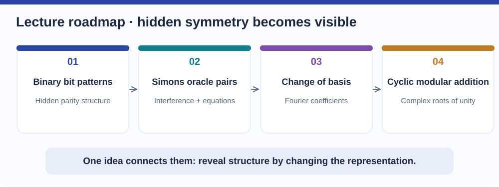
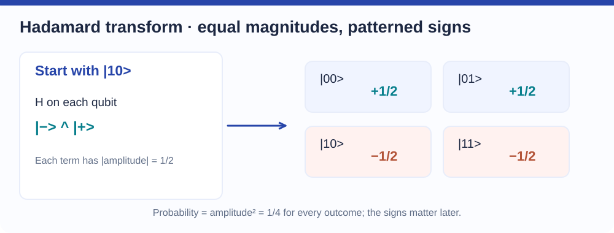
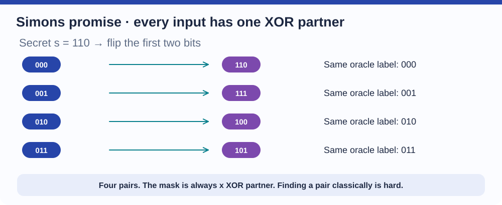
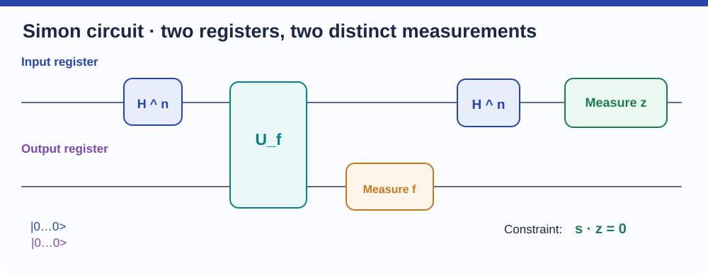
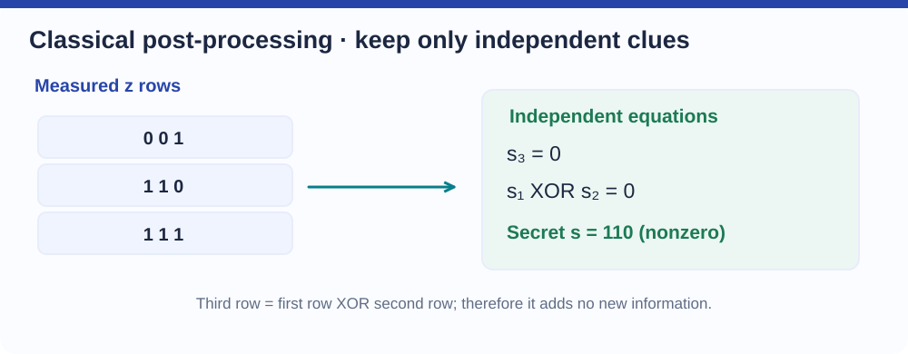
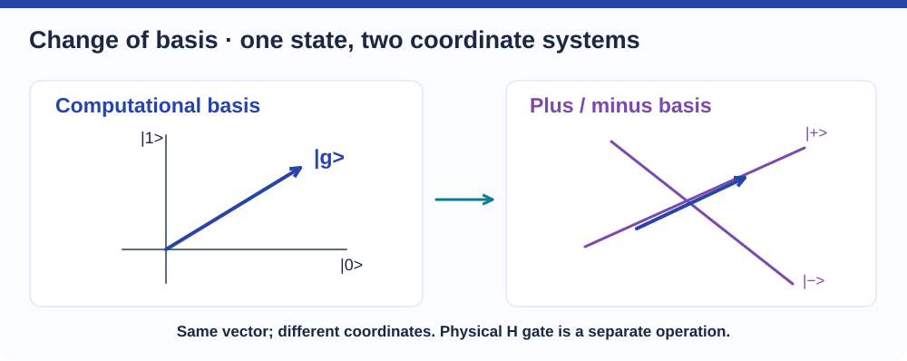
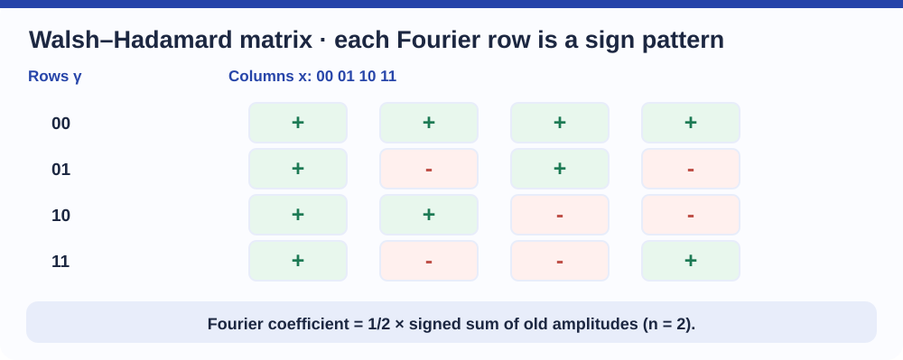
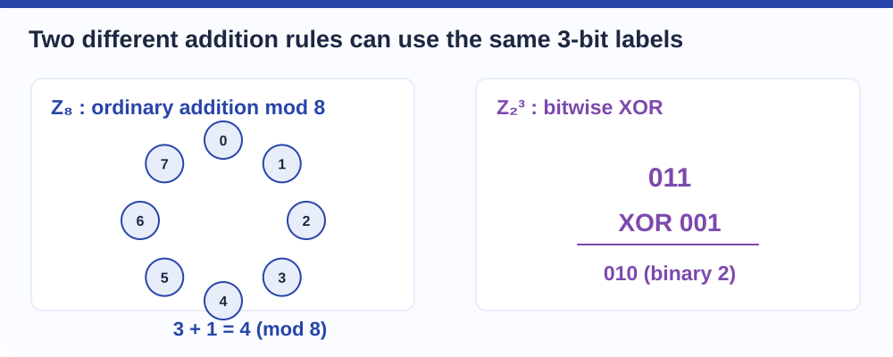
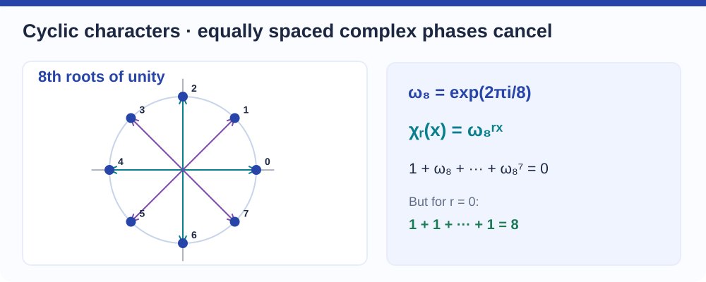

# Core Algorithms (Part C): Simon's Algorithm, Change of Basis, and the Road to the Quantum Fourier Transform

> **Source:** Professor's lecture transcription, *02 Core Algorithms (Part C)*. No lecture PDF was supplied for this session. All diagrams, worked additions and interactive demonstrations in this package are original reconstructions, not screenshots from slides.  
> **Teaching notation:** A binary string is written `101` or $|101\rangle$; `⊕` means bitwise XOR; a dot product of bit strings always means **modulo 2**, unless explicitly stated otherwise.  
> **Scope:** This lecture **finishes Simon's algorithm**, reinterprets Deutsch–Jozsa and Bernstein–Vazirani as Fourier/change-of-basis algorithms, then **introduces** modular arithmetic, characters and roots of unity. A full quantum Fourier transform (QFT) circuit and factoring are topics for subsequent lectures.

## 1. Introduction

### What are we learning, and why?

Imagine two different puzzles. In the first, someone hides a pairing pattern inside a huge table of inputs and outputs. In the second, someone gives you a complicated pattern of positive and negative values and asks what structure it hides. These sound unrelated. Quantum computing connects them with a surprisingly simple idea: **change the way you describe a quantum state so that hidden regularities become visible**.

The professor follows this journey:

1. **Recall earlier algorithms:** Deutsch–Jozsa, Bernstein–Vazirani and the key formula for several Hadamard gates.
2. **Complete Simon's problem:** a function secretly pairs strings $x$ and $x\oplus s$; find the hidden string $s$.
3. **Explain why interference helps:** unwanted answers cancel, leaving only bit strings $z$ satisfying $s\cdot z=0$.
4. **Use ordinary algebra to finish:** several clues become equations that a classical computer solves.
5. **Reinterpret Hadamard as a basis change:** the same vector has different coordinates in the $|0\rangle,|1\rangle$ and $|+\rangle,|-\rangle$ bases.
6. **Introduce characters:** parity signs $(-1)^{s\cdot x}$ convert XOR/addition into multiplication.
7. **Move from binary strings to modular integers:** to discover numerical periods, we need a bigger family of waves made with complex roots of unity.

**Why important?** Simon's algorithm gives an exponential *query-complexity separation* between quantum and classical algorithms under a specific oracle promise. The Fourier viewpoint then leads toward quantum period-finding and Shor's factoring algorithm.

**What should you know before starting?** Nothing beyond being willing to learn binary numbers, basic multiplication, simple vectors and probability. All are reviewed below.

**After this lecture**, you should be able to work through a Simon measurement, explain why some sampled equations add no information, derive the Hadamard/Fourier coefficients, and calculate the basic roots-of-unity identities.

### How to use these notes

Read Sections 2 and 3 in order. Whenever a diagram or animation is linked, first predict what will happen, then press **Step** or **Play** and compare your reasoning. Every major subsection includes common mistakes and a short comprehension check. Full worked practice answers are in [`practice/practice_questions.md`](practice/practice_questions.md).

---

## 2. Prerequisite Concepts

### 2.1 Bits, binary strings and their quantum counterparts

A **bit** is a classical value, either 0 or 1. A *3-bit string* is an ordered list such as `101` (three positions, not the decimal number one hundred and one). An $n$-bit string has $2^n$ possibilities, because every position has two choices. For $n=3$, these are `000`, `001`, `010`, `011`, `100`, `101`, `110`, `111`.

A **qubit** may be in a combination of basis states:

$$
|\psi\rangle=\alpha|0\rangle+\beta|1\rangle,
\qquad |\alpha|^2+|\beta|^2=1.
$$

Here $|0\rangle$ and $|1\rangle$ are basis states; $\alpha$ and $\beta$ are complex-number *amplitudes*; and $|\alpha|^2$, $|\beta|^2$ are the probabilities of measuring 0 and 1 in this basis. The probabilities must sum to 1 because a measurement produces one of these outcomes. A register of $n$ qubits has $2^n$ computational-basis states. For instance $|101\rangle=|1\rangle\otimes|0\rangle\otimes|1\rangle$. The symbol $\otimes$, pronounced *tensor product*, combines systems; it is **not** ordinary scalar multiplication.

**Supplementary numerical example.** If $|\psi\rangle=(3/5)|0\rangle+(4/5)|1\rangle$, then $P(0)=9/25$ and $P(1)=16/25$; $9/25+16/25=1$. *Common mistake:* the amplitudes themselves need not add to 1; **squared magnitudes** do.

### 2.2 XOR and parity: arithmetic with bits

XOR is an addition rule **modulo 2**: $0\oplus0=0$, $0\oplus1=1$, $1\oplus0=1$, $1\oplus1=0$. The last rule is crucial: two 1s produce an *even* count, represented by 0. With strings, XOR acts on matching positions:

$$
101\oplus110
=(1\oplus1)(0\oplus1)(1\oplus0)=011.
$$

**Parity** asks whether a count is even (0) or odd (1). The *binary dot product* collects particular positions and takes their parity:

$$
a\cdot x=(a_1x_1+a_2x_2+\cdots+a_nx_n)\bmod 2.
$$

The symbols $a_i,x_i$ are the individual 0-or-1 bits. Multiplication means ordinary 0/1 multiplication and the final sum is reduced modulo 2. The string $a$ is a **mask**: where it contains 1, it selects the corresponding bit of $x$.

For $a=101$, $x=110$: $a\cdot x=(1\cdot1+0\cdot1+1\cdot0)\bmod2=1$. For $a=110$, $x=101$: $(1+0+0)\bmod2=1$.

**Why we need this:** Simon's algorithm does not directly output the secret $s$. It outputs bit strings $z$ that obey an equation involving $s\cdot z$.

### 2.3 Hadamard: one gate, two outcomes, and a sign

The **Hadamard gate**, written $H$, converts computational basis states to the $+/-$ basis:

$$
|+\rangle=\frac{|0\rangle+|1\rangle}{\sqrt2},\qquad
|-\rangle=\frac{|0\rangle-|1\rangle}{\sqrt2};
$$
$$
H|0\rangle=|+\rangle,\quad H|1\rangle=|-\rangle,
\quad H|+\rangle=|0\rangle,\quad H|-\rangle=|1\rangle.
$$

**Intuition:** $H$ does not merely toss a coin. It creates **signed amplitudes**, enabling them to reinforce or cancel when later operations combine paths.

The matrix form is
$$
H=\frac1{\sqrt2}\begin{pmatrix}1&1\\\\1&-1\end{pmatrix},
\qquad H^2=I.
$$

The square-root factor keeps the state normalized. Multiplying $H$ by the column vector $(1,0)^T$ gives $(1,1)^T/\sqrt2$; multiplying by $(0,1)^T$ gives $(1,-1)^T/\sqrt2$. The superscript $T$ means transpose: we write a row as a column.

### 2.4 Several Hadamards: the key formula

$H^{\otimes n}$ means “apply one Hadamard to **each** of $n$ qubits.” The professor repeatedly uses

$$
\boxed{H^{\otimes n}|x\rangle
=\frac1{\sqrt{2^n}}\sum_{z\in\{0,1\}^n}(-1)^{x\cdot z}|z\rangle.}
\tag{1}
$$

Every symbol has a job: $n$ is the number of bits; $x$ is the starting string; $z$ ranges over all possible strings; $x\cdot z$ is parity; $(-1)^0=+1$ and $(-1)^1=-1$; the factor $1/\sqrt{2^n}$ normalizes the $2^n$ equal-sized amplitudes.

**Step-by-step for $x=10$:**

$$
H^{\otimes2}|10\rangle
=H|1\rangle\otimes H|0\rangle
=\frac{|0\rangle-|1\rangle}{\sqrt2}\otimes
 \frac{|0\rangle+|1\rangle}{\sqrt2}.
$$

Distribute the tensor product across the sums:

$$
=\frac12(|00\rangle+|01\rangle-|10\rangle-|11\rangle).
$$

The signs can be checked independently with $x\cdot z$. For $z=10$, $10\cdot10=1$, giving $-1$; for $z=01$, the dot product is 0, giving $+1$. Each outcome has probability $(1/2)^2=1/4$ **if measured immediately**, even though the signs differ. Later interference reveals why those signs matter.

**Visual explanation:** [Step through a Hadamard on multiple qubits](animations/animation_01.html).

### 2.5 Phase kickback and what a query measures

A **black-box function** (also called an **oracle**) is a device whose behavior we can query without inspecting its internal implementation. If $f(x)$ is one bit, the standard reversible oracle is

$$
U_f|x\rangle|y\rangle=|x\rangle|y\oplus f(x)\rangle.
$$

Put the second register into $|-\rangle$. Because flipping $|-\rangle$ contributes a minus sign,

$$
U_f|x\rangle|-\rangle=(-1)^{f(x)}|x\rangle|-\rangle.
$$

Check each possibility: for $f(x)=0$, no flip and sign $+1$; for $f(x)=1$, an $X$ acts on $|-\rangle=(|0\rangle-|1\rangle)/\sqrt2$, giving $(|1\rangle-|0\rangle)/\sqrt2=-|-\rangle$. This effect is called **phase kickback**. It converts a function value into a useful **relative phase**, rather than merely writing a classical output.

Applying phase kickback to an equal superposition makes the *phase state*

$$
|\psi_f\rangle=\frac1{\sqrt{2^n}}
\sum_x (-1)^{f(x)}|x\rangle.
\tag{2}
$$

This works directly here because $f(x)$ is a single **bit**. Simon's oracle returns a string, so his version of the algorithm follows a different route.

### 2.6 Inner products, interference and changing coordinates

Two different paths can contribute amplitude to the same outcome. Their amplitudes **add before probabilities are calculated**. Hence $a+(-a)=0$ makes an outcome impossible, while $a+a=2a$ makes it stronger. This is **interference**, not multiplication of probabilities.

A **basis** is a set of independent reference directions used to describe a vector. The physical vector does not change when you change coordinates. For an orthonormal basis $\{|b_j\rangle\}$, its coordinates are given by

$$
|\psi\rangle=\sum_j c_j|b_j\rangle,\qquad
c_j=\langle b_j|\psi\rangle.
$$

The bracket $\langle b_j|\psi\rangle$ is an **inner product**; it measures the complex amplitude of the component in direction $|b_j\rangle$. The bra $\langle b_j|$ is the conjugate-transpose of the ket $|b_j\rangle$. In our early Hadamard examples, coefficients are real, so complex conjugation does not alter them. We return to this idea in Section 3.5.

**Check Your Understanding — prerequisites**

1. Why is $110\oplus110=000$, not `220`?
2. Calculate $101\cdot111$ modulo 2.
3. Why can two states have the same immediate measurement probabilities but lead to different later results?

*Answers:* 1. XOR is position-wise addition mod 2. 2. $(1+0+1)\bmod2=0$. 3. Relative phases affect interference after additional gates.

---

## 3. Main Lecture Content — In the Professor's Sequence

### 3.1 Opening review: Deutsch–Jozsa, Bernstein–Vazirani and Simon

**Simple explanation.** The professor opens by recalling three algorithms. The same Hadamard transform reveals three kinds of hidden information, but the puzzles differ in what the oracle promises.

| Problem | Promise about $f$ | What we want | Quantum oracle queries | Classical comparison |
|---|---|---|---:|---|
| Deutsch–Jozsa | Function is constant or exactly balanced | Which case? | 1 (exact) | Deterministic exact worst case $2^{n-1}+1$; randomized bounded-error much less |
| Bernstein–Vazirani | $f(x)=s\cdot x$ for a hidden string $s$ | All bits of $s$ | 1 (exact) | $n$ classical queries for an exact deterministic solution |
| Simon | $f(x)=f(y)$ iff $y=x$ or $y=x\oplus s$, $s\neq0$ | Hidden XOR mask $s$ | $O(n)$ with high success probability | $\Theta(2^{n/2})$ queries for bounded-error randomized algorithms under the promise |

*Source versus additional teaching:* The professor compares these query advantages. The randomized-versus-deterministic qualification and the formal $\Theta$ notation above clarify the assumptions, rather than changing the lecture's message.

#### Deutsch–Jozsa: using the all-zero amplitude

For the phase state from Equation (2), apply $H^{\otimes n}$ once more:

$$
H^{\otimes n}|\psi_f\rangle
=\frac1{2^n}\sum_z\left[\sum_x(-1)^{f(x)+x\cdot z}\right]|z\rangle.
$$

**Derivation (no skipped normalization):** each of the two Hadamard preparations contributes $1/\sqrt{2^n}$; multiplying the factors gives $1/2^n$. The coefficient of a particular $z$ comes from summing contributions from every $x$. For $z=0^n$, the dot product $x\cdot0^n=0$, so

$$
A(0^n)=\frac1{2^n}\sum_x(-1)^{f(x)}.
\tag{3}
$$

- If $f(x)=0$ always, every term is $+1$, and $A(0^n)=+1$.
- If $f(x)=1$ always, every term is $-1$, and $A(0^n)=-1$.
- If $f$ is balanced, half the signs are positive and half negative, so $A(0^n)=0$.

A constant function therefore yields all zeros **with probability 1**, because $|\pm1|^2=1$. A balanced function yields all zeros **with probability 0**. Measuring the final register distinguishes the cases in one oracle query.

**Supplementary example:** for two-bit inputs $00,01,10,11$, take $f(x)=x_1$. The four signs are $+,+,-,-$; Equation (3) gives $(1+1-1-1)/4=0$. For constant zero, the four signs are all +, so the amplitude is $4/4=1$.

**Important distinction:** only the sign of the constant-case amplitude depends on whether the constant is 0 or 1; its measurement probability is 1 in both cases.

#### Bernstein–Vazirani: an entire hidden string in one measurement

Here $f(x)=s\cdot x$, so the phase state is

$$
|\psi_s\rangle=\frac1{\sqrt{2^n}}\sum_x(-1)^{s\cdot x}|x\rangle
=H^{\otimes n}|s\rangle.
$$

Applying the Hadamards again gives

$$
H^{\otimes n}|\psi_s\rangle
=(H^{\otimes n})^2|s\rangle=|s\rangle,
$$

because $H^2=I$ on each qubit. The final computational-basis measurement returns the hidden string $s$ exactly. This is not unrestricted reading of the oracle's entire truth table: the promise that $f$ is **a linear parity function** is what makes the method possible.

**Supplementary example:** if $s=101$, the oracle encodes the parity of bits 1 and 3. The final answer is exactly `101`, not a random sample of the input strings.

**Visual comparison:** [Interactive Deutsch–Jozsa and Bernstein–Vazirani](animations/animation_02.html).

**Common mistakes:** (i) saying both algorithms solve arbitrary functions; their specific **promises** are essential; (ii) treating negative amplitude as negative probability; only squared magnitude is probability.

**Check Your Understanding**

1. Why is the amplitude of $|00\rangle$ zero for a balanced two-bit function?
2. Why does Bernstein–Vazirani need the second Hadamard layer?
3. Would one query solve Deutsch–Jozsa exactly if the constant/balanced promise were removed?

*Quick answers:* 1. Equal numbers of + and − terms cancel. 2. It converts the phase pattern $H^{\otimes n}|s\rangle$ back to $|s\rangle$. 3. No, the two alternatives would no longer be fully specified.

### 3.2 Simon's problem: discover a string that secretly pairs inputs

**Simple explanation.** Picture a collection of numbered lockers. Every locker has a partner with exactly the same label. You do not know the pairing rule, but it is consistent everywhere: to find the partner of an input, flip exactly those bits selected by one secret string $s$.

**Why do we need it?** If we identify $s$, we uncover a hidden symmetry. Classical black-box access typically needs many queries to encounter a collision; the quantum method creates information about the symmetry without having to find an explicit matching pair.

**Technical statement (Simon's promise):**

$$
f:\{0,1\}^n\longrightarrow\{0,1\}^n,
\quad s\in\{0,1\}^n,\quad s\neq0^n,
$$
$$
\boxed{f(x)=f(y)\iff y=x\ \text{or}\ y=x\oplus s.}
\tag{4}
$$

This means **exactly two different inputs** share each output that occurs. We call the function **2-to-1 on its image**. The condition $s\neq0^n$ guarantees the partner differs from the original input. In the spoken lecture, “addition by $s$” means XOR here, not ordinary integer addition.

**Professor's three-bit mask example, reconstructed carefully.** Choose $s=110$. Then

$$
000\oplus110=110,\quad
001\oplus110=111,\quad
010\oplus110=100,\quad
011\oplus110=101.
$$

This divides eight inputs into four pairs. Below is a **supplementary explicit oracle** satisfying the same promise; the professor illustrates pairs but does not require this exact table.

| Input $x$ | Partner $x\oplus110$ | Shared output $f(x)$ |
|---|---|---|
| 000 | 110 | 000 |
| 001 | 111 | 001 |
| 010 | 100 | 010 |
| 011 | 101 | 011 |

One simple formula that produces those outputs is $f(x_1x_2x_3)=0(x_1\oplus x_2)x_3$, where juxtaposition assembles a three-bit string: a leading `0`, the XOR of the first two bits, and the third bit. The two members of a pair always have the same XOR of the first two bits and the same third bit.

**Find $s$ classically if a collision is discovered.** If $f(001)=f(111)$, compute

$$
s=001\oplus111=(0\oplus1)(0\oplus1)(1\oplus1)=110.
$$

**Why classical queries cost about $2^{n/2}$.** There are $2^n$ possible inputs. After making $k$ queries, there are approximately $k(k-1)/2$ distinct pairs of queried inputs to compare. Each queried pair has a small chance (on the order of $1/2^n$) of being the hidden partner. The expected number of matching pairs becomes order 1 when

$$
\frac{k^2}{2^n}\approx1
\quad\Longrightarrow\quad k\approx\sqrt{2^n}=2^{n/2}.
$$

This is the **birthday-paradox intuition** and explains the classical randomized query scaling. It is not a claim that the input space has only $2^{n/2}$ elements: it contains $2^n$ elements; the square root comes from counting pairs of queries.

**Visual explanation:** [Try every XOR pairing and identify the hidden mask](animations/animation_03.html).

**Important takeaways:** The secret $s$ is a *single* nonzero mask; querying random $x$ alone tells us $f(x)$, not $s$; a collision gives $s$ immediately but is hard to find classically.

**Common mistakes:** assuming $f(x)=x\oplus s$ (not Simon's promise); saying $f$ outputs one bit (here it returns a string); assuming outputs are all distinct (they appear twice).

**Check Your Understanding**

1. If $s=101$, what is the partner of `011`?
2. If $f(0010)=f(1011)$, what is $s$?
3. Why is $s=000$ excluded under the 2-to-1 promise?

*Answers:* 1. `110`. 2. `1001`. 3. Each input would be paired with itself rather than a distinct input.

### 3.3 Simon's quantum circuit: why one run reveals an equation

This is the main derivation of the first half of the lecture. We will keep the normalizing factors visible, even when the professor suppresses them on the board for clarity.

#### What is the oracle, and why is an output register needed?

Unlike Deutsch–Jozsa, Simon's $f(x)$ is a **whole $n$-bit string**, not one bit. We therefore use $n$ input qubits and $n$ output qubits. The reversible oracle is

$$
\boxed{U_f|x\rangle|y\rangle=|x\rangle|y\oplus f(x)\rangle.}
\tag{5}
$$

- $|x\rangle$: the register we want to examine (unchanged by the oracle).
- $|y\rangle$: an auxiliary output register.
- $y\oplus f(x)$: the bitwise XOR of the two strings, so output length is still $n$.
- Starting with $|0^n\rangle$ in the output register writes $|f(x)\rangle$ there.

**Why not simply use** $|x\rangle\to|f(x)\rangle$? Because $f$ is 2-to-1 and discards information, that map alone is not reversible. Quantum gates are unitary, so the useful oracle keeps $x$ and XORs $f(x)$ into another register.

For the explicit supplementary three-bit function from Section 3.2, compute $x_1\oplus x_2$ into one blank output wire using **two CNOTs** (controls $x_1,x_2$), copy $x_3$ into another blank output wire using one CNOT, and leave the remaining output wire at zero. That is one possible reversible oracle implementation; the professor treats $U_f$ as a supplied black box rather than requiring us to synthesize arbitrary $f$.

#### Step 1: start with zeros

$$
|\Psi_0\rangle=|0^n\rangle\otimes|0^n\rangle.
$$

There are **two** registers of $n$ qubits, so a total of $2n$ qubits. The notation $0^n$ means $n$ zeros (for $n=3$, `000`).

#### Step 2: spread the first register over all inputs

Apply $H$ to every input qubit, leaving the second register alone:

$$
|\Psi_1\rangle
=\left(\frac1{\sqrt{2^n}}\sum_x|x\rangle\right)|0^n\rangle
=\frac1{\sqrt{2^n}}\sum_x|x\rangle|0^n\rangle.
\tag{6}
$$

**Why the coefficient?** All $2^n$ inputs have the same amplitude $1/\sqrt{2^n}$, and the total probability is $2^n(1/2^n)=1$.

#### Step 3: call the oracle once

Each term $|x\rangle|0^n\rangle$ becomes $|x\rangle|f(x)\rangle$. Since a quantum gate is linear, it works term by term:

$$
|\Psi_2\rangle=U_f|\Psi_1\rangle
=\frac1{\sqrt{2^n}}\sum_x|x\rangle|f(x)\rangle.
\tag{7}
$$

The first and second registers are now correlated. For example, under $s=110$, the terms $|000\rangle|000\rangle$ and $|110\rangle|000\rangle$ both carry the same output string.

#### Step 4: measure the output register

Suppose the output measurement reads $f(x_0)$. By the promise, only two input strings could have produced it: $x_0$ and $x_0\oplus s$. Every other term is removed by the measurement. The **normalized** state of the input register becomes

$$
\boxed{|\Psi_3\rangle=\frac{|x_0\rangle+|x_0\oplus s\rangle}{\sqrt2}.}
\tag{8}
$$

**Why $1/\sqrt2$?** Before normalization, each survivor had amplitude $1/\sqrt{2^n}$. The measurement selects one particular output (probability $2/2^n$). Conditional on that outcome, the remaining two equally likely inputs each need probability $1/2$, hence amplitude $1/\sqrt2$. We do **not** learn $x_0$ itself from measuring the output, only the shared function value. The two input alternatives remain in superposition.

**Professor's example:** with $s=110$, the input may collapse to $(|001\rangle+|111\rangle)/\sqrt2$. If you measure the first register *now*, you get either `001` or `111`. Neither result by itself tells you $s$. So the algorithm does something different: another Hadamard layer.

#### Step 5: apply Hadamards to the input register

Use Equation (1) on each of the two terms:

$$
H^{\otimes n}|\Psi_3\rangle
=\frac1{\sqrt2}\left(H^{\otimes n}|x_0\rangle+
H^{\otimes n}|x_0\oplus s\rangle\right).
$$

Expand both with the Hadamard rule:

$$
=\frac1{\sqrt{2\cdot2^n}}\sum_z\left[
(-1)^{x_0\cdot z}+(-1)^{(x_0\oplus s)\cdot z}
\right]|z\rangle.
\tag{9}
$$

**Key property of the binary dot product:**

$$
(x_0\oplus s)\cdot z=(x_0\cdot z+s\cdot z)\bmod2.
$$

Therefore the second sign can be factored:

$$
(-1)^{(x_0\oplus s)\cdot z}
=(-1)^{x_0\cdot z}(-1)^{s\cdot z}.
$$

Substitute it into Equation (9):

$$
\boxed{|\Psi_4\rangle=
\frac1{\sqrt{2^{n+1}}}\sum_z
(-1)^{x_0\cdot z}\left[1+(-1)^{s\cdot z}\right]|z\rangle.}
\tag{10}
$$

This is the crucial expression. Work out the two cases instead of jumping to the conclusion:

| Condition | Value of $(-1)^{s\cdot z}$ | Bracket $1+(-1)^{s\cdot z}$ | Resulting amplitude |
|---|---:|---:|---|
| $s\cdot z=0$ | $+1$ | $2$ | $\pm2/\sqrt{2^{n+1}}=\pm1/\sqrt{2^{n-1}}$ |
| $s\cdot z=1$ | $-1$ | $0$ | exactly zero |

The sign $\pm$ in surviving amplitudes depends on $x_0\cdot z$, but their **squared magnitudes** are all $1/2^{n-1}$. Therefore:

$$
\boxed{\text{Every final measurement returns a uniformly random }z
\text{ satisfying }s\cdot z=0.}
\tag{11}
$$

**What was the quantum gain?** Instead of looking for two inputs with the same $f(x)$, interference gives a linear equation about their hidden relationship.

**Interactive visual explanation:** [Watch interference cancel exactly half the outcomes](animations/animation_04.html).

#### Why exactly half of the $z$ strings survive

For any nonzero $s$, find a position where $s_i=1$. Choose **all other $n-1$ bits of $z$** freely. The equation $s\cdot z=0$ then fixes the selected bit $z_i$ uniquely: set it so that the overall parity is even. There are two choices for each of the other $n-1$ positions, hence

$$
\boxed{\#\{z:s\cdot z=0\}=2^{n-1}.}
\tag{12}
$$

**Supplementary 4-bit example based on the professor's argument:** let $s=1011$ and $z=?b_2b_3b_4$. Then $s\cdot z=z_1\oplus z_3\oplus z_4$, so $z_1=z_3\oplus z_4$. The other three bits can be chosen in $2^3=8$ ways and each choice determines the first bit.

#### Detailed three-bit measurement table ($s=110$)

Here $s\cdot z=z_1\oplus z_2$ because the third bit of $s$ is zero.

| Candidate $z$ | $z_1\oplus z_2$ | Survives? | $P(z)$ |
|---|---:|---|---:|
| 000 | 0 | Yes | 1/4 |
| 001 | 0 | Yes | 1/4 |
| 010 | 1 | No | 0 |
| 011 | 1 | No | 0 |
| 100 | 1 | No | 0 |
| 101 | 1 | No | 0 |
| 110 | 0 | Yes | 1/4 |
| 111 | 0 | Yes | 1/4 |

For example, if $x_0=001$ and $z=111$, then $x_0\cdot z=1$, $s\cdot z=0$, and Equation (10) gives amplitude $-2/4=-1/2$ (here $n=3$, so $\sqrt{2^{n+1}}=4$). Its probability is $1/4$. If $z=101$, then $s\cdot z=1$; the two contributions cancel regardless of $x_0$.

**Common mistakes:** (i) treating a coefficient of $-1/2$ as probability $-1/2$; the probability is $1/4$; (ii) claiming the output measurement gives the mask $s$; it gives a value of $f$; (iii) omitting normalization so the resulting probabilities do not sum to 1; (iv) believing $x_0$ determines which outcomes are possible; it only affects their signs, not the support.

**Check Your Understanding**

1. Where are the $2n$ qubits used in Simon's circuit?
2. Why does measuring the second register leave exactly two input strings?
3. For $s=101$, does $z=010$ survive the final Hadamard? Does $z=100$?

*Answers:* 1. $n$ in the input register and $n$ in the oracle-output register. 2. The 2-to-1 promise. 3. `010` survives because the parity is zero; `100` does not.

### 3.4 Repeating Simon's experiment and solving equations classically

**Intuition before the mathematics.** Every run produces a clue, but some clues are repetitive. Imagine learning a password with questions like “is the first bit zero?” and later receiving “the first bit plus the second bit is zero.” Together those say something new. But if you already knew both bits were zero, hearing “their sum is zero” adds nothing.

A run returns $z$ and therefore an equation

$$
z_1s_1\oplus z_2s_2\oplus\cdots\oplus z_ns_n=0.
\tag{13}
$$

All the $z_i$ are known; the $s_i$ are unknown. The arithmetic is over $\mathrm{GF}(2)$, meaning the numbers $0,1$ with XOR as addition. This is just linear algebra with a two-value number system.

#### A complete worked solution for $n=3$

Suppose repeated valid measurements give the **independent** clues

$$
z^{(1)}=001,\qquad z^{(2)}=110.
$$

For $z^{(1)}$, Equation (13) reads

$$
0s_1\oplus0s_2\oplus1s_3=0
\quad\Rightarrow\quad s_3=0.
$$

For $z^{(2)}$, it reads

$$
1s_1\oplus1s_2\oplus0s_3=0
\quad\Rightarrow\quad s_1\oplus s_2=0,
$$

which means $s_1=s_2$. Combining both conditions gives two candidates: $000$ and $110$. But the Simon promise tells us $s\neq000$, so **the secret must be $s=110$**.

**Why only two independent clues?** In three bits, each independent homogeneous equation typically cuts the candidate set in half. With $n-1$ independent equations, the solution space has dimension one: it contains $000$ and one nonzero candidate. The promise selects the latter. The professor describes needing “about $n$” clues; precisely, **$n-1$ independent clues suffice** in the nonzero-secret version.

#### What counts as a *new* clue?

Suppose your first two measurements are $z^{(1)}=1000$ and $z^{(2)}=0100$. You now know $s_1=0$ and $s_2=0$. If the next measurement is $1100$, its equation is $s_1\oplus s_2=0$, which follows from the first two equations. It is **dependent**, not new information.

The **span** of $r$ independent strings consists of all XOR combinations of those strings. Each coefficient is either 0 (leave this string out) or 1 (include it), yielding exactly $2^r$ distinct sums. A new measurement is useful only if it lies **outside** the current span; otherwise it repeats information already present.

For $s\neq0$, the valid $z$'s live in a space of size $2^{n-1}$. If we have $r$ independent clues, $2^r$ valid strings are in their span. Thus the next uniformly random valid sample adds new information with probability

$$
\boxed{P(\text{new clue}\mid\text{rank }r)=1-\frac{2^r}{2^{n-1}}
=1-2^{r-(n-1)}.}
\tag{14}
$$

For example, if $n=4$, the valid space has $2^3=8$ strings. With one independent clue, its span has two strings (the zero string and that clue), so the next sample is new with probability $1-2/8=3/4$. With two independent clues, the span has four strings, so the next has probability $1-4/8=1/2$. This is why a few extra runs are helpful.

#### Gaussian elimination: what the classical computer does

Collect the measured $z$'s as rows of a matrix $M$. Find a nonzero vector $s$ satisfying

$$
Ms=0\pmod2.
$$

A legal row operation is to XOR one row into another; it preserves the solution set. Keep removing redundant rows until the matrix has independent rows. If its rank reaches $n-1$, the nonzero null-space solution is unique. After recovering a candidate, you can validate the promise with an additional oracle test if desired (for example, check that $f(0^n)=f(s)$); oracle access and the promise are still required for such validation.

**Why this is a hybrid quantum/classical algorithm:** the quantum device supplies the equations; an ordinary laptop solves them. This is a recurring pattern in quantum algorithms: use the quantum computer for what produces useful information, then do inexpensive classical post-processing.

#### How many repetitions are enough?

A simple high-probability result discussed by the professor is that after

$$
m=n-1+k\quad\text{independent runs},
$$

the probability of having **enough independent information** is at least approximately $1-2^{-k}$; a standard union-bound proof gives the precise lower bound $1-2^{-k}$ (or slightly better). So when $k=10$, the success probability is at least $1-1/1024\approx99.90\%$. Note that the **runs are independent samples**, not necessarily independent equations; finding independence is precisely the task.

**Supplementary explanation of this bound:** Imagine any nonzero vector $t$ distinct from $s$. The chance that one uniformly sampled valid $z$ also satisfies $t\cdot z=0$ is $1/2$ if $t$ is not the secret direction. After $m$ runs that chance is $2^{-m}$. There are at most $2^{n-1}-1$ distinct competing directions to rule out after accounting for the valid subspace. Adding these failure probabilities (the *union bound*) gives less than $2^{n-1}2^{-m}=2^{-k}$. The extra $k$ samples make accidental ambiguities unlikely.

**Interactive exercise:** [Collect clues and solve Simon equations](animations/animation_05.html).

**Common mistakes:** confusing $n$ samples with $n$ independent equations; eliminating with ordinary arithmetic rather than XOR; forgetting the all-zero solution exists but is excluded by the promise; saying every single run identifies $s$.

**Check Your Understanding**

1. If measurements `100`, `010`, and `110` arrive, which one is redundant?
2. For nonzero Simon secret $s$ with $n=5$, how many independent equations suffice?
3. Why does extra repetition improve the chance of success?

*Answers:* 1. `110` is `100` XOR `010`. 2. Four independent equations. 3. It helps overcome repeated/dependent samples.

### 3.5 The professor's comparison: where does the real quantum advantage appear?

The lecture next compares the three algorithms. Deutsch–Jozsa and Bernstein–Vazirani are elegant demonstrations of **interference** and **query savings**; Simon's separation is substantially larger because $O(n)$ quantum oracle uses replace an exponential number of classical oracle uses (for the problem and promise specified).

Do not confuse **query complexity** with a claim that every implementation is exponentially faster end-to-end. Building the oracle, handling noise, executing gates and classical post-processing take resources too. The professor emphasizes oracle calls as the quantity being counted in these theoretical comparisons.

**The shared strategy:** create a phase or symmetry pattern, apply a carefully chosen transform, let incompatible patterns cancel, and measure the surviving information. That observation motivates the next major idea: **Fourier analysis is a way of revealing hidden patterns**.

### 3.6 Change of basis: the same state, different coordinates

**Simple explanation.** Suppose you tell a friend where a point is using east and north. Your friend uses two diagonal directions. You both describe the **same physical point**, but the pairs of numbers differ. That is a change of basis.

For one qubit, the first basis consists of $|0\rangle$ and $|1\rangle$; the alternative basis consists of $|+\rangle$ and $|-\rangle$. A state written in the computational basis is

$$
|g\rangle=\alpha|0\rangle+\beta|1\rangle.
$$

From Section 2.3,

$$
|0\rangle=\frac{|+\rangle+|-\rangle}{\sqrt2},\qquad
|1\rangle=\frac{|+\rangle-|-\rangle}{\sqrt2}.
$$

Substitute these expressions for $|0\rangle$ and $|1\rangle$:

$$
|g\rangle=
\alpha\frac{|+\rangle+|-\rangle}{\sqrt2}
+\beta\frac{|+\rangle-|-\rangle}{\sqrt2}.
$$

Collect the $|+\rangle$ and $|-\rangle$ terms:

$$
\boxed{|g\rangle=\underbrace{\frac{\alpha+\beta}{\sqrt2}}_{\alpha'}|+\rangle
+\underbrace{\frac{\alpha-\beta}{\sqrt2}}_{\beta'}|-\rangle.}
\tag{15}
$$

**Every symbol:** $\alpha,\beta$ are the old coordinates, $\alpha',\beta'$ are the new coordinates, and $1/\sqrt2$ comes from the normalized basis vectors. The **physical state is identical** on both sides. We did not operate on the qubit; we only rewrote it.

**Supplementary numerical example:** start with $|g\rangle=|0\rangle$, so $\alpha=1,\beta=0$. Then $\alpha'=1/\sqrt2$, $\beta'=1/\sqrt2$. Thus $|0\rangle=(|+\rangle+|-\rangle)/\sqrt2$. If instead $|g\rangle=|+\rangle$, its $+/-$ coordinates are $(1,0)$: it lies exactly along the $+$ basis direction.

#### How this relates to applying a physical Hadamard gate

Two related statements must be kept separate:

- **Change the mathematical basis**: $|g\rangle$ stays the same physical state; its coordinates become $(\alpha',\beta')$.
- **Apply the gate $H$** and continue describing outcomes in the *computational* basis: the *new physical state* is $H|g\rangle=\alpha'|0\rangle+\beta'|1\rangle$.

Why do the same numbers appear? Because $H$ maps the $+/-$ basis to the computational basis. This lets us measure $+/-$-basis information using a Hadamard followed by ordinary computational-basis measurement.

**Two-qubit version.** The four new basis states are

$$
|++\rangle,\quad|+-\rangle,\quad|-+\rangle,\quad|--\rangle.
$$

Expand one completely:

$$
|+-\rangle
=\frac{|0\rangle+|1\rangle}{\sqrt2}\otimes
 \frac{|0\rangle-|1\rangle}{\sqrt2}
=\frac{|00\rangle-|01\rangle+|10\rangle-|11\rangle}{2}.
$$

All four form an **orthonormal basis**: every state has norm 1 and distinct basis vectors have inner product zero. For example $\langle+|-\rangle=(1-1)/2=0$, and therefore $\langle++|+-\rangle=\langle+|+\rangle\langle+|-\rangle=1\cdot0=0$.

**Interactive visual:** [Move between coordinate systems](animations/animation_06.html).

**Common mistakes:** believing the state has changed merely because its coordinates have; forgetting the division by $\sqrt2$; using the coefficients themselves instead of squared magnitudes to calculate measurement probabilities; confusing a two-qubit $+/-$ basis with just two directions (there are four).

**Check Your Understanding**

1. Express $|1\rangle$ in the $+/-$ basis.
2. What are the $+/-$-basis coordinates of $|-\rangle$?
3. If $|g\rangle=\sqrt3|0\rangle/2+|1\rangle/2$, what is its $|+\rangle$ amplitude?

*Answers:* 1. $(|+\rangle-|-\rangle)/\sqrt2$. 2. $(0,1)$. 3. $(\sqrt3+1)/(2\sqrt2)$.

### 3.7 The multi-qubit Fourier/Hadamard basis

For $n$ qubits, there are $2^n$ computational basis states $|x\rangle$. The professor introduces another set of $2^n$ states, indexed by a bit string $\gamma$:

$$
\boxed{|F_\gamma\rangle=H^{\otimes n}|\gamma\rangle
=\frac1{\sqrt{2^n}}\sum_{x\in\{0,1\}^n}(-1)^{\gamma\cdot x}|x\rangle.}
\tag{16}
$$

Here $\gamma$ labels **which plus/minus basis vector** is being considered: for every 0 in $\gamma$, use $|+\rangle$; for every 1, use $|-\rangle$. Thus

$$
\gamma=001\quad\Longrightarrow\quad
|F_{001}\rangle=|++-\rangle.
$$

**Derive the sign pattern by hand** rather than memorizing it:

$$
|++-\rangle
=\frac1{\sqrt8}(|0\rangle+|1\rangle)
\otimes(|0\rangle+|1\rangle)
\otimes(|0\rangle-|1\rangle).
$$

The first and second factors contribute a $+1$ sign whether their bit is 0 or 1. The last factor contributes $+1$ if $x_3=0$ and $-1$ if $x_3=1$. Therefore

$$
|F_{001}\rangle=\frac1{\sqrt8}\big(
|000\rangle-|001\rangle+|010\rangle-|011\rangle
+|100\rangle-|101\rangle+|110\rangle-|111\rangle
\big).
$$

This is precisely the pattern $(-1)^{001\cdot x}=(-1)^{x_3}$. For $\gamma=101$, the signs instead depend on the parity $x_1\oplus x_3$. Each $|F_\gamma\rangle$ has **all $2^n$ computational basis components** with equal magnitudes and a structured pattern of signs.

**Why is it a basis?** $H$ is unitary, so applying $H^{\otimes n}$ to the orthonormal set $\{|\gamma\rangle\}$ produces another orthonormal set $\{|F_\gamma\rangle\}$. Thus any $n$-qubit vector can be expressed uniquely in either basis.

#### Fourier coefficients are the coordinates in this new basis

Start with a general state

$$
|g\rangle=\sum_{x\in\{0,1\}^n}g_x|x\rangle,
\qquad\sum_x|g_x|^2=1.
$$

Here $g_x$ is the computational-basis amplitude of $|x\rangle$. We want numbers $\widehat g(\gamma)$ satisfying

$$
|g\rangle=\sum_\gamma\widehat g(\gamma)|F_\gamma\rangle.
\tag{17}
$$

Because the new basis is orthonormal, take the inner product with $\langle F_\gamma|$ on both sides. On the right, every term vanishes except the one labeled $\gamma$. Therefore

$$
\widehat g(\gamma)=\langle F_\gamma|g\rangle.
$$

Insert the explicit expression of $F_\gamma$ and the original vector:

$$
\widehat g(\gamma)
=\left(\frac1{\sqrt{2^n}}\sum_x(-1)^{\gamma\cdot x}\langle x|\right)
\left(\sum_y g_y|y\rangle\right).
$$

Multiply the sums:

$$
=\frac1{\sqrt{2^n}}\sum_{x,y}(-1)^{\gamma\cdot x}g_y\langle x|y\rangle.
$$

Orthonormality means $\langle x|y\rangle=1$ if $x=y$, otherwise 0. Only terms with $x=y$ remain:

$$
\boxed{\widehat g(\gamma)
=\frac1{\sqrt{2^n}}\sum_x(-1)^{\gamma\cdot x}g_x.}
\tag{18}
$$

These numbers are the **Walsh–Hadamard transform** or Fourier coefficients on the group of bit strings under XOR. They are not the original amplitudes; they are **weighted sums of the original amplitudes**, with the $+/-$ weights selected by $\gamma$.

#### Concrete two-bit example, all intermediate steps

Let

$$
|g\rangle=\frac{|00\rangle+|01\rangle}{\sqrt2},
$$

so $g_{00}=1/\sqrt2$, $g_{01}=1/\sqrt2$, $g_{10}=0$, $g_{11}=0$. With $n=2$, the overall factor in Equation (18) is $1/2$. Calculate each Fourier coordinate:

$$
\begin{aligned}
\widehat g(00)&=\tfrac12(g_{00}+g_{01}+g_{10}+g_{11})=\tfrac1{\sqrt2},\\
\widehat g(01)&=\tfrac12(g_{00}-g_{01}+g_{10}-g_{11})=0,\\
\widehat g(10)&=\tfrac12(g_{00}+g_{01}-g_{10}-g_{11})=\tfrac1{\sqrt2},\\
\widehat g(11)&=\tfrac12(g_{00}-g_{01}-g_{10}+g_{11})=0.
\end{aligned}
$$

Therefore in the new basis the same state is

$$
|g\rangle=\frac{|F_{00}\rangle+|F_{10}\rangle}{\sqrt2}.
$$

Applying $H^{\otimes2}$ to the original state, meanwhile, produces $(|00\rangle+|10\rangle)/\sqrt2$ in the computational basis—**same coefficients**, but now represented on the computational labels after a physical operation.

**The professor's all-plus observation:** for $\gamma=0^n$, every weight is $+1$, so

$$
\boxed{\widehat g(0^n)=\frac1{\sqrt{2^n}}\sum_x g_x.}
\tag{19}
$$

This is a normalized **sum** of the old amplitudes. The arithmetic mean would be $(1/2^n)\sum_x g_x$, so it is related to the coefficient by a factor $1/\sqrt{2^n}$. The lecture informally calls this the “average”; the normalization matters in exact calculations. For the *uniformly normalized phase state* $g_x=(-1)^{f(x)}/\sqrt{2^n}$, Equation (19) becomes exactly the average sign $(1/2^n)\sum_x(-1)^{f(x)}$, matching Deutsch–Jozsa.

**Why does this matter?** A particular coordinate can reveal a global pattern in exponentially many amplitudes. The quantum machine manipulates those amplitudes together, but **one measurement still returns one outcome**; it cannot print all $2^n$ Fourier coefficients for free. Nor can an arbitrary classical data list be loaded into amplitudes without cost. The quantum advantage comes from the promise and how the state is prepared.

**Interactive visual:** [Build a Fourier spectrum from the signs of a quantum state](animations/animation_07.html).

**Common mistakes:** thinking $\gamma=001$ means the state $|001\rangle$ rather than $|++-\rangle$ when used as a Fourier-basis label; forgetting the $1/\sqrt{2^n}$ factor; calling the physical transformed state and the re-expressed original state the same *operation*; assuming amplitudes can all be read from a single experiment.

**Check Your Understanding**

1. What product state is $|F_{101}\rangle$?
2. For $n=2$, what is $\widehat g(00)$ when $|g\rangle=|00\rangle$?
3. Why does $\gamma=0^n$ use all positive weights?

*Answers:* 1. $|-+-\rangle$. 2. $1/2$. 3. Every dot product $0^n\cdot x$ equals zero.

### 3.8 Characters: why a hidden shift has a simple Fourier signature

**Simple explanation.** A “character” is a function that turns addition into multiplication. Think of how a logarithm turns multiplication into addition, but here the direction is reversed. In the lecture it is the *mathematical reason* the Hadamard sign patterns behave so neatly with XOR.

For a one-bit number $b$, let $\chi(b)=(-1)^b$. Check the four possibilities:

| $x$ | $y$ | $x\oplus y$ | $\chi(x\oplus y)$ | $\chi(x)\chi(y)$ |
|---:|---:|---:|---:|---:|
| 0 | 0 | 0 | +1 | (+1)(+1)=+1 |
| 0 | 1 | 1 | −1 | (+1)(−1)=−1 |
| 1 | 0 | 1 | −1 | (−1)(+1)=−1 |
| 1 | 1 | 0 | +1 | (−1)(−1)=+1 |

The property also works for bit strings. Fix any label $\gamma$ and define

$$
\boxed{\chi_\gamma(x)=(-1)^{\gamma\cdot x}.}
\tag{20}
$$

Then

$$
\chi_\gamma(x\oplus y)
=(-1)^{\gamma\cdot(x\oplus y)}
=(-1)^{\gamma\cdot x+\gamma\cdot y}
=(-1)^{\gamma\cdot x}(-1)^{\gamma\cdot y}
=\chi_\gamma(x)\chi_\gamma(y).
\tag{21}
$$

In the middle exponent we may add integers because $(-1)^m$ only depends on whether $m$ is even or odd. There are $2^n$ such characters, one for every mask $\gamma$. They correspond exactly to the Hadamard/Fourier basis wave patterns.

#### Hidden shift $\Rightarrow$ Fourier coefficients vanish in a predictable way

The professor returns to Simon's key symmetry. The two-term input state after measuring the oracle-output register was

$$
|g\rangle=\frac{|x_0\rangle+|x_0\oplus s\rangle}{\sqrt2}.
$$

Its Fourier coefficient at label $\gamma$, using Equation (18), is

$$
\widehat g(\gamma)
=\frac1{\sqrt{2^{n+1}}}
\left[(-1)^{\gamma\cdot x_0}+
(-1)^{\gamma\cdot(x_0\oplus s)}\right].
$$

Factor using the character property:

$$
=\frac{(-1)^{\gamma\cdot x_0}}{\sqrt{2^{n+1}}}
\left[1+(-1)^{\gamma\cdot s}\right].
$$

Therefore the coefficient is zero whenever $\gamma\cdot s=1$; only coordinates with $\gamma\cdot s=0$ survive. The **support** of a Fourier transform means the set of labels at which the coefficient is **nonzero**. In Simon's problem,

$$
\boxed{\operatorname{supp}(\widehat g)
\subseteq\{\gamma:\gamma\cdot s=0\}.}
\tag{22}
$$

For the equal two-term state, in fact every such $\gamma$ survives, so the inclusion is equality. This is the general principle highlighted by the professor: **symmetry in one description becomes a restriction on where Fourier information can appear**.

**Connection to the three algorithms:**

- Deutsch–Jozsa: the all-plus Fourier coordinate reveals the *overall signed balance*.
- Bernstein–Vazirani: the phase state is a single Fourier-basis vector, so one index has all the weight.
- Simon: the state is invariant under XOR with $s$, so Fourier weight is restricted to the subspace perpendicular to $s$.

**Common mistakes:** taking $\chi_\gamma(x)$ to be probability instead of a $+1/-1$ sign; assuming “Fourier support” refers to which physical qubits are active (it means which **coefficients** are nonzero); assuming every kind of shift is handled by exactly the same $H$ transform.

**Check Your Understanding**

1. For $\gamma=0101$, which bits of $x$ influence $\chi_\gamma(x)$?
2. Why does $\chi_\gamma(x\oplus y)=\chi_\gamma(x)\chi_\gamma(y)$ matter for Simon's algorithm?
3. Is $H^{\otimes n}$ the general QFT for *all* kinds of integer addition?

*Answers:* 1. Bits 2 and 4. 2. It factors the hidden-shift sign, exposing cancellation. 3. No: it is the Fourier transform for XOR on bit strings; the cyclic integer case needs complex phases.

### 3.9 The professor's sound-wave analogy: Fourier transforms reveal patterns

Consider a musical sound containing several notes. Looking at the raw amplitude over time is like staring at a wiggly line: it may be hard to identify the notes. A **Fourier transform** expresses the signal as a combination of standard waves; the strength of each wave reveals which frequencies are present.

In the binary situation above, the standard waves are patterns of $+1$ and $-1$ selected by $\chi_\gamma(x)$. They are the analogs of frequencies. Changing basis extracts the corresponding coefficients $\widehat g(\gamma)$. When the algebraic structure is **XOR**, $H^{\otimes n}$ is the appropriate Fourier transform. When it is integer addition around a clock, we need different waves, built from complex-number rotations.

**Important qualification:** The Fourier transform does not automatically extract every property of an arbitrary unknown function with one measurement. It rearranges amplitudes in a way that can make a particular promised property easy to detect.

### 3.10 From bits to integers: modular arithmetic and $\mathbb Z_N$

**Why change the arithmetic?** Simon's secret uses bitwise XOR: $1\oplus1=0$. Factoring and numerical period-finding involve adding ordinary integers. The professor therefore introduces the cyclic number system

$$
\mathbb Z_N=\{0,1,2,\ldots,N-1\},
$$

where addition wraps around after $N-1$. We write $(a+b)\bmod N$ for the remainder after dividing the sum by $N$.

**Everyday analogy:** a 12-hour clock: after 11 comes 0 (or 12), and 10 plus 4 hours reads 2.

**Professor's $N=6$ examples:**

$$
3+4=7\equiv1\pmod6;
\qquad4+4=8\equiv2\pmod6;
\qquad3\times5=15\equiv3\pmod6.
$$

The $\equiv$ sign means “has the same remainder modulo.” **Step-by-step:** 7 divided by 6 leaves remainder 1; 8 divided by 6 leaves remainder 2; 15 divided by 6 leaves remainder 3. No number falls outside $0,1,2,3,4,5$.

For quantum registers, the lecturer focuses on $N=2^k$, so every label from 0 through $N-1$ has an exact representation using **$k$ bits**. For example, in $\mathbb Z_8$, decimal 5 corresponds to $|101\rangle$ on three qubits. The *same register* can be discussed as $|5\rangle$ when emphasizing modular arithmetic or $|101\rangle$ when emphasizing its implementation.

**Crucial distinction:** The group $\mathbb Z_8$ has elements 0–7 with addition modulo 8, whereas the bit-string group $\mathbb Z_2^3$ has eight three-bit strings with **bitwise XOR**. They have the **same number of labels but a different addition rule**. In the first, $3+1\equiv4\pmod8$; in the second, `011 XOR 001 = 010` (binary 2).

The general state looks familiar:

$$
|\psi\rangle=\sum_{x=0}^{N-1}\alpha_x|x\rangle,
\quad\sum_x|\alpha_x|^2=1.
$$

The difference is how we interpret labels and shifts, not the number of amplitudes.

**Interactive visual:** [Rotate around modular number clocks](animations/animation_08.html).

**Common mistakes:** treating $\mathbb Z_8$ addition as XOR; assuming all arithmetic is confined to $\{0,1\}$; confusing $N$ (number of possible integer labels) with $k=\log_2 N$ (number of qubits).

**Check Your Understanding**

1. Compute $5+6\pmod8$.
2. What binary string represents the label 6 in $\mathbb Z_8$?
3. In $\mathbb Z_8$, is $3+1$ the same as `011 XOR 001`?

*Answers:* 1. $11\bmod8=3$. 2. `110`. 3. No: 4 versus 2.

### 3.11 Characters of $\mathbb Z_N$: complex roots of unity

The professor asks: what replaces the $\pm1$ patterns when we use **addition modulo $N$**? We want a nonzero function $\chi:\mathbb Z_N\to\mathbb C$ with the same multiplication property:

$$
\boxed{\chi((x+y)\bmod N)=\chi(x)\chi(y).}
\tag{23}
$$

#### First deduction: $\chi(0)=1$

Setting $x=y=0$ gives $\chi(0)=\chi(0)^2$, so $\chi(0)$ is either 0 or 1. For a **nonzero character**, it must be 1. More formally, if $\chi(0)=0$, then $\chi(x)=\chi(x+0)=\chi(x)\chi(0)=0$ for every $x$, giving only the identically zero function, which is not an allowed character.

#### Second deduction: $\chi(1)^N=1$

In $\mathbb Z_N$, adding 1 to itself $N$ times returns 0. Applying the property repeatedly,

$$
\chi(0)=\chi(\underbrace{1+\cdots+1}_{N\text{ times}})
=\underbrace{\chi(1)\cdots\chi(1)}_{N\text{ factors}}
=\chi(1)^N.
$$

But $\chi(0)=1$, therefore

$$
\boxed{\chi(1)^N=1.}
\tag{24}
$$

Thus $\chi(1)$ must be an **$N$-th root of unity**: a complex number whose $N$-th power equals 1.

#### What are complex roots of unity?

The imaginary unit $i$ obeys $i^2=-1$. A complex number $a+bi$ can be drawn as a point $(a,b)$ in the plane. A complex number on the **unit circle** has length 1. The angle $\theta$ is represented by **Euler's formula**:

$$
\boxed{e^{i\theta}=\cos\theta+i\sin\theta.}
$$

So multiplication of unit complex numbers adds angles. If we go around a full circle, the angle changes by $2\pi$ radians (360 degrees) and we return to 1:

$$
e^{i2\pi}=\cos2\pi+i\sin2\pi=1.
$$

Define the primitive $N$-th root

$$
\boxed{\omega_N=e^{2\pi i/N}.}
\tag{25}
$$

Its $N$ distinct powers are

$$
1,\omega_N,\omega_N^2,\ldots,\omega_N^{N-1},
\quad\omega_N^N=1.
$$

These points divide the circle into $N$ equally spaced angles. Not all roots are primitive; for example $\omega_8^2=i$ only visits four distinct points under repeated powers, yet it is still an eighth root of unity because $i^8=1$.

**Supplementary numerical example: $N=4$.** The primitive root is

$$
\omega_4=e^{2\pi i/4}=e^{i\pi/2}=i.
$$

Its powers are $1,i,-1,-i$. Multiply each by itself four times to check the root property: $1^4=1$, $i^4=1$, $(-1)^4=1$, $(-i)^4=1$. The points lie east, north, west and south on the complex unit circle.

#### Every character comes from one of the roots

Once $\chi(1)$ is fixed, $\chi(x)=\chi(1)^x$ because $x$ is 1 added to itself $x$ times. We have $N$ choices for $\chi(1)$, indexed by $r=0,1,\dots,N-1$:

$$
\boxed{\chi_r(x)=\omega_N^{rx}=e^{2\pi i rx/N}.}
\tag{26}
$$

Check the defining property:

$$
\chi_r((x+y)\bmod N)
=\omega_N^{r(x+y)}
=\omega_N^{rx}\omega_N^{ry}
=\chi_r(x)\chi_r(y).
$$

Reducing $x+y$ modulo $N$ does not change the answer because multiplying the exponent by an extra $N$ contributes $\omega_N^{rN}=1$.

**Why not just $(-1)^x$?** That is a valid character for **even** $N$, but it gives only one particular alternating pattern. We need a complete set of $N$ characters for a Fourier basis on $\mathbb Z_N$. For odd $N$, $(-1)^x$ is **not** compatible with wraparound (e.g. $x=N-1,y=1$). The complex roots produce exactly the required family.

**Interactive visual:** [Explore the roots, powers and characters](animations/animation_09.html).

#### The geometric cancellation identity

The professor illustrates that equally spaced unit-circle arrows cancel when added. The precise identity is

$$
\boxed{\sum_{x=0}^{N-1}\omega_N^{rx}
=\begin{cases}
N,&r\equiv0\pmod N,\\
0,&r\not\equiv0\pmod N.
\end{cases}}
\tag{27}
$$

**Derive it using geometric series.** Let $q=\omega_N^r$. If $r\equiv0\pmod N$, then $q=1$ and every term in $1+q+\cdots+q^{N-1}$ is 1; there are $N$ terms, so the sum is $N$.

Otherwise $q\neq1$, and the series sum is

$$
S=1+q+q^2+\cdots+q^{N-1}.
$$

Multiply by $q$:

$$
qS=q+q^2+\cdots+q^{N-1}+q^N.
$$

Subtract:

$$
S-qS=1-q^N
\quad\Rightarrow\quad
S(1-q)=1-q^N.
$$

Since $q=\omega_N^r$, $q^N=1$, so the numerator is zero. As $q\neq1$, division by $1-q$ is allowed, giving $S=0$. Geometrically the arrows might trace the complete circle once, or a smaller regular polygon repeatedly; either way their sum is zero.

**Supplementary $N=8,r=2$ check:** $q=\omega_8^2=i$. The terms are $1,i,-1,-i,1,i,-1,-i$: two complete copies of a four-point polygon, summing to zero.

**Common mistakes:** thinking $\omega_N^0=0$ (it equals 1); thinking the sum of *all* powers is zero even for the trivial character $r=0$ (it is $N$); thinking roots of unity are points on a Bloch sphere (the professor's circle is the **complex plane**, not a diagram of qubit states); forgetting that $\chi$ converts modular addition into **multiplication**, not a new addition.

**Check Your Understanding**

1. What are the fourth roots of unity?
2. Evaluate $\chi_2(3)$ for $N=4$.
3. What is $\sum_{x=0}^7\omega_8^{3x}$? Why?

*Answers:* 1. $1,i,-1,-i$. 2. $\omega_4^{6}=i^6=-1$. 3. Zero; $r=3$ is not divisible by 8.

### 3.12 Preview: from Hadamard waves to the general Quantum Fourier Transform

This last part is **a preview**, not a full QFT lesson. The lecture ends after deriving the characters and cancellation identity, with a promise to construct the corresponding Fourier basis and gates in the next session. The following formula is added as a bridge to that session.

On the cyclic number system $\mathbb Z_N$, the natural *supplementary* transform is

$$
\boxed{\operatorname{QFT}_N|x\rangle
=\frac1{\sqrt N}\sum_{y=0}^{N-1}\omega_N^{xy}|y\rangle.}
\tag{28}
$$

Here $N=2^k$ can represent a register of $k$ qubits; $x$ is the input **integer label**; $y$ ranges over all output labels; $\omega_N^{xy}$ is a complex phase; and $1/\sqrt N$ normalizes the result. This construction uses the same character idea but with **complex phases** instead of just $+1/-1$. The choice of a plus sign in the exponent is one standard convention; a minus sign defines the inverse transform in another convention.

**A tiny example, just to see the new ingredient:** with $N=4$, $\omega_4=i$, and $x=1$,

$$
\operatorname{QFT}_4|1\rangle
=\frac12(|0\rangle+i|1\rangle-|2\rangle-i|3\rangle).
$$

Compare this with $H^{\otimes2}|01\rangle=(|00\rangle-|01\rangle+|10\rangle-|11\rangle)/2$. Both use the same four computational labels, but the **patterns of phases differ** because the underlying addition rules differ.

**Why it matters:** numerical *period finding* asks for a secret period in patterns such as $f(x)=f(x+r)=f(x+2r)=\cdots$, with arithmetic done on integers rather than XOR masks. Such a regularity is the kind of hidden symmetry the QFT can convert into measurable information. The professor says this is the road to **factoring**. Full period-finding, Shor's algorithm and complete QFT circuits are **not derived in this lecture**.

**Visual preview:** [The root-of-unity wave explorer](animations/animation_09.html) demonstrates the components needed to understand Equation (28), rather than claiming to implement the next lecture in full.

### 3.13 Where the professor stops

The professor closes by emphasizing that the ideas remain the same—**hidden symmetry, characters, basis change and interference**—but the next lecture will require more comfort with complex numbers. The takeaway is not to memorize complex exponentials blindly: understand why $\omega_N^{x+y}=\omega_N^x\omega_N^y$ is the correct replacement for $(-1)^{a\oplus b}=(-1)^a(-1)^b$, and why the character patterns must respect wraparound modulo $N$.

---

## 4. Important Formulas — What Each One Means

| Formula | Symbols and meaning | When to use it | Mini-example |
|---|---|---|---|
| $a\cdot x=\bigoplus_i a_ix_i$ | XOR parity of selected bit positions | Binary masks and Simon clues | $101\cdot110=1$ |
| $H^{\otimes n}\lvert x\rangle=2^{-n/2}\sum_z(-1)^{x\cdot z}\lvert z\rangle$ | Hadamard on all $n$ qubits; parity controls sign | Expand Hadamard outputs | $H^{\otimes2}\lvert 00\rangle$: all 4 signs positive |
| $\lvert \psi_f\rangle=2^{-n/2}\sum_x(-1)^{f(x)}\lvert x\rangle$ | Single-bit oracle values encoded as phases | Deutsch–Jozsa/BV | $f=0$: all positive phases |
| $A(0^n)=2^{-n}\sum_x(-1)^{f(x)}$ | Amplitude at all zeros after the final H layer | Deutsch–Jozsa constant vs balanced | balanced $\Rightarrow A=0$ |
| $U_f\lvert x,y\rangle=\lvert x,y\oplus f(x)\rangle$ | Reversible oracle with output register | Simon and other oracles | $y=0\Rightarrow$ writes $f(x)$ |
| $\lvert \Psi_3\rangle=(\lvert x_0\rangle+\lvert x_0\oplus s\rangle)/\sqrt2$ | Paired inputs after measuring oracle output | Simon's interference | $s=110,x_0=001$: pair 001/111 |
| $P(z)=2^{-(n-1)}$ if $s\cdot z=0$, else 0 | Uniform distribution on the perpendicular subspace | Interpret Simon measurements | $n=3$: 4 possible results, each 1/4 |
| $Ms=0\pmod2$ | Classical equations from measured $z$'s | Recover Simon's secret | rows 001,110 imply $s=110$ under promise |
| $\lvert F_\gamma\rangle=2^{-n/2}\sum_x(-1)^{\gamma\cdot x}\lvert x\rangle$ | Hadamard/Fourier basis vector indexed by $\gamma$ | Change basis | $F_{01}=\lvert +-\rangle$ |
| $\widehat g(\gamma)=2^{-n/2}\sum_x(-1)^{\gamma\cdot x}g_x$ | Normalized Fourier coefficient of amplitudes $g_x$ | Extract a parity-weighted pattern | $\widehat g(0)=\sum_xg_x/\sqrt{2^n}$ |
| $\chi_\gamma(x)=(-1)^{\gamma\cdot x}$ | XOR character, maps addition to multiplication | Factor hidden-shift phases | $\chi_\gamma(x\oplus s)=\chi_\gamma(x)\chi_\gamma(s)$ |
| $a+b\pmod N$ | Integer addition with wraparound | Cyclic group $\mathbb Z_N$ | $5+6=3\pmod8$ |
| $\omega_N=e^{2\pi i/N}$ | Primitive $N$-th root of unity | Waves in $\mathbb Z_N$ | $\omega_4=i$ |
| $\chi_r(x)=\omega_N^{rx}$ | Character indexed by frequency $r$ | Complex Fourier basis | $\chi_2(1)=-1$ for $N=4$ |
| $\sum_{x=0}^{N-1}\omega_N^{rx}=N$ if $r=0$, else 0 | Roots-of-unity cancellation for $r\bmod N$ | Fourier orthogonality | $1+i-1-i=0$ |
| $\mathrm{QFT}_N\lvert x\rangle=N^{-1/2}\sum_y\omega_N^{xy}\lvert y\rangle$ | **Preview**, cyclic Fourier transform | Next lecture: period finding | $N=4,x=1$: phases $1,i,-1,-i$ |

## 5. Key Concepts Summary

Simon's problem hides a fixed nonzero XOR mask $s$: matching function outputs come from inputs that differ by $s$. A quantum oracle call prepares input/output correlations. Measuring the output leaves a two-input superposition. Hadamards make unwanted phases cancel and leave only measurement results $z$ satisfying $s\cdot z=0$. Several such results form ordinary binary linear equations; a classical computer recovers $s$. The quantum oracle use is linear in $n$ with high success probability, unlike the classical birthday-paradox scaling.

The professor then explains **why** Hadamards were effective: they switch between two orthonormal bases and produce the Fourier coefficients of a state's amplitudes. Signed parity patterns, called **characters**, respect XOR: addition of inputs turns into multiplication of signs. This makes hidden symmetries appear as missing or surviving Fourier coefficients.

For later numerical problems, addition is modulo $N$ instead of bitwise XOR. The corresponding characters are complex waves $\omega_N^{rx}$ constructed from equally spaced roots of unity. Their cancellation law will underpin the general QFT and later period-finding algorithms.

## 6. Glossary

| Term | Simple meaning | Why it matters |
|---|---|---|
| Amplitude | Complex weight of a basis state | Squared magnitude gives measurement probability |
| Basis | Independent reference directions | Coordinates—and thus meaningful measured patterns—depend on it |
| Computational basis | States $\lvert 0\rangle,\lvert 1\rangle$ and their bit-string products | Standard input and measurement labels |
| Hadamard gate | Converts 0/1 states into +/− combinations | Creates and reveals parity interference |
| Tensor product | Combining separate quantum registers | Builds multi-qubit states and gates |
| XOR | Bitwise addition modulo 2 | Defines Simon's hidden shift |
| Modulo 2 | Keep just the remainder 0 or 1 | Makes binary linear equations possible |
| Binary dot product | Parity of selected matching 1-bits | Specifies a Simon measurement constraint |
| Oracle | Queryable black-box function implemented reversibly | The unit whose calls we compare |
| Phase kickback | Encodes one-bit oracle output as a sign | Key to Deutsch–Jozsa and BV |
| Promise | Guaranteed special behavior of the function | Makes a fast solution possible |
| Simon secret | Nonzero mask $s$ with $f(x)=f(x\oplus s)$ | Quantity the algorithm finds |
| Collision | Two different inputs have the same output | Classical route to recovering $s$ |
| Interference | Adding amplitudes before squaring | Removes invalid results |
| Linear independence | A clue not made by XORing previous clues | Required to determine the secret |
| Span | All XOR sums of a collection of strings | Detects redundant measurements |
| Rank | Number of independent equations | $n-1$ identifies a unique nonzero Simon secret |
| Gaussian elimination | Solve equations by row operations | Classical post-processing of Simon data |
| Inner product | Amplitude of one vector along another | Gives coordinates in an orthonormal basis |
| Fourier/Hadamard basis | Product states built from plus and minus | Describes parity-sign wave patterns |
| Fourier coefficient | Weighted sum of old coordinates | Reveals which patterns are present |
| Character | Function that converts addition into multiplication | Makes shift symmetries algebraically simple |
| Fourier support | Index labels where coefficients are nonzero | Reveals restrictions caused by symmetry |
| $\mathbb Z_N$ | Integers from 0 to $N-1$ with wraparound | Models arithmetic for later period finding |
| Complex number | $a+bi$ with $i^2=-1$ | Represents rotations and nonbinary Fourier phases |
| Root of unity | Complex number whose $N$-th power is 1 | Produces cyclic Fourier characters |
| QFT | General quantum Fourier transform | Preview of algorithms for numerical periods |
| Query complexity | Number of oracle calls | Precise way to compare algorithmic speedups |

## 7. Practice Questions

The separate practice workbook contains conceptual, numerical, application and multiple-choice questions, with all worked answers in its own **Answer Key** section. It covers parity, Hadamards, oracle promises, Simon interference, Gaussian elimination, change of basis, Fourier coefficients, modular arithmetic and complex phases.

[Open the practice questions and detailed solutions](practice/practice_questions.md).

## 8. Final Revision Notes — Exam Quick Review

1. **Learn the sequence:** Hadamard signs → oracle phase/symmetry → interference → measurement → classical equations → Fourier interpretation.
2. **Binary dot product:** $a\cdot x=\bigoplus_i a_ix_i$. Always write “mod 2” when solving it.
3. **Hadamard formula:** $H^{\otimes n}|x\rangle=2^{-n/2}\sum_z(-1)^{x\cdot z}|z\rangle$. Signs depend on parity; all immediate measurement magnitudes are equal.
4. **Simon's promise:** $f(x)=f(y)$ if and only if $y=x$ or $y=x\oplus s$, $s\ne0$.
5. **Simon's stages:** $|0,0\rangle\to\sum_x|x,0\rangle\to\sum_x|x,f(x)\rangle\to(|x_0\rangle+|x_0\oplus s\rangle)/\sqrt2\to$ Hadamard $\to z$.
6. **The result:** only $z$ with $s\cdot z=0$ survive. There are $2^{n-1}$ such strings, each with probability $2^{-(n-1)}$.
7. **Classical finish:** collect rows $z$, solve $Ms=0\pmod2$; get rank $n-1$ and discard the all-zero candidate. More runs help avoid redundant rows.
8. **Same state, new basis:** $\alpha|0\rangle+\beta|1\rangle=((\alpha+\beta)/\sqrt2)|+\rangle+((\alpha-\beta)/\sqrt2)|-\rangle$.
9. **Fourier coefficient:** $\widehat g(\gamma)=2^{-n/2}\sum_x(-1)^{\gamma\cdot x}g_x$. The all-zero label sums all amplitudes with positive weights.
10. **Characters:** $\chi_\gamma(x)=(-1)^{\gamma\cdot x}$ and $\chi_\gamma(x\oplus y)=\chi_\gamma(x)\chi_\gamma(y)$.
11. **Modular group:** $\mathbb Z_N$ uses ordinary addition with wraparound, **not** bitwise XOR.
12. **Roots:** $\omega_N=e^{2\pi i/N}$, $\chi_r(x)=\omega_N^{rx}$, and the sum of nontrivial root powers is zero.
13. **Next lecture:** full QFT, numerical periods, factoring. This session gives their prerequisite intuition and mathematics.

## 9. Interactive Learning — Offline Gallery

| Animation | What you can change and learn |
|---|---|
| [01 — Hadamard amplitudes](animations/animation_01.html) | Starting bit string and number of qubits; verify $(-1)^{x\cdot z}$ and normalization |
| [02 — Deutsch–Jozsa and BV](animations/animation_02.html) | Function family and hidden string; see amplitude cancellation or selection |
| [03 — Simon's paired inputs](animations/animation_03.html) | Secret mask and input; watch XOR pairings |
| [04 — Simon's interference](animations/animation_04.html) | Secret, measured pair and Fourier label; see addition or cancellation of amplitudes |
| [05 — Simon's linear equations](animations/animation_05.html) | Add simulated measurements, inspect rank and candidate secrets |
| [06 — One-qubit basis change](animations/animation_06.html) | Angle of a real qubit state; observe new $+/-$ coordinates |
| [07 — Fourier sign matrix](animations/animation_07.html) | Choose an example state; calculate the complete Walsh spectrum |
| [08 — Modular arithmetic clock](animations/animation_08.html) | Modulus, operands and stepwise wraparound |
| [09 — Roots and cyclic waves](animations/animation_09.html) | $N$, character index and power; visualize complex-vector cancellation |

All nine HTML files contain their own CSS and JavaScript and work **offline**. The diagrams are independent local SVGs, with meaningful labels and no remote image dependencies.

---

*End of this lecture's notes. Additional worked examples, proofs and diagrams beyond the spoken transcript are labelled or contextualized as teaching supplements; the full QFT circuit and factoring procedures have not been attributed to this lecture.*
