# Core Algorithms (Part C) — Quantum Fourier Transform: Basis, Interference and Periodicity

**Source:** IIT Delhi Quantum Computing lecture, *03 Core Algorithms (Part C)*. 
**Teaching approach:** The **lecture sequence** is followed below. Explanations marked **Beginner's expansion** or **Supplementary example** are added to help someone new to the mathematics. 
**Source availability:** No PDF slides were included with this upload. All diagrams in `images/` are original teaching diagrams; formulas are reconstructed from the spoken lecture and checked mathematically. 
**Read alongside:** [Practice workbook and fully worked answers](practice/practice_questions.md).

> **Most important idea:** The Quantum Fourier Transform (QFT) changes a quantum state's amplitudes so that a *pattern hidden in phases or repeated spacings* may become a *pattern of measurement probabilities*. Its usefulness comes from **interference**, not from reading out exponentially many amplitudes.

## 1. Introduction

### 1.1 What will we learn?

The professor continues from Hadamard transforms and Simon's algorithm to a more general way to reveal repeating patterns. In the order taught, this lecture covers:

1. Review of the $|+\rangle$, $|-\rangle$ states and why the signs $+1,-1$ are special.
2. The $N$th **roots of unity**, points spaced around the complex unit circle.
3. A family of waves $\omega_N^{\gamma x}$ and a **new orthonormal basis** of Fourier states.
4. How to compute **Fourier coefficients** by taking an inner product, including complex conjugation.
5. The **discrete Fourier transform** matrix $F_N$, its inverse and its difference from $H^{\otimes k}$.
6. What QFT does to one spike, two spikes, shifted spikes and periodically spaced spikes.
7. Why discovering periodicity matters for **period finding** and, eventually, factoring.
8. Phase-rotation gates $R_j$, controlled phase gates, binary encodings, and the first step in factoring $F_N|x\rangle$ into one-qubit states.

**By the end** you should be able to calculate $F_4$, understand where its $i$ and $-i$ entries come from, check that a Fourier vector has length one, compute $F_8(|0\rangle+|4\rangle)/\sqrt2$, and explain why an $N$-dimensional quantum state needs only $\log_2N$ qubits.

### 1.2 Why does it matter?

Imagine hearing several musical notes at once. The raw sound waveform is complicated, but its Fourier spectrum separates the repeating frequencies. A quantum algorithm similarly creates a quantum state whose amplitudes encode a useful *repetition or symmetry*. A Fourier transformation can cause incompatible contributions to cancel and compatible ones to reinforce. Measuring then gives clues about the pattern.

**Important caution:** The lecture presents the QFT **definition and the essential circuit factorization**. It previews, but does *not yet fully derive*, the complete controlled-rotation circuit and Shor's factoring algorithm. Those are identified as future material, not silently attributed to this lecture.

### 1.3 Route through the lesson

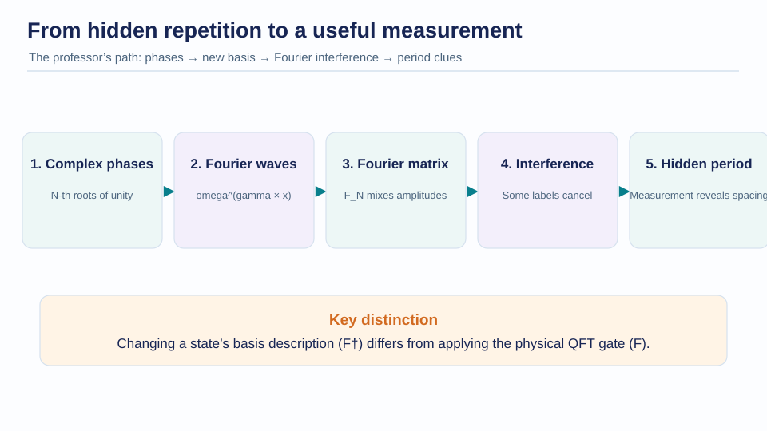

Begin with section 2 if symbols such as $|x\rangle$, $\omega$, $i$, $\otimes$ or $\langle u|v\rangle$ look unfamiliar. Otherwise, follow the professor from section 3 onward. Every animation opens in a browser without internet access.

## 2. Prerequisite Concepts

### 2.1 One bit, several bits, and the difference between $N$ and $k$

A classical bit has only two values: 0 and 1. A collection of three bits can encode eight different values:

| Binary | Decimal | Binary as an addition |
|---|---:|---|
| `000` | 0 | $0+0+0$ |
| `001` | 1 | $0+0+1$ |
| `010` | 2 | $0+2+0$ |
| `011` | 3 | $0+2+1$ |
| `100` | 4 | $4+0+0$ |
| `101` | 5 | $4+0+1$ |
| `110` | 6 | $4+2+0$ |
| `111` | 7 | $4+2+1$ |

If $k$ bits are available, there are $N=2^k$ possible binary strings. Conversely, when $N$ is a power of 2, $k=\log_2N$ qubits label $N$ computational-basis states. **Capital $N$ counts the basis states; lowercase $k$ counts the qubits.**

**Supplementary example:** $N=8$ corresponds to $k=3$ qubits, and the label $|5\rangle$ is shorthand for the computational basis state $|101\rangle$. It does *not* mean five separate qubits.

**Check Your Understanding:** How many basis states do four qubits have? Which binary string labels $|6\rangle$ when $N=8$?

### 2.2 Kets, amplitudes, probabilities and normalization

A single qubit can be written

$$|\psi\rangle=\alpha|0\rangle+\beta|1\rangle.$$

The vertical bars and angle brackets form **ket notation**, a compact label for a quantum state. $\alpha$ and $\beta$ are **complex amplitudes**, not probabilities themselves. The measurement probabilities in the $\{|0\rangle,|1\rangle\}$ basis are $|\alpha|^2$ and $|\beta|^2$. Therefore,

$$|\alpha|^2+|\beta|^2=1.$$

Why squares? An amplitude can be negative or complex; a probability must be a nonnegative real number. The absolute-value square $|a+bi|^2=a^2+b^2$ supplies that number.

**Step-by-step example:** Suppose $\alpha=1/\sqrt2$ and $\beta=i/\sqrt2$.

1. $|1/\sqrt2|^2=(1/\sqrt2)^2=1/2$.
2. $|i/\sqrt2|^2=(i/\sqrt2)^*(i/\sqrt2)=(-i)(i)/2=-i^2/2=1/2$.
3. The probabilities sum to $1/2+1/2=1$, so the state is normalized.
4. A computational-basis measurement produces 0 or 1, each with probability $1/2$, **not** the values $1/\sqrt2$ or $i/\sqrt2$.

For $k$ qubits, the general state has $N=2^k$ amplitudes:

$$|\psi\rangle=\sum_{x=0}^{N-1}\alpha_x|x\rangle,\qquad \sum_{x=0}^{N-1}|\alpha_x|^2=1.$$

The summation sign $\sum$ means: *add all the terms as $x$ runs through its listed values.*

**Common mistake:** A superposition is not a list of $N$ independent classical answers that can be read on demand. Measurement returns one outcome $x$, with probability $|\alpha_x|^2$.

**Check Your Understanding:** What does $|\alpha_x|^2$ tell us? Does a single measurement reveal all the $\alpha_x$ values?

### 2.3 Bras, inner products and complex conjugates

A ket is represented by a column. Its matching **bra** is the complex-conjugate transpose row. The symbol $^*$ means *replace $i$ by $-i$* in every coefficient, and $^\dagger$ means transpose *and* conjugate.

$$|\psi\rangle=\begin{bmatrix}\alpha\\\\\beta\end{bmatrix}
\quad\Longrightarrow\quad
\langle\psi|=\begin{bmatrix}\alpha^*&\beta^*\end{bmatrix}.$$

Multiply row by column:

$$\begin{aligned}
\langle\psi|\psi\rangle
&=\begin{bmatrix}\alpha^*&\beta^*\end{bmatrix}\begin{bmatrix}\alpha\\\\\beta\end{bmatrix}\\
&=\alpha^*\alpha+\beta^*\beta\\
&=|\alpha|^2+|\beta|^2\\
&=1\quad\text{for a normalized state}.
\end{aligned}$$

The complex conjugate is **essential**, not optional. For instance, the inner product of $(1,i)^T$ with itself (without conjugation) would wrongly give $1+i^2=0$ even though it is a nonzero vector. With conjugation the result is $1+(-i)i=2$; divide the vector by $\sqrt2$ to normalize it.

If two normalized states have $\langle u|v\rangle=0$, they are **orthogonal**: quantum measurement can perfectly distinguish them using a suitable basis. This is the fact used to prove that Fourier basis states are orthogonal.

**Check Your Understanding:** What is the conjugate of $-i$? Why would $i\cdot i$ be incorrect in a norm calculation?

### 2.4 Linear combination and tensor product

A **linear combination** means multiply vectors by coefficients and add them. A **tensor product** $\otimes$ combines two quantum systems; for basis states we use

$$|a\rangle\otimes|b\rangle=|ab\rangle.$$

For example,

$$\begin{aligned}
(|0\rangle+|1\rangle)\otimes(|0\rangle+|1\rangle)
&=|0\rangle|0\rangle+|0\rangle|1\rangle\\
&\qquad+|1\rangle|0\rangle+|1\rangle|1\rangle\\
&=|00\rangle+|01\rangle+|10\rangle+|11\rangle.
\end{aligned}$$

Each factor has length $\sqrt2$, so to make the **two-qubit state** normalized, divide the overall expression by 2:

$$|+\rangle\otimes|+\rangle=\frac12(|00\rangle+|01\rangle+|10\rangle+|11\rangle).$$

Later the lecture will perform this expansion **in reverse**: a sum of $N$ terms will be written as a product of just $k$ one-qubit states. That compact form is the key starting point for an efficient QFT circuit.

**Caution:** Not every quantum state factors into a tensor product; for example $(|00\rangle+|11\rangle)/\sqrt2$ is entangled. The special state $F_N|x\rangle$ *does* have the factorization shown later.

### 2.5 The complex plane and Euler's formula

A complex number has a real part and an imaginary part: $a+bi$, with $i^2=-1$. Draw $a$ horizontally and $b$ vertically. Numbers of length one lie on the **unit circle**:

$$e^{i\theta}=\cos\theta+i\sin\theta.$$

That tells us that $e^{i\theta}$ is an arrow at angle $\theta$ from the positive real axis. Some special positions:

| Angle | Complex number |
|---|---|
| $0$ | $1$ |
| $\pi/2=90^\circ$ | $i$ |
| $\pi=180^\circ$ | $-1$ |
| $3\pi/2=270^\circ$ | $-i$ |
| $2\pi=360^\circ$ | $1$ again |

We measure angles in **radians** in formulas: $2\pi$ radians equals one full turn ($360^\circ$). Multiplying two unit-length complex numbers **adds their angles**:

$$e^{ia}\,e^{ib}=e^{i(a+b)}.$$

**Supplementary example:** $i\cdot i=e^{i\pi/2}e^{i\pi/2}=e^{i\pi}=-1$. This will make Fourier matrix calculations much easier.

### 2.6 Modular arithmetic: counting on a clock

In arithmetic **modulo $N$**, whenever we go beyond $N-1$, we wrap back to zero. For example, modulo 8:

$$6+5=11\equiv3\pmod 8,\qquad 3\times5=15\equiv7\pmod 8.$$

Here $\equiv$ means *has the same remainder as*. Quantum Fourier transform works with the cyclic sequence $0,1,\ldots,N-1$, but each $x$ is still stored as a binary string on $k$ qubits.

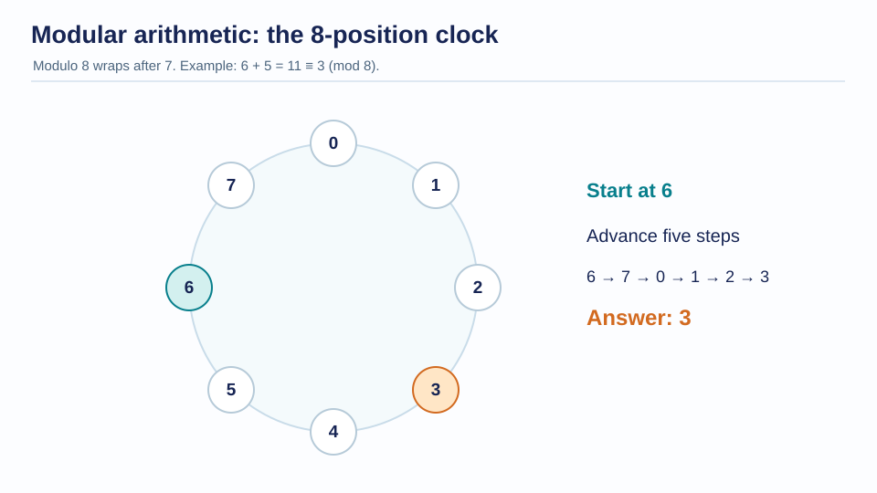

**Check Your Understanding:** Calculate $7+4\pmod8$. Why does an eighth root of unity return to 1 after eight steps?

### 2.7 The Hadamard gate as the familiar starting point

$$H=\frac1{\sqrt2}\begin{bmatrix}1&1\\\\1&-1\end{bmatrix},\qquad
H|0\rangle=|+\rangle=\frac{|0\rangle+|1\rangle}{\sqrt2},\qquad
H|1\rangle=|-\rangle=\frac{|0\rangle-|1\rangle}{\sqrt2}.$$

Think of $|+\rangle$ and $|-\rangle$ as two *different directions*, both formed from the same $|0\rangle$ and $|1\rangle$ basis vectors. The QFT generalizes their $+1$ and $-1$ coefficients to *many complex phases*.

---

## 3. Main Lecture Content — in the professor's order

### 3.1 Revisiting $+1$, $-1$ and the need for something more general

**Simple explanation.** In earlier algorithms, including Deutsch–Jozsa, Bernstein–Vazirani and Simon's algorithm, the Hadamard transform used signs $+1$ and $-1$ to make terms add or cancel. The professor starts this lecture by asking: *What takes the place of the two signs when our labels are numbers modulo $N$, rather than independent binary additions?*

**Why do we need this?** A hidden period in a sequence of ordinary numbers is more general than flipping a few individual bits. We need the same interference trick, but now the correct phases go all the way around a circle.

The previous pattern was $(-1)^b$ where $b=0$ gives $+1$ and $b=1$ gives $-1$. Both are **square roots of one**: $1^2=(-1)^2=1$. The natural generalization is the **$N$th roots of unity**, the complex numbers $z$ satisfying $z^N=1$.

**Analogy.** A two-position switch can be pointed right or left. Now replace it with a clock hand that can point in $N$ equally spaced directions. You can have more phase patterns without changing the lengths of your arrows.

**Connection:** This is the same intuition from the previous Part C lecture, now extended to the general QFT that was promised there.

**Common mistake:** $\pm1$ are **not** the only complex roots of unity. They are merely the roots for $N=2$ (and a subset for certain other $N$).

**Check Your Understanding:** What do $+1$ and $-1$ do in an interference calculation? Why might modulo-8 arithmetic require more than two phase values?

### 3.2 Where roots of unity come from

The professor reviews a function $\chi$ that turns **addition into multiplication**:

$$\boxed{\chi(x+y\bmod N)=\chi(x)\chi(y)}.$$

Take the candidate $\chi(x)=a^x$ for some nonzero complex number $a$. For ordinary integers, $a^{x+y}=a^xa^y$ holds automatically. For modulo-$N$ arithmetic, however, the label $N$ is treated as 0. Hence

$$\begin{aligned}
\chi(N\bmod N)&=\chi(0)\\
\chi(N)&=a^N\\
\chi(0)&=a^0=1.
\end{aligned}$$

To be consistent, we must require

$$\boxed{a^N=1}.$$

These values of $a$ are exactly the $N$th roots of unity. Define the first counterclockwise step

$$\boxed{\omega_N=e^{2\pi i/N}=\cos(2\pi/N)+i\sin(2\pi/N)}.$$

All $N$ possibilities are $\omega_N^0,\omega_N^1,\dots,\omega_N^{N-1}$, and $\omega_N^N=1$.

**Numerical example, $N=4$.** First calculate the angle $2\pi/4=\pi/2$. Therefore

$$\omega_4=e^{i\pi/2}=i.$$

Its powers are $i^0=1$, $i^1=i$, $i^2=-1$, $i^3=-i$, $i^4=1$ again. Exactly four distinct points lie on the circle.

**Numerical example, $N=8$.** $2\pi/8=\pi/4$, so

$$\omega_8=e^{i\pi/4}=\frac{1+i}{\sqrt2},\qquad
\omega_8^2=i,\qquad \omega_8^4=-1,\qquad\omega_8^8=1.$$

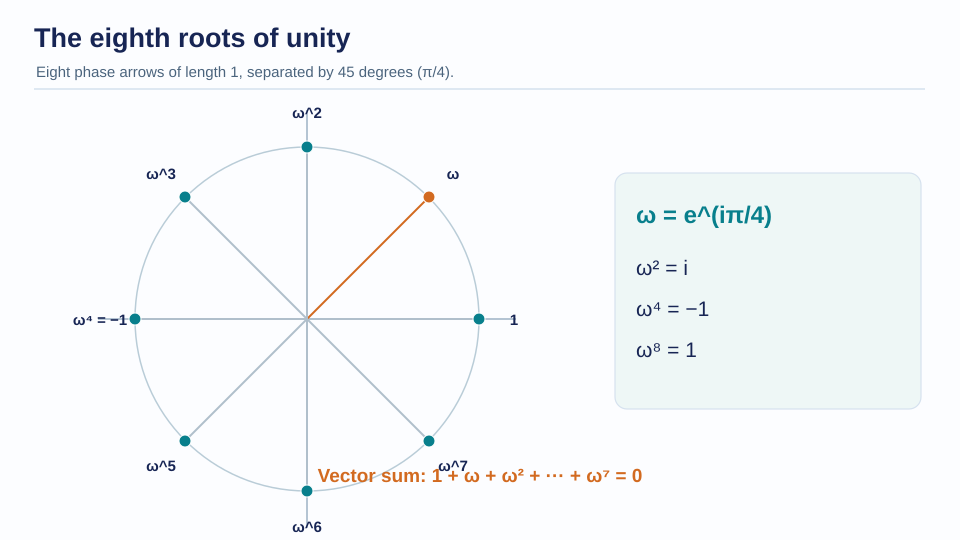

[Open animation 01: roots of unity, angle and repeated rotation](animations/animation_01.html).

**Why is their sum zero?** For $\omega_N\ne1$, the geometric sum is

$$S=1+\omega_N+\omega_N^2+\cdots+\omega_N^{N-1}.$$

Multiply by $\omega_N$:

$$\omega_NS=\omega_N+\omega_N^2+\cdots+\omega_N^{N}.$$

Subtract the two equations. Every middle term cancels:

$$S-\omega_NS=1-\omega_N^N=1-1=0.$$

Therefore $(1-\omega_N)S=0$. Because $\omega_N\ne1$, $1-\omega_N\ne0$, and hence

$$\boxed{\sum_{x=0}^{N-1}\omega_N^x=0\quad (N>1)}.$$

More generally, for any integer $m$,

$$\boxed{\sum_{x=0}^{N-1}\omega_N^{mx}=\begin{cases}N,&m\equiv0\pmod N,\\0,&m\not\equiv0\pmod N.\end{cases}}$$

This remains true even if $m$ shares a factor with $N$. The proof uses $z=\omega_N^m$: either $z=1$, giving $N$ ones, or the same geometric-series cancellation applies.

**Common mistake:** The sum is **not** zero when the chosen root equals 1; then the sum is $N$. And the sum of complex vectors is not the sum of their lengths—directions matter.

**Check Your Understanding:** What is $\omega_4^6$? What is $1+i-1-i$? What happens to $\sum_{x=0}^3\omega_4^{2x}$?

### 3.3 The family of character functions $\chi_\gamma$

The professor next defines not just one rotating phase pattern, but **one for every possible frequency label** $\gamma$:

$$\boxed{\chi_\gamma(x)=\omega_N^{\gamma x},\qquad\gamma=0,1,\ldots,N-1.}$$

**Simple explanation.** If $x$ tells you how far you have walked along a row of samples, $\gamma$ tells you *how quickly the phase arrow turns*. $\gamma=0$ means no turn; $\gamma=1$ means one full rotation over $N$ samples; $\gamma=2$ turns twice as quickly.

**Why do these qualify as characters?** Calculate both sides:

$$\begin{aligned}
\chi_\gamma(x+y)&=\omega_N^{\gamma(x+y)}\\
&=\omega_N^{\gamma x+\gamma y}\\
&=\omega_N^{\gamma x}\omega_N^{\gamma y}\\
&=\chi_\gamma(x)\chi_\gamma(y).
\end{aligned}$$

Because $\omega_N^N=1$, wrapping $x+y$ modulo $N$ does not change the result. Hence there are $N$ different functions with the desired property.

**Worked example, $N=8$, $\gamma=2$.** The phase at sample $x$ is $\omega_8^{2x}=e^{i\pi x/2}$. For $x=0,1,2,3,4$, the values are $1,i,-1,-i,1$. The pattern completes a circuit every four steps, so it goes around twice while $x$ runs from 0 through 7.

The lecture notes that one on-screen drawing accidentally used the **opposite turning direction**: $\omega_N^{-\gamma x}$ instead of $\omega_N^{+\gamma x}$. Both sign conventions are valid *when used consistently*. Throughout these notes, the **forward quantum transform** uses the **positive exponent**; the Fourier coordinate coefficients use the **negative exponent** (see sections 3.6–3.9).

[Open animation 02: characters, frequency and phase arrows](animations/animation_02.html).

**Common mistake:** $\omega_N^\gamma$ is a single complex number. $\chi_\gamma(x)=\omega_N^{\gamma x}$ is a *function of $x$*. These are related, but not interchangeable.

**Check Your Understanding:** For $N=8$ and $\gamma=0$, what is $\chi_0(x)$? How many full rotations does the phase make when $\gamma=3$?

### 3.4 Building new Fourier basis vectors

The computational basis is $|0\rangle,|1\rangle,\dots,|N-1\rangle$. These states are orthonormal: $\langle x|y\rangle=1$ if $x=y$ and 0 otherwise.

**Analogy.** You can describe the same physical arrow using horizontal/vertical directions or using two differently tilted axes. The vector has not changed; its coordinate description changes. In the QFT, the new axes are complex **wave-shaped directions** rather than everyday 2D arrows.

For each $\gamma$ define the Fourier vector

$$\boxed{|f_\gamma\rangle=\frac1{\sqrt N}\sum_{x=0}^{N-1}\omega_N^{\gamma x}|x\rangle.}$$

**Each piece:** $\gamma$ labels the new direction, $x$ runs over all old basis states, $\omega_N^{\gamma x}$ sets the relative phase for that state, and $1/\sqrt N$ ensures length one. A Fourier vector has **every** computational basis ket present with a complex phase, rather than only one ket as in the computational basis.

**Worked example $N=4$.** Here $\omega_4=i$ and $1/\sqrt4=1/2$.

$$\begin{aligned}
|f_0\rangle&=\tfrac12(|0\rangle+|1\rangle+|2\rangle+|3\rangle),\\
|f_1\rangle&=\tfrac12(|0\rangle+i|1\rangle-|2\rangle-i|3\rangle),\\
|f_2\rangle&=\tfrac12(|0\rangle-|1\rangle+|2\rangle-|3\rangle),\\
|f_3\rangle&=\tfrac12(|0\rangle-i|1\rangle-|2\rangle+i|3\rangle).
\end{aligned}$$

To check $f_3$, list $i^{3x}$ for $x=0,1,2,3$: $i^0=1$, $i^3=-i$, $i^6=-1$, and $i^9=i$. This **corrects an inconsistency** that the professor notices while trying to calculate $\langle f_1|f_3\rangle$ aloud.

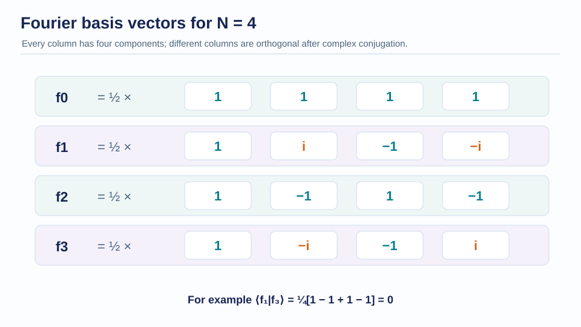

[Open animation 03: build and compare the four $F_4$ basis vectors](animations/animation_03.html).

**Check Your Understanding:** What is the coefficient of $|2\rangle$ in $|f_1\rangle$? Why does $|f_0\rangle$ contain no negative or imaginary coefficients?

### 3.5 Are the Fourier basis vectors really orthonormal?

The professor emphasizes that a different *basis* must still contain independent, normalized directions. Let us prove both parts without skipping the complex-conjugate step.

**Part A — Norm of $|f_\gamma\rangle$.** Start with the definition:

$$|f_\gamma\rangle=\frac1{\sqrt N}\sum_x\omega_N^{\gamma x}|x\rangle.$$

Take the conjugate transpose to get the bra:

$$\langle f_\gamma|=\frac1{\sqrt N}\sum_y(\omega_N^{\gamma y})^*\langle y|
=\frac1{\sqrt N}\sum_y\omega_N^{-\gamma y}\langle y|.$$

Why did the sign change? Since $\omega_N=e^{2\pi i/N}$ and $i^*=-i$, $(\omega_N^t)^*=\omega_N^{-t}$.

Now take the inner product:

$$\begin{aligned}
\langle f_\gamma|f_\gamma\rangle
&=\frac1N\sum_{y=0}^{N-1}\sum_{x=0}^{N-1}
\omega_N^{-\gamma y}\omega_N^{\gamma x}\langle y|x\rangle\\
&=\frac1N\sum_{x=0}^{N-1}\omega_N^{-\gamma x}\omega_N^{\gamma x}
\quad\text{(only $x=y$ survives)}\\
&=\frac1N\sum_{x=0}^{N-1}1\\
&=\frac1N\cdot N=1.
\end{aligned}$$

**Part B — Orthogonality of different labels.** For $\gamma\ne\sigma$,

$$\begin{aligned}
\langle f_\gamma|f_\sigma\rangle
&=\frac1N\sum_{x=0}^{N-1}\omega_N^{-\gamma x}\omega_N^{\sigma x}\\
&=\frac1N\sum_{x=0}^{N-1}\omega_N^{(\sigma-\gamma)x}\\
&=0,
\end{aligned}$$

because $\sigma-\gamma$ is not 0 modulo $N$, so the nontrivial root-of-unity sum vanishes (section 3.2). Combining these results:

$$\boxed{\langle f_\gamma|f_\sigma\rangle=\delta_{\gamma\sigma}}
\quad\text{where}\quad
\delta_{\gamma\sigma}=\begin{cases}1,&\gamma=\sigma,\\0,&\gamma\ne\sigma.\end{cases}$$

**Check the professor's troubled example explicitly:**

$$\begin{aligned}
\langle f_1|&=\tfrac12(\langle0|-i\langle1|-\langle2|+i\langle3|),\\
|f_3\rangle&=\tfrac12(|0\rangle-i|1\rangle-|2\rangle+i|3\rangle),\\
\langle f_1|f_3\rangle
&=\tfrac14\,[1+(-i)(-i)+(-1)(-1)+(i)(i)]\\
&=\tfrac14[1-1+1-1]=0.
\end{aligned}$$

Notice: the **bra** has coefficients $1,-i,-1,+i$, which is *not* the same coefficient list as the original $|f_1\rangle$. Dropping the conjugate is exactly how an incorrect nonzero answer can appear.

**Common mistakes:** (1) Forgetting to conjugate the first vector; (2) confusing “orthogonal” with “basis vectors have no overlapping kets”—the Fourier vectors overlap in every computational basis component but cancel in the inner product; (3) forgetting the factor $1/\sqrt N$.

**Check Your Understanding:** Why does the sum contain $\sigma-\gamma$ rather than $\sigma+\gamma$? What is $\langle f_2|f_2\rangle$?

### 3.6 Fourier coefficients: the *same state* in a new basis

Let an arbitrary state be

$$|\psi\rangle=\sum_{x=0}^{N-1}\alpha_x|x\rangle.$$

Because the Fourier vectors form an orthonormal basis, this **same vector** can be written as

$$|\psi\rangle=\sum_{\gamma=0}^{N-1}\widehat\alpha_\gamma|f_\gamma\rangle.$$

The hat in $\widehat\alpha_\gamma$ reads *Fourier coefficient*. It is a coordinate of the original state when using Fourier basis directions rather than computational basis directions.

**How do we obtain one coefficient?** Take the inner product with $\langle f_\gamma|$:

$$\begin{aligned}
\langle f_\gamma|\psi\rangle
&=\Big\langle f_\gamma\Big|\sum_{\sigma}\widehat\alpha_\sigma|f_\sigma\rangle\\
&=\sum_\sigma\widehat\alpha_\sigma\langle f_\gamma|f_\sigma\rangle\\
&=\widehat\alpha_\gamma,
\end{aligned}$$

since every term except $\sigma=\gamma$ vanishes. Now substitute the computational-basis formulas:

$$\begin{aligned}
\widehat\alpha_\gamma
&=\langle f_\gamma|\psi\rangle\\
&=\frac1{\sqrt N}\sum_{y,x}\omega_N^{-\gamma y}\alpha_x\langle y|x\rangle\\
&=\frac1{\sqrt N}\sum_{x=0}^{N-1}\alpha_x\omega_N^{-\gamma x}.
\end{aligned}$$

Therefore,

$$\boxed{\widehat\alpha_\gamma=\frac1{\sqrt N}\sum_{x=0}^{N-1}\alpha_x\omega_N^{-\gamma x}.}$$

**Why the minus sign?** It comes from turning the Fourier **ket** into the **bra**. This is the *coordinate change* convention for the basis vectors defined here.

**Reverse the formula.** Since the new basis states reconstruct the same state,

$$\begin{aligned}
|\psi\rangle
&=\sum_\gamma\widehat\alpha_\gamma |f_\gamma\rangle\\
&=\sum_\gamma\widehat\alpha_\gamma\frac1{\sqrt N}\sum_x\omega_N^{\gamma x}|x\rangle\\
&=\sum_x\left(\frac1{\sqrt N}\sum_\gamma\widehat\alpha_\gamma\omega_N^{\gamma x}\right)|x\rangle.
\end{aligned}$$

Compare the coefficient of $|x\rangle$ with the original $\alpha_x$:

$$\boxed{\alpha_x=\frac1{\sqrt N}\sum_{\gamma=0}^{N-1}\widehat\alpha_\gamma\omega_N^{\gamma x}.}$$

**Example, $N=2$:** Take $|\psi\rangle=|0\rangle$, so $(\alpha_0,\alpha_1)=(1,0)$ and $\omega_2=-1$. Then

$$\widehat\alpha_0=\tfrac1{\sqrt2}(1+0)=\tfrac1{\sqrt2},\qquad
\widehat\alpha_1=\tfrac1{\sqrt2}(1-0)=\tfrac1{\sqrt2}.$$

Thus $|0\rangle=(|+\rangle+|-\rangle)/\sqrt2$. It is **one unchanged state**, expressed in different coordinates.

**Preservation of length:** A unitary basis change preserves the sum of absolute-square amplitudes:

$$\boxed{\sum_x|\alpha_x|^2=\sum_\gamma|\widehat\alpha_\gamma|^2=1.}$$

This is the quantum version of Parseval's identity, not “the sum of absolute values equals 1.”

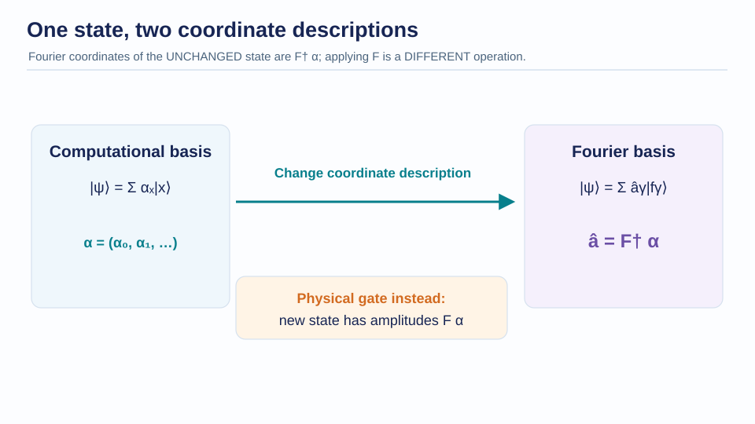

[Open animation 04: coordinate change and the Fourier coefficient](animations/animation_04.html).

**Common mistake:** Writing $\widehat\alpha_\gamma=\sum_x\alpha_x\omega^{+\gamma x}/\sqrt N$ *while claiming it came from* $\langle f_\gamma|\psi\rangle$ as defined here. That would use the wrong sign. It can be a legitimate **different Fourier convention**, but both directions must be changed consistently.

**Check Your Understanding:** Which formula contains $\omega^{-\gamma x}$? What is the physical distinction between changing a state's coordinates and applying a quantum gate to it?

### 3.7 Discrete Fourier transform and the sign convention

**Simple explanation.** A **discrete Fourier transform (DFT)** takes a list of $N$ complex numbers and mixes them into another list of $N$ complex numbers. Each output is a weighted sum of all the inputs. The weights are equally spaced phase arrows, so some terms reinforce and others cancel.

We need to distinguish two mathematically related operations:

- **Constructing a Fourier state / applying the positive-sign QFT:** $F_N|x\rangle=|f_x\rangle$, with $+\gamma x$ in the exponent.
- **Reading the coordinates of the *unchanged* state in the Fourier basis:** $\widehat\alpha=F_N^\dagger\alpha$, with $-\gamma x$ in the exponent.

Both are Fourier transforms in common language; the difference is which direction one calls “forward”. The lecture acknowledges that books sometimes reverse the sign convention. **We follow the lecturer's construction of $F_N$ with the positive exponent**, while writing Fourier *coordinate* coefficients with the negative exponent.

**Why does the distinction matter?** For $N=2$, $H=H^\dagger$, so the difference is invisible. For $N\ge4$, a typical QFT matrix is not its own inverse. Mixing the two would produce wrong phases and wrong circuit interpretations.

**Check Your Understanding:** If $|\psi\rangle$ has amplitudes $\alpha$, which matrix gives its Fourier-basis coordinates? What matrix takes $|2\rangle$ to $|f_2\rangle$?

### 3.8 The Fourier matrix $F_N$ — build each entry carefully

The $N\times N$ matrix $F_N$ has entry in **row $y$**, **column $x$**

$$\boxed{(F_N)_{y,x}=\frac1{\sqrt N}\omega_N^{yx}.}$$

(The professor sometimes uses $\gamma$ for the column and $x$ for the row. Since the matrix is symmetric, the number is the same, but we keep row $y$ and column $x$ fixed to avoid indexing mistakes.)

**Why is this the right matrix?** Multiplying a matrix by a basis column $|x\rangle$ simply selects its column $x$. That column is

$$\frac1{\sqrt N}\begin{bmatrix}
\omega_N^{0x}\\\\\omega_N^{1x}\\\\\vdots\\\\\omega_N^{(N-1)x}
\end{bmatrix},$$

which is precisely the coordinate column of $|f_x\rangle$. Hence $F_N|x\rangle=|f_x\rangle$.

**Work through $F_4$.** Here $\omega_4=i$ and $1/\sqrt4=1/2$. Write row and column labels 0,1,2,3. For example, row 3, column 2 has entry

$$\tfrac12\omega_4^{3\cdot2}=\tfrac12 i^6=-\tfrac12.$$

Row 1, column 3 has entry

$$\tfrac12\omega_4^{1\cdot3}=\tfrac12 i^3=-\tfrac{i}{2}.$$

Filling all entries gives

$$\boxed{F_4=\frac12\begin{bmatrix}
1&1&1&1\\\\
1&i&-1&-i\\\\
1&-1&1&-1\\\\
1&-i&-1&i
\end{bmatrix}.}$$

**What about $F_2$?** With $\omega_2=-1$,

$$F_2=\frac1{\sqrt2}\begin{bmatrix}1&1\\\\1&-1\end{bmatrix}=H.$$

But $F_4\ne H\otimes H$. To see this, $H\otimes H$ has only **real** entries $+1/2$ or $-1/2$. $F_4$ has **imaginary** entries $+i/2$ and $-i/2$, so they cannot be the same matrix.

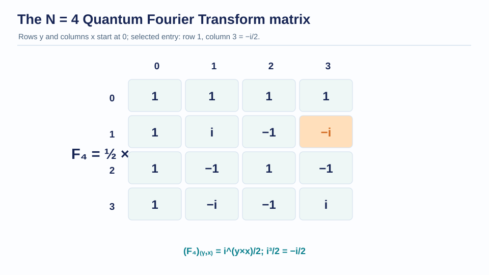

[Open animation 05: find any $F_4$ matrix entry and transform a basis ket](animations/animation_05.html).

**Common mistakes:** (1) Start row/column numbering at 1 instead of 0; (2) forget to divide by $\sqrt N$; (3) assume $F_4=H\otimes H$ just because both act on two qubits.

**Check Your Understanding:** What is $F_4$ at row 2, column 1? Why does column zero contain four ones before normalization?

### 3.9 The inverse, unitarity and a useful correction

The Fourier basis states are orthonormal, so the columns of $F_N$ are orthonormal. A matrix with this property is **unitary**:

$$\boxed{F_N^\dagger F_N=F_NF_N^\dagger=I.}$$

Thus its inverse is the conjugate transpose:

$$\boxed{F_N^{-1}=F_N^\dagger,\qquad(F_N^\dagger)_{y,x}=\frac1{\sqrt N}\omega_N^{-yx}.}$$

For $F_4$, simply replace $i$ with $-i$ in the matrix (the transpose changes nothing because this particular matrix is symmetric):

$$F_4^\dagger=\frac12\begin{bmatrix}
1&1&1&1\\\\
1&-i&-1&i\\\\
1&-1&1&-1\\\\
1&i&-1&-i
\end{bmatrix}.$$

**Check the inverse on a column.** $F_4|1\rangle=\tfrac12(1,i,-1,-i)^T$. Apply $F_4^\dagger$. Its row 1 is $\tfrac12(1,-i,-1,i)$. Dot with the column:

$$\frac14[1+(-i)(i)+(-1)(-1)+(i)(-i)]=\frac14[1+1+1+1]=1.$$

The other rows produce 0; the final vector is $|1\rangle$ again.

**Correction to a hesitant comment in the lecture.** The professor declines to derive what power of $F_N$ becomes the identity. The general identity for this normalized **positive-sign** DFT is

$$\boxed{F_N^2|x\rangle=|-x\bmod N\rangle,\qquad F_N^4=I.}$$

Here is why: the amplitude at $|z\rangle$ after two transforms is

$$\begin{aligned}
\langle z|F_N^2|x\rangle
&=\sum_{y=0}^{N-1}(F_N)_{z,y}(F_N)_{y,x}\\
&=\frac1N\sum_{y=0}^{N-1}\omega_N^{y(z+x)}\\
&=\begin{cases}1,&z+x\equiv0\pmod N,\\0,&\text{otherwise}.
\end{cases}
\end{aligned}$$

So two applications **reflect the basis label**. Two more reverse that reflection. For $N=2$, reflection $-x\bmod2$ equals $x$, so $F_2^2=H^2=I$. For $N=4$, $F_4^2|1\rangle=|3\rangle$, not $|1\rangle$.

**Check Your Understanding:** What matrix reverses $F_4$? What does $F_8^2|3\rangle$ produce?

### 3.10 The professor's $F_8|0\rangle$ and $F_8|3\rangle$ examples

Set $N=8$ and $\omega=\omega_8=e^{i\pi/4}$. By the column formula,

$$F_8|0\rangle=\frac1{\sqrt8}(|0\rangle+|1\rangle+\cdots+|7\rangle).$$

Why? Every phase is $\omega^{0\cdot y}=1$.

For $|3\rangle$ the phase in output position $y$ is $\omega^{3y}$. Compute the exponent $3y$, reduce modulo 8, and fill it in:

| $y$ | $3y$ | $3y\bmod8$ | amplitude before $1/\sqrt8$ |
|---:|---:|---:|---|
|0|0|0|$1$|
|1|3|3|$\omega^3$|
|2|6|6|$\omega^6$|
|3|9|1|$\omega$|
|4|12|4|$\omega^4=-1$|
|5|15|7|$\omega^7$|
|6|18|2|$\omega^2=i$|
|7|21|5|$\omega^5$|

Thus

$$\boxed{F_8|3\rangle=\frac1{\sqrt8}(|0\rangle+\omega^3|1\rangle+\omega^6|2\rangle+\omega|3\rangle+\omega^4|4\rangle+\omega^7|5\rangle+\omega^2|6\rangle+\omega^5|7\rangle).}$$

All eight amplitudes have magnitude $1/\sqrt8$ because $|\omega^t|=1$. Therefore every computational-basis measurement outcome $y$ has probability $1/8$, whether the input was $|0\rangle$ or $|3\rangle$.

**Big insight:** Different initial basis states produce **different phase patterns** but **identical probabilities** after one QFT. The phase information can still matter to later interference, even when it is invisible in this immediate measurement.

**Common mistake:** “Same probabilities” does **not** mean “same quantum state”. $F_8|0\rangle$ and $F_8|3\rangle$ are orthogonal, distinguishable in the right basis (e.g., by applying $F_8^\dagger$ before measuring).

**Check Your Understanding:** Why does $F_8|3\rangle$ have magnitude-one phase factors? Can we identify whether the input was 0 or 3 merely by measuring after one QFT?

### 3.11 What a single spike looks like after the QFT

The lecturer draws a **single spike**: before applying $F_N$, the state is exactly $|x_0\rangle$, so its probability distribution has value 1 at $x_0$ and zero everywhere else. After the QFT, all $N$ measurement probabilities are $1/N$.

$$\begin{aligned}
|x_0\rangle&\xrightarrow{F_N}\frac1{\sqrt N}\sum_{y=0}^{N-1}\omega_N^{x_0y}|y\rangle,\\
P(y)&=\left|\tfrac1{\sqrt N}\omega_N^{x_0y}\right|^2=\frac1N.
\end{aligned}$$

**Analogy:** A perfectly localized pluck of a string excites many frequencies. Here a basis state concentrated at one label becomes spread over all Fourier labels, with different phases that encode where it started.

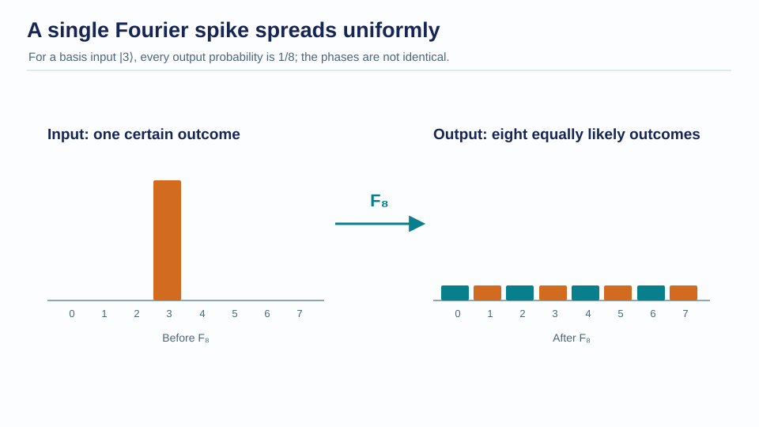

**Check Your Understanding:** If an eight-outcome register starts in $|5\rangle$, which outcomes are possible after one $F_8$? What is the probability of each?

### 3.12 Two spikes: the interference becomes visible

Now we follow the lecturer's most important numerical experiment. Take the normalized two-spike state

$$|\psi_+\rangle=\frac{|0\rangle+|4\rangle}{\sqrt2},\quad N=8.$$

Initially, a measurement gives 0 or 4, each with probability $1/2$. Use **linearity** ($F$ of a sum is the sum of $F$ of each term):

$$\begin{aligned}
F_8|\psi_+\rangle
&=\tfrac1{\sqrt2}(F_8|0\rangle+F_8|4\rangle)\\
&=\frac1{\sqrt2}\frac1{\sqrt8}\sum_{y=0}^{7}
\left(\omega^{0\cdot y}+\omega^{4y}\right)|y\rangle\\
&=\frac14\sum_{y=0}^7[1+\omega^{4y}]|y\rangle\\
&=\frac14\sum_{y=0}^7[1+(-1)^y]|y\rangle.
\end{aligned}$$

We used $\omega_8^4=-1$. Check separately:

- If $y$ is **even**, $(-1)^y=+1$, so the amplitude is $(1+1)/4=1/2$.
- If $y$ is **odd**, $(-1)^y=-1$, so the amplitude is $(1-1)/4=0$.

Therefore,

$$\boxed{F_8\frac{|0\rangle+|4\rangle}{\sqrt2}=\frac{|0\rangle+|2\rangle+|4\rangle+|6\rangle}{2}.}$$

Each of the four surviving outcomes has probability $(1/2)^2=1/4$. Total probability $4\cdot1/4=1$. The odd positions **cancel exactly**. This is quantum interference, made visible as a pattern of likely outcomes.

**Flip the relative sign.** Now take $|\psi_-\rangle=(|0\rangle-|4\rangle)/\sqrt2$. Repeating the calculation gives $(1-(-1)^y)/4$. Odd values survive, even values cancel:

$$\boxed{F_8\frac{|0\rangle-|4\rangle}{\sqrt2}=\frac{|1\rangle+|3\rangle+|5\rangle+|7\rangle}{2}.}$$

This is **not** obtained by removing a minus sign after measurement. The sign is a *relative phase in the input superposition*, and the QFT converts that phase into a completely different distribution of outcomes.

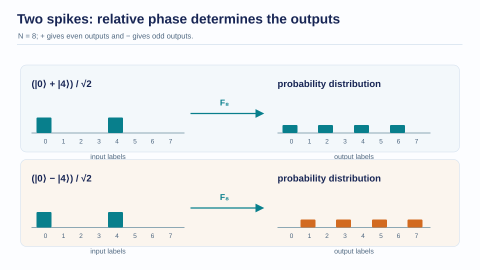

[Open animation 06: step through two-spike constructive and destructive interference](animations/animation_06.html).

**Common mistake:** Treating the $1/\sqrt2$ in the input as though it has no effect. Both the input normalization and QFT normalization contribute to the final amplitude $1/4[1+(-1)^y]$.

**Check Your Understanding:** What probabilities does $F_8(|0\rangle-|4\rangle)/\sqrt2$ assign to $|3\rangle$ and $|4\rangle$? What single mathematical expression accounts for cancellation?

### 3.13 Shift the two spikes: phases change, not the output positions

The professor asks what happens if the two input spikes shift from $0,4$ to $1,5$. You might expect the Fourier output spikes to shift as well, but they **do not**.

Start with

$$|\psi_{\mathrm{shift}}\rangle=\frac{|1\rangle+|5\rangle}{\sqrt2}.$$

The output amplitude at $|y\rangle$ is

$$\begin{aligned}
A_y&=\frac14\left(\omega^{y}+\omega^{5y}\right)\\
&=\frac14\omega^y(1+\omega^{4y})\\
&=\frac14\omega^y(1+(-1)^y).
\end{aligned}$$

The same even $y$ values survive, while every surviving amplitude is additionally multiplied by $\omega^y$:

$$F_8|\psi_{\mathrm{shift}}\rangle
=\frac12\left(|0\rangle+\omega^2|2\rangle+\omega^4|4\rangle+\omega^6|6\rangle\right).$$

Since $\omega^2=i$, $\omega^4=-1$, $\omega^6=-i$, this is

$$\boxed{\frac12(|0\rangle+i|2\rangle-|4\rangle-i|6\rangle).}$$

The probability distribution remains $1/4$ at 0, 2, 4 and 6. **A shift in input location produces a changing phase across the same output frequencies**, not a shift in their positions.

**Check Your Understanding:** Why do the odd outputs still vanish for input $|1\rangle+|5\rangle$? What is the modulus squared of the amplitude $i/2$?

### 3.14 The general periodic pattern: from $N/r$ spikes to $r$ spikes

The lecturer now generalizes from two spikes to a repeating **comb** of spikes. Let $r$ be a positive integer that divides $N$, and set $m=N/r$. There are $m$ equally spaced input positions $0,r,2r,\dots,(m-1)r$.

Make the input state normalized:

$$\boxed{|\psi_r\rangle=\frac1{\sqrt m}\sum_{\ell=0}^{m-1}|\ell r\rangle
=\sqrt{\frac rN}\sum_{\ell=0}^{N/r-1}|\ell r\rangle.}$$

Why $1/\sqrt m$? There are $m$ different basis states, each with amplitude $1/\sqrt m$; the probability sum is $m\cdot(1/m)=1$.

To compute the amplitude of output $|y\rangle$:

$$\begin{aligned}
A_y&=\langle y|F_N|\psi_r\rangle\\
&=\frac1{\sqrt N}\frac1{\sqrt m}\sum_{\ell=0}^{m-1}\omega_N^{y\ell r}\\
&=\frac1{\sqrt{Nm}}\sum_{\ell=0}^{m-1}e^{2\pi i y\ell/m}.
\end{aligned}$$

Now use our roots-of-unity sum from section 3.2. If $y$ is a multiple of $m=N/r$, then $e^{2\pi i y/m}=1$ and every term is 1; the sum is $m$. Otherwise, the terms go around the unit circle and cancel to 0:

$$A_y=\begin{cases}
\frac{m}{\sqrt{Nm}}=\sqrt{m/N}=\frac1{\sqrt r},&y\equiv0\pmod m,\\
0,&\text{otherwise}.
\end{cases}$$

Therefore the **exact result** is

$$\boxed{F_N|\psi_r\rangle
=\frac1{\sqrt r}\sum_{j=0}^{r-1}\left|j\frac Nr\right\rangle.}$$

**Interpretation.** The input has $N/r$ spikes spaced $r$ apart. The output has $r$ spikes spaced $N/r$ apart. **Input spacing and output spacing swap roles.** We have not magically read every amplitude; we have created a distribution from which measurements can reveal a likely *multiple of the reciprocal spacing*.

**Worked example 1:** $N=8,r=4$. Input has two spikes, $|0\rangle$ and $|4\rangle$, each normalized by $1/\sqrt2$. Output has $r=4$ spikes at $0,2,4,6$ with amplitude $1/2$.

**Worked example 2:** $N=16,r=8$. Input has $16/8=2$ spikes at $0,8$ with amplitudes $1/\sqrt2$. Output has eight spikes at $0,2,4,6,8,10,12,14$, each with amplitude $1/\sqrt8$. The professor accidentally says “9” while enumerating the even values; **the correct list contains only even positions**.

**Worked example 3:** $N=16,r=4$. Input state is $(|0\rangle+|4\rangle+|8\rangle+|12\rangle)/2$. Output is $(|0\rangle+|4\rangle+|8\rangle+|12\rangle)/2$; this particular evenly spaced comb is its own Fourier image.

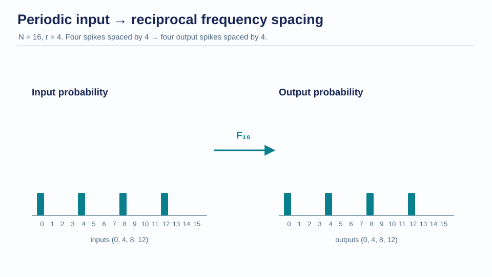

[Open animation 07: change $N$, period $r$ and spike offset](animations/animation_07.html).

**Important limitation:** This *clean* rule assumes $r$ divides $N$ exactly and the inputs have equal amplitudes at all those periodic positions. With a truncated period or an irregular pattern, the spectrum can have multiple peaks with nonzero values between them; that is the richer situation addressed in actual period-finding algorithms later.

**Check Your Understanding:** If $N=16$ and $r=2$, how many input spikes are there, and how many output spikes? Why is the output amplitude $1/\sqrt r$ instead of 1?

### 3.15 A general shifted periodic comb

The professor connects the shift example $0,4\mapsto1,5$ to a general rule. Let $s$ be an integer offset and define

$$|\psi_{r,s}\rangle=\frac1{\sqrt m}\sum_{\ell=0}^{m-1}|(s+\ell r)\bmod N\rangle,\qquad m=N/r.$$

At output $y$:

$$\begin{aligned}
\langle y|F_N|\psi_{r,s}\rangle
&=\frac1{\sqrt{Nm}}\sum_\ell\omega_N^{y(s+\ell r)}\\
&=\omega_N^{ys}\frac1{\sqrt{Nm}}\sum_\ell\omega_N^{yr\ell}.
\end{aligned}$$

The second factor gives exactly the same *surviving positions* as before. The first factor $\omega_N^{ys}$ adds a **phase** depending on $y$ and $s$:

$$\boxed{F_N|\psi_{r,s}\rangle=\frac1{\sqrt r}\sum_{j=0}^{r-1}\omega_N^{s jN/r}\left|j\frac Nr\right\rangle.}$$

**Why useful?** The quantum algorithm may collapse to a periodic sequence beginning at an unknown location. It can still learn the spacing without first knowing the starting point, because the output **probabilities** do not depend on $s$ in this ideal case.

**Common mistakes:** (1) Assuming a shifted input produces shifted frequencies; (2) assuming the shift is completely irrelevant—it changes the output *state's phases*, even though probabilities are unchanged.

**Check Your Understanding:** What changes in the result when $s$ changes? Which part remains invariant?

### 3.16 Connection back to Simon's algorithm and forward to period finding

The lecture makes the conceptual link explicit:

| Earlier: Simon's problem | Here: cyclic period finding |
|---|---|
| Hidden symmetry $f(x)=f(x\oplus s)$ | Hidden periodicity $f(x)=f(x+r\bmod N)$ |
| Arithmetic uses bitwise XOR ($\oplus$) | Arithmetic uses integer addition modulo $N$ |
| Interference uses Hadamards $H^{\otimes k}$ | Interference uses $F_N$ and complex phases |
| Surviving labels satisfy $s\cdot z=0\pmod2$ | Surviving Fourier labels are related to reciprocal periodic spacing |
| Measure and solve binary equations | Measure and later use classical number theory/continued fractions (future lecture) |

**Simple explanation.** A function may be hard to understand from a few direct input/output samples. But if its values repeat, quantum superposition followed by interference can convert the hidden repetition into a useful output pattern.

**Preview of factoring (not a complete factoring lesson).** The professor mentions powers modulo 15, such as $7^x\bmod15$. Here is a **supplementary numerical example** to connect the dots:

| $x$ | $7^x\bmod15$ |
|---:|---:|
|0|1|
|1|7|
|2|4|
|3|13|
|4|1|
|5|7|

The pattern repeats with period 4 because $7^4\equiv1\pmod{15}$. Once period 4 is known, $7^{4/2}=49$ and

$$\gcd(49-1,15)=\gcd(48,15)=3,\qquad
\gcd(49+1,15)=\gcd(50,15)=5.$$

We have recovered factors 3 and 5 of 15. This is *one favorable example*; Shor's algorithm has additional conditions and retries and was **not fully taught in this lecture**.

**Check Your Understanding:** What is the hidden feature that the Fourier transform is meant to reveal? What would be difficult if the values did not repeat at all?

### 3.17 Why $\log_2N$ qubits matter more than $N$ amplitudes

The professor temporarily shifts from Fourier formulas to the **size of the problem**. The QFT on $N$ basis labels operates on $k=\log_2N$ qubits when $N=2^k$. For example, a 50-qubit register has $2^{50}$ basis amplitudes—but **only 50 physical quantum wires** in an abstract circuit model.

**Analogy:** A classical table with one value per possible 50-bit string is unimaginably large. A quantum state can be described mathematically by such a list of amplitudes, but the device operates on the *whole state* through a small number of gates, without storing a classical table in the usual sense.

**Important distinction: efficiency vs reading output.** An exact $k$-qubit QFT circuit uses $O(k^2)$ standard one- and two-qubit gates (discussed further in section 3.20). That is exponentially smaller than explicitly writing $N=2^k$ transformed coefficients, **but it does not give you those $N$ numbers on a classical printout**. One measurement returns one label, not its complex amplitude. The QFT is valuable when an algorithm arranges for that single label, or a small number of sampled labels, to reveal a useful feature such as a period.

**Professor's complexity analogy:** Trying every divisor of a large integer makes a program take time related to the **value** of the integer, which is exponential in its number of digits. Euclid's algorithm, by contrast, computes greatest common divisors efficiently using the representation's number of digits. The lecturer uses this contrast to motivate algorithms whose cost depends on bit length. As a precision note, the common general-purpose *classical* factoring algorithms are better than naive trial division; the relevant fact is that no polynomial-time classical factoring algorithm is currently known.

**Check Your Understanding:** How many qubits are needed to represent 16 computational basis labels? Why is an exponentially compact quantum state not automatically an exponentially large readable answer?

### 3.18 The phase gate $R_j$ and its controlled version

The professor introduces the actual building block that will eventually implement the QFT. Define

$$\boxed{R_j=\begin{bmatrix}1&0\\\\0&e^{2\pi i/2^j}\end{bmatrix}.}$$

This is a **single-qubit phase gate**. It leaves $|0\rangle$ untouched while adding phase to $|1\rangle$:

$$\begin{aligned}
R_j|0\rangle&=|0\rangle,\\
R_j|1\rangle&=e^{2\pi i/2^j}|1\rangle,\\
R_j(\alpha|0\rangle+\beta|1\rangle)&=\alpha|0\rangle+e^{2\pi i/2^j}\beta|1\rangle.
\end{aligned}$$

**Examples, one at a time:**

| Gate | Phase on $\lvert 1\rangle$ | Familiar name |
|---|---|---|
|$R_1$|$e^{i\pi}=-1$|$Z$|
|$R_2$|$e^{i\pi/2}=i$|$S$|
|$R_3$|$e^{i\pi/4}$|$T$|
|$R_4$|$e^{i\pi/8}$|smaller phase rotation|

**Numerical example:** Apply $R_2$ to $|+\rangle=(|0\rangle+|1\rangle)/\sqrt2$:

$$R_2|+\rangle=\frac1{\sqrt2}(|0\rangle+i|1\rangle).$$

The computational measurement probabilities are still $1/2,1/2$; only the **relative phase** has changed.

A **controlled-$R_j$** acts on two qubits. The first is the control, the second the target. It adds the phase only when **both qubits are 1**:

$$\boxed{CR_j=\operatorname{diag}(1,1,1,e^{2\pi i/2^j})}$$

in the ordered basis $|00\rangle,|01\rangle,|10\rangle,|11\rangle$. For instance, $CR_2|11\rangle=i|11\rangle$, while $CR_2|10\rangle=|10\rangle$.

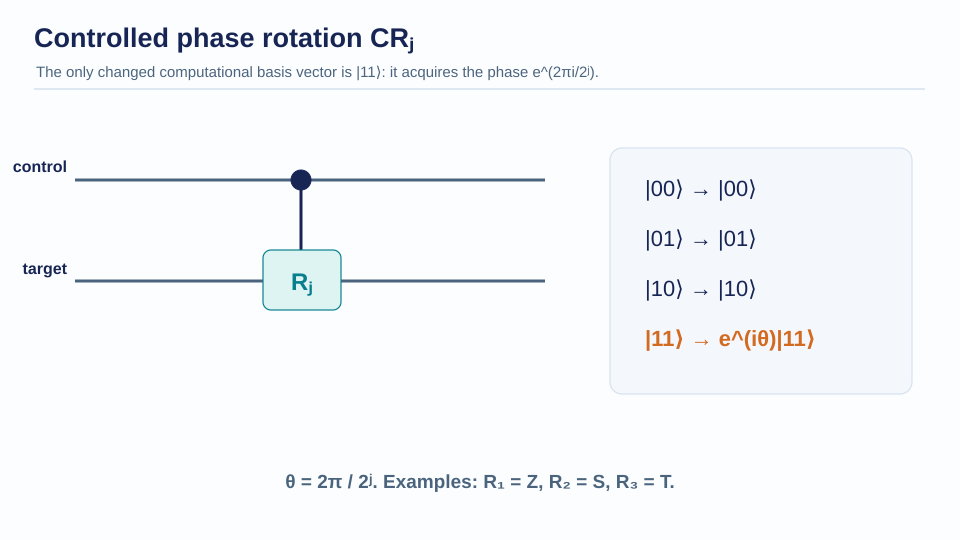

[Open animation 08: phase and controlled phase gates](animations/animation_08.html).

**Common mistake:** A phase gate does not flip $|1\rangle$ into $|0\rangle$. It multiplies the amplitude attached to $|1\rangle$ by a complex unit-length number. Even when both basis values are 1, the controlled gate changes the **phase**, not the bit values.

**Check Your Understanding:** Which $R_j$ equals the $S$ gate? What does controlled-$T$ do to $|01\rangle$ and $|11\rangle$?

### 3.19 What exactly must the QFT quantum circuit compute?

The lecturer now states the circuit-design task. A register contains the amplitudes of an arbitrary quantum state:

$$|\psi\rangle=\sum_{x=0}^{N-1}\alpha_x|x\rangle.$$

Apply **the positive-sign quantum transform $F_N$**:

$$\begin{aligned}
F_N|\psi\rangle
&=\sum_x\alpha_xF_N|x\rangle\\
&=\sum_x\alpha_x\frac1{\sqrt N}\sum_{y=0}^{N-1}\omega_N^{xy}|y\rangle\\
&=\sum_{y=0}^{N-1}\left[\frac1{\sqrt N}\sum_{x=0}^{N-1}\alpha_x\omega_N^{xy}\right]|y\rangle.
\end{aligned}$$

Define output amplitude $\alpha'_y$:

$$\boxed{\alpha'_y=\frac1{\sqrt N}\sum_{x=0}^{N-1}\alpha_x\omega_N^{xy}.}$$

**Read this slowly:** for each output label $y$, the circuit adds one contribution from *every input label $x$*, rotates its phase according to $xy$, and normalizes. The circuit performs all of this coherently, without measuring the input along the way.

**Remember the convention from section 3.6:** $\alpha'$ here equals $F_N\alpha$; the coordinates $\widehat\alpha$ of the **unchanged** state in the $|f_\gamma\rangle$ basis equal $F_N^\dagger\alpha$. The professor uses the phrase “Fourier coefficients” informally for both; the distinction prevents sign errors in worked problems.

**Check Your Understanding:** What does the output amplitude $\alpha'_0$ equal? Does the QFT circuit obtain each amplitude by first measuring $|\psi\rangle$?

### 3.20 Turn $N$ output terms into $k$ simple tensor factors

This is the final substantive mathematical derivation of the lecture. It is the bridge between the abstract $N\times N$ Fourier matrix and a circuit using only $k=\log_2N$ qubits.

Let $N=2^k$. The integer $x$ is encoded by $k$ **input bits**; for example, for $k=3$, $x=5$ is `101` because $5=4+0+1$.

For the output, choose the bit-order convention used in the professor's derivation:

$$y=2^{k-1}y_0+2^{k-2}y_1+\cdots+2y_{k-2}+y_{k-1},$$

where $y_0$ is the **most significant output bit**. These are output **bit labels**; they are not independent qubits that have already been measured.

Start from the QFT definition on one basis state:

$$F_N|x\rangle=\frac1{\sqrt N}\sum_{y=0}^{N-1}\omega_N^{xy}|y\rangle.$$

**Step 1 — Substitute the binary expansion of $y$.**

$$\omega_N^{xy}=\exp\left(\frac{2\pi i x}{2^k}\left[2^{k-1}y_0+2^{k-2}y_1+\cdots+y_{k-1}\right]\right).$$

**Step 2 — Distribute multiplication and split the exponential of a sum into a product.** Using $e^{a+b}=e^ae^b$,

$$\begin{aligned}
\omega_N^{xy}
&=\exp(2\pi ixy_0/2)\exp(2\pi ixy_1/4)\\
&\qquad\cdots\exp(2\pi ixy_{k-1}/2^k).
\end{aligned}$$

**Step 3 — Each output bit can only be zero or one.** In the first factor, if $y_0=0$, its contribution is 1 and its ket is $|0\rangle$. If $y_0=1$, its contribution is $e^{2\pi ix/2}$ and its ket is $|1\rangle$. Therefore summing over $y_0$ produces the one-qubit expression

$$|0\rangle+e^{2\pi ix/2}|1\rangle.$$

The same reasoning applies separately to every other output bit.

**Step 4 — Rewrite the sum over all $2^k$ bit strings as a tensor product.** Since $1/\sqrt N=1/2^{k/2}$,

$$\boxed{
F_{2^k}|x\rangle=
\bigotimes_{j=0}^{k-1}
\frac{|0\rangle+e^{2\pi ix/2^{j+1}}|1\rangle}{\sqrt2}.
}$$

The order of factors corresponds to $y_0,y_1,\dots,y_{k-1}$ (most significant output bit first). Each factor has length one, and the tensor product of the factors also has length one.

**Worked example: $k=3,N=8,x=5$.** We calculate the phase on each output qubit:

| Output factor | Angle | Complex phase |
|---|---|---|
| $j=0$ | $2\pi\cdot5/2=5\pi$ | $-1$ |
| $j=1$ | $2\pi\cdot5/4=5\pi/2$ | $i$ |
| $j=2$ | $2\pi\cdot5/8=5\pi/4$ | $(-1-i)/\sqrt2$ |

So

$$\boxed{F_8|5\rangle=
\frac{|0\rangle-|1\rangle}{\sqrt2}
\otimes\frac{|0\rangle+i|1\rangle}{\sqrt2}
\otimes\frac{|0\rangle+e^{5\pi i/4}|1\rangle}{\sqrt2}.}$$

**Verify one term**: the ket $|101\rangle$ corresponds to $y=5$, so the matrix definition predicts amplitude $\omega_8^{5\cdot5}/\sqrt8=e^{(25\pi i/4)}/\sqrt8=e^{\pi i/4}/\sqrt8$. From the product formula, choose $|1\rangle$ from factor 0, $|0\rangle$ from factor 1, and $|1\rangle$ from factor 2. Their phase is $(-1)e^{5\pi i/4}=e^{\pi i/4}$, with magnitude $1/\sqrt8$ after normalization. They match.

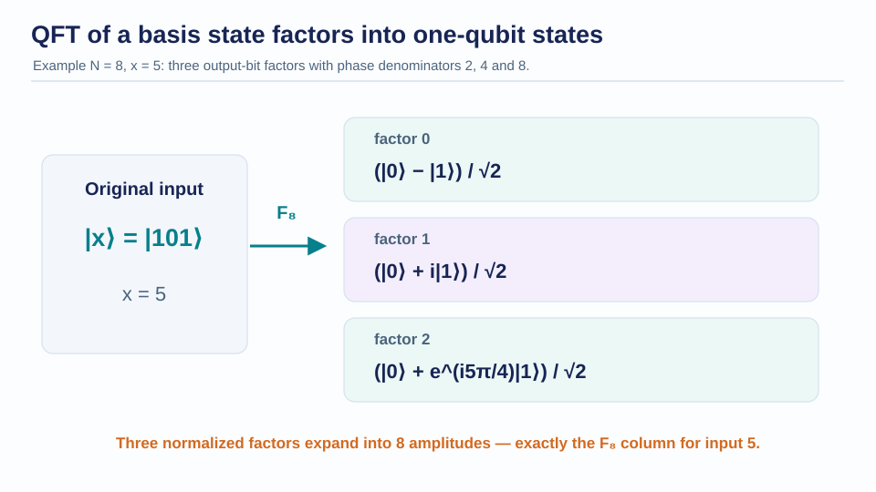

[Open animation 09: QFT product-state factorization, binary digits and phases](animations/animation_09.html).

**Key point:** The QFT output of an individual *basis state* factors into one-qubit states. An arbitrary superposition **after** QFT is not necessarily a product state. The lecture ends the main derivation here; the full gate-by-gate implementation is the next lecture's task.

**Common mistakes:** (1) Missing the $1/\sqrt2$ on each factor; (2) using the same bit significance convention for input and output without checking the lecturer's order; (3) claiming that all QFT outputs, including superpositions, are separable.

**Check Your Understanding:** Why can we split the exponential into a product? For $F_8|2\rangle$, what is the phase in the first output-qubit factor?

### 3.21 How the phase gates lead toward a small QFT circuit (preview)

**Lecture status: preview, not a derivation the professor completed today.** After writing the product formula, the professor shows that the required phases have denominators $2,4,8,\dots$. Those are exactly the kinds of phases supplied by $Z=R_1$, $S=R_2$, $T=R_3$, and their higher-$j$ relatives. Conditional phases are supplied by controlled-$R_j$.

The standard exact QFT construction on $k$ qubits uses $k$ Hadamard gates, $k(k-1)/2$ controlled phase rotations, and up to $\lfloor k/2\rfloor$ swaps to correct the output-bit order. That is $O(k^2)$ elementary operations. For $k=3$, this corresponds to three Hadamards, three controlled phase rotations and one final SWAP in the usual decomposition. This **extra note** prepares you for the next lecture; don't mistake it for the gate-by-gate proof presented in the lecture.

**Why is there a classical-output catch?** Even if these $O(k^2)$ gates act on $2^k$ amplitudes, a measurement returns one outcome with probability $|\alpha'_y|^2$. It does not print every $\alpha'_y$. Quantum algorithm design therefore has to turn a global Fourier structure into useful *sampling outcomes*.

[Open animation 10: QFT circuit building blocks and gate-count growth](animations/animation_10.html).

**Check Your Understanding:** What gate-count formula gives the number of controlled phase gates on four qubits? Does a small QFT circuit allow a single measurement to reveal all transformed amplitudes?

### 3.22 Questions and clarifications at the end of the lecture

The professor discusses several points in response to students:

- **“Do we need $N$ qubits?”** No. If $N=2^k$, the labels from 0 to $N-1$ fit into $k$ qubits.
- **“Why not directly compute all the Fourier coefficients?”** In a quantum state, the output amplitudes exist as a combined state, but measuring does not reveal their full list; you can sample output labels.
- **“Is this exponential speedup generic?”** No. The QFT is a structured unitary with a compact implementation. A generic large unitary typically requires many more gates.
- **“Does the number of primes below $N$ relate to the number of QFT qubits?”** These are different ideas. The approximate prime-counting relation is $\pi(N)\sim N/\ln N$, whereas the number of qubits needed for $N$ basis labels is $\log_2N$; the lecture does not assert a causal link.
- **“What about the earlier oracle $U_f$?”** This is a previous-topic review, not part of the QFT proof. A reversible oracle typically acts as $U_f|x\rangle|y\rangle=|x\rangle|y\oplus f(x)\rangle$. Its construction from $X$, CNOT and Toffoli gates depends on the specific $f$.
- **“What comes next?”** The professor assigns by-hand exercises on complex numbers, the matrix and tensor-product formula. The exact QFT circuit and period-finding applications are continued in a later session.

**A final intuition:** A QFT is a *way to listen for repetition in the amplitude phases*. The cleverness of a quantum algorithm is arranging for that repetition to correspond to an answer worth learning.

---

## 4. Important Formulas — with meaning and usage

| Formula | Meaning / when to use |
|---|---|
| $N=2^k$ | $k$ qubits have $N$ computational basis labels. E.g., $k=3\Rightarrow N=8$. |
| $\omega_N=e^{2\pi i/N}$ | First counterclockwise $N$th root of unity; $\omega_N^N=1$. |
| $\chi_\gamma(x)=\omega_N^{\gamma x}$ | A phase pattern / character on integer labels modulo $N$. |
| $\chi_\gamma(x+y)=\chi_\gamma(x)\chi_\gamma(y)$ | Addition of labels becomes multiplication of complex phases. |
| $\sum_{x=0}^{N-1}\omega_N^{mx}=N$ if $m\equiv0\pmod N$, otherwise $0$ | The cancellation rule behind Fourier orthogonality and interference. |
| $\lvert f_\gamma\rangle=N^{-1/2}\sum_x\omega_N^{\gamma x}\lvert x\rangle$ | The $\gamma$th Fourier basis vector. |
| $\langle f_\gamma\mid f_\sigma\rangle=\delta_{\gamma\sigma}$ | Fourier vectors have unit norm and are mutually orthogonal. |
| $\widehat\alpha_\gamma=N^{-1/2}\sum_x\alpha_x\omega_N^{-\gamma x}$ | Coordinate of the **unchanged** state along Fourier basis vector $f_\gamma$. |
| $\alpha_x=N^{-1/2}\sum_\gamma\widehat\alpha_\gamma\omega_N^{\gamma x}$ | Reconstruct computational coordinates from Fourier coordinates. |
| $(F_N)_{y,x}=N^{-1/2}\omega_N^{xy}$ | **Positive-sign** QFT matrix element. |
| $F_N\lvert x\rangle=\lvert f_x\rangle$ | Fourier transform of a basis label. |
| $\alpha'_y=N^{-1/2}\sum_x\alpha_x\omega_N^{xy}$ | Amplitude after physically applying $F_N$. |
| $F_N^{-1}=F_N^\dagger$ | QFT is unitary and reversible. |
| $F_N^2\lvert x\rangle=\lvert -x\bmod N\rangle$ | Two QFT applications invert a basis label; $F_N^4=I$. |
| $\lvert \psi_r\rangle=\sqrt{r/N}\sum_{\ell=0}^{N/r-1}\lvert \ell r\rangle$ | Ideal uniform periodic input, valid when $r\mid N$. |
| $F_N\lvert \psi_r\rangle=r^{-1/2}\sum_{j=0}^{r-1}\lvert jN/r\rangle$ | Reciprocal spacing: $N/r$ input spikes become $r$ output spikes. |
| $R_j=\mathrm{diag}(1,e^{2\pi i/2^j})$ | Phase on $\lvert 1\rangle$ by angle $2\pi/2^j$. |
| $CR_j=\mathrm{diag}(1,1,1,e^{2\pi i/2^j})$ | Two-qubit controlled phase, nontrivial only on $\lvert 11\rangle$. |
| $F_{2^k}\lvert x\rangle=\bigotimes_{j=0}^{k-1}(\lvert 0\rangle+e^{2\pi ix/2^{j+1}}\lvert 1\rangle)/\sqrt2$ | Compact Fourier output on a *basis state*; foundation for circuit synthesis. |

**How to use this card:** First identify which problem you have: **character? basis vector? coordinate change? actual physical transform? period detection?** The sign in the exponential depends on that choice. The examples in sections 3.4, 3.6, 3.8, 3.12 and 3.20 show the corresponding calculations from beginning to end.

## 5. Key Concepts Summary

1. Earlier Hadamard-based algorithms made patterns interfere using signs $+1$ and $-1$.
2. To work with integer labels around a modulo-$N$ clock, we use the $N$ equally spaced complex roots of unity.
3. A **character** $\omega_N^{\gamma x}$ turns modular addition into complex multiplication.
4. Using those phases, we create $N$ **Fourier basis vectors** $|f_\gamma\rangle$, all with length one and mutually orthogonal.
5. A fixed quantum state can have coordinates $\alpha_x$ in the computational basis and $\widehat\alpha_\gamma$ in the Fourier basis; both describe the same state.
6. The **positive-sign QFT matrix** $F_N$ maps $|x\rangle$ to $|f_x\rangle$. Its inverse is $F_N^\dagger$, which appears in the coordinate-change formula.
7. One basis spike becomes a uniform probability distribution after the QFT. Two or more spikes can interfere and create a **sparse spectrum**.
8. A uniform periodic pattern with $N/r$ spikes turns into $r$ output spikes. Shifting the input changes the output phases, not its output probabilities.
9. This is the same underlying strategy as Simon's algorithm: **use interference to reveal hidden structure**.
10. The tensor-product factorization shows how an $N$-term Fourier vector can be built from only $k=\log_2N$ simple factors. The exact gate-by-gate circuit follows in a later lecture.

## 6. Glossary

| Term | Simple meaning | Why it matters |
|---|---|---|
| Qubit | Quantum two-level system | $k$ qubits have $2^k$ basis states. |
| Basis | Independent directions used to describe a vector | Fourier change of basis is central. |
| Ket $\lvert x\rangle$ | Quantum state written as a column / label | Represents computational states. |
| Bra $\langle x\lvert $ | Conjugate-transposed ket | Needed for correct inner products. |
| Amplitude | Complex coefficient of a basis state | Its magnitude squared is a probability. |
| Phase | Angle of a complex amplitude | Determines constructive/destructive interference. |
| Global phase | Common multiplier of an entire state | Physically unobservable. |
| Relative phase | Difference between component phases | Can change interference and outcomes. |
| Tensor product | Combines quantum systems | Lets one write a state using several qubits. |
| Superposition | Sum of quantum basis states | Allows amplitudes to interfere. |
| $N$th root of unity | Complex number $z$ with $z^N=1$ | Supplies equally spaced phase choices. |
| $\omega_N$ | $e^{2\pi i/N}$ | Fundamental phase step. |
| Character | Function that maps addition to multiplication | Generates Fourier wave patterns. |
| Fourier vector | Wave-like new basis state | Replaces computational basis directions. |
| Orthonormal | Perpendicular and unit length | Makes basis-change coefficients simple. |
| DFT | Discrete Fourier transform | Converts coordinate lists between periodic representations. |
| QFT | Quantum implementation of a DFT-style unitary | Reveals hidden periodic structure by interference. |
| Unitary | Invertible norm-preserving quantum transformation | Ensures valid state evolution. |
| Conjugate transpose | Transpose plus $i\mapsto-i$ | Gives the inverse of a unitary matrix. |
| Fourier coefficient | Coordinate in a Fourier basis | Describes alignment with a wave-like direction. |
| Interference | Addition/cancellation of amplitudes | Suppresses some outputs, reinforces others. |
| Period $r$ | Step after which a pattern repeats | Main target of period finding. |
| Modular arithmetic | Arithmetic that wraps after $N-1$ | Describes the cyclic Fourier setting. |
| $R_j$ | Single-qubit phase gate | Supplies QFT phase rotations. |
| Controlled-$R_j$ | Conditional two-qubit phase gate | Supplies controlled phases in QFT circuits. |
| Oracle $U_f$ | Reversible implementation of a function | Reviewed as part of earlier algorithms. |

## 7. Practice Questions

The [practice workbook](practice/practice_questions.md) contains **conceptual, numerical, application and multiple-choice questions**, as well as **fully worked answers in a separate answer section**. It includes additional detailed exercises on the moments where the lecture is hardest: checking $\langle f_1|f_3\rangle$, computing Fourier matrix entries, proving the two-spike cancellation, and verifying the tensor factorization for $k=3$.

To prepare for an exam, try each question before looking at its explanation. Where a question uses a method beyond the exact lecture discussion, it is labeled **supplementary exercise**.

## 8. Final Revision Notes

**Minute 1 — Complex phases.** $\omega_N=e^{2\pi i/N}$ and $\omega_N^N=1$. Each $\omega_N^t$ is an arrow on the unit circle. Adding a full set of nontrivial roots gives 0.

**Minute 2 — Fourier basis.** $|f_\gamma\rangle=\frac1{\sqrt N}\sum_x\omega_N^{\gamma x}|x\rangle$. The states are orthonormal because the roots-of-unity sums vanish unless two labels match.

**Minute 3 — Two signs.** Physical QFT: $F_N|x\rangle=|f_x\rangle$ uses $+$ in the exponent. Coordinates of the *same* state in that Fourier basis: $\widehat\alpha=F_N^\dagger\alpha$ uses $-$.

**Minute 4 — Patterns.** Single input spike $\to$ all output probabilities equal. Pair $|0\rangle\pm|4\rangle$ for $N=8$ $\to$ even or odd output labels. Uniform periodic spacing $r$ $\to$ spacing $N/r$.

**Minute 5 — Circuits.** $R_1=Z$, $R_2=S$, $R_3=T$. For $N=2^k$, the basis-output $F_N|x\rangle$ factors into $k$ one-qubit states; controlled phase gates allow a compact circuit. **The full circuit derivation is next lecture.**

**Five errors to avoid:** Forgetting normalization; using a bra without conjugation; confusing $F_N$ with $F_N^\dagger$; confusing relative phase with probability; claiming one measurement reads all Fourier coefficients.

## 9. Interactive Learning — offline animations

Each file is standalone HTML, CSS and JavaScript; open it directly in a modern browser. No servers or external libraries are required.

| File | What to explore |
|---|---|
| [Animation 01 — Roots of unity](animations/animation_01.html) | Pick $N$; rotate the complex arrow through $N$ positions; observe the sum. |
| [Animation 02 — Characters](animations/animation_02.html) | Change $\gamma$ and $x$; watch $\omega^{\gamma x}$ wrap and compare phase multiplication. |
| [Animation 03 — Fourier basis](animations/animation_03.html) | Compare $f_0,f_1,f_2,f_3$, amplitudes and orthogonality. |
| [Animation 04 — Coordinate change](animations/animation_04.html) | Follow $F_4^\dagger\alpha$ and distinguish it from $F_4\alpha$. |
| [Animation 05 — Fourier matrix](animations/animation_05.html) | Choose a row/column, compute the matrix entry and select a basis column. |
| [Animation 06 — Two spikes](animations/animation_06.html) | Change input plus/minus sign and see even/odd output interference. |
| [Animation 07 — Periodic comb](animations/animation_07.html) | Change $N,r$, and offset; see reciprocal output spacing and phase shift. |
| [Animation 08 — Controlled phase](animations/animation_08.html) | Set $j$, control and target; follow the phase applied to $\lvert 11\rangle$. |
| [Animation 09 — Tensor factorization](animations/animation_09.html) | Select $x$ and $k$; inspect the phase and normalization of each factor. |
| [Animation 10 — QFT circuit cost](animations/animation_10.html) | Count Hadamards, controlled rotations and swaps as $k$ grows. |

**Original image index:** [Learning map](images/diagram_01_learning_map.svg), [Modular clock](images/diagram_02_modular_clock.svg), [Roots of unity](images/diagram_03_roots_of_unity.svg), [Fourier basis](images/diagram_04_fourier_basis.svg), [Basis change](images/diagram_05_change_of_basis.svg), [Fourier matrix](images/diagram_06_fourier_matrix.svg), [One spike](images/diagram_07_single_spike.svg), [Two spikes](images/diagram_08_two_spikes.svg), [Periodic comb](images/diagram_09_periodic_comb.svg), [Controlled phase](images/diagram_10_controlled_phase.svg), [Tensor factorization](images/diagram_11_tensor_factorization.svg).

---

**Study scope and corrections:** These notes use the the lecture as the primary source. Original explanations and exercises are added for understanding; the professor's uncompleted QFT circuit is *not* presented as if fully taught. Spoken slips corrected here include the $f_3$ sign/orthogonality example, a spoken list of even positions that mistakenly included an odd number, missing normalization factors, and the difference between $F_N$ and $F_N^\dagger$. No slide content is attributed to a PDF because no PDF accompanied this lecture.
