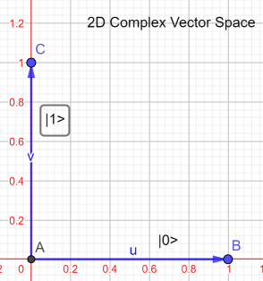

# Vector notation and bra-ket

[Home](../README.md) · [Roadmap](../00-learning-roadmap.md) · [Glossary](../glossary.md)

**Previous:** [Scalars and vectors](01-scalars-and-vectors.md) · **Next:** [Matrix multiplication](03-matrix-multiplication.md)

---

Quantum notes do not usually write \(\vec{v}\). They use **Dirac notation**, also called **bra-ket** notation. It looks unusual at first. It is only a nickname for the same column of numbers you already know.

The notation is built from an angle bracket and a vertical bar:

- a **ket** looks like \(|v\rangle\)
- a **bra** looks like \(\langle v|\)

## What a ket is

A ket \(|v\rangle\) is a vector \(v\). In the math, it lives in a vector space \(V\). In the physics, it stands for a *state* of a quantum system: “this is how the system is right now.”

For one bit (and later, one qubit), two special kets are the starting points. Think of them as two arrows that are at right angles: one along the horizontal axis, one along the vertical axis.

Your notes labeled the horizontal arrow \(B\) (point B) and the vertical arrow \(C\) (point C):

$$
|0\rangle = \begin{bmatrix} 1 \\ 0 \end{bmatrix}
$$

$$
|1\rangle = \begin{bmatrix} 0 \\ 1 \end{bmatrix}
$$

Read \(|0\rangle\) as “ket zero” and \(|1\rangle\) as “ket one.”

- \(|0\rangle\) means “all of the vector is in the first slot, none in the second.”
- \(|1\rangle\) means “none in the first slot, all in the second.”

These two arrows are the **standard basis**. Any other 2-number column can be built by mixing them. That mixing is how superposition will appear later.

A general ket is just a column of amplitudes:

$$
|a\rangle = \begin{bmatrix} a_0 \\ a_1 \end{bmatrix}
$$

Kets follow the same rules as ordinary vectors: you can add them and multiply them by numbers.

These two special kets are **orthogonal**: they point at right angles. The overlap of two orthogonal vectors is zero. We will write that overlap with a bra and a ket in a moment:

$$
\langle 0|1\rangle = 0
$$

## Complex conjugates

A complex number has a real part and an imaginary part:

$$
x = a + i b
$$

Its **complex conjugate** flips the sign of the imaginary part:

$$
x^* = a - i b
$$

If \(x\) is an ordinary real number, then \(x^* = x\).

## What a bra is

A bra \(\langle b|\) is the conjugate transpose of the ket \(|b\rangle\): turn the column into a row, *and* conjugate each entry.

$$
\langle b|
=
|b\rangle^\dagger
=
\begin{bmatrix} b_0 \\ b_1 \end{bmatrix}^\dagger
=
\begin{bmatrix} b_0^* & b_1^* \end{bmatrix}
$$

For real numbers this is just “lie the column on its side”:

$$
|0\rangle = \begin{bmatrix} 1 \\ 0 \end{bmatrix}
\quad\text{and}\quad
\langle 0| = \begin{bmatrix} 1 & 0 \end{bmatrix}
$$

## Inner product (bra-ket)

Write a bra next to a ket and you get a *single number*, the **inner product**. It answers “how much do these two states overlap?”

$$
\langle b|a\rangle
=
b_0^* a_0 + b_1^* a_1
$$

Your notes also wrote this as \(a_0 b_0^* + a_1 b_1^*\), which is the same because ordinary numbers (and complex numbers) multiply in either order.

A useful fact:

$$
\langle b|a\rangle = \langle a|b\rangle^*
$$

For the computational basis:

$$
\langle 0|0\rangle = 1,\quad
\langle 1|1\rangle = 1,\quad
\langle 0|1\rangle = 0,\quad
\langle 1|0\rangle = 0
$$

That is the precise meaning of “these two vectors are orthogonal.”

## Outer product (ket-bra)

Write a ket next to a bra and you get a *matrix*:

$$
|a\rangle\langle b|
=
\begin{bmatrix}
a_0 b_0^* & a_0 b_1^* \\
a_1 b_0^* & a_1 b_1^*
\end{bmatrix}
$$

Inner product = number. Outer product = grid of numbers. Both are legal; they just mean different shapes.

## A tiny dictionary

| Everyday idea | Linear algebra | Dirac notation |
|---|---|---|
| Arrow along \(x\) | \(\begin{bmatrix} 1 \\ 0 \end{bmatrix}\) | \(|0\rangle\) |
| Arrow along \(y\) | \(\begin{bmatrix} 0 \\ 1 \end{bmatrix}\) | \(|1\rangle\) |
| A general state | a column vector | \(|\psi\rangle\) (often read “ket psi”) |

---

**Previous:** [Scalars and vectors](01-scalars-and-vectors.md) · **Next:** [Matrix multiplication](03-matrix-multiplication.md)
