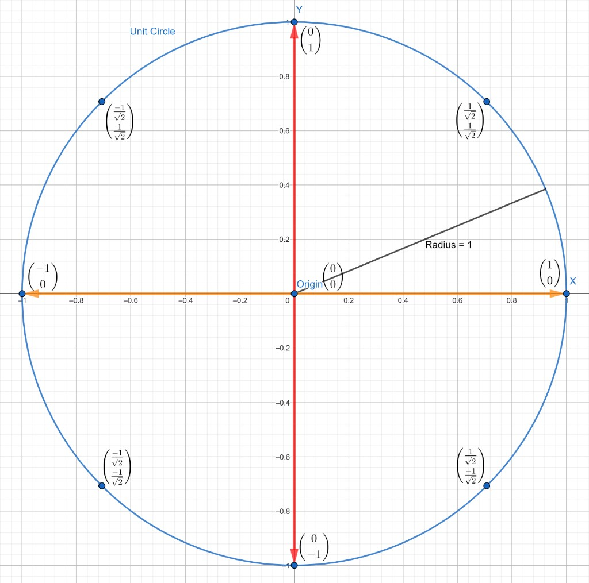

# Complex numbers and unitary matrices

[Home](../README.md) · [Roadmap](../00-learning-roadmap.md) · [Glossary](../glossary.md)

**Previous:** [Matrix multiplication](03-matrix-multiplication.md) · **Next:** [Tensor products](05-tensor-products.md)

---

Quantum amplitudes are allowed to be **complex numbers**, not only ordinary real numbers. You only need a little of that language to understand a **unitary** matrix, which is how a quantum gate is written.

## Complex numbers in one sentence

A complex number has two parts: a real part and an imaginary part. The imaginary unit \(i\) is defined by

$$
i^2 = -1
$$

Examples: \(1 - i\) and \(1 + i\). The **complex conjugate** of a number flips the sign of the imaginary part: the conjugate of \(1 - i\) is \(1 + i\).

## Length 1: why a circle appears

A 2-number real vector \(\begin{bmatrix} x \\ y \end{bmatrix}\) has length \(\sqrt{x^2 + y^2}\). If that length is \(1\), the tip of the arrow sits on a circle of radius \(1\).

Quantum states are written so that this length (more precisely, a complex version of it) stays \(1\). That is what keeps probabilities adding up to \(100\%\).

Useful points on that circle:

$$
\begin{bmatrix} 1 \\ 0 \end{bmatrix},\quad
\begin{bmatrix} 0 \\ 1 \end{bmatrix},\quad
\begin{bmatrix} -1 \\ 0 \end{bmatrix},\quad
\begin{bmatrix} 0 \\ -1 \end{bmatrix}
$$

and the four diagonal points

$$
\begin{bmatrix} \frac{1}{\sqrt{2}} \\ \frac{1}{\sqrt{2}} \end{bmatrix},\quad
\begin{bmatrix} -\frac{1}{\sqrt{2}} \\ \frac{1}{\sqrt{2}} \end{bmatrix},\quad
\begin{bmatrix} -\frac{1}{\sqrt{2}} \\ -\frac{1}{\sqrt{2}} \end{bmatrix},\quad
\begin{bmatrix} \frac{1}{\sqrt{2}} \\ -\frac{1}{\sqrt{2}} \end{bmatrix}
$$

Each of those has length \(1\). For the first diagonal point:

$$
\left(\frac{1}{\sqrt{2}}\right)^2 + \left(\frac{1}{\sqrt{2}}\right)^2 = \frac{1}{2} + \frac{1}{2} = 1
$$

## What “unitary” means

A **unitary** matrix \(U\) is a **square** matrix of complex numbers whose inverse is its **conjugate transpose**.

- **Transpose** \(U^T\): rows become columns.
- **Conjugate transpose** \(U^\dagger\) (your notes also wrote \(U^H\)): transpose, *and* conjugate every entry.

The test is multiplication, not addition:

$$
U^\dagger U = I
$$

where \(I\) is the identity matrix. If this holds, then \(U^\dagger = U^{-1}\): the conjugate transpose *is* the inverse. So the operation is reversible, and it preserves the length of state vectors.

A matrix equal to its own conjugate transpose (\(A^\dagger = A\)) is called **Hermitian**. That is a different idea. \(U^\dagger\) is always “the conjugate transpose of \(U\).” It is Hermitian only if it equals \(U\).

## Worked example

Take

$$
U = \frac{1}{2}
\begin{bmatrix}
1 - i & 1 + i \\
1 + i & 1 - i
\end{bmatrix}
$$

This matrix is symmetric, so the transpose looks the same:

$$
U^T = \frac{1}{2}
\begin{bmatrix}
1 - i & 1 + i \\
1 + i & 1 - i
\end{bmatrix}
$$

Flip the sign of each imaginary part to get the conjugate transpose:

$$
U^\dagger = \frac{1}{2}
\begin{bmatrix}
1 + i & 1 - i \\
1 - i & 1 + i
\end{bmatrix}
$$

Now multiply (the two factors of \(\frac{1}{2}\) become \(\frac{1}{4}\)):

$$
U^\dagger U
=
\frac{1}{4}
\begin{bmatrix}
(1+i)(1-i) + (1-i)(1+i)
&
(1+i)(1+i) + (1-i)(1-i)
\\
(1-i)(1-i) + (1+i)(1+i)
&
(1-i)(1+i) + (1+i)(1-i)
\end{bmatrix}
$$

The top-left entry expands as

$$
\begin{align*}
(1+i)(1-i) + (1-i)(1+i)
&= 1 - i + i - i^2 + 1 + i - i - i^2 \\
&= 1 - i^2 + 1 - i^2 \\
&= 2 - 2i^2 \\
&= 2 - 2(-1) \\
&= 4
\end{align*}
$$

The off-diagonal entries cancel to \(0\). The bottom-right entry is also \(4\). So

$$
U^\dagger U
=
\frac{1}{4}
\begin{bmatrix} 4 & 0 \\ 0 & 4 \end{bmatrix}
=
\begin{bmatrix} 1 & 0 \\ 0 & 1 \end{bmatrix}
= I
$$

Therefore this \(U\) is unitary.

Every quantum gate is a unitary matrix. That is why quantum operations are reversible. They are *not* all equal to their own inverse. Some gates (NOT, CNOT, Hadamard) happen to be; many others (phase gates, most rotations) are not. The inverse is always \(U^\dagger\), which may or may not equal \(U\).

---

**Previous:** [Matrix multiplication](03-matrix-multiplication.md) · **Next:** [Tensor products](05-tensor-products.md)
