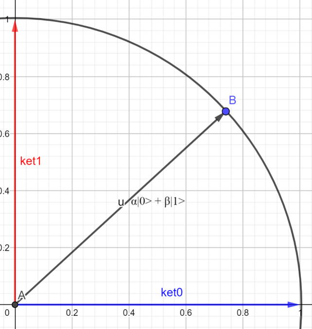

# The qubit

[Home](../README.md) · [Roadmap](../00-learning-roadmap.md) · [Glossary](../glossary.md)

**Previous:** [Classical bits and reversibility](01-classical-bits-and-reversibility.md) · **Next:** [Pauli-X gate](05-pauli-x-gate.md)

---

A classical bit is only \(0\) or \(1\). A **qubit** is the quantum version of that idea. During a calculation it is *not* forced to be a single classical value. It is a vector.

## The model

In these notes, the state of one qubit is a vector in a **2-dimensional complex vector space**:

$$
|\psi\rangle = \begin{bmatrix} \alpha \\ \beta \end{bmatrix}
= \alpha|0\rangle + \beta|1\rangle
$$

The numbers \(\alpha\) and \(\beta\) are **amplitudes**. They may be complex. They must satisfy the **normalization** rule

$$
|\alpha|^2 + |\beta|^2 = 1
$$

(Your notes wrote \(\lvert\lvert a\rvert\rvert^2\). For a single number, the usual symbol is \(|\alpha|^2\): the square of its length in the complex plane.)

The two computational-basis states, which match classical \(0\) and \(1\), are still

$$
|0\rangle = \begin{bmatrix} 1 \\ 0 \end{bmatrix},
\qquad
|1\rangle = \begin{bmatrix} 0 \\ 1 \end{bmatrix}
$$

They are often drawn as the horizontal and vertical unit arrows. Any other legal qubit is a mix of those two arrows, with total length \(1\).

## Check that a vector is a legal qubit

Each of these has \(|\alpha|^2 + |\beta|^2 = 1\):

$$
\begin{bmatrix} \dfrac{1}{\sqrt{2}} \\ \dfrac{1}{\sqrt{2}} \end{bmatrix}
:\quad
\left(\frac{1}{\sqrt{2}}\right)^2 + \left(\frac{1}{\sqrt{2}}\right)^2
= \frac{1}{2} + \frac{1}{2} = 1
$$

$$
\begin{bmatrix} \dfrac{1}{2} \\ \dfrac{\sqrt{3}}{2} \end{bmatrix}
:\quad
\left(\frac{1}{2}\right)^2 + \left(\frac{\sqrt{3}}{2}\right)^2
= \frac{1}{4} + \frac{3}{4} = 1
$$

$$
\begin{bmatrix} -1 \\ 0 \end{bmatrix}
:\quad
|-1|^2 + |0|^2 = 1
$$

$$
\begin{bmatrix} \dfrac{1}{\sqrt{2}} \\ -\dfrac{1}{\sqrt{2}} \end{bmatrix}
:\quad
\left(\frac{1}{\sqrt{2}}\right)^2 + \left(-\frac{1}{\sqrt{2}}\right)^2
= \frac{1}{2} + \frac{1}{2} = 1
$$

The last two still have length \(1\). The minus signs are **phases**. They matter when you combine paths, but they do not change the *measurement probabilities* of this single qubit by themselves.

## Superposition, said carefully

People often say a qubit is “\(0\) and \(1\) at the same time.” The math is more precise: the state is a *combination* of the two basis states, with amplitudes \(\alpha\) and \(\beta\).

That is **not** the same as running two classical computers in parallel. You do not get to read both answers. You get one shot at a measurement, which we describe next.

## Measurement

Until you look, the qubit can sit in superposition. A standard measurement in the \(0/1\) basis **collapses** it to one of the two basis states:

- you see \(0\) (the state becomes \(|0\rangle\)) with probability \(|\alpha|^2\)
- you see \(1\) (the state becomes \(|1\rangle\)) with probability \(|\beta|^2\)

Examples:

| State | \(P(0)\) | \(P(1)\) | Picture |
|---|---|---|---|
| \(\begin{bmatrix} 1/\sqrt{2} \\ 1/\sqrt{2} \end{bmatrix}\) | \(1/2\) | \(1/2\) | a fair coin |
| \(\begin{bmatrix} 1 \\ 0 \end{bmatrix}\) | \(1\) | \(0\) | always \(0\) |
| \(\begin{bmatrix} 0 \\ 1 \end{bmatrix}\) | \(0\) | \(1\) | always \(1\) |
| \(\begin{bmatrix} 1/2 \\ \sqrt{3}/2 \end{bmatrix}\) | \(1/4\) | \(3/4\) | biased coin |

After measurement you no longer have the superposition. You have a definite bit, and repeating the same measurement will give that same bit.

---

**Previous:** [Classical bits and reversibility](01-classical-bits-and-reversibility.md) · **Next:** [Pauli-X gate](05-pauli-x-gate.md)
