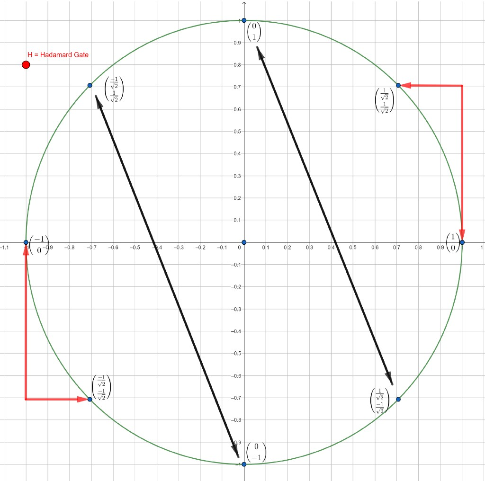

# Pauli-X gate (quantum NOT)

[Home](../README.md) · [Roadmap](../00-learning-roadmap.md) · [Glossary](../glossary.md)

**Previous:** [The qubit](04-the-qubit.md) · **Next:** [Hadamard gate](06-hadamard-gate.md)

---

The same matrices that acted on classical bits also act on qubits. A **quantum gate** is a unitary matrix. The **Pauli-X** gate is the quantum **NOT**, also called a **bit flip**.

On the computational basis it does what the name suggests:

$$
X|0\rangle = |1\rangle,
\qquad
X|1\rangle = |0\rangle
$$

On a superposition it swaps the two amplitudes:

$$
X\bigl(\alpha|0\rangle + \beta|1\rangle\bigr) = \alpha|1\rangle + \beta|0\rangle
$$

## The matrix

$$
X = \begin{bmatrix} 0 & 1 \\ 1 & 0 \end{bmatrix}
$$

This is the same matrix as classical negation. It is unitary, and it is its own inverse: apply \(X\) twice and you are back.

$$
X|0\rangle
=
\begin{bmatrix} 0 & 1 \\ 1 & 0 \end{bmatrix}
\begin{bmatrix} 1 \\ 0 \end{bmatrix}
=
\begin{bmatrix} 0 \\ 1 \end{bmatrix}
= |1\rangle
$$

$$
X|1\rangle
=
\begin{bmatrix} 0 & 1 \\ 1 & 0 \end{bmatrix}
\begin{bmatrix} 0 \\ 1 \end{bmatrix}
=
\begin{bmatrix} 1 \\ 0 \end{bmatrix}
= |0\rangle
$$

In a circuit diagram, X is a box on a single wire.

## Superposition example

Suppose a qubit has a \(25\%\) chance of measuring \(0\) and a \(75\%\) chance of measuring \(1\):

$$
\begin{bmatrix} 1/2 \\ \sqrt{3}/2 \end{bmatrix}
\qquad
\left|\frac{1}{2}\right|^2 + \left|\frac{\sqrt{3}}{2}\right|^2
= \frac{1}{4} + \frac{3}{4} = 1
$$

Run it through X:

$$
\begin{bmatrix} 0 & 1 \\ 1 & 0 \end{bmatrix}
\begin{bmatrix} 1/2 \\ \sqrt{3}/2 \end{bmatrix}
=
\begin{bmatrix}
0\cdot\frac{1}{2} + 1\cdot\frac{\sqrt{3}}{2} \\
1\cdot\frac{1}{2} + 0\cdot\frac{\sqrt{3}}{2}
\end{bmatrix}
=
\begin{bmatrix} \sqrt{3}/2 \\ 1/2 \end{bmatrix}
$$

Now the chances have swapped: \(75\%\) for \(0\), \(25\%\) for \(1\). Normalization still holds.

## Geometry on the unit circle

If you draw real two-number states on a circle of radius \(1\), X swaps the two coordinates. That is a reflection across the diagonal line \(y = x\).



- \(|0\rangle = \begin{bmatrix} 1 \\ 0 \end{bmatrix}\) goes to \(|1\rangle = \begin{bmatrix} 0 \\ 1 \end{bmatrix}\)
- \(|1\rangle\) goes back to \(|0\rangle\)
- the equal superposition \(\begin{bmatrix} 1/\sqrt{2} \\ 1/\sqrt{2} \end{bmatrix}\) is unchanged, because swapping the two equal numbers does nothing
- \(\begin{bmatrix} -1/\sqrt{2} \\ 1/\sqrt{2} \end{bmatrix}\) swaps with \(\begin{bmatrix} 1/\sqrt{2} \\ -1/\sqrt{2} \end{bmatrix}\)

**Correction.** Your notes said the bit flip “has no effect on the superposition bit.” That is true only for this *particular* superposition (and for \(\begin{bmatrix} -1/\sqrt{2} \\ -1/\sqrt{2} \end{bmatrix}\)). It is **not** true for every superposition. The \(25\%/75\%\) example above is a superposition, and X clearly changes it.

When amplitudes are fully complex, the picture becomes a **Bloch sphere** instead of a circle. We stay in the real plane for now.

A tiny simulator program that allocates one qubit, writes \(0\), applies NOT, and reads the bit looks like this (QCEngine-style):

```javascript
qc.reset(1);            // one qubit
qc.write(0);            // start as |0>
qc.not();               // apply X
var result = qc.read(); // measure as a classical bit
```

---

**Previous:** [The qubit](04-the-qubit.md) · **Next:** [Hadamard gate](06-hadamard-gate.md)
