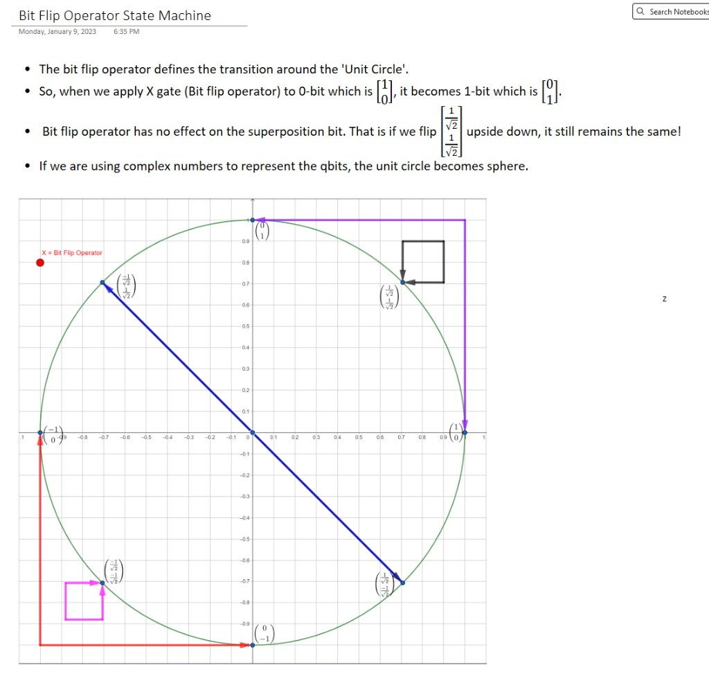

# Hadamard gate

[Home](../README.md) · [Roadmap](../00-learning-roadmap.md) · [Glossary](../glossary.md)

**Previous:** [Pauli-X gate](05-pauli-x-gate.md) · **Next:** [Combining X and H](07-combining-x-and-h.md)

---

The **Hadamard** gate \(H\) is the usual way to take a definite \(0\) or \(1\) and turn it into an **equal superposition**. It is also its own inverse: apply \(H\) twice and you return to where you started.

## The matrix

$$
H
=
\begin{bmatrix}
\dfrac{1}{\sqrt{2}} & \dfrac{1}{\sqrt{2}} \\[6pt]
\dfrac{1}{\sqrt{2}} & -\dfrac{1}{\sqrt{2}}
\end{bmatrix}
$$

## From bits to superposition

$$
H|0\rangle
=
\begin{bmatrix}
\frac{1}{\sqrt{2}} & \frac{1}{\sqrt{2}} \\
\frac{1}{\sqrt{2}} & -\frac{1}{\sqrt{2}}
\end{bmatrix}
\begin{bmatrix} 1 \\ 0 \end{bmatrix}
=
\begin{bmatrix} 1/\sqrt{2} \\ 1/\sqrt{2} \end{bmatrix}
$$

$$
H|1\rangle
=
\begin{bmatrix}
\frac{1}{\sqrt{2}} & \frac{1}{\sqrt{2}} \\
\frac{1}{\sqrt{2}} & -\frac{1}{\sqrt{2}}
\end{bmatrix}
\begin{bmatrix} 0 \\ 1 \end{bmatrix}
=
\begin{bmatrix} 1/\sqrt{2} \\ -1/\sqrt{2} \end{bmatrix}
$$

Both of these measure as a fair coin: probability \(1/2\) for \(0\) and \(1/2\) for \(1\). They are *not* the same state. The minus sign in the second vector is a relative phase. If you measure in the \(0/1\) basis you will not see the difference, but later gates can.

## Why the minus sign is required

If the bottom-right entry were \(+1/\sqrt{2}\) as well, then \(H|0\rangle\) and \(H|1\rangle\) would be the identical vector. Two different inputs, one output: not reversible. Quantum gates must be unitary, so they must stay reversible. The minus sign keeps the two outputs distinct.

## From superposition back to bits

Because \(H\) is its own inverse, the same gate undoes superposition.

Starting from \(H|0\rangle\):

$$
H
\begin{bmatrix} 1/\sqrt{2} \\ 1/\sqrt{2} \end{bmatrix}
=
\begin{bmatrix}
\frac{1}{\sqrt{2}}\cdot\frac{1}{\sqrt{2}} + \frac{1}{\sqrt{2}}\cdot\frac{1}{\sqrt{2}} \\
\frac{1}{\sqrt{2}}\cdot\frac{1}{\sqrt{2}} + \left(-\frac{1}{\sqrt{2}}\right)\cdot\frac{1}{\sqrt{2}}
\end{bmatrix}
=
\begin{bmatrix} 1/2 + 1/2 \\ 1/2 - 1/2 \end{bmatrix}
=
\begin{bmatrix} 1 \\ 0 \end{bmatrix}
= |0\rangle
$$

Starting from \(H|1\rangle\):

$$
H
\begin{bmatrix} 1/\sqrt{2} \\ -1/\sqrt{2} \end{bmatrix}
=
\begin{bmatrix}
\frac{1}{2} + \frac{1}{\sqrt{2}}\cdot\left(-\frac{1}{\sqrt{2}}\right) \\
\frac{1}{2} + \left(-\frac{1}{\sqrt{2}}\right)\cdot\left(-\frac{1}{\sqrt{2}}\right)
\end{bmatrix}
=
\begin{bmatrix} 1/2 - 1/2 \\ 1/2 + 1/2 \end{bmatrix}
=
\begin{bmatrix} 0 \\ 1 \end{bmatrix}
= |1\rangle
$$

## Geometry

On the real unit circle, \(H\) sends the \(x\)-axis states to the diagonal superpositions, and sends \(|1\rangle\) to the other diagonal.

## A common workflow (with a warning)

Many textbook circuits do something like this:

1. start from classical bits
2. use \(H\) to create superposition
3. apply quantum operations
4. use \(H\) (or measurement) so the interesting answer becomes a definite \(0\) or \(1\)

Not every algorithm looks like that, and the last step is not magic: if you measure too soon, you destroy the superposition you needed.

---

**Previous:** [Pauli-X gate](05-pauli-x-gate.md) · **Next:** [Combining X and H](07-combining-x-and-h.md)
