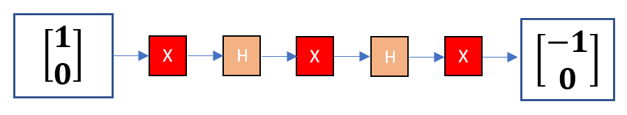
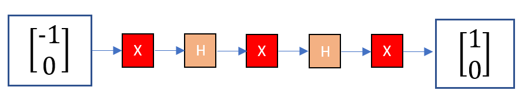

# Combining X and H

[Home](../README.md) · [Roadmap](../00-learning-roadmap.md) · [Glossary](../glossary.md)

**Previous:** [Hadamard gate](06-hadamard-gate.md) · **Next:** [Representing multiple qubits](02-representing-multiple-qubits.md)

---

Gates can be chained. In a picture you read **left to right** (what happens first is on the left). In matrix algebra you multiply **right to left** (the first gate is the matrix closest to the vector).

This example starts at \(|0\rangle\) and applies \(X\), then \(H\), then \(X\), then \(H\), then \(X\).

## Walk through the states

Start:

$$
|0\rangle = \begin{bmatrix} 1 \\ 0 \end{bmatrix}
$$

1. \(X\): \(\begin{bmatrix} 0 \\ 1 \end{bmatrix} = |1\rangle\)
2. \(H\): \(\begin{bmatrix} 1/\sqrt{2} \\ -1/\sqrt{2} \end{bmatrix}\)
3. \(X\) swaps the two entries: \(\begin{bmatrix} -1/\sqrt{2} \\ 1/\sqrt{2} \end{bmatrix}\)
4. \(H\) of that vector:

$$
H\begin{bmatrix} -1/\sqrt{2} \\ 1/\sqrt{2} \end{bmatrix}
=
\frac{1}{\sqrt{2}}
\begin{bmatrix}
-1/\sqrt{2} + 1/\sqrt{2} \\
-1/\sqrt{2} - 1/\sqrt{2}
\end{bmatrix}
=
\begin{bmatrix} 0 \\ -1 \end{bmatrix}
$$

5. \(X\): \(\begin{bmatrix} -1 \\ 0 \end{bmatrix} = -|0\rangle\)

The output is the original bit with an overall minus sign. Measuring in the \(0/1\) basis, \(-|0\rangle\) still gives \(0\) with probability \(1\). The minus sign is a **global phase**: it does not change those probabilities, but it is a real difference in the vector, and the next gates can care.

## The same chain is reversible

Feed that output back into the *same* sequence \(X,H,X,H,X\):

$$
\begin{bmatrix} -1 \\ 0 \end{bmatrix}
\;\xrightarrow{X}\;
\begin{bmatrix} 0 \\ -1 \end{bmatrix}
\;\xrightarrow{H}\;
\begin{bmatrix} -1/\sqrt{2} \\ 1/\sqrt{2} \end{bmatrix}
\;\xrightarrow{X}\;
\begin{bmatrix} 1/\sqrt{2} \\ -1/\sqrt{2} \end{bmatrix}
\;\xrightarrow{H}\;
\begin{bmatrix} 0 \\ 1 \end{bmatrix}
\;\xrightarrow{X}\;
\begin{bmatrix} 1 \\ 0 \end{bmatrix}
$$

You recover \(|0\rangle\). That is the point of unitary gates: you can always walk back.

A compact way to write the whole machine is the matrix product

$$
X\,H\,X\,H\,X
$$

applied to the starting column. You do not need to multiply the five matrices by hand if you are happy tracking the vector step by step, as above.

---

**Previous:** [Hadamard gate](06-hadamard-gate.md) · **Next:** [Representing multiple qubits](02-representing-multiple-qubits.md)
