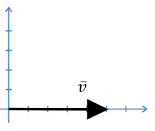
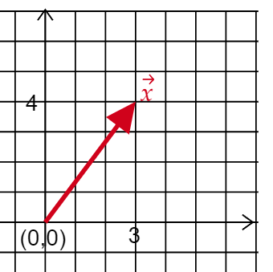

# Scalars and vectors

[Home](../README.md) · [Roadmap](../00-learning-roadmap.md) · [Glossary](../glossary.md)

**Previous:** [Why quantum computing?](../00-why-quantum-computing.md) · **Next:** [Vector notation and bra-ket](02-vector-notation-and-bra-ket.md)

---

A **scalar** is just a single number. A **vector** is a number *plus a direction*.

If someone says a car is moving at 5 miles per hour, that is only a size. That is a scalar. **Speed** is a scalar.

If they say the car is moving 5 miles per hour *east*, you now have size and direction. That is a vector. **Velocity** is a vector.

## How we write a vector in two dimensions

Imagine a flat map with two directions:

- left–right (horizontal)
- up–down (vertical)

To describe a vector on that map, we give two numbers: how far it goes horizontally, then how far it goes vertically.

This picture is a vector that only moves to the right. It does not go up or down at all.

In coordinates we write that idea as

$$
\vec{v} = (5,\ 0)
$$

The first number is the horizontal move: $+5$. The second number is the vertical move: $0$.

In linear algebra we stack those two numbers in a column. That is the form you will see everywhere in quantum computing:

$$
\vec{v} = \begin{bmatrix} 5 \\ 0 \end{bmatrix}
$$

- The top entry is the horizontal part.
- The bottom entry is the vertical part.

(Your OneNote notes used a bar over the letter, $\bar{v}$. These notes use an arrow, $\vec{v}$. Both mean “this is a vector.”)

## Example: a vector that moves right *and* up

Now take a vector that moves $+3$ horizontally and $+4$ vertically:

$$
\vec{x} = \begin{bmatrix} 3 \\ 4 \end{bmatrix}
$$

The arrow starts at the origin $(0,0)$ and ends at the grid point where $x=3$ and $y=4$.

The *length* of this arrow is the straight-line distance from start to finish. By Pythagoras:

$$
\sqrt{3^2 + 4^2} = \sqrt{9 + 16} = \sqrt{25} = 5
$$

So $\vec{x}$ has magnitude $5$, even though its two components are $3$ and $4$.

## Why this matters for quantum computing

A quantum bit (qubit) is not stored as a single $0$ or $1$. It is stored as a short list of numbers — a vector. Once you can read a column of numbers as “how much in this direction, how much in that direction,” you are ready for the next note: the special way physicists write those vectors.

---

**Previous:** [Why quantum computing?](../00-why-quantum-computing.md) · **Next:** [Vector notation and bra-ket](02-vector-notation-and-bra-ket.md)
