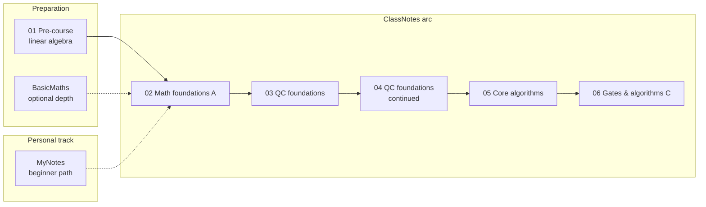

# Quantum Computing & Mathematical Foundations

> Course-aligned lecture notes, diagrams, and browser interactives for learning quantum computing from the ground up. Notes only—no application code.

---

## Table of contents

- [Read with Markdown Reader](#read-with-markdown-reader)
- [About this repository](#about-this-repository)
- [Start here](#start-here)
- [Course map](#course-map)
- [Folder layout](#folder-layout)
- [ClassNotes](#classnotes)
- [BasicMaths](#basicmaths)
- [MyNotes](#mynotes)
- [File conventions](#file-conventions)

---

## Read with Markdown Reader

These notes are written for **[Markdown Reader](https://markdownreader.github.io/)**—a browser extension (Chrome, Edge, Firefox) that renders `.md` files with math (KaTeX), diagrams, a sidebar TOC, syntax highlighting, and live refresh while you edit.

| Resource | Link |
| -------- | ---- |
| Documentation | [markdownreader.github.io](https://markdownreader.github.io/) |
| Install (all browsers) | [md-reader.github.io/install](https://md-reader.github.io/install/) |
| Chrome | [Chrome Web Store](https://chromewebstore.google.com/detail/markdown-reader/medapdbncneneejhbgcjceippjlfkmkg) |
| Microsoft Edge | [Edge Add-ons](https://microsoftedge.microsoft.com/addons/detail/markdown-reader/djnplooklihmkcioemdjfcednfkpiodc) |

**Open a note locally**

1. Install Markdown Reader from the links above.
2. In `chrome://extensions` or `edge://extensions`, open **Markdown Reader** → **Details** → turn on **Allow access to file URLs** (Chrome/Edge). Firefox usually allows `file://` paths without extra steps.
3. Open a `.md` file in the browser (drag it into a tab or use `file:///…`).

**Animations and quizzes** live in `animations/`, `assets/`, and similar folders as standalone `.html` files. Render the Markdown in Markdown Reader; open HTML links in the same browser for interactives.

---

## About this repository

Personal study material bundled in one place:

| | |
| --- | --- |
| **Content** | Transcript- and slide-aligned course packs, *Essence of Linear Algebra* chapter notes, pre-course linear algebra refreshers, beginner-friendly articles |
| **Formats** | Markdown (~85 files), offline HTML interactives (~166), images (PNG, JPG, SVG) co-located with the notes that reference them |
| **Layout** | Each module keeps notes, figures, and interactives together so relative links keep working after clone or download |

---

## Start here

| If you want to… | Open |
| --------------- | ---- |
| A gentle, ordered beginner path | [MyNotes — README](MyNotes/MarkdownNotes/README.md) → [Learning roadmap](MyNotes/MarkdownNotes/00-learning-roadmap.md) |
| Pre-course linear algebra | [Pre-course notes index](ClassNotes/01%20Pre-Course%20Linear%20Algebra%20Notes/Notes/01_Introduction_to_Linear_Algebra.md) |
| Main course from the beginning | [Mathematical Foundations Part A](ClassNotes/02%20Mathematical%20Foundations%20Part%20A/01%20Mathematical%20Foundations%20Part%20A%20Notes.md) |
| Deep dive on oracles & Deutsch | [Core Algorithms Part A](ClassNotes/05%20Core%20Algorithms/01%20Core%20Algorithms%20Part%20A/notes/lecture-notes.md) |
| Linear algebra intuition (3Blue1Brown-style) | [Essence of Linear Algebra — Vectors](BasicMaths/Essence%20of%20linear%20algebra/01-Vectors/notes/lecture-notes.md) |

Suggested order for the course arc: work through **ClassNotes `01` → `06`**. Use **BasicMaths** for extra linear-algebra practice and **MyNotes** for a parallel recap.

---

## Course map



---

## Folder layout

```
QuantumMechanics-Notes/
├── ClassNotes/          # Course modules 01–06 (main arc)
├── BasicMaths/          # Essence of linear algebra + Products + Summation
├── MyNotes/             # Beginner Markdown path + glossary
└── README.md            # You are here
```

| Folder | Role |
| ------ | ---- |
| [`ClassNotes/`](ClassNotes/) | Lecture packs in chronological order |
| [`BasicMaths/`](BasicMaths/) | Supplementary linear algebra and notation |
| [`MyNotes/`](MyNotes/) | Self-contained beginner articles |

---

## ClassNotes

| # | Module | Where to start |
| -: | ------ | -------------- |
| 01 | [Pre-Course Linear Algebra Notes](ClassNotes/01%20Pre-Course%20Linear%20Algebra%20Notes/Notes/) | `01_Introduction_to_Linear_Algebra.md` … `09_Questions_To_Revise.md` |
| 02 | [Mathematical Foundations Part A](ClassNotes/02%20Mathematical%20Foundations%20Part%20A/) | [Notes 1](ClassNotes/02%20Mathematical%20Foundations%20Part%20A/01%20Mathematical%20Foundations%20Part%20A%20Notes.md) · [Algebra refresher](ClassNotes/02%20Mathematical%20Foundations%20Part%20A/02%20Linear%20Algebra%20Refresher%20for%20Quantum%20Computing%20Notes.md) |
| 03 | [QC Foundations](ClassNotes/03%20QC%20Foundations/) | [Part A notes](ClassNotes/03%20QC%20Foundations/01%20QC%20Foundations%20Part%20A%20Notes.md) · [Bloch sphere](ClassNotes/03%20QC%20Foundations/Quantum_Notes_Updated_Bloch_Sphere/Bloch_Sphere_Beginner_Notes.md) · [Animations pack](ClassNotes/03%20QC%20Foundations/03%20QC%20Foundations/) |
| 04 | [QC Foundations Continued](ClassNotes/04%20QC%20Foundations%20Continued/) | [Math Part C](ClassNotes/04%20QC%20Foundations%20Continued/01%20Mathematical%20Foundations%20Part%20C/Study_Notes.md) · [QC Part C](ClassNotes/04%20QC%20Foundations%20Continued/02%20QC%20Foundations%20Part%20C/Study_Notes.md) · [Gates & circuits](ClassNotes/04%20QC%20Foundations%20Continued/03%20Gates%20Circuits/Study_Notes.md) |
| 05 | [Core Algorithms](ClassNotes/05%20Core%20Algorithms/) | [Part A notes](ClassNotes/05%20Core%20Algorithms/01%20Core%20Algorithms%20Part%20A/notes/lecture-notes.md) · [Part B notes](ClassNotes/05%20Core%20Algorithms/02%20Core%20Algorithms%20Part%20B/notes/lecture-notes.md) · [Gates Part B](ClassNotes/05%20Core%20Algorithms/03%20Gates%20&%20Circuit%20Design%20Part%20B/Lecture_Notes.md) |
| 06 | [Gates, Circuit Design & Core Algorithms (C)](ClassNotes/06%20Gates,%20Circuit%20Design%20And%20Core%20Algorithms/) | Each subfolder: `Lecture_Notes.md` + `animations/` + `practice/` |

<details>
<summary><strong>Module 04 & 05 — what's inside</strong></summary>

**04 — three packs** (`Study_Notes.md` + `assets/` quizzes)

| Pack | Topics |
| ---- | ------ |
| Mathematical Foundations Part C | Tensor products, CNOT, Pauli, entanglement, eigenvalues |
| QC Foundations Part C | Born rule, multi-qubit / tensor material |
| Gates Circuits | Bloch sphere, Hadamard, phase and T-gate explainers |

**05 — Core Algorithms**

| Pack | Highlights |
| ---- | ---------- |
| Part A | Oracles, phase kickback, Deutsch; see [pack README](ClassNotes/05%20Core%20Algorithms/01%20Core%20Algorithms%20Part%20A/README.md) for the full animation list |
| Part B | Continued algorithms + `animations/` |
| Gates & Circuit Design Part B | `practice/practice_questions.md` |

</details>

---

## BasicMaths

| Path | Description |
| ---- | ----------- |
| [`Essence of linear algebra/`](BasicMaths/Essence%20of%20linear%20algebra/) | 16 chapters (`01-Vectors` … `16-Abstract Vector Spaces`): `notes/lecture-notes.md`, images, optional animations, chapter README |
| [`Products/Products.md`](BasicMaths/Products/Products.md) | Inner/outer products and quantum intuition + quiz assets |
| [`Summation/Summation_Basics.md`](BasicMaths/Summation/Summation_Basics.md) | Summation notation + companion HTML |

---

## MyNotes

[`MyNotes/MarkdownNotes/`](MyNotes/MarkdownNotes/) — short articles in reading order:

- [Why quantum computing?](MyNotes/MarkdownNotes/00-why-quantum-computing.md) and [Learning roadmap](MyNotes/MarkdownNotes/00-learning-roadmap.md)
- [Glossary](MyNotes/MarkdownNotes/glossary.md)
- `01-mathematical-foundations/` and `02-quantum-computing-foundations/` topic files
- Figures in [`assets/images/`](MyNotes/MarkdownNotes/assets/images/)

Full TOC: [MyNotes README](MyNotes/MarkdownNotes/README.md).

---

## File conventions

| Pattern | Meaning |
| ------- | ------- |
| `notes/lecture-notes.md` | Main write-up in newer packs |
| `Lecture_Notes.md` / `Study_Notes.md` | Main write-up at module root (older packs) |
| `README.md` in a pack | Entry point + animation index |
| `practice/practice_questions.md` | Extra problems (several Part B/C packs) |

[`.gitignore`](.gitignore) keeps bulk exports (`.txt`, `.pdf`, transcript dumps) out of the repo. When adding material, keep image and animation folders next to the Markdown files that link to them.

---

<p align="center">
  <sub>Clone the repo, install <a href="https://md-reader.github.io/install/">Markdown Reader</a>, open any linked note, and read.</sub>
</p>
