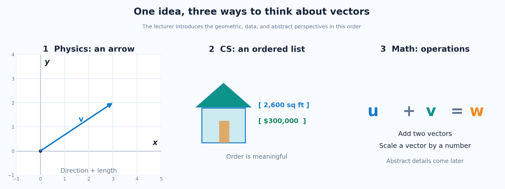
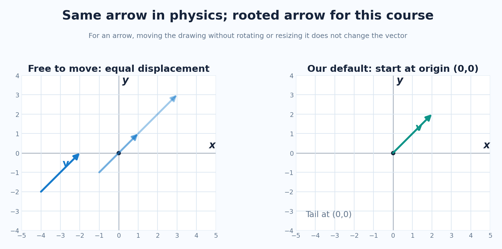
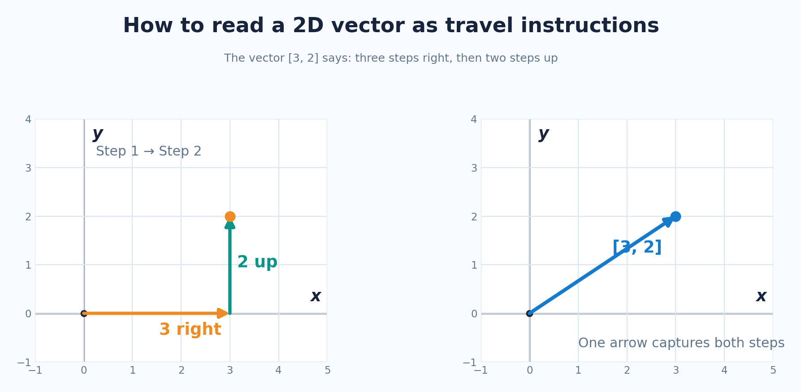
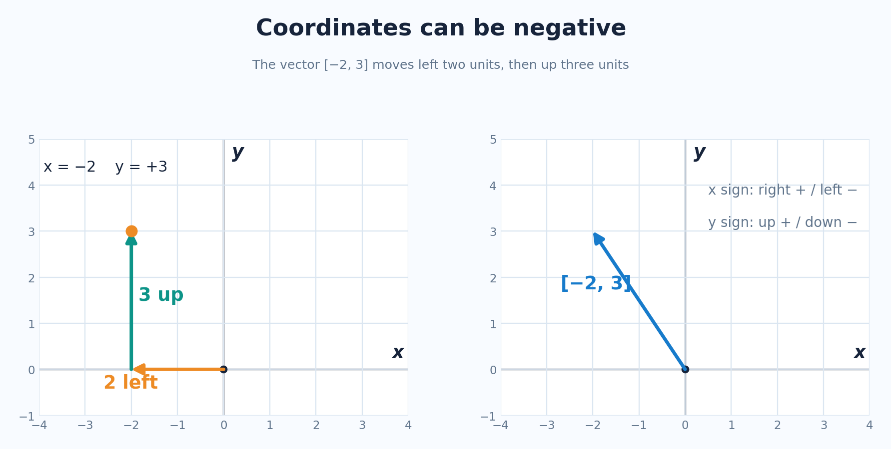
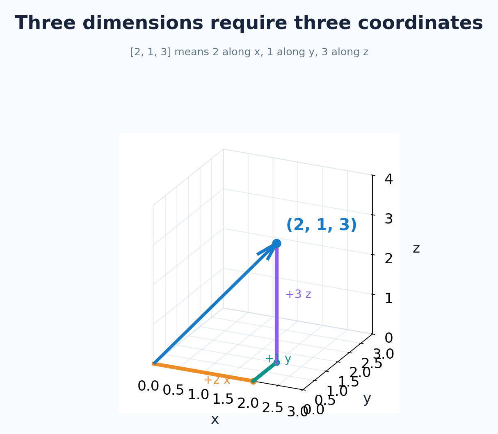
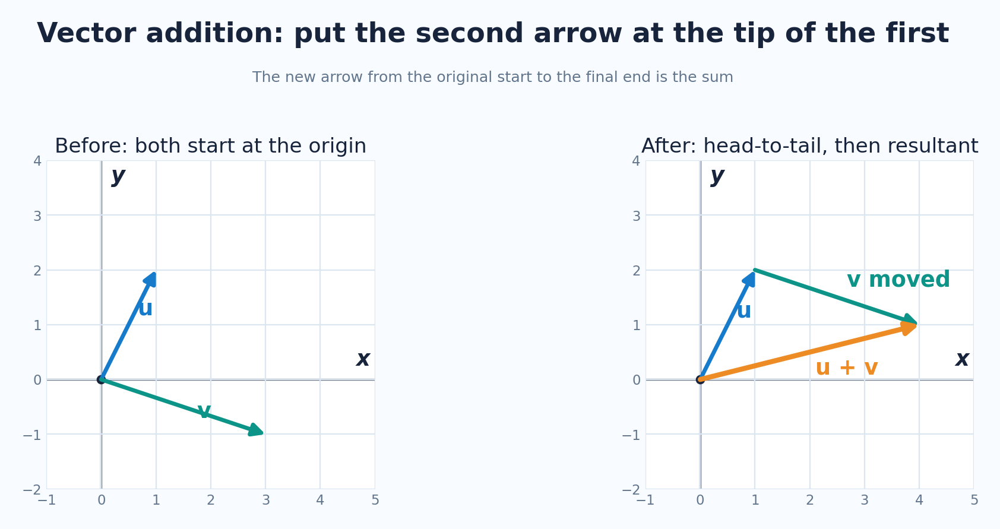
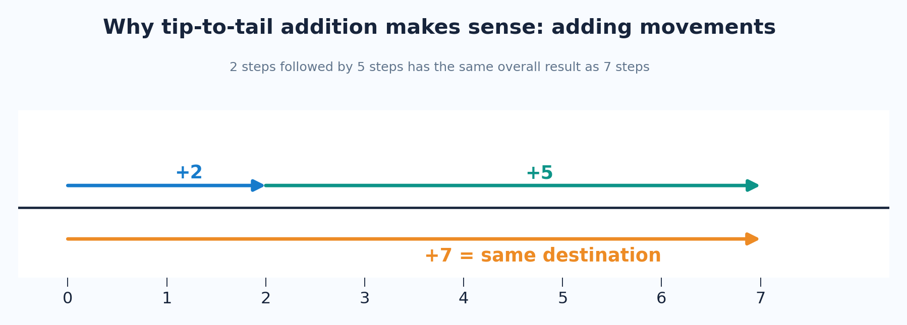
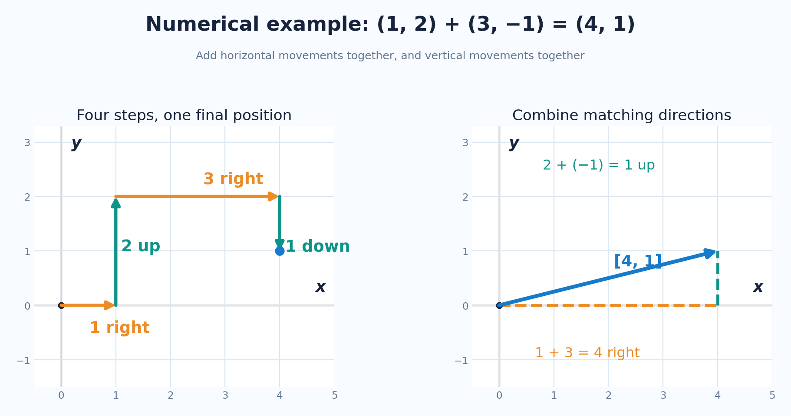
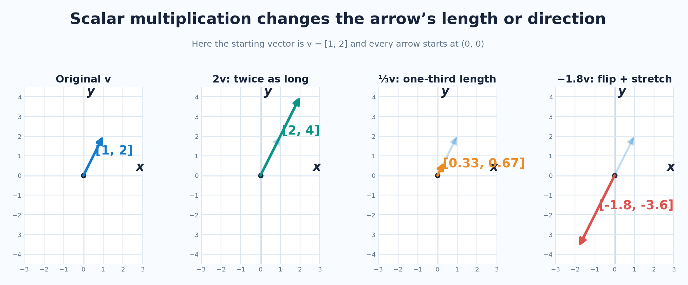
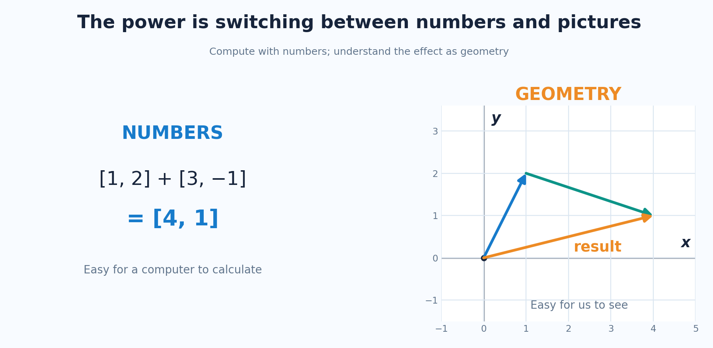

# 01 — Vectors

**Essence of Linear Algebra · Chapter 1 · Beginner-friendly learning notes**

**Source:** The supplied *01-Vectors.mp4* lecture and its accompanying transcript. The explanations follow the order of the lecture, from three interpretations of vectors to coordinates, addition, scaling, and applications. Illustrations and practice explanations are original teaching aids.

> **How to study:** Read one section, look at its diagram, and repeat the steps aloud. When a blue **Try the animation** link appears, open it in your browser. You can change values, play the demonstration, or advance one step at a time. No internet is required.

---

## 1. Why does linear algebra begin with vectors?

The lecturer starts with a very basic question: **What is a vector?** It is worth answering carefully because nearly everything we learn in linear algebra will involve vectors.

You may encounter different explanations depending on what you study. The lecture introduces **three related perspectives**:

1. The **physics** perspective: a vector is an arrow.
2. The **computer science** perspective: a vector is an ordered list of numbers.
3. The **mathematics** perspective: a vector is something on which we can sensibly perform certain operations.

These are not three unrelated objects. They are three ways to understand the same mathematical ideas.

### 1.1 The physics student's perspective: vectors are arrows

Imagine standing on a field. Someone gives you these instructions:

* Walk **five metres**.
* Walk **towards the east**.

If I draw that instruction as an arrow, the arrow contains two pieces of information:

- **Length**: how far to go — five metres.
- **Direction**: where to go — east.

That is the physics view of a vector. An arrow pointing northeast can represent a different motion from an equally long arrow pointing southeast, because their **directions** are different.

**Important observation from the lecturer:** You can pick up an arrow, move it to another part of the picture, and it is still the **same vector** if its length and direction remain unchanged. Moving the drawing does not change the motion that the arrow describes.

For example, an arrow representing "go two steps right and one step up" means the same movement whether its tail is at your doorstep or at a park entrance.

The lecturer then distinguishes two cases:

- **2D (two-dimensional)** arrows live in a flat plane, such as a sheet of paper.
- **3D (three-dimensional)** arrows live in ordinary space, where we can move left/right, forward/backward, and up/down.

**Beginner note:** The *dimension* tells us how many independent coordinate directions we need to describe the vector. It does **not** tell us how long the arrow is.

### 1.2 The computer science student's perspective: vectors are ordered lists

Now the lecturer switches to an entirely different example: **analyzing house prices**.

Suppose we are comparing houses, and we care about only two things:

1. House area in square feet.
2. House price.

The video illustrates a house using values such as **2,600 square feet** and **$300,000**. We can describe that house with an ordered pair:

\[
\begin{bmatrix}
2600\\
300000
\end{bmatrix}
\]

Read this as:

- First entry: **2,600** square feet.
- Second entry: **300,000** dollars.

Why is the order important? Because

\[
\begin{bmatrix}2600\\300000\end{bmatrix}
\qquad\text{and}\qquad
\begin{bmatrix}300000\\2600\end{bmatrix}
\]

would assign the entries to different features. The second would describe a wildly different house if we kept the same convention that the first entry is area and the second is price.

In computer science, we often call each value a **feature**: one measurable fact about an object. A list with two features is represented by a **two-dimensional vector**.

**Two different uses of the word "length":**

- **List length:** the number of entries. Our house list has two entries, so its dimension is 2.
- **Arrow length:** the physical size of an arrow in a diagram. This is a different idea.

The lecturer calls a vector a "fancy word for a list" in this particular computer-science setting. More precisely, it is an **ordered numerical list** that can participate in vector operations.

**Extra beginner explanation:** In the house example, the two entries have different units. The point is to store organized numerical information; we should not interpret the two coordinates as literal metres travelled in physical space.

### 1.3 The mathematician's perspective: focus on what we can do

The lecturer now gives a hint of a more general idea: a mathematician is interested less in what a vector looks like, and more in **two operations** we can perform on vectors.

The two operations are:

1. **Adding two vectors.**
2. **Multiplying a vector by a number.**

For the moment, think of these as ordinary questions:

- If I combine one movement with another, what is the overall movement?
- If I double or halve one movement, what happens to its arrow?

The formal mathematical definition is intentionally **postponed** in the lecture. Mathematicians also require these operations to follow certain rules, but those rules are not introduced here. We will first learn the operations with arrows and numbers.

**Remember this:** The three perspectives are connected by the same underlying ideas. The next sections use drawings to make the two operations easy to see.

---

## 2. The picture we will use for the rest of the course

After showing three perspectives, the lecturer chooses the approach that will guide these videos:

> Whenever you hear "vector," first imagine an **arrow drawn in a coordinate system, with its tail at the origin**.

This is a **convenient representation**, not a denial of the earlier physics view. In physics, we can slide the arrow around. For learning linear algebra, placing the tail at a fixed starting point makes it much easier to attach numbers to it.

### 2.1 What is a coordinate system?

Imagine placing a large sheet of graph paper on a table. Draw two perpendicular lines:

- A **horizontal** line, called the **x-axis**.
- A **vertical** line, called the **y-axis**.

Where they cross is the **origin**. Its coordinates are

\[
(0,0).
\]

The origin is simply our agreed starting point, like choosing the front gate of a house as the starting point when giving directions.

Next, choose a distance that will count as **one unit**. Mark that same unit distance repeatedly along both axes. These are the **tick marks**. We can extend the tick marks into grid lines to make the graph easier to read.

You can picture the axes as two rulers crossing at zero:

| Axis | Positive direction | Negative direction |
|---|---|---|
| x-axis | right | left |
| y-axis | up | down |

**Why are the axes useful?** A drawing can show the arrow's direction at a glance. The coordinate system adds exact numbers, so two people (or a person and a computer) can agree on precisely which arrow they mean.

### 2.2 Why root the vector at (0, 0)?

Suppose one arrow begins at (0, 0) and another identical arrow begins at (5, 5). Both describe the same displacement, but their endpoints are at different positions. If we always start arrows at (0, 0), the endpoint becomes a simple, unambiguous numerical description of the vector.

This is the central idea connecting **geometry** (the picture) and **arithmetic** (the numbers).

---

## 3. How to describe a 2D vector using two numbers

The lecturer now explains exactly how an arrow turns into a list of numbers.

### 3.1 The coordinates are travel instructions

Consider the vector

\[
\mathbf v=\begin{bmatrix}3\\2\end{bmatrix}.
\]

We read the two numbers in order:

1. **3**, the first number: start at the origin and move **three units right** along the x-direction.
2. **2**, the second number: from where you arrived, move **two units up**, parallel to the y-axis.

You end at the point **(3, 2)**.

Now draw a single straight arrow from the origin **(0, 0)** to **(3, 2)**. That arrow is the vector \(\mathbf v\).

Notice that the two-part walk is only a way to **find the arrow's tip**. The vector itself is drawn as **one straight arrow**, not as a bent path.

**Language to remember:**

- **Tail**: the beginning of the arrow, at (0, 0).
- **Tip** or **head**: the point at the arrowhead.
- **Component**: one of the numbers used to describe the vector. Here, 3 is the x-component and 2 is the y-component.

The lecturer uses **vertical square brackets** to write a vector:

\[
\underbrace{\begin{bmatrix}3\\2\end{bmatrix}}_{\text{vector}}
\qquad\longleftrightarrow\qquad
\underbrace{(3,2)}_{\text{tip as a point}}.
\]

The notation helps distinguish an arrow from a point, even though the numbers are the same when we draw our vector starting at the origin.

### 3.2 What if one coordinate is negative?

The video also shows a vector pointing left and up, corresponding to

\[
\begin{bmatrix}-2\\3\end{bmatrix}.
\]

Interpret it step by step:

1. \(-2\) in the x-position means **two units left**.
2. \(+3\) in the y-position means **three units up**.
3. The tip ends at **(−2, 3)**.

**Don't confuse a negative number with a shorter distance.** The number \(-2\) means a movement of distance **2 units in the negative direction**. Its sign tells us direction.

The same method works for all sign combinations. For example, the supplementary example

\[
\begin{bmatrix}2\\-3\end{bmatrix}
\]

means two right and three down.

### 3.3 Every coordinate pair specifies exactly one rooted vector

Once the axes, unit distances, and origin have been fixed:

- Each ordered pair of numbers picks out **one specific arrow starting at the origin**.
- Each arrow starting at the origin has **one specific ordered pair**.

That is why we can freely translate between a **picture** and **numbers**.

For example:

| Numbers | Where the arrow points |
|---|---|
| \(\begin{bmatrix}3\\2\end{bmatrix}\) | right 3, up 2 |
| \(\begin{bmatrix}-2\\3\end{bmatrix}\) | left 2, up 3 |
| \(\begin{bmatrix}0\\4\end{bmatrix}\) | straight up 4 |
| \(\begin{bmatrix}0\\0\end{bmatrix}\) | stays at the origin; the **zero vector** |

The last two rows are extra examples to reinforce the lecturer's rule. A coordinate can be zero; that simply means no movement along that axis.

### Explore it yourself

**[▶ Open Animation 01 — Coordinates as walking instructions](../animations/animation-01.html)**

Choose x = 3 and y = 2, press **Step**, and watch the horizontal motion, vertical motion, and final arrow appear. Then choose x = −2 and y = 3 to match the left-and-up example.

### Check your understanding

1. Where is the tail of the vectors we draw in this course?
2. What does the first component \(-4\) tell you?
3. Where does the vector \(\begin{bmatrix}1\\-2\end{bmatrix}\) end?

*Answers: (1) at the origin (0, 0); (2) move four units left; (3) at (1, −2).*

---

## 4. Extending the same idea to 3D vectors

The lecturer now asks: **What about three dimensions?**

In 2D we have x and y. To describe movement through ordinary 3D space, we add a third axis called the **z-axis**, perpendicular to both the x-axis and the y-axis.

Instead of two coordinates, we need **three**:

\[
\mathbf w=\begin{bmatrix}2\\1\\3\end{bmatrix}.
\]

The video illustrates an example with those three components. Read it as three instructions:

1. Move **2 units along x**.
2. Then move **1 unit parallel to y**.
3. Then move **3 units parallel to z**.

Our destination, expressed in that coordinate system, is **(2, 1, 3)**. The 3D vector is the straight arrow from the origin to that destination.

**What does "perpendicular" mean?** Two directions are perpendicular if they meet at a right angle (90°). Think of the three edges meeting at the corner of a rectangular room.

We can now compare dimensions:

| Dimension | Coordinates required | Example |
|---|---:|---|
| 2D | 2 numbers | \(\begin{bmatrix}3\\2\end{bmatrix}\) |
| 3D | 3 numbers | \(\begin{bmatrix}2\\1\\3\end{bmatrix}\) |

The same one-to-one rule applies in 3D: with a coordinate system fixed, **every ordered triplet** identifies one vector from the origin, and every vector from the origin has one triplet.

**Extra beginner analogy:** In a building, imagine moving east along a corridor, then north along another corridor, then taking a lift to a higher floor. The three instructions together determine your destination.

---

## 5. First fundamental operation: vector addition

We now arrive at the first of the two operations the lecturer promised earlier.

Think of two arrows:

- **u** points up and a little to the right.
- **v** points mainly right and a little down.

What does it mean to **add** them?

### 5.1 Visual rule: tip-to-tail

The lecturer demonstrates a specific drawing procedure:

1. Draw the **first vector**, \(\mathbf u\).
2. **Move the drawing** of the second vector \(\mathbf v\) without changing its length or direction.
3. Place the **tail of v at the tip of u**.
4. Draw a new arrow from the **original tail of u** to the **new tip of v**.
5. This new arrow is the **sum**, \(\mathbf u+\mathbf v\).

**Important:** We are not stretching, twisting, or rotating v. We only move its picture, just as we were allowed to move physics vectors without changing them. This is a special construction used to understand addition; the resulting vector can again be drawn starting at the origin.

The long new arrow is sometimes called the **resultant vector**. That term simply means the single vector representing the combined effect.

### 5.2 Why is tip-to-tail addition sensible?

The lecturer does not want us to memorize a drawing rule blindly. He asks **why** we would define addition this way.

Imagine you are walking:

- First, take the journey described by **u**.
- From where you now stand, take the journey described by **v**.

Where you finish is exactly where you would finish if you had travelled along the single resultant arrow, \(\mathbf u+\mathbf v\), directly from the starting point.

The two-route and one-route descriptions are different, but their **overall displacement** is the same.

**Displacement** means the change from starting position to ending position. It does not record every turn along the route; it tells you where you ended up relative to where you began.

### 5.3 The number-line analogy: 2 + 5 = 7

The lecturer connects vector addition to arithmetic children already know.

Imagine standing at zero on a number line:

1. Move **2** units to the right, landing at 2.
2. Move **5 more** units to the right, landing at 7.
3. Alternatively, move **7** units right in one journey.

Both descriptions lead to the same end position:

\[
2+5=7.
\]

The difference is that number-line movement is only **one-dimensional**. Vectors let us combine movements in **two or three directions at once**.

### 5.4 The lecturer's full numerical example

The lecture now gives exact coordinates:

\[
\mathbf u=\begin{bmatrix}1\\2\end{bmatrix},
\qquad
\mathbf v=\begin{bmatrix}3\\-1\end{bmatrix}.
\]

Before calculating, interpret the first vector:

- u means **1 right** and **2 up**.

And interpret the second vector:

- v means **3 right** and **1 down**.

Now perform the two movements in sequence. You can imagine the route in four smaller steps:

| Step | Movement | Position after the step |
|---|---|---|
| Start | — | (0, 0) |
| 1 | 1 right | (1, 0) |
| 2 | 2 up | (1, 2) |
| 3 | 3 right | (4, 2) |
| 4 | 1 down | (4, 1) |

Notice where we finished: **(4, 1)**.

The lecturer then makes the important connection: rather than keep all four separate steps, **combine horizontal movements** and **combine vertical movements**.

**Horizontal total:**

\[
1+3=4.
\]

So our total movement is **4 right**.

**Vertical total:**

\[
2+(-1)=1.
\]

So our total movement is **1 up** (because adding −1 means moving down one).

Put the totals into a column:

\[
\begin{aligned}
\mathbf u+\mathbf v
&=\begin{bmatrix}1\\2\end{bmatrix}
 +\begin{bmatrix}3\\-1\end{bmatrix}\\[6pt]
&=\begin{bmatrix}1+3\\2+(-1)\end{bmatrix}\\[6pt]
&=\boxed{\begin{bmatrix}4\\1\end{bmatrix}}.
\end{aligned}
\]

The **numerical calculation** and **geometric construction** agree: the sum is an arrow from (0, 0) to (4, 1).

### 5.5 The general rule for adding vectors

We can now express the lecturer's pattern as a rule. Let

\[
\mathbf a=\begin{bmatrix}a_1\\a_2\end{bmatrix},
\qquad
\mathbf b=\begin{bmatrix}b_1\\b_2\end{bmatrix}.
\]

Here, \(a_1\) and \(b_1\) are the **x-components**; \(a_2\) and \(b_2\) are the **y-components**.

Then:

\[
\boxed{
\mathbf a+\mathbf b=
\begin{bmatrix}a_1+b_1\\a_2+b_2\end{bmatrix}
}
\]

In plain language: **match the positions and add the numbers.** First with first, second with second.

**Extra example (for practice):**

\[
\begin{bmatrix}-2\\3\end{bmatrix}
+
\begin{bmatrix}4\\-5\end{bmatrix}
=
\begin{bmatrix}-2+4\\3-5\end{bmatrix}
=
\begin{bmatrix}2\\-2\end{bmatrix}.
\]

The result means 2 right, 2 down.

### Explore it yourself

**[▶ Open Animation 02 — Tip-to-tail vector addition](../animations/animation-02.html)**

Start with the lecturer's example. The stages show both vectors at the origin, the head-to-tail arrangement, the resultant arrow, and the matching-component calculation. Try the **cancel-out** preset to see how two nonzero vectors can have the zero vector as their sum.

### Common mistakes in vector addition

- **Mistake:** Add a vector's x-component to the other's y-component. **Correction:** x goes with x; y goes with y.
- **Mistake:** Move the second arrow *and* rotate it. **Correction:** For addition, translate it without rotating or changing its length.
- **Mistake:** Add the lengths of the arrows and assume that is the length of their sum. **Correction:** Different directions can reinforce or cancel; follow the coordinate or tip-to-tail rule.

---

## 6. Second fundamental operation: multiplication by a number

Once addition is understood, the lecturer introduces the other operation: **multiplying a vector by a number**.

Instead of combining two arrows, we keep **one vector** and change its size (and sometimes its direction).

This operation is called **scalar multiplication**.

### 6.1 Multiply by 2: stretch

Imagine a vector \(\mathbf v\) of some length. If we calculate

\[
2\mathbf v,
\]

we draw an arrow in the **same direction** but **twice as long**.

For a concrete numerical example, take

\[
\mathbf v=\begin{bmatrix}1\\2\end{bmatrix}.
\]

The scaled vector is

\[
2\mathbf v
=2\begin{bmatrix}1\\2\end{bmatrix}
=\begin{bmatrix}2\times1\\2\times2\end{bmatrix}
=\begin{bmatrix}2\\4\end{bmatrix}.
\]

The new arrow ends at (2, 4) instead of (1, 2), so its length is twice the original.

### 6.2 Multiply by 1/3: shrink

Next, the lecturer uses the fraction **one-third**:

\[
\frac13\mathbf v.
\]

That tells us to create a new arrow whose length is **one-third of the original length**. It still points in the **same direction**.

Using the same numerical vector:

\[
\frac13\begin{bmatrix}1\\2\end{bmatrix}
=\begin{bmatrix}\frac13\\\frac23\end{bmatrix}.
\]

Why \(\frac23\) in the lower entry? Because

\[
\frac13\times 2=\frac23.
\]

**Beginner analogy:** Think of a drawing on a photocopier. Scaling by \(\frac13\) makes the whole arrow one-third its original size; we do not shrink the x-part but leave the y-part unchanged.

### 6.3 Multiply by −1.8: reverse and stretch

The lecturer now introduces a negative number. Suppose we calculate

\[
-1.8\mathbf v.
\]

This does two things:

1. The **negative sign** points the new arrow in the **opposite direction**.
2. The number **1.8** makes it **1.8 times as long**.

Using our numerical vector:

\[
\begin{aligned}
-1.8\begin{bmatrix}1\\2\end{bmatrix}
&=\begin{bmatrix}-1.8\times1\\-1.8\times2\end{bmatrix}\\[4pt]
&=\boxed{\begin{bmatrix}-1.8\\-3.6\end{bmatrix}}.
\end{aligned}
\]

Before scaling, the arrow pointed right and up. Afterwards, it points **left and down**. Its length is **1.8 times** the length of the original.

### 6.4 What is a scalar?

The lecturer gives a name to the number that performs this scaling: a **scalar**.

In

\[
2\mathbf v,
\]

- \(2\) is the **scalar**.
- \(\mathbf v\) is the **vector**.
- \(2\mathbf v\) is the **scaled vector**.

Numbers such as \(2\), \(\frac13\), and \(-1.8\) are scalars when we use them to multiply a vector.

The words **scalar** and **number** are often used nearly interchangeably in this course when discussing real-valued vectors.

### 6.5 The general numerical rule

After showing stretching and reversing graphically, the lecturer returns to numerical lists. Just like vector addition worked **component by component**, scalar multiplication also works **component by component**.

For

\[
\mathbf v=\begin{bmatrix}x\\y\end{bmatrix}
\]

and scalar \(k\),

\[
\boxed{
k\mathbf v
=\begin{bmatrix}kx\\ky\end{bmatrix}
}
\]

This rule means: **multiply every component by the same number**.

| Scalar k | Geometric effect | Example for \(\mathbf v=[1,2]^T\) |
|---|---|---|
| 2 | twice as long, same direction | \([2,4]^T\) |
| 1/3 | one-third length, same direction | \([1/3,2/3]^T\) |
| −1.8 | reversed, 1.8 times as long | \([-1.8,-3.6]^T\) |
| 0 | becomes the zero vector | \([0,0]^T\) |

**Additional beginner clarification:** The last case, multiplying by zero, extends the lecturer's examples. The zero vector has zero length, so it has no particular pointing direction.

### Explore it yourself

**[▶ Open Animation 03 — Scalar multiplication](../animations/animation-03.html)**

Select **× 2**, **× ⅓**, and **× −1.8** in that order. Watch how the arrow grows, shrinks, and reverses. You can also move the scalar slider and press **Step** to see the intermediate positions.

### Common mistakes in scalar multiplication

- **Mistake:** Multiply only the x-component. **Correction:** Multiply *every* component.
- **Mistake:** Assume that a negative scalar always makes the vector shorter. **Correction:** The sign controls direction; the magnitude \(|k|\) controls its length.
- **Mistake:** Think that a scalar must be a whole number. **Correction:** It can be a fraction, decimal, negative number, or zero.

---

## 7. Why these two operations are the heart of linear algebra

The lecturer now returns to a point from the beginning. He has shown us how to **add vectors** and how to **multiply a vector by a scalar**.

Almost every topic later in this visual introduction to linear algebra will revolve around those two operations.

Let's put their meanings side by side:

| Operation | What it does to an arrow | What it does to numbers |
|---|---|---|
| Vector addition, \(\mathbf u+\mathbf v\) | combines two movements into a resultant movement | adds matching components |
| Scalar multiplication, \(k\mathbf v\) | stretches, shrinks, or reverses a movement | multiplies every component by \(k\) |

A mathematician can study the **properties of these operations** even when the vectors are not drawn as ordinary arrows. The lecturer deliberately leaves this abstract perspective for a later chapter.

**Remember this:** Do not learn the graphical rule and numerical rule as two unrelated facts. They are two ways to describe the **same change**.

---

## 8. Switching between pictures and numbers is what makes linear algebra useful

The lecturer ends by emphasizing a powerful practical idea: what matters is not whether you prefer the **arrow** interpretation or the **number-list** interpretation. What matters is that you can **translate back and forth**.

### 8.1 Why the data analyst benefits

A data analyst may start with many lists of numbers: house area and price, measurements from a sensor, or other numerical features. Viewing the numbers geometrically can reveal relationships and patterns that may be difficult to notice in a long table.

Here is a simple way to connect the ideas:

- **Numbers** make information precise and ready for calculations.
- **Pictures** make the relationships between those numbers easier for a human to understand.

The lecture does not develop a specific data-analysis algorithm yet; it explains why this change of viewpoint is useful.

### 8.2 Why physicists and graphics programmers benefit

Physicists can describe a displacement or direction using an arrow, then express it numerically to perform calculations.

Computer-graphics programmers go in the opposite direction too: they start by imagining where something should appear on a screen, then use numbers to decide **where the pixels go**.

For example, if the movement is

\[
\begin{bmatrix}1\\2\end{bmatrix}
+
\begin{bmatrix}3\\-1\end{bmatrix}
=
\begin{bmatrix}4\\1\end{bmatrix},
\]

then the programmer knows the final displacement is four units horizontally and one unit vertically in the chosen coordinate system. That can be turned into a position on a screen.

**Additional beginner explanation:** You do not need to know computer graphics to understand the lesson. The important fact is that a computer can calculate numbers quickly while people find pictures intuitive; linear algebra connects those strengths.

---

## 9. What comes next in the lecture series?

The lecturer concludes this introductory video by saying the next topics will include:

- **Span**.
- **Basis** (plural: **bases**).
- **Linear dependence**.

Those concepts are **not taught in this lecture**, so we will not jump ahead here. For now, being comfortable with coordinates, adding two arrows, and scaling a vector is enough to prepare for them.

---

## Review sheet: what you should remember

This is a revision aid **after** the full lecture, not a replacement for the explanations above.

| Idea | Recall it in one sentence |
|---|---|
| Geometric vector | An arrow with length and direction. |
| Numerical vector | An ordered set of coordinate components. |
| 2D | Two coordinate directions (x, y). |
| 3D | Three coordinate directions (x, y, z). |
| Origin | The shared starting point (0, 0), or (0, 0, 0) in 3D. |
| Vector addition | Join arrows tip-to-tail; add matching components. |
| Scalar multiplication | Multiply every component; stretch, shrink, or reverse. |
| Key insight | Convert freely between geometry and numbers. |

### Formulas worth keeping close

**2D vector addition**

\[
\begin{bmatrix}a\\b\end{bmatrix}
+
\begin{bmatrix}c\\d\end{bmatrix}
=
\begin{bmatrix}a+c\\b+d\end{bmatrix}.
\]

**2D scalar multiplication**

\[
k\begin{bmatrix}a\\b\end{bmatrix}
=
\begin{bmatrix}ka\\kb\end{bmatrix}.
\]

## Mini-practice (with fully worked answers)

**Question 1.** A vector is \(\begin{bmatrix}-3\\2\end{bmatrix}\). From the origin, where will its tip be?

**Solution:** \(-3\) means go 3 left. \(+2\) means go 2 up. The tip is **(−3, 2)**.

**Question 2.** Add \(\begin{bmatrix}2\\-1\end{bmatrix}\) and \(\begin{bmatrix}-4\\3\end{bmatrix}\).

**Solution:** Add each component with the one in the same position:

\[
\begin{bmatrix}2+(-4)\\-1+3\end{bmatrix}
=\boxed{\begin{bmatrix}-2\\2\end{bmatrix}}.
\]

This resultant goes two left, two up.

**Question 3.** Multiply \(\begin{bmatrix}3\\-2\end{bmatrix}\) by \(-2\).

**Solution:** Apply the number to both entries:

\[
-2\begin{bmatrix}3\\-2\end{bmatrix}
=\begin{bmatrix}-2(3)\\-2(-2)\end{bmatrix}
=\boxed{\begin{bmatrix}-6\\4\end{bmatrix}}.
\]

The new vector is twice as long and points in the opposite direction.

**Question 4.** What happens if we multiply any vector by zero?

**Solution:** Every component becomes zero. In 2D the result is \(\begin{bmatrix}0\\0\end{bmatrix}\), the **zero vector**.

**Question 5.** In the lecture's house example, why does swapping the two numbers matter?

**Solution:** Their positions have meanings. The first number is square footage, the second is price. Swapping them changes which feature gets which value. **Order matters.**

## Glossary (only terms used in this lecture)

| Term | Beginner meaning |
|---|---|
| Vector | An object we can picture as an arrow or describe using numerical components. |
| Component | One numerical entry of a vector. |
| Coordinate | A number describing position or movement along an axis. |
| Dimension | The number of coordinate directions/components being used. |
| Axis | A reference direction, such as x, y, or z. |
| Origin | The zero point where the axes meet. |
| Tail / tip | The start and the arrowhead of a vector. |
| Displacement | Overall change from starting point to ending point. |
| Resultant | The vector that represents combined motion. |
| Scalar | A number used to multiply a vector. |
| Scaling | Changing a vector's length and, if the scalar is negative, its direction. |
| Zero vector | A vector whose components are all zero. |

---

**Study suggestion:** Return to the three interactive demonstrations and try to predict the result *before* clicking Step. When you can explain why \([1,2]+[3,-1]=[4,1]\) both geometrically and numerically, you have understood the core of this lecture.
